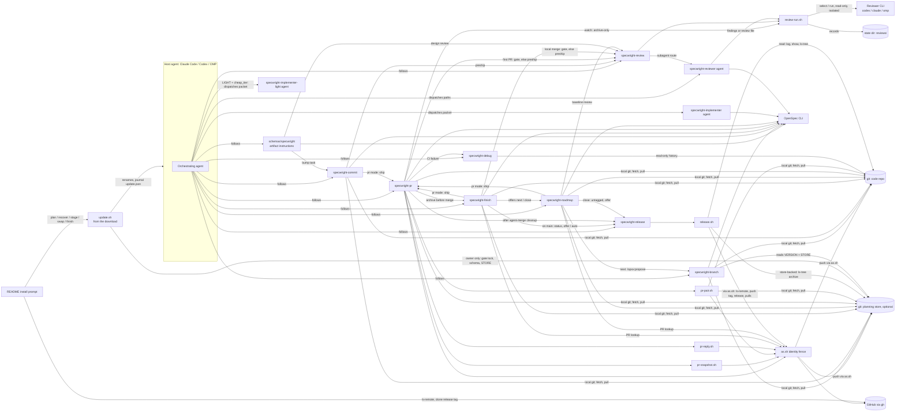

# Specwright Architecture

Specwright is not a running service. It is text and small scripts that an AI agent loads and follows inside a user's project. "Components" below are therefore instruction packages, scripts and the external tools they drive. The agent is the only process that runs them.

## System triage

- **T1 Components:** applies. There are eight skills, two agents, a schema, four PR scripts, the review runner, the release script and an install prompt, with directed calls between them (see Components).
- **T2 State:** applies. Change artifacts, `tasks.md` ticks, commit trailers, PR reply markers, the feedback pass record, pre-ship review records and the store gate lock are all persistent state.
- **T3 Concurrency:** applies. Several agents share one machine, one `gh` login store and one planning store. `watch` polls in the background, reviewers answer asynchronously, and a review runs as a background job under a deadline.
- **T4 Boundaries:** applies. The schema is OpenSpec's extension point; `specwright.yaml` is a shared, versioned settings format; commit subjects, trailers and PR markers are formats that later runs parse; GitHub and the model CLIs are external systems.
- **T5 Volume:** applies. PR threads, comments and checks grow without a fixed bound, and so does commit history per change.
- **T6 Risk:** applies. The scripts push and comment under a GitHub identity, and cross-model review sends code to another provider.

## Components

| Component | Responsibility | Owns (state) | Talks to via (contract) |
|---|---|---|---|
| `schemas/specwright` | Artifact sequence (proposal, specs, design with triage, review gate, tasks) and apply instructions | Artifact templates | OpenSpec schema format (`openspec schema validate`) |
| `specwright-branch` | Clean-main gate, `<prefix>/<change-name>` branch, store branch and gate lock | Store gate lock | git in the code repo and the store; `openspec list --json` |
| `specwright-commit` + `task-cover.sh` | One commit per task or per task group (`commit_granularity`; ADR 0016), Reconcile, completion check | Task commits and their subjects/trailers | git in the code repo and the store; `openspec list --json`; `tasks.md`; `task-cover.sh` (read-only task evidence: subject prefix or `Specwright-Task:` trailer, one JSON document, exit 0/1/2/3); `specwright-pr` ship in pr mode |
| `specwright-finish` + `finish.sh` | Archive commit, local `--no-ff` merge or hand-off to the PR; the undo plan of a deferred archive | Archive commit, merge commit, planning-only marker | `finish.sh undo-archive-plan` (one JSON document with the undo `script` and `after_rerun`, exit 0/1/2; read-only git; finish shows the scripts and runs neither); git in the code repo and the store; OpenSpec archive; `gh` through `as.sh` for the code PR lookup and the post-merge check; `git pull` on main through `as.sh` for a GitHub remote; `specwright-pr` ship in pr mode |
| `specwright-pr` + scripts | Ship, feedback and watch for one PR or a code/store PR pair; with `pr.merge: agent`, the merge at watch's ready head and remote branch deletion in cleanup (ADR 0009) | Feedback pass record, PR reply markers | `gh` GraphQL/REST through `as.sh`, including `pr-pair.sh tier` (reads `cheap_tier.enabled` for apply, no `gh` call, always exit 0 for readable settings; ADR 0013), `pr-snapshot.sh --wait --until attention` (watch's wake filter: skips polls that are only check progress, counted in `filtered`), `pr-pair.sh merge` (REST merge with the ready head SHA, then read-back) and `delete-remote` (ref SHA and open-base-PR checks, then REST ref delete); `git` in the code repo and store (push; `pr-pair.sh`); `openspec list --json`; JSON on stdout; `specwright-finish` (archive before merge) and `specwright-debug` (CI failures) |
| `vcs.sh` | The selected repository's branch read and every version-control write for Git, colocated jj or GitButler (code repo, `finish: pr` only); backend probe on every subcommand; the GitButler change branch named by the caller, never HEAD | Git refs, jj bookmarks and working copy, or GitButler branches through `but`, owned by the selected backend | `probe`, `state`, `branch-create`, `switch`, `commit`, `advance`, `merge`, `delete-branch`, `fetch-main`, `pull`, `push`, and `plan`; `pr-pair.sh vcs` for independent `vcs` and `planning_store.vcs` settings; Git reads for shared history; jj network operations, `but pull` and the GitButler branch push through `as.sh` |
| `specwright-roadmap` | Strategy, architecture baseline, milestones | `openspec/strategy.md`, `roadmap.md`; the baseline `architecture.md` and ADRs (see State ownership) | git and the store for its own branch and commits, taking the store gate lock to branch in a store-backed project; `git fetch`/`git pull` on main through `as.sh` for a GitHub remote; `gh` through `as.sh` for PR status; OpenSpec CLI (`list`, `templates`, `schema validate`, `context`); `specwright-pr` ship in pr mode |
| `specwright-review` + `review-run.sh` + `bounded.py` copy | Reviewer route selection, isolated runs and output validation for design and pre-ship reviews; the pre-ship review, the ship/merge gate and the archive-only check (ADR 0007) | Pre-ship review records and receipts | `review-run.sh` subcommands (`select`, `run`, `record`, `waive`, `gate`, `archive-only`, `rounds`), one JSON document each, exit 0/1/2/3; fixed command lines for `codex`, `claude`, `omp`; `git` read-only; the findings schema; called by the schema's review step, `specwright-commit`, `-pr`, `-finish` and `-roadmap`. No `gh` call |
| `specwright-release` + `release.sh` + `bounded.py` copy | Version-file check and bump, release commit lookup from main's first-parent history, notes from git and the archive (each change's `## Release Notes` section, else its Why line; ADR 0015), idempotent publish of an annotated tag and a GitHub release (ADR 0010) | Annotated tags and GitHub releases (see State ownership); no state file | `release.sh` subcommands (`check`, `bump --to`, `status`, `untagged`, `publish --version`, `--main <ref>`, and `notes --proposal <file>`, which runs no git command and no opt-in gate), one JSON document each, exit 0/1/2/3, `warnings` in `status` and `publish` naming each change whose section fell back; `git` read-only apart from `tag -a` and the push of `refs/tags/<tag>`; `git ls-remote`, push, `gh release view/create` and the closed-PR read through `as.sh`; called by `specwright-finish`, `specwright-pr` watch and `specwright-roadmap` close; the bump task is committed by `specwright-commit` |
| `specwright-debug` | Root-cause debugging discipline | The named stash `specwright-debug: <topic>`, until it is restored | git, read-only (`status`, `log`), plus `stash` to test a dirty tree: named `specwright-debug: <topic>`, its ref reported, restored after, and looked up by message at the start of every run so an interrupted run's stash is offered back; returns a verified fix uncommitted to `specwright-pr` in CI mode |
| `specwright-implementer` agent | Implements one task group test-first from a packet, loading the project skills the packet names (Claude `Skill`, OMP `read` of the given `SKILL.md` path) | Nothing committed: the orchestrator verifies, ticks and commits | Packet in, evidence report out; OpenSpec CLI (`list`, `templates`, `schema validate`) |
| `specwright-implementer-light` agent (ADR 0013) | The implementer's body and `tools:` word for word, pinned to `haiku` (Claude Code) or `pi/smol` (OMP); gets every group of a `TIER: LIGHT` change when `pr-pair.sh tier` reports `cheap_tier` on, else apply falls back to `specwright-implementer` | Nothing committed: the orchestrator verifies, ticks and commits | As `specwright-implementer`; a test keeps the two bodies identical |
| `specwright-reviewer` agent | Fresh-context review when the selected route is `subagent` (design or pre-ship) | The one file it is asked to write (a design-review scratch file from `review-run.sh record --scratch`, or a pre-ship findings file) | File paths in; the review out, with exactly one `VERDICT:` line, or findings JSON, validated by `review-run.sh record` (a design review copied to its review file by `record --out` only when it validates); OpenSpec CLI (`list`, `context`, `instructions`, `templates`) |
| Install prompt (README) | Asks for targets, settings and schema choice; downloads the highest release tag; merges `config.yaml` and `specwright.yaml`; runs the Step 7 checks; stamps `VERSION`; reads the downloaded `OPENSPEC_VERSION` and stops before any write when `openspec --version` differs, unless the user states the override | `openspec/.specwright/VERSION` | `scripts/update.sh` subcommands and its `interface`; copy layout in `CONTRIBUTING.md` |
| `scripts/update.sh` (ADR 0011) | Plans, stages, swaps and finishes an install or update from the downloaded copy; validates changes in flight against the staged schema; recovers an interrupted run from its journal; for a store, writes the schema and `STORE` only as owner, on a free store, under the gate lock | Update journal, staging directories, project update lock, `STORE` and the update's gate lock (see State ownership) | `plan`, `recover`, `stage`, `swap`, `finish`, one JSON document each; `openspec` read-only (`schema validate`, `validate`, `status --json`); `git` read-only plus renames of the targets; not installed into projects, so `specwright-branch` reads `VERSION` and `STORE` itself |
| Evals (`evals/`) | Graded agent runs and script tests, with a fake `gh`; the stress tier (evals marked `stress`) run on the default model and on Haiku as a wording diagnostic | Fixtures; the stress record `evals/git-workflow/stress.md` | `evals.json` + `grade.py`; `tiers.py` compares the stress evals' grades between two configurations (one JSON document, exit 0/1); `unittest`; `evals/run.py` runs the suites in parallel, one process per test file, and with `--changed <base>` only the suites that `evals/suites.json` maps the changed paths to (`.github/workflows/evals.yml` runs every suite on Linux, Windows and macOS for each pull request; contributors rely on it and run locally only the module they are writing); `evals/fixturecache.py` builds each fixture repo once per test process and hands out copies; `evals/timings.md` records the suite wall times |

## State ownership

| State | Sole writer | Lifetime | Invalidation / rebuild | Authoritative copy |
|---|---|---|---|---|
| Change artifacts (`openspec/changes/<name>/`) except `review.md` | Orchestrating agent, through the schema | Until archive | Drift rule: separate `amend <artifact>` commit | Planning repo branch, then main |
| `review.md` | One writer per review, by path: the orchestrator for LIGHT (`SKIPPED_LIGHT`); `review-run.sh run --out` for a CLI route, writing only after validation; `review-run.sh record --out` from the `specwright-reviewer` scratch file for a fresh-context review, also only after validation; the orchestrator also records `USER_OVERRIDE` after escalation, `DEFERRED` when the user declares a parking change, and `WAIVED` on the user's explicit decision, quoted | Until archive | A new review round rewrites it | Planning repo branch, then main |
| `tasks.md` ticks | Orchestrator (never the implementer) | Until archive | Reconcile against commits | Planning repo (store when store-backed) |
| Task commits (`task X.Y` subject, `Code-Changes: none`) | `specwright-commit` | Permanent | Never rewritten without the user | Change branch, then main |
| Archive and merge commits (`archive change`, `merge: <change>`) | `specwright-finish`; `merge: <branch>` also from `specwright-roadmap` in local mode | Permanent | Never rewritten; roadmap status reads them | Planning repo (archive); main of each merged repo, store and code (merge) |
| Undo backups (`<git-dir>/specwright-undo/<archived-name>/`, `base/` and `amended/` copies of the main specs a deferred archive touched) | The user, through the `script` that `finish.sh undo-archive-plan` prints; the script refuses to write into an existing one | Until the user deletes it; untracked, never read or deleted by Specwright | Not rebuilt: the copies are taken when the script runs | That directory (the only copy of an uncommitted main-spec edit after the restore) |
| Planning-only marker (`specwright-change.yaml`, `code_changes: none`, in the archive directory) | `specwright-finish` writes it at archive; `specwright-pr` feedback deletes it when a code fix follows | Permanent once on the store's main | Proof for roadmap status that a store-backed change has no code side | Store branch, then the store's main |
| `Preship-Round: <n>` trailers and `address pre-ship review` commits | `specwright-review` fix step, committed under `specwright-commit` rules (store-backed: one commit per changed repo, same subject and trailer) | Permanent | The pre-ship escalation count is the highest trailer in `<main>..HEAD` of either repo (`review-run.sh rounds`); `pr-pair.sh rounds` never counts them | Change branch in either repo, then main |
| `Amendment: clarification` / `Amendment: behaviour-change` trailers on `amend specs` commits | `specwright-review` amendment rule, committed under `specwright-commit` rules | Permanent | Never rewritten; the PR description's Review section reads them | Change branch, then main |
| Pre-ship review records (`reviews/<repo key>/<change>/<code head>[+<store head>].json`: findings, receipt, waivers; no stored outcome) | `review-run.sh run` / `record` write the record whole; `waive` is the only writer of `waivers`; each by temp file and rename | Until the state dir is cleared | Keyed by head: a new commit leaves no record for the new head, except the archive commit, which `gate` matches through `archive-only`. Pass or blocked is derived from findings and waivers each time. Lost: a new review, and the user decides waivers again (ADR 0007's exception to 0003) | `~/.cache/specwright/reviews/` (or `SPECWRIGHT_STATE_DIR`), machine-local |
| `Feedback-Round: <n>` trailers | `specwright-pr` feedback | Permanent | The round count is derived from them | Change branch in either repo |
| PR markers: reply markers (`specwright:handled <id>`, with a trailing `resolve` when the thread is to be resolved, then `rev=<rev>`, the item revision the reply answered; `specwright:waiting <id> rev=<rev>`), pair-link comments (`specwright:link`), `specwright:pr-item` in after-limit issue bodies | `pr-reply.sh` (it re-reads the item before posting and refuses a changed revision); `pr-pair.sh link`; `specwright-pr` after the limit | Life of the PR | A marker with `rev=` counts only while the item still has that revision; for a thread, against the thread as it stood before the reply, so an edit that landed before the reply lists it again (`rebound`), and the reaction posted with that reply does not answer it; only an edit after the reply can be answered by a reaction alone. Markers without `rev=` (0.1.10) keep the time rule: an item edited after the reply counts as unhandled again | GitHub |
| Feedback pass record | The one session running feedback for the change, through `pr-pair.sh pass write/plan/done/adopt` (a repo-local change passes no `--store` and has only the code repo). Created exclusively (a second write is refused), holds an owner id that `done` and `adopt` require, and is keyed by a hash of repository and change so distinct identities never share a file. A record owned by another session is shown to the user, never taken over automatically. | One feedback pass | Deleted at `pass done`; a leftover record blocks the next pass until resumed | `~/.cache/specwright/feedback/` (or `SPECWRIGHT_STATE_DIR`) |
| Watch ownership claims | Each `pr-snapshot.sh --wait` writes only its own numbered claim (the highest number plus one and a nonce of its own, so a claim name is never reused); a new claim also removes the lower ones, which have lost anyway | One watch | The newest claim owns the PR: a watcher whose own file is gone or that sees a higher number exits 4 before its next poll. Exit removes only its own file, so it never ends a newer watcher's ownership; a crashed owner's claim is beaten by the next one. One directory per owner, name and PR, in lower case, so distinct PRs never share a claim. An uncreatable directory turns ownership off, with a stderr notice. 0.1.10's `watch/<owner>-<repo>-<pr>` token is not read and is left in place | `~/.cache/specwright/watch/v2/<owner>/<repo>/<pr>/<n>-<nonce>` (or under `SPECWRIGHT_STATE_DIR`) |
| Head first-seen record (the GitHub time a snapshot first saw a head whose push is not in the activity log) | The first `pr-snapshot.sh` that sees the head (a snapshot without `--reviewer` only records the sighting and never fails over it): it writes a temp file and publishes it with a no-clobber hard link, so the first writer wins and nobody reads an empty record; later processes only read it | Until a new head of the same PR is recorded, which removes it | Lost or deleted → the next snapshot records a later time (a stricter cutoff); unreadable or unparseable → that process's own first sighting, kept across its polls (`first_seen_unsaved`) | `~/.cache/specwright/heads/<owner>/<repo>/<pr>/<oid>`, lower case (or under `SPECWRIGHT_STATE_DIR`) |
| Store gate lock | `specwright-branch`, `specwright-roadmap` when it branches in a store-backed project, and `update.sh swap` for the store schema swap | Its own gate or schema swap only; each removes only the lock it took | A gate or roadmap lock is never auto-removed; the user confirms removal. An update's lock (`change: specwright-update …`) is taken over and released only by `recover` from the same checkout with the journal's token, and other sessions do not offer its removal | `<store git-common-dir>/specwright-gate.lock` |
| Strategy and roadmap (`strategy.md`, `roadmap.md`) | `specwright-roadmap` init/close, and **next** when it adds a gap-closing change | Project lifetime | The roadmap is updated at each milestone close; status is derived, never stored. **next** adds a gap-closing change only after the branch gate has created its branch, as a roadmap-only commit there that merges with the change | Main of the planning repo |
| Baseline review (`architecture-review.md`) | One writer per round, by path: `review-run.sh run --out` for a CLI route, writing only after validation; `review-run.sh record --out` from the `specwright-reviewer` scratch file on the fresh-context path; the orchestrator also records `USER_OVERRIDE` after escalation (never `DEFERRED` or `WAIVED`: neither is written here) | Project lifetime | A new review round rewrites it | Main of the planning repo |
| Architecture file and ADRs (`architecture.md`, `docs/adr/`) | One writer at a time, by path: `specwright-roadmap` init/close, or the apply task of a change whose reviewed design records an ADR (it also updates the index) | Project lifetime | An ADR is `Status: proposed` and editable until its review gate passes; it is then marked `accepted` and never edited again: a new ADR supersedes it and the index is updated. Roadmap init and close write ADRs as proposed and accept them, with the date and their index rows, only when the baseline review gate passes; an accepted ADR not yet on main may still be edited, but the edit voids the review | Main of the repo holding them (`project.architecture`, `project.adr_dir`) |
| Settings (including `review.*` and `pr.review_after_archive`) | The user (install prompt merges; `specwright-roadmap` init may set the `project:` paths) | Project lifetime | Install keeps local values | `openspec/specwright.yaml`, `openspec/config.yaml` |
| Installed version | Install prompt, last step | Until next install | Rewritten on install | `openspec/.specwright/VERSION` |
| Update journal (`update.json`, `format: 1`: from, to, targets and states, manifest, store role, lock token) and staging directories (`.specwright-update-<basename>/new`, `old`; in a store, the schema's `.specwright-update-schemas-<id>`, keyed by the code checkout: `<id>` is the first 12 hex digits of SHA-256 of its path, and another checkout's makes the store busy) | `update.sh stage`/`swap`/`recover`/`finish`; the journal by temp file and rename before the step it records | `stage` until `finish`, rollback, or a swap refused before its first rename (which removes its own staging and journal) | Never rebuilt: `recover` discards, resumes or rolls back from it and the manifest on disk (ADR 0011's exception to 0003's local-state location) | `openspec/.specwright/update.json` in the code checkout |
| `STORE` (`version:`, `owner:`) | `update.sh swap`/`recover` under the store gate lock, for role `owner` or `claim` only; the user by hand for a transfer | Life of the store | Rewritten by the owner's next update; the install never commits it (ADR 0011's second exception to 0003) | `<store root>/openspec/.specwright/STORE`, committed by the user |
| Update lock | Each mutating `update.sh` subcommand | One subcommand | A stale lock (same host, dead pid) is replaced and reported | `openspec/.specwright/update.lock` |
| PR merge state | GitHub; Specwright requests a merge only through `pr-pair.sh merge`, with `pr.merge: agent` (ADR 0009) | Permanent | Read back from GitHub after every merge request, never cached or stored; a failed read-back is unknown and deletes nothing | GitHub |
| Annotated release tag `<tag>` (code repo only) | `release.sh publish` (ADR 0010) | Permanent; Specwright never moves, deletes or force-pushes it | A missing tag is recreated at the same commit by a re-run; a tag at another commit is a stop for the user | origin |
| GitHub release | `release.sh publish`, with `release.github_release` | Permanent; never edited | Missing → a re-run creates it with the tag's message | GitHub |
| Remote change branch | The pusher; after its PR merged, `pr-pair.sh delete-remote` in agent mode with `pr.delete_branch` | Until deleted | `delete-remote` re-reads the ref and the open PRs based on it before deleting; a moved ref or a based-on PR keeps it | GitHub |

## Boundaries and contracts

- **OpenSpec:** only through the custom schema and the CLI (`list`, `show`, `new change`, `instructions`, `templates`, `schema validate`, `validate`, `archive`, `context --json`). The OpenSpec version is pinned in `OPENSPEC_VERSION` (mirrored by the README badge, the public install commands and `CONTRIBUTING.md`, kept in step by `TestOpenSpecPin`) and enforced at install: the install prompt requires an exact match with `openspec --version` before it writes anything, except through an explicit, per-run override the user states.
- **Settings:** `specwright.yaml` keys are documented in `templates/openspec/specwright.yaml` and the README. A new key has a safe default, so a missing key keeps earlier behaviour.
- **Git evidence formats:** commit subjects `<type>(<change>): task X.Y …` and `<type>(<change>): address pre-ship review`, trailers `Feedback-Round:`, `Preship-Round:`, `Amendment:` and `Code-Changes: none`, the legacy `address review feedback` subject (counted as a round only on a branch with no trailers in either repo), archive/merge subjects, and the planning-only marker. Later runs and roadmap status parse these, so changing them is a workflow change (minor version).
- **Commits** (ADR 0016): `commit_granularity` (`task` default, or `group`) in `specwright.yaml`, the `<type>(<change>): group N <heading>` subject and the `Specwright-Task: X.Y` trailer are parsed by later runs (`task-cover.sh`, Reconcile, the end-of-apply check), so changing them is a workflow change (minor version). A task is covered by a subject starting `<type>(<change>): task X.Y ` or an exact `Specwright-Task` trailer value read by Git's trailer parser.
- **Releases** (ADR 0010): `release:` settings in `specwright.yaml` (`enabled` default false, `version_files` as a path → regex map whose first key is the primary file, `tag` default `v{version}`, `github_release`, `auto`) and the tag name and annotation format are parsed by later runs (the previous-release lookup), so changing them is a workflow change (minor version). The same holds for the `## Release Notes` section of `proposal.md` (summary, then `### Added`/`Changed`/`Fixed`/`Removed` lists; ADR 0015), which later runs parse from the archive. The release commit of V is the first commit in main's first-parent history whose primary version file reads V; `release.enabled` with `pr.merge_method: rebase` is refused. A tag is created once and never moved, deleted or force-pushed, and only the code repo is tagged.
- **Install and update** (ADR 0011): the install prompt downloads the highest release tag and drives `scripts/update.sh` through its `interface` (an integer; another value stops before staging). The journal (`format: 1`) and `STORE` (`version:` and `owner:`, the owner being the code repo's `origin` as `host/owner/repo`) are formats later runs parse, so changing them is a workflow change (minor version). `specwright-branch` compares `major.minor` of `VERSION` and `STORE.version` at the gate and stops on a mismatch.
- **VCS backend selection** (ADR 0018): `vcs` selects the code repository's version-control backend (`git`, `jj` or `gitbutler`) and `planning_store.vcs` independently selects the planning store's backend (`git` or `jj`); each defaults to `git`, and `gitbutler` needs `finish: pr`. Later runs parse these settings through `pr-pair.sh vcs`; neither setting is inferred from repository contents, and the store does not inherit the code setting.
- **Script I/O** (ADR 0002): `pr-snapshot.sh` and `pr-pair.sh` print one JSON document (`pr-snapshot.sh --logs` appends plain log text); `pr-reply.sh` prints one plain line per action. Exit codes signal stop conditions. `pr-pair.sh item-issues --repo o/n --item <id>...` prints `{"ok":true,"found":{"<id>":N},"missing":["<id>"]}`. A network limit (ADR 0012) is named `deadline_exceeded` or `response_too_large`: the `error` of `pr-pair.sh`'s JSON (exit 3, unknown), `as.sh: <limit>: <command>` (exit 3), or `bounded: <limit>: <command>` on stderr in `pr-snapshot.sh` and `pr-reply.sh`. Scripts use only `bash` with a POSIX userland (`sed`, `grep`, `mktemp` and similar; Git Bash on Windows), `git`, `gh` 2.40+ (built-in jq) and the Python standard library (all four PR scripts, `as.sh` included, need 3.8+ and exit 2 without it; `pr-pair.sh` accepts 3.8+, but `pass write` needs 3.10+ and fails with a traceback, not JSON, on older versions: #46); `pr-pair.sh` runs `git` in the code repo and the store for repo identity, the expected PR set, recovery and cleanup.
- **GitHub identity** (ADR 0008): every `gh` call and every git network call to a github.com remote runs through `as.sh <run login>` (or, for `pr-pair.sh`'s own `gh` calls, its internal fence that resolves and verifies the token the same way), and `gh auth switch` is never run. The run login is the configured login (`github.login`, `planning_store.login` for the store); with none, the first user-started step of a run resolves the active account once with `as.sh --resolve` and hands the login to every step it invokes, so a later switch cannot redirect the run; empty fallbacks (`review_request.login`, `pr.request_as`) end at the run login. `git fetch` and `git pull` on main are fenced when the remote's fetch URL is on github.com, and plain for other hosts; in the branch gate and roadmap status a refusal (including a failed `--resolve`) means local refs only, elsewhere it stops. `pr-pair.sh` runs every network read of a repository other than the one it started in through `as.sh <that repo's login>` from inside it, and `cleanup-plan` emits fenced pulls. On a jj repository, `vcs.sh` routes jj fetch and push through `as.sh`; these commands have no added deadline and remain outside ADR 0014's scope. `as.sh` refuses (exit 3) when a github.com URL git could use, a github.com rewrite rule, a URL argument or a `-c` value carries userinfo, and unsets `GH_HOST` and the enterprise token variables.
- **Reviewer routes** (ADR 0007): `review-run.sh select` walks `review.order` (default `[codex, claude, omp]`), skips the current harness and takes the first installed route whose probe passes, else the `specwright-reviewer` subagent; `review.cross_model: false` means the subagent only. Each route runs one fixed command line from the script with read-only tools by allowlist, the user's skills, extensions, rules and slash commands off, and a fresh OMP session dir; the prompt goes by file. For a pre-ship review the script embeds the code-range diff (and the store-range diff) in a nonce-delimited untrusted region, bounded by `review.max_diff_kb`. Output is validated, fail closed, from every route including the subagent: pre-ship findings against `findings.schema.json`, design reviews as a review file with exactly one `VERDICT:` line whose value is `APPROVE`, `APPROVE_WITH_CHANGES` or `REVISE`, and exactly one `CHANGES_APPLIED:` line that fits it (`no` or `yes` after `APPROVE_WITH_CHANGES`, else `n/a`); this tightens ADR 0007's validation. The subagent writes a design review to a scratch file from `record --scratch`, and `record --out` copies it to the review file only when it validates, so a refused review never replaces an earlier one. For OMP the 2 MiB bound applies to the answer in the last `agent_end` event, not to the event stream. On Windows the codex route passes on only the user's `windows.sandbox` setting. A failed review exits 3 and never falls through to another route. Every run writes a receipt (route, skipped routes with reasons, requested and actual model and level). The diff and the files the reviewer reads go to that route's provider.

## Resource bounds and failure visibility

| Flow / store | Bound | At the bound | On failure | Who finds out |
|---|---|---|---|---|
| PR snapshot | 100 per list (threads, comments per thread, comments, reviews, checks) | List overflow sets `complete: false` and `truncated: [...]`; watch hands over to the user, and feedback does too unless only `checks` is cut off | `gh` error → non-zero exit | The user, through the hand-over |
| PR snapshot bodies | Thread comments clipped at 2500 characters, PR comments and reviews at 1200 | Clipping does not change `complete`; each shortened body is marked `clipped: true`, and feedback reads every clipped item whole with `pr-snapshot.sh --full <id>` (one call per item) before judging it | A failed `--full` read: the item is neither dropped nor answered, and is handed to the user as needing a manual read | The user, on a failed read |
| Feedback rounds | `pr.max_fix_rounds` (default 2) | `pr.after_limit`: ask, file issues or stop | The pass record resumes an interrupted pass, store-backed or repo-local; `rounds` reads both branches, or only the code branch when there is no store | The user at the limit; the agent on resume |
| Watch polling | `pr.poll_interval` (default 5m); reviewer timeout per head (default 20m) | Advisory reviewer stops blocking; required reviewer → ask | Poll error → retry next interval. Pair readiness counts a snapshot only for the PR and head discovery reports; otherwise a `refresh` blocker makes watch take a new snapshot. One watcher per PR on a machine, by numbered claims; an unwritable state directory polls unowned | The agent's watch loop, then the user |
| Reviewer report cutoff | Push time of the head from repository activity; when push activity is missing, Mira and other timestamp-based reviewers count only output at or after the first-seen time of the head (never the commit date); Codex and Kody keep their commit-precise signals. The snapshot reports which cutoff it used (`head_cutoff`) | A report made between the push and the first snapshot is not counted, so a required reviewer can time out (fails closed) | First-seen record unwritable → the process's own first sighting, kept across its polls | The agent, through `head_cutoff`; the user on a required reviewer's timeout |
| Fully paginated metadata reads (`pr-pair.sh` discovery, linking, recovery; after-limit issue reuse) | 32 MiB each of stdout and stderr and 300 s per paginated read; 50 pages in `has_reaction`'s cursor loop; issue reuse is one `pr-pair.sh item-issues` read per repository per pass, filtered by gh `--jq` to marked issues (ADR 0012) | The command's process tree is killed and the script stops with `response_too_large` or `deadline_exceeded`, exit 3, GitHub state unknown; never a partial list | A stopped `item-issues` read files no issue in that pass and reports the lookup not done | The agent, from the named error |
| Network commands (`gh`, `git` in the PR scripts) | `bounded.py` (ADR 0012): 120 s per command (300 s paginated), 32 MiB each of stdout and stderr; output read from pipes as the command writes it, never a file, each stream cut off at its bound; `gh auth token` in secret mode (deadline plus 5 s at most). The watch measures `--timeout` as elapsed time and gives each poll, the first snapshot included, one 120 s deadline | Process tree killed by PID; `deadline_exceeded` or `response_too_large` naming the command: exit 3 in `pr-pair.sh` and `as.sh`, the existing failure exit plus a stderr line in `pr-snapshot.sh` and `pr-reply.sh`. A cut-off write (merge PUT, reply) is state unknown, decided by a read-back or the next snapshot | A failed poll sets `ok=0`; the watch reports its timeout within 130 s of it passing and checks ownership before each poll and before the report. `release.sh` and `update.sh` are bounded by the same module (ADR 0014); `finish.sh` runs no network command | The agent, from the named error |
| Release publish | One tag push and one `gh release create` per version; first-parent log of the primary file (one commit per release); `proposal.md` reads 64 KB each; sections and `tasks.md` parsed for the last 1 000 changes of the range, sizes taken first by one `cat-file --batch-check` so no blob over 64 KB is read for them; 150 items, a 600-character summary and 500-character items; notes clipped per entry, names only past 100 entries | Over 150 items: `…and N more items`; an over-bound or invalid section falls back to the Why line with a warning; over 100 entries: names then `…and N more`; a tag at another commit or a lower untagged version: exit 1, nothing written | Network or fence failure: exit 3 after the last completed step; a re-run resumes from observed state, never repeating or moving a step; every network command runs through `bounded.py` (ADR 0014), and a cut-off tag push or release creation is decided by a read-back | The user, from the report; auto mode does not hide it |
| Install / update | One project at a time; staged and previous copies are 2 times the installed size; every change in flight costs three `openspec` calls | Disk full: `stage` fails before the swap | Staged and swapped with a journal; an interrupted run is discarded, resumed or rolled back by the next run (ADR 0011). A store's schema is written only by its owner on a free store, under the gate lock; a crashed swap leaves the lock for the same checkout's `recover` | The user, from the next run's report |
| Review run (design or pre-ship) | `review.timeout` (default 20m) per run; output checked every 0.25 s while the CLI runs (ADR 0012): stdout 2 MiB on claude, 64 MiB on codex and OMP, stderr 8 MiB, the answer 2 MiB (codex: the last `agent_message` in its `--json` event stream; OMP: the last `agent_end`), probes 1 MiB per stream; 100 findings; probes 10s each | Deadline: process tree killed by PID, exit 3 `timeout`; an output bound: tree killed, exit 3 `invalid` with `output too large` naming the stream; invalid output: exit 3 `invalid`; no record written | Probe failure → next route, subagent at the end; a failed run stops the caller and never falls through | The user |
| Pre-ship review input | `review.max_diff_kb` (default 1024 KB) for the code plus store diff | `run` exits 1 `diff_too_large` with the size before any reviewer starts; never truncated | — | The user (raise the bound or set `review.preship: false`) |
| Design review | Roadmap baseline and change design review alike: escalate after 2 consecutive REVISE rounds, no other cap; a later edit voids a pass and gets a new round (for the baseline, the ADR acceptance edit does not, and a PR fix to strategy, architecture or an ADR on `docs/project-baseline` or `docs/close-*` re-runs the baseline review before the fix is reported done); one verdict line | REVISE escalates to the user (USER_OVERRIDE) | No route left → `specwright-reviewer` subagent; invalid output → failed review, stop | The user |
| Store gate | One holder (atomic `mkdir`) | Second gate stops and names the owner | Interrupted gate leaves the lock → the user confirms removal. A `git checkout -b` that errors (a failing `post-checkout` hook errors after creating the branch) is rolled back in every repo the gate branched, judged by the current branch, then the lock is released (#60) | The user |
| Task commits | One per task | — | A ticked task without a commit is a gap → Reconcile asks | The agent, then the user |
| Local finish | Archive commit, then merges (store-backed: store, then code) | — | Re-entry resumes from git evidence per repo (archive commit, merge on main, branch exists) and continues at the first step not done, never repeating one; uncommitted change or archive paths stop it and ask; no marker file | The agent, then the user on dirty paths |

## Known gaps

Defects where the code does not yet meet this baseline, found in the baseline review (`openspec/architecture-review.md`) and earlier PR reviews. The roadmap schedules them. Issue numbers refer to sh1ny/specwright.

This table is frozen at the reviewed baseline. The live list is the open sh1ny/specwright issues labelled `known-gap`: every gap below carries the label, and a gap found later (for example #52, #53) is filed there instead of being added here, so recording a defect does not reopen the baseline review. An issue closes when its fix merges with a regression test.

| Gap | Issue |
|---|---|
| Pair readiness accepts a snapshot of another PR or an old head; missing push activity also lets previous-head reports satisfy current-head reviewer readiness | #31 |
| A reviewer edit during a fix is hidden by the later reply | #33 |
| `pr-pair.sh` git calls on the store use the code account | #35 |
| Install/update has no lifecycle for running sessions or shared stores | #36 |
| Watch cleanup can delete a newer watcher's token, leaving no watcher | #39 |
| Hyphenated watch-token filenames alias distinct repository/PR identities, so a watcher for another PR can take ownership | #39 |
| Roadmap init/close write to a store without the branch check or gate lock | #43 |
| Roadmap writes baseline ADRs as `accepted` before the review gate | #44 |
| README and `specwright-pr` do not state the Python 3.8+ dependency the scripts enforce | #45 |
| `pass write` needs Python 3.10+ although the gate accepts 3.8+; unexpected errors escape the JSON contract | #46 |
| Clipped snapshot bodies can be judged without the full text | #47 |
| Baseline review caps rounds at two, with no reset after a later edit | #49 |
| Roadmap **next** never commits its gap-closing roadmap edit, so the branch gate stops | #50 |

## In-force ADRs

The baseline ADRs were accepted once the round 4 review of their revised final text passed (`openspec/architecture-review.md`: `APPROVE_WITH_CHANGES`, with the reviewer's re-check setting `CHANGES_APPLIED: yes`).

| ADR | Decision | Supersedes |
|---|---|---|
| [0001](../docs/adr/0001-build-on-unmodified-openspec.md) | Extend OpenSpec only through a schema, skills, agents and templates installed as copies | — |
| [0002](../docs/adr/0002-agent-instructions-with-thin-scripts.md) | The agent follows instructions; deterministic work goes to small bash + git + gh + python3 scripts | — |
| [0003](../docs/adr/0003-git-and-github-as-the-state-store.md) | Git history and GitHub hold workflow evidence; local state is only recoverable working state | — |
| [0007](../docs/adr/0007-reviewer-routes-with-a-specwright-owned-contract.md) | The orchestrator verifies and commits; an implementer agent builds; reviews run on an ordered list of isolated reviewer routes with fixed command lines, script-built input and fail-closed validation; pre-ship review records are machine-local (exception to 0003) | 0005 |
| [0008](../docs/adr/0008-fenced-github-identity-by-default.md) | Every `gh` call and GitHub git network call runs under a process-scoped, verified run login: the configured login, or the active account resolved once per user-started run and handed off; userinfo on github.com URLs is refused, `gh` is pinned to github.com, other hosts stay outside | 0004 |
| [0006](../docs/adr/0006-openspec-resolves-the-planning-root.md) | OpenSpec resolves where planning lives; store-backed changes pair branches and commits across two repos | — |
| [0009](../docs/adr/0009-opt-in-agent-merge-at-the-ready-head.md) | Specwright merges a PR only with `pr.merge: agent` and `finish: pr`, from watch's ready state with a required reviewer, at the ready head SHA through the REST merge with read-back (store first, then code); never with admin rights, auto-merge, a queue, another method or a dismissed review; remote branches are deleted only at the merged head with no PR based on them | — |
| [0010](../docs/adr/0010-releases-are-annotated-tags-never-moved.md) | The version bump is a reviewed task on the change branch; the release commit is the first commit in main's first-parent history reading the version, and rebase merges are refused; a tag is created once and never moved, deleted or force-pushed; only the code repo is tagged | — |
| [0011](../docs/adr/0011-staged-updates-and-store-ownership.md) | Updates are staged next to each target and swapped by a journaled `scripts/update.sh` while the prompt keeps the questions; the journal lives in the project and `STORE` in the store (exceptions to 0003); a store's schema is written only by its recorded owner, on a free store, under the gate lock with a recoverable token | — |
| [0014](../docs/adr/0014-bounded-runs-share-one-process-module.md) | Every network command of the PR scripts, `release.sh` and `update.sh` runs through `bounded.py` under a deadline and a byte bound, tokens in secret mode only; `bounded.py` is copied byte-identically into each skill that runs bounded processes; Windows trees are held by a job object and the exit is seen by a watcher thread; reviewer output is bounded while the CLI runs, codex's answer read from its event stream; a limit is named (`deadline_exceeded`, `response_too_large`, `output too large`) and a cut-off write is decided by a read-back; `finish.sh` runs no network command | 0012 |
| [0015](../docs/adr/0015-release-notes-come-from-each-proposal.md) | Release notes come from each change's `## Release Notes` section, read from the archive at the release commit; the summary is the bumping change's (ticked `release.sh bump --to <V>` task, else the last valid section), written by the bump task; items are grouped by `Added`/`Changed`/`Fixed`/`Removed`; an invalid, oversized or missing section falls back to the Why line with a warning; section-only edits do not void the design review | — |
| [0016](../docs/adr/0016-task-evidence-and-group-commits.md) | Task evidence is a subject starting `<type>(<change>): task X.Y ` or an exact `Specwright-Task:` trailer read by Git's parser; `commit_granularity: group` commits each task group once at its boundary, one group pending at a time, never by rewriting history | — |
| [0018](../docs/adr/0018-vcs-backends-git-jj-gitbutler.md) | One backend script owns branch reads and version-control writes for Git, colocated jj and GitButler; settings are explicit and per repo; GitButler is code-repo and `finish: pr` only, probed without side effects, read by named branch tip never HEAD, committed by named paths, pushed without force through the fence and pulled only when alone; the Git backend refuses a GitButler workspace; fenced network calls, FETCH_HEAD-only reads, and narrow Git-write exceptions (annotated tag, GitButler branch push) | 0017 |
| [0013](../docs/adr/0013-cheap-tier-through-pinned-agents.md) | A cheaper model takes only bounded, re-verified work, through an agent pinned to that model and chosen by name (`specwright-implementer-light` for LIGHT changes with `cheap_tier.enabled`); the orchestrator, reviews, watch and GitHub writes never move down; watch is cheapened by a deterministic wake filter instead | — |
