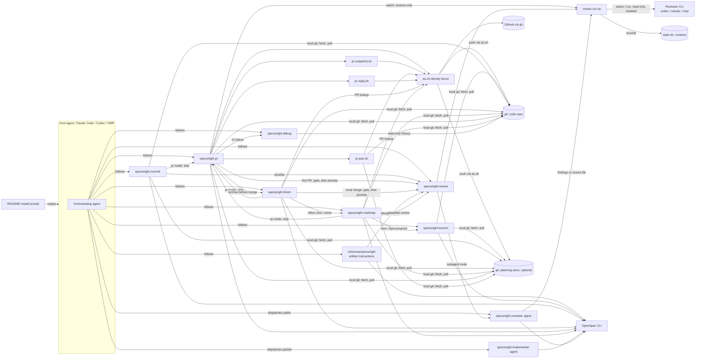

# Specwright Architecture

Specwright is not a running service. It is text and small scripts that an AI agent loads and follows inside a user's project. "Components" below are therefore instruction packages, scripts and the external tools they drive. The agent is the only process that runs them.

## System triage

- **T1 Components:** applies. There are seven skills, two agents, a schema, four PR scripts, the review runner and an install prompt, with directed calls between them (see Components).
- **T2 State:** applies. Change artifacts, `tasks.md` ticks, commit trailers, PR reply markers, the feedback pass record, pre-ship review records and the store gate lock are all persistent state.
- **T3 Concurrency:** applies. Several agents share one machine, one `gh` login store and one planning store. `watch` polls in the background, reviewers answer asynchronously, and a review runs as a background job under a deadline.
- **T4 Boundaries:** applies. The schema is OpenSpec's extension point; `specwright.yaml` is a shared, versioned settings format; commit subjects, trailers and PR markers are formats that later runs parse; GitHub and the model CLIs are external systems.
- **T5 Volume:** applies. PR threads, comments and checks grow without a fixed bound, and so does commit history per change.
- **T6 Risk:** applies. The scripts push and comment under a GitHub identity, and cross-model review sends code to another provider.

## Components

| Component | Responsibility | Owns (state) | Talks to via (contract) |
|---|---|---|---|
| `schemas/specwright` | Artifact sequence (proposal, specs, design with triage, review gate, tasks) and apply instructions | Artifact templates | OpenSpec schema format (`openspec schema validate`) |
| `specwright-branch` | Clean-main gate, `<prefix>/<change-name>` branch, store branch and gate lock | PR merge state | GitHub; Specwright requests a merge only through `pr-pair.sh merge`, with `pr.merge: agent` (ADR 0009) | Permanent | Read back from GitHub after every merge request, never cached or stored; a failed read-back is unknown and deletes nothing | GitHub |
| Remote change branch | The pusher; after its PR merged, `pr-pair.sh delete-remote` in agent mode with `pr.delete_branch` | Until deleted | `delete-remote` re-reads the ref and the open PRs based on it before deleting; a moved ref or a based-on PR keeps it | GitHub |
| Store gate lock | git in the code repo and the store; `openspec list --json` |
| `specwright-commit` | One commit per task, Reconcile, completion check | Task commits and their subjects/trailers | git in the code repo and the store; `openspec list --json`; `tasks.md`; `specwright-pr` ship in pr mode |
| `specwright-finish` | Archive commit, local `--no-ff` merge or hand-off to the PR | Archive commit, merge commit, planning-only marker | git in the code repo and the store; OpenSpec archive; `gh` through `as.sh` for the code PR lookup and the post-merge check; `git pull` on main through `as.sh` for a GitHub remote; `specwright-pr` ship in pr mode |
| `specwright-pr` + scripts | Ship, feedback and watch for one PR or a code/store PR pair; with `pr.merge: agent`, the merge at watch's ready head and remote branch deletion in cleanup (ADR 0009) | Feedback pass record, PR reply markers | `gh` GraphQL/REST through `as.sh`, including `pr-pair.sh merge` (REST merge with the ready head SHA, then read-back) and `delete-remote` (ref SHA and open-base-PR checks, then REST ref delete); `git` in the code repo and store (push; `pr-pair.sh`); `openspec list --json`; JSON on stdout; `specwright-finish` (archive before merge) and `specwright-debug` (CI failures) |
| `specwright-roadmap` | Strategy, architecture baseline, milestones | `openspec/strategy.md`, `roadmap.md`; the baseline `architecture.md` and ADRs (see State ownership) | git and the store for its own branch and commits, taking the store gate lock to branch in a store-backed project; `git fetch`/`git pull` on main through `as.sh` for a GitHub remote; `gh` through `as.sh` for PR status; OpenSpec CLI (`list`, `templates`, `schema validate`, `context`); `specwright-pr` ship in pr mode |
| `specwright-review` + `review-run.sh` | Reviewer route selection, isolated runs and output validation for design and pre-ship reviews; the pre-ship review, the ship/merge gate and the archive-only check (ADR 0007) | Pre-ship review records and receipts | `review-run.sh` subcommands (`select`, `run`, `record`, `waive`, `gate`, `archive-only`, `rounds`), one JSON document each, exit 0/1/2/3; fixed command lines for `codex`, `claude`, `omp`; `git` read-only; the findings schema; called by the schema's review step, `specwright-commit`, `-pr`, `-finish` and `-roadmap`. No `gh` call |
| `specwright-debug` | Root-cause debugging discipline | None | git, read-only (`status`, `log`), plus `stash` to test a dirty tree, restored after; returns a verified fix uncommitted to `specwright-pr` in CI mode |
| `specwright-implementer` agent | Implements one task group test-first from a packet, loading the project skills the packet names (Claude `Skill`, OMP `read` of the given `SKILL.md` path) | Nothing committed: the orchestrator verifies, ticks and commits | Packet in, evidence report out; OpenSpec CLI (`list`, `templates`, `schema validate`) |
| `specwright-reviewer` agent | Fresh-context review when the selected route is `subagent` (design or pre-ship) | The one file it is asked to write (`review.md`, `architecture-review.md`, or a pre-ship findings file) | File paths in; the review file out, with exactly one `VERDICT:` line, or findings JSON, validated by `review-run.sh record`; OpenSpec CLI (`list`, `context`, `instructions`, `templates`) |
| Install prompt (README) | Installs or updates the copies into a project; keeps local `model:` lines | `openspec/.specwright/VERSION` | Copy layout in `CONTRIBUTING.md` |
| Evals (`evals/`) | Graded agent runs and script tests, with a fake `gh` | Fixtures | `evals.json` + `grade.py`; `unittest` (`python -m unittest discover evals/pr-pair`) |

## State ownership

| State | Sole writer | Lifetime | Invalidation / rebuild | Authoritative copy |
|---|---|---|---|---|
| Change artifacts (`openspec/changes/<name>/`) except `review.md` | Orchestrating agent, through the schema | Until archive | Drift rule: separate `amend <artifact>` commit | Planning repo branch, then main |
| `review.md` | One writer per review, by path: the orchestrator for LIGHT (`SKIPPED_LIGHT`); `review-run.sh run --out` for a CLI route, writing only after validation; `specwright-reviewer` for a fresh-context review; the orchestrator also records `USER_OVERRIDE` after escalation | Until archive | A new review round rewrites it | Planning repo branch, then main |
| `tasks.md` ticks | Orchestrator (never the implementer) | Until archive | Reconcile against commits | Planning repo (store when store-backed) |
| Task commits (`task X.Y` subject, `Code-Changes: none`) | `specwright-commit` | Permanent | Never rewritten without the user | Change branch, then main |
| Archive and merge commits (`archive change`, `merge: <change>`) | `specwright-finish`; `merge: <branch>` also from `specwright-roadmap` in local mode | Permanent | Never rewritten; roadmap status reads them | Planning repo (archive); main of each merged repo, store and code (merge) |
| Planning-only marker (`specwright-change.yaml`, `code_changes: none`, in the archive directory) | `specwright-finish` writes it at archive; `specwright-pr` feedback deletes it when a code fix follows | Permanent once on the store's main | Proof for roadmap status that a store-backed change has no code side | Store branch, then the store's main |
| `Preship-Round: <n>` trailers and `address pre-ship review` commits | `specwright-review` fix step, committed under `specwright-commit` rules (store-backed: one commit per changed repo, same subject and trailer) | Permanent | The pre-ship escalation count is the highest trailer in `<main>..HEAD` of either repo (`review-run.sh rounds`); `pr-pair.sh rounds` never counts them | Change branch in either repo, then main |
| `Amendment: clarification` / `Amendment: behaviour-change` trailers on `amend specs` commits | `specwright-review` amendment rule, committed under `specwright-commit` rules | Permanent | Never rewritten; the PR description's Review section reads them | Change branch, then main |
| Pre-ship review records (`reviews/<repo key>/<change>/<code head>[+<store head>].json`: findings, receipt, waivers; no stored outcome) | `review-run.sh run` / `record` write the record whole; `waive` is the only writer of `waivers`; each by temp file and rename | Until the state dir is cleared | Keyed by head: a new commit leaves no record for the new head, except the archive commit, which `gate` matches through `archive-only`. Pass or blocked is derived from findings and waivers each time. Lost: a new review, and the user decides waivers again (ADR 0007's exception to 0003) | `~/.cache/specwright/reviews/` (or `SPECWRIGHT_STATE_DIR`), machine-local |
| `Feedback-Round: <n>` trailers | `specwright-pr` feedback | Permanent | The round count is derived from them | Change branch in either repo |
| PR markers: reply markers (`specwright:handled <id>`, with a trailing `resolve` when the thread is to be resolved, then `rev=<rev>`, the item revision the reply answered; `specwright:waiting <id> rev=<rev>`), pair-link comments (`specwright:link`), `specwright:pr-item` in after-limit issue bodies | `pr-reply.sh` (it re-reads the item before posting and refuses a changed revision); `pr-pair.sh link`; `specwright-pr` after the limit | Life of the PR | A marker with `rev=` counts only while the item still has that revision; for a thread, against the thread as it stood before the reply, so an edit that landed before the reply lists it again (`rebound`), and the reaction posted with that reply does not answer it; only an edit after the reply can be answered by a reaction alone. Markers without `rev=` (0.1.10) keep the time rule: an item edited after the reply counts as unhandled again | GitHub |
| Feedback pass record | The one session running feedback for the change, through `pr-pair.sh pass write/plan/done/adopt` (a repo-local change passes no `--store` and has only the code repo). Created exclusively (a second write is refused), holds an owner id that `done` and `adopt` require, and is keyed by a hash of repository and change so distinct identities never share a file. A record owned by another session is shown to the user, never taken over automatically. | One feedback pass | Deleted at `pass done`; a leftover record blocks the next pass until resumed | `~/.cache/specwright/feedback/` (or `SPECWRIGHT_STATE_DIR`) |
| Watch ownership claims | Each `pr-snapshot.sh --wait` writes only its own numbered claim (the highest number plus one and a nonce of its own, so a claim name is never reused); a new claim also removes the lower ones, which have lost anyway | One watch | The newest claim owns the PR: a watcher whose own file is gone or that sees a higher number exits 4 before its next poll. Exit removes only its own file, so it never ends a newer watcher's ownership; a crashed owner's claim is beaten by the next one. One directory per owner, name and PR, in lower case, so distinct PRs never share a claim. An uncreatable directory turns ownership off, with a stderr notice. 0.1.10's `watch/<owner>-<repo>-<pr>` token is not read and is left in place | `~/.cache/specwright/watch/v2/<owner>/<repo>/<pr>/<n>-<nonce>` (or under `SPECWRIGHT_STATE_DIR`) |
| Head first-seen record (the GitHub time a snapshot first saw a head whose push is not in the activity log) | The first `pr-snapshot.sh` that sees the head (a snapshot without `--reviewer` only records the sighting and never fails over it): it writes a temp file and publishes it with a no-clobber hard link, so the first writer wins and nobody reads an empty record; later processes only read it | Until a new head of the same PR is recorded, which removes it | Lost or deleted → the next snapshot records a later time (a stricter cutoff); unreadable or unparseable → that process's own first sighting, kept across its polls (`first_seen_unsaved`) | `~/.cache/specwright/heads/<owner>/<repo>/<pr>/<oid>`, lower case (or under `SPECWRIGHT_STATE_DIR`) |
| Store gate lock | `specwright-branch`, and `specwright-roadmap` when it branches in a store-backed project | Its own gate only; each removes only the lock it took | Never auto-removed; the user confirms removal | `<store git-common-dir>/specwright-gate.lock` |
| Strategy and roadmap (`strategy.md`, `roadmap.md`) | `specwright-roadmap` init/close, and **next** when it adds a gap-closing change | Project lifetime | The roadmap is updated at each milestone close; status is derived, never stored. **next** adds a gap-closing change only after the branch gate has created its branch, as a roadmap-only commit there that merges with the change | Main of the planning repo |
| Baseline review (`architecture-review.md`) | One writer per round, by path: `review-run.sh run --out` for a CLI route, writing only after validation; `specwright-reviewer` writes it on the fresh-context path; the orchestrator also records `USER_OVERRIDE` after escalation | Project lifetime | A new review round rewrites it | Main of the planning repo |
| Architecture file and ADRs (`architecture.md`, `docs/adr/`) | One writer at a time, by path: `specwright-roadmap` init/close, or the apply task of a change whose reviewed design records an ADR (it also updates the index) | Project lifetime | An ADR is `Status: proposed` and editable until its review gate passes; it is then marked `accepted` and never edited again: a new ADR supersedes it and the index is updated. Roadmap init and close write ADRs as proposed and accept them, with the date and their index rows, only when the baseline review gate passes; an accepted ADR not yet on main may still be edited, but the edit voids the review | Main of the repo holding them (`project.architecture`, `project.adr_dir`) |
| Settings (including `review.*` and `pr.review_after_archive`) | The user (install prompt merges; `specwright-roadmap` init may set the `project:` paths) | Project lifetime | Install keeps local values | `openspec/specwright.yaml`, `openspec/config.yaml` |
| Installed version | Install prompt, last step | Until next install | Rewritten on install | `openspec/.specwright/VERSION` |

## Boundaries and contracts

- **OpenSpec:** only through the custom schema and the CLI (`list`, `show`, `new change`, `instructions`, `templates`, `schema validate`, `validate`, `archive`, `context --json`). The OpenSpec version is pinned in the README badge and `CONTRIBUTING.md`, but not enforced at install (#37).
- **Settings:** `specwright.yaml` keys are documented in `templates/openspec/specwright.yaml` and the README. A new key has a safe default, so a missing key keeps earlier behaviour.
- **Git evidence formats:** commit subjects `<type>(<change>): task X.Y …` and `<type>(<change>): address pre-ship review`, trailers `Feedback-Round:`, `Preship-Round:`, `Amendment:` and `Code-Changes: none`, the legacy `address review feedback` subject (counted as a round only on a branch with no trailers in either repo), archive/merge subjects, and the planning-only marker. Later runs and roadmap status parse these, so changing them is a workflow change (minor version).
- **Script I/O** (ADR 0002): `pr-snapshot.sh` and `pr-pair.sh` print one JSON document (`pr-snapshot.sh --logs` appends plain log text); `pr-reply.sh` prints one plain line per action. Exit codes signal stop conditions. Scripts use only `bash` with a POSIX userland (`sed`, `grep`, `mktemp` and similar; Git Bash on Windows), `git`, `gh` 2.40+ (built-in jq) and the Python standard library (`pr-pair.sh` accepts 3.8+, but `pass write` needs 3.10+ and fails with a traceback, not JSON, on older versions: #46); `pr-pair.sh` runs `git` in the code repo and the store for repo identity, the expected PR set, recovery and cleanup.
- **GitHub identity** (ADR 0008): every `gh` call and every git network call to a github.com remote runs through `as.sh <run login>` (or, for `pr-pair.sh`'s own `gh` calls, its internal fence that resolves and verifies the token the same way), and `gh auth switch` is never run. The run login is the configured login (`github.login`, `planning_store.login` for the store); with none, the first user-started step of a run resolves the active account once with `as.sh --resolve` and hands the login to every step it invokes, so a later switch cannot redirect the run; empty fallbacks (`review_request.login`, `pr.request_as`) end at the run login. `git fetch` and `git pull` on main are fenced when the remote's fetch URL is on github.com, and plain for other hosts; in the branch gate and roadmap status a refusal (including a failed `--resolve`) means local refs only, elsewhere it stops. `pr-pair.sh` runs every network read of a repository other than the one it started in through `as.sh <that repo's login>` from inside it, and `cleanup-plan` emits fenced pulls. `as.sh` refuses (exit 3) when a github.com URL git could use, a github.com rewrite rule, a URL argument or a `-c` value carries userinfo, and unsets `GH_HOST` and the enterprise token variables.
- **Reviewer routes** (ADR 0007): `review-run.sh select` walks `review.order` (default `[codex, claude, omp]`), skips the current harness and takes the first installed route whose probe passes, else the `specwright-reviewer` subagent; `review.cross_model: false` means the subagent only. Each route runs one fixed command line from the script with read-only tools by allowlist, the user's skills, extensions, rules and slash commands off, and a fresh OMP session dir; the prompt goes by file. For a pre-ship review the script embeds the code-range diff (and the store-range diff) in a nonce-delimited untrusted region, bounded by `review.max_diff_kb`. Output is validated, fail closed, from every route including the subagent: pre-ship findings against `findings.schema.json`, design reviews as a review file with exactly one `VERDICT:` line and a `CHANGES_APPLIED:` line. A failed review exits 3 and never falls through to another route. Every run writes a receipt (route, skipped routes with reasons, requested and actual model and level). The diff and the files the reviewer reads go to that route's provider.

## Resource bounds and failure visibility

| Flow / store | Bound | At the bound | On failure | Who finds out |
|---|---|---|---|---|
| PR snapshot | 100 per list (threads, comments per thread, comments, reviews, checks) | List overflow sets `complete: false` and `truncated: [...]`; watch hands over to the user, and feedback does too unless only `checks` is cut off | `gh` error → non-zero exit | The user, through the hand-over |
| PR snapshot bodies | Thread comments clipped at 2500 characters, PR comments and reviews at 1200 | Clipping does not change `complete`; each shortened body is marked `clipped: true`, and feedback reads every clipped item whole with `pr-snapshot.sh --full <id>` (one call per item) before judging it | A failed `--full` read: the item is neither dropped nor answered, and is handed to the user as needing a manual read | The user, on a failed read |
| Feedback rounds | `pr.max_fix_rounds` (default 2) | `pr.after_limit`: ask, file issues or stop | The pass record resumes an interrupted pass, store-backed or repo-local; `rounds` reads both branches, or only the code branch when there is no store | The user at the limit; the agent on resume |
| Watch polling | `pr.poll_interval` (default 5m); reviewer timeout per head (default 20m) | Advisory reviewer stops blocking; required reviewer → ask | Poll error → retry next interval. Pair readiness counts a snapshot only for the PR and head discovery reports; otherwise a `refresh` blocker makes watch take a new snapshot. One watcher per PR on a machine, by numbered claims; an unwritable state directory polls unowned | The agent's watch loop, then the user |
| Reviewer report cutoff | Push time of the head from repository activity; when push activity is missing, Mira and other timestamp-based reviewers count only output at or after the first-seen time of the head (never the commit date); Codex and Kody keep their commit-precise signals. The snapshot reports which cutoff it used (`head_cutoff`) | A report made between the push and the first snapshot is not counted, so a required reviewer can time out (fails closed) | First-seen record unwritable → the process's own first sighting, kept across its polls | The agent, through `head_cutoff`; the user on a required reviewer's timeout |
| Fully paginated metadata reads (`pr-pair.sh` discovery, linking, recovery; after-limit issue reuse) | None: every page is read and held in memory; issue reuse scans all issues once per finding (F × I) | — | Large histories slow every call and grow memory (#40) | Nobody until a call is slow or fails |
| Network commands (`gh`, `git` in the PR scripts) | No Specwright deadline. The watch timeout counts sleep intervals, not elapsed time, and cannot interrupt a poll that hangs | — | A hung command blocks timeout reporting and ownership checks (#40) | Nobody until the user notices |
| Install / update | One project at a time | — | Interrupted update can leave deleted skills; a store's shared schema is replaced for every project (#36) | The user, on the next failing run |
| Review run (design or pre-ship) | `review.timeout` (default 20m) per run; reviewer output read up to 2 MB; 100 findings; probes 10s each | Deadline: process tree killed by PID, exit 3 `timeout`; oversized or invalid output: exit 3 `invalid`; no record written | Probe failure → next route, subagent at the end; a failed run stops the caller and never falls through | The user |
| Pre-ship review input | `review.max_diff_kb` (default 1024 KB) for the code plus store diff | `run` exits 1 `diff_too_large` with the size before any reviewer starts; never truncated | — | The user (raise the bound or set `review.preship: false`) |
| Design review | Roadmap baseline and change design review alike: escalate after 2 consecutive REVISE rounds, no other cap; a later edit voids a pass and gets a new round (for the baseline, the ADR acceptance edit does not, and a PR fix to strategy, architecture or an ADR on `docs/project-baseline` or `docs/close-*` re-runs the baseline review before the fix is reported done); one verdict line | REVISE escalates to the user (USER_OVERRIDE) | No route left → `specwright-reviewer` subagent; invalid output → failed review, stop | The user |
| Store gate | One holder (atomic `mkdir`) | Second gate stops and names the owner | Interrupted gate leaves the lock → the user confirms removal. A `git checkout -b` that errors (a failing `post-checkout` hook errors after creating the branch) is rolled back in every repo the gate branched, judged by the current branch, then the lock is released (#60) | The user |
| Task commits | One per task | — | A ticked task without a commit is a gap → Reconcile asks | The agent, then the user |
| Local finish | Archive commit, then merges (store-backed: store, then code) | — | Re-entry resumes from git evidence per repo (archive commit, merge on main, branch exists) and continues at the first step not done, never repeating one; uncommitted change or archive paths stop it and ask; no marker file | The agent, then the user on dirty paths |

## Known gaps

Defects where the code does not yet meet this baseline, found in the baseline review (`openspec/architecture-review.md`) and earlier PR reviews. The roadmap schedules them. Issue numbers refer to sh1ny/specwright.

This table is frozen at the reviewed baseline. The live list is the open sh1ny/specwright issues labelled `known-gap`: every gap below carries the label, and a gap found later (for example #52, #53) is filed there instead of being added here, so recording a defect does not reopen the baseline review. An issue closes when its fix merges with a regression test.

| Gap | Issue |
|---|---|
| Pair readiness accepts a snapshot of another PR or an old head; missing push activity also lets previous-head reports satisfy current-head reviewer readiness | #31 |
| A reviewer edit during a fix is hidden by the later reply | #33 |
| `pr-pair.sh` git calls on the store use the code account | #35 |
| Install/update has no lifecycle for running sessions or shared stores | #36 |
| OpenSpec pin is not enforced | #37 |
| Watch cleanup can delete a newer watcher's token, leaving no watcher | #39 |
| Hyphenated watch-token filenames alias distinct repository/PR identities, so a watcher for another PR can take ownership | #39 |
| Unbounded metadata reads and no command deadlines in the PR scripts | #40 |
| Roadmap init/close write to a store without the branch check or gate lock | #43 |
| Roadmap writes baseline ADRs as `accepted` before the review gate | #44 |
| README and `specwright-pr` do not state the Python 3.8+ dependency the scripts enforce | #45 |
| `pass write` needs Python 3.10+ although the gate accepts 3.8+; unexpected errors escape the JSON contract | #46 |
| Clipped snapshot bodies can be judged without the full text | #47 |
| Baseline review caps rounds at two, with no reset after a later edit | #49 |
| Roadmap **next** never commits its gap-closing roadmap edit, so the branch gate stops | #50 |

## In-force ADRs

The baseline ADRs were accepted once the round 4 review of their revised final text passed (`openspec/architecture-review.md`: `APPROVE_WITH_CHANGES`, with the reviewer's re-check setting `CHANGES_APPLIED: yes`).

| ADR | Decision | Supersedes |
|---|---|---|
| [0001](../docs/adr/0001-build-on-unmodified-openspec.md) | Extend OpenSpec only through a schema, skills, agents and templates installed as copies | — |
| [0002](../docs/adr/0002-agent-instructions-with-thin-scripts.md) | The agent follows instructions; deterministic work goes to small bash + git + gh + python3 scripts | — |
| [0003](../docs/adr/0003-git-and-github-as-the-state-store.md) | Git history and GitHub hold workflow evidence; local state is only recoverable working state | — |
| [0007](../docs/adr/0007-reviewer-routes-with-a-specwright-owned-contract.md) | The orchestrator verifies and commits; an implementer agent builds; reviews run on an ordered list of isolated reviewer routes with fixed command lines, script-built input and fail-closed validation; pre-ship review records are machine-local (exception to 0003) | 0005 |
| [0008](../docs/adr/0008-fenced-github-identity-by-default.md) | Every `gh` call and GitHub git network call runs under a process-scoped, verified run login: the configured login, or the active account resolved once per user-started run and handed off; userinfo on github.com URLs is refused, `gh` is pinned to github.com, other hosts stay outside | 0004 |
| [0006](../docs/adr/0006-openspec-resolves-the-planning-root.md) | OpenSpec resolves where planning lives; store-backed changes pair branches and commits across two repos | — |
| [0009](../docs/adr/0009-opt-in-agent-merge-at-the-ready-head.md) | Specwright merges a PR only with `pr.merge: agent` and `finish: pr`, from watch's ready state with a required reviewer, at the ready head SHA through the REST merge with read-back (store first, then code); never with admin rights, auto-merge, a queue, another method or a dismissed review; remote branches are deleted only at the merged head with no PR based on them | — |
