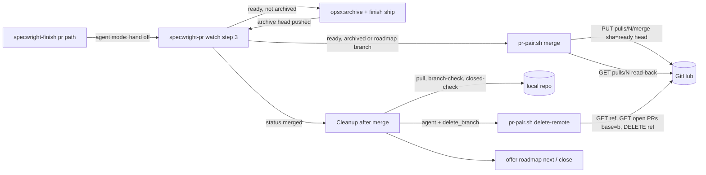
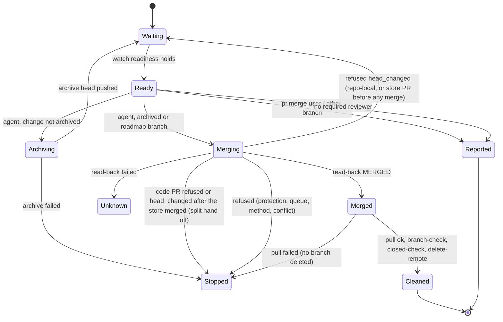

# Design

## Triage

| Trigger | Applies? | Evidence |
|---|---|---|
| T1 Components (new component, or 3+ with directed relationships) | yes | watch (`skills/specwright-pr/SKILL.md:119-138`) → `pr-pair.sh merge` → GitHub → Cleanup after merge (`SKILL.md:141-146`) → `pr-pair.sh delete-remote`; finish's `pr` path (`skills/specwright-finish/SKILL.md:78-81`) hands to watch |
| T2 State (persistent state, caches, 3+ state machine) | yes | a PR's merge state machine as watch drives it: ready → archiving → ready on archive head → merging → merged / refused / unknown → cleaned. No new persistent state |
| T3 Concurrency (background work, workers/isolates, async, retries) | yes | watch runs in the background; a push or a human merge can land between ready and the merge request; two sessions may watch the same PR |
| T4 Boundaries (data format, migration, shared interface, IPC, external) | yes | new GitHub REST calls (`PUT pulls/{n}/merge`, `GET/DELETE git/refs`), new settings keys, two new `pr-pair.sh` subcommands with JSON output |
| T5 Volume (grows without a fixed bound) | no | one merge and one ref deletion per PR; the only list read (open PRs based on the branch) uses the existing paginated `gh_list` (`pr-pair.sh:566`) |
| T6 Risk (security, money, data loss, unrecoverable user data) | yes | an irreversible merge to the default branch, and a remote branch deletion that can lose unmerged commits |

TIER: FULL

## Context

The proposal (`proposal.md`) states the goal. What the design builds on:

- **Readiness already exists.** Watch step 3 (`skills/specwright-pr/SKILL.md:131`) defines ready per PR: MERGEABLE, CLEAN, no pending or failing checks, every required reviewer reported, no unanswered items, one quiet wait. Store-backed readiness is `pair-state` `ready` (`SKILL.md:132`, `pr-pair.sh:1203`). The archive step re-watches the archive head and, through `review-run.sh archive-only`, lets earlier reviewer reports count for it (`SKILL.md:133-137`). Today the branch ends at `SKILL.md:138`: "report ready and stop; the user merges".
- **Cleanup already exists and is safe.** Repo-local cleanup checks out main, runs the fenced `pull --ff-only`, then `branch-check` decides local deletion from the merged PR's `head_sha` (`SKILL.md:145`, `pr-pair.sh:1953-1990`). Store-backed cleanup goes through `cleanup-plan` (`pr-pair.sh:1993-2024`). The issues-left-open backstop is `closed-check` (`SKILL.md:146`). All of this works for merge, squash and rebase merges, because `branch-check` accepts a tip that is the merged head or its ancestor.
- **The identity fence is the default** (ADR 0008): every `gh` call runs through `as.sh <run login>`, and `pr-pair.sh` calls `gh` through `gh()` (`pr-pair.sh:195`), which pins the token per repository. Every `gh` call names its repository.
- **Settings** are read by `load_settings`/`contexts` (`pr-pair.sh:487`, `527`). Every key has a safe default (architecture: Boundaries, Settings).
- **The never-merge rule** sits in `specwright-pr` Never (`SKILL.md:150`) and finish's `pr` path (`specwright-finish/SKILL.md:80`). The strategy (`openspec/strategy.md:14`) allows a merge on GitHub only under "a documented, opt-in setting".
- **`gh pr merge` is the wrong tool here** (CLI manual, checked through Context7): on a branch that requires a merge queue, it queues the PR or turns on auto-merge instead of merging, and `--delete-branch` deletes the local branch too, bypassing `branch-check`.
- **Test harness:** the fake `gh` (`evals/fakes/gh.py:691`, `cmd_api`) serves REST endpoints by path and method, and has no merge or git-ref endpoint yet. Graded agent evals live in `evals/git-workflow/evals.json` with fixtures in `fixtures.py` (for example `gh_pull`, `fixtures.py:503`).

## Decisions

### D1: Merge at the end of watch, not in a new mode

- **Choice:** the merge is a branch of watch step 3. Where watch now says "report ready and stop; the user merges", with `pr.merge: agent` it merges the PR at the ready head and continues into Cleanup after merge. Finish's `pr` path hands off to watch instead of offering it.
- **Rejected:** a separate `merge` mode of `specwright-pr` (or a finish step) that re-checks readiness on its own. Readiness (reviewers, cutoffs, stale verdicts, pair state) took several releases to get right, and a second checker would drift from it. Merging from where readiness is decided means "ready" has one definition.
- **Reversal cost:** low. A later separate mode could call the same `pr-pair.sh merge` subcommand.

### D2: Merge through GitHub's REST merge endpoint, guarded by the ready head

- **Choice:** `pr-pair.sh merge --repo o/n --pr N --method merge|squash|rebase --head <sha>` sends `PUT repos/o/n/pulls/N/merge` with `merge_method` and `sha=<ready head>`, then always reads the PR back (`GET repos/o/n/pulls/N`) and reports on what it reads back, not on the PUT's status. The output is one JSON document with `status`: `merged` (merged now or before, with `head_sha` and `merge_commit_sha`), `refused` (still open; the HTTP status and GitHub's message; 409 is reported as `head_changed`), or exit 3 `unknown` (the read-back failed, or the PUT failed without an HTTP status).
- **Rejected:** `gh pr merge --match-head-commit`, because on a merge-queue branch it queues the PR or enables auto-merge, both of which the spec forbids, and because its result is a text message, not structured state. Also rejected: deciding the result from the PUT's response alone. A PUT that times out after GitHub merged, or that fails because a human merged first, would then be misread. The read-back makes GitHub's state the only authority (ADR 0003).
- **Reversal cost:** low. One subcommand behind a JSON contract.

### D3: Delete the remote branch by checking its SHA, then the REST ref delete

- **Choice:** `pr-pair.sh delete-remote --repo o/n --branch b --head <merged head>` reads `GET repos/o/n/git/ref/heads/b`. When the ref is missing, it reports `gone` (GitHub's auto-delete already ran). When the ref is at another SHA, it reports `moved` with that SHA and keeps the branch. Otherwise it lists open PRs with `base=b` and keeps the branch (`based_on` with their numbers) when there are any. Only then does it send `DELETE repos/o/n/git/refs/heads/b` and report `deleted`. A failed read is exit 3, and nothing is deleted.
- **Rejected:** `git push --force-with-lease=b:<sha> origin --delete b`. It is atomic, but it pushes through the remote's push URLs (several push URLs, rewrite rules: the cases ADR 0008 spent a whole change fencing), it needs a git network fixture, and it can target a remote that is not the PR's repository. The REST check, then delete, always names the PR's repository. The window between the check and the delete is milliseconds, on a branch whose PR is already merged. A push that lands in that window loses only the remote copy of commits that are still on the pusher's machine.
- **Reversal cost:** low.

### D4: Agent mode archives without asking, and treats roadmap branches as ready-to-merge

- **Choice (user's decision):** with `pr.merge: agent`, watch's Archive before merge runs without the question. A `docs/project-baseline` or `docs/close-<milestone>` branch has nothing to archive and merges once it is ready. Any other branch (not `<prefix>/<change-name>` of a known change, and not a roadmap branch) is reported ready and never merged.
- **Rejected:** keep the archive question in agent mode. The setting is the user's standing consent to the path from ready to merged, and a question in the middle of it would make the dogfood exit criterion depend on an interactive answer for every change.
- **Reversal cost:** low. It is text in watch step 3.

### D4a: Merge only heads reviewers saw

- **Choice:** two guards on top of the head SHA condition. (1) An agent merge needs at least one `required` reviewer in the PR's repository's reviewer set (`pr.reviewers`; store: `planning_store.reviewers`). Without one, watch reports ready, states `agent merge needs a required reviewer in pr.reviewers`, and merges nothing. (2) When watch watched an archive head without reviewers (the `archive-only` carry-over, `SKILL.md:134`), it merges only when the ready head equals that archive head. Any other head gets `archive-only --base <ready head before the archive> --head <current head>` again. Unless that still reports `archive_only: true`, watch returns to watching with the reviewers (re-requesting review under the existing rules). Readiness (`pr-pair.sh:1141-1170`) does not compare the head with the archive head, so the merge step must.
- **Rejected:** merge on readiness as it stands, accepting projects with no required reviewer. With the template's `pr.reviewers` commented out (`templates/openspec/specwright.yaml:82-83`), readiness would mean CI green and one quiet wait, and a slow review requested through `review_request.body` could arrive after the merge. User-merge projects keep today's readiness: the person merging is the review gate there.
- **Reversal cost:** low. Relaxing it later is a setting or a superseding ADR; a merge of unreviewed code cannot be undone.

### D5: Store-backed pairs merge store first, then code

- **Choice:** merge only when `pair-state` is `ready`. Merge the store PR, then the code PR, each as its own repository's login with its own ready head. Once the store PR merged, any code result other than `merged` (refused, `head_changed`, unknown) stops with `planning merged, code pending` and cleans up the store only. A later watch stops too: `pair-state` returns `split_hand_off` for one merged and one open PR (`pr-pair.sh:1222-1224`). The user merges the code PR, and Cleanup after merge then runs for the code repo.
- **Rejected:** code first. A refused store merge would then leave code merged with its planning unmerged, a state roadmap status cannot show: it derives `planning merged, code pending`, but has nothing for the reverse. Store first leaves a failure in the state status already reports and **next** already waits on.
- **Reversal cost:** low.

### D6: Remote deletion is part of cleanup in agent mode, whoever merged

- **Choice:** with `pr.merge: agent` and `pr.delete_branch` (default `true`), Cleanup after merge runs `delete-remote` for each merged PR, after the local cleanup succeeded (main pulled). A user who merges by hand in agent mode gets the same cleanup.
- **Rejected:** delete only right after the agent's own merge. A session that dies between the merge and the cleanup would leave the branch, and the resumed cleanup (watch sees MERGED, or finish's **After the PR is merged**) cannot tell who merged. Tying deletion to the mode keeps the restart path the same as the first run.
- **Reversal cost:** low.

### D7: Record ADR 0009 for the merge contract

- **Choice:** a new ADR, "Opt-in agent merge at the ready head", records the binding parts: merge only with `pr.merge: agent`, only from watch's ready state with at least one required reviewer, at the ready head SHA, a reviewer-less archive head only when it is the head `archive-only` judged, through the REST endpoint with read-back; no admin rights, auto-merge, queueing, method fallback or review dismissal; remote deletion only at the merged head. Later changes (a merge-queue mode, jj backends in M5) must work within it or supersede it.
- **Rejected:** no ADR, keeping the rules only in the spec. The strategy names "a documented, opt-in setting" as the only exception to never merging on GitHub. That exception is a boundary future changes have to respect, which is what ADRs are for here.
- **Reversal cost:** low.

## Diagrams (FULL)

Components (T1, T4):



PR merge states as watch drives them (T2, T3):



Store-backed merge sequence (T3):

```mermaid
sequenceDiagram
  participant W as watch
  participant S as store PR
  participant C as code PR
  W->>W: pair-state = ready (both heads recorded)
  W->>S: merge --head store_ready (store login)
  S-->>W: merged
  W->>C: merge --head code_ready (code login)
  alt merged
    C-->>W: merged
    W->>W: cleanup both repos (cleanup-plan), delete-remote each
  else refused or unknown
    C-->>W: refused / unknown
    W->>W: report "planning merged, code pending"; cleanup store only
  end
```

## State & Ownership (FULL)

| State | Owner (sole writer) | Lifetime | Invalidation / rebuild | Authoritative copy |
|---|---|---|---|---|
| PR merge state | GitHub; Specwright requests it only through `pr-pair.sh merge` | Permanent | Read back after every merge request; never cached | GitHub |
| Ready head (the SHA watch last reported ready) | The watch session, in its snapshot file | One watch | A new snapshot replaces it; the merge request carries it, so a stale value fails the merge (409) instead of merging | GitHub's PR head; the snapshot is only the condition |
| Remote change branch | The pusher; after merge, `delete-remote` in agent mode | Until deleted | `delete-remote` re-reads the ref before deleting | GitHub |
| Settings `pr.merge`, `pr.merge_method`, `pr.delete_branch` | The user (install prompt merges the template) | Project lifetime | Read at each run | `openspec/specwright.yaml` |
| Local change branch | Unchanged: Cleanup after merge, through `branch-check` | Until cleanup | — | Local repo |

No new persistent state: the merge outcome is derived from GitHub every time (ADR 0003).

## Failure & Visibility (FULL)

| Component | Fails / dies mid-operation → | Recovery | Retry safe? | Who finds out |
|---|---|---|---|---|
| Auto-archive in watch | Archive workflow fails, or its push fails | Watch stops with the error, and nothing is merged; the user fixes it and resumes finish or watch | Yes (finish Resume) | The user |
| `merge` PUT | Network error or timeout after GitHub merged | Read-back sees MERGED → `merged` | Yes: a second PUT on a merged PR is refused, and the read-back still says merged | Nobody needs to |
| `merge` PUT | Refused (405/409/422) | PR stays open; `head_changed` goes back to watching the new head; anything else stops | Yes for `head_changed` (it waits for ready again); not retried otherwise | The user, with GitHub's message |
| `merge` read-back | Fails | Exit 3 `unknown`: no cleanup, no deletion; the user checks the PR, and a later watch or finish sees MERGED and cleans up | Yes | The user |
| Session dies after merge, before cleanup | — | The next watch (state MERGED → cleanup) or finish **After the PR is merged** runs the same cleanup, remote deletion included (D6) | Yes | The agent on resume |
| Cleanup pull | Fails | Stops; no local or remote branch deleted (existing rule) | Yes | The user |
| `delete-remote` | Ref read or PR list fails | Exit 3: keep the branch, report it | Yes | The user (report) |
| `delete-remote` | DELETE fails (permissions) | Report the branch as kept with GitHub's message; cleanup continues | Yes | The user (report) |
| Store-backed second merge | Refused, `head_changed` or unknown | Report `planning merged, code pending`; clean up the store only; a later watch stops at `split_hand_off`; the user merges the code PR, then Cleanup after merge | By the user only; then cleanup | The user, and roadmap status |

## Resource Bounds (FULL)

| Queue / buffer / cache / transfer | Bound | At the bound | Timeout | At 10x / 100x |
|---|---|---|---|---|
| Merge requests | One PUT and one GET per PR per ready head | — | No Specwright deadline: the existing `gh` behaviour (#40) | Unchanged: one per PR |
| Open PRs based on the branch | Paginated `gh_list`, all pages | Held in memory (the existing pattern, architecture: fully paginated reads) | As above | Stacked-PR counts are tiny |
| Ref read and delete | One GET and one DELETE per merged PR | — | As above | Unchanged |

## Flow & State Gaps (FULL)

- **Push between ready and merge:** the head guard makes GitHub refuse with 409, and `merge` reports `head_changed`. Repo-local, or a store PR before any merge: watch watches the new head. A code PR after the store merged: split hand-off (D5).
- **Push after the archive head, before ready:** the head guard alone does not catch it, because readiness without reviewers would judge the new head. D4a's archive-head comparison does: the new head goes back through `archive-only` or a watch with reviewers before any merge.
- **No required reviewer configured:** no merge (D4a); watch reports ready as in user mode.
- **Human merges first:** the PUT fails, and the read-back shows MERGED with the human's head. `merged` uses that `head_sha` for `branch-check`, so local deletion stays safe.
- **Two sessions watch the same PR:** watch ownership claims (`SKILL.md:123`) make the older watcher exit 4 before it acts. If both still reach the merge, the second PUT is refused and its read-back says merged, which ends in the same cleanup, and `branch-check` is idempotent.
- **Stale verdict or BLOCKED:** not ready, so no merge. The stale-verdict report stays as it is, and the agent never dismisses a review.
- **Archive head needs a fresh approval** (`SKILL.md:136`): in agent mode the question there stays, because posting review requests is outward-facing and the setting does not cover it. If the user declines, nothing is merged.
- **Merge state CLEAN, but the method is disallowed:** GitHub refuses with 405. Watch reports it, and the user changes `pr.merge_method` or merges by hand.
- **Restart mid-cleanup:** existing cleanup resume rules apply, with `delete-remote` re-run idempotently (`gone` counts as done).

## Mechanism Ledger (FULL)

| Mechanism | Built? | Why (harm nobody catches / expensive later) | Evidence that would change the call |
|---|---|---|---|
| Head-SHA condition on the merge | yes | Without it, a push that lands after ready is merged silently. It guards only the ready head, not what reviewers saw: see the next two rows | — |
| Archive-head comparison before merging a reviewer-less watch | yes | A commit pushed after the archive commit would be judged ready on CI alone and merged unreviewed (D4a) | — |
| At least one required reviewer for agent merge | yes | Without one, readiness has no review condition and a late review lands after an irreversible merge (D4a) | Users asking to merge on CI alone, which would go in a superseding ADR |
| Read-back after the PUT | yes | A timeout after a successful merge would otherwise be misreported, and cleanup skipped or wrongly run | — |
| Ref SHA check before remote delete | yes | Deleting a branch someone pushed to after the merge loses commits from GitHub silently | — |
| Open-PRs-based-on-branch check | yes | GitHub closes PRs based on a deleted branch, and nobody would notice until a stacked PR vanished | — |
| Atomic lease delete (`git push --force-with-lease --delete`) | no | Its race window is milliseconds, on a branch whose PR is merged; it costs a git network path through every push URL (D3) | A report of commits lost in that window |
| Re-running the pre-ship gate at merge | no | The gate passed before the first PR, and fixes after it went through PR reviewers that readiness requires. Requiring a new gate pass per head would force a pre-ship review after every feedback fix | A dogfood merge of a defect the pre-ship review would have caught |
| Merge-queue support (`--auto`, queue) | no | Out of scope: the REST merge refuses on a queue branch, so the failure is visible and the user merges | A project that relies on merge queues opting into agent mode |
| Retry with another method | no (forbidden) | It would silently override the repository's policy | — |
| Merge lock or record file | no | GitHub's state plus the head guard already serialise merges; a file would add a second writer (ADR 0003) | — |

## Risks / Trade-offs

- [An irreversible merge on a misread readiness] → Merge only from watch's existing readiness check, with the head guard and read-back; default `user`; evals prove a default project never sends a merge request.
- [GitHub records the run login as the merger, not the user] → Documented in the template comment and the README. The merge commit's author follows GitHub's rules for the merging account.
- [Auto-archive in agent mode removes the last interactive pause] → The setting is explicit opt-in. The archive commit is still pushed and watched to ready before the merge.
- [The strategy text (`openspec/strategy.md:14`) says the only merges are local] → It already allows "a documented, opt-in setting". Rewording it belongs to `specwright-roadmap` close of M2, the strategy's sole writer, and is noted for that close.

## ADRs

- **In force, constraining this change:** 0002 (thin scripts: two subcommands, JSON out, exit codes), 0003 (GitHub as the state store: merge state is read back, never stored), 0007 (the pre-ship gate before the first PR, the archive-only carry-over), 0008 (every new `gh` call fenced as the repository's run login).
- **To record during apply:** 0009 "Opt-in agent merge at the ready head" (D7), status proposed, then accepted with its row in the architecture's index once this design's review passes.

## Open Questions

- The exact wording of the template comments and README section, settled while editing them.
