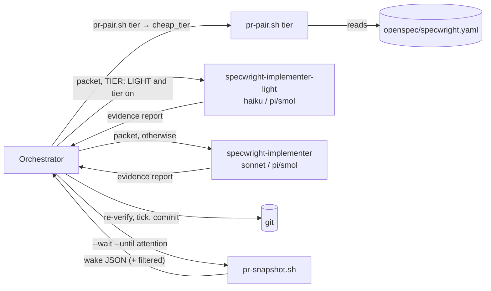
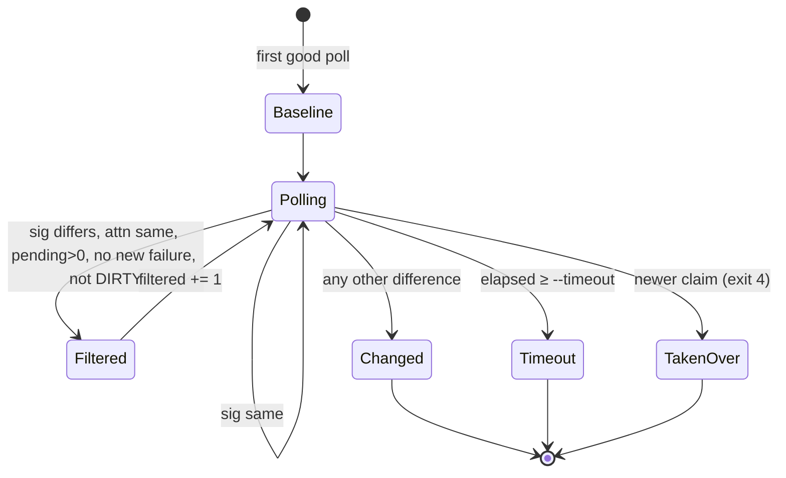

# Design

## Triage

| Trigger | Applies? | Evidence |
|---|---|---|
| T1 Components (new component, or 3+ with directed relationships) | Yes | A new agent (`specwright-implementer-light`), a new eval script (`evals/git-workflow/tiers.py`) and a new `pr-pair.sh` subcommand. Dispatch goes orchestrator → setting reader → one of two implementers. |
| T2 State (persistent state, caches, 3+ state machine) | No | No new stored state. The wait keeps its in-process baseline as today (`pr-snapshot.sh:516-517`), and the stress record is a committed document. |
| T3 Concurrency (background work, workers/isolates, async, retries) | Yes | The wake filter changes when the background `--wait` loop (`pr-snapshot.sh:520-533`) wakes, and so how watch's wakes interleave with reviewers and CI. |
| T4 Boundaries (data format, migration, shared interface, IPC, external) | Yes | A new setting (`cheap_tier.enabled`), a new CLI flag (`--until attention`) and `filtered` output field, a new `pr-pair.sh tier` JSON contract, a new installed agent file, and new `evals.json` fields. |
| T5 Volume (grows without a fixed bound) | No | The filter only skips wakes inside a wait that is still bounded by `--timeout`. `tiers.py` reads a fixed eval list. |
| T6 Risk (security, money, data loss, unrecoverable user data) | No | No new GitHub write path. The cheap implementer has the same tools as the current one (`agents/claude/specwright-implementer.md:5`), and its work is re-verified before any commit (ADR 0007). A filter that wakes too rarely is bounded by `--timeout`, so the worst case is a later wake, never a missed one. Model cost goes down. |

TIER: FULL

## Context

- The implementer is one agent definition per harness, with its model pinned in frontmatter: `agents/claude/specwright-implementer.md:4` (`sonnet`) and `agents/omp/specwright-implementer.md:4` (`pi/smol`). The apply DELEGATION rule (`schemas/specwright/schema.yaml:489-501`) names `specwright-implementer` and sends it a packet.
- OMP's task tool takes no per-call model. A subagent runs on its definition's `model:` (a role such as `pi/smol`, mapped per user in `~/.omp/agent/config.yml`). Claude Code's Agent tool takes a `model` override, but relying on it would split the two harnesses.
- Watch runs one background `pr-snapshot.sh --wait --timeout 1800` per PR (`skills/specwright-pr/SKILL.md:131`). The wait wakes as soon as `sig` differs from its first snapshot's (`pr-snapshot.sh:517-531`). `sig` covers PR state, head, merge state, every check's name and state, threads, comments, reviews, stale verdicts, reviewer states and truncation (`pr-snapshot.sh:380-389`). A check going from pending to pass therefore wakes the orchestrator, which then finds nothing to do and waits again (watch steps 2-3). During CI, nearly every poll interval in which some check finishes costs one orchestrator turn, up to one per interval until CI ends.
- `pr-pair.sh context` reads `openspec/specwright.yaml`, but it raises `bad_setting` for a bad agent-merge setting and returns early in user mode (`pr-pair.sh:583-600`). That makes it a poor reader for a setting apply needs.
- Git-workflow runs live at `eval-<name>/<config>/run-*/grading.json`, with `summary.pass_rate` and per-assertion `expectations` (`evals/git-workflow/grade.py:2204-2215`). The add-greeting fixture is `TIER: LIGHT` (`evals/git-workflow/fixtures.py:201`). Evals 55, 56 and 64 exercise watch's ready, archive and merge handling from a first snapshot. Eval 3 applies the LIGHT add-greeting change.
- The round-1 review (`review.md`) showed that a Haiku watcher saves little, and puts a cheap model in front of untrusted comment text. On the user's decision (2026-10-25), watch gets a deterministic wake filter instead, and the stress tier runs the evals with the agent under test on Haiku as a wording test.

## Decisions

### D1: The cheap implementer is a pinned agent definition, chosen by name

- **Choice:** Ship `specwright-implementer-light` per harness, with the implementer's body word for word and `model: haiku` (Claude Code) or `model: pi/smol` (OMP). A skill-text test keeps the bodies and `tools:` lines identical. The orchestrator picks the agent by name.
- **Rejected:** a per-dispatch model override (`cheap_tier.model`, passed as the Agent tool's `model`), because OMP has no such override and the setting would carry a harness-specific model name.
- **Rejected:** templating the model into the agent at install, because it adds a substitution step and a second form of every agent file to `update.sh` (ADR 0001 installs plain copies).
- **Reversal cost:** low. It is one installed file per harness and one dispatch rule.

On OMP the light implementer runs on the same role as the implementer (`pi/smol`). The README says so: on OMP the tier changes nothing unless the user points `specwright-implementer`'s `model:` line at a stronger role (both agents use `pi/smol`, so remapping the role would move both).

### D2: One switch, read by a dedicated `pr-pair.sh tier`

- **Choice:** A boolean `cheap_tier.enabled` (default `false`). `pr-pair.sh tier --code <toplevel>` loads the settings with the existing `load_settings` and decides on the parsed value, as every other boolean setting does (`pr-pair.sh:372-375`). A parsed `True` (`true`, `yes`) is on. A parsed `False` (`false`, `no`) or a missing key is off. Any other value (`on`, a quoted `"true"`, a number) is off with `note: "cheap_tier.enabled: <text as written> is not true or false; treated as false"`. When `cheap_tier` is present but not a map, the result is off with `note: "cheap_tier must hold enabled: true|false; treated as false"`. It prints `{"ok": true, "cheap_tier": bool}` plus any `note`, validates nothing else, and exits 0 for any readable settings file. Apply runs `bash <specwright-pr>/scripts/pr-pair.sh tier --code <code toplevel>` once per apply run. A non-zero exit or a missing field means the tier is off, with a note.
- **Rejected:** add the field to `pr-pair.sh context`, because that call exits 2 on unrelated merge settings and returns before most fields in user mode (`pr-pair.sh:595`), so a merge typo would turn the tier off.
- **Rejected:** apply reads the YAML in its instructions, because an agent can read `"true"` or `yes` as on, and then the dispatch is not deterministic.
- **Rejected:** per-use keys (`implementer.model_light`, as #22 sketched), because only one use remains and one switch is all the criterion needs.
- **Reversal cost:** low. It is an optional key whose absence means off.

### D3: Watch skips check-progress wakes with a deterministic filter

- **Choice:** `pr-snapshot.sh --wait --until attention`. The snapshot jq adds `attn` beside `sig`: the same base64 join without the checks and merge-state components. After each good poll whose `sig` differs from the baseline, the wait skips the wake (`filtered += 1`) only when all of these hold:
  - `attn` equals the baseline's;
  - `checks.pending > 0`;
  - every name in `checks.failing` was already failing in the baseline;
  - `merge_state` is not `DIRTY`.
  
  Otherwise it wakes `changed`. The baseline stays the first good snapshot, so a later failure or the end of CI is judged against what watch last looked at. Watch step 1 always passes `--until attention`. A `timeout` wake counts as a full wait with no new activity for the ready rule, filtered polls included. A `timeout` after filtered polls is only reachable when the checks end where the baseline had them, for example a passing check re-run that passes again. The end of CI otherwise wakes `changed`. `--until` without `--wait`, or with a mode other than `attention`, exits 2 before any `gh` call.
- **Rejected:** a `specwright-watcher` agent on Haiku that runs the waits and returns the wakes that need judgment (round 1's design). It saved only the wakes this filter removes for free. It also needed a deterministic snapshot writer and a two-writer rule for store-backed watch (review C2), and put a cheap model next to untrusted comment text with a shell able to reach `gh` (review M4).
- **Rejected:** a longer `--timeout`, because it does not cut `changed` wakes, and those are the ones that cost.
- **Reversal cost:** low. It is an opt-in flag, and watch can drop it with no state to migrate.

### D4: The stress tier runs the evals on Haiku as a wording test

- **Choice:** Mark evals in `evals.json` with `"stress": "<kind>"`:
  - `light-apply`: eval 3;
  - `watch`: evals 55, 56 and 64;
  - `implementer`: a new `eval-implementer-light-packet`, whose prompt hands a packet for one add-greeting task group and tells the agent to follow `agents/claude/specwright-implementer-light.md`. The grader checks that the group's tests exist and pass, and that nothing was committed or ticked.

  The stress run runs those evals twice through skill-creator, with the executor on the default model (`base`) and on Haiku (`haiku`). This measures whether Haiku can follow the text, not a shipped setup: Specwright never puts Haiku in the orchestrator's seat. `tiers.py --base base --cheap haiku` compares the two. The record uses one run per configuration. With more runs, an eval differs when its mean pass rate differs, which flags variance for a human to read: `tiers.py` is diagnostic, not a CI gate.
  
  A real dispatch trial is recorded in `evals/git-workflow/stress.md`: a LIGHT apply in a scratch project with the cheap tier on, with the harness transcript showing `specwright-implementer-light` on a Haiku model. The dispatch is guaranteed because, with the tier on, a LIGHT change has no inline exception: every group is delegated (cost-tiers spec). The DELEGATION text's small-group clause applies only when the tier is off or the change is FULL. Each wording gap the Haiku run shows is fixed in the skill text and re-run before the record is final.
- **Rejected:** grade only the shipped configuration (orchestrator on default, cheap tier on), because the graders read repo and fake-gh state and cannot see which implementer ran (review C1). The dispatch trial covers that, and the Haiku run tests the wording.
- **Rejected:** a CI gate on the stress tier, because each run is a set of real model sessions, and #22 treats the scores as diagnostic.
- **Reversal cost:** low.

### D5: Reword the M4 criterion on this branch

- **Choice:** The first task replaces the cheap-tier exit criterion in `openspec/roadmap.md` with exactly:

  > With `cheap_tier.enabled: true`, every task group of a LIGHT change goes to `specwright-implementer-light` on Haiku, shown by the dispatch trial in `evals/git-workflow/stress.md`. With it unset, dispatch is unchanged. Watch waits with `--until attention`. The stress-tier evals have been run on Haiku and on the default tier, and every difference `tiers.py` reports is fixed in the skill wording or recorded in `stress.md` as a model limit, with its evidence. (agent)

  Change 6's line is updated to match. `tiers.py` exit 0 is not required: a difference that is not a wording gap (Haiku cannot do the task from any reasonable wording, shown by a re-run after a wording attempt) closes the criterion once it is recorded with that evidence. The task is committed by name as its own task, so the plan and the change merge together. This follows the user's decision, recorded in Context.
- **Rejected:** leave the criterion and close M4 against wording the change no longer meets, because close would then report it failing.
- **Reversal cost:** low.

### D6: Record the tier rule as ADR 0013

- **Choice:** A new ADR, written during apply. It records that a cheaper model takes only bounded, re-verified work through a pinned agent chosen by name, and that reviews, orchestration, watch and GitHub writes never move down. It extends 0007's role split without superseding it.
- **Rejected:** no ADR, because the rule binds every later agent or tier.
- **Reversal cost:** low.

## Diagrams (FULL)

T1, T4: dispatch and contracts.

T3: one wait with the filter.

## State & Ownership (FULL)

| State | Owner (sole writer) | Lifetime | Invalidation / rebuild | Authoritative copy |
|---|---|---|---|---|
| A wait's baseline and `filtered` count | That `pr-snapshot.sh --wait` process | One wait | Gone at exit; the next wait takes a new first snapshot | Process memory |
| `cheap_tier.enabled` | The user | Project lifetime | Install keeps the local value | `openspec/specwright.yaml` |
| Stress record (`stress.md`) | The apply task that runs the stress tier | Permanent, in git | A later run adds a dated section | The repo |
| `stress` marks in `evals.json` | Changes that edit the eval list | Permanent | The eval-list test checks them | The repo |

## Failure & Visibility (FULL)

| Component | Fails / dies mid-operation → | Recovery | Retry safe? | Who finds out |
|---|---|---|---|---|
| Filter skips a wake it should not | Watch hears of it at the next unfiltered change or at `--timeout` (1800 s), never later | The filter's conditions are unit-tested, one per spec scenario, against fake-gh snapshots | Yes | The tests; at worst the user sees a later wake |
| `pr-snapshot.sh --until` with a bad mode | Exit 2 before any `gh` call | Watch reports the error, as for any failed wait | Yes | The orchestrator, then the user |
| `pr-pair.sh tier` | Non-zero exit (settings unreadable) | Apply goes on with the tier off and says so once | Yes | The user, in the apply report |
| Light implementer | Wrong or incomplete work | The orchestrator re-runs each task's verification (ADR 0007). A failure goes back to the group or to a DRIFT or BLOCKED stop. | Yes | The orchestrator, before any commit |
| Light implementer missing (an install from before 0.8.0, or a session started before the install) | Dispatch by name fails | Use `specwright-implementer` and say so once | Yes | The user, in the report |
| `tiers.py` | Missing or malformed `grading.json` | Listed as missing, exit 1 | Yes | Whoever runs it |

## Resource Bounds (FULL)

| Queue / buffer / cache / transfer | Bound | At the bound | Timeout | At 10x / 100x |
|---|---|---|---|---|
| Polls in one wait | `--timeout` / `--interval`, as today (6 at the defaults) | The wait wakes `timeout` | `--timeout`, plus one 120 s poll deadline (ADR 0012) | Unchanged: the filter adds no polls and no `gh` calls |
| Baseline kept in memory | One snapshot, already held today (`base`) | — | — | Fixed |
| `filtered` counter | At most the poll count | — | — | Fixed |
| `tiers.py` input | Stress evals (5) × runs per configuration × 2 | Reads only marked evals | — | Linear and small |

## Flow & State Gaps (FULL)

- **Check progress then feedback in the same wait:** the feedback changes `attn`, so the wait wakes `changed` at the first poll that sees it, whatever was filtered before.
- **A check fails, then is re-run to pending, within one poll interval:** the poll sees no new failing check and filters it. The re-run was someone else's action, and the end of CI or a new failure wakes watch.
- **All checks done but `merge_state` still `BLOCKED` on a review:** `pending == 0`, so the wait wakes, and watch judges the ready rule as today.
- **A reviewer reports through a check run:** reviewer states are in `attn`, so a change of reviewer state wakes the wait even when the only GitHub change was a check.
- **Advisory checks pending only:** `checks.pending` leaves them out (`pr-snapshot.sh:370-371`), so the wait wakes when the required checks are done.
- **A check failing in the baseline is re-run:** it goes fail → pending → pass, with no new failure and `pending > 0` until it ends, so it is filtered until CI ends. Watch already handled that failure at the earlier wake, and the end of CI wakes it.
- **Tier switched mid-change:** `pr-pair.sh tier` is read once per apply run. Groups already committed stay as they were, and the switch applies from the next run.
- **Session restart mid-wait:** as today. The new wait takes the claim, and the old one exits 4.

## Mechanism Ledger (FULL)

| Mechanism | Built? | Why (harm nobody catches / expensive later) | Evidence that would change the call |
|---|---|---|---|
| Wake filter | Yes | No harm without it, but it is the change's watch saving, and it is deterministic | — |
| `pr-pair.sh tier` as the only reader | Yes | Two readers would disagree on `yes` or `"true"`, and nobody would notice which implementer ran | — |
| Body-equality test for the light implementer | Yes | The copies would drift silently, and the cheap one would run stale rules | A shared include in both harnesses |
| Fallback when the light implementer is missing | Yes | Without it, a session started before the install stops apply on a setting the user turned on | — |
| Haiku watcher agent | No | The filter removes the same wakes for free (D3) | Stress record showing most remaining wakes are no-op `changed` wakes the filter cannot judge |
| CI gate on the stress tier | No | Diagnostic by #22, and it needs real model sessions | Parity regressions found after a release |
| Variance tolerance in `tiers.py` | No | The record uses one run per configuration, and a human reads any difference | Repeated stress runs whose differences are only noise |

## Risks / Trade-offs

- [Haiku misses rules a stronger model follows] → It is found by the stress run before release. The fix goes in the skill wording, never in model-specific text, and is re-run.
- [The filter delays a wake someone wanted, for example to see a check pass] → Watch acts only on failures, feedback and the end of CI. The delay is bounded by the end of CI or `--timeout`.
- [On OMP the tier changes nothing] → The README says so (D1).
- [The `haiku` alias resolves to a newer Haiku later] → The stress record names the model the transcript showed. A re-run after a model change is cheap.

## ADRs

- **In force, constraining this change:** 0001 (agents installed as copies), 0002 (deterministic work in scripts: the filter, `tier`, `tiers.py`), 0007 (the orchestrator verifies, and the role split), 0012 (bounded network commands; the filter adds no calls).
- **To record during apply:** 0013, a cheaper model takes only bounded, re-verified work, through a pinned agent chosen by name. It is indexed in `openspec/architecture.md`, and the component table gains the light implementer, `pr-pair.sh tier`, the filter and `tiers.py`.
