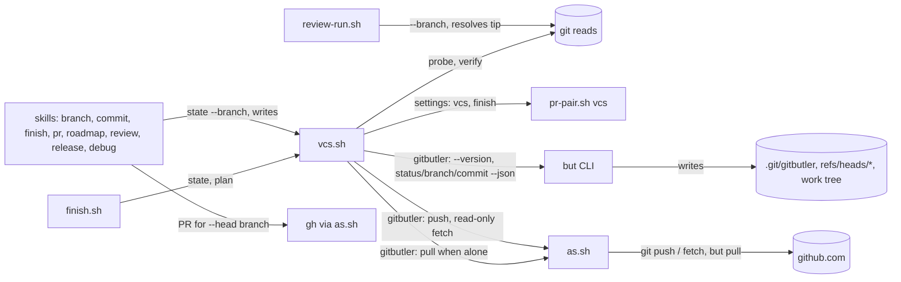
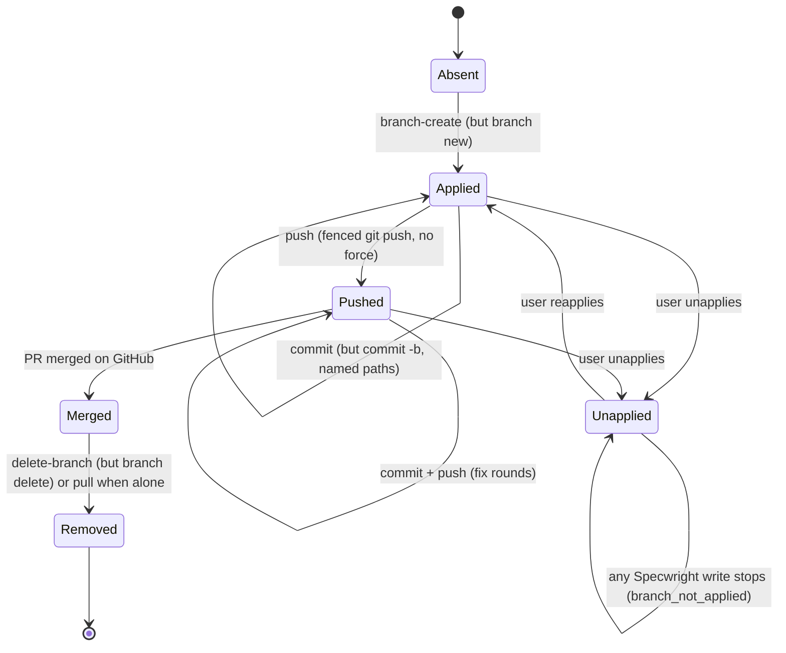
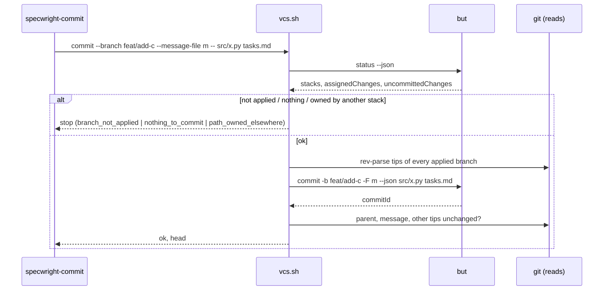
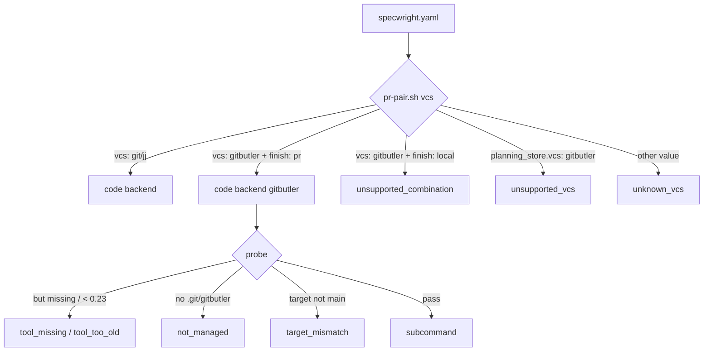

# Design

## Triage

| Trigger | Applies? | Evidence |
|---|---|---|
| T1 Components (new component, or 3+ with directed relationships) | Yes | A third backend inside `vcs.sh`, driving an external tool (`but`). It is reached from eight skills, `finish.sh`, `pr-pair.sh` and `review-run.sh`, and it calls `as.sh`, which gains a `but` fence. |
| T2 State (persistent state, caches, 3+ state machine) | Yes | GitButler's workspace state (`.git/gitbutler/`, applied branches, assignments), and a change branch with 5+ states: absent, applied, committed, pushed, unapplied by the user, merged, removed. |
| T3 Concurrency (background work, workers/isolates, async, retries) | Yes | Several agents and the user share one GitButler workspace. GitButler takes its own write lock and refreshes in the background (`.git/background-refresh.lock`, verified). `but pull` rebases every applied branch. |
| T4 Boundaries (data format, migration, shared interface, IPC, external) | Yes | New `vcs` value; `vcs.sh` JSON gains `head` and split dirty paths; `but --json` output parsed; review records keyed by branch tip; CI downloads a pinned `but` build and checks its SHA-256. |
| T5 Volume (grows without a fixed bound) | Yes | `but status --json` grows with the workspace (every applied branch's commits and every uncommitted change); paths named per commit. |
| T6 Risk (security, money, data loss, unrecoverable user data) | Yes | Another agent's uncommitted edits share the working tree; a bare `but commit` takes them all, `but push` always force-pushes, and `but pr` authenticates outside the identity fence (ADR 0008). |

TIER: FULL

## Context

- **The seam exists.** `vcs.sh` already takes `--repo --role [--code]` and prints one JSON document per subcommand (ADR 0017). The backend comes from `pr-pair.sh vcs` (`skills/specwright-pr/scripts/pr-pair.sh:755-773`), which accepts only `git` and `jj`, and `get_settings` repeats that check (`skills/specwright-pr/scripts/vcs.sh:132`). `probe` (`vcs.sh:157-188`) is where a third branch goes.
- **Ranges read HEAD.** These all assume HEAD is the change branch, which on GitButler is the `gitbutler/workspace` commit or another applied branch:
  - the pre-ship diff and record heads (`skills/specwright-review/scripts/review-run.sh:507-522, 819-831, 1087-1132, 1247-1249`);
  - the `Preship-Round` count (`review-run.sh:1506`);
  - task evidence ranges `<main>..HEAD` (`skills/specwright-commit/SKILL.md:53,63`);
  - the reviewer agent's `git diff <base>...HEAD` (`agents/claude/specwright-reviewer.md:23`, and the OMP copy);
  - finish's head guards and undo plan (`skills/specwright-finish/scripts/finish.sh:170-179, 412-418`).

  - the after-archive record lookup through `parent_of(moved)` = `HEAD^` and `archive_only(..., "HEAD", ...)` (`review-run.sh:1262, 1392-1398`);
  - `release.sh check --main`, which reads `merge-base HEAD <ref>`, `<ref>..HEAD` and the work tree's version files (`skills/specwright-release/scripts/release.sh:755-759`).

  On Git and jj HEAD is the branch tip, so naming the tip changes nothing there.
- **Cleanup and PR-pair Git writes outside `vcs.sh`.** `pr-pair.sh cleanup-plan` routes only jj through `vcs.sh plan` (`pr-pair.sh:2059`). Every other backend gets literal `git checkout <main>`, `git pull --ff-only` and `git branch -D/-d` (`pr-pair.sh:2069-2086`), which `specwright-pr` runs as given. `remote_contains` uses the `--refmap=` fetch only for jj (`pr-pair.sh:1274`, called at 1323 and 1819).
- **Callers of `state`.** They read `clean`, `on_main` and `branch`, and switch to main before pulling:
  - the gate (`skills/specwright-branch/SKILL.md:18`);
  - the commit completion check (`skills/specwright-commit/SKILL.md:63`);
  - finish (`skills/specwright-finish/SKILL.md:31,39-46`);
  - roadmap (`skills/specwright-roadmap/SKILL.md:30`);
  - PR cleanup (`skills/specwright-pr/SKILL.md:157-158`).

  Finish reads the archive and the `merge:` proof on the refreshed local `<main>` (`skills/specwright-finish/SKILL.md:39`, `pr-pair.sh:1988-2008`).
- **`finish` defaults to `local`.** The template ships `finish: local` (`templates/openspec/specwright.yaml:6`), and the skills treat an absent `finish` as `local` (`skills/specwright-commit/SKILL.md:67`, `skills/specwright-finish/SKILL.md:74`).
- **Unguarded Git writes.** With `vcs` unset, the Git backend writes with no check for a GitButler workspace (`vcs.sh:409, 423-425`). jj metadata gets only the `jj_present` note (`vcs.sh:188`).
- **Identity fence.** `as.sh` fences `git` and, since ADR 0017, only `jj git push` and `jj git fetch` (`skills/specwright-pr/scripts/as.sh:174-200`), refusing repository and config options.
- **CI.** `.github/workflows/evals.yml:59-76` installs a SHA-256-pinned jj; `JJ_VERSION` holds the pin.
- **GitButler 0.23.1, checked by running it in scratch repos on 2026-10-30:**
  - **Setup is implicit.** There is no setup step. Any `but` command, `but status` included, writes `.git/gitbutler/`, adds `gitbutler.project.targetRef` and `log.excludeDecoration` to `.git/config`, and later creates `gitbutler/target`. Global app state was untouched. `but setup` only says setup is no longer needed.
  - **HEAD.** With one branch applied, HEAD is that branch (single-branch mode). With two or more, HEAD is `gitbutler/workspace`, a synthetic merge commit with one parent per stack. `git branch --show-current` prints whichever is current.
  - **JSON output.** Every command takes `--json`. `status --json` has:
    - `uncommittedChanges[]` `{cliId, filePath, changeType}`;
    - `stacks[]` `{assignedChanges[], branches[{name, commits, branchStatus}]}`;
    - `mergeBase` and `upstreamState`.

    Short IDs change between calls, so names are the stable key. Without `--json`, a skill-install banner goes to stdout.
  - **Commit.** `but commit -b <branch> -F <file> <paths>` committed only the named paths. Repo-root paths and `dir/` work; `./` and globs do not. With no paths it commits everything, and with two or more stacks and no `-b` it refuses. Changes that depend on another stack are refused atomically. Multi-line messages and trailers were kept, minus the final newline. Author and committer come from Git `user.*`. **`pre-commit` and `commit-msg` hooks did not run.**
  - **Push and PR.** `but push` always force-pushes, pushes the branch and the branches below it, and runs from another directory, so relative remote URLs fail. A plain `git push origin b:b` on a GitButler branch worked, and status then showed `nothingToPush`. `but pr` authenticates with GitButler's own interactive forge login.
  - **Pull.** `but pull` fetches, rebases every applied branch onto the target, removes branches whose work landed upstream, and fast-forwards local main.
  - **Merge.** `but merge` has no message flag: its subject is `Merge branch '<b>'`.
  - **Delete and unapply.** `but branch delete` and `but unapply` act only on applied branches.
  - **Skills.** `but skill install --path <dir>` writes `SKILL.md` and `references/`. `but skill check --json` reports `{path, scope, installed_version, up_to_date}`.
  - **Downloads.** The official installer resolves `latest`, and the `release/0.23.1` GitHub release has no assets. But each build has a versioned URL. `https://app.gitbutler.com/api/downloads?channel=release` lists the latest 10 releases, each with a standalone Linux x86_64 `but`; on 2026-10-30 that was 0.23.1-3317 back to 0.20.4-3116 (released 2026-06-26). Whether a URL keeps answering after its build leaves that list is not known. For Linux x86_64 that includes the standalone CLI `https://releases.gitbutler.com/releases/release/0.23.1-3317/linux/x86_64/but`: a 47 MB glibc ELF that needs only `libc`, `libm`, `libgcc_s` and `libz`, all present on the workflow's `ubuntu-24.04` runner (`.github/workflows/evals.yml:31`). GitButler publishes no checksum; the listing's `sha` field is a source commit, not a file hash. Scoop's `extras/gitbutler` manifest hashes only the Windows installer from the same host.
  - **Checksum.** The SHA-256 of that `but` file, computed here on 2026-10-30, is `57e442543839c912f164fb91a20ea934826fc0023ddf552a70f2ed63ba514a73`.
  - **No daemon.** No desktop app or daemon is needed.
- **Scope set by the user (2026-10-30):** GitButler is PR mode only, code repo only, and CI pins `but`. The user first chose the installer plus a version check, because the design then said no versioned download existed. Once the versioned URLs were found, the user chose the pinned download with a SHA-256 check (2026-10-30). See proposal.md.

## Decisions

### D1: GitButler is a third backend inside `vcs.sh`, limited to the code repo and `finish: pr`

- **Choice:**
  - `pr-pair.sh vcs` accepts `gitbutler` for `vcs` only.
  - It refuses `planning_store.vcs: gitbutler` (`unsupported_vcs`).
  - It refuses `vcs: gitbutler` unless `finish` is exactly `pr` (`unsupported_combination`). An absent `finish` counts as `local`, as it does in the skills.
  - Every `vcs.sh` call reads these settings before probing, so the stop comes before any write in either repo.
  - `vcs.sh` gets a `gitbutler` branch for `probe`, `state`, `branch-create`, `switch`, `commit`, `delete-branch`, `fetch-main`, `pull`, `push` and `plan`. `merge` and `advance` stop with `unsupported_combination`; neither has a GitButler meaning in PR mode.
- **Rejected:** a separate `gitbutler.sh`, or letting the agent drive `but` from GitButler's own skill with Specwright rules around it. Either one splits the write boundary that ADR 0017 makes single. It would also leave fencing, path naming and the HEAD rules to prose, which the evals cannot pin.
- **Reversal cost:** low. The backend is one branch per subcommand plus a settings value.

### D2: The probe uses only `but --version` and Git reads

- **Choice:**
  - Git reads run first: `rev-parse --show-toplevel`, `.git/gitbutler/` exists, and `git config --get gitbutler.project.targetRef` names `refs/heads/<main>` or `refs/remotes/origin/<main>`.
  - Only then does `but --version` run, and it must report 0.23 or newer. It runs from a fresh temporary directory, not from the script directory, because installed skills live inside the code checkout.
  - The Git-checks-first order is what protects an unmanaged repo: `but` never runs at all until the repo is known to be managed already.
  - Missing pieces stop with `not_managed`, `target_mismatch`, `tool_missing`, `tool_version_unknown` or `tool_too_old`. `not_managed` tells the user to open the repo with GitButler (app or `but status`) themselves.
- **Rejected:** probing with `but status`. It succeeds in any Git repo and sets the repo up as a side effect (verified), so it would convert a repo the user never opted in, against #19's no-silent-setup rule.
- **Reversal cost:** low.

### D3: The change branch joins the workspace; the gate does not require a bare, clean main

- **Choice:**
  - On GitButler the gate's "on main" holds whenever the probe passes, because every applied branch is based on the target.
  - Uncommitted changes outside `
/changes/<change-name>/` do not stop the gate. It lists them once as changes this change will not commit.
  - `branch-create` runs `but branch new <branch> --json` and checks that the branch is applied, with no commits beyond the target.
  - An existing local branch of that name (`git show-ref`) stops as on Git.
- **Rejected:** requiring single-branch mode on a clean main, the Git rule. GitButler's point is parallel branches in one tree, and the M5 criterion requires other workspace changes to stay untouched. Requiring the workspace to be empty would turn that into "there are none". A clean-tree rule would also give little protection, because another agent can edit after the gate passes. D5's path naming is the protection that holds.
- **Reversal cost:** low. It is a gate rule, and tightening it later is a patch.

### D4: The caller names the change branch; ranges read its tip, never HEAD

- **Choice:**
  - `state` takes an optional `--branch <name>`.
  - On every backend it reports `head`, the commit that stands for the change:
    - on Git and jj, HEAD, after checking that the current branch equals `--branch` when one is given;
    - on GitButler, `refs/heads/<branch>`, plus `applied`.
  - On Git and jj, a `--branch` that differs from the current branch is reported (`branch_matches: false`), never a stop. Finish calls `state` from main, so the Git flow is unchanged.
  - The fields on GitButler:
    - `branch` is the `--branch` value when that branch is applied, else `""`. Without `--branch`, `applied_branches` lists every applied branch.
    - `on_main` is false when `--branch` names an applied branch, and true otherwise (no `--branch`, or the named branch is not applied). Finish step 1 (`skills/specwright-finish/SKILL.md:63-66`) and the gate rollback (`skills/specwright-branch/SKILL.md:41`) therefore see the change branch, not main, while it is applied, and they call `state --branch <prefix>/<change-name>` on GitButler.
    - Dirty paths come split into three lists. `dirty_paths` stays, as their union.
      - `change_paths`: paths assigned to the named branch, unassigned paths under `
/changes/<change-name>/` (the change name is the branch name after its first `/`), and unassigned paths that `<main>..<tip>` already touches.
      - `unassigned_paths`: every other unassigned path.
      - `other_branch_paths`: `{path, branch}` for paths assigned to another applied branch.
    - `clean` is true when `change_paths` is empty.
  - Unassigned paths are the change's business only when the change says so. Specwright never assigns hunks, so a file the implementer edited but never named sits in `unassigned_paths`. Callers that check for leftovers treat `unassigned_paths` as Git callers treat dirty paths:
    - the commit skill's completion check and Reconcile stop and ask about any unassigned path not noted at step 1, as on Git (`skills/specwright-commit/SKILL.md:63`);
    - finish's leftover check does the same.

    `other_branch_paths` never count.
  - `switch` on GitButler:
    - to `<main>`, it is a no-op success (`switched: false`): the workspace is always based on main;
    - to an applied branch, it is a no-op success (resume);
    - to an unapplied branch, it stops with `branch_not_applied`. Specwright never runs `but apply`, which can conflict with the other branches.
  - Every range reader takes a branch name and resolves the tip itself, on every call, instead of reading `HEAD`. A caller never hands in a SHA: the gate must judge the commit that is about to ship, as `current_heads` does today (`review-run.sh:1246-1250`).
    - `review-run.sh` takes new `--branch <name>` and `--store-branch <name>` options. It resolves `refs/heads/<name>` for the diff, the record key, the `Preship-Round` count, the after-archive lookup (`parent_of` and `archive_only` take the resolved tip), `heads_moved`, `gate` and `waive`.
    - Task-cover ranges are `<main>..<branch>`.
    - The reviewer brief is `git diff <base>...<branch>`.
    - Finish's head guards resolve the branch.
    - `release.sh check --branch <name>` reads the version files at the resolved tip with `git show`, and judges `<ref>..<tip>`.
  - Fail closed:
    - when the code repo's backend is `gitbutler`, `review-run.sh` and `release.sh check` stop with a usage error if `--branch` is missing;
    - on Git and jj, `--branch` is optional and the scripts read `HEAD`, as today.
  - The skills pass `--branch` with the branch being worked on: `<prefix>/<change-name>` for a change, and the roadmap's `<branch>` (`docs/project-baseline`, `docs/close-*`) for a roadmap branch. The call sites that change:
    - the gate (`on_main`, `clean`, rollback);
    - commit (step 1 note, Reconcile, completion check, task-cover);
    - finish (step 1, `clean`, leftovers, switch);
    - roadmap (clean main, branch rollback);
    - the PR skill (ship step 1's branch and clean check, ship's release check, feedback pass, cleanup);
    - review (preflight, run, record, gate, waive).
- **Rejected:** making HEAD the change branch, either by switching to it in single-branch mode or by unapplying the other branches during a step. That rewrites other agents' workspace, and is exactly what the criterion forbids.
- **Rejected:** reading `gitbutler/workspace` and filtering commits by branch. That is fragile when stacks share files, and impossible to key review records by.
- **Reversal cost:** medium. Review records are keyed by the tip. On Git and jj that is the same SHA as HEAD, so old records stay valid (ADR 0007's per-head rule is unchanged).

### D5: Commits name every path, target the branch with `-b`, and check ownership first

- **Choice:**
  1. Read `but status --json`.
  2. Stop with `branch_not_applied` when the branch is not applied.
  3. Stop with `nothing_to_commit` when no named path covers an uncommitted change, judged from step 1's `uncommittedChanges` as in step 6 (a path that only a rename's source covers counts as unchanged here). Step 7 never runs with an empty path list.
  4. Stop with `path_owned_elsewhere` when a named path appears in another stack's `assignedChanges`.
  5. Normalize the paths to repo-relative form with `/` and no `./`. Directories end in `/`. Glob characters stop with `bad_path`.
  6. Pass to `but` only the named paths that cover at least one `uncommittedChanges[].filePath` read in step 1 (a directory covers as a prefix). A named path that covers none is left out of the arguments. It is either unchanged or only the source of a rename, which GitButler lists once, at the new path, and commits whole, deletion included. `but commit` fails on a path it cannot find (verified, task 1.3), so naming a rename's source would fail the whole commit.
  7. Run `but commit -b <branch> -F <msgfile> --json <paths...>`, with the message file outside the work tree (it is the caller's file, and `specwright-commit` already keeps it in a temp subdirectory).
  8. Verify with Git reads:
     - the new tip's parent is the old tip;
     - the file set of `git diff-tree --no-commit-id --name-only --no-renames -r <new tip>` lies under the named paths, all of them and not only those passed to `but` (nothing extra), and holds every `filePath` from step 1 under the named paths (nothing missing). A directory matches as a prefix. A rename's source is checked like any other path, so an archive commit that names only the new directory fails with `commit_mismatch`, because the deletions under `
/changes/<change-name>/` were not named;
     - `git log -1 --format=%B <branch>` equals the message, ignoring the final newline;
     - every other branch's tip is unchanged.

     The file-set check is needed because `but commit` reads its arguments as CLI IDs (`but commit --help`, `but help cli-ids`), so a short path can resolve to another object. If another agent's `but pull` removed the branch between steps 2 and 7, `but commit -b` recreates it on the target. That shows up as a parent mismatch, never as a silent success.

     If verification fails, stop with `commit_mismatch`, report both tips and leave the commit in place. The user decides, as with every other post-write mismatch.
  - **Hooks.** `but commit` runs no `pre-commit` or `commit-msg` hook (verified). Specwright writes every trailer into the message itself, so no Specwright evidence depends on a hook. The README says that hooks do not run under GitButler, and that `pr.validate` still runs before each push.
- **Rejected:** writing the commit with Git plumbing (`commit-tree` + `update-ref` on the branch). It bypasses GitButler's workspace state, which then sees a branch it did not make. The GitButler skill also forbids Git writes in the workspace.
- **Rejected:** running the hooks ourselves. They would see the whole workspace tree, not the branch's.
- **Reversal cost:** low.

### D6: Push with the fenced Git push, without force; open the PR with `gh`

- **Choice:**
  - After checking that the branch is applied, `push` runs `as.sh <login> git push origin refs/heads/<branch>:refs/heads/<branch>`. It runs without force and without `-u`, which would write `branch.<b>.*` config. It does not reuse the Git backend's `push -u origin HEAD` (`vcs.sh:461-463`), because HEAD is the wrong commit here.
  - A non-fast-forward rejection stops with `push_rejected`.
  - `specwright-pr` opens and edits the PR with `gh pr create --head <branch>` as today.
  - On GitButler the push is the one Git write besides the release tag. It writes the remote branch and its remote-tracking ref, never HEAD, the index, the work tree or a local branch.
- **Rejected:** `but push`. It always force-pushes, which could overwrite a reviewer's suggestion commit. It pushes the branches below in a stack, and runs from another directory.
- **Rejected:** `but pr`. Its interactive forge login authenticates outside ADR 0008's fence, and it creates stacked PRs.
- **Reversal cost:** low.

### D7: `but pull` runs only when no other branch is applied

- **Choice:**
  - `pull` reads `but status --json` and `git worktree list --porcelain`.
  - It runs `as.sh <login> but pull --json` and reports `pulled: true` only when both hold:
    - no applied branch remains other than the `--branch` being cleaned up;
    - no linked worktree exists. `but pull --help` gives `--update` a default of `worktrees,workspace`, and even `workspace` rebases the worktrees based on applied branches.
  - Otherwise it runs no `but` write and returns `ok: true, pulled: false, reason: pull_skipped, applied_branches: [...], worktrees: [...]`. Callers report the skip and go on.
  - On GitButler, every step that reads main after a pull reads `fetch-main`'s fetched commit instead of local `<main>`:
    - the gate's archive check;
    - finish's A and M checks (`skills/specwright-finish/SKILL.md:39`);
    - `pr-pair.sh branch-check`.

    A stale local target therefore never hides a merged archive or proof. Git and jj keep reading local `<main>`.
- **Rejected:** always `but pull`. It rebases every applied branch, which is another agent's published history.
- **Rejected:** never pulling. After the first cleanup the target would never move, and every new branch would start further behind.
- **Reversal cost:** low.

### D8: `fetch-main` is the read-only fetch; `delete-branch` needs the merge proof

- **Choice:**
  - `fetch-main` on GitButler is the jj backend's `FETCH_HEAD`-only fetch (ADR 0017), fenced the same way. It touches no GitButler state.
  - `delete-branch` runs `but branch delete <branch> --json` on an applied branch.
  - Without `--force` it first proves the merge: the tip is an ancestor of the fetched main. With `--force`, the caller already proved a merged PR, as for squash merges today.
  - When the branch is already gone (removed by `but pull`), it reports `already_deleted`.
  - The delete has a second precondition, read from state on every call: the commit the workspace is based on must already contain the merged change.
    - That commit is GitButler's stored base: `mergeBase.commitId` from `but status --json`. Task 1.2 checked it in a scratch repo with a remote (2026-10-30, `but` 0.23.1): it stayed put when `git fetch origin` moved `origin/main`, and moved to the fetched commit on `but pull`. The `gitbutler/target` ref moved on neither, so it is not the base.
    - It is never `gitbutler.project.targetRef`, which can be `refs/remotes/origin/<main>` and moves on any fetch, GitButler's background refresh included.
    - "Contains" means the branch tip is an ancestor of that base, or, for a squash merge, the `--merged-commit <sha>` is. That commit is GitHub's `merge_commit_sha` for the merged PR. `pr-pair.sh`'s `norm_pr` (`pr-pair.sh:687-690`) gains `merge_commit_sha`, so `discover --state merged` and `cleanup-plan` carry it; today only the agent-merge result returns it (`pr-pair.sh:2120-2121`). The repo-local cleanup passes the `newest` merged PR's `merge_commit_sha`. When it is null, the delete judges the tip alone.
    - Otherwise the delete runs no `but` write and reports `ok: true, deleted: false, reason: left_applied`.
    - Reason: `but branch delete` removes a branch's commits from the shared work tree. Until the target holds the merged change, deleting the branch would take that code away from every other agent, and could break hunks of other branches that depend on it.
    - This precondition does not depend on whether an earlier pull ran, so it holds whatever happened between the two calls. The user's next `but pull` removes the branch as integrated.
  - An existing but unapplied branch stops with `branch_not_applied`, and Specwright never deletes it with Git.
- **Rejected:** `git branch -D`. It is a Git write against a branch GitButler tracks.
- **Reversal cost:** low.

### D9: GitButler's own skill is the tool guidance, offered and never installed silently

- **Choice:**
  - The install prompt offers, per selected agent, `but skill install --path <agent skills dir>/gitbutler`. It always passes `--path`, because without a terminal `but` picks a global directory. It runs only on the user's yes.
  - The branch gate runs `but skill check --json` after the probe passes (the repo is already managed, so its side effects are moot). When it finds the skill missing or outdated it adds one note with the install command, never a stop.
  - Specwright's skills tell the agent to load the `gitbutler` skill when the backend is `gitbutler`, and keep every write in `vcs.sh`.
- **Rejected:** vendoring a GitButler skill in Specwright. It would drift with `but` releases, and #19 asks to reuse GitButler's maintained one.
- **Reversal cost:** low.

### D10: Real-`but` evals in scratch repos; CI downloads a pinned, checksummed `but`

- **Choice:**
  - `evals/vcs` gains `butenv.py`, built like `jjenv.py`: scratch repos under a short temp root, a local bare remote, the fake `gh`, and every Git call Specwright makes logged.
  - A fixture opens a repo with `but status` once and caches it through `fixturecache.py`. Tests run only in those repos.
  - A fixture test checks that a copied repo still works under `but` at its new path. `.git/gitbutler/` may record absolute paths. If the copy does not work, the fixture is built per test file instead of copied.
  - Every real-`but` test lives in `evals/vcs`, including those for `cleanup-plan`, `review-run.sh --branch`, `release.sh check --branch` and the undo plan. `evals/suites.json` maps `pr-pair.sh`, `as.sh`, `review-run.sh`, `release.sh` and `finish.sh` to `vcs` as well as to their own suites, so `--changed main` runs those tests locally too.
  - `BUT_VERSION` holds the build (`0.23.1-3317`); its SHA-256 sits in the workflow beside it, as `JJ_VERSION`'s does (`.github/workflows/evals.yml:59-76`).
  - Only the `vcs` suite's job (`if: matrix.suite == 'vcs'`) installs `but`. It downloads `https://releases.gitbutler.com/releases/release/<BUT_VERSION>/linux/x86_64/but` with `curl --fail`, checks it with `sha256sum --check` before it is made executable, installs it into a job-local bin directory on `PATH`, and fails setup unless `but --version` names the version part of `BUT_VERSION`, derived in the step so a bump edits only `BUT_VERSION` and the hash.
  - Every suite job sets `SPECWRIGHT_REQUIRE_BUT=1`, so a real-`but` test placed outside `evals/vcs` fails in CI instead of skipping. `evals/runner/test_butenv.py` clears the variable itself, as `test_ci_workflow.py` does for jj.
  - An upstream release changes nothing in CI: the URL and hash are fixed. A bump edits `BUT_VERSION` and the hash together.
  - The download needs no installer, no shell piped from the network, and no GitButler account.
  - Locally, a missing `but` skips with `but not installed`.
- **Rejected:** the official installer plus a version check (the user's first choice). It always installs the latest build, so every upstream release would fail the `vcs` job until the pin moved, and nothing checks the bytes.
- **Rejected:** building from source at a pinned tag. It is verifiable but costs a Rust build per CI run (the user chose against it on 2026-10-30).
- **Rejected:** local-only tests. The CI rule that a missing tool fails would need an exception.
- **Reversal cost:** low. Only the install step and `BUT_VERSION` change.

### D11: Debug never stashes, and the undo plan writes files from Git reads

- **Choice:**
  - On GitButler `specwright-debug` asks instead of stashing, as on jj.
  - `finish.sh undo-archive-plan` gets a `gitbutler` script with these steps:
    1. guard on `vcs.sh state --branch <b>` (applied, tip equals the archive commit, no uncommitted change under the touched paths);
    2. `mv` the archived directories back;
    3. write each main spec from `git cat-file --filters <pre-archive>:<path>`, as the Git plan does (`finish.sh:433`), and remove a spec the archive created;
    4. `but commit -b <b> -F <msg> <touched paths>`.

    It runs no Git write.
- **Rejected:** `git restore --source` or `git checkout <rev> -- <path>`. Both are Git writes to the shared work tree and index.
- **Reversal cost:** low.

### D13: PR-pair cleanup and fetches route every non-Git backend through `vcs.sh`

- **Choice:**
  - `pr-pair.sh cleanup-plan` sends every repo whose backend is not `git` through `vcs.sh plan`, using `backends[k] != "git"` in place of `== "jj"` at `pr-pair.sh:2059`.
  - For GitButler, `vcs.sh plan` emits the steps in order:
    1. the `switch` no-op;
    2. `vcs.sh pull --branch <b>`;
    3. `vcs.sh delete-branch --branch <b> --force --merged-commit <sha>` (the PR's `merge_commit_sha` from `cleanup-plan`'s PR data, omitted when null), which deletes only when the workspace base already holds the merge (D8).
  - `remote_contains` uses the `--refmap=` fetch for every non-Git backend (`pr-pair.sh:1274`).
  - The store keeps its own backend's plan, so a Git store's cleanup is unchanged.
  - The feedback pass (`pr-pair.sh pass plan`, which today reads `git status -uall` over the whole tree, `pr-pair.sh:1635-1646`, and raises `unrecorded_change` at `1779-1783`) reads the code repo through `vcs.sh state --branch <b>` on a non-Git backend:
    - `other_branch_paths` are outside the pass and never `unrecorded_change`;
    - `pass write` also records the `unassigned_paths` present when the pass starts, as `preexisting` in the existing pass record (no new state file). Those paths are ignored by `plan`;
    - an unassigned path that appears during the pass and is outside the recorded files is `unrecorded_change` (ask), consistent with D4's leftover rule. Another agent editing during a pass is therefore asked about once, not on every round.
- **Rejected:** leaving `cleanup-plan` alone and having the GitButler skill prose skip its Git lines. Those are generated commands that the PR skill runs as given, so the prose cannot reliably veto them, and no eval would see the gap.
- **Reversal cost:** low.

### D14: The Git backend refuses a GitButler workspace

- **Choice:**
  - With `vcs` resolving to `git`, `probe` stops with `gitbutler_workspace` before any write when `.git/gitbutler/` exists and `gitbutler.project.targetRef` is set, whatever HEAD is.
  - No HEAD is exempt. `probe` runs on every `vcs.sh` subcommand, so an exemption for HEAD on `<main>` would let the gate create a Git branch that every later call then refuses.
  - The message says to set `vcs: gitbutler`, or to take the repo out of GitButler before using Git.
- **Rejected:** inferring `gitbutler` from the metadata. ADR 0017 keeps the setting explicit, and refusing an unsafe write is not inference.
- **Rejected:** silently running Git in the workspace, as today. It corrupts the workspace, as `but`'s own guidance says.
- **Reversal cost:** low.

### D12: A new ADR supersedes 0017

- **Choice:** ADR 0018, "Version-control backends: Git, colocated jj and GitButler", restates 0017's decisions and adds these:
  - `gitbutler` for the code repo only, with `finish: pr` only;
  - a probe that never sets a repo up;
  - the named-branch rule, with ranges reading the tip and never HEAD;
  - named-path commits;
  - the fenced Git push as the second named Git write;
  - a pull that never rebases another branch or worktree;
  - the Git backend's refusal to write in a GitButler workspace.

  The index row for 0017 is replaced. 0017's file stays unchanged.
- **Rejected:** a separate ADR beside 0017. 0017 says the setting "accepts `git` or `jj`" and that only the release tag bypasses its Git-write rule, so an ADR that only adds to it would contradict an accepted ADR.
- **Reversal cost:** low.

## Diagrams (FULL)

Components (T1):

Change branch in a GitButler workspace (T2):

Commit with other agents in the workspace (T3):

Settings to backend (T4):

## State & Ownership (FULL)

| State | Owner (sole writer) | Lifetime | Invalidation / rebuild | Authoritative copy |
|---|---|---|---|---|
| `vcs`, `finish` (as read for the combination check) | The user (`specwright.yaml`) | Project lifetime | Read fresh by every `vcs.sh` call | Code repo's `openspec/specwright.yaml` |
| GitButler workspace state (`.git/gitbutler/`, `gitbutler/workspace`, `gitbutler/target`, `gitbutler.project.*` config) | GitButler (`but`), driven by the user, other agents and `vcs.sh`'s `but` calls | Repo lifetime | Rebuilt by GitButler; Specwright never edits it directly | `.git/gitbutler/` |
| Change branch `refs/heads/<prefix>/<name>` | `vcs.sh` through `but branch new`, `but commit -b` and `but branch delete`; the user may unapply or rebase it | Gate until cleanup | `state --branch` re-reads it every call; drift is `branch_not_applied`, `commit_mismatch` or `push_rejected` | Repo refs |
| Assignment of uncommitted changes to stacks | GitButler (and the user through its UI) | Until committed | Read every call from `but status --json`; never written by Specwright | GitButler |
| Remote change branch | `vcs.sh push` (fenced Git push, no force) | Until remote cleanup (ADR 0009) | Next push; never forced | origin |
| Local target / main | `but pull` inside `vcs.sh pull`, only when no other branch is applied (D7). `refs/remotes/origin/<main>` (when it is the target ref) also moves on any fetch; only the stored workspace base is moved by `but pull` alone | Until the next pull | The next allowed pull | GitButler target |
| `FETCH_HEAD` | `vcs.sh fetch-main` | Read in the same call | Overwritten by any fetch | origin |
| Pre-ship review records | `review-run.sh`, keyed by the tip it resolves from `--branch` (D4) | As ADR 0007 | As ADR 0007 | State dir |
| GitButler agent skill files | `but skill install`, on the user's yes only | Until reinstalled | `but skill check` reports staleness (D9) | The agent skills dir |

No piece of state gets a second Specwright writer. Others write the workspace state; Specwright reads it fresh on every call and never caches it.

## Failure & Visibility (FULL)

| Component | Fails / dies mid-operation → | Recovery | Retry safe? | Who finds out |
|---|---|---|---|---|
| Settings check | `gitbutler` store or local finish | `unsupported_vcs` / `unsupported_combination` before any write | Yes | User |
| Probe | `but` missing, too old, repo not managed, wrong target | Named stop before any `but` call other than `--version` | Yes | User |
| `branch-create` | `but` dies after creating the branch, before it is applied | Gate rollback as today: if the branch exists, `but branch delete` (applied) or report it for the user (unapplied) | Yes | User (gate report) |
| `commit` | `but` errors (lock held by another `but`, dependency lock) | Exit 1 `but_error` with `but`'s message; nothing committed (`but commit` is atomic, verified for dependency refusals) | Yes | User/agent |
| `commit` | Dies after `but commit`, before verification | Next run: task-cover sees the commit on the branch by its subject/trailers; Reconcile as today | Yes | Agent (Reconcile) |
| `commit` | Verification finds another branch's tip moved, or the message changed | `commit_mismatch` with both tips; nothing undone | After the user looks | User |
| `push` | Rejected (branch rewritten elsewhere), fence refusal, network | `push_rejected` or exit 3; no force retry | Yes | User (ship's push stop) |
| `pull` | Other branches applied, or a linked worktree exists | `pull_skipped`, not a failure; cleanup then leaves the merged branch applied (D8) | — | User (one line in the cleanup report) |
| Finish / `branch-check` after a skipped pull | Local `<main>` lacks the merged archive | Reads the fetched remote main instead (D7) | Yes | Nobody needs to |
| `commit` | `but` resolved a path as another object's CLI ID | `commit_mismatch` naming the files the commit took; commit left for the user | After the user looks | User |
| Git backend in a GitButler workspace | `vcs` unset or `git` in a GitButler-managed repo | `gitbutler_workspace` before any write (D14) | Yes, after setting `vcs` | User |
| `cleanup-plan` (store-backed) | — | GitButler code repo routed through `vcs.sh plan` (D13) | Yes | — |
| `pull` | `but pull` conflicts or fails | Exit 1 `but_error`; GitButler keeps its own undo (`but undo`), which the message names; Specwright runs no undo | Yes, after the user acts | User |
| `delete-branch` | Merge not proven | Stop before any `but` write | Yes | User |
| Concurrent `but` from another agent | GitButler write lock held | `but_error` naming the lock; never retried in a loop | Yes | User/agent |
| `as.sh` with `but` | Other subcommand or a repository option | Exit 3 before running | Yes | User |
| CI `but` install | Download fails, its SHA-256 differs from the pinned hash, or `but --version` differs from `BUT_VERSION` | The `vcs` job's setup fails, naming the failed check; other suites' jobs are unaffected | After the URL is reachable again or the pin and hash are fixed together | PR check |

## Resource Bounds (FULL)

| Queue / buffer / cache / transfer | Bound | At the bound | Timeout | At 10x / 100x |
|---|---|---|---|---|
| Paths in one `commit` | The OS command-line limit, as on Git and jj (ADR 0017's `too_many_paths` check) | `too_many_paths` before any write; the caller names directories | — | Group sizes are tens of paths |
| `but status --json` output | 16 MiB read by `vcs.sh` | `but_output_too_large` before any write | — | A workspace of 10 applied branches with hundreds of changes is well under 1 MiB (each change is about 100 bytes); 100x is still under the cap |
| `but` local commands | No deadline, like local Git and jj in `vcs.sh` | — | The agent's tool timeout | Constant per call |
| Network (`push`, `fetch-main`, `but pull`) | As today's fenced commands: no deadline (ADR 0017) | — | The agent's tool timeout | Unchanged |
| GitButler eval wall time | Scratch repos opened once per test file and copied | — | Suite timeout 45 min in CI | Measured in `evals/timings.md` |

## Flow & State Gaps (FULL)

- **Another agent commits to its own branch during our commit.** `but` serializes writes with its lock. Our verification compares only our branch's parent and message, plus other tips read before our call. A tip that moves through another agent's commit in between reads as `commit_mismatch`. Default: stop and show it. A false stop is safer than a missed sweep.
- **The user unapplies the change branch mid-change.** Every write stops with `branch_not_applied`. Specwright never reapplies it, because that can conflict with the other branches.
- **The user runs `but pull` themselves while the change is pushed.** The branch is rebased, and the next push stops with `push_rejected`. The user decides whether to force, and Specwright never forces.
- **Another agent edits a file our task also edits, unassigned.** `but commit <path>` takes the whole file's uncommitted hunks. The gate's list and the commit's `unassigned_paths` make it visible. The residual risk is recorded under Risks: GitButler's own model has the same limit (its docs call parallel agents "not runtime isolation").
- **Archive commit.** `openspec archive` moves the change directory: deletions under `
/changes/<name>/` and additions under `archive/`. The commit names finish's archive paths exactly (`skills/specwright-finish/SKILL.md:14`): `
/changes/<change-name>/` (a deleted directory), `
/changes/archive/<archived-name>/`, and each synced main spec by file. It never names the parent `
/changes/` or `
/specs/`, which would take another change's uncommitted planning files in the shared work tree. Task 1.3 checked how `but` 0.23.1 sees the move (2026-10-30). A file moved unchanged is one `renamed` change at its new path, and committing that path also commits the deletion at the old path. A file changed while moved is an `added` change at the new path and a `removed` change at the old one. A deleted directory named by path commits its deletions. Naming a path that only a rename's source covers makes `but commit` fail with "Could not find uncommitted change", so D5 step 6 leaves such a path out of `but`'s arguments while the file-set check still holds the commit to every named path. Another change's uncommitted planning files stayed uncommitted.
- **Restart mid-ship.** The push is idempotent (no force). PR creation keeps today's lookup-first rule.
- **`but` upgraded past `BUT_VERSION` locally.** The probe only enforces the floor (0.23). CI pins the exact version. A behaviour change shows up as an eval failure on the next pin bump.
- **The store is Git or jj while the code repo is GitButler.** Paired commits, the gate lock and rollback keep today's order. Each repo uses its own backend, as in the existing "Paired repos each use their own backend" requirement.

## Mechanism Ledger (FULL)

| Mechanism | Built? | Why (harm nobody catches / expensive later) | Evidence that would change the call |
|---|---|---|---|
| Probe without `but` side effects | Yes | Otherwise any Specwright call silently sets up a repo the user never chose to put in GitButler | `but` gaining a read-only status mode |
| Ownership check before commit (`path_owned_elsewhere`) | Yes | A named path holding another stack's changes would move them silently | `but commit -b` refusing assigned paths itself (then keep the check as a clearer message) |
| Post-commit verification | Yes | A commit landing on the wrong branch, or with a trimmed message, breaks task evidence that later steps trust | — |
| No-force push | Yes | A force push could erase a remote commit nobody notices until merge | — |
| Pull skip when other branches are applied | Yes | Rebasing another agent's pushed branch rewrites published history | — |
| Range by branch tip (`--branch`, resolved in the script) on all backends | Yes | Pre-ship review of other branches' code; records keyed by the workspace commit; the record key format is expensive to change later | — |
| `but` fence in `as.sh` | Yes, `pull` only | An unfenced fetch could use another account's credentials (ADR 0008) | Specwright needing another networked `but` subcommand |
| File-set check after commit | Yes | `but` resolves arguments as CLI IDs; a wrong file committed would pass every other check | `but` gaining a path-only argument mode |
| Fail-closed `--branch` on GitButler, resolved per call | Yes | A forgotten or stale head would review, key or gate the wrong commit silently | — |
| Git-backend workspace refusal (D14) | Yes | `vcs` unset in a GitButler workspace would corrupt it with Git writes | — |
| Delete skipped after a skipped pull | Yes | Deleting would remove merged code from every agent's work tree until a pull | — |
| Handling stacked branches | No | Specwright never creates them; `but branch new` without `-A/-B` makes a new stack | Users stacking change branches |
| `but worktree` isolation | No | Out of scope; the shared workspace is the GitButler model the criterion names | A dogfood run where shared-file sweeps actually happen |
| Retry on GitButler's write lock | No | One call per step, errors surface; a loop could hide a stuck lock | Frequent lock errors in dogfood runs |
| Checksum for `but` in CI | Yes, SHA-256 pinned in the workflow | The versioned download could change under the same URL | GitButler publishing signed checksums, which would replace ours |

## Risks / Trade-offs

- **[Risk] Local `but` reads (`status`, `commit`, `branch`) may reach the network.** GitButler refreshes in the background, and `but status --refresh-prs` "forces" a forge sync, which suggests a sync without the flag. A fetch or forge call made outside `as.sh` would break ADR 0008 and the Git-write boundary. → Task 1.1 checks this before any other code is written, with a logging bare remote (fetch attempts) and the fake `gh` plus an unroutable forge host (API calls), in a scratch repo with a remote. If any local read touches the network, apply stops and the design goes back for a new review round, because the fix (env that disables network, or fencing every `but` call) changes D5 and the `as.sh` boundary.
  - **Result (task 1.1, 2026-10-30, `but` 0.23.1 on Windows).** Every request was routed through a logging proxy. The origin was `https://github.com/...`, and `gh` was faked. `status --json`, `branch new`, `commit -b` and `branch delete` made no fetch, no forge or `github.com` call and no `gh` call. A Git positive control and `but pull` were both logged, so the proxy saw that traffic. The one request the local commands made was GitButler's usage metrics to `eu.i.posthog.com`, nine requests over five commands. It carries no Git credential and no repository data that Specwright sends; it follows the user's own `but config metrics` setting, which Specwright never changes. With metrics disabled in an app-data directory isolated by `E2E_TEST_APP_DATA_DIR`, the same commands made no request at all, and the user's own app data was untouched. `butenv.py` uses that isolated app-data directory and disables metrics in it, so no eval sends metrics.
  - **Line endings.** With the Windows Git default `core.autocrlf=true` in system config, `but branch delete` failed in a scratch repo with "1 conflict prevents checkout". It succeeded with `autocrlf` off. CI runs on Linux, and `butenv.py` sets `GIT_CONFIG_NOSYSTEM=1` and `core.autocrlf=false` in its scratch repos. Only `branch delete` was seen failing. `but pull`, which also checks out the workspace, was not run with `autocrlf` on, so whether cleanup's pull works there is open until the dogfood run. When a `but` write fails and the repo's effective `core.autocrlf` is `true`, `vcs.sh` keeps `but_error` and adds `hint: core.autocrlf is true; GitButler checkouts can conflict on line endings` to the message. The README states this limit under the GitButler setup.
- **[Risk] Which GitButler value holds the workspace base.** → An apply task checks, in a scratch repo with a remote, that the chosen value is unchanged after `git fetch origin` moves `origin/<main>`, and moves after `but pull`. If no value behaves that way, apply stops and the design returns for review. Result (task 1.2): `mergeBase.commitId` behaves that way, and `gitbutler/target` does not (D8).
- **[Risk] `but pull` may not honour `as.sh`'s `GIT_CONFIG_*` fence if it fetches without system Git.** → An apply task checks it against a fenced `insteadOf` rule, as the jj smoke run did. If `but pull` does not honour the fence, `pull` on GitButler always reports `pull_skipped` with reason `unfenced`, and the user pulls. The specs still hold: a skipped pull is not a failure. Result (task 1.4): `but pull` fetches by running system `git fetch`. A `GIT_CONFIG_*` `insteadOf` rule redirected it, and over HTTP it called the env-provided credential helper; the logging server then received that helper's credential. The `unfenced` fallback is not needed.
- **[Risk] GitButler CLI flags change quickly (setup removed between docs and 0.23.1).** → A version floor in the probe, an exact pin in CI, evals against the real CLI, and `--json` only.
- **[Risk] Shared-file edits by another agent are committed with ours.** → The gate and commit name unassigned paths, and the README states the limit. GitButler documents the same limit.
- **[Risk] Hooks do not run on `but commit`.** → Specwright adds its trailers itself, and `pr.validate` runs before push. The README says so.
- **[Risk] The pinned hash is ours, not GitButler's.** It proves CI runs the bytes that were hashed on 2026-10-30, not that GitButler built them. The hash is trust-on-first-use from one download; Scoop hashes only the Windows installer from the same host. → The download is over HTTPS from GitButler's release host, and the binary runs only in scratch repos, in a job with the default read-only token.
- **[Risk] GitButler removes an old build from its release host.** → The `vcs` job fails at the download with `curl --fail`, naming the URL. The fix moves `BUT_VERSION` and its hash together to a listed build. The listing holds only the latest 10 releases, about four months at the 2026 pace, so a pin that has left it may stop downloading.
- **[Trade-off] Tests and the implementer run against the whole workspace, other branches' code included.** That is GitButler's model, and it is stated in the README.

## ADRs

- **In force, constraining this change:**
  - 0001: OpenSpec untouched.
  - 0002: thin scripts.
  - 0003: Git history stays the evidence; no new local state.
  - 0006: OpenSpec resolves the planning root (store pairing follows from it).
  - 0007: review records keyed by head, now the branch tip.
  - 0008: fencing, so no `but pr` and no `but push`.
  - 0009: remote deletion only through `delete-remote`.
  - 0010: annotated tags.
  - 0016: subjects and trailers as evidence, written by Specwright and not by hooks.
  - 0017: one backend script, to be superseded by 0018.
- **To record during apply:** ADR 0018, "Version-control backends: Git, colocated jj and GitButler". It supersedes 0017 (D12). The architecture index replaces 0017's row, and the `vcs.sh` row of the Components table names the GitButler backend.

## Open Questions

- Whether `but pull` and `but branch delete` work in a workspace with `core.autocrlf=true`; the dogfood run on Windows answers it.
- Whether `BUT_VERSION` follows each GitButler release or stays at 0.23.1-3317 until a dogfood project needs newer. Only the pin and its hash change. A pin that has left the 10-release listing has no evidence of staying downloadable.
