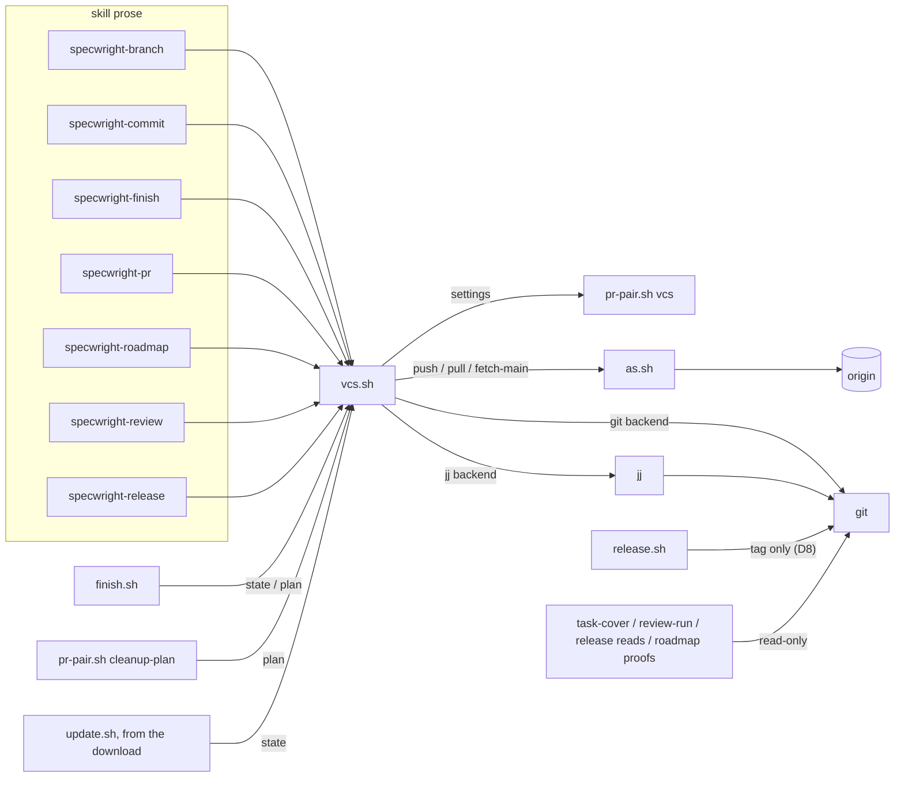
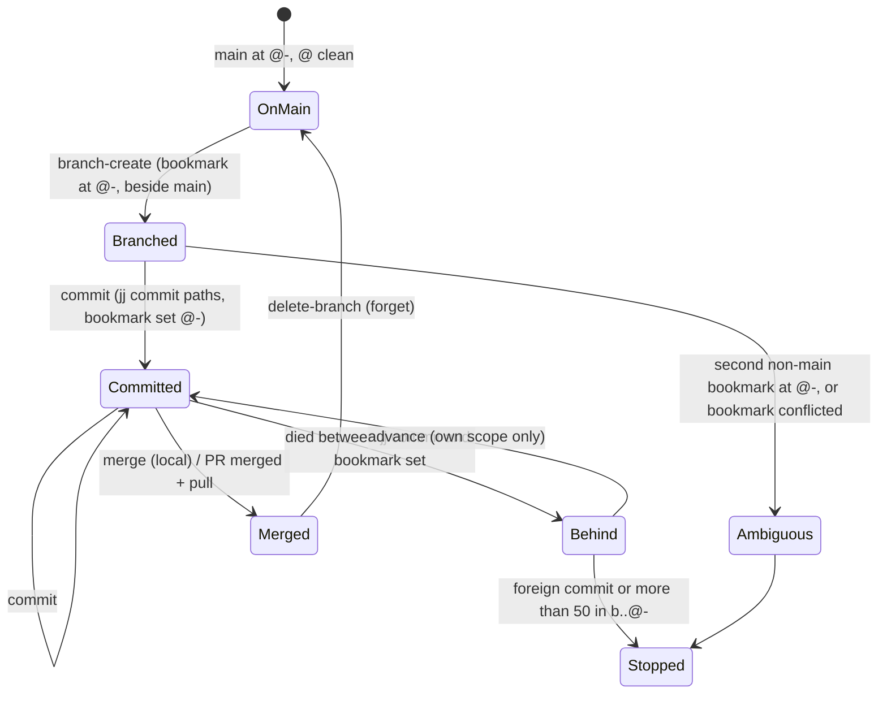
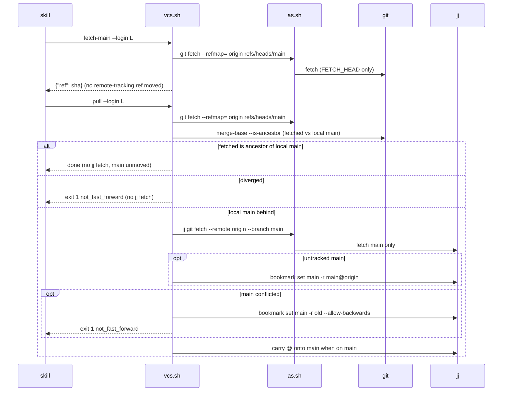

# Design

## Triage

| Trigger | Applies? | Evidence |
|---|---|---|
| T1 Components (new component, or 3+ with directed relationships) | Yes | A new script, `skills/specwright-pr/scripts/vcs.sh`. Eight skills, `finish.sh`, `pr-pair.sh` (`cleanup-plan`, `remote_contains`) and `update.sh` call it, and it calls `git`/`jj` and `as.sh`. |
| T2 State (persistent state, caches, 3+ state machine) | Yes | jj bookmarks and the `@`/`@-` invariant are new workflow state. A jj change branch has 5+ states: on main, branched, committed, behind, ambiguous. |
| T3 Concurrency (background work, workers/isolates, async, retries) | Yes | jj snapshots the working copy on every command; another agent or the user can run jj in the same repo; jj imports remote-tracking moves into tracked bookmarks; recovery after an interrupted commit or merge. |
| T4 Boundaries (data format, migration, shared interface, IPC, external) | Yes | The new `vcs` and `planning_store.vcs` settings; the `vcs.sh` JSON interface shared by skills and scripts; an external tool (jj 0.46+); the CI workflow installs a pinned binary. |
| T5 Volume (grows without a fixed bound) | Yes | The paths named in one commit; commits walked by the resume check. Both get bounds below. |
| T6 Risk (security, money, data loss, unrecoverable user data) | Yes | Identity fencing for jj pushes (ADR 0008). `jj new` takes a non-empty `@` off disk (verified, see D3); a full `jj git fetch` deletes a tracked bookmark whose remote branch is gone and abandons its commits (verified, see D12). |

TIER: FULL

## Context

- **Every write is prose.** Git writes live in the skill prose the agent runs (`skills/specwright-branch/SKILL.md:22,41`, `skills/specwright-commit/SKILL.md:23,27`, `skills/specwright-finish/SKILL.md:77`, `skills/specwright-pr/SKILL.md:84`, `skills/specwright-roadmap/SKILL.md:30,35`). Scripts mostly read. The exceptions:
  - `release.sh` creates and pushes tags (`skills/specwright-release/scripts/release.sh:1740`).
  - `pr-pair.sh` fetches a branch tip (`skills/specwright-pr/scripts/pr-pair.sh:1238`). That fetch also updates the remote-tracking ref.
  - `finish.sh` and `cleanup-plan` print commands for others to run (`skills/specwright-finish/scripts/finish.sh:1-4,356-393`, `pr-pair.sh:2002-2011`).
- **What breaks on jj.** Everything keys on `git branch --show-current`:
  - the gate and the commit guard;
  - `finish.sh:138-141`, which already stops on a detached HEAD;
  - `cleanup-plan` at `pr-pair.sh:2010`;
  - `update.sh:1459`, which refuses a detached store.

  That read is empty on a colocated jj repo.
- **Smoke runs on jj 0.46.0, 2026-10-29.** These are the claims the decisions rest on:
  - After `jj bookmark set <b> -r @-`, `git rev-parse HEAD` equals `refs/heads/<b>`.
  - `git log -1 --format=%B` shows the jj description with its trailers intact.
  - `git status --porcelain` lists `@`'s uncommitted files.
  - `jj new main <b> -m "merge: x"` gives a merge whose `--first-parent` subject is `merge: x`. `jj new` has `--no-edit`, which creates a commit without moving `@`.
  - `jj bookmark forget` removes `refs/heads/<b>`.
  - `jj commit <path> -m` on a path with no changes makes an empty commit.
  - `jj new <rev>` from a non-empty `@` removed `@`'s files from disk; they are kept as a sibling change.
  - Env-injected `GIT_CONFIG_*` (an `insteadOf` rule) reached jj's Git child process during `jj git push`.
  - `git fetch --refmap= origin refs/heads/main` writes only `FETCH_HEAD`. jj cannot resolve a commit known only through `FETCH_HEAD` (`Revision ... doesn't exist`).
  - `jj git fetch --remote origin --branch main` updates only `main`: a pushed change bookmark whose remote branch was deleted survives it. A full `jj git fetch` deletes that bookmark and abandons its commits.
  - Correction found by the round 1 review: a plain `git fetch` followed by any jj command does move a local bookmark that tracks the remote, and conflicts it when the two diverged. Tracking is the default after `jj git clone --colocate`.
- **What still works through Git reads.** Logs, trailers, `task-cover.sh` ranges (`skills/specwright-commit/scripts/task-cover.sh:112-116`), review records keyed by `HEAD` (`skills/specwright-review/scripts/review-run.sh:782`), roadmap and release first-parent proofs (`release.sh:1375`) and `ls-tree`.
- **Identity fence.** `as.sh` fences only `git`/`git.exe` argv (`skills/specwright-pr/scripts/as.sh:155-169`). It enforces identity through `GIT_CONFIG_*` env and `GIT_SSH_COMMAND` (`as.sh:192-214`). Its fenced command has no deadline (`as.sh:71`).
- **Settings reader.** Settings are read by `pr-pair.sh`'s YAML reader (`pr-pair.sh:317`, `load_settings` at `:537`). `tier` (`pr-pair.sh:733`) is the model for a small settings subcommand (ADR 0013). `update.sh` already loads helpers from the downloaded copy (`scripts/update.sh:1353-1355`).
- See proposal.md for scope. The reference workflow is the user-level `jj-workflow` skill (non-interactive flags, `bookmark set --to @-`, `--head` on `gh pr create`). Its patterns are reused; its machine paths and identity values are not.

## Decisions

### D1: One backend script owns every write and the branch read

- **Choice:**
  - A new `skills/specwright-pr/scripts/vcs.sh` sits next to `as.sh`, which the other skills already reach as `<specwright-pr>`. It is bash with an embedded Python 3.8+ body, like `pr-pair.sh`.
  - Subcommands:
    - `probe`;
    - `state` (current branch, on-main, clean, dirty paths with `/` separators, behind commits, and the `jj_present` note on Git);
    - `branch-create`, `switch`, `commit`, `advance`, `merge`, `delete-branch`;
    - `fetch-main` (read-only refresh; prints the fetched commit), `pull`, `push`;
    - `plan` (emits the backend's commands for `finish.sh` and `cleanup-plan`).
  - Every subcommand takes `--repo <dir> --role code|store [--code <code toplevel>]`, prints one JSON document and exits 0 (done), 1 (stop, named `error`), 2 (usage) or 3 (network or fence failure, state unknown).
  - Skills call it for both backends. Its `git` branch runs exactly the commands the skills run today.
  - `add-gitbutler-backend` adds a `gitbutler` branch to the same subcommands.
- **Rejected:**
  - A git→jj translation table in each skill's prose. That puts eight copies of the bookmark rule in instructions no eval can run, and they drift.
  - A generic VCS library with plugins. #19 asks for small explicit procedures, and ADR 0002 keeps scripts thin.
- **Reversal cost:** medium. Every skill's write steps point at `vcs.sh`; reverting rewrites that prose, but the format of the history it writes does not change.

### D2: Reads stay Git; colocation is required

- **Choice:** Specwright supports only colocated jj repos: `.jj/` and a Git work tree at the same toplevel. Scripts and prose keep reading through Git (logs, trailers, `ls-tree`, ranges ending at `HEAD`, `merge-base`), because jj exports bookmarks to `refs/heads` and HEAD to `@-` (Context). Only the branch read moves to `vcs.sh state`, and the remote's main is read from the commit that `fetch-main` prints (D12).
- **Rejected:** Routing every read through jj (`jj log` templates in `task-cover.sh`, `review-run.sh`, `release.sh`, roadmap proofs) so that non-colocated repos and secondary workspaces work. That rewrites every read-only script and its tests, for a setup #19 does not require.
- **Reversal cost:** medium. Adding non-colocated support later means porting the reads; nothing written now blocks it. Evidence that would reopen this: a dogfood project that needs parallel jj workspaces.

### D3: The change bookmark points at `@-`; `@` holds only uncommitted edits, and moves carry them

- **Choice:** After every Specwright write on jj, the change bookmark equals `@-`, which is Git's HEAD.
  - **Branch creation:** `jj bookmark create <b> -r @-` from a clean main.
  - **Commit:**
    1. `state` must report `<b>`, the one bookmark other than main at `@-`.
    2. Check that the named paths have changes in `@` (`jj diff -r @ --name-only <filesets>`), else stop with `nothing_to_commit`.
    3. Check that every named path that exists on disk is tracked in `@` (`jj file list -r @ <fileset>` is non-empty for it). jj leaves ignored files, and new files over `snapshot.max-new-file-size`, out of `@`, and `jj commit <paths>` then exits 0 without them. A missing one stops with `path_not_tracked`, naming the path and the likely reason.
    4. `jj commit <filesets> -m "<message file text>"`.
    5. `jj bookmark set <b> -r @-`.

    Paths become `root:"<path>"` filesets with `"` and `\` escaped, so no path is read as fileset syntax, and task text is never shell input (task-commits). jj's `\` output on Windows is normalised to `/` before any comparison.
  - **Moving `@` (switch, after a merge or pull):** an empty `@` gets `jj new <target>`. A non-empty `@` gets `jj rebase -r @ -o <target>`, which carries the edits as Git's checkout does. If `@` is then conflicted, `jj rebase -r @ -o <old parent>` puts it back with the same content, and the step stops with `carry_conflict`.
- **Rejected:**
  - Pointing the bookmark at `@` so it follows the working copy. `@`'s commit id changes on every snapshot, Git's HEAD (`@-`) would no longer be the branch tip, and a push could publish uncommitted edits.
  - `jj split`. It moves bookmarks forward from the old change, so a bookmark could land on the remainder.
  - Refusing every move with a non-empty `@`. That breaks local finish, whose leftover-files path continues today (`skills/specwright-finish/SKILL.md:71`).
- **Reversal cost:** medium. The invariant is what every Git read relies on.

### D4: The backend is set per repo, defaults to Git, and is never inferred

- **Choice:**
  - `vcs` applies to the code repo and `planning_store.vcs` to the store. Both default to `git`, and the store never inherits `vcs`.
  - `pr-pair.sh vcs --code <dir>` reads both, as `tier` does, and prints `{"ok":true,"code":"git|jj","store":"git|jj"}`, or `unknown_vcs`.
  - `vcs.sh` calls it and probes inside every subcommand, `state` included, so no caller can skip the probe. With `jj`, the probe stops with:
    - `tool_missing` or `tool_too_old` (below 0.46, parsed from `jj --version`);
    - `not_managed` (no `.jj/`);
    - `not_colocated` (no Git work tree at the jj root).
  - With `git` and a `.jj/` present, `state` adds `jj_present: true`. The gate prints one note and continues on Git, so a repo where someone once tried jj works as today.
- **Rejected:**
  - Detecting the backend from `.jj/`. #19 forbids inferring ownership.
  - Stopping Git writes when `.jj/` is present. That breaks repos that work today, against the exit criterion that the Git flow stays unchanged.
  - Having the caller pass `--vcs`. An agent could pass the wrong value, and the probe would check the wrong thing.
- **Reversal cost:** low.

### D5: A jj local merge is built off to the side, then main and `@` follow

- **Choice:**
  1. Find an existing merge: a commit in `merges() & children(<main>) & children(<b>)` whose parents are exactly (main, b) in that order and whose subject is the message's. Reuse it if found.
  2. Otherwise run `jj new --no-edit <main> <b> -m "<merge message>"`, then find the merge as in step 1. The first parent is main, as with `git merge --no-ff`, and `@` does not move.
  3. If the merge is in `conflicts()`, run `jj abandon <merge>` and stop with `conflicted` and the paths. main, `@` and `<b>` are untouched.
  4. Carry `@` onto the merge (D3); on `carry_conflict`, abandon the merge and stop.
  5. `jj bookmark set <main> -r <merge>`.

  A rerun after a death between any two steps finds the merge in step 1 and skips the steps already done (`@-` is already the merge, or main already points at it).
- **Rejected:**
  - Finishing by rebasing or squashing onto main. That loses the `merge: <name>` first-parent subject that finish, roadmap proof and `release.sh:1375` read.
  - `jj op restore` on a conflict. It reverts every operation since, including another agent's.
- **Reversal cost:** low.

### D6: Deleting a jj branch forgets the bookmark

- **Choice:** `delete-branch` runs `jj bookmark forget <b>` (local and its remote-tracking record), with the merged check `b ∈ ::main` unless `--force` (Git `-D`).
- **Rejected:** `jj bookmark delete`. It marks a remote deletion that a later `jj git push --tracked` or `--deleted` would publish. That would bypass `pr-pair.sh delete-remote`'s merged-head and open-base-PR checks (ADR 0009).
- **Reversal cost:** low.

### D7: jj network calls go through `as.sh`, with today's timeout behaviour

- **Choice:**
  - `as.sh` accepts `jj git push` and `jj git fetch` as fenced commands. It applies its existing remote and rewrite-rule checks (the repo is colocated, so `git remote`/`git config` read the same config jj uses) and its transport env.
  - It refuses jj global options that select another repository or config (`-R`, `--repository`, `--config`, `--config-file`) and any other jj subcommand.
  - `vcs.sh push`, `pull` and `fetch-main` fence only when origin's fetch URL is on github.com; other hosts run plain, the same rule as today.
  - Like the `[as] git push` and `[as] git fetch` they replace, these are the agent's own commands moved into a script. The fenced command keeps no deadline (`as.sh:71`), on both backends. ADR 0017 records this as outside ADR 0014's scope, which covers the PR scripts' metadata calls, `release.sh` and `update.sh`.
- **Rejected:**
  - Running them through `bounded.py`. That adds a 120 s deadline the Git push lacks today, and needs a read-back for a cut-off push. It changes the Git flow.
  - Letting jj use its own credentials or SSH. That breaks ADR 0008: the push could authenticate as whatever account the ambient helper picks.
- **Reversal cost:** medium. If a later jj stops using a Git child process for push, env injection stops working. An eval pushes through a fake credential helper that only answers with the fenced token, so that change fails CI instead of passing silently.

### D8: Release tags remain a Git write on jj

- **Choice:** `release.sh publish` keeps `git tag -a`, the tag fetch and `git push origin refs/tags/<tag>` on jj. They write only `refs/tags/<tag>`, which jj imports. The tag fetch names `refs/tags/<tag>` only and moves no branch or remote-tracking ref.
- **Rejected:**
  - `jj tag set` plus `jj git push --tag`. It makes a lightweight tag with no message, which breaks ADR 0010's annotated format and the notes that are rebuilt from the tag.
  - Refusing releases on jj. That leaves `release.enabled` unusable there.
- **Reversal cost:** low.

### D9: Recovery reads disk and jj; no new state file

- **Choice:**
  - **Interrupted commit:** `state --scope <s>` reports `behind` with the commits in `<b>..@-` on a linear path, capped at 50. `<s>` is the change name, or the branch name for a roadmap branch. `advance --scope <s>` moves the bookmark only when each of those commits has a subject starting `<type>(<s>): `. Otherwise it stops with `bookmark_behind` and lists them. The commit skill's Reconcile step, finish's resume and roadmap init/close run it before new work.
  - **Interrupted merge:** handled by D5's step 1.
  - **Failed push:** retried by rerunning `push`. jj's push acts as force-with-lease, and a stale remote stops.
- **Rejected:** A journal file per operation. ADR 0003 limits local state to what can be rebuilt, and this state can be.
- **Reversal cost:** low.

### D10: No stash on jj

- **Choice:** On jj, the branch gate never offers a stash (commit first, or abort). Where `specwright-debug` would stash, it stops and asks the user to set their edits aside or abort.
- **Rejected:** Emulating a stash with a parked jj change and a restore protocol. That adds a state, its own conflict handling and a leftover check for a case that asking covers.
- **Reversal cost:** low.

### D11: Evals run real jj, with Git writes logged

- **Choice:**
  - A new `evals/vcs` suite runs `vcs.sh` and the scripted flows (branch → two groups → archive → local finish; branch → ship → merge on the fake GitHub → cleanup) against real jj. It uses scratch colocated repos under a short temp root (Windows MAX_PATH) and a local bare remote.
  - It covers both tracking states of main: a `jj git clone --colocate` repo (tracked) and a `jj git init --colocate` repo (untracked).
  - A `git` shim on PATH logs every call Specwright makes and fails the test on a write outside D8 and D12's read fetch. jj's own Git child process bypasses the shim through `git.executable-path=<real git>` in the scratch repo's jj config.
  - Git-backend tests assert the exact commands of the `git` branch.
  - CI installs jj from the pinned `JJ_VERSION` release with a pinned SHA-256. Tests skip as `jj not installed` locally unless `SPECWRIGHT_REQUIRE_JJ=1`.
- **Rejected:** A fake `jj`. jj semantics change between releases, and the tracked-bookmark behaviour in Context is exactly what a fake would hide.
- **Reversal cost:** low.

### D12: On jj, read-only fetches write `FETCH_HEAD` alone; pulls fetch main through jj

- **Choice:**
  - **Read-only fetches:** `vcs.sh fetch-main` replaces each refresh that only reads origin's main:
    - the gate's "used once" fetch;
    - roadmap status, init and close reads;
    - ship's and watch's base fetch;
    - finish's main refresh before proofs;
    - `specwright-release` publish step 1.

    On jj it runs `git fetch --refmap= origin refs/heads/<main>`, prints `{"ref": "<sha>"}` read from `FETCH_HEAD` in the same call, and the step reads that commit wherever it read `origin/<main>`. On Git it runs today's `git fetch origin <main>` and prints `{"ref": "origin/<main>"}`.
  - `pr-pair.sh remote_contains`, on a jj repo, adds `--refmap=` to its tip fetch.
  - **Release:** on jj, the release steps pass the fetched commit as `--main <sha>`, and the store's fetched commit as `--store-main <sha>` (already a `release.sh` option, `release.sh:1284`). They also pass a new `--base <branch>`, which `merged_pulls` uses as the GitHub base branch whenever it is given (`release.sh:1326`). Without `--base`, today's rule applies: the branch is taken from an `origin/<name>` ref. The store never falls back to a `refs/remotes/origin/<main>` that only a pull moves (`release.sh:1288`).
  - **Pulls** (cleanup after a merge, roadmap init/close in pr mode):
    1. Run the read-only fetch above, record local main as `<old>`, and classify with `git merge-base --is-ancestor`:
       - the fetched commit is an ancestor of `<old>` (equal or ahead): done, with no jj fetch and no move. This is pr mode's "merged locally" cleanup, where Git's `pull --ff-only` succeeds too;
       - `<old>` is an ancestor of the fetched commit: continue;
       - otherwise: stop with `not_fast_forward`, naming both commits, before any jj fetch.
    2. `jj git fetch --remote origin --branch <main>`. A tracked main fast-forwards here. An untracked main that is an ancestor of `main@origin` gets `jj bookmark set <main> -r <main>@origin`.
    3. If main is conflicted (origin moved again between steps 1 and 2), run `jj bookmark set <main> -r <old> --allow-backwards` and stop with `not_fast_forward`.
    4. When the repo was on main, carry `@` onto main (D3).

    Fetching only main keeps a change bookmark whose remote branch GitHub deleted at merge, so `branch-check` still decides the deletion.
- **Rejected:**
  - Plain `git fetch` everywhere. jj imports the remote-tracking move into a tracked main and conflicts it after a local merge (Context).
  - Moving main from `FETCH_HEAD` with `jj bookmark set`. jj cannot see a commit no imported ref reaches.
  - A full `jj git fetch`. It deletes the change bookmark and abandons its commits when the remote branch is gone.
- **Reversal cost:** low. It is confined to `vcs.sh` and one line in `pr-pair.sh`.

### D13: The undo plan is rebuilt for jj around the working copy

- **Choice:** On jj, `finish.sh`'s plan emits a script that changes the working copy and then commits named paths. There is no index to build the commit in.
  - **Guards:**
    - `vcs.sh state` reports the plan branch;
    - `git rev-parse HEAD` is the recorded tip;
    - `jj diff -r @ --name-only` shows no change under the touched paths;
    - the backup directory is absent.
  - **Committed on another branch:** `@` must be empty and `refs/heads/<b>` must equal the tip, then `jj new <b>`.
  - **Steps:** the same backups (Git `cat-file` reads and `cp`); `mv` of each archive directory back and `rm` of markers; `jj restore --from <A^> <main_mod filesets>`; `rm` of the specs the archive added; in committed mode, `jj commit <touched filesets> -m "<subject>"` and `jj bookmark set <b> -r @-`.
  - **Warning:** if the script fails before its commit, `jj restore <touched filesets>` resets those paths to `@-`, and planning starts again. The Git script's "working tree untouched until the commit" property does not hold on jj, and the warning says so.
  - `after_rerun` is unchanged: `openspec archive` and `git merge-file`, which writes files and no Git state.
- **Rejected:** Building the commit off to the side with `jj new --no-edit` and `jj restore --into`. `jj restore` cannot move a directory to another path, which is exactly what un-archiving does.
- **Reversal cost:** low.

## Diagrams (FULL)

Components (T1, T4):



jj change-branch states as `vcs.sh state` reports them (T2):



Commit on jj (T3):

```mermaid
sequenceDiagram
  participant S as commit skill
  participant V as vcs.sh
  participant J as jj
  S->>V: commit --branch b --message-file m -- paths
  V->>V: probe (settings, jj >= 0.46, colocated)
  V->>J: log -r @- (bookmarks) → the one non-main bookmark must be b
  V->>J: diff -r @ --name-only root:"p"...
  alt no changes
    V-->>S: exit 1 nothing_to_commit
  else
    V->>J: commit root:"p"... -m text
    V->>J: bookmark set b -r @-
    V->>J: verify b == @- ; git HEAD == b
    V-->>S: {"ok":true,"commit":sha}
  end
```

Fetch and pull on jj (T3, T4):



## State & Ownership (FULL)

| State | Owner (sole writer) | Lifetime | Invalidation / rebuild | Authoritative copy |
|---|---|---|---|---|
| `vcs`, `planning_store.vcs` | The user (`specwright.yaml`) | Project lifetime | Read fresh by every `vcs.sh` call; never cached | Code repo's `openspec/specwright.yaml` |
| Change bookmark `<prefix>/<name>` (jj) | `vcs.sh` (`branch-create`, `commit`, `advance`, `delete-branch`); the user may also move it | Gate until cleanup | `state` re-derives it on every call; drift is `behind` (D9) or `ambiguous_branch` | jj repo; exported to `refs/heads/<b>` |
| Local main bookmark (jj) | `vcs.sh merge` and `pull` (Specwright); jj's own fetch import for a tracked main (only through `pull`, D12) | Permanent | `pull` checks it against `main@origin`; read-only refreshes never touch it | jj repo |
| Working-copy commit `@` | The user and agents (edits); jj snapshots | Moves with each `jj commit`/`jj new`/`jj rebase -r @` | Never committed except by named paths; carried on moves (D3) | jj working copy |
| Git `HEAD` and `refs/heads/*` on a jj repo | jj (export after each command) | Mirrors jj | Rebuilt by jj on its next command | jj |
| `refs/remotes/origin/<main>` on a jj repo | `jj git fetch` inside `vcs.sh pull` only | Until the next pull | Next pull | origin |
| `FETCH_HEAD` | `vcs.sh fetch-main` and `pull`, `remote_contains` | Read in the same call that writes it | Overwritten by any fetch, so it is never read in a later call | origin |
| Annotated tags | `release.sh publish` (D8) | Permanent | Never moved (ADR 0010) | origin |
| jj operation log | jj | Repo lifetime | — | jj repo |

No piece of state gets a second Specwright writer. The user can also move bookmarks; `state` treats that as drift and never overrides it silently.

## Failure & Visibility (FULL)

| Component | Fails / dies mid-operation → | Recovery | Retry safe? | Who finds out |
|---|---|---|---|---|
| Probe (in every subcommand) | Settings unreadable or unknown value, jj missing or too old, not colocated | Stops before any write with a named error | Yes | User (error names the setting or tool) |
| `vcs.sh commit` (jj) | Dies after `jj commit`, before `bookmark set` | Next run: `state` reports `behind`; Reconcile runs `advance` (own scope only) | Yes | Agent (Reconcile report) |
| `vcs.sh commit` (jj) | Dies during `jj commit` | jj operations are atomic: either the commit exists or `@` still holds the changes | Yes | Nobody needs to; the rerun sees the state |
| `vcs.sh merge` (jj) | Conflicted merge | `jj abandon` of the merge commit; stop with paths; the user resolves on the branch and reruns finish | Yes | User |
| `vcs.sh merge` (jj) | Dies after the merge commit, before main moves or `@` is carried | D5 step 1 reuses it | Yes | Agent |
| Carry of `@` (switch, merge, pull) | The carried edits conflict with the target | `@` rebased back to its old parent, content unchanged; stop with `carry_conflict` | Yes | User |
| `vcs.sh push` | Fence refusal, stale remote, network error | Exit 3 or 1 with the error; nothing reported ready; rerun pushes again (force-with-lease) | Yes | User (ship's push-failure stop) |
| `vcs.sh pull` (jj) | Local main diverged | `not_fast_forward` naming both commits, found before any jj fetch; main untouched; cleanup deletes nothing | Yes, once the user fixes main | User |
| `vcs.sh pull` (jj) | Origin moved between the read and the jj fetch, leaving main conflicted | main set back to its pre-pull commit; `not_fast_forward` | Yes | User |
| `vcs.sh commit` (jj) | A named file is ignored or over the snapshot size limit | `path_not_tracked` before any write | Yes, after the user fixes the file or the config | User |
| `vcs.sh fetch-main` | Network or fence failure | Exit 3; the gate and roadmap status say "local refs only" as today; other steps stop as today | Yes | User |
| jj in the same repo used by another agent | Concurrent operations: jj merges divergent operation heads; a stale working copy errors | `vcs.sh` surfaces jj's error (exit 1, `jj_error` with stderr); it never runs `workspace update-stale` itself | Yes, after the user acts | User |
| `as.sh` with jj | Unsupported option or subcommand | Exit 3 before running | Yes | User |
| `update.sh` on a jj store | Downloaded copy lacks `vcs.sh` | Refuses with `vcs_script_missing` before staging | Yes | User |
| `finish.sh` | `vcs.sh` missing at `../../specwright-pr/scripts/vcs.sh` | Exit 2 naming the path | Yes | User |
| `release.sh` tag on jj | As today (ADR 0010) | As today | As today | User |
| CI jj install | Download or checksum fails | Setup step fails; no suite passes | Yes | PR check |

## Resource Bounds (FULL)

| Queue / buffer / cache / transfer | Bound | At the bound | Timeout | At 10x / 100x |
|---|---|---|---|---|
| Paths in one `commit` | The OS command-line limit (about 32 KB on Windows), the same limit `git commit -- <paths>` has today | `vcs.sh` measures the argv first and stops with `too_many_paths` before any write; the caller names directories instead | — | Group sizes are tens of paths; 100x still fits when named by directory |
| Commits walked by `advance`/`state` | 50 in `<b>..@-` | `bookmark_behind` with the first 50 listed; nothing moves | — | An interruption leaves 1; 50 is far above that |
| Bookmarks read per `state` | Only those on `@-` (one template call) | — | — | Constant |
| Network commands (`push`, `pull`, `fetch-main`) | As today's fenced commands: no deadline (`as.sh:71`) | — | The agent's own tool timeout, as today | Unchanged |
| Local jj/git commands in `vcs.sh` | No deadline (local, like today's skill-level Git commands) | — | — | Constant per call |
| `evals/vcs` wall time | Scratch repos built once per test file and copied (as `fixturecache.py` does) | — | Suite timeout 45 min in CI | New suite; measured in `timings.md` |

## Flow & State Gaps (FULL)

- **The user moved the bookmark.** `state` reports `behind` or `ambiguous_branch`, or no branch at all. Specwright moves a bookmark only through `advance`'s own-scope rule, and never backwards.
- **Another agent edits the same working copy.** Its edits land in `@` on the next snapshot and stay there, because commits take named paths only. If it edits a path the group names, the commit takes that edit too, as it would under Git today.
- **Interrupted gate.** The bookmark exists but no change files were written. The rerun's step 7 finds the existing branch and offers to resume, as today.
- **Store pair interrupted between repos.** This is unchanged: Reconcile pairs commits by subject. Each repo's commits go through its own backend, and `state` per repo replaces `branch --show-current` in the store checks.
- **Remote main moved before the gate.** `fetch-main` writes only `FETCH_HEAD`, so local main stays at `@-` whether or not it tracks the remote. The gate counts the repo on main, branches from local main as Git does today, and reads archives on local main and the fetched commit.
- **Remote main moved and main tracked, then a pull.** The read classifies local main as behind. The pull's `jj git fetch --branch main` then fast-forwards main, and `@` is carried when the repo was on main.
- **Origin moves between the pull's read and its jj fetch.** A conflicted main is set back to its pre-pull commit, and the pull stops (D12 step 3).
- **Windows paths.** jj prints `\` separators on Windows, and Linux CI never sees them. The normalisation is tested on captured Windows output, in a unit test that runs on every platform.
- **The user ran a full `jj git fetch` themselves after a merge.** jj may have deleted the change bookmark. Finish's existing "a merged PR whose branch is gone is done after the backstop" path covers it (change-finish).
- **`@` has more than one parent** (the user ran `jj new a b`). `state` stops with `ambiguous_branch`.
- **Empty `@` with a description.** `@` counts as clean only when it has no changes; a description alone does not make it dirty.
- **Gate on another branch with carry-over.** `switch` carries `@` onto main (D3), as Git's checkout carries untracked files. The change's files are never committed to the other branch.
- **Two Specwright runs in the same checkout at once.** This is unsupported on Git today ("one working tree holds one change at a time"), and on jj too. jj's operation log keeps the repo consistent, and `state` reports the result.

## Mechanism Ledger (FULL)

| Mechanism | Built? | Why (harm nobody catches / expensive later) | Evidence that would change the call |
|---|---|---|---|
| Probe inside every subcommand, `state` included | Yes | A jj write on a non-jj repo, or a wrong-tool read, corrupts or misreads branch state, and nobody sees it until a later step misreads history | — |
| `nothing_to_commit` pre-check | Yes | `jj commit <path>` with no change makes an empty commit that counts as task evidence (verified) | — |
| `path_not_tracked` pre-check | Yes | `jj commit <paths>` exits 0 without a named file jj did not snapshot, and the group commit carries `Specwright-Task:` trailers for work it lacks (round 2 M3) | — |
| Read before the pull's jj fetch | Yes | A jj fetch of a diverged tracked main conflicts it and blocks every later step; a local-ahead main would stop a pull that Git completes (round 2 M1) | — |
| Carry with conflict roll-back on every `@` move | Yes | `jj new` from a non-empty `@` takes the user's files off disk (verified) | — |
| `FETCH_HEAD`-only read fetches (D12) | Yes | jj imports remote-tracking moves into tracked bookmarks, moving or conflicting main (round 1 C1) | — |
| Main-only pull fetch (D12) | Yes | A full fetch deletes the change bookmark and abandons its commits before `branch-check` (verified) | — |
| Own-scope rule in `advance` | Yes | Moving a bookmark over someone's commits publishes them in the PR | — |
| Merge reuse on rerun (D5) | Yes | A second merge commit leaves a stray described change and a confusing first-parent history | — |
| Abandon of a conflicted merge | Yes | A conflicted merge left in the repo blocks every later step | — |
| Fence for jj network commands | Yes | Security (ADR 0008) | — |
| Fake-credential eval for jj push | Yes | A jj release that pushes in-process would bypass the fence silently | — |
| Git-write log in evals | Yes | The exit criterion "every write made through jj" has no other check | — |
| Deadline on push/pull/fetch | No | Today's fenced Git push has none; adding one changes the Git flow (D7) | A hung jj push reported in a dogfood project |
| Stop on `.jj/` with the Git backend | No | It would break working Git repos; a note is enough (D4) | A user hurt by Git writes in a jj repo |
| Journal for jj operations | No | State can be rebuilt (D9) | An interruption that `state` cannot classify |
| Stash emulation | No | Asking the user covers it (D10) | A user asks for it |
| Non-colocated and secondary-workspace support | No | Not required (D2) | A dogfood project needing parallel jj workspaces |
| Automatic `jj workspace update-stale` | No | It changes the user's working copy; jj's own error is clear | Repeated stale-copy stops reported by users |
| Lock around `vcs.sh` operations | No | jj serialises with its operation log; Git keeps its own index lock; the store gate lock is unchanged | Corruption in a concurrency eval |

## Risks / Trade-offs

- **jj CLI flags change between releases.** → A version floor of 0.46 in the probe, a pinned version in CI, and evals against real jj. Raising the floor is a patch release.
- **jj's fetch and import behaviour changes.** → D11 covers tracked and untracked main and a deleted remote branch, so a change in jj's import rules fails CI.
- **Windows MAX_PATH on jj index files.** → Scratch repos under a short temp root. A test whose temp root is too long fails with the path named.
- **Agents fall back to habitual `git commit`/`git push`/`git fetch`.** → Skills say `vcs.sh` for every write and every main refresh, and the evals' Git-write log catches a scripted path that slips.
- **Skill prose grows.** → The backend details live in `vcs.sh`, and each skill line names one subcommand, so the prose gets shorter where it shrinks Git sequences.
- **The cross-skill script path.** `finish.sh` finds `vcs.sh` at `../../specwright-pr/scripts/vcs.sh`, which assumes the install layout keeps skills as siblings. → A missing `vcs.sh` exits 2 naming the path, and an eval checks it on the installed layout.
- **The tag exception weakens "every write through jj".** → It is limited to `refs/tags/<tag>`, named in the spec and the ADR, and checked by the Git-write log.

## ADRs

- **In force, constraining this change:**
  - 0001: OpenSpec untouched.
  - 0002: thin scripts.
  - 0003: Git history stays the evidence; no new local state.
  - 0006: store pairing.
  - 0007: review records keyed by `HEAD`, which is `@-` on jj.
  - 0008: fencing.
  - 0009: remote deletion only through `delete-remote`.
  - 0010: annotated tags.
  - 0011: update from the download.
  - 0014: bounded network commands; D7 states why `vcs.sh`'s fenced commands stay outside it.
  - 0016: subjects and trailers as evidence.
- **To record during apply:** ADR 0017, "Version-control writes go through one backend script". It covers:
  - `vcs.sh` as the sole writer seam;
  - the per-repo setting with no inference;
  - colocated jj only, with Git reads;
  - the bookmark-at-`@-` invariant and carried moves;
  - `FETCH_HEAD`-only read fetches and main-only pulls;
  - the release-tag exception;
  - jj network calls fenced by `as.sh`, with no new deadline.

  It supersedes none.

## Open Questions

- Whether `JJ_VERSION` should track the newest jj release, or stay at the tested 0.46.x until a dogfood project needs newer. Either way the specs, the approach and the tasks stay the same; only the pinned value changes.
