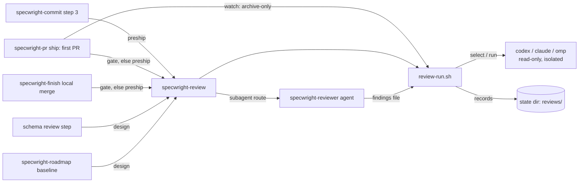
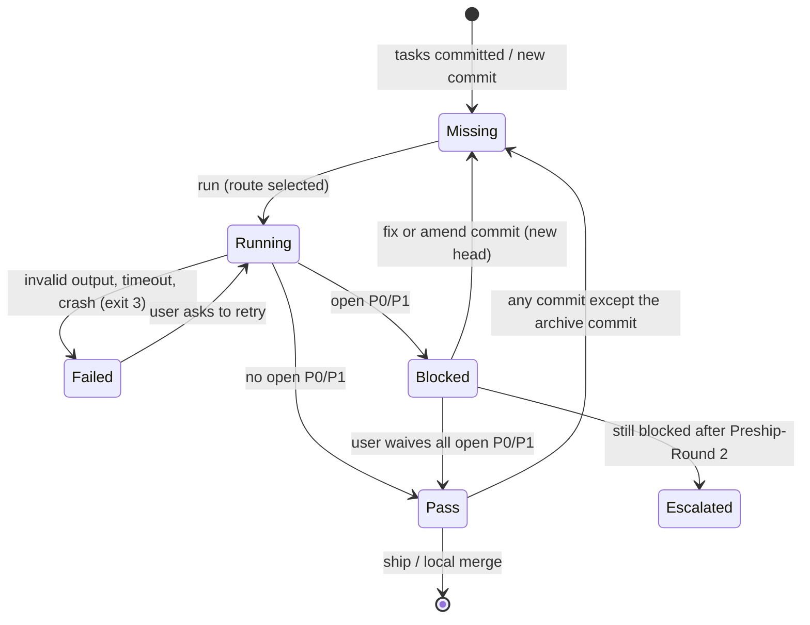
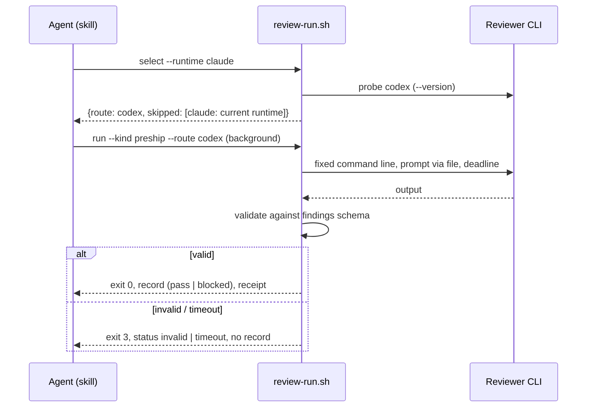

# Design

## Triage

| Trigger | Applies? | Evidence |
|---|---|---|
| T1 Components (new component, or 3+ with directed relationships) | yes | New `specwright-review` skill and `review-run.sh`, called by `specwright-commit`, `specwright-pr`, `specwright-finish`, `specwright-roadmap` and the schema's review step |
| T2 State (persistent state, caches, 3+ state machine) | yes | New pre-ship review records per head under the Specwright state dir; review outcome states (pass, blocked, failed) |
| T3 Concurrency (background work, workers/isolates, async, retries) | yes | A review runs about 5-6 minutes as a background job, with a deadline and process-tree kill |
| T4 Boundaries (data format, migration, shared interface, IPC, external) | yes | Findings JSON schema, review record and receipt formats, new `specwright.yaml` keys, external CLIs (`codex`, `claude`, `omp`), install prompt |
| T5 Volume (grows without a fixed bound) | yes | Review records accumulate per change and head; diffs sent to a reviewer grow with the change |
| T6 Risk (security, money, data loss, unrecoverable user data) | yes | The diff goes to another provider; a reviewer must not write to the checkout; a skipped review must not let unreviewed code ship |

TIER: FULL

## Context

- Design reviews choose a reviewer through the hardcoded pairing in `schemas/specwright/schema.yaml:299-315` (Claude author → `codex`, Codex/GPT author → `claude`), recorded in ADR 0005. The agent picks CLI flags itself ("read its current flags; do not guess them") and saves the output verbatim. Nothing validates it beyond the tasks precheck on the `VERDICT:` line (`schema.yaml:362-366`).
- `specwright-commit` step 3 (`skills/specwright-commit/SKILL.md:42-47`) is the one point where every change passes once all tasks are committed, in both finish modes. In `pr` mode it hands off to ship; in `local` mode it suggests archive.
- Ship (`skills/specwright-pr/SKILL.md:66-77`) pushes, then finds or opens the PR with `ensure-pr`. Feedback fix pushes bypass ship. Watch step 3 (`:128`) re-requests review on the archive head.
- The PR scripts keep machine state under `${SPECWRIGHT_STATE_DIR:-~/.cache/specwright}`, published atomically: temp file plus no-clobber link (`pr-snapshot.sh:389-404`). The new records follow this pattern.
- Installed CLIs (checked 2026-10-11): `codex-cli 0.161.0` (`exec -s read-only -m -c --output-schema -o --json --ephemeral --ignore-rules --ignore-user-config`), `claude 2.1.296` (`-p --safe-mode --disable-slash-commands --disallowedTools --json-schema --output-format --model --effort`), `omp 18.9.2` (`-p --no-skills --no-extensions --no-rules --model --thinking --session-dir --tools --mode json`). The exact command lines are fixed by the trial task (D3); the flags named here are unverified until then.
- This repo has `review.cross_model: false`, so its own design reviews keep using the `specwright-reviewer` subagent. The trial forces each route explicitly.
- The decisions recorded on #27 are inputs, not open questions. The user decided four more on 2026-10-11: a new skill, the review on by default, only the current harness skipped, P0/P1 blocking.

## Decisions

### D1: A new `specwright-review` skill owns review routes

- **Choice:** `skills/specwright-review/` holds `SKILL.md` (pre-ship mode, plus the route rules other skills cite), `references/brief.md` (the pre-ship reviewer brief), `references/findings.schema.json` and `scripts/review-run.sh`. The schema's review step, `specwright-roadmap` baseline reviews, `specwright-commit`, `specwright-pr` and `specwright-finish` call it by name. They resolve the script as `<specwright-review>/scripts/review-run.sh`, as `specwright-roadmap` already resolves `<specwright-pr>/scripts/as.sh`.
- **Rejected:** a step inside `specwright-pr` ship, because design reviews (schema, roadmap) would reach into the PR skill for routes, and `finish: local` never runs ship, so local merges would go unreviewed.
- **Reversal cost:** medium. The install prompt copies every `specwright-*` directory, so moving it later means a rename plus text in five skills.

### D2: One script, `review-run.sh`, with subcommands and a JSON contract (ADR 0002)

- **Choice:** A bash entry point that runs embedded Python 3.8+ (standard library only), printing one JSON document per call. Exit 0 = ok, 1 = stop (show `message`), 2 = usage error, 3 = review failed (invalid, timeout, reviewer crash).
  - `select --runtime <claude|codex|omp|other> [--settings <file>]` → `{route, skipped:[{route, reason}], model, thinking}`. Route is `codex|claude|omp|subagent`.
  - `run --kind preship|design --route <r> --out <file> [--prompt-file f] [--base <main>] [--store <dir> --store-base <main>] --change <name>` → runs the route's fixed command line, validates, and writes `<file>` plus the receipt. For `design`, `--prompt-file` is the request the agent wrote today; the script adds only the isolation flags and validation.
  - `record --kind preship|design --change <name> --result <file> --route <r> [--store <dir>]` → validates a file the `specwright-reviewer` subagent wrote. For `preship`, it checks the findings file and writes the record. For `design`, it checks the `review.md` or `architecture-review.md` file (S4) the same way `run --kind design` checks CLI output, and writes nothing else. Every design review, from any route, is therefore validated before the tasks precheck reads it.
  - `waive --change <name> --finding <id> --reason <text>` → adds a user waiver to the record of the current head (D6).
  - `gate --change <name> [--store <dir>]` → `{status: pass|missing|blocked, heads, reviewed_heads, open:[...]}`. `missing` means no record matches; `blocked` means a matching record has an unwaived P0/P1. A record matches when its heads equal the current heads, or, after an archive, when exactly one repo's head moved by an archive commit:
    - repo-local: the record's head is `HEAD^` and `archive-only` holds for `HEAD^..HEAD`;
    - store-backed: the record's code head equals code `HEAD`, its store head is the store's `HEAD^`, and `archive-only` holds in the store (the archive commit lands only in the store).
  - `archive-only --base <sha> --head <sha> --change <name> [--dir <repo>] [--prefix 
]` → `{archive_only: bool, reason}`, run in the repo that holds the planning files. It is used by `gate` and by watch (D7).
  - `rounds --change <name> [--store <dir>]` → the highest `Preship-Round:` trailer in `<main>..HEAD` of either repo (D6). It is derived from git, not from records.
- **Rejected:** extending `pr-pair.sh`, because it is the PR skill's script (already 1986 lines), and design reviews and local mode need routes without any PR.
- **Reversal cost:** medium. The JSON fields become a contract for five skills; `evals/review-routes` pins them.

### D3: Fixed, isolated command lines per route, set by a trial run

- **Choice:** Each route has one command line in the script, never assembled by the agent.
  - `codex exec -s read-only --ephemeral --ignore-rules --ignore-user-config --skip-git-repo-check --output-schema <schema> -o <out> --json [-m <model>] [-c model_reasoning_effort=<t>] -` (prompt on stdin).
  - `claude -p --safe-mode --disable-slash-commands --tools Read,Grep,Glob --restricted --json-schema <schema JSON without $schema> --output-format json [--model <m>] [--effort <t>]` (prompt on stdin). This is an allowlist, not a denylist, so `NotebookEdit`, `WebFetch` and the Windows `PowerShell` tool are never available. The trial confirmed `--restricted`.
  - `omp -p --no-skills --no-extensions --no-rules --tools read,grep,find,glob --session-dir <fresh temp dir> --mode json --model <@role|provider/id> [--thinking <t> only with a provider/id] @<prompt file>`.

  These lines are the ones the trial ran (`evals/review-routes/trial.md`, which lists the changes from the first draft).

  **The review input is built by the script, not by the reviewer.** For a pre-ship review, `run` computes `git diff --no-color <base>...<head>` for the code range and, with `--store`, for the store range. It also adds the list of changed files and the change's artifact paths. It embeds all of this in the prompt file inside a nonce-delimited untrusted region (a fresh random nonce per run, so diff text cannot close the region). Every route therefore sees the same change, whether or not it has a shell or the store in its working directories. The tools above are for reading surrounding code only. When the combined diff exceeds `review.max_diff_kb` (default 1024 KB), `run` exits 1 with `diff_too_large` and the size, before any reviewer starts. The user raises the bound or opts out (`review.preship: false`). A truncated review never runs.

  The prompt goes through a file or stdin, never argv (length and quoting). The first apply task runs each route against a fixed fixture diff. It records the exact working lines and the receipt fields each CLI reports, verifies on Windows that each route's write attempt changes nothing (Claude's allowlist included), and adjusts these lines before any other code depends on them (roadmap exit criterion).
- **Rejected:** letting the agent read `--help` and build the call each time (today's design-review rule), because the flags drift per run and the user's skills leak in (seen with OMP `/review` loading `ce-code-review`, #27).
- **Reversal cost:** low. These are lines in one script.

### D4: Route selection walks `review.order`, skipping only the current harness

- **Choice:** The agent passes `--runtime` (it knows its own harness; `other` skips nothing). For each route in order, skip it if it is the runtime; otherwise run its probe: `<cli> --version` exits 0, and for `omp` a model-resolution probe that makes no model call (set by the trial: `omp config get modelRoles --json` lists the role, or `omp models find <id> --json` returns the `provider/id` selector). The first route that passes wins. Unknown names stop with exit 1. `review.cross_model: false` → `subagent` without probing. A probe failure means unavailable and moves on. A failure after the review started (invalid output, timeout, crash) is a failed review: it exits 3 and never moves on (#27). OMP `Model "<m>" not found` at probe time counts as unavailable.
- **Rejected:** also skipping routes by model family, because the model behind an OMP `@role` is known only after OMP starts, and the user chose harness-only. The receipt shows the actual model instead.
- **Reversal cost:** low.

### D5: Review records live in the state dir, keyed by head, never in git

- **Choice:** `${SPECWRIGHT_STATE_DIR:-~/.cache/specwright}/reviews/<repo key>/<change>/<code head>[+<store head>].json`, where `<repo key>` is a SHA-256 prefix of the code repo's absolute git common dir. A record holds `{kind, change, heads, base, route, receipt, findings, waivers, at}`. It stores no outcome: `gate` derives pass or blocked from findings and waivers each time (D6). It is written to a temp file and renamed into place. A failed review writes no record (D2 exit 3).
- **Rejected:** committing the record into the change directory, because committing it moves the head the record names, so it can never match, and every round adds a commit. It is also not a ship gate a reviewer can see. The PR description carries what readers need (D9).
- **Reversal cost:** low. A missing record only means a new review.

### D6: Blocking, waivers and escalation

- **Choice:** No stored outcome (M4): a record is a pass when every P0/P1 finding's id is in its `waivers`, and blocked otherwise. `gate` and the description (D9) derive this each time, so `waive` has nothing else to keep in sync. Waivers are written only by `waive`, which the skill runs only after the user's explicit answer, with their reason, under a rename like `record`'s. Fixes for pre-ship findings are committed as `<type>(<change>): address pre-ship review` with a `Preship-Round: <n>` trailer: one commit per round, in the repo of the files (store-backed: one per changed repo, same subject and trailer). Neither the subject nor the trailer matches `address review feedback` or `Feedback-Round:`, so `pr-pair.sh rounds` (`pr-pair.sh:89`, `:1231-1234`) never counts them as PR fix rounds. Escalation reads `rounds` (the highest `Preship-Round`). When a review still has an unwaived P0/P1 after round 2, the skill stops fixing and asks the user. Because the count lives on the branch, a new session or machine sees it too (ADR 0003). P2/P3 findings are fixed in the same round commit when cheap, otherwise left for the description.
- **Rejected:** a round cap shared with `pr.max_fix_rounds`, because those rounds count PR feedback commits on GitHub, a different phase with its own trailer. Counting blocked records instead was also rejected: they are machine-local, so a lost state dir would silently reset escalation (ADR 0003).
- **Reversal cost:** low.

### D7: The archive head carries reviews over by not waiting for reviewers (#69)

- **Choice:** With `pr.review_after_archive: false` (the default), once the archive commit is pushed (by `specwright-finish` through ship), watch runs `review-run.sh archive-only --base <ready head> --head <archive head>` in the planning repo. The ready head is the head watch last reported ready, before it offered the archive.
  - **`archive_only: true`:** watch posts no review request and watches the archive head with no `--reviewer` arguments, so readiness needs only CI, mergeability and no new feedback. Watch offers the archive only once every required reviewer has reported on the ready head (`SKILL.md:126-128`), so those reports are the ones carried over.
  - **`archive_only: false`** (another commit, or a file outside the allowed paths), or the setting `pr.review_after_archive: true`: watch does what 0.1.13 does (re-request review, wait for reviewers).
  - **Branch protection (M3):** when the archive head is short of ready only because `merge_state` is BLOCKED and `review_decision` is `REVIEW_REQUIRED` (branch protection dismissed the approval on the new head), watch does not loop. It reports `archive head needs a fresh approval` and asks once whether to post the review requests on it. On yes, it does what 0.1.13 does for this head. On no, it reports ready-except-approval and stops. `archive-only` holds when there is exactly one commit, its subject is `<type>(<change>): archive change`, and every path is under `
/changes/<change>/` (deleted), `
/changes/archive/<archived-name>/`, or `
/specs/<cap>/spec.md` for a capability in the change's delta specs.
- **Rejected:** teaching `pr-snapshot.sh` to count a reviewer's report on an older head (`--carry-from`). Each reviewer has its own report signal (Codex SHA, Kody check, timestamps), so that means three new code paths in jq for no gain over not asking.
- **Reversal cost:** low.

### D8: Spec findings carry their class, and amendments carry a trailer

- **Choice:** The findings schema requires `spec_class: clarification|behaviour_change` on findings with `category: spec`. The brief defines both classes with #27's tests. A clarification amendment is committed as `<type>(<change>): amend specs` with an `Amendment: clarification` trailer. A behaviour change is committed only after the user approves it, with `Amendment: behaviour-change`. It also follows the drift rule (`schema.yaml:453-458`): a design re-review when the tier is FULL, then test and code updates. Every amendment is followed by a new pre-ship review. The PR description reads the trailers from `<main>..HEAD` (D9).
- **Rejected:** letting the agent judge the class freely at fix time, because the reviewer's class is evidence the user can audit, and the agent may still downgrade a clarification to "ask the user", never the other way round.
- **Reversal cost:** medium. The trailer becomes a parsed git evidence format (architecture: a workflow change).

### D9: The PR description gains a "Review" section

- **Choice:** `references/description.md` adds a section that appears only when it has content:
  - spec amendments made in response to the pre-ship review, identified by their `Amendment:` trailer in `<main>..HEAD` of either repo, each with its class. Apply-phase drift amendments carry no trailer and were re-reviewed by the design review, so they are not listed (S5);
  - P2/P3 findings left open;
  - waived P0/P1 findings with the user's reason, from the record `gate` matched.
- **Rejected:** posting findings as a PR comment, because a comment is not part of the description that reviewers and the merge history read first.
- **Reversal cost:** low.

### D10: The install prompt reads commented-out template keys as optional (#78)

- **Choice:** Keys are compared by dotted path (`pr.request_as`, `planning_store.login`), never by bare name, so `github.login` and the commented `planning_store.login` stay distinct.
  - **Commented-out paths:** a commented-out line `#  key:` gets its path from its indentation after the `#`, within its commented block, under the nearest uncommented or commented parent. A path that the template has only commented out is optional and still supported: Step 6 never lists it as removed and never adds it.
  - **User data:** entries under a map-valued setting whose children are user data (`pr.reviewers.<login>`, `planning_store.reviewers.<login>`) are never compared, added or listed as removed.
  - **Step 7** requires only uncommented template paths.
- **Rejected:** uncommenting the optional keys in the template with empty defaults, because an empty `pr.reviewers: {}` and an absent one mean different things (`{}` = none, absent = `review_request`), so a default cannot stand in for "unset".
- **Reversal cost:** low. The install prompt is text, and changing it is a release (CONTRIBUTING).

### D11: Pre-ship on by default, in one place, with gates as backstops

- **Choice:** `review.preship` defaults to `true`. `specwright-commit` step 3 runs the review after its completion check, before the hand-off.
  - **Ship gate (S2):** at its start, before step 4a's push, ship runs `discover` for every repo of the change. When no PR exists in any of them (the change has never shipped), it runs `gate`. On `missing`, it runs the review first; on `blocked`, it stops. "First PR" is per change, not per repo: when feedback step 9 runs ship for a code repo whose store PR already exists, the gate does not run.
  - **Local merge gate:** `specwright-finish` runs `gate` before the merge, with the same handling.
  - A change with a PR is past the gate, and PR reviewers take over from there.
- **Rejected:** gating every push, including feedback fixes, because those are reviewed by the PR reviewers within the round limit, and a 5-minute local review per fix round doubles the cost of every round.
- **Reversal cost:** low. It is one setting default; projects opt out with `review.preship: false`.

## Diagrams (FULL)

## State & Ownership (FULL)

| State | Owner (sole writer) | Lifetime | Invalidation / rebuild | Authoritative copy |
|---|---|---|---|---|
| Review record (`reviews/<repo key>/<change>/<heads>.json`) | `review-run.sh run` / `record` write it whole (findings, receipt, empty waivers); `waive` is the only writer of `waivers`, by rename. No stored outcome: pass/blocked is derived from findings + waivers | Until the state dir is cleared | Keyed by head: a new commit means no record for the new head. Missing → review again (the user re-decides waivers) | State dir on this machine (machine-local by design, see ADRs) |
| `Preship-Round:` trailers and `address pre-ship review` commits | `specwright-review` fix step, committed by `specwright-commit` rules | Permanent | Never rewritten; the escalation count is derived from them | Change branch, then main |
| Receipt (inside the record, and next to `--out` for design reviews) | `review-run.sh run` | As the record; design receipts sit beside `review.md` in a temp dir and are not committed | Rewritten each run | State dir |
| `Amendment:` trailers | `specwright-commit` amend rule | Permanent | Never rewritten | Change branch, then main |
| `review.md` / `architecture-review.md` | Unchanged writers (architecture State ownership), except that a CLI review is written by `review-run.sh run --out`, which writes only after validation | Unchanged | Unchanged | Unchanged |
| Settings `review.order/models/thinking/timeout/preship`, `pr.review_after_archive` | The user (install merges defaults) | Project | Install keeps local values | `openspec/specwright.yaml` |
| OMP session dir per review | `review-run.sh run` (temp dir) | One run | Deleted after the receipt is read; kept on failure, with its path in the output | Temp dir |

## Failure & Visibility (FULL)

| Component | Fails / dies mid-operation → | Recovery | Retry safe? | Who finds out |
|---|---|---|---|---|
| Probe | CLI missing, auth expired, unknown OMP model | Next route in order; subagent at the end | Yes | The user, in `skipped` reasons in the output and the receipt |
| Reviewer run | Invalid output, crash, deadline passed | Exit 3, process tree killed by PID (never by pattern), no record; the skill reports the route and error and offers a retry | Yes: read-only, no record written | The user |
| Agent session dies during the background review | The orphaned reviewer runs until its deadline; then the script kills it | The next session finds no record (`gate` → `missing`) and reviews again | Yes | Nobody needs to: the gate re-runs it |
| Record write | Disk error, unwritable state dir | Exit 1 with the path; the review result is printed but not recorded, so the gate stays `missing` | Yes | The user (stop message) |
| `waive` without a record for HEAD | Exit 1 `no_record` | Review first | Yes | The user |
| Gate on a machine without the record (another checkout) | `missing` → review again | Costs one review | Yes | Nobody needs to |
| `archive-only` git error | Exit 1; watch treats it as not archive-only (0.1.13 behaviour, review requested) | Fails safe | Yes | The agent (message) |
| Subagent writes invalid findings | `record` exits 3 | Same as an invalid CLI review | Yes | The user |

## Resource Bounds (FULL)

| Queue / buffer / cache / transfer | Bound | At the bound | Timeout | At 10x / 100x |
|---|---|---|---|---|
| Reviewer run time | `review.timeout`, default 20m | Kill the process tree, exit 3 `timeout` | Same | Larger diffs approach the deadline; the user raises the timeout |
| Reviewer output read | 2 MB | Over the limit → `invalid: output too large` | — | Unchanged: findings are small |
| Findings per review | 100 (schema `maxItems`) | More → `invalid` | — | A review with more than 100 findings is not actionable anyway |
| Review records | One file per reviewed head per change (a few KB) | No eviction (see Mechanism Ledger: record garbage collection) | — | 100 changes × 5 heads ≈ 2 MB |
| Diff embedded in the prompt (code range plus store range) | `review.max_diff_kb`, default 1024 KB | `run` exits 1 `diff_too_large` with the size before any reviewer starts; never truncated | — | Large changes hit the bound; the user raises it or opts out |
| Probes | One `--version` per route per selection, 10s each | Over 10s → unavailable | 10s | Constant |

## Flow & State Gaps (FULL)

- **Commit during a running review:** the record names the head the review was started on (captured before the run). The gate then sees a newer HEAD → `missing`. No stale pass is possible.
- **Two sessions review the same head:** both write the same key by rename; the last one wins, and either result is a review of that head.
- **Store-backed, store commit only:** the key includes both heads, so either moving invalidates the record, except the store archive commit, which `gate` matches through the store's `HEAD^` (D2).
- **Archive done before the review (local mode, user archived by hand):** the gate accepts a pass on the archived repo's `HEAD^` only if `archive-only` holds there (D2). Otherwise `missing`, and the review runs over the archived state, which still works because the range is unchanged apart from the moved paths.
- **`review.preship: false` set after a blocked review:** the gates skip checking; the user opted out explicitly.
- **Old installs reading new keys:** a missing `review.order` gives the default, which reproduces the old pairing for Claude and Codex authors. A missing `review.preship` gives `true` (the BREAKING default, in the release notes).
- **Watch restarts after the archive push:** the ready head must come from watch's last ready snapshot file. If that file is gone, `archive-only` has no base → behave as 0.1.13 (request review).

## Mechanism Ledger (FULL)

| Mechanism | Built? | Why (harm nobody catches / expensive later) | Evidence that would change the call |
|---|---|---|---|
| Output schema validation, fail closed | Yes | Prose or partial output would pass as "no findings" and ship unreviewed code: harm nobody catches | — |
| Deadline plus process-tree kill | Yes | A hung CLI blocks ship indefinitely, and #40 shows hangs happen in the PR scripts | — |
| Fresh OMP session dir | Yes | `autoResume` lands the review in an unrelated session (seen on 18.8.9) | OMP gaining a reliable `--no-resume` |
| Records keyed by head | Yes | Without it, a pass survives a later commit and unreviewed code ships | — |
| Nonce-delimited untrusted regions in the prompt | Yes | Diff text that addresses the reviewer could steer the verdict; cheap to add | — |
| Model-family exclusion | No | The user chose harness-only; the receipt shows the model | A review graded by its own author's model missing what another caught |
| Record garbage collection | No | Records are a few KB; no harm | The state dir growing past ~100 MB |
| Multi-persona reviews (CE) | No | Out of scope on #27 | Single-reviewer reviews missing classes of defects |
| Carrying reports across heads in `pr-snapshot.sh` | No (D7) | Not asking gives the same result | A required reviewer that re-reviews every push on its own |
| Locking the review record | No | Concurrent writers of one key produce equivalent records | — |

## Risks / Trade-offs

- [The default-on review adds about 5-6 minutes before every first ship and local merge] → Opt out with `review.preship: false`; the release notes and README say so.
- [CLI flags drift between versions] → The command lines are fixed in one place, the trial task records the versions, and an unknown flag fails the probe or the run loudly (exit 3), never silently.
- [The diff goes to another provider] → The same exposure as today's cross-model design reviews; `review.cross_model: false` keeps everything in-harness.
- [A reviewer with read tools could still read secrets in the repo] → Read-only tools only; the architecture's T6 note already covers cross-model exposure.
- [The archive-only check accepts a malicious archive commit] → It checks exact paths and the subject, and only Specwright makes that commit.

## ADRs

- **In force, constraining this change:** 0002 (script I/O contract, bash plus the Python standard library), 0003 (git and GitHub as the state store: the pre-ship round count is derived from `Preship-Round:` trailers to honour it, see D6), 0004 (identity: the review makes no `gh` call), 0005 (reviewer split, superseded in part below), 0006 (planning root resolution, used for `
` in `archive-only`).
- **To record during apply:** 0007 "Reviewer routes with a Specwright-owned contract". It supersedes 0005: it restates 0005's orchestrator/implementer/reviewer split and replaces the hardcoded pairing with the ordered route list, isolated fixed command lines, the script-built review input, the findings schema and fail-closed validation. 0005's file stays unchanged, and the architecture index swaps its row. 0007 also records its exceptions to ADR 0003 (M5). Pre-ship review records (the findings of a head and the user's waivers) are machine-local working state, not git evidence. Losing them, or shipping from another machine, means a new review, and the user decides waivers again. Nothing is silently passed, because the gate reads only records of the exact heads. The escalation count is not an exception: it comes from git trailers.

## Open Questions

- The OMP model-resolution probe command (a cheap call that exits 1 on an unknown model without starting a review) is fixed by the trial task. If none exists, the run classifies OMP's early `Model "<m>" not found` exit, before any output, as unavailable. Either way the specs hold.
- Which receipt fields each CLI reports for the actual model (Codex `--json` events, Claude `--output-format json` usage, the OMP session file). The trial records them; unreported fields stay `unknown` (spec scenario).
