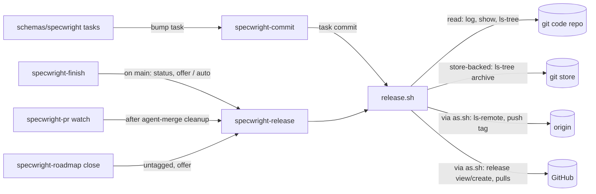

# Design

## Triage

| Trigger | Applies? | Evidence |
|---|---|---|
| T1 Components (new component, or 3+ with directed relationships) | yes | New `specwright-release` skill and `release.sh`, called from `specwright-finish`, `specwright-pr` watch and `specwright-roadmap` close, and calling `as.sh`, git and `gh` |
| T2 State (persistent state, caches, 3+ state machine) | yes | New persistent, published state: annotated tags and GitHub releases. Publish is a three-step sequence (local tag, remote tag, GitHub release) that can stop between steps |
| T3 Concurrency (background work, workers/isolates, async, retries) | yes | Watch can run publish unattended after an agent merge (`release.auto`). Two sessions, or a re-run, can publish the same version. Re-runs are the recovery path |
| T4 Boundaries (data format, migration, shared interface, IPC, external) | yes | New `release:` settings block, a tag name and annotation format that later runs parse (previous-release lookup), `release.sh` JSON I/O, and GitHub releases as an external system |
| T5 Volume (grows without a fixed bound) | yes | Main's first-parent history, the archive directory, tags and (store-backed) closed PRs all grow with the project |
| T6 Risk (security, money, data loss, unrecoverable user data) | yes | Publish pushes to origin and creates releases under a GitHub identity. A tag on the wrong commit is published history that consumers (#36) will install from |

TIER: FULL

## Context

See proposal.md for the problem. Facts the approach depends on:

- **The version today** is in `VERSION`, the README badge (`README.md:3`, `badge/version-0.4.2-blue`) and `metadata.version` in seven `skills/*/SKILL.md` frontmatters (`  version: 0.4.2`). Only `evals/review-routes/test_skill_text.py:48-51` checks one of them (specwright-review) against `VERSION`. With the new skill there will be ten version files: `VERSION`, the badge and eight `SKILL.md` files. Each change bumps them in a final task, for example `openspec/changes/archive/2026-10-15-fix-m2-gaps/tasks.md:58`.
- **The pre-ship record is keyed by head** (`skills/specwright-review/SKILL.md:71-72`). The only commit allowed after a pass is the archive-only commit (`skills/specwright-review/scripts/review-run.sh:1156-1195`). A bump commit made after pre-ship would therefore void the pass, so the bump has to be a task before pre-ship.
- **Merge evidence.** `pr-pair.sh merge` returns `merge_commit_sha` (`skills/specwright-pr/scripts/pr-pair.sh:2101-2102`), but `discover` does not (`:656`). A user-merged PR therefore gives the scripts no merge SHA. Main's history still does: `git log --first-parent origin/main -- VERSION` gives `4f9b823` (squash, 0.4.2) and `9b33ec5` (merge commit, 0.4.1).
- **Hook points.**
  - Finish's roadmap offer comes once the change is on main (`skills/specwright-finish/SKILL.md:85`), after **After the PR is merged** (`:83`) or the local merge (`:72-73`).
  - Watch's **Next step** comes after cleanup (`skills/specwright-pr/SKILL.md:159`).
  - Roadmap **close** steps are at `skills/specwright-roadmap/SKILL.md:67-81`.
- **Settings parsing.** The scripts carry a small YAML reader for maps, scalars and flow collections (`pr-pair.sh:287-409`, `review-run.sh:113-232`), with no block sequences. So `version_files` is a map, path → regex.
- **Identity.** Every GitHub network call goes through `as.sh <run login>` (ADR 0008). `as.sh` fences any git or `gh` command run from inside the repo (`skills/specwright-pr/scripts/as.sh:1-30`).
- **Install** replaces every `skills/specwright-*` directory with the downloaded one (`README.md:151-154`), so a new skill directory installs with no prompt change.
- **No tags exist** (`git tag -l` is empty). The archive directories carry only a date and a name; versions appear only in prose.

## Decisions

### D1: A separate `specwright-release` skill with one script

- **Choice:** New `skills/specwright-release/` with `SKILL.md` and `scripts/release.sh` (bash entry, Python standard-library body, as in `pr-pair.sh`). Finish, watch and close only offer or invoke it. The user chose this.
- **Rejected:** a release step inside `specwright-finish`, because backfill and close need publish without a change to finish, and finish is already the largest resume table.
- **Reversal cost:** low. The callers hold only an offer line.

### D2: The bump is a tracked task on the change branch, before pre-ship

- **Choice:** When `release.enabled` is true, the schema's tasks instruction puts `release.sh bump --to <version>` in the change's last task group. `specwright-commit` commits it like any task, `<type>(<change>): task X.Y bump to <version>`, so the bump is reviewed by pre-ship and merges with the PR. The proposal states the target version by the pre-1.0 rule (`CONTRIBUTING.md:49`), and the design review checks it.
- **Rejected:** a separate release PR after merge (`release/<version>`), because it doubles the PRs per change, runs the review gates again for a three-line diff, and leaves main between merge and release with a version that names the previous release. Also rejected: a bump commit after pre-ship, because it voids the head-keyed pass (Context).
- **Reversal cost:** medium. The schema instruction and the task convention change, but no stored format does.

### D3: The release commit is found from main's history, not from merge output

- **Choice:** The release commit of V is the first commit in `<main>`'s first-parent history (oldest first) whose primary version file reads V. That works for squash merges, merge commits (GitHub's or a local `merge: <change>`), user merges and backfill. `release.sh` reads `git log --first-parent --format=%H --reverse <main> -- <primary>` and `git show <c>:<primary>`.
  - **Rebase merges are refused.** A rebase merge replays the bump task as its own main commit, so the first commit reading V would miss the rest of the change. `release.enabled` with `pr.merge_method: rebase` is refused by bump and publish. Publish also stops, naming the commit, when the first V commit has one parent and its subject does not end in `(#<n>)` (a rebase-merged or directly pushed bump). Resolving such a commit to its PR's `merge_commit_sha` was considered and not built: it adds a `gh` call to every publish to support a merge method no Specwright project uses.
- **Rejected:** using `merge_commit_sha` from `pr-pair.sh merge`, because user merges and backfill have none (Context). Also rejected: tagging `origin/<main>` at publish time, because a later merge may already have landed and the tag would name the wrong commit.
- **Reversal cost:** low.

### D4: Notes are derived from git and the archive, never stored in the repo

- **Choice:** The range for V is `(previous release commit, release commit]` on first-parent main. The previous release commit is the release commit (by D3) of the highest lower version that has a tag, locally or on origin (publish fetches only main, so a fresh clone may hold none of the tags locally), else the commit where the primary file took the value just before V.
  - Repo-local: the range's changes are the archive directories present at the release commit and absent at the previous one (`git ls-tree -d` on both, set difference), ordered by the first first-parent commit that holds each.
  - Each entry carries the change name (the archive name without its date), the first sentence of `proposal.md`'s `## Why`, and the PR number from that commit's subject (`(#n)` or `Merge pull request #n`).
  - The notes become the tag annotation and the GitHub release body.
- **Rejected:** a committed `CHANGELOG.md`, because writing it after merge needs a commit on main (never pushed by Specwright) or another PR (D2). Also rejected: notes from the merged-PR list on GitHub, because local-mode projects have no PRs and the archive already is the record (ADR 0003).
- **Reversal cost:** low. Notes are output; nothing parses them back except the previous-release lookup, which reads only tag names.

### D5: Store-backed notes reuse the roadmap's code-merge proof; only the code repo is tagged

- **Choice:** In a store-backed project:
  - The candidates are archive directories on the store's main, excluding those with `code_changes: none`.
  - A candidate is in V's range when its proof lies in the code range. In local mode that is a first-parent subject `merge: <change-name>`. In pr mode it is a merged PR from `<owner>/<repo>:<prefix>/<change-name>`, the full head ref with `<prefix>` derived from the change name as `specwright-branch` does, whose `merge_commit_sha` is an ancestor of the release commit and not of the previous one. That is one paginated `gh api pulls?state=closed&base=<main>` call through `as.sh`, the discovery roadmap status already uses (`skills/specwright-roadmap/SKILL.md`, store-backed done rule).
  - Only the code repo is tagged.
- **Rejected:** tagging the store as well, because a store is shared by several projects with independent versions (#36), so one store tag namespace would collide. Also rejected: an archive diff by time on the store, because store and code merges are not ordered.
- **Reversal cost:** medium. Store tags could be added later without changing code tags.

### D6: Publish is a sequence of idempotent steps judged by observed state

- **Choice:** Publish reads the state before each step and does only what is missing, in this order:
  1. **Check.** `git ls-remote --tags origin refs/tags/<tag>` (through `as.sh`) and `git rev-parse <tag>^{commit}`. A tag at another commit, locally or on origin, stops publish (exit 1, both commits named). So does a lightweight tag at the release commit (locally `git cat-file -t` is not `tag`; on origin `ls-remote` lists no peeled `^{}` line): a release is an annotated tag. So does a local and an origin tag at the release commit that are different tag objects (`git rev-parse refs/tags/<tag>` against the `ls-remote` object id): a clone whose push lost a race would otherwise release with its own message, not the published tag's. The user deletes the local tag, and a re-run fetches origin's.
  2. **Local tag.**
     - On origin at the release commit but not local: `git fetch origin refs/tags/<tag>:refs/tags/<tag>` (through `as.sh`). Never create a second tag object.
     - Absent on both: `git tag -a <tag> -F <notes> <release commit>`.
  3. **Remote tag.** `git push origin refs/tags/<tag>:refs/tags/<tag>` if absent on origin. Never `--tags`, `--force` or a branch ref.
  4. **GitHub release.** With `github_release`, `gh release view <tag>`, then `gh release create <tag> --verify-tag --title <tag> --notes-file <file>` if absent. The body is always the tag's message (`git tag -l --format='%(contents)' <tag>`), never notes derived again, so the release matches the tag even when the archive has since changed.

  There is no state file. A re-run, or a second session, converges on the same result.
- **Rejected:** a publish journal under `~/.cache/specwright/`, because the tag and the release are themselves the evidence (ADR 0003), and a journal could disagree with them. Also rejected: moving a wrong tag with `--force`, because a published tag is history consumers may already have installed (#36). The user fixes it by hand.
- **Reversal cost:** high for the never-move rule, which binds #36's install-from-tag. It is recorded in an ADR (below).

### D7: Version files are a path → regex map read by the existing YAML subset

- **Choice:** `release.version_files` maps a path or glob (Python `glob`, relative to the repo root; an absolute entry, one with a `..` segment, or a working-tree match that resolves through a symlink outside the repository is refused, so bump never writes outside it; a match that is or goes through a symlink inside the repository is refused too, in the working tree and at a commit (`ls-tree` mode 120000), because git stores a link as its text and status could never read the version there) to a regex with one capture group, applied with `re.MULTILINE`. Its first key is the primary file. `check` reads every matched file and requires exactly one match per file and one shared value. Which tree it reads depends on the subcommand. `check` and `bump` read the working tree. `status` and `publish` read V's release commit, with the current `version_files`: globs through `git ls-tree -r --name-only <c>` (for the primary file's history, one `git -c log.diffMerges=first-parent log -m --first-parent --name-status` pass tracks the matching files at each commit: `-m` with `--first-parent` works on any git, and the `-c` pins it on git 2.31+, where `-m` follows `log.diffMerges`), contents through `git show <c>:<path>`. They stop unless the shared version there is V, so a backfill from a newer checkout checks the old commit's files. `bump` computes every replacement in memory (entries that match the same file each rewrite their own capture, composed into one write), then writes each file to a temp file and renames it in place. A failure before the first rename changes nothing. A failure between renames (disk error) leaves files that `check` reports as disagreeing, and bump to the same target then completes the rest (renames are per file, and bump accepts files already at the target only when the others are at the current version).
- **Rejected:** typed formats (`json:version`, `toml:package.version`, badge), because each format is a parser to maintain. A regex covers all of Specwright's files and the common `package.json` / `Cargo.toml` lines.
- **Reversal cost:** medium. It is a settings format (Boundaries: a new key keeps a safe default).

### D8: Offers sit after cleanup and before the roadmap offer; local mode never auto-publishes

- **Choice:** Finish (once the change is on main) and watch (after agent-merge cleanup) run `release.sh untagged` (below). They offer publish for each listed version oldest first, or with `release.auto: true` publish them oldest first and stop at the first failure. Then they make their roadmap offer. Publish of V refuses while a lower version on the `untagged` list is still untagged, so an unpublished version cannot be skipped and have its changes absorbed into a later release's notes. `finish: local` never runs publish itself, because its merge is not pushed (`skills/specwright-finish/SKILL.md:73`). It reports that the version can be published once `main` is pushed. Close lists `release.sh untagged` and offers each version, oldest first. All three run `untagged` fenced with the run login (`[as]`), since it reads origin's tags (ADR 0008).
- **Rejected:** publishing from inside the merge step, before cleanup, because a cleanup failure (pull refused) would leave a release of a main the checkout cannot see.
- **Reversal cost:** low.

### D9: `release.sh` interface

- **Choice:** One JSON document on stdout per call. Exit codes:
  - 0: done.
  - 1: stop condition (disagreeing files, version not on main, tag conflict, disabled).
  - 2: usage.
  - 3: a git or `gh` network call failed or was refused.

  Subcommands:
  - `check`: version files and the shared version.
  - `bump --to <v>`.
  - `status [--version <v>]`: release commit, range, notes, local, remote and GitHub release state; read-only apart from two `ls-remote` reads of origin (the tag, and every tag for the previous release); an unreadable origin is exit 3.
  - `untagged`: the versions in the primary file's first-parent history on main, after the latest published version, that are not published, oldest first. Published means the tag is on origin (`git ls-remote --tags --refs origin`; with no origin remote, a local tag). Every version whose tag is local but not on origin (a failed push) is listed too, whatever the anchor and also when nothing is published, so it is still offered and still blocks a newer version. Run it as `[as] bash release.sh untagged ...`. With nothing published, only the current version is listed: the history before a project's first release is backfilled only on request (`publish --version`), never offered.
  - `publish --version <v>`: run as `[as] bash release.sh publish ...` from the code repo, so every git and `gh` call inherits the fence.

  `--main <ref>` selects the main ref: the skill passes `origin/<main>` after a fenced fetch when origin is on github.com, else `<main>`. The tagger identity is git's committer identity, and the skill runs publish under the user's commit-identity rules.
- **Rejected:** having the agent run the git and `gh` steps from the skill text, because the step order and the conflict checks are deterministic work (ADR 0002) that evals must cover.
- **Reversal cost:** low.

## Diagrams (FULL)

Components (T1):



Publish states (T2, T3):

```mermaid
stateDiagram-v2
  [*] --> Checked: ls-remote + local rev-parse
  Checked --> Conflict: tag at another commit
  Conflict --> [*]: exit 1, nothing written
  Checked --> LocalTagged: tag -a (skipped if present)
  LocalTagged --> Pushed: push refs/tags/<tag> (skipped if on origin)
  LocalTagged --> [*]: push fails, exit 3; re-run resumes (tag_mismatch if another clone's tag won)
  Pushed --> Released: gh release create (skipped if exists or disabled)
  Pushed --> [*]: release fails, exit 3; re-run resumes
  Released --> [*]: exit 0
```

Range and notes (T4):

```mermaid
sequenceDiagram
  participant S as Skill
  participant R as release.sh
  participant G as git
  S->>R: status --version V --main origin/main
  R->>G: log --first-parent --reverse -- primary
  R->>G: show c:primary (per commit)
  Note over R: release commit = first c reading V; previous = tagged lower version, else value before V
  R->>G: ls-tree -d prev / rel -- archive/
  R->>G: show rel:archive/<name>/proposal.md
  R-->>S: JSON {release_commit, previous, changes[], notes, tag_local, tag_remote, gh_release}
```

## State & Ownership (FULL)

| State | Owner (sole writer) | Lifetime | Invalidation / rebuild | Authoritative copy |
|---|---|---|---|---|
| Version in the version files | `release.sh bump`, committed by `specwright-commit` as a task | Until the next bump | `check` re-derives agreement each run | Main of the code repo |
| Annotated tag `<tag>` | `release.sh publish` | Permanent; never moved or deleted by Specwright | A missing tag is recreated at the same commit by re-run; a tag elsewhere is a stop for the user | origin |
| GitHub release | `release.sh publish` | Permanent; never edited | Missing → re-run creates it | GitHub |
| Notes | Derived by `release.sh` from git only when the tag is created; stored only as the tag message and release body | With the tag | Never rebuilt once tagged; the release body is always the tag's message (D6) | The tag annotation |
| `release:` settings | The user (install merges the template) | Project lifetime | Missing keys take safe defaults (`enabled: false`) | `openspec/specwright.yaml` |

## Failure & Visibility (FULL)

| Component | Fails / dies mid-operation → | Recovery | Retry safe? | Who finds out |
|---|---|---|---|---|
| `bump` | Disk error between per-file renames | `check` reports the disagreement; bump to the same target completes it (D7) | yes | The orchestrator, through the task's verification, which runs `check` |
| `publish` check | `ls-remote` fails or the fence refuses | Exit 3 before any write | yes | The user, from the report |
| `publish` local tag | Killed after `tag -a` | Next run sees the local tag at the release commit and skips it | yes | Nobody needs to |
| `publish` push | Network or fence failure | Exit 3; the local tag stays; re-run pushes, or stops with `tag_mismatch` when another clone's tag reached origin first | yes | The user (finish/watch report the error; auto mode does not hide it) |
| `publish` GitHub release | `gh release create` fails after the push | Exit 3; tag on origin; re-run creates only the release, using the tag's message | yes | The user |
| Two sessions publish V at once | Both see no tag; one push wins | The loser's push is rejected (tag exists) with exit 3. Its re-run finds its local tag and origin's at the same commit as different tag objects and stops with `tag_mismatch` (exit 1, nothing written); the user deletes the local tag and a re-run fetches origin's. A `gh release create` racing an existing release fails, then `view` shows it, so it is counted done | yes | The losing session's user |
| `publish` tag objects | Local and origin tags at the release commit are different objects | Exit 1 `tag_mismatch` before any write, naming both; the user deletes the local tag, a re-run fetches origin's | yes | The user |
| Finish/watch offer | `untagged` fails | The offer is skipped with the error; the roadmap offer still follows | yes | The user |
| Release commit check | The first V commit is a single-parent commit without `(#n)` (rebase merge or direct push), or `pr.merge_method: rebase` with releases on | Exit 1 before any write, naming the commit or the settings; the user tags by hand or changes the method | yes | The user |
| Publish with an older untagged version | A lower version on the `untagged` list (after the latest published tag, or with a local tag not on origin) | Exit 1 naming it; publish it first | yes | The user |

## Resource Bounds (FULL)

| Queue / buffer / cache / transfer | Bound | At the bound | Timeout | At 10x / 100x |
|---|---|---|---|---|
| First-parent log of the primary file | Commits that touched it (one per release) | None needed | none (local git) | 1,000 releases is about 1,000 `git show` calls; one batched `git cat-file --batch` keeps it well under a second |
| Archive set difference | Archive directory count (~11 today) | None | none | Thousands of names fit in memory |
| `proposal.md` reads | One per change in range | First 64 KB read; Why sentence clipped at 300 characters with `…` | none | Same |
| Store-backed closed-PR discovery | Paginated, all pages (as roadmap status) | Same unbounded read as #40 | No Specwright deadline (#40) | Slow on large histories; the same gap as #40, not widened |
| `untagged` versions | Versions since the latest published tag, plus local-only tags | None | none | Small |
| Notes size | Clipped per entry; GitHub's 125,000-character release body limit | Over 100 entries: list names only, then `…and N more` | — | Bounded |

## Flow & State Gaps (FULL)

- **Bump without merge.** Status on main reports the old version as current, and nothing is offered until the merge.
- **A change that does not bump** (roadmap `docs/` PRs, a forgotten bump). Main's version already has a tag, so nothing is offered. Its archive lands in the next release's range and is listed there.
- **Two versions merged before either is published.** The release commits are distinct (D3). `untagged` lists both, and publish of the newer one refuses until the older one is published (D8), so each version keeps its own notes.
- **Rebase merge.** Refused (D3).
- **Backfill order.** Backfill below the latest tag is not blocked. Its range starts at the highest lower tagged version, else the value before V, so 0.4.1 and 0.4.2 get correct notes in either order. They are run oldest first anyway (tasks).
- **Two changes in flight bumping to the same version.** The second to merge carries no version change on main (the version already reads V), so V's release commit is the first one. The second change lands in the next release's range. The design review of the second change's proposal is where its target version is corrected. Not built: a branch-time check, because a branch cannot see unmerged siblings.
- **`finish: local` offline.** `untagged` reads origin's tags, so with origin unreachable a local finish cannot list the untagged versions: the offer is skipped with the error (Failure table), as for any `untagged` failure. That is expected; publish needs origin anyway.
- **Version going backwards on main** (a revert of a bump). The first commit reading V still identifies V's release. A later commit reading V again is ignored, and `untagged` lists versions by first appearance only.
- **Local main stale.** The skill fetches first (fenced) and passes `origin/<main>`. With no origin, publish refuses at the push step (exit 3), which says no origin.
- **Store moved during publish.** Store-backed notes read the store's main once per run. A store merge that lands mid-run is picked up by the next release.
- **Interrupted publish.** D6.

## Mechanism Ledger (FULL)

| Mechanism | Built? | Why (harm nobody catches / expensive later) | Evidence that would change the call |
|---|---|---|---|
| Tag conflict check (never move) | yes | A moved tag silently changes what consumers install (#36); expensive to undo once fetched | — |
| Version-file agreement check before bump/publish | yes | Today only one of the version files is checked (Context); a drifted file ships a wrong version nobody notices | — |
| Publish journal / lock | no | The tag and the release are atomic, checkable evidence; concurrent runs converge (Failure table) | A GitHub API that lets two releases exist for one tag |
| Previous-release lookup by tag | yes | Without it, publishing the newer of two untagged versions drops the older one's changes from all notes | — |
| Semver pre-release or build metadata | no | Specwright and its dogfood projects use plain `MAJOR.MINOR.PATCH` | A project that needs `-rc` tags |
| Signed tags | no | No project signs today; `git tag -s` can be added behind a key later without a format change | A request or a signing policy |
| Automatic bump-level choice | no | The proposal states it and the design review checks it; a script could not judge "workflow change" | Repeated wrong bump levels in reviews |
| Store tags | no | D5 | A single-project store that wants planning tags |

## Risks / Trade-offs

- [The agent forgets the bump task] → The schema's tasks instruction requires it when releases are enabled, and the design review checks the proposal's version. A missed bump only delays the release: the next one lists the changes.
- [A wrong regex matches the wrong line] → `check` requires exactly one match per file. This repo's own `check` test runs on every eval run.
- [Unattended publish under `release.auto`] → Off by default. It only tags a commit already on origin's main, reviewed by the merge gates, and never moves anything.
- [Notes depend on proposal wording] → They show the first sentence only. A poorly worded Why gives a poor line, but never a wrong change.

## ADRs

- **In force, constraining this change:** 0001 (extend only through skills, schema and templates), 0002 (deterministic steps in a thin script with JSON I/O), 0003 (tags and releases as git and GitHub evidence, no state file), 0006 (the planning root decides store-backed notes), 0008 (every push and `gh` call through `as.sh` under the run login).
- **To record during apply:** 0010 "Releases are annotated tags on the merged main commit, never moved". It covers D3 (the release commit is found from main's first-parent history), D6 (Specwright creates a tag once and never moves, deletes or force-pushes it; a conflict stops for the user), D5 (only the code repo is tagged) and D2 (the bump is a reviewed task on the change branch). The same task updates `openspec/architecture.md`: a component row for `specwright-release`, state rows for tags and GitHub releases, the settings boundary for `release:`, and the in-force index.

## Open Questions

- The exact first-sentence rule for Why when it starts with a code span or a list. The implementation picks a rule, and tests pin it. This does not change specs or tasks.
