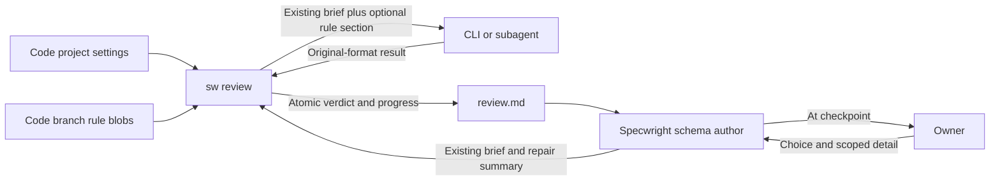
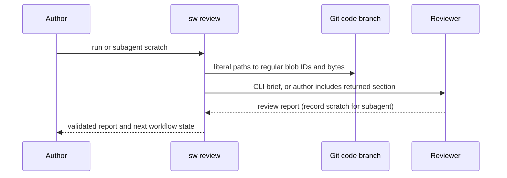

# Design

## Triage

| Trigger | Applies? | Evidence |
|---|---|---|
| T1 Components | yes | The schema calls an author/orchestrator, native `sw`, and an isolated reviewer or fresh-context subagent (`schemas/specwright/schema.yaml:459-486`). |
| T2 State | yes | The CLI and subagent currently replace the reviewed file atomically (`cli/lib/src/review/run.dart:652-662,1780-1782`); checkpoint decisions and repairs must survive replacement. |
| T3 Concurrency | yes | A reviewer runs in the background (`skills/specwright-review/SKILL.md:52-56`); result publication and owner choices must serialize when separate invocations overlap. |
| T4 Boundaries | yes | Two new project settings, a reviewer input section, and state in `review.md`. |
| T5 Volume | yes | Rule files and review history grow with use; never truncate criteria or owner decisions. |
| T6 Risk | yes | The code reads paths to send to a review provider; the existing checklist does not open untracked or linked citations (`schemas/specwright/schema.yaml:516-521`). |

TIER: FULL

## Context

The schema is the design-review orchestrator and describes both dispatch routes and the checklist (`schemas/specwright/schema.yaml:459-537`). The native CLI reads review settings from the project (`cli/lib/src/review/run.dart:215-224`) and validates both output fields (`cli/lib/src/review/run.dart:2291-2318`); pre-ship builds its own input from named branch ranges (`cli/lib/src/review/run.dart:435-477`). Task creation checks the recorded verdict (`schemas/specwright/schema.yaml:593-609`); the old change loop escalates after two consecutive `REVISE` results and offers an owner override (`schemas/specwright/schema.yaml:539-553`). The motivating replay is described in the proposal.

## Decisions

### D1: Declare and read rule inputs from the code repository

- **Choice:** Optional `review.standing_rules` in the code checkout's `openspec/specwright.yaml` lists UTF-8 text file paths relative to the code Git toplevel, using `/`. Match literal tree entries at the resolved code branch commit; accept only normal blobs (Git mode `100644` or `100755`). Refuse invalid paths, bad entries, decode failures and overflow; do not follow filesystem paths. Extend `requireSettingsPinnedTo` to accept a resolved commit and return whether a pin was enforced: its private `_settingsPinned` already accepts an explicit ref (`cli/lib/src/pr/settings_commands.dart:135-177,265-280`). On GitButler pin against that exact commit even with no declared rules, then parse its settings blob through the shared reader instead of rereading the workspace. Git and jj read the code toplevel's project YAML. The FULL workflow does not accept `--settings`. `select --change-review --branch <branch>` runs this same settings preparation before probing a route. Its selection file binds the selected route to the code repository, branch and fingerprint of the settings bytes used. FULL `run` and subagent `record --scratch` and completion require that selection; a stale settings fingerprint or different route is refused before starting the reviewer or publishing a result. The store supplies only planning artifacts. Absent or empty rules share the same identity and produce no standing section or rule blob lookups.
- **Rejected:** Discover ambient instructions or read configured paths from the worktree. Discovery is not owner selection, and worktree reads can send uncommitted content or follow links outside the repo.
- **Reversal cost:** Medium.
- **Important:** yes (configuration and repository-to-provider contract).
- **Chosen by:** user (code-repo-relative tracked declaration; agent selected committed Git object reads).

### D2: Use one renderer for both change-design routes only

- **Choice:** An explicit FULL change-design option on `sw review run` and `record` distinguishes the change workflow from the baseline caller of `--kind design`. Guard the old design writers too: before launch or write, refuse a route without the FULL option at a resolved active `changes/<name>/review.md` destination, and at any existing controller-marked record. Apply this to the subagent result path as well so a legacy copy-and-delete cannot erase the authoritative record. The baseline destination and generic scratch fixture paths still work. `run` appends the standing section only with declared rules; `record --scratch` returns that same rendered section for verbatim inclusion in the subagent brief. It directs the reviewer to assess proposed and preserved tests; the rules do not alter workflow, isolation, tools or output. Persist the ordered `(path, blob ID)` fingerprint. A Required Changes-only recheck needs prior conditional approval, the same rule identity and the exact prior artifact capture (D5). Changed rules, including empty to nonempty, require a full review and prevent tasks or apply from using an earlier pass. The author hands off first if a checkpoint is due; changing rule inputs does not reset an unresolved scope count. No delta-only review. Keep the checklist and template except for comments about the replaced escalation.
- **LIGHT write guard:** The review instruction consults the existing report before selecting its path, via `design-step --light --out <review>`, a read of the record only. A controller-marked FULL report or a legacy unresolved FULL disposition still requires the FULL controller even if today's design triages LIGHT. Do not replace it with `SKIPPED_LIGHT`, including after an owner's scope change. A genuinely eligible LIGHT re-check has no rule input or reviewer route. Author its usual verdict or re-check findings in scratch and publish via `record --kind light`; the controller repeats the eligibility check under the publication lock, so a LIGHT author cannot race a FULL result and erase it. Tasks/apply check a FULL passing result through the FULL controller even if the design's current triage says LIGHT.
- **Packet access:** Before a FULL change CLI attempt starts, require the route's existing local file-read capability: OMP `read` and Claude `Read` in the effective tool list (defaults include them; an explicit list must include them), or the native file access of fixed read-only Codex. OMP's adapter uses `--no-tools` for an empty list (`cli/lib/src/review/routes.dart:620-625`); Claude sends its effective tools through `--tools` (`cli/lib/src/review/routes.dart:552-561`). Refuse a selected route without this capability with a named settings error, before probing/starting it at dispatch or allocating captures; do not silently add tools, fall through, or send path-only evidence to a tool-less reviewer. The author checks the selected harness exposes local file reads to the installed subagent before requesting scratch or dispatching (the shipped Claude and OMP definitions list `Read` and `read`: `agents/claude/specwright-reviewer.md:2-5`, `agents/omp/specwright-reviewer.md:2-5`). An unavailable packet is a failed review, never a pass.
- **Rejected:** Inject in all routes including pre-ship and baseline, or require the reviewer to read rule paths itself. The evidence covers change-design review alone, and a path is not proof the full text reached a no-tools route. Applying rules to pre-ship, where the reviewer sees a finished diff, is a candidate follow-up for the owner; baseline and LIGHT are also unchanged.
- **Reversal cost:** Low.
- **Important:** yes (review scope and reviewer input contract).
- **Chosen by:** user (scope); agent chose the shared renderer.

### D3: Native checkpoint state; leave the reviewer verdict authoritative

- **Choice:** `review.design_max_rounds` is a positive integer, default 3. Each valid FULL change-design result consumes one round in the current scope, including a Required Changes recheck; failures do not count. `APPROVE` and reviewed `APPROVE_WITH_CHANGES/yes` pass even at the limit, `REVISE` and `APPROVE_WITH_CHANGES/no` do not. Below the limit the author can repair and re-review regardless of finding counts. At the limit `sw review design-step --out <review> --branch <branch>` reports `owner_checkpoint`; FULL-change launch and scratch refuse a new pass until authorized. The author presents open findings or Required Changes and the repair log, and asks in every decision mode. `--choice scoped-pass --detail <scope>` permits one additional validated result; if unresolved, hand off again even if the configured number was later raised. `--choice scope-change --detail <reason>` captures the current artifact fingerprint and opens a fresh budget only for a full review of changed proposal/specs/design (not a Release Notes-only edit). `--choice stop` records a blocked design. Record only the owner's actual choice. None of these actions writes `USER_OVERRIDE` or changes the verdict; older override records, pre-review waivers, deferrals, `pr.max_fix_rounds`, `pr.after_limit`, and the baseline/pre-ship policies are distinct and unchanged.
- **Rejected:** Add a second threshold alongside the old two-`REVISE` escalation, use a stalled count, or substitute a computed verdict. Those either cut off later valid catches or let the controller disagree with the reviewer on readiness.
- **Reversal cost:** Medium.
- **Important:** yes (configuration and changed task eligibility at the handoff).
- **Chosen by:** user.

### D4: Persist only workflow progress in the same review record

- **Choice:** Atomically append a controller-owned `## Review progress` section to the validated report, distinct from the template. A reserved exact comment line starts the footer, with a versioned base64url UTF-8 JSON payload for round, scope count, latest artifact and rule fingerprints, repair notes and owner choices. Regenerate the human-readable log from validated state and refuse a noncanonical or malformed stored footer. Reject that exact marker even in a reviewer fenced example; an ordinary `## Review progress` heading is not a marker. Reject line separators in repair summaries and encode owner detail as quoted text with all line separators escaped, so it cannot introduce verdict or framing lines. Preserve every reviewer verdict/findings line when recording a choice. Older unresolved reviews seed the global and scope round from the one positive `Round` metadata entry or report an actionable error. A fresh review after an amended passing design begins a new scope budget. The author reports real repairs before the next pass (or `none`); a successful result carries them forward. Do not parse findings or derive a verdict.
- **Rejected:** Overwrite owner decisions with each result, keep them only in machine-local state, or introduce a cumulative finding ledger. The current review plus durable progress is sufficient.
- **Reversal cost:** Medium.
- **Important:** yes (durable review record).
- **Chosen by:** agent (delegated within the approved contract).

### D5: Publish only results for the starting review inputs

- **Choice:** At dispatch fingerprint the report, named code tip, rule set, cap, mode and normalized current artifact contents. The controller copies the proposal, design and all spec deltas once into a private per-attempt directory, using the same path/content pairs for the fingerprint and for the paths the reviewer is told to read. Supply these copies and a copy of the prior review, never live planning paths, to either route, including store-backed reviews. Continue using cited repo sources as evidence under today's rules; development-time code reads are not part of the planning fingerprint. The CLI uses its existing temporary directory; the subagent receives attempt paths and a scratch digest bound to the recorded state and its result path. On conditional approval, retain that exact artifact set in a machine-local cache for the next recheck, keyed to the record's artifact identity. A missing or mismatched cache forces a full review. A recheck supplies both captured versions and instructs the reviewer to compare all proposal/design/spec changes (excluding a Release Notes-only edit) and refuse confirmation if any edit is outside the Required Changes; only then does it recheck the requested fixes. Other passes retain the original full checklist. Before publishing either route's result, re-read state and controlled inputs under the same local advisory lock that serializes recording an owner choice, and reject any stale result before replacement. A choice must specify its round. Locks live outside the checkout and are never held across a reviewer run or owner decision. This serializes local writers, not worktree editors.
- **Verdict at publication:** After the ordinary validator, both FULL writers enforce the mode against the live publication snapshot. A full attempt may publish `APPROVE/n/a`, `REVISE/n/a`, or `APPROVE_WITH_CHANGES/no`. Only a full attempt's `APPROVE_WITH_CHANGES/no` creates or replaces a conditional baseline (store its full-attempt round and artifact fingerprint). A limited Required Changes recheck is eligible only against that exact still-current full baseline and a verified copy of its artifacts. It can publish only `APPROVE_WITH_CHANGES/yes` or `REVISE/n/a`; both close and retire the baseline. `REVISE` requires a fresh full review after repairs, subject to the checkpoint. A recheck returning `APPROVE_WITH_CHANGES/no` or standalone `APPROVE` is invalid, as is any full attempt returning `APPROVE_WITH_CHANGES/yes`, including after cache loss or changed rules. Invalid/stale results do not change verdict, baseline, round or scoped permission; invalid output never promotes the recheck's capture.
- **Rejected:** Lock throughout the review, point the reviewer at moving artifact paths, or treat a scratch path as its dispatch proof. That either leaves long-lived blockers or lets a reviewer result stand for other inputs. Do not keep a cumulative archive of either reviews or snapshots.
- **Reversal cost:** Medium.
- **Important:** yes (preserves owner authorization across a shared write seam).
- **Chosen by:** agent (delegated within the approved contract).

### Decision summary

| # | Decision | Choice | Rejected | Reversal cost | Important | Chosen by |
|---|---|---|---|---|---|---|
| S1 | Scope | FULL change design only | All reviews | Low | yes | user |
| S2 | Readiness | Authoritative reviewer verdict | Count-based stop or override | Medium | yes | user |
| D1 | Rule source | Declared code-branch blobs | Ambient or worktree text | Medium | yes | user |
| D2 | Brief | Shared renderer on the FULL change path | All review modes or rule paths alone | Low | yes | user |
| D3 | Handoff | Configured owner checkpoint | Competing threshold or computed verdict | Medium | yes | user |
| D4 | Record | Native progress section in `review.md` | Ephemeral or duplicate record | Medium | yes | agent |
| D5 | Result publication | Bind results to starting inputs, compare under short lock | Unbound scratch or long-lived lock | Medium | yes | agent |

## Assumptions

None.

## Carried constraints

- **C1:** Rules declared by a project are criteria, not permission to change workflow or reviewer isolation. Kind: invariant. Destination: spec: specs/review-routes/spec.md → Requirement: FULL change-design reviews receive binding standing requirements.
- **C2:** An unresolved reviewer disposition remains unresolved after any checkpoint choice. Kind: invariant. Destination: spec: specs/design-review-gate/spec.md → Requirement: The owner checkpoint records its choice without overriding the verdict.
- **C3:** Git object reads avoid reading the work tree, so configured rule paths never need a filesystem fallback. Kind: rejected alternative. Destination: ADR 0044.
- **C4:** Binding rules do not apply to pre-ship, roadmap baseline or LIGHT review. Kind: deliberate gap. Destination: spec: specs/review-routes/spec.md → Requirement: FULL change-design reviews receive binding standing requirements.
- **C5:** No stop on an unchanged or increased finding count. Kind: rejected alternative. Destination: spec: specs/design-review-gate/spec.md → Requirement: Unresolved design review reaches an owner checkpoint.
- **C6:** An invalid, stale or failed result does not use an authorized scoped pass. Kind: invariant. Destination: spec: specs/design-review-gate/spec.md → Requirement: The owner checkpoint records its choice without overriding the verdict.
- **C7:** Reviews, owner deliberation and waits happen outside the publication lock. Kind: invariant. Destination: ADR 0044.
- **C8:** Both routes review captured planning artifacts, and a result for stale inputs cannot publish. Kind: invariant. Destination: spec: specs/review-routes/spec.md → Requirement: Review results apply only to captured design inputs.
- **C9:** A prior pass no longer authorizes tasks or apply after standing-rule identity changes. Kind: invariant. Destination: spec: specs/review-routes/spec.md → Requirement: A design review pass covers its standing rules.
- **C10:** A missing or unverifiable prior capture forces a full review; a result from that full attempt cannot confirm a recheck. Kind: invariant. Destination: spec: specs/review-routes/spec.md → Requirement: Review results apply only to captured design inputs.
- **C11:** A limited recheck cannot renew a conditional baseline, even if it finds additional changes to ask for. Kind: invariant. Destination: spec: specs/review-routes/spec.md → Requirement: Review results apply only to captured design inputs.
- **C12:** A path-only packet with no effective file-read capability is refused, not an empty review. Kind: invariant. Destination: spec: specs/review-routes/spec.md → Requirement: FULL design review requires usable evidence and bounds failure retention.
- **C13:** Failed FULL attempts cannot leave a series of diagnostic files or archives of session transcripts. Kind: invariant. Destination: spec: specs/review-routes/spec.md → Requirement: FULL design review requires usable evidence and bounds failure retention.

## Diagrams (FULL)

```mermaid
stateDiagram-v2
  [*] --> Review
  Review --> DesignPass: reviewer passes
  Review --> Review: unresolved below checkpoint; repair
  Review --> Checkpoint: unresolved at limit or after extra pass
  Checkpoint --> Review: scoped pass
  Checkpoint --> RevisedScope: scope change with reason
  RevisedScope --> Review: revised artifacts; new scope budget
  Checkpoint --> Stopped: stop
```

## State & Ownership (FULL)

| State | Owner (sole writer) | Lifetime | Invalidation / rebuild | Authoritative copy |
|---|---|---|---|---|
| Config and rule blobs | Project owner through Git | Project | New config or committed rules are used on the next review; rules are never inferred from elsewhere | Code project config plus selected branch commit |
| Verdict / findings | Fresh reviewer produces input; native review owns the file write | Until a new validated report; verdict covers only reviewed design | Invalid or interrupted output does not replace it | Latest report in `review.md` |
| Round, repairs and checkpoint choice | Native review; receives author repairs and owner decisions, not reviewer instructions | Change lifetime | Atomic replacement preserves history; missing file follows first-review behavior; malformed progress stops | Progress section in `review.md` |
| Brief | Native renderer with existing author packet | One invocation | Re-render from current inputs on each pass; clean run directory as today | The input actually supplied to the route |
| Dispatch snapshot | Controller (subagent handoff carries the digest) | One attempted reviewer invocation | Compare live controlled inputs under the publication lock; dispose of attempt inputs once recorded or refused. Interrupted subagent attempts keep their slots until explicitly identified as abandoned and removed | Private capture supplied to reviewer and the dispatch fingerprint |
| Conditional artifact capture | Native review cache, not an approval record | From a full attempt's validated conditional result until superseded or confirmed | Stage the next capture separately; do not retire the old one unless its report was replaced. Reclaim an unreferenced stage on the next publication. A limited recheck never replaces the baseline; either valid disposition retires it. Missing or mismatched bytes require full review | Private snapshot keyed by the recorded full round and checked against its artifact identity |
| Retained failed result | Native FULL controller under the publication lock | At most the most recent retained bounded failure | Replace one fixed slot only; never retain an oversized result, full CLI session or multiple scratch results. Diagnostic loss or partial data on interrupted write cannot affect review state | `last-failed` per canonical review record, not part of `review.md` |

## Failure & Visibility (FULL)

| Component | Fails / dies mid-operation → | Recovery | Retry safe? | Who finds out |
|---|---|---|---|---|
| Rules resolution | Missing code branch, invalid path/mode/text or overflow → named error before reviewer; no record mutation | Fix setting or commit a valid rule | Yes after fix | Author and owner |
| Reviewer | Existing route validation or timeout → prior report/progress untouched | Existing failed-review workflow; no implicit route retry | A fresh review remains same round | Author and owner |
| Missing read capability | FULL path-only packet refused before dispatch, with the selected route and missing effective tool named | Restore the existing read tool in that route or explicitly select a usable reviewer through normal settings | Yes after configuration changes | Author and owner |
| Progress write | Invalid or corrupt record → refuse; failed atomic write → original remains | Recover bad record or fix disk and re-run | Yes; an already recorded choice is not recorded twice | Author and owner |
| Publication lock | Concurrent completion or owner choice → busy or stale before replacing the record | Re-read the record; a dead writer no longer holds an OS lock | Only after checking current state | Author |
| Owner | No answer → wait; explicit stop → record followed by blocked review | New owner-directed work is separate, not auto-resume | No automatic retry | Owner |

- **Failure reporting in the schema and review skill:** For a FULL failure, report the route, exit status and error; `review.md` stays untouched and tasks do not start. Report the controller's `diagnostic` path only if the current failed attempt retained a bounded result. Never report the former subagent `scratch` path as preserved, and never reuse an earlier diagnostic path to explain a newer failure. A completed subagent attempt removes its scratch (or reports a cleanup error when the reservation could not be released). Baseline and other non-FULL design record failures still name and retain that attempt's original scratch as today.

## Resource Bounds (FULL)

| Queue / buffer / cache / transfer | Bound | At the bound | Timeout | At 10x / 100x |
|---|---|---|---|---|
| Git input verification | At most 32 rule paths of 512 UTF-8 bytes each, 256 KiB aggregate blob bytes, and finite ref, settings, pin and tree output caps | Refuse during capture, never truncate. Do not print rule contents on error | One monotonic 60 s budget for all Git commands per preparation or publication check, including root/ref resolution, the GitButler settings pin/filter helper and rule reads. Pass remaining time through the shared bounded launcher; a failure releases the publication lock without modifying the record | A larger policy is not a standing review brief |
| Report input | Existing 2 MiB ceiling (`cli/lib/src/review/run.dart:29,1576-1580,2551-2557`) | Same failed-output behavior | Existing review timeout | No change |
| Review record history | Bound by the existing 2 MiB answer limit plus the same bound for the progress section; refuse rather than drop entries | Owner sees error; record stays intact | No new independent wall deadline | Normal progress grows by one short note per round and one owner decision per handoff, not by copying all prior reports |
| Captured artifacts | 16 MiB across at most 256 regular current artifact files per attempt, plus one equally bounded copied baseline and one prior report copy. At most two unfinished subagent attempts per canonical record, reserved under the publication lock. The cache holds the recorded baseline and at most one staged replacement | A third scratch request names the occupied paths and refuses before allocating. Reclaim only an attempt known stopped. Completed refusals clean the attempt directory after optionally saving the one diagnostic below. If cleanup fails, keep the reservation and name it, so failures cannot silently free slots while leaving captures behind | No network wait on local regular files; Git inputs have the budget above | Narrow oversized changes; discard any unreferenced staged baseline before staging a replacement |
| Failed or invalid output (FULL) | One fixed `last-failed` file per canonical review record, at most 2 MiB as written, shared by both CLI and subagent attempts | Retain a complete bounded answer only; discard oversized and incomplete output without publishing it or returning a misleading result path. At RECORD after the subagent has stopped, read at most 2 MiB plus one byte from its scratch, then remove the transient attempt (not an OS quota for an actively writing subagent). Reuse the existing CLI transport and answer limits. Do not preserve FULL OMP session directories (`cli/lib/src/review/run.dart:1594-1598,1617-1633,1790-1804`); keep receipt and error as today. Write/truncate the single diagnostic file under the same lock without creating backup files. Report cleanup/write errors; a diagnostic is never gate input | Existing route timeout; no extra report-read wait on local regular files | Repeated refusals replace one diagnostic rather than growing state; never copy or keep oversized results |

## Flow & State Gaps (FULL)

- An interrupted CLI review leaves the previous verdict and owner choice untouched. The subagent result is not installed until recorded and validated against its dispatch digest. A rejected, stale or failed run does not consume an accepted scoped pass. The author checks `design-step` on resume.
- A concurrent publication sees the current record under the same lock as owner choice writes. A losing result is refused as stale or busy; an earlier accepted result or owner decision survives. The lock is not held while waiting on a child, and does not claim to prevent worktree edits by a user or external processes after publish.
- An A–B–A edit to a live planning file cannot change the copied file read by the reviewer; a persistent edit makes publication stale. Add only the controller-owned attempt directory to the existing read scope: the runner constructs `allowedDirs` for the store today (`cli/lib/src/review/run.dart:484-486,511`) and Claude maps this list to `--add-dir` (`cli/lib/src/review/routes.dart:570-572`); Codex and OMP read the absolute local paths under their existing controls. Smoke-test real Claude reading a marker present only in the capture through `sw`, with the existing read-only tool list and flags intact.
- `scope-change` does not alter the current verdict; the author changes the proposal/specs/design as needed under the existing decision process and runs a full review of the revised scope. Unchanged artifacts (including a release-notes-only edit) leave the new budget unopened.
- `stop` and waiting do not invalidate or remove existing review artifacts; they prevent another pass without the proper owner action and never allow tasks while unresolved.

## Mechanism Ledger (FULL)

| Mechanism | Built? | Why | Evidence that would change the call |
|---|---|---|---|
| Code branch blobs, literal path lookup and mode check | yes | A filesystem path could leak untracked or linked local data to the reviewer | Provider never receives project content |
| One shared brief renderer | yes | CLI and subagent otherwise drift or review different criteria | Only one supported review route |
| Review progress section, written atomically | yes | A resume after replacement or process death would lose the checkpoint or owner choice | Different single authoritative review storage format |
| Finding-count gate or experimental finding schema | no | Replays found real defects after unchanged counts; verdict is already validated | Separate owner-approved evidence and contract |
| Short lock and starting snapshot comparison | yes | Two completion processes otherwise race after both see the same reviewed record, and a stale result can consume the owner's choice | One process owns every publication and owner action |
| Captured artifacts plus previous conditional snapshot | yes | Current live files could change and change back before publication; a Required Changes recheck needs both versions to detect unrelated changes | A content-addressed upstream planning snapshot available to both routes |

## Risks / Trade-offs

- Declared text reaches the review provider in full. Restrict the source to intentional, committed regular files and document the transfer; do not include secrets or unrelated policy.
- The default changes for projects that declare nothing: the brief is unchanged, but the change-design owner handoff is after three unresolved validated rounds instead of two consecutive `REVISE` rounds. No project PR feedback policy changes.
- Only the latest reviewer report is authoritative; the repair and owner log is not a cumulative findings validator and does not claim problems disappeared just because their counts changed.

## ADRs

- **In force, constraining this change:** 0007 (reviewer and orchestrator split, fail-closed output), 0019 as amended by 0021 (GitButler settings pin), 0026 (carry constraints), 0035 and 0036 (unchanged isolation and tool policy).
- **To record during apply:** 0044, covering deliberate committed standing-rule inputs and the distinction between checkpoint and readiness. Amend only the design decision; no ADR has its accepted text edited.
