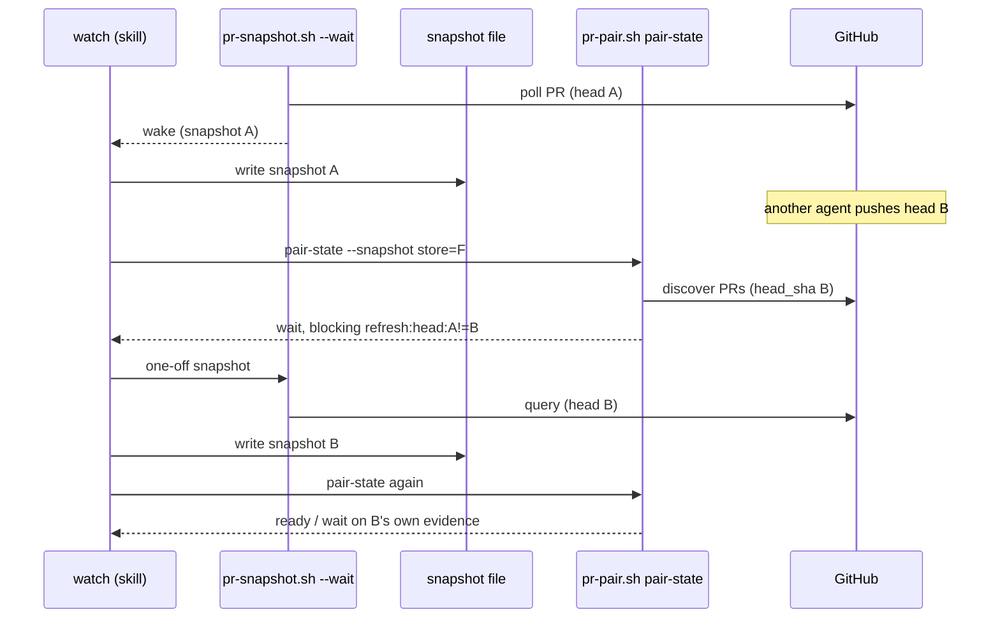
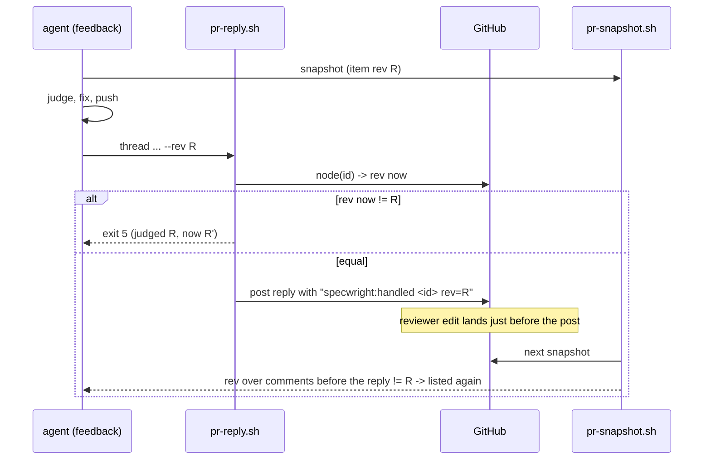
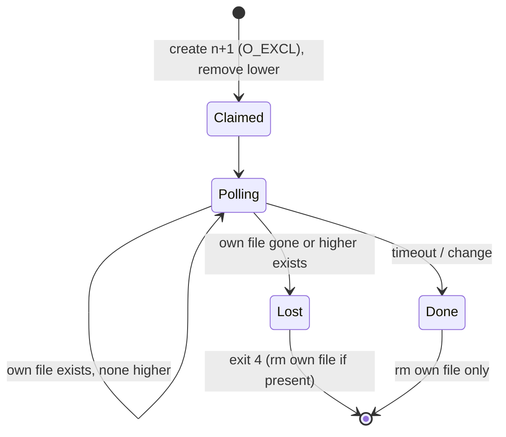
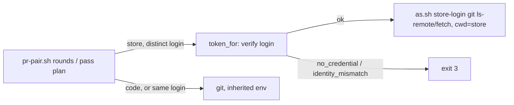

# Design

## Triage

| Trigger | Applies? | Evidence |
|---|---|---|
| T1 Components (new component, or 3+ with directed relationships) | Yes | Three scripts (`pr-snapshot.sh`, `pr-reply.sh`, `pr-pair.sh`), `as.sh`, the skill and GitHub, with directed calls; `pr-pair.sh` starts calling `as.sh` |
| T2 State (persistent state, caches, 3+ state machine) | Yes | New on-disk first-seen record per head; watch ownership changes from one token file to a directory of claims; reply markers on GitHub gain a revision |
| T3 Concurrency (background work, workers/isolates, async, retries) | Yes | Concurrent `--wait` watchers (#39); a reviewer can edit while a reply is in flight (#33); snapshots written by one watcher are read later by `pair-state` (#31) |
| T4 Boundaries (data format, migration, shared interface, IPC, external) | Yes | Marker format, snapshot JSON (`clipped`, `head_cutoff`, `refresh` blockers), `pr-reply.sh` arguments and exit codes, `--full` |
| T5 Volume (grows without a fixed bound) | Yes | First-seen records accumulate per PR; claim files per PR |
| T6 Risk (security, money, data loss, unrecoverable user data) | Yes | Git credentials for the store (#35); hidden reviewer feedback |

TIER: FULL

## Context

The proposal lists the six defects. Current code, as read:

- `cmd_pair_state` (`skills/specwright-pr/scripts/pr-pair.sh:1100-1133`) discovers each PR (`expected_set`, whose PR entries carry `number`, `url` and `head_sha` from `norm_pr`, `pr-pair.sh:521-524`) and then calls `readiness()` (`:1055-1084`) on whatever snapshot file it was given. Nothing compares the two.
- `prepare_cfg` (`pr-snapshot.sh:260-287`) uses the activity-log push time when found. Otherwise `pushed` is the GitHub time this process first saw the head, and `since` is the commit date (`:281-284`). `since` is the report cutoff for Mira and generic reviewers (`:196-204`). `first_seen` lives in a shell variable, so every new process restarts it (`:273`).
- Markers: `pr-reply.sh` appends `<!-- specwright:handled <id>[ resolve] -->` (`pr-reply.sh:50-56`) and posts by id after only a pending-review check (`:38-48`, `:84`). The snapshot treats a PR comment or review as handled when a marker reply is newer than its last edit (`pr-snapshot.sh:102-103`, `:121-123`), and a thread as answered when no reviewer comment is newer than your latest reply (`:143-148`). `pass plan` already stops on `stale_disposition` when a recorded item's `rev` changed (`pr-pair.sh:1691-1715`), but only for items still listed, and a hidden edit is not listed.
- Store git transport: `git()` (`pr-pair.sh:109-110`) runs with the process `ENV`. When `pr-pair.sh` runs under `as.sh <code login>`, that environment carries the code login's `GH_TOKEN` and credential helper (`as.sh:53-55`), so `remote_contains` (`:1136-1152`) reads the store as the code login. `gh` calls already switch per repo through `REPO_LOGIN` and `token_for` (`:113-155`).
- Watch ownership: `claim_watch`, `release_watch` and `still_owner` (`pr-snapshot.sh:57-72`) keep one token in `watch/$owner-$name-$pr`; release is a read followed by a separate `rm`.
- Clipping: `clip()` (`pr-snapshot.sh:99-100`) cuts at 2500 (thread comments) or 1200 (comments, reviews) characters and adds `…[truncated, see url]`, with no field saying so.
- Tests: `evals/pr-pair/test_pr_pair.py` drives `pr-pair.sh` against the fake `gh` (`evals/fakes/gh.py`), which hands `--jq` filters to the real `jq` (`gh.py:134-141`). Nothing exercises `pr-snapshot.sh` or `pr-reply.sh` yet.

## Decisions

### D1: Pair readiness checks the snapshot against discovery

- **Choice:** before `readiness()`, `cmd_pair_state` compares each snapshot's `url` (owner/name and number) and `head_oid` with the discovered PR's `url`, `number` and `head_sha`. A mismatch, or a missing field, adds a blocker `refresh:pr:<got>!=<want>` or `refresh:head:<got7>!=<want7>`, and `ready` is false. The result gets `refresh: [<side>...]`. Watch reacts, once per wake:
  - **`refresh:head`:** take a one-off snapshot of the same PR into that side's file, then call `pair-state` again.
  - **`refresh:pr`:** the branch's PR was replaced (for example PR 7 closed and PR 9 opened). Stop that side's background wait. Take the one-off snapshot of the PR number in `pair-state`'s `prs.<side>` (PR 9), not the old one. Restart that side's background wait on that number. Then call `pair-state` again.
  - **Still mismatched** (GitHub's PR and REST views briefly disagree after a push): go back to waiting, on the PR that `prs.<side>` names.

  SKILL watch step 2 (store-backed) gets these three rules.
- **Rejected:** have `pr-snapshot.sh --wait` drop its stale snapshot file itself when the head moves. It loses because the watcher does not own the file the skill keeps; the skill writes it. Also, only `pair-state` knows the head discovery reports, so only it can make the comparison.
- **Reversal cost:** low. It is a blocker in one function.

### D2: When push time is missing, the cutoff is the first-seen time, persisted per head

- **Choice:** `prepare_cfg` no longer uses the commit date. When the activity log has no push for the head, the cutoff and the timeout start are the earliest GitHub time at which any snapshot on this machine saw the head. That time is stored in `<state>/heads/<owner>/<name>/<pr>/<oid>` (lower case, `<state>` = `SPECWRIGHT_STATE_DIR` or `~/.cache/specwright`). The record is written with its content in place: the time goes to a temp file beside it, which is then published with a no-clobber hard link (`ln`, which fails if the record exists), and the temp file is removed. The first writer wins, and no process ever sees an empty record. A later process reads the record. Publishing it removes the sibling files of other heads of the same PR. When the record can be neither published nor read, or exists but does not parse as a GitHub date, the fallback is the in-process first-seen time. It is set once per head per process and reused on every poll, as `pr-snapshot.sh:273` does today, so in a `--wait` the cutoff and the timeout start stay fixed. That gives `source: "first_seen_unsaved"`. The snapshot adds `head_cutoff: {source: "push"|"first_seen"|"first_seen_unsaved", at}`. Codex (SHA in the result) and Kody (check run on the commit) keep their exact rules. The record is written only when `--reviewer` is given, as `prepare_cfg` is today.
- **Rejected:** keep the commit date and add a heuristic, for example ignoring reports older than the previous head's push. It loses because it still needs the push time that is missing, and the architecture review's case (`commit(B) < report(A) < push(B)`) has no reliable signal other than observation. Also rejected: using `Commit.pushedDate` from GraphQL, which GitHub has deprecated and no longer fills.
- **Consequence:** with push activity missing, a report made between the push and the first snapshot is not counted. A required reviewer then times out and watch asks the user (SKILL watch step 3). This fails closed by design. Codex, the configured required reviewer, is unaffected.
- **Reversal cost:** low. It is local working state; deleting the directory only makes cutoffs later.

### D3: Replies carry the revision they answer; markers bind it

- **Choice:**
  - `pr-reply.sh` takes `--rev <rev>` on `thread`, `comment` and `resolve`.
  - With `--rev`, it reads the item first through GraphQL `node(id)`. For a thread it reads the thread's comments; for a comment it reads the IssueComment or PullRequestReview. It computes the revision with the snapshot's formula: thread `<last databaseId>@<max(lastEditedAt|createdAt)>`, comment `lastEditedAt // createdAt`, review `lastEditedAt // submittedAt`.
  - A different revision → exit 5 with `judged <a>, now <b>` on stderr, nothing posted. A read failure → exit 3.
  - The marker becomes `specwright:handled <id>[ resolve] rev=<rev>`. `--waiting` markers carry `rev=` too.
  - Snapshot rules:
    - **PR comments and reviews:** when any marker for the item carries `rev=`, the item is handled only while one such marker equals its current `rev`. With none, the 0.1.10 time rule applies.
    - **Threads:** the bound revision is checked against the thread as it stood when the reply was posted. That is the revision formula over the comments whose `databaseId` is lower than the marker reply's. If it differs, a reviewer edit landed before the reply. The thread then gets `rebound: true` and `awaiting_reviewer: false`, and the thread filter at `pr-snapshot.sh:148` becomes `select((.isResolved | not) or ($open | length > 0) or $held or $rebound)`, so the thread is listed even when it is resolved (the usual case, since most replies resolve). `rebound` joins the thread's `sig` entry, so it wakes watch. Edits and comments after the reply are already caught by the existing `$edited`/`$open` rules.
  - **SKILL feedback step 4** gets: "A thread with `rebound: true` was edited by the reviewer before your reply was posted, so your reply answered an older text. Judge its current comments as a new finding. Reply in the thread without `--resolve` if it is already resolved, and never re-open it."
- **Why the marker too, not only the re-read:** between the re-read and the post there is a window (one HTTP round trip) in which an edit is still hidden by the time rule. Binding closes it.
- **Version (approved by the user, 2026-10-10):** 0.1.11, not a minor version. ADR 0003 makes a marker change a workflow change, because changes in flight would need a migration. This change needs none: 0.1.10's regex (`specwright:handled ([A-Za-z0-9_=-]+)`) still reads the id from a 0.1.11 marker, and 0.1.11 applies the old rule to markers without `rev=`. `resolve_pending`'s `contains("specwright:handled <tid> resolve")` still matches.
- **Rejected:** a separate binding store, for example the pass record holding which revision each reply answered. It loses because replies are on GitHub and must be judged by any session on any machine (ADR 0003). A local record cannot be read by the next session's snapshot.
- **Reversal cost:** medium. Markers persist on PRs; a later reader must keep accepting both forms.

### D4: Store git transport runs through `as.sh` under the store login

- **Choice:** `pr-pair.sh` gets `git_net(d, *args)` for `ls-remote` and `fetch`. `remote_contains` uses it for both calls.
  - **Mapping:** `git_net` finds the login by resolving `identity(d)` (the `<owner>/<name>` of `d`'s `origin`, cached per directory) and looking that slug up in `REPO_LOGIN`. When `identity(d)` fails (no GitHub origin), there is nothing to map, and plain `git` runs as today.
  - **Callers fill the map:** `REPO_LOGIN` is filled by `read_store_as`. `expected_set` and `pass_plan` already call it (`pr-pair.sh:605`, `:1592`). `cmd_rounds` (`:1168-1201`) does not, so with `--store` it now resolves the store slug with `identity(store)` and calls `read_store_as(ctx, slug)` before any `remote_contains` call.
  - **Store with a distinct login** (a `planning_store.login` that differs from the code login): `git_net` first calls `token_for(login)` in-process, so a missing or mismatched credential stops with `no_credential` or `identity_mismatch` (exit 3) before git runs. It then runs `bash <PR_PAIR_DIR>/as.sh <login> git <args>` with `cwd=d`. Otherwise it runs plain `git` as today.
  - **Finding `as.sh`:** the bash wrapper exports `PR_PAIR_DIR` as an absolute path to the script directory, `$(cd "$(dirname "$0")" && pwd -P)`, converted with `cygpath -m` where `cygpath` exists, as `PR_PAIR_BASH` is today (`pr-pair.sh:53-55`). SKILL calls `bash scripts/pr-pair.sh` by a relative path, and `as.sh` runs with the store as its working directory, so a relative path would not resolve.
  - **Tests:** a store remote that only the store login can read, exercised through `rounds` (unpushed detection) and `pass plan` (the `push` row), plus a missing store credential that stops before any git network call.
- **Rejected:** pass the store's `GH_TOKEN` in the environment of a plain `git` call. It loses because it works only when an inherited `as.sh` credential helper reads `$GH_TOKEN`. Without `as.sh` around `pr-pair.sh`, git would use the ambient credentials, and repository-local `http.extraHeader`s would not be scrubbed (the scrub is per working directory, `as.sh:44-51`).
- **Consequence:** an SSH store origin with a distinct store login now fails the check as `remote_unreadable` (exit 3, reported). `as.sh` disables SSH, as it already does for that store's pushes.
- **Reversal cost:** low.

### D5: Watch ownership is a directory of numbered claims

- **Choice:**
  - **Key:** each PR gets a directory `<state>/watch/v2/<owner>/<name>/<pr>/`, with owner and name in lower case. GitHub names cannot contain `/`, so distinct PRs never share a directory.
  - **Claim:** take the highest number `n` in the directory and create `<n+1>-<nonce>` with `set -C`, where the nonce is the process id plus random digits. Claims order by number, then by nonce, so two watchers that pick the same number still have a single winner. Then remove every claim lower than its own.
  - **Ownership:** `still_owner` is true while the watcher's own file exists and no higher claim does.
  - **Release:** `rm` of the watcher's own file only.
  - **Why the nonce** (amended after the local review): a number alone comes back once the directory empties. A claims 1; B claims 2, removes 1 and exits; C then claims 1 again, and A would take C's file for its own, poll beside C and remove C's claim on exit. A name that is never reused keeps the old owner out.
  - No clock and no read-then-remove of a shared file, so cleanup cannot touch another watcher's claim. A crashed owner's file is beaten by the next claim. An unwritable directory turns ownership off with a stderr notice.
- **Rejected:** keep one token file and make release atomic with rename-and-check. It loses because after the rename, the file may turn out to be a newer watcher's token, and putting it back can overwrite a third watcher's token. Each repair opens another window. Also rejected: ownership by timestamp-named files. It loses because it needs sub-second clocks (`EPOCHREALTIME` is missing in macOS's bash 3.2), and ties are broken arbitrarily.
- **Reversal cost:** low. It is local and per watch.

### D6: Clipped bodies are flagged and readable in full

- **Choice:** `clip()` stays. Each clipped item or comment gets `clipped: true` (else `false`). `pr-snapshot.sh --full <node id> [--repo o/n]` reads `node(id)` with fragments for IssueComment, PullRequestReview and PullRequestReviewComment. It prints `{"ok":true,"id","kind","body","rev","url"}` with the raw body, or `{"ok":false,"error":"not_found"}` and exit 1, or exit 3 when GitHub cannot be read. Feedback step 1 reads every clipped item in full before step 5 judges. If the read fails, the item is reported as needing a manual read, and is neither dropped nor answered.
- **Rejected:** raise or remove the clip limits. It loses because one long bot review per poll would then fill the agent's context on every wake. Also, `sig` and wake logic do not need full bodies.
- **Reversal cost:** low.

## Diagrams (FULL)

T1/T3: watch, pair-state and the snapshot file (D1).

T2/T3: the reply and marker binding (D3).

T2: watch claims (D5).

T4: the store's git network read (D4).

## State & Ownership (FULL)

| State | Owner (sole writer) | Lifetime | Invalidation / rebuild | Authoritative copy |
|---|---|---|---|---|
| Reply markers (`specwright:handled <id>[ resolve] rev=<rev>`, `specwright:waiting <id> rev=<rev>`) | `pr-reply.sh` | Life of the PR | A marker counts only while its `rev` matches (D3); markers without `rev=` use the time rule | GitHub |
| First-seen head record `<state>/heads/<o>/<n>/<pr>/<oid>` | The first `pr-snapshot.sh` that sees the head with no push activity (with or without `--reviewer`; amended after the local review) (temp file published by a no-clobber hard link; later processes only read) | Until a new head of the same PR is recorded, which removes it | Deleted or lost → the next snapshot records a later time (stricter cutoff) | Local disk; nothing else holds it |
| Watch claims `<state>/watch/v2/<o>/<n>/<pr>/<k>-<nonce>` | Each watcher writes only its own claim; a new claim also removes lower numbers (they have lost anyway) | One watch | Exit removes its own file; a crashed owner's file is beaten by the next claim | Local disk |
| Snapshot file kept by watch | The skill (watch step 1) | Until the next wake of that PR | `refresh` blocker → replaced by a one-off snapshot (D1) | GitHub; the file is a cache |
| Old watch token `watch/<owner>-<name>-<pr>` | 0.1.10 watchers only | Until those watchers end | Not read by 0.1.11; left in place | — |

## Failure & Visibility (FULL)

| Component | Fails / dies mid-operation → | Recovery | Retry safe? | Who finds out |
|---|---|---|---|---|
| `pair-state` binding | Discovery fails → exit 3 as today | Next wake | Yes | Agent, then user |
| Refresh snapshot after a `refresh` blocker | Fails, or still mismatched | Back to waiting; the next wake retries | Yes | Agent; `blocking` names the mismatch |
| First-seen record | Cannot be published or read, or does not parse | Cutoff and timeout start = this process's first-seen time, kept across polls; `source: first_seen_unsaved` | Yes, stricter only | Agent, via `head_cutoff` |
| First-seen record | Writer dies before the hard link | The temp file is left; no record exists, so the next process publishes its own | Yes | Nobody needs to (the temp file is stray, a few bytes) |
| `pr-reply.sh` re-read | Read fails (exit 3) | Nothing posted; the agent stops and reports | Yes | User |
| `pr-reply.sh` revision changed | Exit 5 | Fresh snapshot, judge the item again (feedback step 8) | Yes | Agent |
| `pr-reply.sh` after posting | Dies before resolve or react | Existing rule: the snapshot shows `resolve_pending` / unreacted; retry the one step | Yes | Agent |
| `git_net` via `as.sh` | No credential / identity mismatch → exit 3; network error → `remote_unreadable` | User fixes the credential | Yes | User |
| Watch claim | Dies before removing lower claims | The lower watcher sees a higher number and exits 4 | Yes | Nobody needs to |
| Watch claim | Directory not writable | Polls without ownership, stderr notice | — | Agent sees stderr |
| `--full` | Fails | Item handed to the user, neither dropped nor answered | Yes | User |

## Resource Bounds (FULL)

| Queue / buffer / cache / transfer | Bound | At the bound | Timeout | At 10x / 100x |
|---|---|---|---|---|
| First-seen records | One file per PR ever snapshotted with reviewers; other heads of the PR are removed | — (not pruned across PRs) | — | 1000 PRs ≈ 1000 files of ~30 bytes; acceptable, see ledger |
| Watch claims | Lower claims removed at each claim; at most the number of watchers alive at once | — | Watch timeout as today | No growth with PR count beyond one empty directory per PR |
| `pr-reply.sh` re-read | One GraphQL call per reply; threads read 100 comments | A thread over 100 comments is already a stop (snapshot `truncated`) | No deadline (#40, M4) | Linear in replies |
| `--full` | One call per clipped item | — | No deadline (#40) | Linear in clipped items |
| `git_net` | One extra `gh api user` per call (`as.sh` verification) | — | No deadline (#40) | Few calls per pass |

## Flow & State Gaps (FULL)

- **Head moves between discovery and the refresh snapshot:** the second `pair-state` sees a new mismatch and waits; the next wake sees a consistent pair. A loop is bounded by one refresh per wake.
- **PR replaced on a branch (`refresh:pr`):** watch stops the wait on the old PR, snapshots the PR that `prs.<side>` names and restarts the background wait on it (D1). The old PR's activity no longer wakes watch, and the new PR's does.
- **Reviewer edits between the re-read and the post:** the reply posts. The marker's `rev` no longer matches the pre-reply revision, so the item is listed again (D3).
- **Reviewer edits after the reply:** existing time rules list it again (unchanged).
- **Resumed pass (feedback step 2):** reply rows pass the finding's recorded `revision.rev` as `--rev`. A changed item gives exit 5 → the agent takes fresh snapshots and plans again, and `pass plan` reports `stale_disposition` for it.
- **0.1.10 and 0.1.11 sessions on one PR:** markers are read both ways (D3). Watchers on old and new keys do not see each other; the old one ends at its timeout (proposal, Compatibility).
- **Two machines:** first-seen records and claims are per machine, as watch ownership is today. A cutoff on machine 2 may be later than on machine 1, which is stricter only.
- **Clock:** first-seen times are GitHub's `Date` header, never the local clock (as `prepare_cfg` does now).

## Mechanism Ledger (FULL)

| Mechanism | Built? | Why (harm nobody catches / expensive later) | Evidence that would change the call |
|---|---|---|---|
| `refresh` blocker in `pair-state` | Yes | Ready reported for an unchecked head; nobody catches it before merge | — |
| Same PR/head check in `pass plan` | No | A plan on a stale snapshot is caught by the `stale_disposition` rule and the `rev` check at reply time | A pass completing on a snapshot of another PR |
| Persisted first-seen record | Yes | Without it each wake moves the cutoff forward and a required reviewer's report is never counted | — |
| Pruning first-seen records across PRs | No | Tiny files; no harm | A user reports the state directory growing noticeably |
| Re-read in `pr-reply.sh` | Yes | Closes the common case without waiting for a snapshot | — |
| `rev=` in markers | Yes | Closes the re-read window; a format added later would need a migration | — |
| Post-check and self-delete of a reply that raced an edit | No | Marker binding already lists the item again | — |
| `git_net` through `as.sh` | Yes | Private store pass completion fails as `remote_unreadable` | — |
| Numbered watch claims | Yes | Silent loss of the only watcher | — |
| Migrating old watch tokens | No | Old watchers end at their own timeout | A report of two watchers polling one PR for long |
| `--full` and `clipped` | Yes | A finding past the cut is dropped silently | — |

## Risks / Trade-offs

- [The snapshot's revision formula is duplicated in `pr-reply.sh`] → one test builds a thread and comments in the fake `gh`, takes the snapshot's `rev`, and asserts that `pr-reply.sh --rev` accepts it unchanged and refuses it after an edit.
- [Required generic reviewers time out more often when push activity is missing] → only in that fallback. Watch already asks the user on a required timeout, and `head_cutoff.source` says why.
- [`as.sh` per store git call costs one `gh api user` each] → a handful of calls per pass.
- [Fake `gh` grows a snapshot GraphQL handler] → it returns raw `data` and the real `jq` runs the shipped filter, so the filter itself is under test.

## ADRs

- **In force, constraining this change:**
  - 0002: JSON-on-stdout and exit codes. New fields are additive, and the new `pr-reply.sh` exit codes are 3 and 5.
  - 0003: markers on GitHub stay the evidence (D3). The first-seen record and the claims are working state that can be rebuilt; losing them only makes the cutoff later or hands ownership to the next watcher.
  - 0004: store git transport goes through the same fence as store pushes (D4).
  - 0006: store paths are unaffected.
- **To record during apply:** none. Nothing here binds future changes beyond what ADRs 0003 and 0004 already decide. `openspec/architecture.md` records the marker suffix and the new local records in its state table. ADR 0003 lists local state by example: the first-seen record follows its rule (rebuildable working state under the same directory), and the list is not edited because accepted ADRs are immutable.
