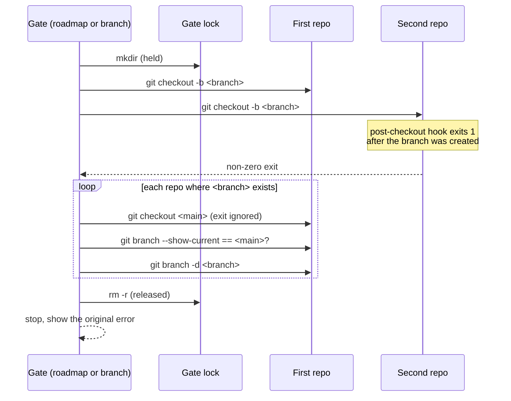

# Design

## Triage

| Trigger | Applies? | Evidence |
|---|---|---|
| T1 Components (new component, or 3+ with directed relationships) | No | No new component. Edits stay inside `specwright-roadmap`, `specwright-branch` and `specwright-finish`, along the existing finish → roadmap → branch edges (`openspec/architecture.md` component graph). |
| T2 State (persistent state, caches, 3+ state machine) | Yes | The roadmap file gains a persistent marker (`Split agreed: <date>`) that close reads. The milestone lifecycle (changes open → milestone end → closed) becomes explicit in next and status. |
| T3 Concurrency (background work, workers/isolates, async, retries) | Yes | The store gate lock serialises sessions (`skills/specwright-roadmap/SKILL.md:33-36`, `skills/specwright-branch/SKILL.md:38-41`). The rollback runs while the lock is held and must release it on every path. |
| T4 Boundaries (data format, migration, shared interface, IPC, external) | Yes | `roadmap.md` is a format that next, status and close parse; the new marker extends it, and downstream roadmaps (mythspine, blackgrid) already exist without it. Git hooks are an external system the gate must tolerate. |
| T5 Volume (grows without a fixed bound) | No | Fixed work: two repos, one branch, a handful of spec requirements. |
| T6 Risk (security, money, data loss, unrecoverable user data) | Yes | The rollback deletes branches. Deleting a branch that held work would lose it, so the delete must be safe by construction. |

TIER: FULL

## Context

See proposal.md for the issues. Current state:

- **next** (`skills/specwright-roadmap/SKILL.md:55-60`) handles two cases in step 3: a planned change to start, or "none is left but exit criteria still fail". A milestone whose changes are all done and whose criteria were never walked falls in neither. **close** step 3 (`:66`) already routes a failing criterion to next, so the gap path has a caller that has actually walked the criteria.
- **close** step 5 (`:68`) always says "promote Next to Now and split it into changes". **init** step 6 (`:52`) splits only Now. The template (`skills/specwright-roadmap/references/roadmap.md`) says Next is "split into changes at the close of the current milestone".
- **status** (`:73`) names "what **next** would start".
- **finish** (`skills/specwright-finish/SKILL.md:78`) offers "**next** (or **close** if this was the milestone's last change)".
- Store gates: roadmap step 3 (`skills/specwright-roadmap/SKILL.md:35`) and `specwright-branch` store step 3 (`skills/specwright-branch/SKILL.md:40`) treat a store-side error as "nothing was branched". `specwright-branch` has no rollback at all for a code-side error. Git creates and switches the branch before it runs `post-checkout`; the hook's exit status becomes the command's, so a failing hook leaves the repo on the new branch with a non-zero exit (githooks(5): post-checkout "cannot affect the outcome of git switch or git checkout", but its exit status is the command's).
- `openspec validate --specs --strict` fails on four `planning-stores` requirements (569, 505, 539 and 631 characters). Archiving this change into a scratch copy of `openspec/` and validating there passes all ten specs (checked while writing the delta).
- Evals: roadmap agent cases are `eval-roadmap-next-gap`, `eval-roadmap-next-gap-dirty-main` and `eval-store-roadmap-close-locked` (`evals/git-workflow/evals.json`, fixtures at `evals/git-workflow/fixtures.py:495-560`, graders at `evals/git-workflow/grade.py:275` and `:558`). Text checks live in `evals/git-workflow/test_instructions.py` (`PlanningStores`, `ProjectPlanning`).

## Decisions

### D1: A milestone end is next's third case, and it hands over to close

- **Choice:** next step 3 first asks whether every Now change is done. If so it reports a milestone end, offers **close** and stops: no branch, no file. It proposes a gap-closing change only for a criterion that **close** found failing or that the user reports failing. next starts only Now changes. status names `milestone end: run close` in place of a change. finish offers close when the merged change was the Now milestone's last one, otherwise next, never both.
- **Rejected:** next walks the exit criteria itself at a milestone end (runs the agent-verified ones, asks for the user-verified ones) and then proposes a gap change or offers close. That duplicates close steps 2-3 in a second place, so the two walks drift apart, and it makes a "what's next" question run checks and ask for user verifications.
- **Rejected:** next falls through to the Next milestone's first change when Now is done. That would start a milestone that was never closed, so exit criteria would go unchecked.
- **Reversal cost:** low. Instruction text only; no stored state.

### D2: An agreed Next split is marked by a `Split agreed:` line

- **Choice:** a Next milestone may list changes when the author explicitly agrees them; it then carries `**Split agreed:** <YYYY-MM-DD>` above its Changes list, in the same Changes format as Now. close keeps a marked split (same names, same order) and proposes any amendment to the user instead of applying it. A Next that lists changes without the line (legacy roadmaps, prose exceptions like the downstream project's) makes close ask the user whether the split is agreed: yes keeps it, no re-splits as before. A Next without changes is split as before. The line lives only while its milestone is Next: close drops it on promotion. Init, and close for the new Next it writes, add the line when the author explicitly agrees a split.
- **Rejected:** treat any change list under Next as agreed. A draft list would then silently become binding, and nothing tells close which one the author signed off on, which is what #51 asks for.
- **Rejected:** record agreements outside the roadmap (a settings key or a separate file). That splits one fact across two files, and the roadmap stays the only place a reader looks.
- **Reversal cost:** low. A marker line in a Markdown file; removing it later turns marked splits back into "ask the user".

### D3: One rollback rule for every `git checkout -b` error in a store gate

- **Choice:** after any `git checkout -b` error in either store gate, check each repo where the gate ran `git checkout -b`. In each repo where `<branch>` exists: if the repo is on `<branch>`, run `git checkout <main>`, ignore its exit status (the same hook may fail again) and confirm with `git branch --show-current` that it is on `<main>`; then `git branch -d <branch>`. Release the lock, then stop and show the original error. If a repo is still on `<branch>` after the switch, delete nothing there but still roll back the other repo, then release the lock and stop, naming that repo and both branches. The rule applies to roadmap step 3 and `specwright-branch` store step 3, which also gains the code-side case it lacked.
- **Rejected:** keep per-case rollbacks and add the hook case to each. Two error points (store first or code first) times two outcomes (branch created or not) give four paths per gate, and each skill already missed one. One rule driven by what exists covers all of them.
- **Rejected:** bypass hooks with `git -c core.hooksPath=<empty dir> checkout -b`. That skips hooks the project relies on (environment setup, LFS), and a gate must not change the project's behaviour to make its own step easier.
- **Reversal cost:** low. Instruction text only.

### D4: The over-long requirements are split, and the archived deltas stay as merged

- **Choice:** each of the four `planning-stores` requirements keeps its header, its wording and every scenario under MODIFIED, with its description cut to its first behaviour, as the schema's spec instruction requires when a long requirement is split ("keep its header and every scenario ... then add each behavior you removed as its own ADDED requirement with its own scenarios"). Each removed sentence becomes an ADDED requirement with its own happy and failure scenarios, distinct from the kept ones, word for word apart from the subject the split needs ("A feedback pass's record"). The archived deltas of `fix-workflow-recovery` and `fix-pr-evidence-freshness` are not edited.
- **Rejected:** edit the archived deltas too, as #66 suggests. An archive records what a merged change did; `openspec validate --specs` reads only `openspec/specs/`, and the scratch-copy check passes without touching the archives. Rewriting merged history would make that record disagree with its PR.
- **Rejected:** trim the descriptions by rewording, without splitting. That changes requirement text that reviews have already approved, and the schema's rule for long requirements is to split them.
- **Reversal cost:** low.

### D5: Regression coverage combines agent evals, text checks and a strict-validation test

- **Choice:**
  - Agent evals in `evals/git-workflow/evals.json`, with fixtures and graders:
    - `eval-roadmap-next-milestone-end`: next offers close and creates nothing.
    - `eval-roadmap-close-agreed-split`: close keeps a marked Next split.
    - `eval-store-roadmap-close-hook-fail`: a failing `post-checkout` in the code repo after the store branch exists.
    - `eval-store-branch-hook-fail`: a failing `post-checkout` in the store after the code branch exists.
  - The two `eval-roadmap-next-gap*` cases change their prompt from next to close, because next no longer proposes a gap at an unwalked milestone end. Their assertions stay.
  - Text checks in `test_instructions.py` for each new rule. The existing `test_roadmap_store_checks_code_repo_before_any_branch` (`evals/git-workflow/test_instructions.py:230-242`) asserts step 3's old per-case wording and is updated to the single rule.
  - A new `evals/git-workflow/test_specs_strict.py` copies `openspec/` to a temp directory, archives every active change there and runs `openspec validate --specs --strict`. It guards #66 before archive, and skips naming the missing CLI when `openspec` is absent.
- **Rejected:** a pure-Python length check of requirement text. It re-implements OpenSpec's parser and limit, and would not catch the next validator rule.
- **Reversal cost:** low.

## Diagrams (FULL)

Milestone lifecycle as next, status, finish and close see it (T2):

```mermaid
stateDiagram-v2
  [*] --> ChangesOpen: Now promoted
  ChangesOpen --> ChangesOpen: next starts a planned change<br/>(finish offers next)
  ChangesOpen --> MilestoneEnd: last Now change done<br/>(finish offers close)
  MilestoneEnd --> MilestoneEnd: next / status → "milestone end: run close"
  MilestoneEnd --> GapChange: close finds a criterion failing<br/>(or the user reports one)
  GapChange --> ChangesOpen: next adds the gap change on its branch
  MilestoneEnd --> Unverified: close finds a criterion unverified
  Unverified --> MilestoneEnd: user records a result
  MilestoneEnd --> Closed: every criterion passes
  Closed --> [*]: Done line; Next promoted (agreed split kept, D2)
```

Store gate branch step with the rollback (T3, T4):

The first repo is the store for roadmap and the code repo for `specwright-branch`.

## State & Ownership (FULL)

| State | Owner (sole writer) | Lifetime | Invalidation / rebuild | Authoritative copy |
|---|---|---|---|---|
| `Split agreed: <date>` line in Next | `specwright-roadmap` init, or close for the new Next it writes, when the author explicitly agrees a split | Until close promotes that milestone to Now, where the line is dropped (an unmarked list confirmed at promotion gets no line) | Removed when the milestone becomes Now; a user's edit is honoured as-is | Planning repo's main (`roadmap.md`) |
| Milestone end (all Now changes done) | Nobody: derived from archives and merge proofs, never stored | — | Recomputed on every next, status and finish | Main branches, as already derived |
| Empty `<branch>` left by a failed `checkout -b` | The gate that created it, while it holds the lock | Until the rollback deletes it | Deleted in the same gate run | — |
| Store gate lock | Unchanged (`openspec/architecture.md` State ownership) | Its own gate run | Released on every rollback path | `<store git-common-dir>/specwright-gate.lock` |

## Failure & Visibility (FULL)

| Component | Fails / dies mid-operation → | Recovery | Retry safe? | Who finds out |
|---|---|---|---|---|
| next at a milestone end | Writes nothing, so nothing to recover | — | Yes | The user, from the close offer |
| close keeping a split | Stops before its commit: the `docs/close-<m>` branch holds uncommitted edits, as today | Existing close flow (Committing project files) | Yes, after the user discards or commits the edits | The user |
| Gate rollback, switch-back fails (repo still on `<branch>`) | That repo is left on the empty `<branch>`, and nothing is deleted there | The user switches back and deletes it; the report gives both commands | Yes, after cleanup: step 2 refuses until the repo is on main | The user, from the stop report naming the repo and both branches |
| Gate rollback, `git branch -d` refuses | The branch is kept (it has commits main lacks, which cannot happen for a branch made in this run, so it is not ours) | The user decides | Yes | The user, from the stop report |
| Gate rollback, session dies before releasing the lock | The lock stays | Existing stale-lock flow: the user confirms removal | Yes | The next gate run, which shows the owner |
| Strict-validation test | `openspec` missing → skipped, naming it; an archive error → test fails with the CLI output | — | Yes | The developer running the suite |

## Resource Bounds (FULL)

| Queue / buffer / cache / transfer | Bound | At the bound | Timeout | At 10x / 100x |
|---|---|---|---|---|
| Rollback | Two repos, one branch each | — | None needed: local git only | Not volume-dependent |
| Strict-validation test temp copy | One copy of `openspec/` (currently under 2 MB) | — | Inherits the suite's run | At 100x (~200 MB) the copy would be slow; then copy only `specs/` and the active changes |

## Flow & State Gaps (FULL)

- **Partial completion:** next at a milestone end writes nothing. close keeps its existing branch-then-commit order; the kept split is written in the same commit as the Done line.
- **Concurrent operations:** the rollback runs while the gate lock is held, so no other gate can branch in the same store meanwhile. Another tool could still create `<branch>` between step 2's check and step 3. In that case `git checkout -b` fails with "already exists", and the rollback would find a branch it did not create. `git branch -d` deletes it only when main already holds its commits, so no work is lost. The default assumption is that this race does not occur in practice (D3 mechanism ledger).
- **Stale data:** finish decides between close and next once the change is on main: after the local merge, or after cleanup's `git pull --ff-only` in pr mode. Done status comes from roadmap's own derivation (fetch, then `origin/<main>`), so a stale local main cannot hide the last change.
- **Out-of-order events:** a last change whose planning merged but whose code is pending is not done, so next reports it and does not offer close (project-planning scenario "Last change archived but code pending").
- **Restart mid-operation:** a gate that dies after a hook failure, before rolling back, leaves the lock and maybe an empty branch. The next run stops on the lock (the user confirms it is stale), then step 2 stops on "not on main" or "branch exists" and offers the user the commands. This is today's behaviour, and the report names what to run.

## Mechanism Ledger (FULL)

| Mechanism | Built? | Why (harm nobody catches / expensive later) | Evidence that would change the call |
|---|---|---|---|
| Rollback judged by current branch, not exit status | Yes | A failing post-checkout hook also fails the switch back; trusting the exit status would leave a repo on the empty branch and report it as rolled back | — |
| `git branch -d` (not `-D`) in the rollback | Yes | It refuses to delete a branch whose commits main lacks, so a branch not made by this run cannot lose work | — |
| Runtime record of which repos this run branched | No | The scope is static: the rollback covers only repos where the gate ran `git checkout -b` (the store, plus the code repo when the gate branches it), and step 2 checked each of those for `<branch>`. The lock excludes other gates, and `-d` protects any work | An outside tool creating gate branches during a gate run |
| Hook bypass during the gate | No | It changes project behaviour (D3) | — |
| Rollback in the single-repo `specwright-branch` gate | No | A retry stops at step 4 (not on main, offering to switch back), then at step 7 (branch exists, offering to resume it): two stops with the right offers, and nothing is half-made across repos | A report of a single-repo hook failure that needed manual git |
| Automatic migration of unmarked Next lists | No | close asks the user once per milestone (D2); a guess would make a draft binding | — |
| Pure-Python requirement-length check | No | The OpenSpec-backed test covers it and future rules (D5) | `openspec` unavailable in CI |

## Risks / Trade-offs

- [The two `eval-roadmap-next-gap*` cases change their prompt] → Their assertions about the branch, the roadmap commit and main are unchanged, and the project-planning MODIFIED requirement keeps the gate behaviour they test. Only the entry point changes, as the spec requires.
- [A downstream roadmap with a prose split exception stops close for a question] → One question, asked only for a milestone whose list predates the marker; any split agreed from 0.1.12 on carries the line, so close does not ask for it.
- [Agent evals prove the instructions on a live run only when someone runs them] → Text checks in `test_instructions.py` and the strict-validation test run in the unittest suite on every change, so the rules cannot silently disappear.

## ADRs

- **In force, constraining this change:** 0001 (OpenSpec unmodified: the #66 fix goes through a delta and the CLI's own validator), 0002 (instructions plus thin scripts: no new script, the rollback is skill text), 0003 (git holds the evidence: the milestone end is derived, never stored), 0006 (OpenSpec resolves the planning root: the gates' two-repo pairing is unchanged).
- **To record during apply:** none. The marker line is a roadmap convention, not a binding format for other changes. `openspec/architecture.md` gets no new ADR. Only the Store gate row under Resource bounds and failure visibility gains the rollback.
