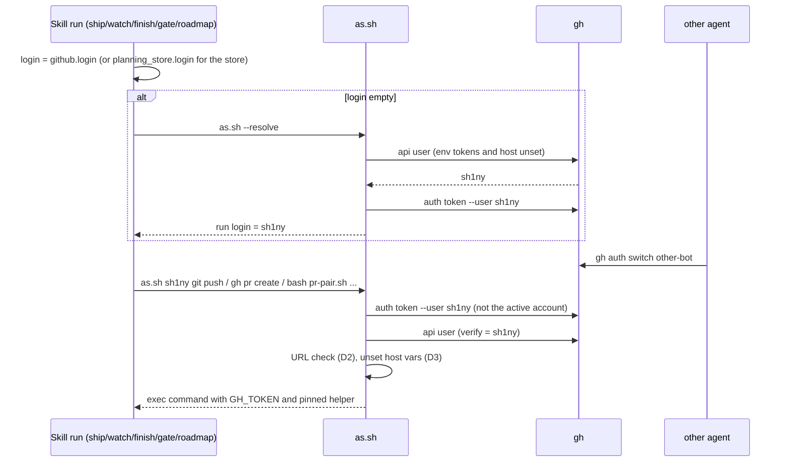
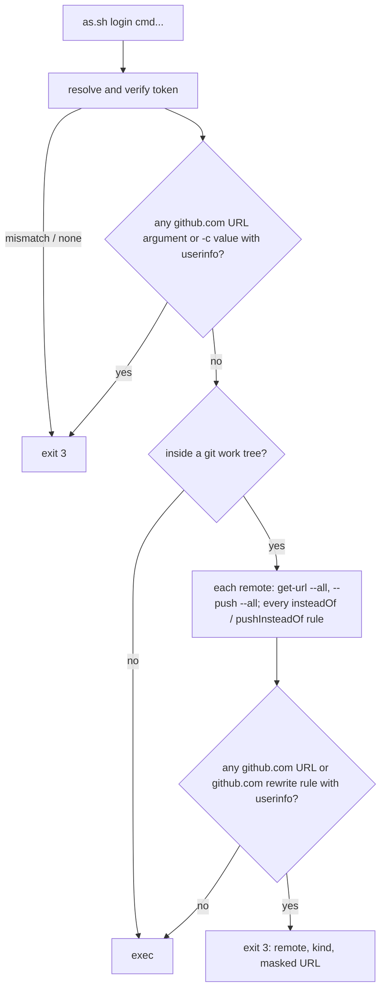

# Design

## Triage

| Trigger | Applies? | Evidence |
|---|---|---|
| T1 Components (new component, or 3+ with directed relationships) | Yes | Five skills, `as.sh`, `pr-pair.sh` and `gh`/git all take part in choosing the account (`openspec/architecture.md:48`, `:107`). |
| T2 State (persistent state, caches, 3+ state machine) | Yes | New per-run state: the resolved run login, which every later call of the run must use. It is not persisted. |
| T3 Concurrency (background work, workers/isolates, async, retries) | Yes | The race this change closes is concurrent: another agent's `gh auth switch` between two calls of a run. `pr-snapshot.sh --wait` runs in the background for a whole watch. |
| T4 Boundaries (data format, migration, shared interface, IPC, external) | Yes | `as.sh` is a shared script interface (new `--resolve` mode, new exit-3 refusals); the `github.login` default changes meaning. |
| T5 Volume (grows without a fixed bound) | No | One login per repo per run; the URL check reads a repo's remotes, bounded by its config. |
| T6 Risk (security, money, data loss, unrecoverable user data) | Yes | Authentication: which account pushes, comments and (with #15) merges. |

TIER: FULL

## Context

See proposal.md for the problem and scope. Current state, checked in the code:

- `as.sh` resolves `gh auth token --hostname github.com --user <login>` with `GH_TOKEN`/`GITHUB_TOKEN` unset (`skills/specwright-pr/scripts/as.sh:28-30`), verifies it with `gh api --hostname github.com user` (`:33-34`), disables SSH and prompts (`:42-43`), scrubs inherited `http.*.extraHeader` and installs a credential helper that answers only `https://github.com` with the verified token (`:51-58`). It leaves `GH_HOST`, `GH_ENTERPRISE_TOKEN` and `GITHUB_ENTERPRISE_TOKEN` alone, and does not look at remote URLs.
- `specwright-pr` uses `[as]` only "when `github.login` is set", and plain `gh` otherwise (`skills/specwright-pr/SKILL.md:46`); review requests fall back to the ambient account with plain `gh` (`:50`); the template's `github.login: ""` is commented "unsafe when agents run concurrently" (`templates/openspec/specwright.yaml:13-14`).
- Unfenced call sites: `specwright-finish`'s `gh pr view <branch> --json state` (`skills/specwright-finish/SKILL.md:79`); `git fetch -q origin <main>` in the branch gate (`skills/specwright-branch/SKILL.md:17`); `git fetch origin <main>` and `git pull --ff-only origin <main>` in roadmap (`skills/specwright-roadmap/SKILL.md:20`, `:30`); `git pull --ff-only` in finish (`skills/specwright-finish/SKILL.md:34`, `:79`) and in `specwright-pr` cleanup (`skills/specwright-pr/SKILL.md:145`); the plain `git pull --ff-only` that `cleanup-plan` emits (`skills/specwright-pr/scripts/pr-pair.sh:1956`).
- `pr-pair.sh` already fences its own network reads per repo: `git_net` runs `as.sh <login> git ...` when a login reads that repo (`pr-pair.sh:127-140`), `token_for` resolves and verifies like `as.sh` (`:170-186`) but keeps inherited host variables. `ambient_login()` (`:544-548`) reads `gh api user`, which under `as.sh` is the fenced login.
- Test pattern: `evals/pr-pair/test_as_sh.py` serves HTTP on localhost, puts a fake `gh` first on `PATH` (`fixtures.install_fake_gh`, state in `gh-state.json` with `user` and per-login `tokens`) and records what git sends (`:29-93`).

## Decisions

### D1: Resolve the active account once per run, then fence to it

- **Choice:** with no login configured, a run's first step is `bash scripts/as.sh --resolve`, which (with `GH_TOKEN`, `GITHUB_TOKEN`, `GH_HOST` and the enterprise token variables unset) reads the active github.com account with `gh api --hostname github.com user --jq .login`, confirms `gh auth token --hostname github.com --user <login>` exists, and prints the login (exit 3 otherwise). The skill keeps that login as the run login for the rest of the run and passes it to every `[as]`, so `[as]` always means `bash scripts/as.sh <run login>`; "drop it when `github.login` is empty" goes away. Each fenced call still looks up that login's own token, so a later `gh auth switch` changes nothing for the run. Only the resolution itself reads the active account.
  A run is the chain of steps one user request starts in one session. Every hand-off names the run login: commit → ship, ship → watch, watch → feedback / ship / archive, archive → finish → ship, and finish → the roadmap offer. The handing step states it in its hand-off ("run login: `<login>`"), and the receiving step uses it without resolving again. A receiving step that cannot find the login stops and asks the user. Only a user-started step resolves. The `--wait` watcher gets the login on its command line.
  When `--resolve` fails in a step that accepts local refs (branch gate, roadmap status), that counts as a fence refusal: the step reports `local refs only (no gh account)` and continues. Any other step stops. `gh` stays optional for local mode (`README.md:44`).
- **Rejected:** require a configured login (#38 option 1: refuse authenticated work until `github.login` is set) because it breaks every default install on its first ship for a race that resolve-once already removes; the install prompt keeps asking for a login (`README.md:138`), so projects that want a fixed account still get one.
- **Rejected:** persist the resolved login to a file in the git dir so separate tool calls share it, because it is new persistent state with its own staleness and second-writer problems (two sessions in one checkout), while the agent's run already carries every other per-run value (change name, branch, mains) in its own context.
- **Reversal cost:** low. It is one script mode and one sentence in each skill's identity paragraph.

### D2: Refuse credential-bearing URLs; do not rewrite them

- **Choice:** before `exec`, whenever `as.sh` starts inside a git work tree, it reads each remote's URLs as git resolves them (`git remote get-url --all <r>` and `git remote get-url --push --all <r>`, which apply `insteadOf`/`pushInsteadOf`). It also reads every `url.<base>.insteadOf` / `pushInsteadOf` rule. It refuses (exit 3) when a URL whose host is github.com has any userinfo (`scheme://<anything>@github.com`), and when a rule whose target is github.com, or that rewrites a github.com URL, carries userinfo in its base. That includes a bare username, since `https://<token>@github.com` cannot be told apart from `https://someone@github.com`, and the helper supplies the credential anyway. URLs and rules for other hosts are ignored: the pinned helper never answers them (`as.sh:57`), and a global GitLab token rule must not block `gh`. The same check covers each command-line argument that is a github.com URL, and the value of each `-c key=value` argument. The message names the remote, the kind (`fetch`/`push`/`rewrite`/`argument`) and the URL with its userinfo replaced by `***`. The check runs for every fenced command, not only `git`, because scripts run under `as.sh` (`pr-pair.sh`) run git themselves and inherit the helper.
- **Rejected:** strip and override (pass a credential-free URL through command-scoped config) because git's `remote.<r>.pushurl` is multi-valued and command-scoped config adds values rather than replacing them, so a stripped override would push to both URLs; and silently changing what a user's remote points at hides the misconfiguration instead of fixing it.
- **Rejected:** check only when the command is `git` because `[as] bash scripts/pr-pair.sh ...` runs `git ls-remote`/`fetch` itself and would bypass a command-name check.
- **Reversal cost:** low. A refusal can be relaxed to a strip later without touching callers.

### D3: Pin gh to github.com inside the fence

- **Choice:** `as.sh` and `pr-pair.sh`'s `token_for` unset `GH_HOST`, `GH_ENTERPRISE_TOKEN` and `GITHUB_ENTERPRISE_TOKEN` (alongside `GH_TOKEN`/`GITHUB_TOKEN`) before resolving, verifying or running anything.
- **Rejected:** export `GH_HOST=github.com` instead of unsetting because it still lets an inherited enterprise token sit in the environment of every fenced command, and unsetting gives gh's own default, which is github.com.
- **Reversal cost:** low.

### D4: Fence git network calls to GitHub remotes; leave other remotes alone

- **Choice:** the skills run `git fetch`/`git pull` through `[as]` when the fetch URL of the remote they use is on github.com, and plain otherwise. That URL is `git remote get-url <remote>`, parsed as `pr-pair.sh`'s `parse_repo` does. It is not decided by `pr-pair.sh identity` succeeding: identity reports `mismatch` for an origin that pushes to a fork (`pr-pair.sh:408-410`), and that fetch must still be fenced. `cleanup-plan` emits `["bash", "<as.sh>", <login>, "git", "pull", "--ff-only"]` for a repo it reads under a login, with each repo's login from `context` (the store's `planning_store.login`, else the code login); an empty code login becomes `ambient_login()`, which is the fenced run login because `cleanup-plan` itself runs under `[as]` (`pr-pair.sh:544-548`). A refused fetch keeps each step's existing failure rule: the branch gate and roadmap status say they used local refs (`skills/specwright-branch/SKILL.md:17`, `skills/specwright-roadmap/SKILL.md:20`); finish and cleanup stop.
- **Rejected:** fence every git network call regardless of host because `as.sh` drops inherited credential helpers and answers only github.com, so a local-mode project on a self-hosted HTTPS remote would lose its credentials and every fetch would fail, with no GitHub identity to protect.
- **Reversal cost:** low.

### D6: `pr-pair.sh` reads every other repository through `as.sh` from inside it

- **Choice:** `git_net` (`pr-pair.sh:127-140`) runs every network read of a repo other than the one the process started in through `as.sh <that repo's login>`, with the repo as working directory. That login is the store login, or the code run login (`ambient_login()` under the outer fence) when the store login is empty or equal. So the URL check (D2) and the header scrub, which cover only the repo `as.sh` starts in (`test_as_sh.py:106-110`), apply to the store too. Today a store read with equal logins runs plain `git` (`pr-pair.sh:129-137`, `:190-194`). With both logins empty, the new default, that would become the normal store path.
- **Rejected:** have the outer `as.sh` check every repo a script might touch because it cannot know them: the store path comes from the script's arguments.
- **Reversal cost:** low. It is one function.

### D5: Supersede ADR 0004 with ADR 0008

- **Choice:** record ADR 0008 "Fenced GitHub identity by default" during apply, superseding 0004: the fence is the default; with no login the run login is the active account resolved once per run; git network calls to GitHub are fenced; credential-bearing URLs are refused; gh is pinned to github.com. 0004's file stays unchanged; the architecture index swaps the row, and the GitHub identity paragraph (`openspec/architecture.md:107`) is rewritten without the #38 exceptions.
- **Rejected:** amend 0004 in place because accepted ADRs are immutable.
- **Reversal cost:** low (docs).

## Diagrams (FULL)

Run login and fence (T1, T2, T3):

URL check (T4, T6):

## State & Ownership (FULL)

| State | Owner (sole writer) | Lifetime | Invalidation / rebuild | Authoritative copy |
|---|---|---|---|---|
| Run login per repo | The user-started step, set once from settings or `as.sh --resolve` | One run (the chain of steps one user request starts in one session) | Handed to every step the run invokes; never updated mid-run; a handed-off step that cannot find it stops and asks; only a user-started step resolves | The agent's run context; passed explicitly to every `[as]`, hand-off and background watcher |
| Verified token | `as.sh` (and `pr-pair.sh` `TOKENS`) | One process | Re-resolved per process | gh's credential store for that login |
| Remote URLs, `insteadOf` rules | The user (git config) | Repo lifetime | Read fresh by each `as.sh` call; never written by Specwright | The repo's git config |
| `github.login` and fallbacks | The user (`openspec/specwright.yaml`) | Project lifetime | Read at run start | The settings file |

## Failure & Visibility (FULL)

| Component | Fails / dies mid-operation → | Recovery | Retry safe? | Who finds out |
|---|---|---|---|---|
| `as.sh --resolve` | No `gh`, no active account, or no token for it → exit 3 | In the branch gate and roadmap status: counts as a fence refusal, the step reports `local refs only (no gh account)` and continues. Elsewhere: the run stops; the user runs `gh auth login` or sets `github.login` | Yes, nothing ran | User: the local-refs note, or the stop message |
| `as.sh` verify | Token resolves to another login → exit 3 | User repairs `gh` auth | Yes | User |
| `as.sh` URL check | Credential URL → exit 3 before any request | User removes the secret from the remote or rewrite rule | Yes | User: message names the remote and kind, secret masked |
| Fenced fetch (gate, roadmap status) | Refused (SSH origin, no credential) | Step continues on local refs and says so | Yes | User: the existing "local refs only" / "may be stale" note |
| Fenced pull (finish, cleanup) | Non-zero exit | Stop; no branch deleted | Yes | User |
| Background watcher | Killed mid-wait | Watch restarts it with the same run login | Yes | Watch (exit status), user on stop |

## Resource Bounds (FULL)

| Queue / buffer / cache / transfer | Bound | At the bound | Timeout | At 10x / 100x |
|---|---|---|---|---|
| Extra `gh` calls per fenced command | 2 (`auth token`, `api user`), unchanged; `--resolve` adds 2 per run | — | gh's own | Unchanged per call; GraphQL budget unaffected (REST `user`) |
| URL check | One `git config` read plus 2 `get-url` calls per remote | — | none needed (local) | Repos with many remotes cost a few ms each |

## Flow & State Gaps (FULL)

- **Switch between `--resolve` and the first call:** harmless; each call uses the resolved login's own token.
- **Switch before `--resolve`:** the run takes whichever account is active at its start; that is the documented meaning of an empty login. Projects that need a fixed account set `github.login`.
- **Hand-off within a run** (ship → watch → feedback / archive → finish): the run login travels with the hand-off; no step re-resolves, so a switch during a long watch changes nothing.
- **Lost run login inside a run:** the step that cannot find it stops and asks; it never re-resolves, since that would re-open the race.
- **Resumed run** (the user starts ship/watch again in a new session): a new user request is a new run and resolves again; if the active account changed between sessions, it uses the new one. Recorded in the README so users who switch accounts set `github.login`.
- **Background watcher started before a switch:** it got the run login on its command line, so it is unaffected.
- **Store-backed with both logins empty:** the store uses the code repo's run login (one resolution per run), matching the existing `planning_store.login` default to `github.login`.
- **Credential URL added mid-run:** the next fenced call reads the URLs fresh and refuses.

## Mechanism Ledger (FULL)

| Mechanism | Built? | Why (harm nobody catches / expensive later) | Evidence that would change the call |
|---|---|---|---|
| Run login handed off between steps | Yes | Re-resolving per step lets a switch during a watch redirect replies, the archive push and (#15) the merge | — |
| `pr-pair.sh` store reads through `as.sh` inside the store | Yes | Otherwise the store's URLs and headers escape the check with the default empty logins (D6) | — |
| Resolve-once run login | Yes | Without it, a default install acts as whatever account another agent switched to; nobody notices until a PR or merge shows the wrong author | — |
| Credential-URL refusal (remotes, push URLs, rewrites, arguments) | Yes | A push silently authenticates as the token's owner while every check reports the configured login | — |
| Host-variable unset | Yes | Fenced calls could go to an enterprise host with another identity | — |
| Persisted run login file | No | Context already carries the run's values; a file adds a second writer. A step that cannot find its handed login stops and asks | Frequent stops from runs losing the handed login after compaction |
| Stripping credentials from URLs | No | Refusal is fail-closed and simpler (D2) | Users routinely needing embedded tokens for other reasons |
| Fencing non-GitHub remotes | No | No GitHub identity involved (D4) | A second forge supported by the PR flow |
| Checking `GIT_CONFIG_*` env URL injection | No | `as.sh` sets `GIT_CONFIG_COUNT` itself, so inherited `GIT_CONFIG_KEY_n` entries are not read (`as.sh:59`) | A git version that merges inherited and new counts |

## Risks / Trade-offs

- [A local-mode user with an SSH GitHub origin loses the branch gate's main refresh] → the gate keeps working on local refs and says so; the README tells them to use HTTPS or set nothing else.
- [A user relies on a token in the remote URL] → **BREAKING** in the 0.3.0 notes, with the fix (remove it; `gh auth login` provides the credential).
- [An agent forgets the run login between tool calls and drops `[as]`] → skill-text tests assert no `gh`/`git fetch`/`git pull`/`git push` call site lacks `[as]` and that the "drop it when empty" wording is gone.
- [The URL check misses an exotic URL form (scp-like, `file://`)] → those carry no HTTP credentials or are already refused by the SSH block; the check refuses any userinfo on a github.com URL, whatever its scheme (D2), and ignores other hosts.

## ADRs

- **In force, constraining this change:** 0002 (agent instructions with thin scripts: the run login lives in skill instructions, not a daemon), 0003 (git and GitHub as the state store: no new persisted state), 0004 (superseded here).
- **To record during apply:** 0008 "Fenced GitHub identity by default", superseding 0004; update `openspec/architecture.md` index and the GitHub identity paragraph.
