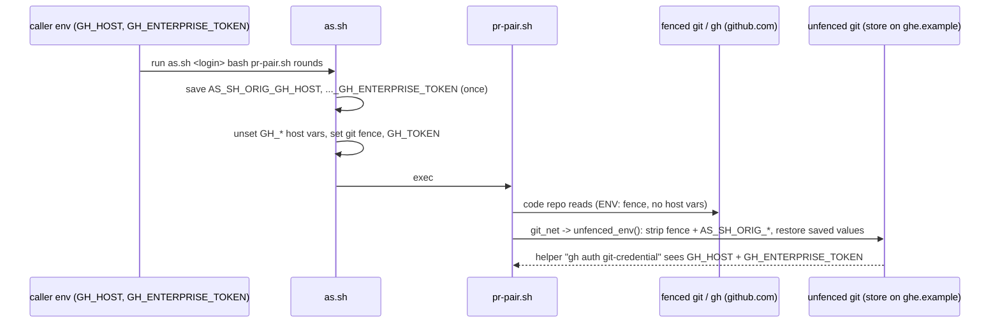
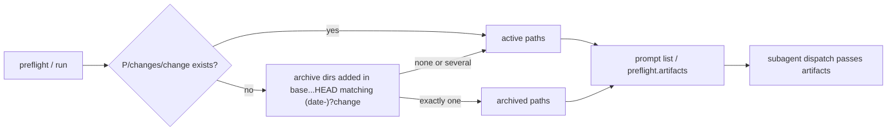

# Design

## Triage

| Trigger | Applies? | Evidence |
|---|---|---|
| T1 Components (new component, or 3+ with directed relationships) | no | No new component. The fixes stay inside existing scripts and skill text: `as.sh`, `pr-pair.sh`, `review-run.sh`, `specwright-finish`. |
| T2 State (persistent state, caches, 3+ state machine) | no | No new stored state. The finish resume table is an existing decision table; it gains one guard, not a state. |
| T3 Concurrency (background work, workers/isolates, async, retries) | no | Nothing runs concurrently. The pull added to resume is a single fenced foreground call. |
| T4 Boundaries (data format, migration, shared interface, IPC, external) | yes | `review-run.sh preflight` output gains an `artifacts` field that the subagent dispatch consumes (a script-to-agent contract). `as.sh` exports new `AS_SH_ORIG_*` variables that `pr-pair.sh` reads. |
| T5 Volume (grows without a fixed bound) | no | The archive lookup reads one directory listing and one diff name list, both bounded by the change. |
| T6 Risk (security, money, data loss, unrecoverable user data) | yes | #83 is a credential bypass (an embedded token authenticates as another account). #84 moves enterprise tokens across the fence boundary. #75 can end a finish while `main` is stale. |

TIER: FULL

## Context

See `proposal.md` for the five issues. Current code:

- **as.sh host tests.** `gh_url` and `gh_userinfo` match `github\.com([:/]|$)` after the authority (`skills/specwright-pr/scripts/as.sh:73-74`). The credential helper answers only `[ "$h" = github.com ]` (`as.sh:170`). `github.com.` fails all three, so a URL carrying userinfo on that host is neither refused nor overridden by the helper. Git then uses the embedded credential.
- **pr-pair host split.** `GH_URL` (`skills/specwright-pr/scripts/pr-pair.sh:102-104`) decides through `fetch_repo`/`identity` whether `git_net` fences a repo (`pr-pair.sh:186-201`). A `github.com.` origin is classified as non-GitHub and read with `unfenced_env()`, which uses the user's own git and credentials.
- **Saved originals.** `as.sh:44` unsets `GH_TOKEN GITHUB_TOKEN GH_HOST GH_ENTERPRISE_TOKEN GITHUB_ENTERPRISE_TOKEN` before the save block at `as.sh:138-147`, which records only the git fence variables. `unfenced_env()` (`pr-pair.sh:145-152`) strips `FENCE_VAR` and restores `AS_SH_ORIG_SET`. The enterprise variables are therefore gone for the unfenced store read. `HOST_VARS` (`pr-pair.sh:156`) already keeps them out of pr-pair's own fenced `gh` and `token_for` calls.
- **Artifact paths.** `artifact_paths(root, prefix, change)` (`skills/specwright-review/scripts/review-run.sh:665-668`) always names `<root>/
/changes/<change>/`. `build_prompt` lists them (`review-run.sh:699`). `cmd_preflight` (`review-run.sh:831-849`) prints only `heads` and `diff_bytes`, and the subagent dispatch (`skills/specwright-review/SKILL.md:53`) gives the agent the change name and the planning root, not artifact paths. The archive-commit matcher in `archive_only` (`review-run.sh:1167`) already accepts `(?:\d{4}-\d{2}-\d{2}-)?<change>`, and is the pattern to reuse.
- **Finish resume.** `skills/specwright-finish/SKILL.md:27` pulls `main` only when none of A, M or B holds. Row `:35` ("`pr`, the branch's PR merged, not B") runs only `closed-check`. The reused-branch-name rule is stated after the table (`:47`) and says it is "checked before the table". It does not say it reuses the `discover` result the no-archive rule (`:27`) fetches, or that it preempts the no-archive report. Row `:45` says "report the closed PR and ask".
- **Eval fixture.** `build_finish_resume_merged` (`evals/git-workflow/fixtures.py:891-934`) sets origin to `https://github.com/acme/...` behind an unreachable proxy, so a real pull would fail. The grader (`evals/git-workflow/grade.py:515-540`) asserts that `main` is unchanged and that `changing_git` finds nothing, and `changing_git` counts `pull` and `checkout main` (`grade.py:361-376`). The watch-merge fixture already uses a local bare origin (`/ob.git/` in its exclude list, `fixtures.py:1018`), which is the pattern to reuse.

## Decisions

### D1: Refresh main inside the merged-PR-branch-gone row, then re-read A

- **Choice:** In `pr` mode, row "the branch's PR merged, not B" first runs the same guarded refresh the no-archive rule already uses: `git status --porcelain` (any output → stop and ask), `git checkout <main>`, `[as] git pull --ff-only`. It skips the refresh when this run already pulled that repo. For the planning repo (repo-local: the one repo; store-backed: the store), it then reads A again on the refreshed `main`: A present → `closed-check`, repo done; A absent → report that the merged PR did not bring the archive to `main`, run no backstop, and leave the repo not done. A store-backed code repo never has A (the archive directory is planning-repo only, `skills/specwright-finish/SKILL.md:23`), so after the refresh it keeps today's outcome: `closed-check`, repo done.
- **Rejected:** Tie the archive directory to the newest PR's merge commit, checking that the directory was added by a commit reachable from the PR's merge or `head_sha`. That needs the merge commit locally, which is exactly what a stale `main` lacks, so it still needs a fetch. It also adds a provenance rule that squash and rebase merges complicate. The refresh is simpler and uses an existing, fenced step.
- **Reversal cost:** low. Skill text plus one eval fixture.

### D2: The reused-branch-name check reads the no-archive rule's `discover` and runs first

- **Choice:** Move the reused-name rule into the Resume prose ahead of the "None of A, M, B" paragraph. In `pr` mode, `discover` runs once per repo whenever a rule needs the branch's PRs (the no-archive lookup, or the table). The reused-name check reads that same result immediately. When an older merged PR exists alongside a newer closed-unmerged PR, or a newer open PR with B false, finish reports every such PR and asks before the no-archive report, any pull, or any table row. Row `:45` becomes "the newest PR closed unmerged (no older merged PR: the reused-name rule above covers that)" with the same report.
- **Rejected:** Keep the rule after the table and add "including the no-archive report" to its sentence. That repeats the original seam: a reader following the text top to bottom has already reported "no archive" at `:27` before reaching it.
- **Reversal cost:** low.

### D3: Artifact paths come from the reviewed range, never from a name match alone

- **Choice:** `artifact_paths` takes the planning repo directory and its base ref. If `
/changes/<change>/` exists in the working tree, use it (today's behaviour). Otherwise list `git diff --no-renames --name-only --diff-filter=A <base>...HEAD -- 
/changes/archive/` in the planning repo and keep the directories whose last component matches `^(\d{4}-\d{2}-\d{2}-)?<change>$` (the `archive_only` pattern). Exactly one → its four paths. None, or several → the active paths as before, so the reviewer reports the artifacts as missing. `run`'s prompt and a new `artifacts` list in `preflight` output both come from this one function. The `specwright-review` subagent dispatch passes `artifacts` to the reviewer, and both reviewer agent files read the paths they are given instead of deriving them from the change name.
- **Rejected:** Pick the newest dated directory that matches the name. A reused name would then review against an older change's artifacts, the same class of error as #75. A rejected sequencing alternative was to run the local gate before the archive commit. That changes `specwright-finish`'s step order and the "head before the archive commit" pass rule (`preship-review` "Ship and local merge require a pass"), and it leaves the PR path's archive-before-merge case unfixed.
- **Reversal cost:** low. `artifacts` is additive in the preflight JSON. Nothing parses that output except the dispatch text.

### D4: The trailing dot is normalised at each host comparison, not by rewriting URLs

- **Choice:** In `as.sh`, `gh_url` and `gh_userinfo` match `github\.com\.?([:/]|$)`, and the credential helper strips one terminal dot (`h=${h%.}`) before comparing it to `github.com`. In `pr-pair.sh`, `GH_URL` accepts `github\.com\.?` in both its URL and scp forms. The anchors stay as they are, so `github.com.example.org` stays a non-GitHub host.
- **Rejected:** Rewrite `github.com.` URLs to `github.com` through a command-scoped `url.*.insteadOf` rule. That changes the URLs git uses and interacts with the user's own rewrite rules, which the fence checks but never alters. It also leaves the userinfo check unaware of the original form.
- **Reversal cost:** low.

### D5: Save the enterprise variables before the unset, restore them only unfenced

- **Choice:** Move the save of `GH_HOST`, `GH_ENTERPRISE_TOKEN` and `GITHUB_ENTERPRISE_TOKEN` into `AS_SH_ORIG_*`/`AS_SH_ORIG_SET` ahead of the unset at `as.sh:44`, under the same "once, outer originals win" guard. A variable that was unset is not recorded, so it is not restored as an empty string. Nothing else changes: `unfenced_env()` already restores everything in `AS_SH_ORIG_SET` and strips `AS_SH_ORIG_*`. Fenced paths never read `AS_SH_ORIG_*`: `gh` reads only `GH_HOST`/`GH_ENTERPRISE_TOKEN`/`GITHUB_ENTERPRISE_TOKEN`, which stay unset in the fence, and pr-pair's `HOST_VARS` filter keeps applying. The same split covers `GITHUB_TOKEN`/`GH_TOKEN`: they stay unsaved, since an unfenced non-GitHub read must not get a github.com token (the PR #82 test `token=unset`).
- **Rejected:** Have `pr-pair.sh` re-read the enterprise variables from the parent process or from `gh auth status`. A child process cannot see the parent's original environment after `as.sh` unset it, and `gh auth status` would put a host-wide token into an unfenced call based on a guess about which host the store uses.
- **Reversal cost:** low. The `AS_SH_ORIG_*` names are internal between two scripts shipped together.

## Diagrams (FULL)

T4: the environment boundary for #84 and the preflight contract for #81.

## State & Ownership (FULL)

| State | Owner (sole writer) | Lifetime | Invalidation / rebuild | Authoritative copy |
|---|---|---|---|---|
| `AS_SH_ORIG_*` / `AS_SH_ORIG_SET` env | outermost `as.sh` | one process tree | set once; nested `as.sh` keeps the outer values | the caller's environment at the outermost `as.sh` |
| Local `main` during resume | `specwright-finish` (guarded pull) | repo | fast-forward pull from origin | `origin/<main>` on GitHub |
| `preflight.artifacts` | `review-run.sh` | one review | recomputed per call from the working tree and range | the planning repo at HEAD |

## Failure & Visibility (FULL)

| Component | Fails / dies mid-operation → | Recovery | Retry safe? | Who finds out |
|---|---|---|---|---|
| Resume refresh (D1) | dirty tree → stop before checkout. Pull fails (network, non-ff) → stop, delete nothing | user cleans the tree or fixes the remote, reruns finish | yes: checkout and ff-pull are idempotent | user: the stop lists the files or shows git's error |
| Merged PR without archive on refreshed main (D1) | repo not done | user inspects the PR; archive recovery (`chore/archive-<change>`) applies | yes | user: explicit report, no `Nothing to finish` |
| Artifact lookup (D3) | git diff fails → fall back to the active paths | the reviewer reports missing artifacts as a finding | yes | user: through the review findings |
| as.sh host check (D4) | refusal → exit 3 before the command | user removes the userinfo | yes | user: masked message |
| Enterprise restore (D5) | variable absent → unfenced git runs as before | none needed | yes | user: git's own auth error from the enterprise host, as without Specwright |

## Resource Bounds (FULL)

| Queue / buffer / cache / transfer | Bound | At the bound | Timeout | At 10x / 100x |
|---|---|---|---|---|
| Archive name list (D3) | files added in one change's range under `
/changes/archive/` | n/a | none (local git) | linear in archive files added by the change, typically under 20 |
| Resume pull (D1) | one fast-forward pull per repo per run | n/a | git's own | unchanged |

## Flow & State Gaps (FULL)

- **Refresh twice:** when the no-archive rule already pulled the repo in this run, D1 does not pull again. It reads A from the refreshed `main`.
- **Store-backed resume:** D1 refreshes each repo whose newest PR merged with its branch gone, but re-reads A only in the planning repo (the store). The store-backed code repo is done after `closed-check` with no A, as today, since the archive directory never gives the code repo an A.
- **Reused name with only the archive directory, `local` mode:** unchanged. Row `:38` already asks the user.
- **Squash-merged archive on another machine (D3):** the archive commit in `base...HEAD` adds the archived files, so it is found. If the branch was rebased onto a `main` that already holds the archive, the files are not added in range, and the active paths are named (the reviewer reports them missing). That is acceptable: such a review is a recovery after merge, which the gate never requires.
- **Nested `as.sh` (D5):** the outer originals win, as for the git variables today.

## Mechanism Ledger (FULL)

| Mechanism | Built? | Why (harm nobody catches / expensive later) | Evidence that would change the call |
|---|---|---|---|
| Guarded refresh before accepting a merged-PR-branch-gone row | yes | stale `main` silently reported as done (#75) | n/a |
| Provenance check tying the archive to the PR merge commit | no | the refresh covers a stale local `main`; provenance needs the same fetch plus squash handling. Residual: when the refreshed `origin/main` holds only an older same-name archive, D1 counts it as A. Accepted, because `specwright-branch`'s **Used once** check refuses a change name that is already archived, so a new generation of that name cannot start | a reused name that reached `main` despite the **Used once** check (an older Specwright, or a branch made by hand) |
| Archived-artifact fallback limited to dirs added in range | yes | a name match alone could review against another change (#81 + reused names) | n/a |
| Fail-closed stop when no artifacts exist at all | no | reviews of fixtures without artifacts exist (`evals/review-routes`); the reviewer already reports missing files as findings | a pre-ship review that passed while the artifact paths were missing |
| Trailing-dot normalisation in pr-pair's `GH_URL` | yes | a `github.com.` store would be read unfenced with the user's ambient credentials (identity drift, ADR 0008) | n/a |
| Normalising other host spellings (ports, `www.github.com`, IDN) | no | not reported; `github.com:443` already matches `[:/]` | a report of another spelling that git accepts for github.com |
| Restoring `GH_TOKEN`/`GITHUB_TOKEN` unfenced | no | would leak a github.com token to a non-GitHub host | n/a |

## Risks / Trade-offs

- [The evals `eval-finish-resume-merged-branch-gone` and `eval-finish-resume-squash-merged` share a fixture whose origin is unreachable, so the new pull would fail] → Reuse the watch-merge fixture's mechanism: a local bare origin plus a `bin/git` shim that adds a command-scoped `-c url.<bare>.insteadOf=https://github.com/<slug>.git` to `pull`/`fetch` only, so `git remote get-url origin` still returns the github.com URL (fenced pull, `discover` parses owner/name). Update the shared grader to allow exactly `checkout main` and `pull --ff-only` for both evals, while still forbidding commit, merge, push and branch deletion.
- [Graded evals must be re-run after late skill edits (M2 lesson)] → The tasks re-run the changed and new finish evals after the last `specwright-finish` edit.
- [`AS_SH_ORIG_GH_ENTERPRISE_TOKEN` is visible to fenced commands as an inert variable] → It held the same value in the caller's environment before the fence, so no new exposure. `gh` and git do not read that name, and pr-pair strips it in `unfenced_env`. A test asserts that the fenced `gh` sees no `GH_HOST`/`GH_ENTERPRISE_TOKEN`.
- [A pattern change in `as.sh` weakens the refusal] → Tests cover the look-alike host `github.com.example.org`, mixed case, a rewrite rule, an argument and the credential helper. The existing `test_as_sh.py` cases stay green.

## ADRs

- **In force, constraining this change:** 0002 (thin scripts: the fixes stay in `as.sh`, `pr-pair.sh`, `review-run.sh`), 0003 (git and GitHub hold the evidence: D1 refreshes from origin instead of trusting local state), 0007 (script-built review input, fail-closed: D3 changes only the paths the script builds), 0008 (fenced identity, userinfo refused, `gh` pinned to github.com, other hosts outside: D4 and D5 apply it to `github.com.` and to enterprise hosts).
- **To record during apply:** none. These are fixes inside existing decisions.
