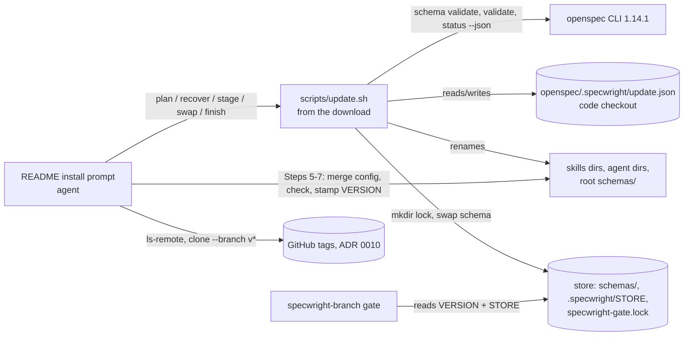
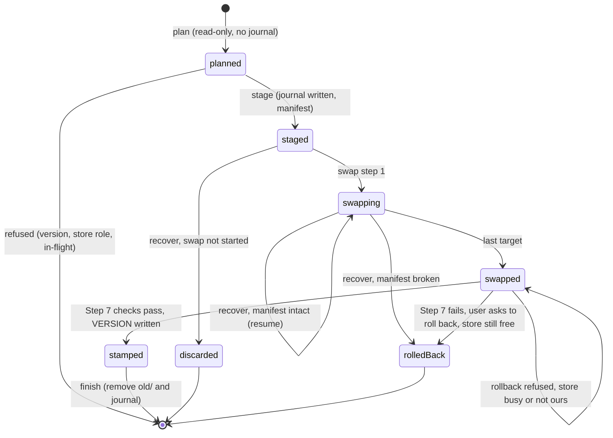
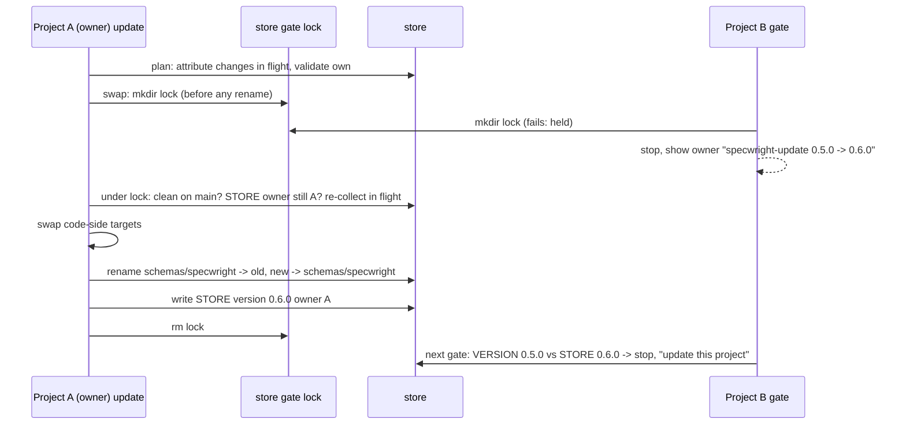

# Design

## Triage

| Trigger | Applies? | Evidence |
|---|---|---|
| T1 Components (new component, or 3+ with directed relationships) | yes | New `scripts/update.sh`. It is driven by the README prompt and calls `openspec` and `git`, and `specwright-branch` reads the record it writes. |
| T2 State (persistent state, caches, 3+ state machine) | yes | A new update journal (`openspec/.specwright/update.json`), a new store record (`<root>/openspec/.specwright/STORE`), and an update state machine: planned → staged → swapping → swapped → stamped → done, plus rolled back. |
| T3 Concurrency (background work, workers/isolates, async, retries) | yes | Running agent sessions read skills while they are swapped. Two projects share one store. An interrupted run is retried later. |
| T4 Boundaries (data format, migration, shared interface, IPC, external) | yes | New file formats (the journal, `STORE`). A store's schema is shared across projects. The release tags from ADR 0010 become the download interface. The gate gets a new cross-repo check. |
| T5 Volume (grows without a fixed bound) | yes | The changes in flight that get validated, and the staged and previous copies (a second and third copy of every skill and the schema). |
| T6 Risk (security, money, data loss, unrecoverable user data) | yes | An update that fails halfway leaves projects that cannot run, and a store schema replaced under another project's change in flight can lose that project's work. |

TIER: FULL

## Context

- **Install today.** Install is a prompt the agent follows (`README.md:43-247`). Step 4 deletes each `specwright-*` skill directory and then copies the new one, and it replaces `<root>/openspec/schemas/specwright/` in place. Step 7 stamps `openspec/.specwright/VERSION` only after its checks pass. Nothing records a partial Step 4, so an interruption shows up only as a missing script at the next skill run (#36).
- **What validation covers.** `openspec validate <change>` checks delta format only. A scratch root whose `schemas/specwright/schema.yaml` was deleted still printed `Change ... is valid`. `openspec status --change <c> --json` does load the schema: with no schema it returns `status[].code: change_error` and still exits 0, so the JSON must be read, not the exit code. Artifact status is file-existence only (`done`/`ready`/`blocked`). A schema that adds a dependency ahead of an existing artifact therefore shows that artifact `done` while its new dependency is missing. Verified by hand on 1.14.1 in a scratch root on 2026-10-16.
- **Store gate lock.** `specwright-branch` already serialises store gates with an atomic `mkdir` lock, `specwright-gate.lock`, under the store's git common dir. A held lock is never removed automatically (`skills/specwright-branch/SKILL.md:34`). The update reuses that lock for the store schema swap.
- **Script conventions.** Specwright scripts are bash with python3 helpers, and each subcommand prints one JSON document (`skills/specwright-release/scripts/release.sh:2-4`). Evals run them against scratch git repos (`evals/release/fixtures.py`) and put fakes first on `PATH` (`evals/fakes/gh.py`).
- **What the repo ignores.** Specwright's own repo ignores the installed copies and `openspec/.specwright/` (`.gitignore`), so the journal is never in its diffs. The staging directories (D2) are not ignored yet: this change adds `.specwright-update-*/` to its `.gitignore`, and the README tells adopters they may do the same. Adopters may track `openspec/.specwright/VERSION`.
- **The download interface.** ADR 0010 makes release tags permanent (never moved), so a tag is a stable thing to install from. Tags exist from v0.4.1 on.

## Decisions

### D1: A script does the file work of the update; the prompt keeps the questions

- **Choice:** new `scripts/update.sh` at the repo root, run from the downloaded copy (`bash <download>/scripts/update.sh <subcommand>`). Its subcommands:
  - `plan`: writes nothing in the project or the store; prints its `interface` (an integer, 1 here), the version change, its kind, the store role, the changes in flight with their validation result, any pending journal and any refusals. Its validation scratch roots live in `<download>/.update-scratch/`;
  - `recover`: resumes or rolls back a pending journal;
  - `stage`: copies and verifies the new files;
  - `swap`: prints `store_written: true|false`, whether it replaced the store's schema, `config.yaml` context and `STORE`;
  - `finish`: after the stamp, removes the previous copies and the journal.

  The prompt keeps the questions (targets, settings, schema choice), the `config.yaml` and `specwright.yaml` merges (Steps 5-6), the Step 7 checks and the stamp. It calls the script for Step 4 and acts on its JSON. Step 5 merges `<root>/openspec/config.yaml` only for role `none`, or when `swap` reported `store_written: true`. Otherwise it skips Step 5, and Step 7 reports the `config.yaml` check as `store config managed by owner <id>` instead of failing it, so `VERSION` is still stamped. The prompt is pasted from the README on `main`, while the script comes from the chosen tag, so the two can differ. The prompt therefore names its minimum release (0.6.0) and the script interface it drives (1), and stops before staging when the download has no `scripts/update.sh` or `plan` reports another interface (D7).
- **Rejected:** keep Step 4 as prompt text with staging rules written out. An agent cannot be interrupted at a chosen step in an eval, so the exit criterion could not be tested. Its rename order would also differ between runs. ADR 0002 already routes deterministic work to scripts.
- **Rejected:** install `update.sh` into projects as a skill. It must come from the new version: the old copy cannot know the new layout. A copy in the project would also be swapped by itself.
- **Reversal cost:** medium. An interface change bumps `interface`, which older prompts then refuse. Nothing is stored except the journal (D3).

### D2: Stage next to each target, then swap target by target with two renames

- **Choice:** each target directory gets a sibling staging directory, `<parent>/.specwright-update-<basename>/`, with `new/` and `old/` beneath it (for example `.claude/.specwright-update-skills/new/specwright-branch/`). A sibling is on the same filesystem, so the swap is a pair of renames: target → `old/`, then `new/` → target. The staging directory is never inside a skills directory, so a harness that scans skills directories does not load it. Agent files are staged in the same way, with the user's `model:` line carried into the staged copy (the Step 4 rule, now done by the script). The schema is staged next to `<root>/openspec/schemas/`.
- **Rejected:** stage in one temp directory and copy into place. A copy is not atomic per directory, and a temp directory on another drive (Windows `%TEMP%` vs `F:`) cannot be renamed into place.
- **Rejected:** swap a single symlink `specwright-current` → versioned directory. Git Bash on Windows creates copies, not links, unless developer mode is on. Harnesses would also see the versioned directories as skills.
- **Reversal cost:** low. These are internal paths, removed by `finish`.

### D3: A journal in the project, written before each step

- **Choice:** `openspec/.specwright/update.json` in the code checkout. It holds:
  - `from`, `to` and the installed ref;
  - every target with its staging directory and its state (`staged`, `old-moved`, `swapped`);
  - a manifest of the staged copy: the relative path and SHA-256 of every file;
  - the store role.

  The journal starts with `format: 1`, so a later version can tell an older journal from its own. It is written atomically (temp file and rename) before the step it records. `recover` decides:
  - the swap has not started (no target `old-moved` or `swapped`) → **discard** the staging; the next `stage` starts again from the new download;
  - every staged target still matches the manifest → **resume**, swapping the rest;
  - otherwise → **roll back**, moving each `old/` back and discarding `new/`;
  - `VERSION` already reads `to` → only `finish` is left.

  In a store, every outcome also releases the update's own gate lock (D5). A journal for another target version is recovered first, then the new update starts.
- **Rejected:** keep the journal under `~/.cache/specwright/`, as ADR 0003 places local state. The journal describes files in this checkout, and the staging directories next to them are useless without it. A cache cleared or on another account would orphan them. Recorded as an ADR exception, as ADR 0007 did for pre-ship records.
- **Rejected:** no journal, inferring state from the staging directories. A target that is missing with both `new/` and `old/` present looks the same whether the swap just started or nearly ended.
- **Reversal cost:** medium. The journal is a file format, but it lives only while an update is unfinished.

### D4: "Validates" means the delta, the staged schema loading the change, and no done artifact with a missing dependency

- **Choice:** a change in flight lives on its branch: `specwright-branch` creates the branch from a clean main before the change is scaffolded, so main and a fresh worktree hold no change directory. `plan` therefore collects:
  - every change directory in the planning repo's working tree (tracked or not), other than `archive/`;
  - every local branch `<prefix>/<name>` (`git for-each-ref refs/heads/`, the `specwright-branch` prefixes; this covers every worktree, which share refs) whose tree holds `
/changes/<name>/`, while the planning main (`origin/<main>` when present, else the local main) has no archive named exactly `<name>` or `YYYY-MM-DD-<name>` (the main spec's "A change name is used once" rule; a glob such as `*-<name>` would also match `fix-<name>`).

  Remote-tracking refs `origin/<prefix>/<name>` holding an unarchived change with no local branch are listed as warnings (`in flight elsewhere, not validated`), without blocking. That was the user's choice (2026-10-16): a teammate's pushed or abandoned branch would otherwise block every teammate's update with no remedy. No fetch is made.

  A change read from a branch is extracted with `git archive <ref> 
/changes/<name> 
/specs`, so it is validated with that branch's specs.

  For a workflow update, `plan` builds a scratch root per change in `<download>/.update-scratch/` (never in the project or the store): the staged schema, a `config.yaml` with `schema: specwright`, the main specs (working tree, or the branch's), and the change, when its `.openspec.yaml` names `specwright`. Changes on another schema are listed as `not on specwright` and are not checked. The scratch root runs three checks:
  1. `openspec schema validate specwright`;
  2. `openspec validate <change>`;
  3. `openspec status --change <change> --json`, which must have no `status[]` error, and every artifact whose files exist must have each `requires` id `done` or `skipped`.

  Any failure refuses the update with the change name and the first error.

  On a workflow update, `swap` repeats the collection and the validation for every role, against the staged schema, before its first rename (for a store, under the gate lock: D5). When the set of changes or any result differs from `plan`'s, it stops before the first rename and names the difference. This closes the window between `plan` and `swap` in which another worktree or session can start a change.
- **Rejected:** only the working tree's `changes/`. The reviewer showed it is empty on main, so the update would proceed over every change in flight.
- **Rejected:** `openspec validate` alone. It does not read the schema (Context), so it would pass every change.
- **Rejected:** keep the previous schema installed under a versioned name and finish changes in flight on it. The user chose validate-else-refuse (2026-10-16). It also needs two schemas side by side and cleanup after archive.
- **Reversal cost:** low. The rule lives in one function, and specs state only that a failing change refuses.

### D5: A store's schema has one recorded owner; others never write the store

- **Choice:** `<root>/openspec/.specwright/STORE` holds `version: <x.y.z>` and `owner: <id>`. `<id>` is the code repo's `origin` fetch URL normalised to `host/owner/repo`: scheme, userinfo, `.git` and a trailing dot on the host are dropped, and `github.com.` becomes `github.com`. With no `origin`, it is `path:<code toplevel>`.

  `plan` gives one of four roles:
  - `none`: repo-local;
  - `claim`: no `STORE`;
  - `owner`: `STORE` owner = this id;
  - `other`.

  For `other`, the script stages only code-side files, and refuses when the target's major or minor version differs from `STORE.version`. The refusal names the highest tag with `STORE`'s major and minor version, so the user can run that patch update instead.

  For `owner` or `claim` with a workflow update, every change in flight in the store is attributed. A change is this project's when the code repo has a local branch `<prefix>/<change-name>` for one of `specwright-branch`'s prefixes (`feat`, `bugfix`, `refactor`, `docs`, `chore`). Another project's change refuses the update. This project's changes are validated (D4).

  For `owner` or `claim`, `swap` takes the store's `specwright-gate.lock` **before its first rename of any target**, in this order: it writes a random token into the journal (atomic write), then runs `mkdir` on the lock, then writes the lock's `owner` file with `change: specwright-update <from> -> <to>`, `code: <code toplevel>` and `token: <token>`. Under the lock it:
  1. reads `STORE` again: a record whose owner is now another project stops the swap and names that owner. This settles two simultaneous claims. It runs before the free check, so the second claimer names the owner, not the first claimer's uncommitted files;
  2. checks the store is **free**: on its main, and `git status --porcelain` empty apart from this update's own staging paths (named in the journal). A store on a change branch, or dirty, is **busy**:
     - a patch update whose staged schema is byte-identical to the installed one drops the store targets and `STORE` from the journal and swaps only the code side. The report says the store schema was already current;
     - any other update stops, names the branch (or the dirty paths), says to finish that change first, and releases the lock.

     The store stays on a change branch for the whole of a change (gate to finish), so this is the normal state while any change is in progress. Swapping the schema on that branch would put it in the change's working tree. Requiring a free store also closes the race with a gate that has just created its branch and released the lock;
  3. repeats the in-flight collection, attribution and validation (D4);
  4. saves the store's current `config.yaml` and `STORE` (or their absence) in the schema staging directory and records them in the journal, then swaps the code-side targets, then the schema, then writes `STORE`, keeping the old schema in `old/` for rollback. The prompt's Step 5 then merges `config.yaml`, and the journal records its merged content;
  5. releases the lock once every rename and the record are done.

  A stop at 1-3 releases the lock and has written nothing. The install never commits `STORE`.

  **Recovery of the lock.** After a crash the lock may still be held by the dead run. `recover` takes it over only when its `owner` names `specwright-update`, this checkout and the journal's token. It then releases it in every outcome: discard, resume, rollback, or finish-only. A journal with a token but no lock (killed between the token write and `mkdir`) needs no takeover. A lock whose `owner` file is missing or empty (killed between `mkdir` and the `owner` write) is shown to the user under the existing confirm-then-remove rule. Any other holder stops `recover`, which names the holder.

  **Free, for a recovery run.** For `recover` the store is free when it is on its main and `git status --porcelain` lists nothing beyond this update's staging paths and the store paths the journal records as written by this update (the schema target, `STORE`, `config.yaml`), each still matching the content the journal recorded. Any other path, or another branch, makes it busy.

  **Rollback after a failed Step 7.** The lock was released after the swap, so the rollback takes it again and repeats steps 1-2 under that definition. It then restores the previous schema, `config.yaml` and `STORE`, or removes `STORE` after a claim. When the store is busy or no longer this owner's, it stops before any rename and keeps the swapped state and the journal. The store then stays on the new version, which the other project's gate already accepts.

  **What other sessions see.** `specwright-branch` (store step 1) and roadmap init/close (its lock step) show the lock's `owner` as today. When `change:` starts with `specwright-update`, they say an update from that checkout holds the store, tell the user to rerun the update there, and do not offer removal. The existing "confirm, then remove" path stays for every other holder.
- **Rejected:** any project may update, guarded by in-flight checks. The user chose a recorded owner (2026-10-16). It also gives no stable answer to "who moves the store forward".
- **Rejected:** write `STORE` in `finish`, after the stamp. The reviewer showed that the new schema would then sit beside an old record: old-version gates pass, and two claimers both write the record.
- **Rejected:** let the owner swap the schema on its own change branch. The swapped schema would be an uncommitted edit in that change's working tree. `specwright-commit` stages files by name and would leave it dirty, and the reviewer flagged a schema committed on a change branch in round 1.
- **Rejected:** attribute a change by a field in its `.openspec.yaml`. Changes created before 0.6.0 have no such field, and OpenSpec owns that file's format (ADR 0001).
- **Reversal cost:** high for the `STORE` format and the owner id, since stores keep them after this change. Settled by keeping the format to two `key: value` lines that a later version can extend. Ownership transfer is a manual commit of `STORE` by the user, documented in the README Stores section.

### D6: The gate compares major.minor only, in skill text

- **Choice:** `specwright-branch`'s store checks (step 2, with the lock held) read `<code>/openspec/.specwright/VERSION` and `<store root>/openspec/.specwright/STORE`'s `version:` in one shell call. They compare `major.minor` and stop on a mismatch, a missing `VERSION` or an unreadable `STORE`, naming both versions and the owner. A store with no `STORE` passes. The check is a few lines of `sed` in the skill text. `update.sh` is not installed in projects (D1), so the gate cannot call it.
- **Rejected:** check in every skill at every run. The gate is where a change starts, and changes in flight are already protected by D5's refusal. A check in every skill would also block finishing a change when only a patch differs.
- **Reversal cost:** low.

### D7: Download the latest release tag

- **Choice:** Step 3 runs `git ls-remote --tags --refs <repo> 'v*'` and picks the highest semver tag, or the tag the user names. It then runs `git clone --depth 1 --branch <tag>`. It uses `main` only on request, or when no tag exists. `plan` reports the ref. A named version with no tag stops before staging and lists the tags that exist. A chosen tag below the prompt's minimum release (0.6.0) stops too, named or default: those tags have no `scripts/update.sh` (checked: `git ls-tree v0.5.0` has no `scripts/`). That includes the window after this change merges and before v0.6.0 is published, when the highest tag is v0.5.0. The stop offers `main`. After the clone, a missing script or another `interface` stops as well (D1). Installed `VERSION` missing counts as a workflow update (`kind: fresh`), so any change in flight is validated.
- **Rejected:** keep cloning `main`. That installs unreleased work between merge and publish, and the dogfood criterion is "from one tagged release to the next".
- **Reversal cost:** low.

## Diagrams (FULL)

Components (T1, T4):

Update state machine (T2):

Owner workflow update in a store (T3):

## State & Ownership (FULL)

| State | Owner (sole writer) | Lifetime | Invalidation / rebuild | Authoritative copy |
|---|---|---|---|---|
| Installed skills, agents, schema | `update.sh swap` / `recover` | Until the next update | Rerunning the update | The installed files. `VERSION` names their version once stamped |
| `openspec/.specwright/VERSION` | Prompt Step 7 (stamp) | Until the next stamp | Rerun install | The file |
| Journal `update.json` | `update.sh stage`/`swap`/`recover`/`finish` | `stage` until `finish` | Rebuilt never; `recover` consumes it | The journal, checked against the manifest on disk |
| Staging `new/`, `old/` | `update.sh` | `stage` until `finish` or rollback | Deleted by `finish` or rollback | The journal's manifest says what `new/` must hold |
| Scratch validation root | `update.sh plan` | One `plan` run | Deleted on exit (`trap`) | None (derived) |
| `STORE` | `update.sh swap` / `recover`, under the store gate lock (owner or claim only); the user, by hand, for transfer | Life of the store | Rewritten by the owner's next update | The file in the store's working tree. The user commits it |
| Update lock `openspec/.specwright/update.lock` | Each mutating `update.sh` subcommand, for its duration | One subcommand | A stale lock (same host, dead pid) is replaced and reported | The lock directory |
| Store gate lock | `specwright-branch`, roadmap init/close, `update.sh swap` | One gate or one schema swap | Gate and roadmap locks: never automatic, the user confirms it is stale. The update's lock: taken over and released only by `recover` from the same checkout with the journal's token (D5) | The lock directory |

## Failure & Visibility (FULL)

| Component | Fails / dies mid-operation → | Recovery | Retry safe? | Who finds out |
|---|---|---|---|---|
| Download / tag lookup | No staging yet, nothing written | Rerun | Yes | User: the prompt stops with the error |
| `plan` | Read-only. The scratch root is removed by `trap` (a SIGKILL may leave it in the staging area) | Rerun. `stage` clears a stale scratch root | Yes | User: refusal JSON → prompt report |
| `stage` | Partial `new/`; installed files untouched | `recover` sees no swap started → discards `new/` | Yes | User: next run reports `discarded unfinished update to <to>` |
| `swap` (code side) | Some targets swapped, one possibly in `old/` with `new/` not yet moved (target absent) | `recover`: resume if the manifest is intact, else roll back | Yes. Each rename is recorded before it runs and checked on disk after | User: next run reports `resumed` or `rolled back`. Before then, a skill invoked in the gap fails with a missing file. The restart notice and the journal name the fix: rerun the update |
| `swap` (store schema) | Store gate lock held; schema half-swapped | `recover` as above for the schema target. The gate lock stays held, so other projects' gates stop and show `owner` | Yes: the rerun from the same checkout takes over its own lock (token match) | Other projects: their gate stops, names the update and its checkout, and offers no removal. This user: the next run reports it |
| Step 7 checks after swap | `VERSION` not stamped; journal says `swapped`; staging still present, so the repo-local gate sees a dirty tree | The user fixes it and reruns (resume goes straight to Steps 5-7), or asks to roll back (`recover --rollback`, which re-runs D5 steps 1-2 in a store) | Yes | User: each failed check is listed |
| `finish` | `old/` partly removed, journal still present | Rerun `finish` (idempotent: `VERSION` = `to`) | Yes | User: the report |
| Running agent session | Holds old skill text in context while files change | Restart (notice) | n/a | User: restart notice in the report |
| `specwright-branch` version check | Stops a change in another project | That project updates, or the owner updates the store | Yes | That project's user |

## Resource Bounds (FULL)

| Queue / buffer / cache / transfer | Bound | At the bound | Timeout | At 10x / 100x |
|---|---|---|---|---|
| Staged + previous copies | 2 × the installed size (skills ~1 MB, schema ~50 KB, today) | Disk full → `stage` fails before the swap → rollback path | none | 10 MB / 100 MB: fine |
| Changes in flight validated | Working-tree change directories plus local `<prefix>/*` branches with an unarchived change (typically 1-5; `for-each-ref` scales with the number of branches) | Each costs 3 `openspec` calls. All are validated, and the report lists every failure | none per call. OpenSpec is local and bounded by change size | 50 changes: ~150 CLI calls, under a minute. Acceptable for an update |
| Scratch root per change (in the download) | The size of the main specs (~500 KB today) per change | Disk full → `plan` fails, nothing written in the project | none | Fine |
| Manifest in the journal | One line per staged file (~120 today) | n/a | n/a | 1,200 lines: fine |
| `ls-remote` tag list | One call | Network failure → stop before staging | git's own | n/a |

## Flow & State Gaps (FULL)

- **Interrupted before swap:** nothing installed changed (specs). The next run's `recover` sees no swap step taken and discards the staging (`discarded unfinished update`), because the download it staged from may be gone. It then reruns `stage` from the new download.
- **Interrupted mid-swap:** `recover` resumes when the staged files match the manifest, else rolls back. One target can be absent between its two renames. The journal says which rename ran, and `recover` checks the disk before each step.
- **Two update runs at once in one checkout:** the second stops on `update.lock`. A lock whose pid is not alive on the same host is reported and replaced.
- **Owner update racing another project's gate:** the gate lock serialises them. A gate that won leaves the store on its new branch, so the owner's swap, under the lock, finds the store busy: it stops, or, for a patch with an unchanged schema, leaves the store alone and swaps only the code side. A change scaffolded later on that branch is never swapped under, because the swap needs the store on main.
- **Lock taken midway through a swap:** cannot happen. The lock is taken before the first rename and released after the last (D5).
- **A project's change created after the owner's update:** its gate compares versions, so it stops until the project updates (D6).
- **Non-owner session finishing a change while the owner updates:** the owner's update refuses while that change is in flight, so the schema does not change under it.
- **`STORE` committed by one project, edited in another checkout of the store:** git merges like any file. A conflict is the user's to resolve, and `plan` stops on an unreadable `STORE`.
- **Missing `VERSION`:** `kind: fresh`, treated as a workflow update.
- **Downgrade (target lower than installed, not below 0.6.0):** treated by the same rules. A different major or minor version is a workflow update and validates changes in flight. The report says `downgrade`.
- **Adopter upgrading from 0.5.x (no journal, no `STORE`):** a repo-local project gets role `none`. In a store, the first updater claims it (spec).
- **Session started before the update runs a skill after it:** it reads new scripts with old instructions. The restart notice covers this; the design does not detect it.

## Mechanism Ledger (FULL)

| Mechanism | Built? | Why (harm nobody catches / expensive later) | Evidence that would change the call |
|---|---|---|---|
| Journal with manifest | yes | Without it a mid-swap crash is ambiguous (D3), and the next run could finish a damaged copy | — |
| Update lock (project) | yes | Two concurrent runs would interleave renames. Nobody notices until a skill is missing. The user can paste the prompt into two harnesses | — |
| Store gate lock during schema swap | yes | Another project's gate could start a change mid-swap, on a half-installed schema | — |
| Attribution of store changes by branch | yes | Required by the owner rule. Without it every in-flight store change blocks the owner, even their own | A wrong attribution in practice (branch in another clone) → add an explicit marker |
| Restart detection (refuse skills from an older session) | no | Sessions cannot be enumerated across harnesses. The notice is the agreed mitigation (#36) | Reports of sessions running mixed generations despite the notice |
| Preserved old schema for changes in flight | no | The user chose validate-else-refuse | A real change refused often enough that waiting is costly |
| Automatic ownership transfer | no | Rare. A manual `STORE` edit is enough and keeps one writer | Teams asking for it |
| Signature or checksum of the download | no | The tag is immutable by ADR 0010 and fetched over HTTPS from the canonical repo | Supply-chain requirement from adopters |

## Risks / Trade-offs

- [Windows rename fails on a directory held open (an editor or antivirus)] → The rename's error stops `swap`. The journal records the target as not swapped, and `recover` rolls back or resumes on rerun. The report names the directory.
- [Validation passes but the workflow still differs, so a change validates and then cannot ship under new skill rules] → D4 catches structural mismatches only. Each minor release's proposal states what changes in flight need. The dogfood criterion exercises a real minor update with a change in flight.
- [Branch-based attribution misreads a change whose code branch lives only in another clone of the owner's repo] → The owner's update refuses it as another project's. That is the safe direction, and the message names the change so the user can finish it first.
- [Gate lock left by a crashed swap blocks every project of the store] → Other projects' gates name the update and its checkout. A rerun there takes over the lock by its token and recovers (D5). Until then the store is blocked, which is safer than a half-swapped schema.
- [`STORE` must be committed by hand, or other checkouts of the store never see it] → The report lists it with the other uncommitted store files (existing Step 8 rule).

## ADRs

- **In force, constraining this change:**
  - 0001: copies installed, OpenSpec unmodified; changes' `.openspec.yaml` stays OpenSpec's;
  - 0002: agent instructions plus thin scripts;
  - 0003: git as the state store; D3 and the journal location are an exception;
  - 0006: the planning root is resolved by OpenSpec;
  - 0010: tags are never moved, so installing from a tag is stable.
- **To record during apply:** **0011 Updates are staged and swapped by a journaled script; a store's schema has one recorded owner.** It records D1-D3 and D5: the in-project journal as an exception to ADR 0003's local-state location; `STORE` as a second, deliberate departure from 0003 (a committed per-store Specwright state file, which 0003 rejects in general, kept because ownership cannot be derived from git history); the `STORE` format and owner id; owner-only store schema writes on a free store; and the update's gate-lock token. It names the rejected alternatives above. ADR 0001's consequence about #36 is answered by 0011. 0001 stays as it is (accepted ADRs are immutable), and the architecture index gains the 0011 row.

## Testing the interruption criterion

The `evals/update/` suite puts shims for `mv`, `cp` and `rm` first on `PATH`. Each shim counts its calls in a file and, at call N (`UPDATE_KILL_AT=N`), sends `SIGKILL` to the update script's process before doing the operation. A first run counts the operations. The eval then reruns with N = 1..total and, after each kill, asserts:
- if the swap had not started, the installed files are byte-identical to the previous version and `openspec schema validate specwright` passes;
- in either case, a plain rerun ends at exactly the previous or exactly the new version, with no journal, staging or lock left.

No hook exists in `update.sh` itself. Its file operations call the external `mv`, `cp` and `rm` (never builtins or python), so the shims see every step.

## Open Questions

- How exactly Codex and OMP scan skills directories is unverified. D2 keeps staging outside them, so any scan depth is safe.
