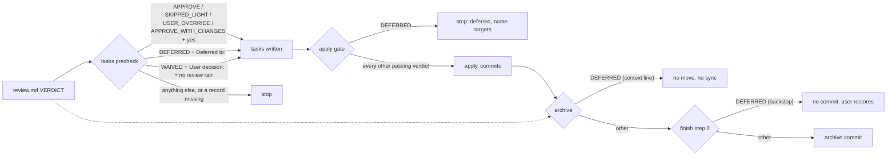

# Design

## Triage

| Trigger | Applies? | Evidence |
|---|---|---|
| T1 Components (new component, or 3+ with directed relationships) | no | No new component. Existing text in the schema, review template, two skills and one config template changes. |
| T2 State (persistent state, caches, 3+ state machine) | no | `review.md` stays one file with one writer per review (`openspec/architecture.md:96`). No new state file. |
| T3 Concurrency (background work, workers/isolates, async, retries) | no | Nothing runs in the background. The gates read `review.md` once each. |
| T4 Boundaries (data format, migration, shared interface, IPC, external) | yes | The `VERDICT:` vocabulary in `review.md` is a contract. The tasks precheck and apply gate read it (`schemas/specwright/schema.yaml:380-386`, `:453`), and so do `review-run.sh` validation (`skills/specwright-review/scripts/review-run.sh:603-632`) and installed projects. The archive refusal also reaches OpenSpec's vanilla archive workflow through the `context:` lines in `config.yaml`. |
| T5 Volume (grows without a fixed bound) | no | One file per change. |
| T6 Risk (security, money, data loss, unrecoverable user data) | yes | A wrong gate lets unreviewed code ship under a passing verdict, which is the failure this gate exists to stop. A wrong archive undo could also lose main-spec edits. |

TIER: FULL

## Context

- The schema's review instruction defines the verdicts APPROVE, APPROVE_WITH_CHANGES, REVISE, SKIPPED_LIGHT and USER_OVERRIDE (`schemas/specwright/schema.yaml:294-370`). The tasks PRECHECK matches whole lines (`:380-386`), and apply reuses that precheck through `GATE: same verdict precheck as tasks` (`:453`). Everything here is instruction text read by the agent. No script runs the precheck (ADR 0002 keeps judgement in instructions).
- `review-run.sh` validation already accepts only APPROVE, APPROVE_WITH_CHANGES and REVISE from a reviewer (`review-run.sh:603`), and the tests already pin USER_OVERRIDE and SKIPPED_LIGHT to refusal (`evals/review-routes/test_review_run.py:626-640`). DEFERRED and WAIVED are refused today without any code change. This change adds only regression tests.
- Archive is OpenSpec's vanilla workflow (`openspec-archive-change`, ADR 0001: unmodified OpenSpec). It reads `openspec instructions archive --json`. That JSON's `context` field is the project `config.yaml` `context:` text, which the archive skill treats as "a required prompt-level input". `specwright-finish` starts only after archive succeeds (`skills/specwright-finish/SKILL.md:12`), and its step 3 makes the archive commit (`:67`).
- Roadmap **next** step 2 offers to resume any active change from `openspec list --json` (`skills/specwright-roadmap/SKILL.md`, next step 2). A parking change stays active forever, so today next would always offer to resume it.
- The pre-ship waiver rule is in `skills/specwright-review/SKILL.md:59`: "A waiver comes only from the user ... Never waive a finding on your own judgement." The design waiver copies that rule.

## Decisions

### D1: Two new verdict values, DEFERRED and WAIVED

- **Choice:** Add `VERDICT: DEFERRED` and `VERDICT: WAIVED`, each with `CHANGES_APPLIED: n/a`, to the same single `VERDICT:` line every gate already reads. Each carries one required Metadata line: `- **Deferred to:** <changes or milestones>` or `- **User decision:** "<the user's words>"`. A waiver also carries the line `No design review ran.` The review template's Reviewer field gains `none (DEFERRED by the user)` and `none (WAIVED by the user)`.
- **Rejected:** keep USER_OVERRIDE and add a separate `DISPOSITION: deferred|waived|escalated` field. Every gate would have to read two fields and cross-check them, which doubles the surface for a partial match. It would also leave USER_OVERRIDE's documented meaning ("after escalation") wrong for two of its three uses, which is the stretching #100 reports.
- **Reversal cost:** medium. Installed projects' `review.md` files would carry the values, so a later rename needs the precheck to accept both spellings for a release.

### D2: Apply refuses DEFERRED inside the schema's apply GATE

- **Choice:** The apply instruction stops spelling its gate as "same verdict precheck as tasks". It says: the tasks precheck, except that `VERDICT: DEFERRED` stops apply, naming its `Deferred to:` targets. `specwright-commit` §1 needs no edit, because apply instructions run before any task.
- **Rejected:** let tasks refuse DEFERRED too, so a parking change never has tasks. The issue's yagura case has tasks (they describe the parked parts), and `openspec status` reports planning incomplete without them, which is what blocked the update in #98.
- **Reversal cost:** low (instruction text).

### D3: Archive refusal in two layers: the archive context line, then a finish backstop that commits nothing

- **Choice:**
  1. A new line in `templates/openspec/config.yaml` `context:` with a fixed opening, `MANDATORY: Before archiving a change (/opsx:archive, /opsx:bulk-archive, openspec-archive-change, 'openspec archive'), read its review.md`. If it holds `VERDICT: DEFERRED`, do not archive it: move nothing, sync no spec, and name the `Deferred to:` targets. In a bulk archive, skip that change and archive the rest. This is the primary refusal: it runs before anything moves. README install Step 5 decides which `context:` lines are Specwright-managed by their opening. It gains `MANDATORY: Before archiving a change` in its prefix list, so an update replaces this line instead of appending another copy. An instruction test asserts that every template `context:` line starts with a prefix Step 5 names.
  2. `specwright-finish` gains a step 0 before step 1. If the archived change's `review.md` (in the archive directory) holds `VERDICT: DEFERRED`, stop before any commit. Tell the user the change must not be archived, and list how to restore it in three groups. Finish runs none of these steps:
     - **Modified main specs** (tracked): `git restore -- <file>`, with the warning that it also discards the user's own uncommitted edits in that file.
     - **Created main specs** (untracked): the user deletes them.
     - **The change directory:** `git restore -- 
/changes/<name>/` when it was committed, otherwise move it back from the archive directory.
     Finish undoes nothing itself. With no archive commit, nothing reaches main.
- **Rejected:** (a) fork the archive skill to add the check. ADR 0001 extends OpenSpec only through schema, skills, agents and templates, and the archive skill is OpenSpec's copy. (b) Have finish undo the archive automatically. The sync may have merged into main specs the user also edited, and an automated `git restore` would drop those edits (T6). (c) Rely on the context line alone. The vanilla skill says context is prompt-level and "not an enforceable check", so a run that ignores it needs a backstop before the commit.
- **Reversal cost:** low (instruction text). Existing installs pick up the context line through the install Step 5 merge.

### D6: The baseline gate keeps its own list

- **Choice:** `skills/specwright-roadmap/SKILL.md` init step 5 stops saying "the same precheck as tasks" and spells out its own list: APPROVE; APPROVE_WITH_CHANGES with `CHANGES_APPLIED: yes`; USER_OVERRIDE after escalation. `DEFERRED`, `WAIVED` and `SKIPPED_LIGHT` never pass the baseline, which is the one place a review always runs. `openspec/architecture.md`'s baseline writer row says neither new verdict is written there.
- **Rejected:** keep the cross-reference and rely on the parenthetical. Once the tasks precheck widens, the reference and its parenthetical contradict each other, and an agent can follow either one.
- **Reversal cost:** low.

### D4: Who may write each verdict

- **Choice:** The orchestrator writes DEFERRED only when the user has declared the change a parking change, and WAIVED only on the user's explicit decision to apply without a design review, quoting it. The agent never offers either one: not when a route fails, not after REVISE rounds, and not as a way past a missing review. The existing rule stays: if no route works, STOP and tell the user. A reviewer route can never produce either one (`review-run.sh` refuses them). `openspec/architecture.md`'s `review.md` row gains these two writer cases.
- **Rejected:** let the agent propose DEFERRED when it recognises a parking change. Any agent-initiated way past the review is the bypass this gate exists to stop. The issue asks that the agent not offer either one.
- **Reversal cost:** low.

### D5: Roadmap reads a parked change from its review.md, and a parking change lands without archive

- **Choice:** **next** step 2 and **status** read each active change's `review.md`. A change with a `VERDICT: DEFERRED` line is `parked`: it is not offered for resume, **status** lists it with its `Deferred to:` targets, and **next** continues to step 3 as if it were not active. A short parking-change note in the skill says when the pattern fits (a backlog for later milestones, never applied or archived), that its review is DEFERRED by the user's decision, and that **next** starts a milestone's part as a new change, which gets its own full review.

  A parking change reaches the planning repo's main without archive, as a planning-only branch merged by the user. In `local` mode the user merges it with `--no-ff` by hand (finish never runs, because nothing is archived). In `pr` mode, ship opens its PR as usual. Watch's **Archive before merge** skips a change whose `review.md` is `DEFERRED`: it reports the PR ready as a parked change and archives nothing. Agent merge then merges nothing, because its existing rule already requires the archive directory (`skills/specwright-pr/SKILL.md`, Merge), and the user merges on GitHub. Run on a parking change's branch, roadmap **next** and **status** say that the parking change is on its own branch and that **next** starts from main once it has merged. **next** starts nothing there.
- **Rejected:** a marker in `.openspec.yaml` or `specwright-change.yaml` (`parked: true`). That is a second record of the same fact with a second writer, and it could disagree with `review.md`, which already decides what the gates allow.
- **Reversal cost:** low.

## Diagrams (FULL)

How each verdict passes each gate (T4: the contract the gates read):

## State & Ownership (FULL)

| State | Owner (sole writer) | Lifetime | Invalidation / rebuild | Authoritative copy |
|---|---|---|---|---|
| `review.md` with `DEFERRED` | Orchestrator, on the user's parking decision | The parking change's life; never archived | A real review round replaces it | Planning repo branch, then main through the user's own merge (D5) |
| `review.md` with `WAIVED` | Orchestrator, on the user's explicit decision | Until archive | Editing proposal, specs or design voids it like any verdict; a review round replaces it | Planning repo branch, then main |
| Reviewer verdicts (APPROVE, APPROVE_WITH_CHANGES, REVISE) | `review-run.sh run --out` / `record --out`, unchanged | Until archive | Unchanged | Unchanged |

The `review.md` writer table in `openspec/architecture.md` is updated, so it still has one writer per review.

## Failure & Visibility (FULL)

| Component | Fails / dies mid-operation → | Recovery | Retry safe? | Who finds out |
|---|---|---|---|---|
| Tasks precheck | Agent misreads a prefix (`DEFERRED_LATER`) | Whole-line match rule, the same as today | Yes | The user (stop message) |
| Apply gate | Agent applies a DEFERRED change anyway | Nothing on the code path catches it: the pre-ship review reads the diff, not the verdict. In `local` mode finish step 0 refuses the archive commit. In `pr` mode watch reports the PR as parked instead of archiving it, which is visible, but a user merge on GitHub would land the code | Yes | The user, at finish step 0 or at watch's parked report |
| Archive context line | Ignored by an archive run | Finish step 0 stops before any commit and lists the paths to restore | Yes (nothing committed) | The user |
| Finish step 0 | Interrupted after the stop message | Nothing was written. A re-run reaches step 0 again (the Resume table's first row runs steps 1-3, which now start at 0) | Yes | The user |
| `openspec archive` CLI run by hand | No agent reads the context | Finish step 0 if finish runs. If the user commits by hand, nothing stops it | — | The user chose to bypass the workflow |

## Resource Bounds (FULL)

| Queue / buffer / cache / transfer | Bound | At the bound | Timeout | At 10x / 100x |
|---|---|---|---|---|
| `review.md` reads by roadmap next/status | One file per active change | — | — | `openspec list` stays small (active changes only); 100 reads of one small file each is fine |

## Flow & State Gaps (FULL)

- **WAIVED change later edited:** like any verdict, it covers only the contents reviewed (here: the contents waived). An edit to proposal, specs or design voids it and needs a new review or a new explicit waiver.
- **DEFERRED change later applied:** the user wants to apply the parking change after all. They need a real review first: the apply gate's stop message says so. The agent does not rewrite the verdict.
- **Parking change emptied:** once every part has moved out, the parking change is still active. Removing it is the user's planning edit. This change does not automate it, and the roadmap note says so.
- **Change in flight on upgrade:** schema artifacts and dependencies are unchanged, so existing `review.md` files keep passing. A project that wrote USER_OVERRIDE for a deferral (yagura) keeps passing too. The README notes it may be rewritten as DEFERRED.
- **Bulk archive with one DEFERRED change:** the context line skips that change and archives the rest. Finish step 0 checks every archived change, so a skipped check still stops before the one commit.

## Mechanism Ledger (FULL)

| Mechanism | Built? | Why (harm nobody catches / expensive later) | Evidence that would change the call |
|---|---|---|---|
| Finish step 0 backstop | yes | The context line is prompt-level only. Without the backstop, an ignored line commits a DEFERRED archive to main, and nobody catches it before merge | — |
| Script that runs the tasks/apply precheck | no | The precheck has always been instruction text with whole-line rules. A script would be a second definition | An agent eval passing a waiver with no `User decision:` line |
| Automatic undo of a refused archive | no | It risks dropping the user's main-spec edits (T6). The user restores with the listed commands | Users repeatedly failing to restore by hand |
| `parked` marker file | no | A second writer for a fact `review.md` already holds (D5) | — |
| Validator support for DEFERRED/WAIVED in `review-run.sh` | no | The orchestrator writes these values, never a reviewer, so validation must keep refusing them | — |

## Risks / Trade-offs

- [The agent offers a waiver to get past a failing route] → the schema, template and review skill state "never offered". An instruction test asserts it, and the route-failure text keeps "STOP and tell the user".
- [WAIVED becomes a routine shortcut] → it needs the user's quoted words, the README marks it as an exception, and the pre-ship review still runs.
- [The vanilla archive skill weighs the context line as advisory] → finish step 0 is the enforced backstop before any commit.
- [An agent ignores the apply gate on a DEFERRED change in `pr` mode, and the user merges on GitHub] → accepted residual risk. The apply gate is the primary control, and watch's parked report names the change as parked before any merge. A ship-time verdict check would also block the parking change's own planning-only PR, which D5 needs.

## ADRs

- **In force, constraining this change:** 0001 (no fork of the archive skill: the refusal goes through templates and Specwright skills), 0002 (the gates stay agent instructions), 0007 (reviewer output is validated and fails closed: the reviewer-only verdict set is unchanged).
- **To record during apply:** none. The decisions are tactical within ADR 0007's contract. `openspec/architecture.md`'s state-ownership row for `review.md` is updated.

## Open Questions

None.
