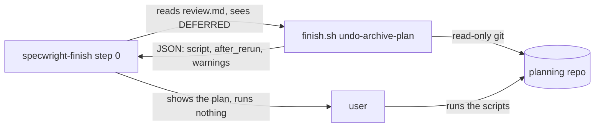
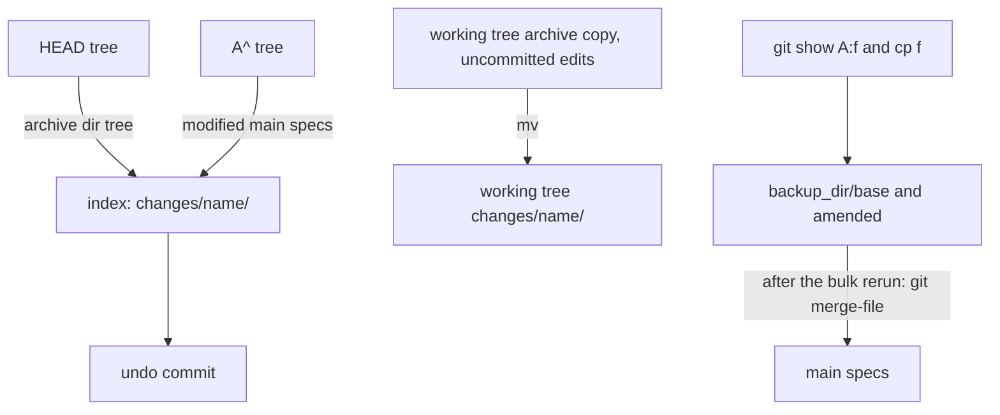

# Design

## Triage

| Trigger | Applies? | Evidence |
|---|---|---|
| T1 Components (new component, or 3+ with directed relationships) | yes | A new script, `skills/specwright-finish/scripts/finish.sh`. `specwright-finish` has no scripts today (`skills/specwright-finish/SKILL.md:7` allows only `git` and `openspec`). |
| T2 State (persistent state, caches, 3+ state machine) | yes | The plan's commands write a backup directory of file copies under the git directory, and these outlive the run. The committed undo also adds one commit to the branch. |
| T3 Concurrency (background work, workers/isolates, async, retries) | no | One synchronous read-only script run. The user runs the printed scripts by hand. |
| T4 Boundaries (data format, migration, shared interface, IPC, external) | yes | `undo-archive-plan`'s JSON output is a contract that the skill text reads. `release.sh check` exit and error semantics change for an unreadable merge base (`skills/specwright-release/scripts/release.sh:616-632`). |
| T5 Volume (grows without a fixed bound) | no | The plan lists one archive commit's paths and a bulk archive's members. Both are bounded by the commit. |
| T6 Risk (security, money, data loss, unrecoverable user data) | yes | The undo moves and restores files the user may have edited without committing. A wrong plan loses spec amendments or uncommitted artifact edits, which is what PR #104 rounds 5-8 kept finding. |

TIER: FULL

## Context

- **Step 0 today** (`skills/specwright-finish/SKILL.md:57-62`) is prose. For an uncommitted archive it lists three restore groups. For a committed one it lists `git revert --no-edit <later commits> <A>`, where A is the **oldest** `--diff-filter=A` line. Resume's A fact (`:23`) also takes the oldest line. The evals for step 0 are wording regexes (`evals/git-workflow/test_instructions.py:1858-1909`).
- **What OpenSpec archive does to the tree:** it moves `
/changes/<name>/` to `
/changes/archive/<YYYY-MM-DD>-<name>/` and syncs each delta `specs/<cap>/spec.md` into `
/specs/<cap>/spec.md`, modifying or creating that file. Finish step 2 may add `specwright-change.yaml` to the archive copy, and step 3 commits these paths as A (`:66-67`). It is an *unverified assumption* that archive changes no file content inside the moved directory. Task 1.1 checks it against a real `openspec archive`.
- **Script conventions** to follow: a bash wrapper that picks Python 3.8+ and runs an embedded source with `-I -X utf8`. Each run prints one JSON document and exits 0 (done), 1 (stop, with `ok: false`, `error` and `message`) or 2 (usage) (`release.sh:57-70`, the `Stop` and `emit` helpers at `:84-102`; `pr-pair.sh` has the same shape). Tests drive these scripts against temp git repos (`evals/release/fixtures.py`).
- **Roadmap:** **next** step 2 already skips a parked change for resume (`skills/specwright-roadmap/SKILL.md:59`). **close** step 1 has no parked rule, and the parking-change note is at `:93`.
- **Release check:** `primary_at` returns `None` both when the primary file is absent and when it does not read exactly one version (`release.sh:587-599`). `check_ahead_of` counts `base_version != version` as a bump (`:625`), and `own_bump` returns True when the parent reads `None` (`:612`).

## Decisions

### D1: A plan-only script owns the undo of a deferred archive

- **Choice:** Add `finish.sh [--dir <planning toplevel>] undo-archive-plan --change <name> --archived-name <archived> --prefix 
 --main <main> [--branch <branch>]`. It runs only read-only git (`rev-parse`, `status --porcelain`, `log`, `show`, `diff --name-status`, `ls-tree`, `cat-file`). It prints `{ok, mode: uncommitted|committed, archive_commit, members: [{name, archived_name, deferred}], main_specs: {modified[], created[]}, amended[], carried_edits[], backup_dir, script, after_rerun, warnings[]}`.
  - `script` is one bash script text. Its first line is `set -euo pipefail`, so the first failing command stops every later one (review C1).
  - `after_rerun` is a second script of the same form, or `null`.

  The user saves each script to a file and runs `bash <file>`. Store-backed: `--dir <store toplevel>`. The code repo is never part of an archive undo.

  **Members.** In a committed archive they are the archive directories A added. In an uncommitted one they are every untracked directory directly under `
/changes/archive/` whose `
/changes/<name>/` is tracked at `HEAD` and missing from the working tree. `deferred` is set from each member's own `review.md`. When there is more than one member, `warnings` names them and says the whole archive is undone (review M3).

  Step 0 becomes: on a whole-line `VERDICT: DEFERRED`, stop, run the script, and show `script`, `after_rerun` and `warnings`. Make no commit, merge or push, and run neither script. On exit 1, show `message`. `allowed-tools` gains `Bash(bash *)`.
- **Rejected:** keep the prose and add behavioural evals of the agent following it. The evals would have to drive an agent through every repo state, and the prose would still be the thing that is wrong. The script makes the plan deterministic and testable without an agent (ADR 0002: deterministic work goes to thin scripts).
- **Rejected:** a script that runs the undo itself. The user's uncommitted edits sit in exactly the files the undo touches, so finish stays "run no restore yourself" and the user runs the scripts.
- **Reversal cost:** low. The JSON is read only by the skill text shipped with it.

### D2: The committed undo is one forward commit built in the index; the working tree is fixed after it

- **Choice:** Undo A with a single new commit whose tree is HEAD's tree with:
  - each member's archive copy, as it is at HEAD (later amendments included), moved back to `
/changes/<name>/`, without a `specwright-change.yaml` that A added;
  - each main spec A modified restored to its content at `A^`, and each one A created removed.

  Every other path keeps HEAD's content, so unrelated paths in later commits stay. `script` builds the commit in the index and leaves the user's uncommitted edits out of it:
  1. A guard: `test "$(git branch --show-current)" = <branch>`, `test "$(git rev-parse HEAD)" = <head>` and `git diff --cached --quiet`. A plan made against another state fails here, before it writes anything. When the resume is on another branch with a clean tree, the script runs `git checkout <branch>` first and the guard follows it.
  2. Save, always and unconditionally (review M2), into `<backup_dir>` = `<git-dir>/specwright-undo/<archived-name>/`, which the script refuses to overwrite (`test ! -e`):
     - `base/<f>` = `git show <A>:<f>`, the synced content without amendments, for each main spec A modified or created;
     - `amended/<f>` = a `cp` of the working-tree file, holding the committed later amendments and any uncommitted edit.

     Because the copies are taken when the script runs, an edit made after the plan is saved too.
  3. In the index: `git rm -r -q --cached -- <archive dir>` for each member, then `git read-tree --prefix=
/changes/<name>/ <tree of HEAD:archive dir>`, then `git rm -q --cached` for the marker if A added it. Then `git restore --source=<A>^ --staged -- <modified>` and `git rm -q --cached -- <created>`.
  4. `git commit -m "<type>(<change-name>): undo archive of <member names>"`.
  5. In the working tree: `mv <archive dir> 
/changes/<name>`, which carries the uncommitted and untracked files in the archive copy. Then `rm` the marker, `git restore --source=<A>^ --worktree -- <modified>`, and `rm -- <created>`.

  After step 5, `git status` shows only the user's own uncommitted edits in the change directories. The main specs are at `A^`, and their amended copies are in `<backup_dir>/amended/`.

  **Re-applying amendments (review M1).** `amended[]` lists the main specs whose `amended/` copy differs from `base/`. For a bulk archive with such files, `after_rerun` is a script with this order:
  1. `openspec archive <member> --yes` for each non-deferred member (the CLI, not the workflow, so finish does not start before the amendments are back);
  2. `git merge-file -L rerun -L archived -L amended <f> <backup_dir>/base/<f> <backup_dir>/amended/<f>` for each listed file. It merges in the working tree, so the index plays no part. A non-zero exit leaves conflict markers, and the script stops there;
  3. a closing line telling the user to start finish for the members.

  Finish then finds the archive paths uncommitted with no A, runs steps 0-3, and commits the amendments inside the new archive commit, before any merge or push. For a single archive, `after_rerun` is `null`. The amended copies stay saved, with a warning: they were made on top of the deferred change's synced content, so the user reviews them by hand.

  The uncommitted undo makes no commit and uses the same guard. It copies each synced main spec into `<backup_dir>/amended/`, because a sync and a user edit in one file cannot be told apart. Then it restores modified ones from HEAD, removes created ones, and moves each archive copy back.
- **Rejected:** the revert chain in today's prose (`git revert <later commits> <A>`). It also reverts the unrelated paths of every later commit, it conflicts whenever a later commit amends A's paths, and the amendments are lost when the archive is rerun. Each of these was a PR #104 finding. The forward commit has none of them, and it still never resets or force-pushes.
- **Rejected:** move the archive copy back in the working tree, then `git add` the paths. That would commit the user's uncommitted edits into the undo commit.
- **Reversal cost:** low. It is a plan text, and nothing persists in a format a later run parses.

### D3: The archive commit is the newest add

- **Choice:** A is the first line of `git log --diff-filter=A --format=%H <main>..<branch> -- <archive dir>/review.md` (newest first), in Resume's A fact and in the script. An older line is an archive that was later reverted, and the newer add is the live one. The script also checks that HEAD's tree holds the archive dir. If it does not, the newest add was reverted too: the result is `no_archive`, with the add commits listed.
- **Rejected:** revert every add line. That also undoes the revert and re-add pair, which is the second comment on #106.
- **Reversal cost:** low.

### D4: A parking change is never a milestone change (#105)

- **Choice:** This is the user's decision for this change. The parking-change note says a parking change is never listed in a milestone's Changes. **next** step 3, **close** step 1 and **status** each check every listed change. A listed change whose active `review.md` holds `VERDICT: DEFERRED` is reported as `parked (listed in error)`, is neither started nor counted done, and comes with the line that removing it from Changes is the user's planning edit. **next** and **close** then stop. The skill never edits the roadmap for it.
- **Rejected:** carve a parked change out of close's done check, so that a milestone can close with it listed. A milestone would then close with an item that is never done, and the roadmap would say otherwise.
- **Reversal cost:** low (instruction text).

### D5: Unreadable is not absent in the release check (#103)

- **Choice:** `primary_at` returns `None` when the primary file is absent at the commit. When the file exists but does not read exactly one version, or the files disagree, it returns an `Unreadable` value carrying the set of versions it matched (possibly empty). Being unreadable proves nothing on its own, but a version outside that set is still a change (review M4). The callers change as follows:
  - `check_ahead_of`: an unreadable version at `<ref>` still passes, as an absent one does. An unreadable merge base counts as bumped when the branch's version is not in its set. Otherwise the history walk decides. An absent base still counts as a bump, as before.
  - `own_bump`: each commit is judged against its parent's version, except that a commit whose parent is unreadable and not on `<ref>` is judged against its nearest first-parent ancestor that is readable or on `<ref>`, in place of that parent (PR #108 review, round 5): a bump made through an unreadable version counts, and a stray line added and then removed does not. A commit whose own version is unreadable is no change when the version it is judged against is among the versions it matched, or is also unreadable. Otherwise it counts as a bump only when every version it matched is greater. A commit judged against an unreadable version on `<ref>` is skipped when its version is the greatest semver in that set, and is no bump when it is a lower one (it dropped the higher version; PR #108 review). Otherwise it counts as a bump when it is greater than every semver in that set, or when the set has none. All other cases are unchanged.
  - This covers each case: #103's duplicate removal (`0.4.2` twice, then `0.4.2`) is no bump; a hand edit from `0.4.2` twice to `0.5.0` is a bump; a repair followed by a bump is a bump; a bump made through `0.4.2` and `0.5.0` listed together, then `0.5.0`, is a bump; a broken main version repaired on both sides, and a stray line added and then removed, are no bump.
- **Rejected:** an unreadable base stops the check with `version_files_invalid`. It would refuse a branch whose whole purpose is to repair that file.
- **Reversal cost:** low. The JSON output is unchanged. Only which branches are refused changes.

## Diagrams (FULL)

T1, the component and its calls:

T2/T4, the committed undo's data flow (what goes where):

## State & Ownership (FULL)

| State | Owner (sole writer) | Lifetime | Invalidation / rebuild | Authoritative copy |
|---|---|---|---|---|
| Undo plan (JSON) | `finish.sh undo-archive-plan` | One run, stdout only | Valid only for the `HEAD` and branch named in its guard. Rerun the script after any change | The repo state it was computed from |
| `<git-dir>/specwright-undo/<archived-name>/` (`base/` and `amended/` copies) | The user, through `script`. `script` refuses to write into an existing one | Until the user deletes it. It is not tracked, and no Specwright step reads or deletes it | Not rebuilt: the copies are taken when the script ran | That directory. It is the only copy of an uncommitted main-spec edit after the restore |
| Undo commit | The user, through `script` | Permanent branch history | A later archive rerun adds a new archive commit on top | The branch |
| Roadmap Changes list | The user (D4), and roadmap init or close | Project | Never edited by next, close or status for a parked change | `openspec/roadmap.md` on main |

## Failure & Visibility (FULL)

| Component | Fails / dies mid-operation → | Recovery | Retry safe? | Who finds out |
|---|---|---|---|---|
| `undo-archive-plan` | Exit 1 with `error` (`no_archive`, `dirty_tree`, `staged_changes`, `target_exists`, `backup_exists`) or exit 2 (usage). It writes nothing | Fix the named state and rerun | Yes (read-only) | The user: finish shows `message` |
| `script` fails midway (the user runs it) | `set -euo pipefail` stops at the first failing command. A failed guard writes nothing. A failed save in step 2 stops before any index or working-tree change. A failure in step 3 leaves the index partly built with no commit. Step 5 runs only after the commit | Step 3 failure: `git restore --staged -- <listed paths>` (in `warnings`) resets the index, the working tree is untouched, and the script is planned again. A non-empty `<backup_dir>` makes the next run's script refuse until the user moves it | Yes, after the index reset and a new plan | The user, from the failing command |
| `after_rerun` merge-file conflicts | Conflict markers in the main spec, and the script stops at that file | The `base/` and `amended/` copies stay in `<backup_dir>`, and `warnings` names them to resolve by hand before finish runs | Yes | The user |
| Roadmap parked check | It cannot read a listed change's `review.md` (no active change of that name): the change is not parked, and the existing rules apply | — | — | — |
| `release.sh check` | An unreadable `<ref>` passes, and an unreadable base falls through to the walk | — | Yes | The user, from ship or merge, only when it refuses |

## Resource Bounds (FULL)

| Queue / buffer / cache / transfer | Bound | At the bound | Timeout | At 10x / 100x |
|---|---|---|---|---|
| Members and main specs listed | The paths of one archive commit, or the untracked archive directories | — | None: local git only | A 100-member bulk archive gives about 100 x 3 script lines, which is still one readable JSON document |
| `git log` of later commits | `<main>..<branch>`, which is bounded by the branch | — | — | Linear in branch length |
| Backup copy size | The size of the main specs A touched | — | — | Spec files are kilobytes each |

## Flow & State Gaps (FULL)

- **Plan stale before it runs:** the guard checks the branch, `HEAD` and a clean index. Uncommitted edits made after the plan are covered by step 2, which always copies the working-tree files when it runs. An edit made while the script runs is the user's own risk, and `warnings` says not to edit during the run.
- **Resume on `<main>` or another branch:** with a clean tree, the plan checks out `<branch>` first. With a dirty tree it refuses (`dirty_tree`, naming the files), because the checkout could carry or clobber them.
- **Index not clean:** step 4 commits the whole index, so the script refuses with `staged_changes` when the index differs from `HEAD`.
- **`
/changes/<name>/` already exists** (the user recreated it): refuse with `target_exists`. A merge of two copies is the user's decision.
- **A reverted and re-added:** D3.
- **Newest add itself reverted** (the archive is gone from HEAD): `no_archive`, with the add commits listed. Nothing is left to undo.
- **Archive already on `<main>`:** step 0 does not run (finish's existing condition, `SKILL.md:29`).

## Mechanism Ledger (FULL)

| Mechanism | Built? | Why (harm nobody catches / expensive later) | Evidence that would change the call |
|---|---|---|---|
| Branch and HEAD guard as the first command | yes | A plan applied to a moved branch would build a wrong commit silently | — |
| Backup of every synced main spec in the uncommitted mode | yes | A sync and a user edit cannot be told apart, and `git restore` drops the edit for good (T6) | — |
| `base/` and `amended/` copies plus `merge-file` in `after_rerun` | yes | The rerun archive brings back only the pre-A content, so amendments are lost silently (#106 comment). `merge-file` works in the working tree, where `git apply --3way` would need a clean index (review M1) | — |
| `set -euo pipefail` script instead of separate lines | yes | A failed guard or save followed by a restore deletes edits with no copy (review C1) | — |
| `staged_changes`, `dirty_tree` and `target_exists` refusals | yes | Each lets a command commit or overwrite the user's work | — |
| Running the plan automatically | no | Finish must not touch the user's uncommitted edits | A user asking for one-command undo, with a dry-run diff shown first |
| Removing the backup directory | no | It is the only copy of what was restored, and a stale directory costs nothing | — |

## Risks / Trade-offs

- [OpenSpec archive changes file content inside the moved directory, so `HEAD:<archive dir>` differs from the pre-archive change dir] → Task 1.1 checks a real `openspec archive`. If it does, the plan restores each file from `A^:
/changes/<name>/` and carries only the later amendments, `git diff A HEAD -- <archive dir>`, through the same base and amended copies.
- [The script becomes long for a bulk archive] → One command per line. The skill shows it as one block.
- [A single archive's amendments rarely merge cleanly] → They are saved, never merged automatically, with a warning (D2).
- [The skill text and the script drift] → The instruction test asserts that step 0 names `undo-archive-plan`, and the behavioural evals pin the script.

## ADRs

- **In force, constraining this change:** 0001 (OpenSpec stays unmodified: the undo lives in finish), 0002 (deterministic work in a thin bash + Python script, one JSON document), 0003 (git is the state: the backup directory is local working state the user owns, kept in the git directory and never read back by Specwright), 0010 (release check semantics: D5 changes only when the check refuses).
- **To record during apply:** none. Tactical.

## Open Questions

- None. Task 1.1 settles the archive-content assumption, and either outcome keeps the approach.
