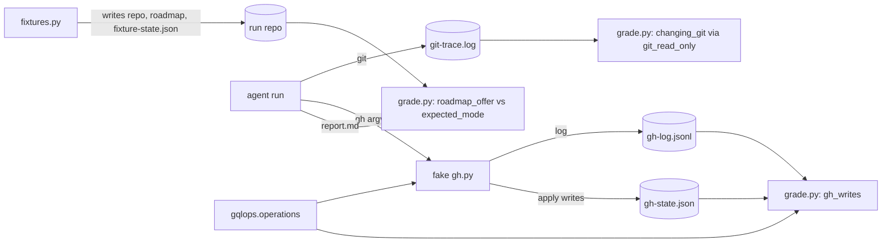

# Design

## Triage

| Trigger | Applies? | Evidence |
|---|---|---|
| T1 Components (new component, or 3+ with directed relationships) | yes | A new shared GraphQL-operation helper under `evals/fakes/`, imported by the grader (`evals/git-workflow/grade.py`) and the fake `gh` (`evals/fakes/gh.py`); the fixtures feed both. |
| T2 State (persistent state, caches, 3+ state machine) | no | The fake's `gh-state.json` keeps its shape; only which calls write to it changes. |
| T3 Concurrency (background work, workers/isolates, async, retries) | no | Grading and the fake run as one process per call, sequentially. |
| T4 Boundaries (data format, migration, shared interface, IPC, external) | yes | The classification becomes a contract shared by the grader and the fake. It also mirrors two external formats: GraphQL documents and git's `GIT_TRACE` `built-in:` lines. |
| T5 Volume (grows without a fixed bound) | no | Inputs are one argv per call and one trace per run, both bounded by the run. The lexer is linear in the query length. |
| T6 Risk (security, money, data loss, unrecoverable user data) | no | Eval infrastructure only; no user data. |

TIER: FULL

## Context

See proposal.md for the three issues. Current code:

- `changing_git` (`evals/git-workflow/grade.py:367`) uses a deny-list. `ALWAYS_WRITE` (`:359`) holds the always-write subcommands, plus special cases for `branch` and `checkout`/`switch`. Anything else, including `update-ref`, `symbolic-ref` and `checkout -` (`-` starts with a dash, `:381`), reads as a read. `refresh_exceptions` (`:518`) subtracts the guarded refresh that finish allows, and `tag_writes` (`:631`) classifies tags on its own.
- `changing_gh` (`:390`) lists eight `pr`/`issue` write subcommands. It finds GraphQL mutations with a first-token regex (`:403`), which misses `fragment ... mutation`. Its REST logic (method token, or fields/body without a forced method) is right and stays.
- `pr_mutations` (`:1412`) is a second, looser `gh` classifier. It counts `api` as a write only with an explicit non-GET `-X`, so `gh api graphql -f query='mutation …'` reads as a GET. It is used by the store-ship graders (`:1584`, `:1610`, `:1819`).
- The fake `gh` dispatches writes by substring: `"resolveReviewThread" in q` and `"addReaction" in q` (`evals/fakes/gh.py:663`, `:671`). It dispatches reads the same way (`"reviewThreads(" in q`, …).
- The agent-merge next-step check (`grade.py:496`) passes when the report holds "roadmap" and either word "next" or "close" anywhere. The fixture `build_watch_merge` (`evals/git-workflow/fixtures.py:1181`) writes a roadmap only for the release variant, which lists `add-greeting` and `add-shout`. `roadmap_pos` (`grade.py:620`) and `offers`/`asks_about` (`:160`-`:170`) are the existing offer helpers.
- The prescribed offer is in `pr-merge` ("offer one specwright-roadmap mode: close when the Now milestone is then done, else next", `openspec/specs/pr-merge/spec.md:96`) and in `skills/specwright-pr/SKILL.md:162`.
- The evals use only the standard library: `fixtures.py:34` puts `evals/fakes` on `sys.path`, and nothing is pip-installed.

## Decisions

### D1: A small stdlib GraphQL lexer, shared by the grader and the fake

- **Choice:** A new module `evals/fakes/gqlops.py` exposes `operations(doc) -> list[(kind, top_fields)] | None`. It tokenises the document, skipping `#` comments, `"..."` strings with escapes and `"""..."""` block strings. It walks the top-level definitions by brace depth: `query`/`mutation`/`subscription` with an optional name, variables and directives; an anonymous `{` (a query); and `fragment` (skipped). For each operation it returns the field names at selection depth 1, with aliases resolved (`alias: field` gives `field`). It returns `None` when the braces do not balance, a string is unterminated, or a top-level token is none of the above. `grade.py` imports it as `fixtures.py:34` does, by putting `evals/fakes` on `sys.path`; `gh.py` imports it as a sibling module.
- **Rejected:** Depending on `graphql-core` for a real parser. The evals run on a bare Python 3.8+ with no pip install (`CONTRIBUTING.md:7` lists only the CLI, git, bash, gh and Python), and the dependency would have to be pinned for CI and every contributor, all to read the operation kinds and their top-level fields. Also rejected: fixing each regex separately in the grader and the fake. That keeps two classifiers that can disagree, which is the defect in #74.
- **Reversal cost:** low. Callers see only `operations()` (and the fake `named_operations()`, which adds each operation's name). The module can be swapped for a real parser later without touching them.

### D2: A write is anything off a read-only allowlist, for git and for gh

- **Choice:** `changing_git` keeps its name and signature but becomes `[c for c in cmds if not git_read_only(c)]`. `git_read_only` looks the subcommand up in a table of predicates:
  - Always read: `status`, `log`, `show`, `diff`, `diff-tree`, `diff-index`, `diff-files`, `rev-parse`, `rev-list`, `ls-tree`, `ls-files`, `ls-remote`, `cat-file`, `merge-base`, `for-each-ref`, `show-ref`, `describe`, `name-rev`, `grep`, `blame`, `shortlog`, `cherry`, `check-ignore`, `check-ref-format`, `count-objects`, `var`, `version` and `help`.
  - Transport and housekeeping children that git starts itself: `upload-pack`, `receive-pack`, `pack-objects`, `index-pack`, `unpack-objects` and `fetch-pack`. These are read, and the parent command that started them (`fetch`, `pull`, `push`, `ls-remote`) is judged instead: a push is still caught as `push`. `gc` and `maintenance run` are read when any argument is `--auto`, whatever other flags follow (git 2.55 adds `--no-quiet --detach`).
  - `fetch`: read only when every option is on a read-only list (`-q`, `-v`, `-n`/`--no-tags`, `-p`/`--prune`, `-u`/`--update-head-ok`, `--all`, `--dry-run`, `-j`/`--jobs`, `--progress` and the like, spelled in full; a short bundle such as `-qf` counts letter by letter) and no refspec argument writes a destination outside `refs/remotes/` (`main:main`, `feat/x:refs/heads/main`, `tag v1`) or starts with `+`. Any other option is a write: `-f`/`--force`, `--tags`, `--prune-tags`, `--set-upstream`, `--refmap`, a prefix such as `--forc`, and options the list does not know.
  - `reflog`: read with no argument, or with `show` or `list`; never `expire` or `delete`.
  - `branch`: read only when every option is on a read-only list (the list-mode options `--list`, `--contains`, `--merged`, `--no-merged`, `--points-at`, `--show-current`, plus `-a`, `-r`, `-v`, `--format`, `--sort`, `--color`, `--column` and the like) and a positional argument appears only in list mode. A value option (`--sort -committerdate`) takes the next argument; a short bundle counts letter by letter, so `-uother` (`-u other`) is a write, as is any option off the list.
  - `checkout`/`switch`: read only with no argument at all.
  - `tag`: read when `tag_writes` finds no write.
  - `config`: read when any argument is `--get*`, `--list` or `-l`, at any position (`as.sh` runs `config --name-only --get-regexp …`).
  - `remote`: read with no argument, `-v`, `get-url` or `show`.
  - `stash`: read with `list` or `show`.
  - `worktree`: read with `list`.
  - `symbolic-ref`: read with one positional argument (reading `HEAD`).

  `changing_gh` and `pr_mutations` become one `gh_writes(calls)`; `pr_mutations(repo)` stays as `gh_writes(gh_calls(repo))` so its callers keep their shape. A call is read-only only when it is one of:
  - `pr view|list|checks|diff|status`
  - `issue view|list|status`
  - `repo view`
  - `release view|list`
  - `auth status|token`
  - `search …`
  - `api` REST with today's GET rule (`:409`-`:419`)
  - `api` POST to `markdown` or `markdown/raw`: GitHub's render endpoint, which changes nothing. `pr-pair.sh closed-check` calls it (`skills/specwright-pr/scripts/pr-pair.sh:878`, `gh api -X POST markdown --input …`).
  - `api graphql` whose `operations()` are all `query`.

  An unparseable or opaque GraphQL call stays a write.

  An eval whose correct run must write subtracts exactly the writes it expects, as `check_watch_merge` already subtracts the merge PUT and the ref DELETE (`grade.py:494`). The release-auto evals expect one `gh release create <tag>`, so `check_finish_release` (`grade.py:758`) and `check_watch_merge` (`:494`, for `eval-agent-merge-release-auto`) subtract that call, and only that one, before their "no other gh call changed anything" check.
- **Rejected:** Extending the deny-lists with the commands #76 names. Every subcommand git or `gh` adds later would read as a read again, so this gap would come back. Also rejected: judging writes by diffing git and fake state before and after, with no trace check. #76 item 1 is exactly a write that is undone before grading, so the trace is the only evidence.
- **Reversal cost:** low. These are pure functions behind their existing names, and the unit tests pin the tables.

### D3: The fake routes writes through the parsed operations

- **Choice:** In `cmd_graphql_evidence` (`gh.py:661`), read the document's operations first and keep only the one GitHub executes: the one `operationName` names, else the only one. Several operations without a name, or a name no operation has, fail with GitHub's error and change no state (`named_operations()`, the same parse with each operation's name). If the kept operation is a `mutation`, the call is a write. Its top-level fields are dispatched by exact name: `resolveReviewThread` and `addReaction` go to today's handlers. Any other field fails with `GraphQL: Field '<name>' doesn't exist on type 'Mutation'` and changes no state. A document that `operations()` cannot parse fails with a parse error, as GitHub does. A document of `query` operations only never reaches the write handlers. Its read dispatch (`"reviewThreads(" in q`, …) stays as it is: a misrouted read changes no state, and the scripts' read queries are pinned by their own tests in `evals/pr-pair`.
- **Rejected:** Parsing reads too and dispatching every query by its top-level field. The read handlers key on nested shapes (`reviews(states`, `node(id` without `reactions(`), not top-level fields. Rewriting that dispatch would put every pr-pair fixture at risk for no state-safety gain.
- **Reversal cost:** low.

### D4: The agent-merge fixture states the mode it expects

- **Choice:** `build_watch_merge` always writes `ROADMAP_SETTINGS` and a roadmap for the agent variants. In `eval-watch-agent-merge`, the Now milestone lists only `add-greeting`, so after the merge the expected mode is **close**. In `eval-agent-merge-release-auto`, it keeps `add-greeting` then `add-shout`, so the expected mode is **next**. The fixture records `expected_mode` in `.git/fixture-state.json`. A new `roadmap_offer(rep)` returns the set of modes the report offers. It looks at sentences, and at paragraph blocks per `offers` (`:166`), that ask (a `?`, or the `asks_about` words). In each, it takes the mode only from the word bound to the roadmap command: `specwright-roadmap <mode>`, `roadmap` followed by the mode within up to three non-word characters (`roadmap: close`, `roadmap **close**`), or a backticked `` `<mode>` `` in a block that names the roadmap. A mode coordinated with a bound mode is bound too: a second mode after `or`, `/`, `and` or `,` (`specwright-roadmap next or close`, `roadmap: next/close`, `` `next` or `close` ``) is offered as well, so these yield `{next, close}` and fail. Any other bare `next` or `close` in the sentence does not count, so "Next step: run specwright-roadmap close for M2?" yields `{close}`, and "the Next milestone (M3)" yields nothing. A mode whose clause rules it out (`not`, `n't`, `never`, `no longer`) is not offered, even in a sentence that asks; a negation in another clause (split at `;`, `:`, a dash, or `, so`/`, but`/`, then`) does not count, so "specwright-roadmap next does not apply" beside a question about close yields `{close}`. The assertion passes when that set is exactly `{expected_mode}`. The default-user variant (`eval-watch-merge-default-user`) gets no roadmap and no assertion change.
- **Rejected:** Dropping the assertion and checking that no mode is offered when no roadmap exists (#87's alternative). That never tests the prescribed close-vs-next choice, which is the behaviour `add-cheap-tier` needs graded on a cheaper model.
- **Reversal cost:** low.

## Diagrams (FULL)

T1 and T4, the components and the shared contract:



T4, how one call is classified, the same in the fake and the grader:

```mermaid
flowchart TD
  C[gh api graphql call] --> P{query text readable from argv?}
  P -- no: @file, --input --> W[write]
  P -- yes --> O[operations doc]
  O -- None: unparseable --> W
  O -- any mutation/subscription --> W
  O -- only query --> RD[read]
  W --> FK{in the fake}
  FK -- top field resolveReviewThread / addReaction --> AP[apply to state]
  FK -- other field / unparseable --> ER[GraphQL error, state unchanged]
```

## State & Ownership (FULL)

| State | Owner (sole writer) | Lifetime | Invalidation / rebuild | Authoritative copy |
|---|---|---|---|---|
| Read-only allowlists (git table, gh table) | `grade.py` | code | edited with tests | `grade.py` |
| GraphQL operation classification | `gqlops.py` | code | edited with tests | `gqlops.py`, read by grader and fake |
| Fake `gh` state (`gh-state.json`) | `gh.py` | one eval run | rebuilt by the fixture | the file |
| `expected_mode` | `fixtures.py` (`build_watch_merge`) | one eval run | rebuilt by the fixture | `.git/fixture-state.json` |

## Failure & Visibility (FULL)

| Component | Fails / dies mid-operation → | Recovery | Retry safe? | Who finds out |
|---|---|---|---|---|
| `gqlops.operations` | Returns `None` on input it cannot parse | Callers count the call as a write; the fake returns a GraphQL error | yes | The grade's evidence names the call; in the fake, the agent sees the error |
| `git_read_only` table | Misses a read that git spawns on its own, so a correct run fails | Add the subcommand with a test | yes | The person grading: the failed check's evidence lists the command |
| `gh_writes` | Misses a read `gh` subcommand, so a correct run fails | Add it to the table with a test | yes | Same: the evidence lists the call |
| Fake dispatch | An unknown mutation field | GraphQL error; state unchanged | yes | The agent run's output; the grader's write check also lists the call |
| `roadmap_offer` | A phrasing it does not recognise, so a correct run fails | Widen the ask words, with a regression test built from the report | yes | The evidence prints the report tail and the expected mode |

Every failure mode is a false *fail*, never a false pass. That is the direction this change chooses, and every failure is visible in the grade's evidence.

## Resource Bounds (FULL)

| Queue / buffer / cache / transfer | Bound | At the bound | Timeout | At 10x / 100x |
|---|---|---|---|---|
| GraphQL document lexed | One argv value (OS argv limit, about 32 KB on Windows) | n/a | none needed: one linear pass | Linear; a 3 MB document lexes in well under a second |
| Git trace commands classified | One run's trace | n/a | none | Linear, one table lookup per command |

## Flow & State Gaps (FULL)

- **Several operations in one document.** If any operation is a mutation, the call counts as a write (conservative). The fake handles the mutation operation; a document with several mutations applies each top-level field in order, as GitHub does for one operation.
- **A write undone before grading (#76 item 1).** The trace check catches it, because classification uses the trace and not the end state.
- **Global git options.** `GIT_TRACE` `built-in:` lines are assumed to print the argv after git's global options (`-C`, `-c`) are consumed. This is an unverified assumption. Task 2 traces a real `git -C <dir> status` and adjusts the parser if the options appear.
- **Out of scope.** Commands git spawns as external helpers (`remote-https`, `credential-*`) are not `built-in:` lines and never reach the classifier.

## Mechanism Ledger (FULL)

| Mechanism | Built? | Why (harm nobody catches / expensive later) | Evidence that would change the call |
|---|---|---|---|
| Shared GraphQL classifier | yes | Without it the grader and the fake disagree (#74), and a state change can pass silently | n/a |
| Allowlists in place of deny-lists | yes | A deny-list silently passes every new write | n/a |
| Parsing reads in the fake | no | A misrouted read changes no state; the pr-pair tests pin the read shapes | A read misrouted by a comment or string that breaks a pr-pair test |
| Full GraphQL validation (types, variables) | no | Only the operation kinds and top-level fields matter for classification | A grader decision that depends on nested fields |
| Self-checking the allowlist against every eval's recorded traces | no | Recorded agent traces are not kept in the repo; unit tests pin the tables, and task 2 traces real fetch, pull and commit runs | A correct run failing on an unlisted read twice |

## Risks / Trade-offs

- [The allowlist rejects a read that a correct run makes, so graded evals fail where they passed] → Task 2 captures real `GIT_TRACE` output from these runs against a local bare repo: fetch, `pull --ff-only`, commit, status, `ls-remote`, and `git push` of both a branch and a tag. It pins every child built-in they start as read, and asserts that `refresh_exceptions` and `other_changes` return `[]` for a correct guarded refresh plus a tag push. At close, the graded evals that use `changing_git` or `gh_writes` are re-run (the finish-resume, finish-release and agent-merge evals) per the M2 lesson.
- [Expected writes count as forbidden ones] → Each eval subtracts exactly its expected writes (D2): the merge PUT and the ref DELETE, plus `gh release create <tag>` in the release-auto evals. A test grades a correct release-auto `gh` log as passing, and the same log with a second `release create` or a `release delete` as failing.
- [`roadmap_offer` is stricter, so a run that offers correctly in odd phrasing fails] → It accepts the existing `offers`/`asks_about` forms (a question in the same sentence or the same paragraph block). Its regression tests include a bulleted offer.
- [`pr_mutations` callers now count `issue` and `api graphql` writes too] → This is the intent. The store-ship evals expect no write, or exactly the PR create, so a correct run is unaffected.

## ADRs

- **In force, constraining this change:** ADR 0002 (agent instructions with thin scripts: evals grade agent behaviour). ADR 0003 (git and GitHub as the state store: the grader reads git and the fake's state, not a separate record).
- **To record during apply:** none. These are tactical eval choices, not binding ones.
