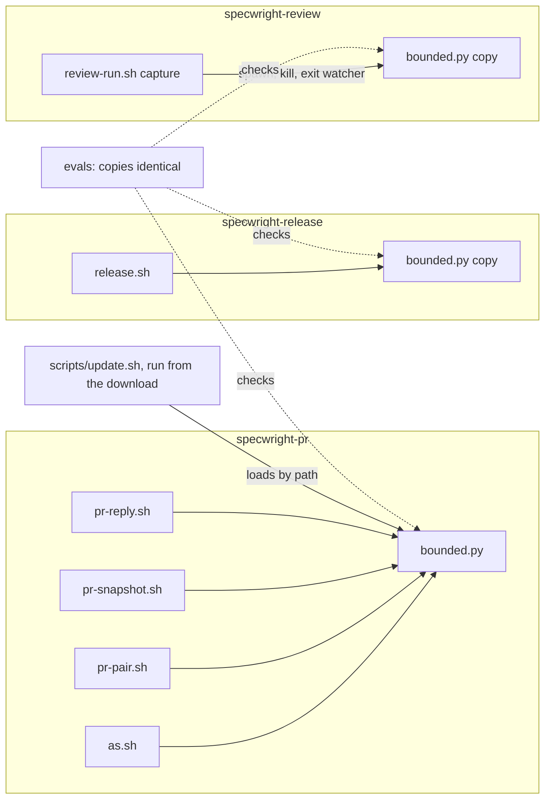
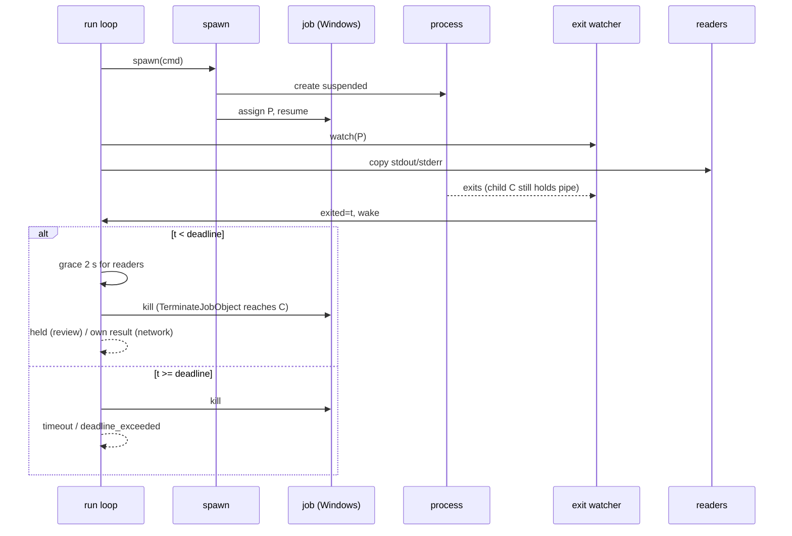
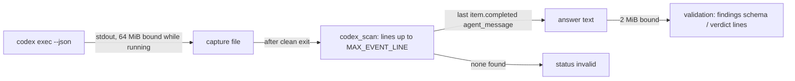

# Design

## Triage

| Trigger | Applies? | Evidence |
|---|---|---|
| T1 Components (new component, or 3+ with directed relationships) | yes | `bounded.py` becomes the process-tree module of four callers in three skills plus `update.sh` (today: only the PR scripts, `skills/specwright-pr/scripts/pr-pair.sh:103-115`, `as.sh:78-82`); `review-run.sh` drops its own `kill_tree` (`review-run.sh:316`) for it |
| T2 State (persistent state, caches, 3+ state machine) | no | No stored state changes. The run loop's states (running, exited, held, timed out, over) exist today (`review-run.sh:401-419`) and keep their meaning |
| T3 Concurrency (background work, workers/isolates, async, retries) | yes | A new exit-watcher thread runs next to the reader threads of `capture` and `_piped` (#114); Windows job assignment races child creation (#116) |
| T4 Boundaries (data format, migration, shared interface, IPC, external) | yes | Codex's `--json` event format becomes the answer contract (#113); `bounded.py`'s module interface is shared by three skills and `update.sh`; `release.sh` gains new `error` values in its JSON |
| T5 Volume (grows without a fixed bound) | yes | This change bounds what was unbounded: `release.sh`'s and `update.sh`'s network output (#111), and codex's answer (#113) |
| T6 Risk (security, money, data loss, unrecoverable user data) | yes | #110 decides whether a user's deletion of a main spec survives an undo; a cut-off tag push publishes a tag that is never moved (ADR 0010) |

TIER: FULL

## Context

The proposal lists the eight issues. What matters for the approach:

- **One runner, two copies today.** `bounded.py` (`skills/specwright-pr/scripts/bounded.py:130-196`) and `review-run.sh`'s `capture` (`review-run.sh:338-445`) have the same spawn rules (`start_new_session` on POSIX, nothing on Windows: `bounded.py:126-127`, `review-run.sh:355`), the same `kill_tree` (`taskkill /T /F` by PID or `killpg`: `bounded.py:52-63`, `review-run.sh:316-327`) and the same exit, grace and deadline loop. ADR 0012 rejected *importing* `bounded.py` from another skill, because skill folders are installed independently. `update.sh` copies every `skills/specwright-*` folder whole (`scripts/update.sh:1646-1674`), so a file inside a skill folder travels with it.
- **Exit seen late (#114).** Both loops learn of the exit from `p.poll()`. While a descendant holds the pipes no reader wakes the loop, so the exit is seen up to `POLL` (0.25 s, `review-run.sh:80`) or 20 ms (`bounded.py:170`) late. An exit first seen at or after the deadline is a timeout by design (round 9 of PR #112: a starved loop must not report a reviewer that was still running at the deadline).
- **Windows survivors (#116).** `taskkill /T` walks the tree from the parent PID. Once the parent has exited, the walk cannot reach its children. The tests skip the child-death assert on Windows (`evals/review-routes/test_review_run.py:944`, `evals/pr-pair/test_bounded.py:198`). No file uses `ctypes` yet.
- **Codex answer (#113).** Codex runs as `exec … -o <work>/last-message.txt --json -` (`review-run.sh:904-918`). The `-o` file is size-polled every 0.25 s (`review-run.sh:392-399`). Its `--json` stdout is already capped at 64 MiB while it runs, but nothing parses it (`review-run.sh:1119`). Codex's JSONL stream emits `{"type":"item.completed","item":{"type":"agent_message","text":…}}` for each agent message, and `--output-last-message` writes the last one (codex `exec/src/event_processor_with_jsonl_output.rs`, `exec/src/exec_events.rs`; installed codex-cli 0.163.0). OMP's answer is already taken from its stream (`omp_scan`, `review-run.sh:947-974`).
- **Unbounded network calls (#111).** `release.sh` runs `git ls-remote` (857, 1239), `gh api --paginate` (1084), `gh release view` (1352), `git fetch` of a tag (1413), `git push` of the tag (1429) and `gh release create` (1365) through plain `subprocess.run` (`run()` 108-112, `gh_run()` 1072-1076). `update.sh`'s `highest_tag` uses `subprocess.run(timeout=60)`: no tree kill and no byte bound (`scripts/update.sh:1353`). `finish.sh` makes no network call: its header says it only reads (lines 1-4), and a grep finds no `fetch`, `push`, `ls-remote` or `gh`.
- **Poll deadline (#117).** `pr-snapshot.sh:542-549` accepts digits only. `bounded.py`'s `resolve` (74-85) takes any non-negative float.
- **Closing lists (#115).** `RenderedLines` (`pr-pair.sh:853-889`) turns a code span into one space. Both readers then accept the reference: the list walk with `FIRST_GAP = \s*` (921, 939-941), and the mid-line keyword check `not line[kw.end():at].strip()` (945-948).
- **Undo after deletion (#110).** `finish.sh:324-327` warns that a spec deleted after the archive stays deleted, but `after_rerun` (409-431) runs `openspec archive` for each non-deferred member, and that recreates the spec from the member's delta.
- **Unreadable revert (#109).** `own_bump` (`release.sh:629-661`) judges each commit against `judged_parent` (615-626), which looks past unreadable parents on the branch. A commit right after an unreadable bump is therefore compared with the version before the bump, so its revert is invisible. This is true whether the reverting commit is unreadable (the issue's case) or readable.

## Decisions

### D1: One process module, an identical copy in each skill that runs bounded processes

- **Choice:** `bounded.py` becomes the one implementation of spawn, exit watching, tree kill and the bounded run. Byte-identical copies live in `skills/specwright-pr/scripts/`, `skills/specwright-release/scripts/` and `skills/specwright-review/scripts/`, and each caller loads its own folder's copy by path, as `pr-pair.sh` does today (`pr-pair.sh:103-115`). `review-run.sh`'s `capture` keeps its own loop (file-backed output, per-stream limits, held pipe = failure) but takes `spawn` and `kill` from its copy and drops its own `kill_tree`. `update.sh` loads `<download>/skills/specwright-pr/scripts/bounded.py` from the download it runs from, and a missing file is a refusal before any write. A test fails when the copies differ.
- **Rejected:** fixing #114 and #116 separately in `review-run.sh`'s inline code and in `bounded.py`, and adding a third inline runner in `release.sh`. Three copies of a Windows job-object routine would drift, and ADR 0012 already paid for two diverging copies. **Rejected:** one shared file outside the skill folders. It breaks the independent installation that ADR 0012 protects.
- **Reversal cost:** low. Callers go through two functions and one CLI.

### D2: Windows trees are held by a job object from spawn

- **Choice:** On Windows, `spawn` creates the process with `CREATE_SUSPENDED`, creates a job object, assigns the process to it and resumes it (`NtResumeProcess`, all through `ctypes`). The job is created without `JOB_OBJECT_LIMIT_KILL_ON_JOB_CLOSE`. Every child the process starts is then in the job, before and after the parent exits. `kill` calls `TerminateJobObject`, and runs `taskkill /T /F /PID` only for a run without a job. When job creation or assignment fails (a parent job forbids nesting, for example), `spawn` resumes the process without a job and the run falls back to today's `taskkill /T`. The fallback is made visible: `bounded.py` writes one stderr line, `bounded: no job object: <reason>`, and `review-run.sh` writes `process_group: none` with the reason in the receipt. A test hook, the environment variable `SPECWRIGHT_TEST_NO_JOB=1`, read only by `spawn`, makes job creation fail so that the fallback can be tested. POSIX is unchanged: `start_new_session` plus `killpg` already reaches children whose parent has exited.
- **Rejected:** snapshotting descendants (`CreateToolhelp32Snapshot`) on each poll while the parent lives. A child started in the last poll interval escapes, and PIDs are reused after exit. **Rejected:** assigning the job after an unsuspended spawn. A child started before the assignment escapes the job. **Rejected:** `KILL_ON_JOB_CLOSE`. It would also kill the detached helpers of a command that finished normally (git's background maintenance, for example), which today survive. That is a behaviour change nobody asked for.
- **Reversal cost:** low. It sits inside `spawn` and `kill`, and the fallback is today's behaviour. `NtResumeProcess` is undocumented but has been stable for 20 years, and psutil's `resume()` uses it.

### D3: The exit is observed by a watcher thread

- **Choice:** `bounded.py` provides an exit watcher: a daemon thread that blocks in `p.wait()`, records `time.monotonic()` and then sets a wake event passed in by the caller. `capture` passes its existing `wake`. `_piped` gets a new `wake` event: its `over` event keeps meaning only "a stream passed its bound", and the loop waits on `wake`, which the readers set on a bound or EOF and the watcher sets on exit. Both loops read the exit time from the watcher instead of `p.poll()`. The loops' wait interval becomes a named constant (`POLL`; 0.25 s in `capture`, 0.02 s in `_piped`). A test hook, `SPECWRIGHT_TEST_POLL` (seconds, read only when set), replaces it so that the #114 evals can make the old polling miss the exit before the deadline. The evals give the fake an absolute exit time taken before the run starts, and check the fake's recorded exit against the run's deadline. The rule stays the same: an exit recorded before the deadline gets the grace, never the deadline, and one recorded at or after it is a timeout. The window shrinks from one poll interval to scheduler latency. A starved or suspended process still records its exit late, which is the deliberate round-9 outcome.
- **Rejected:** polling faster near the deadline. That shrinks the window but does not close it, and it adds a second timing rule. **Rejected:** documenting the ambiguity (#114's third option). The fix is small and testable, and the spec can then state one rule.
- **Reversal cost:** low.

### D4: Codex's answer is the last completed `agent_message` in its event stream

- **Choice:** Drop `-o` from the codex command line. After a clean exit, `codex_scan` reads the captured stdout line by line, as `omp_scan` does (lines up to `MAX_EVENT_LINE`, only lines that contain `item.completed` are parsed), and keeps the `text` of the last `item.completed` event whose `item.type` is `agent_message`. The text then goes through the existing 2 MiB answer bound and validation. No such event: `status: invalid`, "codex's event stream has no agent_message". While codex runs, the 64 MiB stdout bound covers everything it can write. The `watch` parameter of `capture` and `answer_over` are removed.
- **Rejected:** a FIFO for `-o` on POSIX with polling elsewhere. Windows stays unbounded, and a temp-file-and-rename write by codex would break it. **Rejected:** an OS file-size limit. It also kills codex for its own session files, and Windows has none.
- **Reversal cost:** medium. It ties the route to codex's JSONL shape. Evidence: the shape is codex's documented `exec --json` contract (`exec_events.rs`), and #118 (next change) also reads codex's errors from this stream. A shape change makes the run fail closed (`invalid`), never accept a wrong answer.

### D5: `release.sh` and `update.sh` run every network command bounded; a cut-off write is read back

- **Choice:** `release.sh`'s `run()` and `gh_run()` call `bounded.run_bounded` for network commands (`ls-remote`, `fetch`, `push`, `gh *`); its local `git` reads stay plain. The closed-PR read is `paged`. A limit raises `Stop(<limit>, "<limit>: <command>", code=3, call=<command>)`, so the JSON `error` is `deadline_exceeded` or `response_too_large`. For the tag push and `gh release create`, a limit triggers a read-back (`remote_tag` for the push, `release_state` for the release). `remote_tag` returns `(commit, annotated, object)`. The push counts as done only when origin's tag is the local tag object at the release commit. If origin's tag is at another commit, publish stops with `tag_conflict`; if it is the same commit but another object, with `tag_mismatch`. These are the same stops `cmd_publish` makes before the push today (release.sh ~1402-1412), and neither creates a GitHub release. A release found counts as done. Not found: stop with the limit, saying a re-run does it. The read-back fails or is cut off: stop with `error` set to the limit and `state: unknown`. Nothing is retried in the script (ADR 0012). `update.sh`'s `highest_tag` loads `bounded.py` lazily, inside the lookup only, so a download without `specwright-pr` (the eval mini-download, `evals/update/fixtures.py:make_mini_download`) is affected only when a tag must be named. It then runs `run_bounded` with a deadline of `min(60, resolve()'s deadline)`, so the test override can lower it. A limit, or a missing `bounded.py`, becomes the reason string (`deadline_exceeded: git ls-remote`, `bounded.py missing from the download`) in the existing `store_version` refusal. `finish.sh` keeps no network command, and an eval scans it to keep it that way.
- **Rejected:** wrapping the whole `release.sh` run in one outer deadline (through `as.sh` or `timeout`). A single deadline cannot tell which call hung, cannot bound bytes, and kills a publish between its tag push and its read-back.
- **Reversal cost:** low.

### D6: The poll deadline is computed by `bounded.py`

- **Choice:** `bounded.py --deadline-at` prints `time.time()` plus the deadline that `resolve` gives (the `SPECWRIGHT_NET_DEADLINE` rule, capped at 120). `pr-snapshot.sh`'s `poll` exports that as `SPECWRIGHT_NET_DEADLINE_AT` (a float, which `bounded.py` already parses). If the helper prints nothing, the poll falls back to `$(date +%s) + 120`.
- **Rejected:** a second decimal parser in bash (`${d%%.*}`, or `EPOCHREALTIME` arithmetic). It would be a second copy of the rule that #117 shows drifting.
- **Reversal cost:** low.

### D7: A removed code span leaves a marker that no gap accepts

- **Choice:** `RenderedLines` replaces a code span (and `pre`) with U+FFFC instead of a space. It is not whitespace, not a word character and not in `CLOSE_KW`, `LIST_GAP` or `FIRST_GAP`. So the list walk stops at it, the mid-line check `line[kw.end():at].strip()` is non-empty, and text on either side still cannot join into a keyword. New test bodies get recordings made with `evals/pr-pair/record_markdown.py`.
- **Rejected:** special-casing the two readers to look for two spaces. That breaks on any real double space in prose.
- **Reversal cost:** low.

### D8: The after-rerun script deletes again what the user deleted

- **Choice:** `undo-archive-plan` keeps the set `gone` of synced specs deleted after the archive. For each spec in `gone` that a rerun member's delta covers (its `specs/<cap>/spec.md` at T), the after-rerun script first checks, before any `openspec archive` line, that the spec does not exist (`test ! -e <spec> || { echo "<spec> exists; ..." >&2; exit 1; }`). It then adds `rm -f -- <spec>` after all `openspec archive` lines and merges. The script therefore deletes only what the rerun created, never a newer file of the user's. The warning for that spec says the after-rerun script deletes it again after archiving the named members. A spec in `gone` that no rerun member covers keeps today's warning. `rm -f` is enough: after the undo commit the path is absent from HEAD, so the rerun's copy is untracked and removing it restores HEAD's state.
- **Rejected:** refusing the plan (`deleted_spec_in_rerun`). It would leave the user with no undo except restoring the spec by hand, although carrying the deletion through gives exactly the state they had.
- **Reversal cost:** low.

### D9: An unreadable parent on the branch makes any new matched version a change

- **Choice:** In `own_bump`, before today's rules, read the immediate parent `c^`. When it is unreadable and on the branch (not an ancestor of `ref`), and the commit matched a version the parent did not match (a readable commit counts as matching its one version), the commit is a change. It is judged against `judged_parent`. It is a bump when it matched at least one version and each is greater than that version, or, when `judged_parent` is itself unreadable (on `ref`), greater than each semver it matched (a parent with no semver counts every matched version as greater). Otherwise it is no bump, and the walk stops (the newest change decides). Every other commit follows the existing rules unchanged. This amends the `releases` requirement (see specs).
- **Rejected:** comparing only unreadable-to-unreadable sets (Codex's suggestion on PR #108). It leaves the readable revert right after an unreadable bump (`0.6.0` twice → `0.5.0`) counted as a bump. **Rejected:** dropping the look-past (D5 of PR #108). That breaks "Bump made through an unreadable version".
- **Reversal cost:** low.

## Diagrams (FULL)

T1, components after the change:

T3, the run loop with the exit watcher (#114) and the job object (#116):

T4, the codex answer flow (#113):

## State & Ownership (FULL)

| State | Owner (sole writer) | Lifetime | Invalidation / rebuild | Authoritative copy |
|---|---|---|---|---|
| Windows job handle per run | `bounded.spawn` | Until the run returns; closed in `finally` | Not rebuilt; with no job the run falls back to `taskkill` | The OS job object |
| Exit time of a run | exit-watcher thread (written once) | The run | None | The watcher's record; the loop only reads it |
| `bounded.py` copies | This repo's three skill folders; installed by `update.sh` as whole folders | Release | The identity test fails on drift | `skills/specwright-pr/scripts/bounded.py`; the others are copies |
| Codex capture file | `capture`'s stdout reader | The run's work dir, removed in `finally` | None | The file; the answer is derived from it after exit |
| Tag on origin and GitHub release after a cut-off write | GitHub, written by `release.sh publish` | Permanent (ADR 0010) | Read back, never cached | origin / GitHub |

## Failure & Visibility (FULL)

| Component | Fails / dies mid-operation → | Recovery | Retry safe? | Who finds out |
|---|---|---|---|---|
| `spawn` job setup (Windows) | Job create/assign fails | Resume without a job; kill falls back to `taskkill /T`, which leaves today's orphan risk | yes | The log: a stderr line `bounded: no job object: <reason>`, or `process_group: none` in the review receipt. The Windows eval asserts the job path on the test machine |
| `spawn` suspended start | `NtResumeProcess` fails | Terminate the suspended process; the run fails like a spawn failure (exit 127 / reviewer failed) | yes | User, from the named error |
| Exit watcher | Thread cannot start | The loop still polls `p.poll()` as a fallback and keeps today's window | yes | Nobody; behaviour as before this change |
| `release.sh` network command | Deadline or byte bound | Stop with the limit named; nothing retried | Reads yes; writes are decided by read-back (D5) | User, from the JSON `error` |
| Tag push cut off, read-back fails | Unknown whether the tag landed | Stop with `state: unknown`; the next publish's `ls-remote` decides (`Re-runs never move a published tag`) | yes, the re-run is idempotent | User |
| `update.sh` tag lookup | Deadline or byte bound | `store_version` refusal still made, tag not named, reason names the limit | yes | User, from the refusal |
| `update.sh` download lacks `bounded.py` | Cannot bound the lookup | The tag is not named; the `store_version` refusal's reason names the missing file. Nothing else needs the module | yes | User, from the refusal |
| After-rerun guard | A spec it would delete exists already | Exits 1 before any archive, naming it | yes | User |
| `codex_scan` | No `agent_message`, an oversized line, or malformed JSON on that line | `status: invalid`; no review written (fail closed, ADR 0007) | yes, the user reruns | User |
| After-rerun script | `openspec archive` fails before the `rm` | `set -e` stops; the spec is not yet deleted; the plan's warning has said what the script would do | yes, after fixing | User, from the script's exit |
| Runner killed by SIGKILL | Children may survive (ADR 0012 accepts this) | POSIX: unchanged. Windows: the job has no kill-on-close (D2), so unchanged too | n/a | Nobody, accepted as in ADR 0012 |

## Resource Bounds (FULL)

All normative numbers come from ADR 0012 and are unchanged, apart from the two noted here.

| Queue / buffer / cache / transfer | Bound | At the bound | Timeout | At 10x / 100x |
|---|---|---|---|---|
| `release.sh` network command output | 32 MiB per stream (ADR 0012) | Tree killed, `response_too_large`, exit 3, no partial use | 120 s, 300 s for the paged closed-PR read | A store with 100x merged PRs: about 30 pages of 100 per release range, well under 32 MiB and 300 s |
| `update.sh` `ls-remote --tags` | 32 MiB | Tree killed; the tag is not named | 60 s, kept from today | 100x tags is about 1 MB |
| Codex stdout | 64 MiB while running (unchanged) | Tree killed, `invalid`, `output too large` naming stdout | `review.timeout` | Event streams of long reviews are a few MB |
| Codex event line | `MAX_EVENT_LINE` 16 MiB (shared with OMP) | `output too large` | — | — |
| Codex answer | 2 MiB (unchanged) | `invalid`, `output too large` | — | — |
| Exit-watcher threads | One per run | — | Daemon; ends with the process or the runner | One run at a time per script |
| Windows job handles | One per run, closed in `finally` | — | — | — |

## Flow & State Gaps (FULL)

- **Exit and deadline in the same instant:** the watcher's time decides. Equal to the deadline counts as a timeout, as today.
- **Starved runner:** the watcher records the exit late, so a run can be reported as a timeout although the process exited just before. This is accepted and deliberate (round 9). The spec scenario holds the loop with SIGSTOP on POSIX only.
- **Child created between spawn and job assignment:** impossible, because the process is suspended until it is assigned (D2).
- **Command that intentionally leaves a detached helper (git maintenance):** today it survives unless it holds a pipe. With the job, it is killed only when the run kills the tree: at a limit, or when it holds a pipe past the grace. That is the same set of cases as today.
- **Cut-off push where the tag landed but the read-back hangs:** this is `state: unknown`. The re-run finds the tag on origin and counts it done (the existing "Re-run after an interrupted publish" rule).
- **After-rerun with a delta that MODIFIES a deleted spec:** `openspec archive` fails, because there is no main spec to modify. `set -e` stops before the `rm`. The user sees openspec's error, and the spec is still absent at HEAD, so no state is lost.
- **Spec both deleted and amended:** this cannot happen. An amended copy exists only for a spec present at T, and a gone spec is absent at T. `merge` and `gone` are disjoint.
- **Codex prints several `agent_message` items:** the last one is the answer. That matches what `-o` wrote (`final_message` is overwritten on each `ItemCompleted`).
- **#109 walk with merge commits:** the walk is `--no-merges`, so merges are never judged. An unreadable merge parent is covered by the existing "on `ref`" rule.

## Mechanism Ledger (FULL)

| Mechanism | Built? | Why (harm nobody catches / expensive later) | Evidence that would change the call |
|---|---|---|---|
| Job object per run (Windows) | yes | Orphans keep running unseen today (#116); the test skips hide it | — |
| `KILL_ON_JOB_CLOSE` | no | Would kill detached helpers of successful commands; no harm reported from runner SIGKILL | A report of orphans after a killed runner on Windows |
| Exit watcher thread | yes | Wrong status on a real exit (#114); cheap | — |
| Read-back after a cut-off write | yes | ADR 0012 requires a cut-off write to be decided by a read-back; otherwise publish would report a push failure for a tag that is on origin | — |
| Retry of a cut-off write | no | ADR 0012: never retried in a script; the re-run is idempotent | — |
| Identity test for `bounded.py` copies | yes | Silent drift between skills is what #116/#114 suffered in two copies | — |
| Version stamp inside `bounded.py` | no | The identity test covers the repo; installed copies come from one release | A project mixing skill folders from two releases |
| `codex_scan` fallback to `-o` when the stream has no answer | no | Would bring back the unbounded file | A codex release that omits `agent_message` items under `--json` |
| Refusal for #110 instead of carry-through | no | Carry-through restores the user's state exactly (D8) | A case where the rerun's delta must survive the deletion |
| Bash decimal parser for #117 | no | Second copy of the parse rule (D6) | — |

## Risks / Trade-offs

- [Codex changes its JSONL shape] → The run fails closed with `invalid`, naming the missing `agent_message`. The fake codex follows the documented shape, and one real codex run checks it during apply where codex works on this machine (#118 may block that on Windows; then the shape is checked against codex's source).
- [`NtResumeProcess` is undocumented] → Its use is confined to `spawn`. A failure terminates the suspended process with a named spawn error instead of hanging. It is psutil's long-standing resume path.
- [A parent job forbids nested jobs (rare on Windows 8+)] → Fall back to `taskkill /T`, which is today's behaviour.
- [Python start cost for `release.sh` calls] → `release.sh` already runs in Python and imports the module in-process, so there is no extra start. `pr-snapshot.sh` adds one `bounded.py --deadline-at` start per poll (about 100 ms every `poll_interval`).
- [Three copies of `bounded.py`] → An identity test, and the PR copy is the one edited. Accepted as the price of independently installed skills.

## ADRs

- **In force, constraining this change:** 0012 (bounds, named limits, read-back after a cut-off write, no retry), 0007 (fail closed, fixed reviewer command lines), 0010 (tags never moved; idempotent publish), 0011 (`update.sh` runs from the download), 0008 (network calls on github.com fenced through `as.sh`; unchanged here), 0002 (one JSON document per script run).
- **To record during apply:** **0014 "Bounded runs share one process module, copied per skill"**, superseding 0012. It restates 0012's decision with these changes: release and update are bounded (0012's listed exceptions are gone, and `finish.sh` runs no network command); `bounded.py` is copied byte-identically into each skill that runs bounded processes and loaded from its own folder (still no cross-folder import); `review-run.sh` takes spawn, kill and the exit watcher from its copy; Windows trees are held by a job object; the exit is observed by a watcher thread; codex's answer is read from its `--json` event stream, and no route's answer comes from a file the CLI writes. The architecture file's index swaps 0012's row for 0014's, and its Resource bounds and Known gaps rows drop #111.

## Open Questions

- Whether the codex route runs on this Windows machine before #118 is fixed only decides whether the real-codex shape check runs here or falls back to the source check. Neither outcome changes the specs or the tasks.
