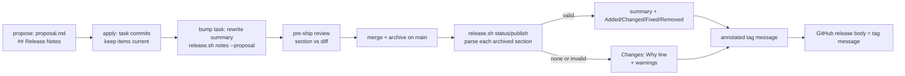

# Design

## Triage

| Trigger | Applies? | Evidence |
|---|---|---|
| T1 Components (new component, or 3+ with directed relationships) | no | One script gains a parser and a subcommand (`skills/specwright-release/scripts/release.sh`); the rest is instruction text in the schema and two skills. No new component or process |
| T2 State (persistent state, caches, 3+ state machine) | no | No new state store. The section lives in `proposal.md`, which is already archived and read by `release.sh` (`release.sh:1055-1058`) |
| T3 Concurrency (background work, workers/isolates, async, retries) | no | `release.sh` runs one subcommand synchronously; the new code runs no process and no network command |
| T4 Boundaries (data format, migration, shared interface, IPC, external) | yes | A new stored format in every proposal of a release-enabled project, read back from archives forever; the tag message and GitHub release body change shape (ADR 0010: tags are never rewritten, so the shape is permanent once published); a new `notes` subcommand and a `warnings` field in the JSON interface |
| T5 Volume (grows without a fixed bound) | yes | Items per release grow with the number of changes and items per change; the GitHub release body has a size limit |
| T6 Risk (security, money, data loss, unrecoverable user data) | no | Notes are text derived from the repo. A wrong tag message is permanent (ADR 0010), which is covered by T4's format decisions and the pre-ship check, not by a security or data-loss path |

TIER: FULL

## Context

- **Notes today.** `status_doc` (`release.sh:1325-1365`) finds the changes in the range (`local_changes`, `release.sh:1087-1104`; `store_changes`, `release.sh:1191-1221`), reads each archived `proposal.md` at the release commit (or the store's main) through `whys` (`release.sh:1055-1058`: one `cat_batch`, at most `MAX_PROPOSAL` = 64 KB each, `release.sh:988`), takes `first_sentence` of `## Why` (`release.sh:996-1036`) for the first `MAX_LISTED` changes only (`release.sh:1345-1349`), and renders `build_notes` (`release.sh:1224-1236`): `Changes in <tag>:` then `- <name> (#<pr>): <why>`, capped at `MAX_LISTED` = 100 changes. Publish writes those notes once into an annotated tag with `--cleanup=verbatim` (`release.sh:1541`) and uses the tag's message as the GitHub release body (`release.sh:1563`, ADR 0010).
- **PR numbers.** A change's PR comes from main's commit subject (`subject_pr`, `release.sh:969-973`) or, store-backed, from the merged code PR (`store_changes`, `release.sh:1213-1215`). That number is what an unreferenced item gets.
- **Dispatch.** `main` (`release.sh:1581-1598`) resolves the repo and calls `st.gate()` (`release.sh:390-399`, stops with `release_disabled`) for every subcommand. `notes --proposal` reads one file and must run before both, as the spec requires (no git call, releases on or off).
- **Instruction text.** The proposal instruction (`schemas/specwright/schema.yaml:12-50`) and template (`schemas/specwright/templates/proposal.md`) have no notes section. The review instruction voids a verdict on any proposal edit (`schema.yaml:364-366`). The tasks rule adds the bump task when `release.enabled` is true (`schema.yaml:464-468`). The pre-ship brief lists what to report (`skills/specwright-review/references/brief.md`, "What to report") and the reviewer can read `openspec/specwright.yaml` with its read tools. `openspec/schemas/specwright/` is the untracked installed copy; only `schemas/specwright/` changes here.
- **Tests.** `evals/release/test_release.py` builds fixture repos with archived proposals and asserts on `doc["notes"]` (e.g. `:450`, `:464`, `:476`, `:530`); `evals/release/test_skill_text.py` pins skill text.

## Decisions

### D1: The notes live in a section of `proposal.md`

- **Choice:** A `## Release Notes` section at the end of `proposal.md`, in the format of the spec requirements "A Release Notes section has one format" and "... tolerates comments, blank lines and wrapped items". `release.sh` reads it from the archived proposal at the release commit, in the same `cat_batch` as the Why lines, but for every change in the range up to the parse bound (Resource Bounds), not only the first `MAX_LISTED`: the bumping change is always last, so a first release with more than 100 changes would otherwise lose its summary. Why lines are still read only for the no-section changes the notes list with one (the first 100).
- **Template:** `templates/proposal.md` is static, so it always carries the `## Release Notes` heading with a guidance comment saying the section is for projects with `release.enabled: true` and is deleted otherwise; the schema's proposal instruction says the same. Comments are stripped before parsing, so guidance left in place does no harm, and a section left with only the comment is invalid (no summary) and falls back. With releases off nothing reads the section.
- **Rejected:** a new schema artifact (`release-notes.md`) because it adds a node to the artifact graph that `openspec status`, the tasks precheck and every archive would have to carry, for one paragraph and a list. **Rejected:** a `CHANGELOG.md` edited by each change, because parallel branches conflict on the same lines, and the notes would no longer be tied to the archived change the range already finds.
- **Reversal cost:** medium. Archived proposals keep whatever format they were written in; a later format must keep reading this one.

### D2: The release summary is the bumping change's summary, written by the bump task

- **Choice:** The notes open with the summary of the bumping change, as the spec requirement "The release summary comes from the bumping change" defines it: the change whose archived `tasks.md` has a ticked `release.sh bump --to <V>` task (the tasks rule makes that task's text fixed, `schema.yaml:464-468`) and a valid section; with none or several, the last change with a valid section in the notes' order. The tasks file is the evidence because order alone is not: the release commit is the first commit reading V (ADR 0010), but one commit can add several archives (a bulk archive), and `local_changes` orders those by directory name (`release.sh:1099`), so the bumping change need not be last. The bump task rewrites that summary to describe the whole release and checks it with `notes --proposal`. Other changes' summaries are not printed.
- **Rejected:** a per-version summary file (`docs/releases/<version>.md`) written by the bump task, because it is a second file per release and a second place to read in the store-backed case, for the same text. **Rejected:** a summary passed to `publish` on the command line, because the tag message could then not be rebuilt from the repo.
- **Reversal cost:** low. Only the source of one paragraph changes.

### D3: Plain `Added:` headings, and today's notes when no section exists

- **Choice:** The notes use `Added:`, `Changed:`, `Fixed:`, `Removed:` and `Changes:` lines, as `Changes in <tag>:` does today, laid out exactly as the spec scenario "Exact layout of several groups" pins: the summary, then each non-empty group after one blank line, items as `- <text>`, no trailing blank line. When no change in the range has a valid section, `build_notes` produces today's text byte for byte.
- **Rejected:** Markdown `###` headings, because the tag message is read as plain text (`git show <tag>`, `git tag -n`) and `###` lines read as noise there; GitHub renders a list after a `Fixed:` line as a list either way. **Rejected:** always using the new shape, because a backfill of an old version would then change its notes for no reader's gain.
- **Reversal cost:** low before the first sectioned tag; afterwards each published tag keeps its shape (ADR 0010), so later shapes simply differ by version.

### D4: Strict parser; an invalid section falls back with a warning

- **Choice:** One parser (`parse_release_notes`) with the strict rules of the format requirements, used by `notes --proposal`, `status` and `publish`. At `status`/`publish`, an invalid section, or a proposal blob over `MAX_PROPOSAL` (judged on the full blob `cat_batch` returns, so a cut can never parse as a shorter valid section), makes that change a no-section change and adds a `warnings` entry (`{"change", "error"}`); the skill reports warnings with the release. `warnings` describe the derived notes, so publish reports them only when it creates the tag; when the tag already exists it reports the tag's message and `warnings: []`.
- **Rejected:** a lenient parser that keeps what it can, because it silently drops or misfiles items in a permanent tag. **Rejected:** stopping `publish` on an invalid section, because the proposal is already on main and `release.auto: true` publishes without a person to fix it; the warning plus the Why line is still a correct, if thinner, note.
- **Reversal cost:** low.

### D5: `notes --proposal` runs before the repo and the opt-in gate

- **Choice:** A fifth subcommand handled in `main` before `git rev-parse` and `st.gate()`: it checks the file's size first, and a file over `MAX_PROPOSAL` is invalid with an error naming the 64 KB limit, as in D4; otherwise it reads the file, parses it and prints the summary, the items by heading and the line each item will get. Before the merge no PR is known, so an unreferenced item's line ends in the literal ` (#<pr>)`, which shows where the PR number will go.
- **Rejected:** folding the check into `check --main`, which ship and watch already run, because `check` is about version files and a notes error would then block ship mechanically; the pre-ship review is the gate for content (D6), the subcommand is the author's tool.
- **Reversal cost:** low.

### D6: The pre-ship review checks the section; severity by harm

- **Choice:** With `release.enabled` true, the brief tells the reviewer to check the section: an item the diff does not ship is P1 `docs` (it would put a false claim in a permanent tag); a missing section, or one that breaks the format rules, is P1 `docs` (publish would drop the whole section, summary included, to the Why line, and with `release.auto: true` nobody is there to act on the warning); a user-visible change without an item is P2 `docs`. The reviewer judges the format from the rules in the brief, since it runs no code. With releases off the section is ignored, so a heading left from the template draws no finding.
- **Rejected:** a deterministic diff-to-items check in a script, because whether a change is user-visible and whether an item describes it is a judgement; the parser already covers the format.
- **Reversal cost:** low.

### D7: Section-only edits keep the design review verdict

- **Choice:** The review instruction's voiding rule (`schema.yaml:364-366`) and the same rule in the review template's comment (`schemas/specwright/templates/review.md:13`) get one exception: an edit confined to the proposal's `## Release Notes` section. The apply instruction and `specwright-commit` say a task that changes what ships updates the section in its own task commit, and that every commit that edits the section, a pre-ship or PR fix commit included, runs `release.sh notes --proposal` on the proposal as part of its verification.
- **Rejected:** moving the section to a file outside the reviewed set to dodge the rule, because that is D1's rejected artifact again.
- **Reversal cost:** low.

## Diagrams (FULL)

T4, the data flow from authoring to the published tag:

## State & Ownership (FULL)

| State | Owner (sole writer) | Lifetime | Invalidation / rebuild | Authoritative copy |
|---|---|---|---|---|
| A change's `## Release Notes` items | the change's author, then its apply task commits | until archive; then frozen in the archive | edited on the branch only; pre-ship review re-checks the head | the archived `proposal.md` at the release commit (store-backed: the store's main) |
| The release summary | the bump task of the change that bumps V | same as the items | rewritten if the bump task reruns (a second bump) | the bumping change's archived proposal |
| The notes text | `build_notes`, derived on each `status`/`publish` | recomputed every run until the tag exists | never cached | the tag's message once published (ADR 0010); publish never re-derives it for the release body |

## Failure & Visibility (FULL)

| Component | Fails / dies mid-operation → | Recovery | Retry safe? | Who finds out |
|---|---|---|---|---|
| `parse_release_notes` on an archived proposal | invalid section | that change falls back to its Why line under `Changes:` | yes (pure) | the user: `warnings` in the JSON, reported by the release skill with the release line |
| Proposal over 64 KB | the blob is larger than `MAX_PROPOSAL` | its section is invalid with an error naming the 64 KB limit (D4), and the change falls back | yes | the user, through the same warning naming the change |
| `notes --proposal` | missing file → exit 2; invalid → exit 1 with every error | author fixes the section and reruns | yes | the agent running the bump or apply task, which reports the errors |
| Pre-ship check | reviewer misses a false item | none automatic; P1 rule makes it blocking when found | n/a | PR reviewers; the published tag cannot be fixed (ADR 0010), which is why a false item is P1 |
| `publish` interrupted after notes were built | as today: the tag holds whatever notes were written at creation; re-runs reuse the tag | existing re-run rules | yes | as today |

## Resource Bounds (FULL)

| Queue / buffer / cache / transfer | Bound | At the bound | Timeout | At 10x / 100x |
|---|---|---|---|---|
| Proposal read per change | 64 KB (`MAX_PROPOSAL`, existing) | over it, the section is invalid (D4); the Why line keeps today's cut | none (local read) | per change |
| Proposals and tasks files parsed per release | the last 1 000 changes of the range. One `git cat-file --batch-check` gives every blob's size first; only blobs of at most `MAX_PROPOSAL` are then read with `cat_batch`, so the read is at most 1 000 × 2 × 64 KB = 128 MB and realistically tens of KB. A blob over the bound is never read for its section or bump task: its section is invalid (D4), and a tasks file over it counts as having no bump task. The size pass applies to the section and `tasks.md` reads only: Why lines for the listed no-section changes are read as today, the blob read whole and `first_sentence` taken from its first 64 KB, so an over-bound proposal keeps its Why line under `Changes:` | older changes are treated as no-section changes, so they are listed by name under the `MAX_LISTED` rule | none (local read) | 10x (a first release of ~100 changes) is parsed whole; 100x hits the bound and still keeps the bumping change, which merges at the release commit and so is among the last |
| Summary | 600 characters | invalid section | none | fixed |
| Item | 500 characters after whitespace collapses | invalid section | none | fixed |
| Items listed in one release | 150 | the first 150 in order, then `…and <n> more items` | none | 10x (~20 changes × 8 items) fits; 100x is cut with a count |
| Changes listed under `Changes:` | 100 (`MAX_LISTED`, existing rule) | names only, then `…and <n> more` | none | as today |
| Notes text | ≤ 150 × ~510 + 100 × ~400 + 600 ≈ 117 K characters | stays under GitHub's release body limit (125 000 characters, an unverified assumption checked in task 2.6) | none | capped by the two lists above |

## Flow & State Gaps (FULL)

- **Several changes in one range.** `check --main` refuses a bump that is not greater than main's (`releases` "A bumped version is greater than main's before it merges"), so with every change shipping its own release a range normally holds one change. A range holds several in a first release of a project that turned releases on late, after a change merged without a bump, or in a backfill. The summary is then the bumping change's (D2), found by its tasks file even when a bulk archive adds it in the same commit as other changes; its bump task describes the release as a whole (the tasks rule says so), and the items of every change are listed either way.
- **A release whose bumping change has no valid section but an earlier one has**: the summary comes from that earlier change. Visible in `status` before publish.
- **Section edited after the pre-ship pass**: a new commit has no pass (existing per-head rule), so the edit is reviewed again.
- **Store-backed**: proposals come from the store's main (`store_changes`), order from the code-merge proof; nothing new.
- **Backfill of an old version**: no sections in range → today's notes (D3).
- **Review voiding**: an apply commit touching the section and another proposal line voids the verdict (spec scenario); judged by the agent from the commit's diff, as the voiding rule is today.

## Mechanism Ledger (FULL)

| Mechanism | Built? | Why (harm nobody catches / expensive later) | Evidence that would change the call |
|---|---|---|---|
| Strict format parser | yes | format of permanent tags; a lenient parse misfiles items silently | — |
| `warnings` in `status`/`publish` JSON | yes | an invalid archived section would otherwise thin the notes with nobody told | — |
| `notes --proposal` | yes | the bump task needs a verification command (tasks rule: every task states its check) | — |
| Size pass (`cat-file --batch-check`) before reading proposals and tasks files | yes | without it the parse bound is not a real bound: `cat_batch` reads each blob whole | — |
| Bump task lookup in archived `tasks.md` | yes | order alone picks the wrong summary when a bulk archive adds several changes at the release commit, and the tag is permanent | — |
| Item cap and count line | yes | GitHub rejects an oversized release body after the tag is pushed | — |
| De-duplication of identical items across changes | no | rare; a duplicate line is harmless | a release showing duplicates in practice |
| Checking that `#<n>` references exist on GitHub | no | needs a network call per item; the reviewer sees the references | a published note with a wrong reference |
| Markdown headings for GitHub rendering | no | D3 | users asking for rendered headings |
| Per-item change attribution | no | the PR reference already ties an item to its change | — |

## Risks / Trade-offs

- [The bump task forgets to rewrite the summary for a multi-change release] → the tasks rule names it, and `status` before publish shows the summary.
- [Authors skip the section] → P1 pre-ship finding with releases on; the fallback keeps the release correct.
- [GitHub's body limit assumption is wrong] → task 2.6 checks the documented limit; the cap is one constant.
- [The voiding exception is abused for non-notes edits] → the exception is for that section only; any other line voids, as the spec scenario pins.

## ADRs

- **In force, constraining this change:** 0010 (tag created once, notes as its message, the bump is a reviewed task; release commit = first commit reading V), 0003 (notes rebuilt from the repo), 0002 (parser in the thin script), 0014 (no new network command; `notes` runs none).
- **To record during apply:** 0015 "Release notes come from each change's proposal": the `## Release Notes` section is the source of release notes, read from the archive at the release commit, the summary taken from the change whose archived `tasks.md` has the ticked `release.sh bump --to <V>` task and a valid section, else from the last change with a valid section, and written by the bump task, an invalid or missing section falling back to the Why line, and section-only edits not voiding the design review. Not superseding anything.

## Open Questions

None.
