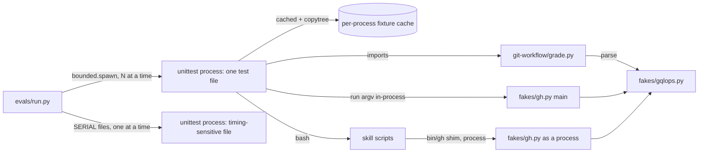
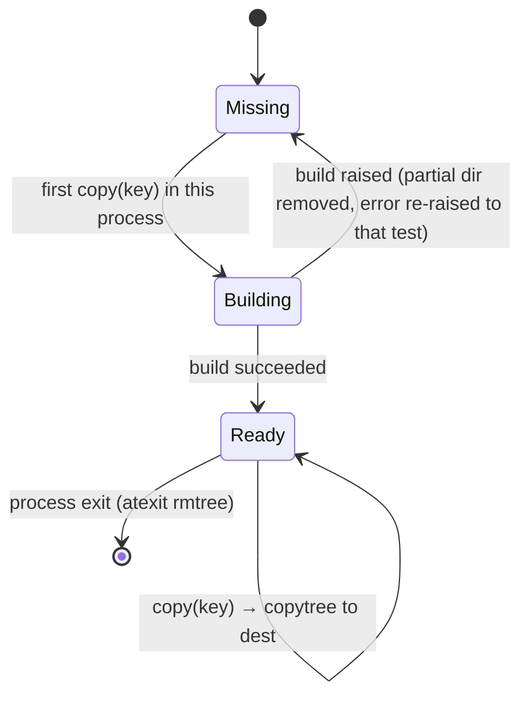
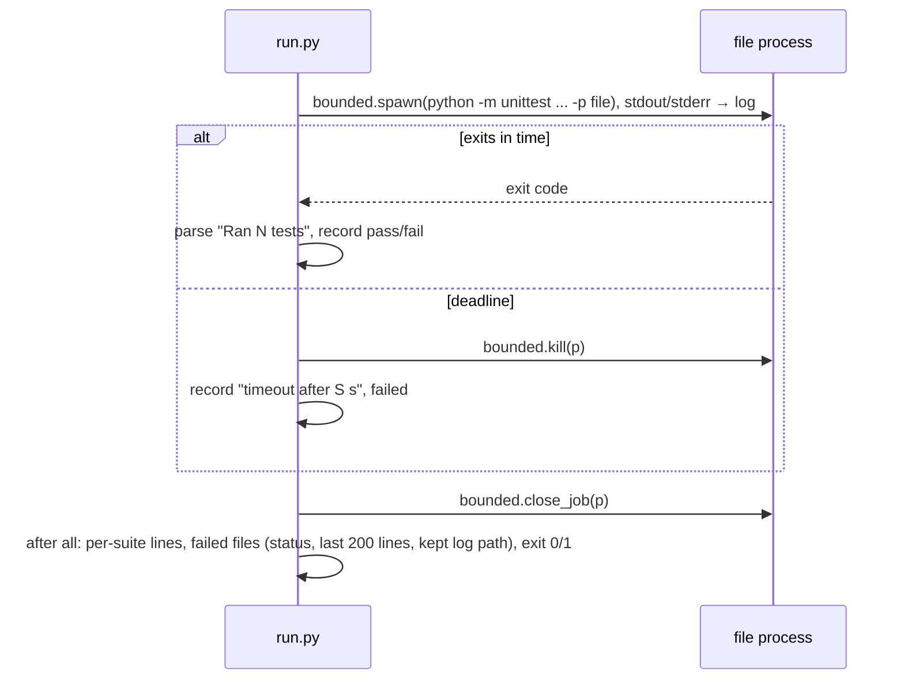

# Design

## Triage

| Trigger | Applies? | Evidence |
|---|---|---|
| T1 Components (new component, or 3+ with directed relationships) | yes | New `evals/run.py` drives one `unittest` process per test file, and those processes use the fixture modules, the fake `gh` and the skill scripts |
| T2 State (persistent state, caches, 3+ state machine) | yes | New per-process fixture cache (a built repo directory reused for each test) |
| T3 Concurrency (background work, workers/isolates, async, retries) | yes | The runner runs test files in parallel, each with its own temp dirs and child processes |
| T4 Boundaries (data format, migration, shared interface, IPC, external) | no | The grader's classification is internal to `evals/`. The fake `gh` CLI contract (argv, `FAKE_GH_*` env, exit codes) is unchanged; the in-process entry point is an addition. `evals/timings.md` is a human record, not a parsed format |
| T5 Volume (grows without a fixed bound) | yes | Test files per run and unittest output per file grow with the suites; bounded below |
| T6 Risk (security, money, data loss, unrecoverable user data) | no | Eval tooling only. Nothing it touches pushes, publishes or deletes user data; it works only in temp dirs |

TIER: FULL

## Context

Proposal: `proposal.md`. The current code these fixes touch:

- `gh_read_only` (`evals/git-workflow/grade.py:592`) picks GraphQL only when `a[1] == "graphql"` (`"graphql" in a[1:2]`, line 602). `api_endpoint` (line 559) already finds the endpoint past options and their values, and `rest_read_only` already uses it (line 578).
- `graphql_read_only` (line 582) classifies every operation that `gqlops.operations` returns. `gqlops.named_operations` (`evals/fakes/gqlops.py:64`) already yields `(kind, name, top_fields)`, and the fake uses it to filter by `operationName` (`evals/fakes/gh.py:703-710`) but keeps every match, which is #125.
- `git_read_only`'s fetch rule (`grade.py:510-516`) treats a fetch with no refspec, or with a `…:refs/remotes/…` destination, as a read. I checked tag following on git 2.55.0.windows.4 against a local bare remote, with `v1` and `v2` deleted from the clone before each fetch:

  | Command | Tags it wrote |
  |---|---|
  | `git fetch origin` | `v1`, `v2` |
  | `git fetch` | `v1`, `v2` |
  | `git fetch --all` | `v1`, `v2` |
  | `git fetch origin refs/heads/main:refs/remotes/origin/main` | `v1`, `v2` |
  | `git fetch origin +refs/heads/*:refs/remotes/origin/*` | `v1`, `v2` |
  | `git fetch origin --update-head-ok` | `v1`, `v2` |
  | `git fetch origin main` | none |
  | `git fetch --no-tags origin` | none |

  So any fetch that stores a ref follows tags, and only a fetch with no destination, or one with `--no-tags`, stays clean.
- `refresh_exceptions` (line 722) allows `checkout main`, `pull --ff-only` and the pull's own `merge --ff-only FETCH_HEAD`. `test_real_traces_of_reads_are_reads` (`evals/git-workflow/test_grade.py:~476`) records that a real `pull` traces `fetch --update-head-ok` as its own built-in command.
- `BRANCH_FLAGS` (line 452) has no `-q`/`--quiet`. `tag_writes` (line 835) treats a positional name with no `TAG_READ` flag as a create, and `-v`/`--verify` is not in `TAG_READ`.
- Skill scripts fetch with `--no-tags`, or with refspecs that have no destination (`git fetch -q origin refs/heads/{branch}` in `pr-pair.sh:1239`). There is one exception: `release.sh:1733` fetches `refs/tags/{tag}:refs/tags/{tag}`, a tag write that both the old rule and the new one grade as a change. So the tighter rule changes no grade of a skill script's fetch.
- Speed (#127): a process launch costs about 215 ms on the Windows machine. Today:
  - fixtures rebuild repos with `git init` and commits for every test (`evals/git-workflow/fixtures.py:47-69`, `evals/release/fixtures.py:77-103`, `evals/finish/fixtures.py:74`, `evals/update/fixtures.py:65-72`, `evals/pr-pair/test_as_sh.py:101`);
  - `evals/pr-pair/test_fake_gh.py:41-50` starts `python gh.py` for every fake call;
  - the update shims are already on `PATH` only for tests that pass `shim_dir` (`evals/update/fixtures.py:380-395`), so there is nothing to cut there.

## Decisions

### D1: GraphQL is detected by the parsed endpoint

- **Choice:** `gh_read_only` routes to `graphql_read_only` when `api_endpoint(a).lstrip("/") == "graphql"`, so the method and option order no longer matter. That rule and the fake's endpoint parse then agree on which calls are GraphQL.
- **Rejected:** keep positional detection and make `rest_read_only` refuse `GET` when a `query=` field holds `mutation`. It lost because it puts a second GraphQL classifier inside the REST path, and that classifier would drift from `graphql_read_only`.
- **Reversal cost:** low.

### D2: Fetch is read-only only when it cannot store a ref

- **Choice:** in `git_read_only`, a fetch is read-only only when both of these hold.
  - **Preconditions, as today:** every option is in `FETCH_FLAGS`, no refspec has `+` (in any slot), there is no `tag` keyword, and every `src:dst` destination is under `refs/remotes/`.
  - **No tags can be stored:** either `-n`/`--no-tags` or `--dry-run` is present, or there is no `--all`/`--multiple`, at least one refspec follows the remote, and no refspec has a `:` destination.

  Anything else is a change:
  - a fetch with no refspec;
  - `--all` or `--multiple` without `--no-tags`/`--dry-run`, whatever its positionals (with `--multiple` every positional is a remote);
  - any `src:dst` refspec without `--no-tags`, including one into `refs/remotes/`;
  - every precondition failure, even with `--no-tags` (`fetch --no-tags origin main:main`, `fetch -n origin tag v1`). The pull's child is handled in `changing_git`, the one place that sees the whole trace: a `fetch` carrying `--update-head-ok` that directly follows a `pull` in the trace (only `READ_ALWAYS` children between them) is dropped, because the pull it belongs to is itself listed. `refresh_exceptions` builds on `changing_git`, so it allows that child together with `pull --ff-only` with no rule of its own.
- **Rejected:** read the fixture repo's `remote.<name>.tagOpt` and treat a configured `--no-tags` remote as clean. It lost because it couples the grader to repo config it does not otherwise read. The trace alone cannot show the config, so failing closed (a write) is the safe default. A fixture that needs a clean default-refspec fetch passes `--no-tags`.
- **Rejected:** keep `fetch origin` a read and compare `refs/tags/` before and after the run instead. It lost because the check that lists changes works from the command trace, and a ref diff would be a second mechanism next to it.
- **Reversal cost:** low. The rule is internal, and the spec scenarios pin it.

### D3: The executed operation decides, in both the grader and the fake

- **Choice:** `graphql_read_only` reads the `operationName` field value from argv: `-f`/`-F`/`--field`/`--raw-field`, separate or attached, in the same spellings `gql_queries` accepts. When the field is present, it keeps only the operations of that name from `gqlops.named_operations`. Classification is unchanged in the other cases:
  - no match: an empty result, which is already a write;
  - several matches: classified as they are, so a mutation among them is a write (fail-closed, though GitHub would reject the call).

  The fake raises `Fail("GraphQL: There are multiple operations named '<name>'.")` when more than one operation matches, before it dispatches anything (#125).
- **Rejected:** share one "operation to execute" function between the grader and the fake through `gqlops`. It lost because the two sides must part on purpose in the error cases. The fake must fail where GitHub fails, while the grader must fail closed. A shared function would have to return both behaviours. A shared parse (`named_operations`) is the right amount to share.
- **Reversal cost:** low.

### D4: Quiet branch listing and tag verify join the allowlists

- **Choice:** add `-q` and `--quiet` to `BRANCH_FLAGS`. They are not added to `BRANCH_READ`, so `git branch -q feat/x` (a create) stays a write. Add `-v` and `--verify` to `TAG_READ`. Write flags are checked first in `tag_writes`, so `tag -v -d x` and `tag -f -v x` stay writes. A bundle such as `-vd` still sets the write letter `d`.
- **Rejected:** none that differs structurally. These are allowlist entries.
- **Reversal cost:** low.

### D5: Fixture repos are built once per test process and copied

- **Choice:** a stdlib helper, `evals/fixturecache.py`, provides `cached(key, build) -> Path` and `copy(key, build, dest)`.
  - The first call for a key builds into a private directory under the process's own cache root (`tempfile.mkdtemp(prefix="sw-fixture-cache-")`, removed at exit by `atexit` with each suite's read-only-safe `rmtree`).
  - Every call then `shutil.copytree`s the finished tree to `dest`.
  - The key is the builder's name plus its shape arguments (prefix, capabilities, version, version files and the like). The destination path is never part of the key, since the cached stage is path-independent.
  - Only path-independent stages are cached: `git init`, config, files and commits. Steps that write absolute paths stay after the copy: `eval.env`, `bin/gh`, `git remote add origin <abs path>` and bare remotes created next to the work tree. They are cheap, or a single process.

  The fixture modules wrap their existing builders (`base`/`project` in git-workflow, `make_repo` in finish and release, `init_repo` plus the first commit in update, and the pr-pair repo setup). `python fixtures.py <name> <dest>`, the graded agent eval path, produces byte-identical trees: same commits, same SHAs (committer dates are pinned where the builder already pins them; where it does not, the SHA was never stable and no test asserts one).
- **Rejected:** a cross-process cache on disk, shared by the parallel test files. It lost because it needs locking and invalidation when schemas change between runs, and staleness becomes possible. A per-process cache is rebuilt on every run, so it is never stale, and the build happens once per file instead of once per test, which is where nearly all the saving is.
- **Rejected:** rewrite absolute paths inside a copied tree, so that path-dependent stages can be cached too. It lost because a text rewrite over `.git/config` and `eval.env` is a new way for a test to be wrong without anyone noticing, for a saving of one process per test.
- **Reversal cost:** low. Callers keep the builder signatures, and removing the cache restores rebuilds.

### D6: The fake gh gets an in-process entry point; scripts keep the process

- **Choice:** `evals/fakes/gh.py` gains `run(argv, env, stdin="", cwd=None) -> (code, stdout, stderr)`. It:
  - saves the cwd and `chdir`s to `cwd` when given, so the logged `cwd` (`test_fake_gh.py:189`) and `repo_of`'s `git remote get-url origin` (`gh.py:307-317`) see the test's directory, not the specwright checkout;
  - replaces the contents of `os.environ` in place with `env` (clear, then update), so the `jq` and `git` children the fake starts inherit it;
  - points `sys.stdout`, `sys.stderr` and `sys.stdin` at `io.StringIO` (`main` already guards `reconfigure` with `hasattr`);
  - calls `main(argv)`, treating a `SystemExit` (the `flood` injection, `gh.py:232`) as its return code;
  - restores cwd, the environment and the streams in `finally`.

  `test_fake_gh.py`'s `gh()` helper uses `run` by default, passing the test's tmp dir as `cwd`. A test that needs a real process passes `process=True`: a `hang` rule, a PID file, a signal, a jq subprocess path it means to test as a process, or stdin as a pipe. `flood` works in-process through the `SystemExit` handling. Scripts under test (`pr-pair.sh`, `pr-snapshot.sh`, `release.sh`, …) still reach the fake through `bin/gh`. The process boundary there is the thing under test.
- **Rejected:** replace the `bin/gh` shim with a long-running fake `gh` server that a thin client talks to. It lost because the client is still one process per call, so it saves little, and it adds a server lifetime and a port or pipe per test.
- **Reversal cost:** low.

### D7: A stdlib parallel runner, one process per test file, bounded by the shared process module

- **Choice:** `evals/run.py [--jobs N] [--timeout S] [suite ...]`.
  - It lists `evals/<suite>/test_*.py` and runs each as `python -m unittest discover -s evals/<suite> -t evals/<suite> -p <file>`, the same top-level directory as today's `python -m unittest discover evals/<suite>`, so sibling imports resolve as they do now.
  - Files run on a `ThreadPoolExecutor(max_workers=jobs)`; `jobs` defaults to `os.cpu_count()`.
  - Each file is started with `bounded.spawn` from `skills/specwright-pr/scripts/bounded.py`, ADR 0014's shared process module, so its tree lives in its own job object (Windows) or session (POSIX).
  - A timeout stops the tree with `bounded.kill(p)` on the spawned `Popen`, not `kill_tree(pid)`, which on Windows misses children whose parent has exited (`bounded.py:69-71`, #116). After every file ends, `bounded.kill(p)` stops what is left of its job or session and `bounded.close_job(p)` closes the handle, so a leftover such as a fake `gh` `hang` sleeper does not outlive its file. An interrupt (Ctrl-C) stops every running tree before the runner waits for its workers, and no queued file starts after it.
  - Output goes to a per-file log file in the runner's temp dir, so a full pipe can never block a child. The logs of passed files are removed at the end. The logs of failed or timed-out files are kept, in a directory that outlives the run, and their paths are printed.
  - Files named in `SERIAL` (a constant in `run.py`) run one at a time after the parallel batch. These are the timing-sensitive files, whose deadlines could slip under CPU load.
  - It prints, per suite, the files run, the tests run (parsed from unittest's `Ran N tests`) and the wall time. For each failed or timed-out file it prints its status (exit code, or `timeout after S s`), the last 200 lines of its log and the kept log's full path.
  - Exit status: 0 when every file passed, 1 when any failed or timed out, 2 for an unknown suite or bad arguments.
- **Rejected:** a third-party runner (pytest-xdist). It lost because the project keeps evals and scripts to the Python standard library (`CONTRIBUTING.md:49`), and the suites are `unittest`.
- **Rejected:** parallelism per test (one process per test method). It lost because each process would rebuild its fixture cache, which undoes D5. Files are the unit where the cache pays off.
- **Reversal cost:** low. `python -m unittest discover evals/<suite>` keeps working unchanged.

### D8: The #127 figures are the before column; the after run is measured on the same machine

- **Choice:**
  - **Before:** the per-suite times and test counts in #127, measured on this Windows machine at the M4 close (2026-10-26), each suite run on its own with `python -m unittest discover evals/<suite>`. No new before run: it would cost about 2.5 hours for a change made of small fixes (the user's decision).
  - **Why it is fair:** 0.8.1 and 0.9.0 added tests since #127, so the after run does more work than the before run did. That makes "the after total is lower" stricter, never easier. The record states both test counts per suite.
  - **After:** after the change, run each suite on its own with `python evals/run.py <suite>`, with no other build, test or eval load from this work on the machine. The record says so.
  - **Test IDs:** at the base commit, list each suite's test IDs (`unittest` loader discovery only, no test runs, a few seconds) into a file kept with the change. List them again after the change and compare. The record states that every base ID is still present, or names any missing one, which blocks the change.
  - **Record:** `evals/timings.md` holds the #127 before column (cited as the issue, with its date), the after column, the machine, git and Python versions of the after run, both test counts and the ID comparison.
- **Rejected:** a new before run at the base commit. It lost because it costs about 2.5 hours of an otherwise idle machine, to gain a like-for-like test count that only makes the comparison easier to pass.
- **Reversal cost:** low.

## Diagrams (FULL)

## State & Ownership (FULL)

| State | Owner (sole writer) | Lifetime | Invalidation / rebuild | Authoritative copy |
|---|---|---|---|---|
| Fixture cache dir per key | `fixturecache` in that test process | That process | Never reused across processes; removed at exit | The builder; the cache is a copy of its output |
| A test's copied fixture | That test | The test (its tmp dir cleanup) | Copied fresh for each test | The test's own copy |
| Fake gh state (`FAKE_GH_STATE` file) | The fake, in-process or as a process, one call at a time per test | The test | Seeded by the test | The file |
| `os.environ` during in-process `run` | `gh.run` | One call; restored in `finally` | Restored on every exit path | The saved copy |
| Runner per-file log | `run.py` | Passed file: the run (removed at the end). Failed or timed-out file: kept after the run, path printed | Rewritten by the next run | The log |
| `evals/timings.md` | The change author, by hand from the runner's output | In the repo | Rewritten by a later change that measures again | The file |

## Failure & Visibility (FULL)

| Component | Fails / dies mid-operation → | Recovery | Retry safe? | Who finds out |
|---|---|---|---|---|
| Fixture build | Exception in the builder | The partial cache dir is removed, the key stays missing, and the exception reaches the test as today | Yes: the next test rebuilds | The developer: the test errors with the builder's traceback |
| Cached-copy test | Test mutates its copy | Nothing to recover: the cache is never handed out, only copied | n/a | Pinned by the "shared fixture is not shared state" test |
| In-process fake gh | Raises something other than `Fail` | `finally` restores env and streams; the exception propagates as a test error | Yes | The developer: test traceback |
| Test file process | Hangs | `--timeout` (D7) → `bounded.kill(p)`, then `close_job(p)`; file counted failed | Yes | Runner output names the file, "timeout after S s" and the kept log path |
| Test file process | Crashes, or fails to import | Exit code non-zero, counted failed | Yes | Runner prints exit code and last log lines |
| Runner itself | Interrupted (Ctrl-C) | Children are in job objects/sessions: `bounded.kill(p)` and `close_job(p)` on each running `Popen` in a `finally`; temp dir removed | Yes | The developer, at the terminal |

## Resource Bounds (FULL)

| Queue / buffer / cache / transfer | Bound | At the bound | Timeout | At 10x / 100x |
|---|---|---|---|---|
| Parallel test processes | `--jobs`, default `os.cpu_count()` | Further files wait in the executor queue | Per file: `--timeout`, default 7200 s | 10x files: same concurrency, longer wall time; 100x: the same |
| Files queued | The suites' `test_*.py` count (about 30 today) | n/a: finite list | n/a | Finite; a list, not a stream |
| Per-file log | On disk in the runner's temp dir; written by tests this repo owns | The runner prints at most the last 200 lines | Ends with the file's deadline | Unittest output at 100x stays in the MB range; passed files' logs are removed at the end of the run, failed or timed-out files' logs are kept (D7) |
| Fixture cache | One tree per distinct key per process (a few keys per file, each a small repo) | n/a | n/a | Keys grow with builder variants, not with tests; removed at exit |
| In-process fake output | `StringIO` per call | The fake's responses are fixture-sized | The test's own | n/a |

## Flow & State Gaps (FULL)

- **Partial completion:** a run stopped mid-way leaves no shared state. Each file's temp dirs belong to that file; the runner's `finally` kills running trees and removes its temp dir, except the kept logs of failed or timed-out files (D7).
- **Concurrency:** parallel files share only read-only inputs: the repo checkout, schemas and skills. Every test writes inside its own `mkdtemp` dir, and the fixture caches are per process. One assumption could be wrong: that no test writes into the repo checkout or uses a fixed path in `%TEMP%`. The first parallel run checks it, and a file that breaks it moves to `SERIAL` (or is fixed), with a note in `evals/timings.md`.
- **Timing-sensitive tests under load:** `evals/pr-pair/test_bounded.py` and the review-routes timeout tests assert deadlines of a few seconds. They start in `SERIAL`, and the first parallel runs decide whether any other file joins them.
- **Stale cache:** cannot happen across runs (D5). Within one process, a builder's inputs (schemas, templates) do not change.
- **Pull child ordering:** git traces the child `fetch` after its parent `pull` line, as `test_real_traces_of_reads_are_reads` recorded. A trace in which the fetch comes before any pull is not treated as a child.

## Mechanism Ledger (FULL)

| Mechanism | Built? | Why (harm nobody catches / expensive later) | Evidence that would change the call |
|---|---|---|---|
| Per-process fixture cache | Yes | The main saving (#127), and cheap to remove | n/a |
| Cross-process cache | No | Locking and staleness for little gain over per-file builds | Per-file builds still dominate a suite's time after D5 |
| Path rewrite in copied fixtures | No | A silent-wrongness risk for one process saved per test | Profiling shows `remote add` and env writes are a large share |
| In-process fake gh | Yes, for direct fake tests | 71 tests, several launches each | n/a |
| Fake gh server | No | Still one client process per call | n/a |
| Runner per-file deadline and tree kill | Yes | A hung test would otherwise hang the whole run with nobody told; reuses `bounded.py` | n/a |
| `SERIAL` list | Yes | A timing test failing under parallel load would look like a regression | The listed files pass reliably under parallel load (then shrink the list) |
| Retry of failed files | No | It would hide real flakiness | A known flaky file with an upstream cause (then fix it, not retry it) |
| `tagOpt` config reading in the grader | No | See D2 | A fixture that must fetch without `--no-tags` and with `tagOpt` set |

## Risks / Trade-offs

- [A grader rule that is too broad fails a correct run] → The fetch rule is checked against every skill script's fetch forms (Context). The six suites and the graded git-workflow fixtures' own fetches (`fetch -q --no-tags origin main`, `test_grade.py:833,893,1041,1081`) still pass.
- [A cached repo differs from a freshly built one] → A test builds one shape both ways and compares `git log --format=%H%n%T`, the trees and `git status`. `python fixtures.py` output is unchanged.
- [In-process fake tests stop catching CLI-level bugs (argv decoding, exit codes, stdout encoding)] → A few process-level tests remain (`process=True`) for exit codes, UTF-8 output and `hang`, and every script test still goes through the process.
- [Parallel load makes timing tests flaky] → The `SERIAL` list (D7).
- [The #127 before column has fewer tests than the after run] → That only makes the after total harder to beat (D8). The record shows both counts, so a reader can see the difference.
- [A noisy after run] → It runs with no other load from this work on the machine (D8); a noisy after run can only hurt the change, never help it.

## ADRs

- **In force, constraining this change:** ADR 0014 (bounded runs share one process module): the runner spawns and stops test processes through `bounded.py`, not its own process code. ADR 0012 (PR scripts and reviewer runs are bounded): unchanged, and `test_bounded.py` keeps its assertions.
- **To record during apply:** none. The runner and the cache are eval tooling and bind no product interface. Apply updates `openspec/architecture.md`'s Evals row to name `evals/run.py` and `evals/timings.md`.

## Open Questions

- Which files besides `test_bounded.py` and the review-routes timeout tests need `SERIAL`. The first parallel runs decide it. It changes a constant, not the approach.
