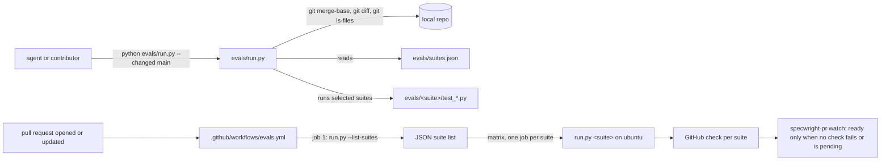

# Design

## Triage

| Trigger | Applies? | Evidence |
|---|---|---|
| T1 Components (new component, or 3+ with directed relationships) | yes | A new CI workflow (`.github/workflows/`, none exists today) and a new path map, both driving `evals/run.py`. |
| T2 State (persistent state, caches, 3+ state machine) | no | The map is a committed config file; no runtime state, cache or state machine is added. |
| T3 Concurrency (background work, workers/isolates, async, retries) | no | Parallel file runs already exist (`evals/run.py:213-224`) and are unchanged; CI jobs are independent and share nothing. |
| T4 Boundaries (data format, migration, shared interface, IPC, external) | yes | A new file format (`evals/suites.json`), a new runner interface (`--changed`, `--list-suites`) and an external system (GitHub Actions). |
| T5 Volume (grows without a fixed bound) | no | Changed paths are bounded by the repository's file count (319 tracked files); the suite list by the directories under `evals/`. |
| T6 Risk (security, money, data loss, unrecoverable user data) | no | The workflow runs on `pull_request` with a read-only token and no secrets; nothing is written outside the runner. |

TIER: FULL

## Context

See proposal.md for the motivation. Current state the approach relies on:

- **Runner.** `evals/run.py` discovers suites as subdirectories holding `test_*.py` (`find_suites`, `evals/run.py:61-62`) and runs the named suites, or all of them (`evals/run.py:198-203`). Unknown suites exit 2 before anything runs (`evals/run.py:199-202`). `--ids` already lists test IDs without running (`evals/run.py:204-205`). Stdlib only, Python 3.8+ (docstring, `evals/run.py:1`).
- **What the suites read.** The suites read far more than "their" script:
  - `git-workflow`'s `test_instructions.py` reads `README.md`, `CONTRIBUTING.md`, `OPENSPEC_VERSION` (`evals/git-workflow/test_instructions.py:1276`) and many `SKILL.md` texts.
  - `release` reads `skills/*/SKILL.md` for version lines and the schema templates.
  - `review-routes` reads the review, commit, PR and roadmap `SKILL.md` texts and the schema.
  - `update` reads `templates/`, the schema and `bounded.py`.

  So the map is many-to-many, and a narrow map is easy to get wrong.
- **External tools.** `git-workflow` runs the real OpenSpec CLI found on `PATH` (`evals/git-workflow/fixtures.py:101`, `evals/git-workflow/grade.py:82`). Several tests skip without `bash` (`evals/git-workflow/test_grade.py:68`). `test_pass_write_on_python38` skips without a 3.8 interpreter (`CONTRIBUTING.md:50`).
- **Platform history.** The suites have been run on Windows (Git Bash). #136 (POSIX nested sessions) shows that Linux-specific behaviour exists, but the suites have never had a full Linux run.
- **No CI exists.** There is no `.github/` directory. The repository is public, so Actions minutes on standard runners are free.
- **PR watch already handles CI.** It waits on `checks.pending`, and handles a failing check through `specwright-debug` in CI mode with `fix(ci):` commits (`skills/specwright-pr/SKILL.md:138-139`). No skill change is needed for a new check.

## Decisions

### D1: CI is the gate; the local run is a fast pre-check

- **Choice:**
  - Every pull request runs every suite on Linux in CI, and watch's existing readiness rule (no failing or pending check) holds the merge until all pass.
  - Locally, a change runs `--changed main`, so the map only has to be good enough to catch most breakage early.
  - A path the map misses is still caught on the PR, one CI round later.
- **Rejected:** a precise per-test dependency map used as the gate (no full run per PR), because a missed dependency would merge broken code silently. Also rejected: keep full local runs and only speed them up further, because that keeps the 80-minute loop and the SSD churn the change exists to remove.
- **Reversal cost:** low. Dropping CI or the flag restores today's behaviour.

### D2: A union-of-rules JSON map, with built-in rules for `evals/` itself

- **Choice:** `evals/suites.json`:
  ```json
  {"rules": [{"paths": ["skills/specwright-release/**"], "suites": ["release"]}, ...],
   "no_eval": ["docs/adr/**", ...]}
  ```
  - **Matching:** a path selects the union of the targets of every rule it matches, never the first match only. `no_eval` applies only to a path no rule (explicit or built-in) matches; a path matching both still selects the rule's targets, and the map test fails on the overlap.
  - **Deduplication:** when a whole suite and one of its files are both selected, the file runs once, as part of the suite.
  - **Pattern syntax:** `**` matches any run of characters including `/`; `*` matches within one path segment. This is implemented with a small regex translation, since `fnmatch`'s `*` crosses `/`.
  - **Targets:** a rule's target is a whole suite (`"release"`) or one test file (`"git-workflow/test_specs_strict.py"`). A file target runs only that file through the existing per-file runner. This keeps cross-cutting readers cheap: `test_specs_strict.py` copies the whole `openspec/` tree and validates it after archiving the active changes (`evals/git-workflow/test_specs_strict.py:31-41`), so `openspec/**` maps to that one file. Every change touches `openspec/changes/`, so every change runs it, which costs one file instead of the whole 535 s `git-workflow` suite.
  - **Built-in rules, so they need no entries:**
    - a path under `evals/<suite>/` selects `<suite>` when `<suite>` exists; a path under an `evals/` directory that is no longer a suite is uncovered and runs every suite;
    - `evals/run.py`, `evals/fixturecache.py` and `evals/fakes/**` select every suite, since they are shared harness code.
  - **Union with built-ins:** explicit rules add to the built-in ones, never replace them. Shared modules that another suite imports need an explicit rule as well: `pr-pair` imports `evals/git-workflow/fixtures.py` (`evals/pr-pair/test_as_sh.py:30`, `test_pr_pair.py:30`, `test_bounded.py:21`, `test_fake_gh.py:18`, `snapfix.py:22`), so that file also selects `pr-pair`. Apply finds every such import with `grep` across the suites.
  - **`evals/timings.md`** maps to `runner` (`evals/runner/test_timings.py:14`), and so does `skills/specwright-pr/scripts/bounded.py`, which `run.py` loads (`evals/run.py:54-58`), besides the suites whose scripts use it.
  - **`no_eval`:** paths that no suite reads, such as `docs/adr/**`, `LICENSE*` and `.gitattributes`. Before an entry goes in, apply checks with `grep` that no suite reads that path.
  - **Mapping a path that is not covered:** fail-closed. It runs every suite (spec: "A path the map does not cover").
- **Rejected:** deriving the map automatically by tracing file opens during a full run, because it needs a full run to build, is platform-specific, and misses paths read through subprocesses (bash scripts reading `SKILL.md`). Also rejected: a Python dict inside `run.py`, because the map changes far more often than the runner, and a data file keeps those diffs out of runner code.
- **Reversal cost:** low. The file format is read only by `run.py` and its test.

### D3: Changed paths come from one `git diff` against the merge base plus untracked files

- **Choice:**
  - **Merge base:** `git merge-base <base> HEAD`. An unknown ref or no merge base exits 2.
  - **Changed paths:** `git diff --name-only -z --no-renames <mb>` covers committed, staged and unstaged changes against the working tree. `--no-renames` reports a rename as a delete plus an add, so both sides count.
  - **Untracked files:** `git ls-files -z --others --exclude-standard`.
  - **Encoding:** NUL separation avoids `core.quotepath` escaping.
  - **Arguments:** `--changed` combined with suite names exits 2.
  - **Which repository:** `--changed` reads `<root>/suites.json` (`--root`, default `evals/`) and runs every git command in the repository that contains the root (`git -C <root> rev-parse --show-toplevel`). Changed paths are relative to that toplevel, and the built-in `evals/<suite>/` rule is evaluated for the root's path relative to it. The runner tests build a scratch git repository with a root and a map inside it, and never use the live checkout, so they also pass in CI, where no local `main` need exist.
- **Rejected:** `git status --porcelain` plus a separate commit-range diff. That needs two parsers and rename handling for the same result.
- **Reversal cost:** low.

### D4: The CI suite list is computed by the runner, not written into the workflow

- **Choice:**
  - **Suite list:** `python evals/run.py --list-suites` prints `find_suites` as a JSON array.
  - **Workflow shape:** a first job runs it and feeds a matrix of one job per suite.
  - **Per-job setup:**
    - `actions/checkout` with `fetch-depth: 0`, then `git branch main origin/main`, so the full history and a local `main` exist (`TestThisRepo.test_backfill_ranges` skips in a shallow clone or without `main`, `evals/release/test_release.py:1882-1891`);
    - `actions/setup-python`, 3.12 for the runner and 3.8 for `SPECWRIGHT_PY38`, so that test runs instead of skipping;
    - `actions/setup-node` and `npm i -g @fission-ai/openspec@$(cat OPENSPEC_VERSION)`;
    - git identity and `init.defaultBranch main` set globally;
    - then `python evals/run.py --timeout 1200 <suite>`.
  - **Timeouts:** the job limit follows `timeout-minutes > --timeout + the suite's normal wall time + margin`, so the runner, not GitHub, stops and names a hung file: `--timeout 1200` (20 minutes per file) with `timeout-minutes: 45`. The PR first ran with `--timeout 2400` and `timeout-minutes: 120`; its first CI run took 7 minutes for pr-pair, the slowest suite (411 s in the runner), so both were lowered from it. pr-pair takes about 35 minutes on 24 logical CPUs (`evals/timings.md`) and its serial files run after the parallel batch (`evals/run.py:44-49`), so its normal time on a 4-CPU runner is not known yet; the D6 WSL run and the first CI run record per-file times, and both numbers are lowered or raised from them before the PR is ready.
  - **Settings:**
    - `permissions: contents: read`;
    - triggers `pull_request` and `workflow_dispatch`;
    - `concurrency` per PR with `cancel-in-progress`;
    - `timeout-minutes: 45` per job (see Timeouts);
    - `fail-fast: false`, so one failing suite does not cancel the rest.
- **Rejected:** a static matrix plus a test that compares it with `find_suites`, because it is one more thing to keep in sync for no gain. Also rejected: a single job running all suites, because its wall time is the sum and one failure hides the others' results.
- **Reversal cost:** low.

### D5: The rule lives in tracked agent instructions: `AGENTS.md` (imported by `CLAUDE.md`) and `CONTRIBUTING.md`

- **Choice:**
  - A new root `AGENTS.md`, which Codex and OMP read, holds this repository's agent rules: run `python evals/run.py --changed main` during a change, rely on CI for every suite on each PR, and run every suite locally only at a milestone close.
  - A new root `CLAUDE.md` holds `@AGENTS.md`, so Claude Code loads the same text.
  - `CONTRIBUTING.md`'s eval section says the same for people.
  - A runner test checks all three (spec: "The instructions say which suites to run when").
  - Neither root file is installed into projects: the install copies skills, schema and templates only.
  - The skills stay unchanged: they are installed into other projects, whose evals are not these.
- **Rejected:** a line in `openspec/config.yaml`'s `context`, because that file is git-ignored here (`.gitignore:19`; `evals/git-workflow/test_instructions.py:1866` notes it is absent in a fresh clone), so no commit can carry it and a test on it would fail in CI. Also rejected: a step in `specwright-commit` telling agents to run targeted evals, because that would ship this repository's test layout to every installed project.
- **Reversal cost:** low.

### D6: Linux failures are fixed in this change, found first in WSL with RAM-backed temp

- **Choice:**
  - **First Linux check:** before the pre-ship review, apply clones the branch into `/dev/shm/<dir>` in WSL and runs the suites there with `TMPDIR` under `/dev/shm`, so the temp churn goes to RAM, not the SSD. Running from a clone, not `/mnt/f`, keeps Windows-drive quirks (file modes, line endings) from looking like Linux defects. WSL gets no installs, which the user's WSL rule allows; the clone is removed afterwards.
  - **Failures from a tool WSL lacks** (the OpenSpec CLI, Python 3.8): listed and left to CI.
  - **Any other failure:** a Linux defect, fixed test-first in this change.
  - **CI's first run on the PR** confirms the rest. A remaining failure there is a watch CI round.
  - **No skips:** no test is skipped or weakened to get green (the existing `eval-runner` requirement "Faster suites keep every test"). Apply reads the first CI run's output for skipped tests and accounts for each one: only platform-only skips (Windows job objects, the Windows argument transport) are expected.
- **Rejected:** shipping CI with failing suites marked "allowed to fail", because a red check that is ignored teaches everyone to ignore it.
- **Reversal cost:** low.

## Diagrams (FULL)

T1 / T4: components and data flow.



## State & Ownership (FULL)

| State | Owner (sole writer) | Lifetime | Invalidation / rebuild | Authoritative copy |
|---|---|---|---|---|
| `evals/suites.json` | The change that adds or moves a file (by hand, under review) | Repository lifetime | The coverage test fails when a tracked file is uncovered or a named suite or file is missing | The branch being tested |
| CI check results | GitHub Actions | Per head commit | A new push starts new runs and cancels the old one (concurrency group) | GitHub |
| Run logs (`evals-run-*` temp dirs) | `evals/run.py`, unchanged (`evals/run.py:210-252`) | One run; kept only for failed files | Removed after a passing run | Local temp / the CI job's log |

## Failure & Visibility (FULL)

| Component | Fails / dies mid-operation → | Recovery | Retry safe? | Who finds out |
|---|---|---|---|---|
| `--changed` path collection | A git command fails or the base does not resolve: exit 2 with the git error and the base named; no test runs | Fix the base or fetch it | Yes | The agent, from the exit and message |
| `suites.json` unreadable or invalid JSON | Exit 2 naming the file and the parse error; no test runs | Fix the file | Yes | The agent; the runner coverage test fails too |
| Map misses a dependency | The local run passes but a suite it skipped would fail | CI runs every suite on the PR; watch handles the failing check | Yes | Watch, from the failing check |
| CI list job fails | No matrix job starts; the PR shows a failed check | Fix and push | Yes | Watch (failing check) |
| CI suite job hangs | The runner's `--timeout` (D4 Timeouts) stops the hung file's tree and prints `FAILED <file> (timeout after S s)` with its output tail, inside the job limit because that limit exceeds `--timeout` plus the suite's normal time; `timeout-minutes` is the backstop if the runner itself hangs | Rerun or fix | Yes (`gh run rerun --failed`) | Watch (failing check, with the file named in the log) |
| Actions outage / runner unavailable | Checks stay pending | Watch's existing wait and its ~2 h no-progress stop | Yes | Watch reports, the user decides |

## Resource Bounds (FULL)

| Queue / buffer / cache / transfer | Bound | At the bound | Timeout | At 10x / 100x |
|---|---|---|---|---|
| Changed path list | Tracked + untracked files (319 tracked today) | Not reachable in practice; each path is a short string | git's own | 3 190 / 31 900 paths: a few MB of memory, still a single regex pass per path |
| Rules in `suites.json` | Tens of rules | n/a | n/a | Linear scan per path; 100x rules × 100x paths is ~10^7 regex matches, seconds |
| CI jobs per PR | One per suite (7 today) plus the list job | GitHub's concurrent job limit queues extra jobs | 45 min per job | 70 suites would queue; acceptable, and far beyond any plan |
| Runner temp on CI | One temp dir per run, removed after a passing run | Runner disk (14 GB on ubuntu runners); a full suite run is far below | Job timeout | Not reached |

## Flow & State Gaps (FULL)

- **Stale local `main`.** If local `main` lags origin, the merge base is older and more paths count as changed. That over-selects suites, which is safe. The instructions say `main`, not `origin/main`, so no fetch or fence is needed.
- **Detached HEAD or a branch with no merge base** (unrelated history): exit 2 (D3).
- **Changes made during a run:** files edited while the runner is collecting or running are not re-read. The selection reflects the moment of collection, which the runner prints.
- **Two pushes in quick succession:** the concurrency group cancels the older run, and watch only acts on checks of the head it pushed (`skills/specwright-pr/SKILL.md:138`).
- **Fork PRs:** `pull_request` runs with a read-only token and no secrets, and the workflow needs none.

## Mechanism Ledger (FULL)

| Mechanism | Built? | Why (harm nobody catches / expensive later) | Evidence that would change the call |
|---|---|---|---|
| Fail-closed "uncovered path → every suite" | Yes | Without it a new file type silently runs nothing locally | n/a |
| Map coverage test | Yes | Keeps the fail-closed fallback rare, so local runs stay fast | n/a |
| Dynamic CI matrix (`--list-suites`) | Yes | A new suite would otherwise go unrun in CI with nobody noticing | n/a |
| Windows CI runner | Not built | Windows runners are slower, and Windows-only paths (job objects in `bounded.py`) are exercised by the local targeted run whenever `bounded.py` changes, plus the full local run at a milestone close | A Windows-only regression reaching main |
| Caching the OpenSpec npm install in CI | Not built | Saves seconds per job; adds cache-key upkeep | Job setup time dominating suite time |
| Required-check branch protection on GitHub | Not built here | A repository setting, not code. Watch already refuses to report ready with a failing check | A merge made outside watch with red checks |
| Auto-deriving the map from file traces | Not built | See D2 | Map misses becoming frequent in CI |

## Risks / Trade-offs

- [The suites have never had a full Linux run, so an unknown number of Linux-only failures may surface] → D6: a WSL run before pre-ship finds most of them, with RAM-backed temp. If the fixes grow beyond test and fixture adjustments, for example a real product defect on POSIX, ask the user whether to fix it here or file it, before the PR.
- [Deadline-sensitive SERIAL files may be slower on 4-vCPU runners] → They already run one at a time after the parallel batch (`evals/run.py:43-51`). A flaky one is fixed or reported, never skipped.
- [Python 3.8 may not be installable on the current Ubuntu image] → Pin the runner image that `setup-python` supports for 3.8, or use `uv python install 3.8`. Checked against the action docs during apply.
- [The local targeted run misses a dependency] → D1: CI catches it on the PR, at the cost of one round.
- [CI duration is unknown] → Recorded from the first green run in the PR description. No exit criterion depends on it.
- [A file's normal time on a 4-CPU runner comes near `--timeout`] → Per-file times from the D6 WSL run and the first CI run are recorded, and no file may normally take more than half of `--timeout`; otherwise the timeouts are raised, or the file split, before the PR is ready.
- [Someone asks for a before/after timing record] → The existing requirement "Suite wall times are recorded" applies to a change that aims to cut a suite's run time. This change runs fewer suites but changes no suite's time, so it adds no `evals/timings.md` entry.

## ADRs

- **In force, constraining this change:**
  - 0002 (thin scripts: stdlib Python, bash, git);
  - 0014 (`evals/run.py` keeps spawning files through `bounded.py`; unchanged).
- **To record during apply:** none. Where full eval runs happen is this repository's development process, not a decision that binds Specwright's product architecture. The architecture file's Evals row is updated to name `--changed`, `evals/suites.json` and the CI workflow.

## Open Questions

- The exact `actions/*` major versions and the runner image are taken from the current action docs during apply. They do not change specs, approach or tasks.
