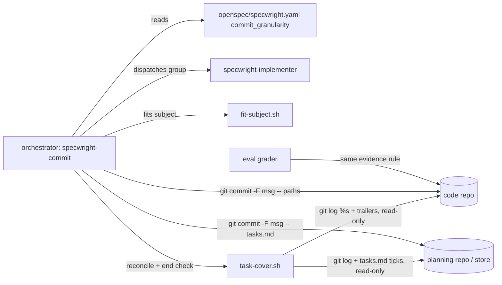
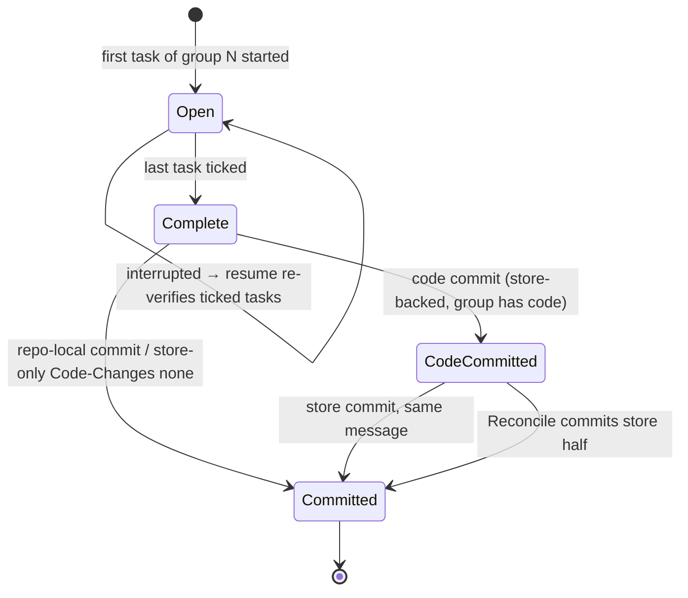
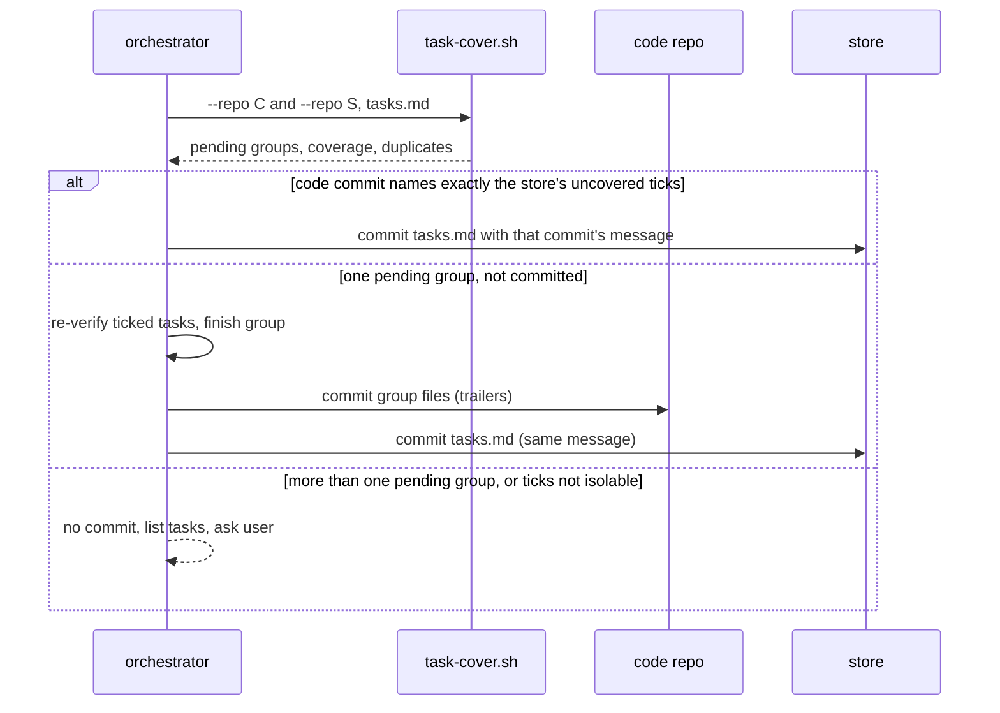

# Design

## Triage

| Trigger | Applies? | Evidence |
|---|---|---|
| T1 Components (new component, or 3+ with directed relationships) | yes | New script `skills/specwright-commit/scripts/task-cover.sh`, read by the orchestrator in Reconcile and the end-of-apply check; `fit-subject.sh`, the schema's apply instruction and the eval grader change with it |
| T2 State (persistent state, caches, 3+ state machine) | yes | A task group moves through open → complete (all ticked, uncommitted) → code half committed → committed (store-backed); the evidence lives in commit messages |
| T3 Concurrency (background work, workers/isolates, async, retries) | yes | Resume after an interrupted run, in a fresh session, against state a previous run left half-written in two repos |
| T4 Boundaries (data format, migration, shared interface, IPC, external) | yes | New commit-message format (`Specwright-Task:` trailer, `group N` subject) that later runs parse; new setting `commit_granularity`; `task-cover.sh` JSON output |
| T5 Volume (grows without a fixed bound) | yes | The commit range `<main>..HEAD` and `tasks.md` grow with the change |
| T6 Risk (security, money, data loss, unrecoverable user data) | yes | A wrong group commit can sweep in the user's files, or a recovery can drop a tick or duplicate a commit |

TIER: FULL

## Context

- Per-task commits today: `skills/specwright-commit/SKILL.md:25-27` (one commit per task, subject `task X.Y <text>`, message by file, fitted by `fit-subject.sh`), `:33` (an implementer's group is split back into per-task commits, a file two tasks touched going with the later one), `:52` ("never ... batch tasks into one commit").
- Evidence today is a subject substring: `SKILL.md:38` and `:44` match `task X.Y ` with a trailing space so 1.1 does not match 1.10. The agent does that match by reading `git log --oneline`.
- Store pairs: code commit first, then the store `tasks.md` commit with the same subject; `Code-Changes: none` for a task without code (`SKILL.md:26`); Reconcile `SKILL.md:36-41`.
- `fit-subject.sh:33` accepts only `^[^ ]+: task [0-9]+\.[0-9]+ `.
- The schema's apply instruction says "commit task by task (the commit rules say how to split a group)" (`schemas/specwright/schema.yaml:510-511`).
- Script pattern (ADR 0002): bash entry point that finds Python 3.8+ (`skills/specwright-pr/scripts/pr-pair.sh:68-72`), one JSON document on stdout, exit 0/1/2/3.
- Git parses trailers natively: `git interpret-trailers --parse` and `git log --format=%(trailers:key=...,valueonly)` read `Specwright-Task: 1.1` and `1.10` as distinct values (checked on this machine). jj and GitButler both write ordinary Git commits, so the trailer survives either backend (#19 builds on that).
- `release.sh` finds the bump task by its tick in `tasks.md`, not by a commit subject (`skills/specwright-release/scripts/release.sh:33`), so it is unaffected. Roadmap proofs use `merge: <change>` and PR discovery, not task subjects.
- #20's decision (2026-10-09) fixes the approach: commit at the group boundary, trailers as evidence, no squash. See proposal.md.

## Decisions

### D1: Commit at the group boundary, never squash

- **Choice:** In group mode the group's work stays uncommitted until every task of the group is ticked and verified, then one commit stages the group's files and `tasks.md` by name (`git add -- <paths> && git commit -F <msgfile> -- <paths>`, as today). A complete group is committed (both halves when store-backed) before any task of another group is ticked. Groups on disjoint files may still be dispatched in parallel, but the orchestrator ticks and commits them one group at a time, so at most one group is ever pending.
- **Rejected:** per-task checkpoint commits squashed at the group boundary, because the squash rewrites history on Git, needs a different procedure on jj and GitButler, and turns an interrupted squash into a recovery problem of its own (#20 decision).
- **Reversal cost:** low. The setting is opt-in, and per-task mode is unchanged.

### D2: Evidence is a subject or an exact trailer, read by a script

- **Choice:** A task is covered by a commit whose subject starts with `<type>(<change-name>): task X.Y ` (the prefix `fit-subject.sh:33` already requires; a `task 1.1 ` later in a subject or a group heading is not evidence) or whose `Specwright-Task` trailer value is exactly `X.Y`. Group messages carry one trailer per covered task, in task order, in the final trailer block with the user's `Co-authored-by` trailer. `task-cover.sh` reads the trailers through Git's own parser (`%(trailers:key=Specwright-Task,valueonly)`) and does the matching. Task mode keeps writing subjects only, with no trailers, so per-task output is byte-for-byte unchanged.
- **Rejected:** a range in the subject (`group 1 (1.1-1.3)`), because a range cannot say which tasks are covered when an earlier task already has a commit, and a substring or range match is the 1.1/1.10 trap. Also rejected: trailers in task mode too, because that changes per-task output, which the exit criterion keeps unchanged.
- **Reversal cost:** high. Later runs parse the format: `task-cover.sh`, Reconcile, the end-of-apply check, and #19's backends. Evidence that settles it: the trailer is plain Git message text, which every backend writes, and Git parses it without Specwright code. Recorded as ADR 0016.

### D3: Group membership by the ID's major number, title from the heading

- **Choice:** Task `X.Y` belongs to group `X`, matched as an integer. The subject text is the `## X. <text>` heading, and a group with no such heading stops its commit.
- **Rejected:** membership by position under a heading, because a mis-numbered task under the wrong heading would then be committed in a group its ID does not name, and every evidence check works on IDs.
- **Reversal cost:** low.

### D4: One pending group on resume

- **Choice:** At the start of a group-mode run (and in Reconcile), `task-cover.sh` reports the groups that have ticked tasks with no evidence. With none, the run continues. With exactly one, that group is pending work: re-verify its ticked tasks, finish its open tasks, then commit it once. A ticked red step (a test seen failing before the implementation) is re-verified by running its named test, which must exist and now pass; the group commit body says its original red output is unavailable, and it stays ticked. A missing named test stops the commit. With more than one, nothing is committed: the groups and tasks are listed for the user. Ticks are never removed.
- **Rejected:** treating every ticked, uncovered task as a gap and asking about each (task mode's rule), because in group mode ticked, uncovered tasks are the normal state of an open group, and asking on every resume would make group mode unusable. Also rejected: inferring the group from the newest tick, because that is invisible state.
- **Reversal cost:** low.

### D5: Store pair keeps code-first order and one message

- **Choice:** The group's code commit lands first, then the store commit of `tasks.md` (plus any planning file the group edited) with the identical message file. A group without code gets the store commit alone, with `Code-Changes: none` before the trailers. Reconcile: when a code commit's trailers name exactly the store's ticked, uncovered tasks, commit the store half with that commit's full message (`git log -1 --format=%B <sha>` written to the message file). A group with ticks but no code commit and no uncommitted code change for its tasks is asked about, as task mode asks about one task.
- **Rejected:** store first, because the store commit is the one a failed code commit would leave lying about the work, and code-first is the order ADR 0006's pairs already use.
- **Reversal cost:** medium (recovery rules and evals).

### D6: Mixed groups allowed, nothing regrouped

- **Choice:** A group commit covers only the group's tasks that have no evidence yet. Earlier per-task commits stay, and the report names a group that mixes both forms. Switching back to `task` mode with a pending group gives its ticked tasks per-task commits under today's split rule (`SKILL.md:33`).
- **Rejected:** forcing a group that has a per-task commit to stay per-task, because it adds a mode-per-group state to track, with no benefit over the evidence check, which already proves coverage per task.
- **Reversal cost:** low.

### D7: Setting read by the agent, validated before any commit

- **Choice:** `commit_granularity` is read from the code repo's `openspec/specwright.yaml` once per apply run, like `finish` and `release.enabled`. A value other than `task` or `group` stops before any commit.
- **Rejected:** a script reader like `pr-pair.sh tier` (ADR 0013), because that exists for a setting the apply loop branches on before dispatching agents. Here a bad value is caught before any write, and a wrong read is caught by the evidence check.
- **Reversal cost:** low.

## Diagrams (FULL)

Components (T1):

Group state (T2):

Store group pair and resume (T3/T4):

## State & Ownership (FULL)

| State | Owner (sole writer) | Lifetime | Invalidation / rebuild | Authoritative copy |
|---|---|---|---|---|
| Ticks in `tasks.md` | Orchestrator (after its own fresh verification) | Change lifetime | Never unticked by this skill; committed with the group | The planning repo's working tree, then its branch |
| Task evidence (subjects, `Specwright-Task:` trailers) | Orchestrator, only through `git commit -F` | Permanent once committed; never amended | Rebuilt by reading `git log <main>..HEAD`; nothing cached | Commit messages on the change branch (ADR 0003) |
| Pending group (open group's uncommitted work) | Orchestrator | Until the group commit | Derived each run by `task-cover.sh` from ticks minus evidence; never stored | Working trees plus `tasks.md` |
| `commit_granularity` | User | Project | Read once per apply run | `openspec/specwright.yaml` in the code repo |
| Pre-existing files list | Orchestrator, at apply start | One run | A fresh session cannot see the last one's list; files the pending group's tasks do not account for are asked about | The session's notes |

## Failure & Visibility (FULL)

| Component | Fails / dies mid-operation → | Recovery | Retry safe? | Who finds out |
|---|---|---|---|---|
| Session dies with group open | Ticks and files uncommitted | D4: next run finds one pending group, re-verifies, finishes, commits | Yes: no commit exists yet | User, from the resume report naming the pending group |
| Code commit fails (hook, disk) | No code commit; ticks uncommitted | Same as open group; commit retried after the cause is fixed | Yes | User: the commit error stops the run |
| Store commit fails after code commit | Code commit names tasks; store ticks uncommitted | Reconcile commits the store half with the code commit's message | Yes: store has no evidence for those tasks | User, from the Reconcile report |
| `task-cover.sh` fails (git error, bad input, over a bound) | No coverage data | Stop: no commit is made without it in Reconcile or at the end | Yes (read-only) | User, from its JSON error |
| `fit-subject.sh` exit 1 for a group | No group commit | User shortens the heading or change name | Yes | User, report names the group and the limit |
| Two groups pending, or ticks a code commit does not name | No commit | User decides how to record them | n/a | User, the listed tasks |

## Resource Bounds (FULL)

| Queue / buffer / cache / transfer | Bound | At the bound | Timeout | At 10x / 100x |
|---|---|---|---|---|
| `tasks.md` read by `task-cover.sh` | 1 MiB | Exit 2, `tasks_too_large`, no coverage | n/a (local file) | Real files are a few KB; 100x is still under 1 MiB |
| Commit range read by `task-cover.sh` | 10 000 commits, 64 KiB per message (cut off past that, trailers taken from what Git parsed) | Over 10 000: exit 1, `range_too_large`, no coverage | none: local `git log`, no network | A change has tens of commits; 100x is ~3 000 |
| Trailers per group commit | One per task of the group | n/a | n/a | A 50-task group has 50 trailer lines; Git handles that |

## Flow & State Gaps (FULL)

- **Partial group, then the mode changes to `task`:** the pending ticks get per-task commits under the split rule (D6).
- **Mode changes to `group` mid-change:** earlier per-task commits stay; the group commit covers the rest (D6).
- **Restart mid-group in a fresh session:** D4. Files changed in the tree that the pending group's tasks (task text, test map rows, design's file list) do not account for are asked about before staging, as `SKILL.md:26` already rules for unexpected files.
- **Restart after the code half:** D5 Reconcile.
- **Restart after both halves, before the next group starts:** nothing pending; the run continues with the next group.
- **Pending ticks and the planning commit:** in group mode the apply-start planning commit and amendment commits never stage a `tasks.md` whose diff ticks a task with no evidence: that file waits for the group commit, so the group commit's `tasks.md` diff ticks exactly the tasks its trailers name. An untracked `tasks.md` that already ticks a task stops apply before any commit (no group can be named for it).
- **Restart with a staged but uncommitted store tick:** Reconcile reads the store diff against `HEAD`, as today (`SKILL.md:37`).
- **Concurrent writers:** one checkout holds one change (specwright-branch); the store gate prevents a second change in the store. Parallel group dispatch is serialised at tick-and-commit (D1), so two pending groups mean an interruption outside the normal flow, and D4 asks.
- **Drift amendment mid-group:** committed by name as `amend <artifact>` (unchanged); it carries no `Specwright-Task:` trailer, so it never counts as evidence.
- **Release bump task in a group:** committed with its group; `release.sh` reads the tick, not the subject.

## Mechanism Ledger (FULL)

| Mechanism | Built? | Why (harm nobody catches / expensive later) | Evidence that would change the call |
|---|---|---|---|
| `task-cover.sh` exact-match coverage | yes | 1.1 vs 1.10, duplicate coverage and cross-group trailers are easy to miss reading a log by eye, and a missed one ships a task with no commit | — |
| Duplicate and cross-group detection | yes | The exit criterion names "no duplicate" and "group 1 never takes a group 10 task"; neither is otherwise visible | — |
| Mode recorded per change or per group | no | Evidence already proves coverage per task; mixed groups are allowed (D6) | A reviewer finds mixed groups confusing in practice |
| Checkpoint commits + squash | no | Rejected in #20 (D1) | A backend that cannot commit selected paths |
| Script-read setting (`pr-pair.sh`-style) | no | D7 | Wrong reads observed in evals |
| Trailers in task mode | no | Would change per-task output (D2) | A later change retires subject evidence |
| Grader rule shared with `task-cover.sh` | yes (grader reuses the same rule; tests cover both) | A grader that matches subjects only would pass a run with lost coverage | — |

## Risks / Trade-offs

- [A group's uncommitted work sits in the tree longer, so an interrupted run loses more context] → D4 resume re-verifies ticked tasks before committing; ticks are never dropped.
- [A user edit made during a long group gets swept in] → files staged by name; files the group's tasks do not account for are a question (unchanged rule).
- [The user's commit-message rule puts `Co-authored-by` last, and trailers in a body paragraph would not parse] → the message template puts `Specwright-Task:` lines in the final trailer block, before `Co-authored-by`; `task-cover.sh` reads only what Git parses as trailers, and the eval checks Git's parse.
- [Format lock-in for #19] → trailers are plain Git message text, which jj and GitButler write as is.

## ADRs

- **In force, constraining this change:** 0002 (thin scripts: `task-cover.sh` is bash + Python stdlib, JSON out), 0003 (evidence lives in Git history, nothing cached), 0006 (code/store pairs, code first), 0007 (the orchestrator verifies and commits; implementers never commit), 0010 (the version bump is a reviewed task, committed like any other).
- **To record during apply:** ADR 0016 "Task evidence is an exact subject or `Specwright-Task:` trailer; group commits at the boundary, never by rewriting history". Add it to the architecture index and the formats-parsed-by-later-runs entry.
