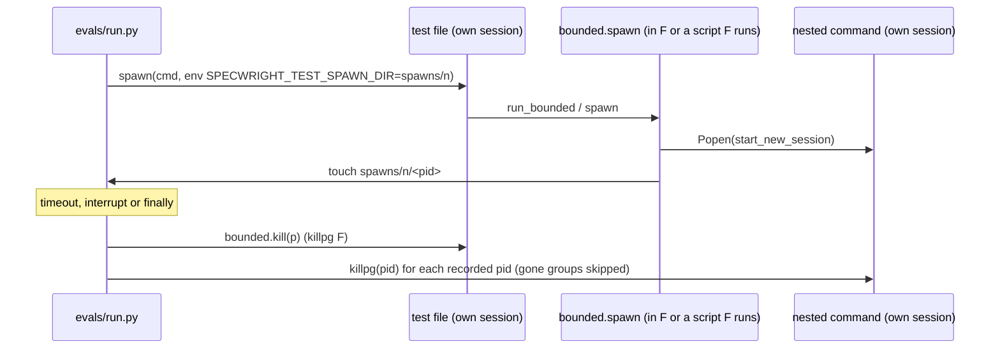
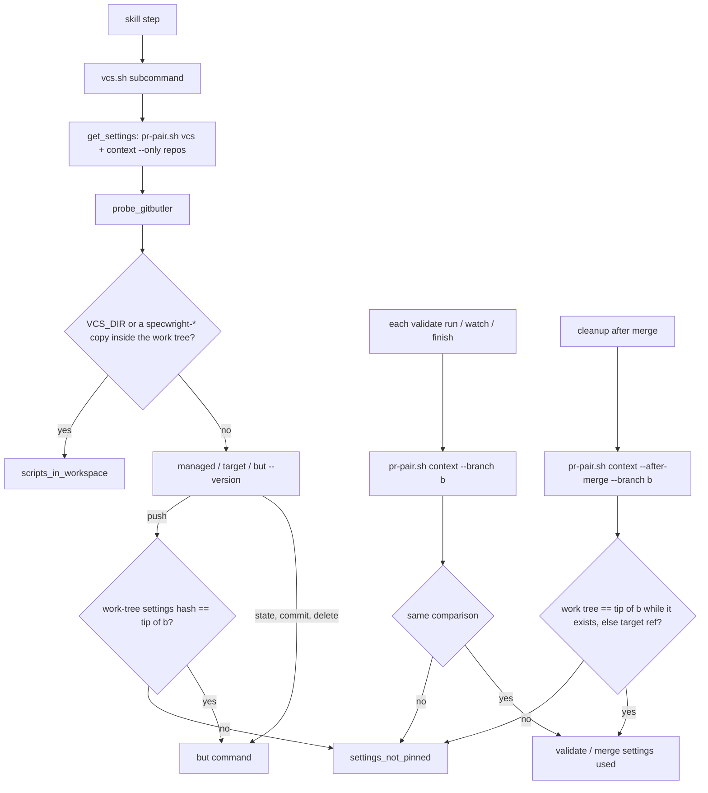
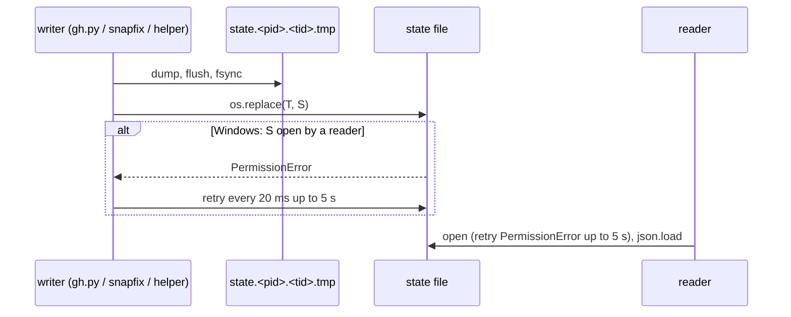

# Design

## Triage

| Trigger | Applies? | Evidence |
|---|---|---|
| T1 Components (new component, or 3+ with directed relationships) | Yes | The #136 fix couples three existing components that already depend on each other: `evals/run.py` spawns test files, `bounded.py` spawns their nested sessions, and the runner stops what `bounded.py` recorded. #151 routes the pin check through `vcs.sh` → `pr-pair.sh context`. No new component. |
| T2 State (persistent state, caches, 3+ state machine) | Yes | The fake `gh` state file (`evals/fakes/gh.py:163-175`) changes how it is written. A new per-file spawn record directory exists for the length of a runner file. |
| T3 Concurrency (background work, workers/isolates, async, retries) | Yes | #134 is a reader/writer race between background watchers and tests (`evals/pr-pair/test_pr_snapshot.py:395`). #136 is about stopping processes that run concurrently. The Windows rename retry is a timed retry. |
| T4 Boundaries (data format, migration, shared interface, IPC, external) | Yes | Changes to shared script interfaces: new `vcs.sh` error `scripts_in_workspace`, `pr-pair.sh context --branch`, `task-cover.sh` exit 2 `duplicate_task_ids`, `update.sh` refusal `target_in_workspace`, and a new `bounded.py` test hook. |
| T5 Volume (grows without a fixed bound) | Yes | The spawn record gets one entry per nested spawn in a test file, which has no fixed bound. |
| T6 Risk (security, money, data loss, unrecoverable user data) | Yes | #150 and #151 decide which code and settings run with the developer's GitHub and merge authority in a shared GitButler work tree. |

TIER: FULL

## Context

The eight issues and the user's two choices are in proposal.md. The user chose the fixes for #150 (Specwright must be installed outside the repo under GitButler) and #151 (stop on any edit to the settings that the change branch has not committed). The code facts the decisions rest on:

- **#133.** `skills/specwright-release/SKILL.md:48` is the only skill or schema line that names `openspec/changes/<change>/proposal.md` as a command argument. `skills/specwright-commit/SKILL.md:36` and `schemas/specwright/schema.yaml:478,532` already write `<proposal.md>`. The skill text is pinned by `evals/release/test_skill_text.py` (`TestReleaseSkill`, helpers `sections()` and `paragraph()` at lines 21-40).
- **#143.** `skills/specwright-commit/scripts/task-cover.sh:128` builds `by_id = {t["id"]: t for t in tasks}`, so the last line with an id wins. `stop(error, message, code)` (lines 55-56) already prints the failure document. `specwright-commit/SKILL.md:53,63` stops on any exit 1, 2 or 3. Tests are in `evals/git-workflow/test_task_cover.py` (`TaskCover`, for example `test_tasks_too_large_exits_2`).
- **#144.** In `evals/git-workflow/grade.py:442`, the evidence for `eval-store-group-code-half` lists subjects only. The check at line 451 (`store-half`) has the same gap. Line 420 (`eval-store-apply-groups`) shows the right shape. The test to extend is `StoreGroupRecovery.test_store_group_code_half_without_trailers_fails` in `evals/git-workflow/test_grade.py:1745`.
- **#134.** The state file is written in place and readers parse it with no retry:
  - Writers that truncate and then write: `gh.py:171-175` `save()`, which `main()` calls after every call, reads included; `snapfix.py:67-72` `mutate()`; and the helper scripts at `test_pr_snapshot.py:333,535,737` and `test_pr_reply.py:280`.
  - Readers: `gh.py:163-168` `load()` and `snapfix.py:64-65` `st()`. Each holds the file only for a single read.
  - Seeding writes that happen before any process starts are not part of the race.
- **#136.**
  - `evals/run.py:235` starts each file with `bounded.spawn`, so on POSIX the file gets its own session.
  - `bounded.spawn` gives every nested command a new session (`bounded.py:139-140`). `kill` → `kill_tree` (lines 75-81) is `killpg` on that one group.
  - On POSIX the runner's `kill(p)` at lines 241-265 and 271-279 therefore never reaches a nested session. Windows is unaffected, because nested job objects end together.
  - ADR 0014 (`docs/adr/0014-bounded-runs-share-one-process-module.md:15`) fixes the POSIX behaviour (`start_new_session`, `killpg`). `bounded.py` already reads `SPECWRIGHT_TEST_*` hooks (header lines 12-14, `_hook` at 104-106).
- **#146.**
  - The fake looks up `sha256(mode + "\n" + text)` in `evals/pr-pair/fixtures/markdown.json` (`gh.py:198-200`, `837-848`).
  - The recorder (`evals/pr-pair/record_markdown.py`) renders only `closing_bodies.collect_bodies()`, which AST-parses three classes of `test_pr_pair.py`. It drops every other entry, and calling it needs real GitHub as KintsugiBot.
  - The coverage test is `ClosingRecordings.test_every_closing_body_has_a_recording` (`test_pr_pair.py:3282-3293`), which also asserts `len(recorded) == len(bodies)`.
  - The unrecorded fixture body is seeded at `evals/git-workflow/fixtures.py:1279,1321`.
- **#150.**
  - The only integrity check is skill text, and it covers GitButler's own skill (`skills/specwright-branch/SKILL.md:15`). No script checks Specwright's copies.
  - `vcs.sh` knows its own directory (`VCS_DIR`, line 27) and the repo root in `probe_gitbutler` (lines 171-193). That function already runs `but --version` outside the repo, because installed skills can live inside it.
  - `update.sh plan` reports refusals as exit 1 with error `refused` and a `refusals[]` list (`scripts/update.sh` header, and `refusals.append` at 1737 and 1748).
- **#151.**
  - `require_settings_pinned` (`vcs.sh:496-512`) checks sibling stacks' `assignedChanges` and `git diff refs/heads/<b> HEAD`. It never compares against the work tree, so it misses an unassigned edit.
  - It runs only from `gitbutler_state` with `--branch` and from `gitbutler_push`.
  - Watch reads the merge settings through `pr-pair.sh context` (`pr-pair.sh:726-737`), which never pins.
  - `vcs.sh` `get_settings` (lines 120-149) already calls `pr-pair.sh vcs` and `context --only repos` before every probe.
  - The GitButler fixtures hide the settings through `.git/info/exclude` (`evals/vcs/test_gitbutler_branch.py:14-16`).

## Decisions

### D1: #133 names the proposal by role, pinned by a skill-text test

- **Choice:** The release skill's notes check becomes `release.sh notes --proposal <proposal.md>`, with one sentence saying it is the change's `
/changes/<change>/proposal.md` in the planning repo, which is the store when store-backed. This matches `specwright-commit`.
  - A new `TestReleaseSkill` test asserts that the notes section names `<proposal.md>` and the store.
  - A second test asserts that no `skills/*/SKILL.md` contains `--proposal openspec/`.
- **Rejected:** Making `release.sh notes` resolve the proposal itself from a change name (`--change add-a`) through `openspec list --json`. That would give `notes` a dependency on the planning root and the store. The architecture keeps `notes --proposal` free of git and opt-in checks (architecture.md, the `specwright-release` row), and every other caller already passes a path.
- **Reversal cost:** low.

### D2: #143 refuses a tasks.md with a repeated id

- **Choice:** While parsing, `task-cover.sh` collects ids that appear on more than one tracked line. If there are any, it calls `stop("duplicate_task_ids", "<file> repeats task ids: 1.1, 2.3", 2)` before computing coverage. Exit 2 is the script's existing code for bad input. The header comment lists the new error, and no skill text changes, because SKILL.md already stops on exit 2.
- **Rejected:** Keeping the first entry per id (`setdefault`) and reporting `duplicate_ids` next to the coverage. A tasks.md with a repeated id is invalid. Reporting coverage for half of it invites a commit on wrong data, and the skill would need a new key to interpret. The issue lists both options. A stop is the one that cannot mislead.
- **Reversal cost:** low.

### D3: #144 puts the parsed tasks in the evidence

- **Choice:** Change the evidence of both `store-group` pair checks (`grade.py:442,451`) to `code={[(x.subject, x.tasks) ...]} store={[(x.subject, x.tasks) ...]} ticks=...`, the shape that `eval-store-apply-groups` already uses. The existing trailers-only failure test also asserts the evidence string.
- **Rejected:** A structured evidence object per check. Every check's evidence is a string today, and changing the format belongs to its own grader change.
- **Reversal cost:** low.

### D4: #134 replaces the state file whole, from one helper

- **Choice:** `evals/fakes/gh.py` gets two helpers and becomes the only place that writes the state file. `main()` (`gh.py:1084`) saves only when the call changed the state: it compares the state's JSON before and after the command, so a read (every watcher poll) writes nothing and cannot overwrite a concurrent test's `mutate` with the state it loaded earlier. A `once` failure that is used up changes the state and still saves (`gh.py:194`).
  - `write_state(path, st)`: dump to `<path>.<pid>.<thread id>.tmp` in the same directory, `flush` and `fsync`, then `os.replace` onto the state file. A `PermissionError` (Windows refuses the replace while a reader has the target open) is retried every 20 ms for up to 5 s. After that it raises `OSError` naming the file and removes the temp file, so the state file is never touched.
  - `read_state(path)`: retries a `PermissionError` on open for the same 5 s.
  - Callers: `save()` and `load()` in `gh.py`; `snapfix.mutate()` and `snapfix.st()`; and the four helper scripts that run during a watch, which already `import gh`.
  - Seeding writes that happen before any process starts keep their plain writes.
- **Rejected:**
  - A lock directory around load-modify-save. Once reads stop saving, the remaining writers are a test's own mutations and the fake `gh` calls the code under test makes, and those run one after another within a test. A lock would add a timeout and stale-lock recovery to every fake `gh` call for a case no test has. See the ledger.
  - Readers that retry on `JSONDecodeError`. That hides the race instead of removing it, and a partial file can still parse as valid JSON.
- **Reversal cost:** low. Eval tooling only.

### D5: #136 records nested spawns only when the runner asks

- **Choice:** A new `bounded.py` test hook, `SPECWRIGHT_TEST_SPAWN_DIR`.
  - **Recording.** When the variable is set in the process's own environment (`os.environ`) and not only in the child's `env=`, each successful POSIX `spawn` creates an empty file named after the child's pid (which is its pgid) in that directory. When the child's `env=` sets a different directory, the pid is recorded there as well, so a nested runner and the outer runner both see it. A failed write is ignored.
  - **Unchanged.** Spawning itself does not change: `start_new_session` and `killpg` stay as they are, so ADR 0014 holds. Windows writes no record, because its job objects already nest.
  - **The runner's side.** `evals/run.py` creates `<workdir>/spawns/<n>/` for each file and passes `env={**os.environ, SPECWRIGHT_TEST_SPAWN_DIR: dir}` to its `spawn`. Wherever it calls `bounded.kill(p)` today (timeout, interrupt, the `finally` sweep, `stop_all`), it then runs `killpg(pid, SIGKILL)` on every recorded pid, ignoring `ProcessLookupError` and `PermissionError`.
  - **Pid reuse.** No extra check: `killpg` targets only groups, and POSIX does not reuse a pid while a group with that id still has members. The one remaining case is a group that is wholly gone and whose id a new, unrelated group leader took within the same file's run. That is accepted, and no leader check is made, since such a check would also skip a group whose leader exited while its children run.
  - **Comments.** The header comment in `run.py` (lines 5-6) and the one at line 264 are corrected.
- **Rejected:**
  - Joining nested spawns to the file's process group. A nested `p.pid` would no longer lead a group, so `killpg(p.pid)` fails and nested tree-kill is lost. That breaks `test_hung_command_grandchild_stopped`, and it contradicts ADR 0014:15.
  - Linux `PR_SET_CHILD_SUBREAPER`. It cannot tell which file an orphan came from when files run in parallel, and macOS has no equivalent.
- **Reversal cost:** low. A test-only hook, and the PR scripts never set it.

### D6: #146 records the fixture bodies through the existing recorder

- **Choice:**
  - `evals/git-workflow/fixtures.py` exports the merged-PR bodies it seeds as module constants (`MERGED_PR_BODIES`), and the two seeding sites use them.
  - `closing_bodies.collect_bodies()` appends those bodies. That makes the recorder render them and the coverage test, length check included, require them.
  - `record_markdown.py` is run once as KintsugiBot. It makes one read-only `POST /markdown` per new body and adds the entry to `markdown.json`.
  - A test calls `pr-pair.sh closed-check` against the finish fixture's fake `gh` and asserts that it no longer reports `no recorded rendering`.
- **Rejected:** A fixture-local `FAKE_GH_MARKDOWN` file with hand-written HTML. It breaks the rule that renderings are recorded from real GitHub, and the coverage test would not see it.
- **Reversal cost:** low.

### D7: #150 GitButler refuses scripts and skill copies inside the work tree

- **Choice:** `probe_gitbutler` checks the install location before it runs `but`.
  - It stops with `scripts_in_workspace` when `VCS_DIR` (resolved) lies under the resolved repo root.
  - It also stops when any of these exist in the work tree: `.claude/skills/specwright-*`, `.agents/skills/specwright-*`, `.claude/agents/specwright-*.md` or `.omp/agents/specwright-*.md`. A sibling branch could add such a copy to shadow the user-level install.
  - The message names each path and says to install at user level. Copies committed on main stop every `vcs.sh` call, including the one for a change that would remove them, so the message also says to remove them by hand through GitButler (a branch made in the GitButler app, not through Specwright). The release notes say the same.
  - `update.sh plan` reads `<code>/openspec/specwright.yaml`. When it selects `vcs: gitbutler`, any `--skills` or `--agents` target under the code toplevel is a `target_in_workspace` refusal.
  - The README install prompt's GitButler choice names user-level targets for Specwright's own skills and agents. The README offer of GitButler's own `gitbutler` skill (README.md:307-308, "never install it silently or into a global directory") is reworded so the two rules are not confused: that line is about GitButler's skill, not Specwright's. The `specwright-branch` GitButler paragraph says the same.
  - **Scope.** D7 covers Specwright's skills, agents and scripts. The schema (`openspec/schemas/specwright/`), its templates and `openspec/config.yaml` stay in the work tree of a repo-local project, and the agent follows their text. They are not checked: OpenSpec reads them, not Specwright's scripts, and a store-backed project keeps them in the store. This is an accepted residual risk (Risks), and ADR 0019 states it.
  - A new ADR records the rule (see ADRs).
- **Rejected:**
  - A git-only drift check run from the skills (the user's other option). The check would live in the very files a sibling branch can replace, so it only catches accidents.
  - Isolating each change in a `but worktree`. That is out of scope since add-gitbutler-backend (its design.md:446).
- **Reversal cost:** medium. GitButler users with in-repo installs must reinstall. GitButler support is one release old (0.12.0), so few installs exist, and Git and jj are untouched.

### D8: #151 pins the settings where they are used, with one comparison owned by `pr-pair.sh`

- **Choice:** `pr-pair.sh` gets a `settings_pinned(code, branch)` check. With `vcs: gitbutler` it compares two hashes:
  - `git hash-object --path=openspec/specwright.yaml <work-tree file>`, which applies the repo's clean and eol filters so CRLF checkouts compare equal;
  - `git rev-parse refs/heads/<b>:openspec/specwright.yaml`.

  A difference, or a file present on only one side, raises `settings_not_pinned` naming the file and saying to commit the edit on `<b>`. A git error is `git_error`.

  It runs wherever the settings are used to act, and the skills read the settings on GitButler only through it:
  - **Each `pr.validate` run.** The general rule `specwright-pr/SKILL.md:53` ("Before any push, run `pr.validate`") covers every push site: ship step 4a.2 (`:84`), feedback step 7 (`:108`) and watch's CI-fix push, in repo-local and store-backed projects alike. It gains one sentence: on GitButler, read `validate` from `pr-pair.sh context --code <code> --branch <branch>` immediately before running it, never from the file and never from an earlier read. A `settings_not_pinned` stops before the command runs. Reading it right before the run closes the window of the pre-ship review and fix rounds between an early read and validate.
  - **Merge settings while the branch exists.** Ship (`:67`), watch (`:128`) and finish (`specwright-finish/SKILL.md:93`) pass `--branch <branch>`.
  - **Merge settings after the merge.** Cleanup (`specwright-pr/SKILL.md:156-159`, `specwright-finish/SKILL.md:94`) reads `merge` and `delete_branch` after the change branch is gone. It calls `context --after-merge --branch <branch>` after its pull and delete. While `refs/heads/<branch>` still exists (the pull returned `pull_skipped` or the delete returned `left_applied`, vcs.sh:658,714), the comparison is against that branch's tip, which holds the settings that were merged. Otherwise it compares against GitButler's target ref (`gitbutler.project.targetRef`), which the pull has just updated. On a mismatch the `settings_not_pinned` message names the reference compared against and says to run `but pull` or undo the work-tree edit, not to commit on `<branch>`.
  - On GitButler, a `context` call for the merge settings (not `--only repos`) without `--branch` is a usage error, exit 2.
  - **`vcs.sh push`**, before `but push`. It calls `pr-pair.sh context --code <code> --only repos --branch <b>`, so there is a single implementation.

  It does not run on `state --branch`, `commit`, `delete-branch` or the gate's `--only repos` read. The change can therefore commit its own settings edit, and rollback and cleanup still see a deleted branch as gone. The settings that cleanup acts on are pinned by `--after-merge`, as above. `require_settings_pinned` in `gitbutler_state` stays as it is today (sibling `assignedChanges` and committed sibling changes, own edits skipped). The new check adds the work-tree comparison at the two points that act.

  Ship needs every task committed, so an uncommitted settings edit of the change's own at ship time is also a stop, and that is correct.

  The GitButler eval fixtures commit `openspec/specwright.yaml` on main instead of hiding it in `.git/info/exclude`.
- **Rejected:**
  - Pinning in every `vcs.sh` call that names the branch (round 1's D8). It refused the change's own settings commit, and it broke rollback and cleanup on a deleted branch.
  - Making every settings reader (`pr-pair.sh`, `review-run.sh`, `release.sh`) read `git show refs/heads/<b>:...`. That changes four readers. It still needs a stop when the branch has no committed settings, and it reads different settings from what the user sees in the work tree.
- **Reversal cost:** medium, for the same GitButler-only reason as D7.

## Diagrams (FULL)

T1/T3 (#136): the runner, the files it starts, and the nested sessions they record.

T4/T6 (#150, #151): where the GitButler checks sit, before any `but` command or settings use.

T2/T3 (#134): a state-file write.

## State & Ownership (FULL)

| State | Owner (sole writer) | Lifetime | Invalidation / rebuild | Authoritative copy |
|---|---|---|---|---|
| Fake `gh` state file (`FAKE_GH_STATE`) | `gh.write_state`, called by the fake `gh` only for a call that changed the state, by `snapfix` and by the test helpers. Reads never write (D4), so the writers left are a test's mutations and the calls the code under test makes, which follow one another | One test | Seeded again by each test | The file at `FAKE_GH_STATE` |
| Spawn record (`<workdir>/spawns/<n>/<pid>`) | `bounded.spawn` creates the entries; `evals/run.py` reads them and removes the directory with its workdir | One test file's run | None. An entry whose group is gone is skipped (`ProcessLookupError`) | That directory |
| `markdown.json` recordings | `record_markdown.py` only | Permanent, in the repo | Re-recorded with `--all` | `evals/pr-pair/fixtures/markdown.json` |
| Change settings under GitButler | The change branch's commit of `openspec/specwright.yaml`. The work-tree copy is accepted only when it is equal | Project lifetime | Commit the edit on the change branch | The tip of the change branch |
| Installed Specwright skills and agents under GitButler | The user, through `update.sh`, at user level | Until the next update | The `update.sh` targets | The user-level directories |

## Failure & Visibility (FULL)

| Component | Fails / dies mid-operation → | Recovery | Retry safe? | Who finds out |
|---|---|---|---|---|
| `write_state` | The temp file is left behind if the process dies before the replace; the state file stays whole | The next write replaces the state file; temp names are unique per pid and thread | Yes | Nobody needs to: a leftover temp file sits in the test's own temp dir, which is removed with it |
| `write_state` rename held off past 5 s | Raises `OSError` naming the file; the old state is unchanged | Rerun the test | Yes | The test author, from the failing test's traceback |
| Runner kill of recorded pids | A group that is gone raises `ProcessLookupError`, which is skipped | None needed | Yes | Nobody. A survivor would show up as a leaked process, which the regression test checks |
| `bounded.spawn` record write fails | The pid is not recorded, and the nested session can survive a timeout (today's behaviour) | None | Yes | Nobody at run time. Accepted because the write goes to a directory the runner just created |
| `task-cover.sh` duplicate ids | Exit 2, no coverage | The user fixes tasks.md | Yes | The user: `specwright-commit` stops and shows the error |
| `settings_not_pinned` / `scripts_in_workspace` | Exit 1 before any `but` command, push or merge | The user commits the settings on the branch, or reinstalls at user level | Yes | The user: the skill shows the JSON error message |
| `record_markdown.py` network failure | Exits non-zero; `markdown.json` is unchanged | Run it again | Yes (read-only POST) | The implementer running the task |

## Resource Bounds (FULL)

| Queue / buffer / cache / transfer | Bound | At the bound | Timeout | At 10x / 100x |
|---|---|---|---|---|
| Spawn record entries per file | One empty file per nested `bounded.spawn`. Today a file makes at most a few hundred (each fake `gh` call through `as.sh` is one) | No bound is enforced. The entries are 0 bytes, and the runner's sweep runs one `killpg` per entry | Not applicable | 100x is tens of thousands of empty files and `killpg` calls at file stop, under a second. Acceptable for eval tooling, and it ends with the file |
| `write_state` rename retry | 5 s at 20 ms intervals | Raises `OSError` | 5 s | Not volume-bound |
| `read_state` open retry | 5 s | Raises the `PermissionError` | 5 s | Not volume-bound |
| Settings pin check | Two `git` calls per pinned `vcs.sh` call | Not applicable | The callers' existing bounds | Not volume-bound |

## Flow & State Gaps (FULL)

- **Concurrent writers to the fake `gh` state.** Reads no longer save, so a watcher's polls cannot undo a test's change. Two real mutations racing would still let the last writer win. No test does that today: the ledger records what would change the call.
- **The runner itself is SIGKILLed.** The `finally` and `stop_all` sweeps never run, so recorded sessions can survive. ADR 0014:29 already accepts this, and it stays accepted.
- **A nested spawn races the timeout.** The child is started but its pid is not yet recorded when the runner sweeps, so that one child can survive. The window is the few microseconds between `Popen` returning and the record being written. Accepted.
- **Settings edited between the pin check and use.** Each validate run reads the command from `context --branch` immediately before it runs, so the remaining window is the time between that read and the command starting. `vcs.sh push` pins again just before the push. Watch runs `context --branch` once per run: an edit made during a long watch is used only by the next watch start, which checks again. Accepted.
- **Skipped pull after the merge.** Another branch is applied, so `pull` returns `pull_skipped`, the target ref lags, and the merged branch stays applied (`left_applied`). `context --after-merge --branch` then compares against the branch's tip, so a change that merged its own settings edit still cleans up.
- **The change edits its own settings.** `state` and `commit` do not pin, so the task commits the edit. From then on `context --branch` and `push` compare against the new tip and pass.
- **Branch deleted.** `state --branch` for a gone branch (gate rollback, finish cleanup, `pair-state`) runs no pin check and reports it gone, as today.
- **Gate before the change branch exists.** `branch-create` and `state` without `--branch` read `main` and `login` from unpinned work-tree settings, as they do today. The values only pick the branch base and the account. Every later step for the branch pins.
- **Fresh install picks GitButler.** There are no settings yet, so `update.sh` cannot refuse. The README prompt applies the rule, and the first `vcs.sh` call refuses an in-repo install anyway (D7).

## Mechanism Ledger (FULL)

| Mechanism | Built? | Why (harm nobody catches / expensive later) | Evidence that would change the call |
|---|---|---|---|
| Atomic replace and rename retry for the fake `gh` state (D4) | Yes | Random CI failures on Linux and Windows (#134, the PR #137 run) | None |
| Save only on change in the fake `gh` | Yes | A watcher's poll would otherwise silently undo a test's `mutate`, which is the flaky test of #134 | None |
| Lock around load-modify-save of the fake `gh` state | No | Once reads stop saving, the remaining writers within a test follow one another | A test failing on a missing state change while two writers run |
| Reader retry on `JSONDecodeError` | No | The atomic replace removes the cause, and a retry would hide a real corruption | A torn read seen after D4 |
| Spawn record (D5) | Yes | A leaked hour-long sleeper per timed-out file on POSIX CI runners, which nobody sees | None |
| Pid-is-group-leader check before `killpg` | No | `killpg` only targets groups, and a live group's id is not reused. The check would also skip a group whose leader exited while its children still run | A reused group id seen in a run |
| Linux subreaper | No | Cannot attribute orphans to a file; Linux only | The parallel runner removed |
| Skill and agent copy scan in the GitButler probe (D7) | Yes | A sibling branch's shadow copy would otherwise run silently with the developer's authority | None |
| Hashing the skill copies against a manifest | No | No manifest survives install (`update.sh` removes the journal); refusing any copy is stricter and simpler | A supported in-repo GitButler install |
| Branch-tip settings read in every reader | No | See D8 | A reader that cannot run after a `settings_not_pinned` stop |
| Gate-time settings pin before the branch exists | No | Nothing is pinned yet, and the values used only pick the base and the account | A gate reading a security-relevant setting |

## Risks / Trade-offs

- **[Risk]** An agent harness loads a project-level `specwright-*` skill that a sibling branch added ahead of the user-level one. The replaced scripts never call the real `vcs.sh`. → **Mitigation:** D7 stops every run of the real scripts while such a copy exists, so the developer finds out on the next step that uses the real install. The README and the new ADR say that GitButler workspaces must not hold project-level Specwright copies. Full isolation needs `but worktree`, which is out of scope.
- **[Risk]** The OpenSpec schema, templates and `openspec/config.yaml` of a repo-local GitButler project sit in the shared work tree, and the agent follows their text. A sibling branch could change them. → **Mitigation:** none in this change. ADR 0019 names it as a residual risk, along with the `but worktree` isolation that would close it, so a later change can take it on. The scripts that act with the developer's authority (D7) and the settings that steer them (D8) are pinned.
- **[Risk]** Existing GitButler users with in-repo installs stop after updating. → **Mitigation:** the error names the paths and the fix, and the release notes list it under Changed. GitButler support shipped in 0.12.0, so very few installs are affected.
- **[Risk]** The fixture change (settings committed instead of excluded) touches several GitButler tests. → **Mitigation:** do it in one helper in `evals/vcs/butenv.py` or the branch fixture. The GitButler suites run with the real `but` on Linux CI.
- **[Risk]** `hash-object --path` and the committed blob disagree under unusual filters. → **Mitigation:** a test with `core.autocrlf=true` covers the common case on Windows CI. Any other mismatch fails closed.
- **[Risk]** The #146 recording needs the network. → **Mitigation:** one read-only call, done by the orchestrator, with the result committed. CI never calls GitHub.

## ADRs

- **In force, constraining this change:**
  - 0014: bounded runs, one process module. POSIX spawning stays as it is.
  - 0016: task evidence and group commits. `task-cover.sh` exit codes.
  - 0017: version-control writes go through one backend script.
  - 0018: VCS backends Git, jj and GitButler.
- **To record during apply:**
  - 0019, "A GitButler workspace runs only the user-level Specwright install and the branch's committed settings". It records D7 and D8 as binding for every later GitButler feature: Specwright's skills, agents and scripts run only from outside the work tree, and the settings are acted on only when they equal the change branch's committed copy. It names the residual risk: the OpenSpec schema, templates and `config.yaml` in a repo-local project's work tree are not checked. It adds to ADR 0018 without superseding it.
  - The same task adds 0019's row to the architecture index and amends the `vcs.sh` and Install rows.

## Open Questions

None. The two decisions that change what gets built (#150, #151) were made by the user.
