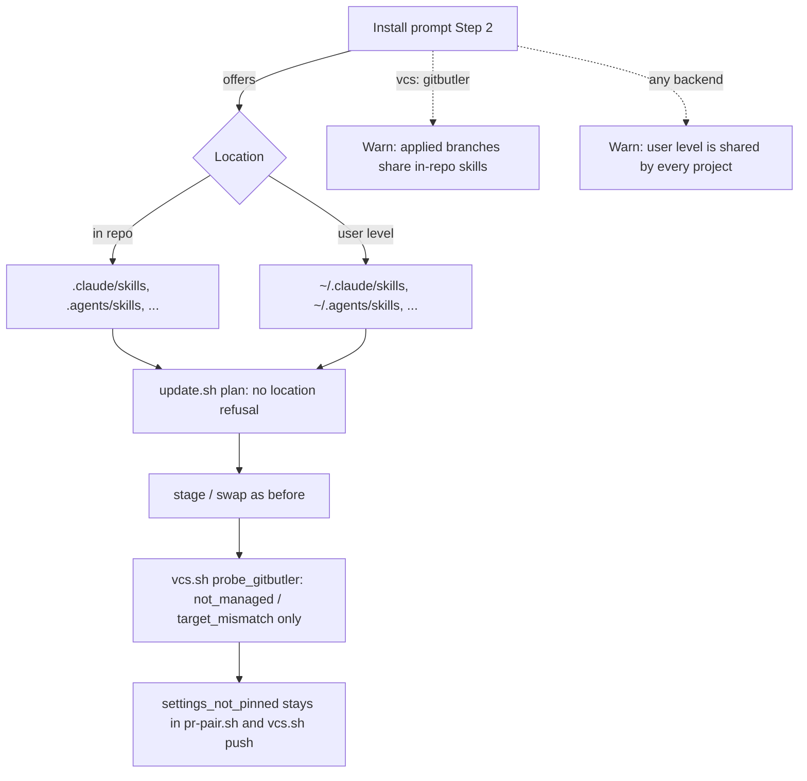

# Design

## Triage

| Trigger | Applies? | Evidence |
|---|---|---|
| T1 Components (new component, or 3+ with directed relationships) | No | Code is removed from two existing scripts (`vcs.sh`, `update.sh`); no component is added |
| T2 State (persistent state, caches, 3+ state machine) | No | No state file, journal or record changes; the update journal and `VERSION` are untouched |
| T3 Concurrency (background work, workers/isolates, async, retries) | No | Nothing runs concurrently; the shared GitButler work tree is the concern, and that is T6 |
| T4 Boundaries (data format, migration, shared interface, IPC, external) | Yes | Two refusal codes (`scripts_in_workspace` from `vcs.sh`, `target_in_workspace` in `update.sh plan`'s `refusals`) leave the scripts' JSON output, and the install prompt's target choice changes |
| T5 Volume (grows without a fixed bound) | No | Nothing grows |
| T6 Risk (security, money, data loss, unrecoverable user data) | Yes | It removes a guard on scripts that push, open PRs and merge with the user's GitHub identity (#150, ADR 0019) |

TIER: FULL

## Context

The proposal explains why. Current state:

- `vcs.sh`: `WORKSPACE_COPIES` and `workspace_install` (`skills/specwright-pr/scripts/vcs.sh:171-186`) collect the script's own directory when it is under the repo root, plus any `specwright-*` skill or agent copy in the work tree. `probe_gitbutler` (`vcs.sh:189-196`) raises `scripts_in_workspace` before any `but` command whenever that list is not empty. Nothing else calls `workspace_install`.
- `update.sh`: `workspace_targets` (`scripts/update.sh:1089-1109`) turns each in-repo `--skills`/`--agents` directory of a `vcs: gitbutler` project into a `target_in_workspace` refusal. Plan adds these at `update.sh:1830`. The header comment at `update.sh:37-41` describes it.
- Settings pinning is separate code and stays: `pr-pair.sh:1037-1069` and `vcs.sh:530-534` (`settings_not_pinned`).
- The branch gate:
  - Its GitButler tool guidance (`skills/specwright-branch/SKILL.md:15`) loads an in-repo copy of GitButler's own skill only after `git status --porcelain` and `git diff --quiet <main> HEAD` show the copy unchanged, and its closing sentences require Specwright to be installed at user level.
  - Step 1's error list (`SKILL.md:14`) names `scripts_in_workspace` among the codes the gate stops on.
- README says user level only in three places:
  - install prompt Step 2's GitButler bullet (`README.md:105-112`);
  - Step 6's GitButler skill offer (`README.md:317-318`: "user level on this backend, Step 2");
  - the GitButler section's skill bullet (`README.md:522`).
- Evals assert the current behaviour:
  - `evals/vcs/test_gitbutler_probe.py:120-180`: the refusal and the user-level pass.
  - `evals/update/test_update.py:725-775`: the refusal for GitButler, and none for Git, a user-level target or no settings.
  - `evals/git-workflow/test_instructions.py:2190-2202` (`test_branch_gate_loads_only_an_unchanged_repo_copy`): the unchanged-copy check D3 removes.
  - `evals/git-workflow/test_instructions.py:2235-2257`: the README and branch-gate user-level wording.
- ADRs: ADR 0019 (accepted) holds both the install half and the settings half, plus a binding clause for later features. ADR 0018 (GitButler backend) is unaffected. Accepted ADRs are never edited (`openspec/architecture.md:116`), and the supersede convention is a `Supersedes:` line (`docs/adr/0018-*.md:5`).

## Decisions

### D1: Remove the two refusals outright, with no opt-in setting

- **Choice:** delete `WORKSPACE_COPIES`, `workspace_install` and the `scripts_in_workspace` raise from `vcs.sh`; delete `workspace_targets`, its call and its header text from `update.sh`. `vcs.sh` probes GitButler exactly as it would from a user-level install.
- **Rejected:** keep the refusals behind a setting (for example `gitbutler.strict_install: true`) because a setting keeps both code paths, their evals and a README explanation alive for a guard the project has decided is the user's business. Also rejected: turn `scripts_in_workspace` into a warning printed on every `vcs.sh` call, because `vcs.sh` prints one JSON document per call that every skill parses. A warning field would be read on every call and acted on by none; the one-time warning belongs in the install prompt (D2).
- **Reversal cost:** low. The removed code is in git history and the evals show its shape; restoring it is a revert.

### D2: Warn once, in the install prompt, where the location is chosen

- **Choice:** install prompt Step 2 offers the in-repo directories and the user-level ones on every backend.
  - For `vcs: gitbutler` it adds that every applied branch shares the work tree: a branch that changes in-repo skills changes them for every applied branch, and keeping them consistent is the user's job.
  - For every backend it says that a user-level install is shared by every project on the machine: one Specwright version, and an update from one project updates all.
  - Both locations at once: in Claude Code a user-level `specwright-*` skill overrides the in-repo skill of the same name in every project (personal over project), while agents resolve project over user. For Claude Code users the skills' location is therefore in effect a per-machine choice, and a mixed install runs the user-level skills.
  - Moving a project from user level to in repo: the user-level copies serve every project on the machine. Either remove them, after moving every other project that uses them to an in-repo install, or update them to 0.14.0 or later, which no longer stops but then shadows the in-repo skills. An older user-level `vcs.sh` stops every call with `scripts_in_workspace` once in-repo copies exist (Flow & State Gaps); that message is the symptom.
  - All of this is a warning only: no detection and no refusal (D4, ADR 0021).
  - The README install section gets a short "Where the skills live" note with the same points, plus three more:
    - OpenSpec's own `openspec-*` skills and `/opsx:*` commands are always in the repo (`openspec init` has no user-level option).
    - On GitButler, an in-repo install leaves its files as unassigned changes in the shared tree. Commit them through a GitButler branch of your own: the gate's "commit on main" offer does not apply there.
    - Step 6's GitButler skill offer stops saying "user level on this backend".
- **Rejected:** a warning in the branch gate on every change, because the user hears it on every change after accepting it once, and the gate has no new information to act on.
- **Reversal cost:** low (text).

### D3: The branch gate loads GitButler's own skill without comparing it with main

- **Choice:** the gate loads GitButler's `gitbutler` skill from wherever the agent finds it. The `git status`/`git diff <main> HEAD` check before loading an in-repo copy is dropped, along with the sentence requiring Specwright at user level, and `scripts_in_workspace` leaves step 1's error list. `test_branch_gate_loads_only_an_unchanged_repo_copy` is replaced by an eval that the gate text has no unchanged-copy check and still runs `but skill check --local --json`. The `but skill check` note for a missing or outdated skill stays.
- **Rejected:** keep the unchanged-copy check for GitButler's skill only, because it guards the same threat as the removed refusals (a sibling branch changing skill text) and contradicts the principle this change records. Keeping it would leave one guard of the class that ADR 0021 renounces.
- **Reversal cost:** low (text).

### D4: ADR 0021 supersedes ADR 0019's install half; 0019 is not edited

- **Choice:** new ADR `0021-installed-skills-are-the-users-to-manage.md` with `Supersedes: 0019 (its user-level install decision and the install part of its binding clause; the settings decision, and the binding that later GitButler features act on the settings only when they equal the change branch's committed copy, stay in force)`. Its decision:
  - Specwright installs into the directories the user chooses, on every backend.
  - After the install, keeping skills consistent across branches, worktrees and a shared GitButler work tree is the user's responsibility.
  - Specwright warns where the risk is chosen and never refuses to run because of where or how the skills are installed.
  - Settings pinning stays (ADR 0019's second half).

  `openspec/architecture.md`'s decision table marks 0019's install half (`scripts_in_workspace`, `target_in_workspace`) as superseded by 0021 and adds the 0021 row. The `vcs.sh` row (line 82) drops `scripts_in_workspace`, and the install prompt row (line 90) drops `target_in_workspace` and the user-level-only wording.
- **Rejected:** a new ADR that supersedes 0019 entirely and restates its settings half, because restating an unchanged decision forks its wording, and readers of 0019 lose nothing by finding the install half marked superseded in the index.
- **Reversal cost:** low (docs).

### D5: Release 0.14.0, with pack-mechanism moving to 0.15.0

- **Choice:** this change bumps to 0.14.0, a minor release because the install behaviour changes (versioning rule). The edit to main's `openspec/roadmap.md`:
  - this change becomes M6 item 4 at 0.14.0;
  - `pack-mechanism` moves to item 5 at 0.15.0 and `gamedev-pack` to item 6 at 0.16.0;
  - the releases criterion ends at 0.16.0;
  - the Later entry's gamedev dogfood check waits for 0.16.0.

  `user-verified-tasks` exists only on the `pack-mechanism` branch and is left to its rebase (0.16.0 → 0.17.0 there). The `pack-mechanism` branch, whose planning is committed but not merged, is rebased afterwards: its ADR becomes 0022, its version 0.15.0, and its `packs_user_level` refusal no longer covers every GitButler project.
- **Rejected:** fold this into `pack-mechanism` because it is a reversal with its own ADR, its own evals and its own release note. The user asked for it to be its own change.
- **Reversal cost:** low.

## Diagrams (FULL)

T4: the install target choice and where each check now runs.

## State & Ownership (FULL)

| State | Owner (sole writer) | Lifetime | Invalidation / rebuild | Authoritative copy |
|---|---|---|---|---|
| Installed skills and agents (in repo or user level) | `update.sh swap`, run by the install prompt; afterwards the user | Until the next install or the user's edit | The next install replaces the `specwright-*` directories it owns | The download, at install time; afterwards whatever the user keeps |

No other state changes.

## Failure & Visibility (FULL)

| Component | Fails / dies mid-operation → | Recovery | Retry safe? | Who finds out |
|---|---|---|---|---|
| `vcs.sh` probe | Unchanged apart from the removed check | As before | Yes | User, through the JSON stop |
| `update.sh plan` | Unchanged apart from one refusal fewer | As before | Yes | User |
| A sibling branch changes in-repo skills (GitButler) | The agent on another applied branch follows the changed text | The user's choice: revert the branch's edit, or install at user level | n/a | The user, warned at install time (D2); Specwright does not detect it |

## Resource Bounds (FULL)

Nothing is queued, buffered or transferred by this change. The removed glob over four `specwright-*` patterns was the only work the check did.

## Flow & State Gaps (FULL)

- **Existing user-level GitButler install updated by this release:** plan accepts the same targets, and nothing moves. The README says the install may now go in the repo. Moving it is the user's choice: rerun the prompt with in-repo targets, then remove the user-level copies by hand.
- **Moving a GitButler project from user level to in repo, with an older user-level copy still loaded:** an existing project has 0.12.3 or 0.13.0 at user level. After the 0.14.0 in-repo install, the work tree holds `.claude/skills/specwright-*`. Claude Code always runs the user-level `specwright-pr` over the in-repo one (personal over project, per its skills docs), so restarting sessions does not help. The old `vcs.sh` runs, its `workspace_install` (`vcs.sh:175-186`) finds the in-repo copies, and every call stops with `scripts_in_workspace`. This change cannot alter the old copy. D2's wording says what to do: remove the user-level copies once no other project on the machine relies on them, or update them to 0.14.0 or later. It names that message as the symptom.
- **Mixed install of 0.14.0 or later in both locations:** in Claude Code the user-level skills run and the in-repo skills are shadowed in every project; agents resolve project over user. Specwright neither detects nor refuses it. The "Where the skills live" note says so.

## Mechanism Ledger (FULL)

| Mechanism | Built? | Why (harm nobody catches / expensive later) | Evidence that would change the call |
|---|---|---|---|
| `scripts_in_workspace` refusal | Removed | Guarded against the user's own applied branches. `pr.validate` already runs shared-tree code with the same authority, so the guard closed one path of many | A real report of a sibling branch's skill edit causing a wrong push or merge that the user could not have seen |
| `target_in_workspace` refusal | Removed | Forced the machine-wide install that blocks per-project versions and packs | Same as above |
| Unchanged-copy check for GitButler's skill | Removed | Same threat class (D3) | Same as above |
| Per-call warning field in `vcs.sh` output | Not built | Read on every call and acted on by none (D1) | Users reporting that they forgot the install-time warning |
| Detection of two Specwright installs (repo and user level) | Not built | Agent loading order is the agent's behaviour, not ours. The note documents it | Repeated support issues from mixed installs |
| `settings_not_pinned` | Kept | Cheap and costs no feature. A sibling's uncommitted settings edit would otherwise steer another branch's merge silently | n/a |

## Risks / Trade-offs

- [A sibling branch's agent edits in-repo Specwright skills and another applied branch follows them] → Accepted as the user's responsibility (ADR 0021). The install prompt and README warn, and a user-level install remains available for anyone who wants the old isolation.
- [Downstream tooling matched `scripts_in_workspace` or `target_in_workspace`] → Neither code is in the documented update-script interface; the release note lists both under Removed.
- [`pack-mechanism` planning assumed GitButler implies user level] → Rebased after this change (D5): `packs_user_level` stays for user-level targets and stops naming GitButler, and roadmap init's no-offer rule keys on user-level targets instead of `vcs: gitbutler`.

## ADRs

- **In force, constraining this change:**
  - 0018: GitButler backend.
  - 0019: its settings half stays.
  - 0011: the update journal, which is unchanged.
- **To record during apply:** 0021, "Installed skills are the user's to manage". It supersedes 0019's install decision and the install part of its binding clause; the settings decision and its binding for later GitButler features stay in force. The same task updates the architecture index and the `vcs.sh` and install prompt rows (D4).
