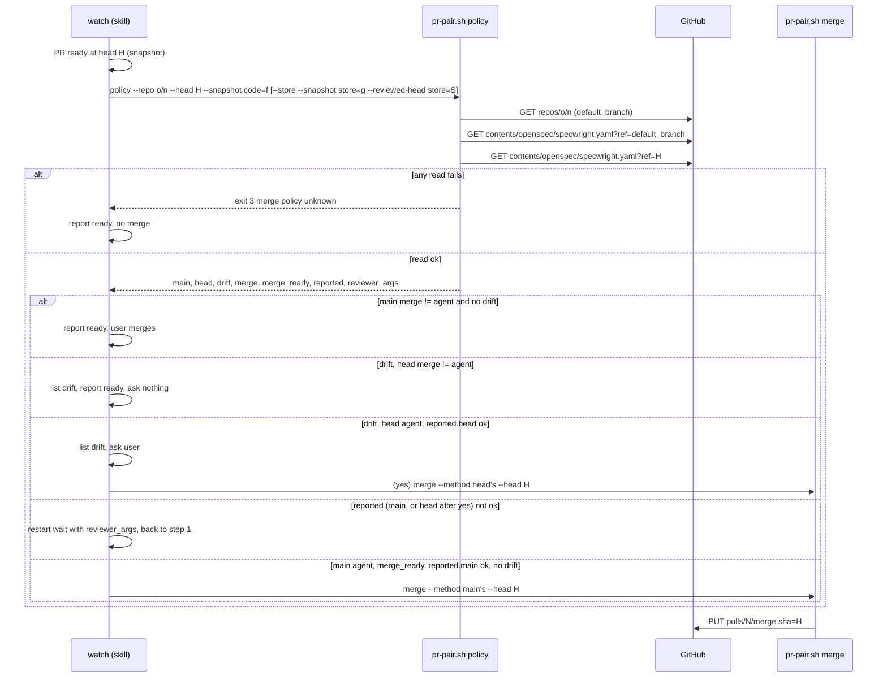
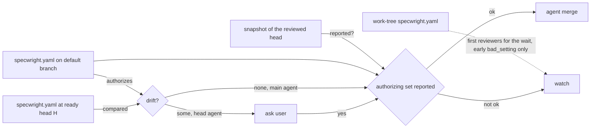

# Design

## Triage

| Trigger | Applies? | Evidence |
|---|---|---|
| T1 Components (new component, or 3+ with directed relationships) | no | One new subcommand in the existing `pr-pair.sh`; watch (skill text), `pr-pair.sh` and GitHub already interact the same way for `merge` (`skills/specwright-pr/SKILL.md:148`). |
| T2 State (persistent state, caches, 3+ state machine) | no | Nothing is stored; the policy is read per merge attempt and not cached. |
| T3 Concurrency (background work, workers/isolates, async, retries) | yes | The head can move and main can change between the policy read and the merge request; watch waits run in the background (`SKILL.md:132`). |
| T4 Boundaries (data format, migration, shared interface, IPC, external) | yes | A new JSON contract (`pr-pair.sh policy`) that the skill text reads, and a new GitHub endpoint (contents API) in the script and the fake `gh`. |
| T5 Volume (grows without a fixed bound) | no | Two file reads and one repository read per merge attempt; the settings file is small and the read is byte-bounded by `bounded.py` (ADR 0014). |
| T6 Risk (security, money, data loss, unrecoverable user data) | yes | Merge authorization: a merge to the default branch cannot be undone (ADR 0009), and the bug is a privilege escalation (#141). |

TIER: FULL

## Context

- `pr-pair.sh context` loads `openspec/specwright.yaml` from the local work tree (`load_settings`, `skills/specwright-pr/scripts/pr-pair.sh:553`) and derives `merge`, `merge_method`, `delete_branch` (`contexts`, `pr-pair.sh:604-628`) and each repo's `merge_ready` from `pr.reviewers` / `planning_store.reviewers` (`repo_ctx`, `pr-pair.sh:571-592`). Watch reads it once before the first wait (`SKILL.md:128`) and uses those values for the archive question (`SKILL.md:143`) and the merge (`SKILL.md:148`).
- Two copies are wrong to trust: the work tree belongs to whoever checked the branch out, and it can be behind the remote head that `merge --head <ready head>` sends to GitHub. The copy that merges is the one at the ready head; the copy that authorizes must be one the PR cannot change: the default branch.
- `context` also feeds the main branch name from settings (`main_branch`, `pr-pair.sh:585`), so the branch could point "main" at a branch it controls. The default branch must come from GitHub, not from settings.
- GitButler pinning (ADR 0019, `settings_pinned`, `pr-pair.sh:748`) stays as it is for every other setting; it compares the work tree with the local branch and does not cover a remote push.
- Precedents in the script: fenced `gh api` reads through `bounded.py` (`gh`, `pr-pair.sh:257`), unknown = exit 3 (`unknown`, `pr-pair.sh:645`), 404 read as a result (`delete-remote`, `pr-pair.sh:2339`).
- See proposal.md for the threat (#141).

## Decisions

### D1: Read both copies from GitHub at merge time, in a new `pr-pair.sh policy`

- **Choice:** `pr-pair.sh policy --repo <o>/<n> --head <code sha> --snapshot code=<file> [--reviewed-head code=<sha>] [--store --snapshot store=<file> --reviewed-head store=<sha>]` reads `repos/<o>/<n>` for `default_branch`, then `repos/<o>/<n>/contents/openspec/specwright.yaml?ref=<default_branch>` and `?ref=<head sha>`, fenced as the repository's run login. Each file response must be `type: file` with `encoding: base64`; it is decoded and parsed with the same `parse_yaml` and the same validation as `context`. It prints one JSON line: `default_branch`, `main` and `head` (each the normalized policy), `drift` (a list of `{key, main, head}`), the effective `merge`, `merge_method`, `delete_branch`, `merge_ready` (`code`, and `store` with `--store`), `merge_reason` and `merge_note`, all from main, and `reported` (D6) for main's and the head's reviewer sets. Watch calls it before the archive decision and again right before each merge request (after the Version check), as Flow & State Gaps says when.
- **Rejected:** read main from the local `origin/<main>` after a fenced `vcs.sh fetch-main`, and the head from the local branch, inside `context` (the issue's suggestion) because the ready head is a remote commit that the local checkout may not have (a collaborator's push), so a local read either misses it or needs a second fetch of the PR branch; and `context` is called by ship, finish and cleanup, which do not merge and would pay a network read for nothing. The GitHub read names exactly the commit the merge request names.
- **Rejected:** keep reading the work tree and only add a check that the work-tree file equals main's because a remote push after the check still changes the merged head; the decision must bind to the merged commit.
- **Reversal cost:** low. One subcommand behind a JSON contract and three paragraphs of skill text.

### D2: Main decides; any difference needs the user

- **Choice:** the policy keys are `pr.merge`, `pr.merge_method`, `pr.delete_branch`, `pr.reviewers` and `planning_store.reviewers`. Each is compared after normalization: `merge` as `contexts` reads it (an unrecognised value is `user`, with the text kept for the report), `merge_method` and `delete_branch` with their defaults, reviewers through `reviewers_of` (login without `[bot]`, role defaulting to `required`, timeout in seconds, request text). A difference in any key goes into `drift`. Watch merges on its own only when main's `merge` is `agent`, main's `merge_ready` holds for every expected PR and `drift` is empty. With drift, the head's policy is the only one a yes can adopt, so the question is asked only when the head's `merge` is `agent`, its reviewer set has a required reviewer, and `reported.head` holds (D6): watch lists every entry and asks `Merge PR #<n> at <head> with the head's policy (<method>)?`; yes merges with the head's `merge_method`, no reports ready and stops. With drift and a head whose `merge` is not `agent`, watch lists the drift, reports ready and asks nothing: neither copy opts this PR in to an agent merge (main `user`), or the PR turns agent merge off for itself (main `agent`, head `user`), which it is free to do. With drift and a head that is `agent` but short of D6, watch lists the drift and the missing reviewers and merges nothing. Main's invalid `merge_method` or `delete_branch` with `merge: agent` is `bad_setting` (exit 2), as in `context`; an invalid head value is only reported in `drift`, and if the user confirms it, `merge --method` refuses it (exit 2, `pr-pair.sh` usage).
- **Rejected:** merge with main's policy and ignore the head's because a PR that legitimately changes the method or the reviewers would merge under rules it is replacing, silently. The exit criterion asks for a report and a question.
- **Rejected:** compare the raw file bytes because comments, key order or quoting would then stop every PR that touches the file for an unrelated setting.
- **Rejected:** a three-way comparison against the merge base, so that a branch merely behind main on the settings file does not drift, because it adds a third read and a merge-base lookup for a case that only costs one question; a false positive asks the user, a false negative merges.
- **Reversal cost:** low.

### D3: Main is GitHub's default branch, not a setting

- **Choice:** `default_branch` comes from `repos/<o>/<n>`; `main_branch` in settings is not used for the policy read.
- **Rejected:** the `main` that `context` reports because it is read from the same settings file the PR can edit (`pr-pair.sh:585`).
- **Reversal cost:** low.

### D4: Unknown fails closed; only a 404 reads as an empty file

- **Choice:** a failed read, a cut-off read (`bounded.py` limit), a response that is not a file or not base64, or an unparseable YAML file is exit 3 `lookup_failed` with `merge policy unknown: <reason>`; watch reports ready and merges nothing, and tries again the next time it reaches the merge step. A 404 on main's contents read is an empty settings file, so main without the file means `merge: user`. A 404 at the head is unknown (`no openspec/specwright.yaml readable at <H>`): GitHub answers 404 both for a missing path and for a ref it cannot resolve, and an empty head would show defaults the head never set in a drift question. A PR that deletes the settings file is merged by the user.
- **Rejected:** fall back to the work tree when GitHub cannot be read because that restores the bypass on any network failure.
- **Reversal cost:** low.

### D5: The archive decision uses the same read

- **Choice:** before archiving a ready, unarchived change, watch runs `policy` at the ready head with its snapshot; it archives without asking only with main's `merge: agent`, no drift and `reported.main` true for every expected PR, and asks otherwise. `context`'s `merge` stays the start-of-watch read (its `bad_setting` and `merge_note` still stop or warn early), and `finish` still reads it only to decide whether to hand the PR to watch, which merges nothing without `policy`.
- **Rejected:** move `finish` and the start of watch onto `policy` too because neither sends a merge request; there may be no PR yet at finish time, and the extra network read buys nothing the merge step does not already check.
- **Reversal cost:** low.

### D6: Readiness is checked against the authorizing reviewer set, in the script

- **Choice:** the waits keep taking `--reviewer` arguments from `context` (the work tree), but that set no longer authorizes anything. `policy` reads the latest snapshot of each expected PR (`--snapshot code=<file>`, with `--store` also `store=<file>`) and, for main's reviewer set and for the head's, reports `reported.<side>.<repo>`: `ok` true only when the snapshot's `head_oid` is the reviewed head and every `required` login of that set appears in the snapshot's `reviewers` with `state: reported`; else `ok` false with `missing` (logins absent from the snapshot or not reported) and `head_mismatch` when the snapshot is of another head. The reviewed head is per repository: each snapshot's `head_oid` is checked against its own repository's reviewed head, never another repository's. For the code PR it is `--head`, unless `--reviewed-head code=<sha>` names another; for the store PR it is `--reviewed-head store=<sha>`, required with `--store` (the store PR's ready head; the settings are still read only at the code head). For an archive head that `archive-only` judged, `--reviewed-head <repo>=<R>` names the ready head before the archive in the repository that got the archive commit (the store's in a store-backed change, the code repo's otherwise), and that repository's snapshot is R's (the carry-over of SKILL.md watch step 3). `policy` also prints `reviewer_args.<side>.<repo>` (`login:role:seconds` per reviewer). When the set watch must rely on (main's, or the head's after a yes) is not `ok`, watch merges nothing, restarts that PR's wait with that set's `reviewer_args`, posting the requests that set names as on a re-request, and returns to step 1; the head is merged only once a snapshot taken with that set shows it ready.
- **Rejected:** start every wait with main's reviewers instead because a confirmed drift adopts the head's set, which watch does not know until the merge step; and an in-script check is needed anyway, since a set passed through skill text can drift from the one that authorizes.
- **Rejected:** compare the waited set with main's in skill text because a missed comparison is exactly the bypass; the check belongs in the script (ADR 0002).
- **Reversal cost:** low.

## Diagrams (FULL)

## State & Ownership (FULL)

| State | Owner (sole writer) | Lifetime | Invalidation / rebuild | Authoritative copy |
|---|---|---|---|---|
| Merge policy on main | Maintainers, through merged PRs | Until the next merge to main | Read again before each merge request | GitHub, default branch |
| Merge policy at the ready head | PR branch pushers | That commit | A new head is a new read (watch re-runs `policy` for it) | GitHub, the commit `H` |
| `policy` output | `pr-pair.sh policy` (per call) | One merge attempt | Never reused across heads or wakes | none stored |
| User's yes to a drift | The user | One head | A new head needs a new answer | watch's conversation |
| Reviewer set the wait uses | watch (from `context` at start, replaced by `policy`'s `reviewer_args` when that set is not `ok`) | One wait | Restarted whenever `policy` reports the authorizing set not `ok` | none: it only drives the wait; `policy`'s `reported` decides the merge |
| Latest snapshot per PR | watch (the wait writes it) | Until the next wake | Each wake replaces it | GitHub; `policy` checks its `head_oid` against the reviewed head |

## Failure & Visibility (FULL)

| Component | Fails / dies mid-operation → | Recovery | Retry safe? | Who finds out |
|---|---|---|---|---|
| `policy` GitHub reads | exit 3 `merge policy unknown: <reason>` | Next pass through the merge step reads again | yes, reads only | User, in watch's report |
| `policy` parse of main's file | exit 2 `bad_setting` naming the key | User fixes main | yes | User |
| Watch dies between `policy` and `merge` | No merge request was sent; a restarted watch reads the policy again | Restart watch | yes | User (watch stopped) |
| Main changes between `policy` and `merge` | The merge used the policy read a moment earlier | none; the window is the merge call itself | n/a | nobody; accepted (Risks) |
| Head moves after `policy` | `merge` sends `sha=H`; GitHub refuses with 409 `head_changed` | watch watches the new head and reads its policy | yes | User, `head_changed` report |

## Resource Bounds (FULL)

| Queue / buffer / cache / transfer | Bound | At the bound | Timeout | At 10x / 100x |
|---|---|---|---|---|
| Contents read (×2) and repository read | `bounded.py` byte bound for a non-paginated `gh api` (ADR 0014); GitHub's contents API returns base64 content only up to 1 MB | cut-off or `encoding: none` → unknown (exit 3), no merge | `bounded.py` deadline for a single read | Settings files are a few KB; 3 reads per merge attempt, one attempt per ready head |

## Flow & State Gaps (FULL)

- **Head moves after the read:** the merge request carries `sha=H`, so GitHub refuses any other head (existing guard, ADR 0009). The new head is watched to ready and gets its own `policy` read and, with drift, its own question.
- **Head moves after the user's yes:** same as above; the yes covered `H` only.
- **Main moves after the read:** a maintainer merge to main in the seconds between `policy` and the PUT is not seen. Accepted: only someone who can already merge to main can cause it.
- **Store-backed pair:** one `policy --store` call on the code repository (the store's reviewers live in the code settings) with both PRs' snapshots and `--reviewed-head store=<store ready head>`, before the store merge; each snapshot is checked against its own PR's head; its `merge_ready.store` and `reported.<side>.store` replace `context`'s for the store PR. A drift question covers the pair. The store PR's own head is not read: the store holds no `specwright.yaml`.
- **Archive head:** after the archive push, the merge step runs `policy` at the archive head, which normally carries the same settings as the ready head; a difference is drift like any other. When `archive-only` judged the archive head and it was watched without reviewers, the reviewer check uses `--reviewed-head <repo>=<ready head before the archive>` for the repository that got the archive commit (the store in a store-backed change), with that head's snapshot, so the carried-over reports must be from main's required reviewers too; any other archive head is checked with its own snapshot.
- **Wait started with another set:** the first `policy` that finds the authorizing set not `ok` restarts the wait with that set; the PR is then short of ready until those reviewers report on the current head, exactly as for a new head today.
- **When the reads run:** with `finish: pr`, watch runs `policy` at the archive decision and at the merge step for every change or roadmap branch, whatever `context`'s `merge` says, so main alone decides and the work tree never gates the read. In a user-mode project (main `user`, no drift) the outcome is today's: watch asks before archiving, reports ready and stops; the cost is three reads per ready head.

## Mechanism Ledger (FULL)

| Mechanism | Built? | Why (harm nobody catches / expensive later) | Evidence that would change the call |
|---|---|---|---|
| Policy from the default branch | yes | The #141 bypass merges unreviewed code with the maintainer's credentials; nobody sees it before main changes | — |
| Head copy read at the merged SHA | yes | A remote push leaves the work tree stale, so a work-tree check misses the bypass | — |
| Default branch from GitHub, not settings | yes | `main_branch` is itself in the file the PR edits | — |
| Reviewer report check against the authorizing set, in `policy` | yes | A wait started with a stale or edited set reports a head ready that main's required reviewer never saw (round 1 Critical); nobody sees it before main changes | — |
| Normalized comparison | yes | A raw diff would ask on every unrelated settings edit, training users to say yes | — |
| Three-way merge-base comparison | no | A false positive only asks one question | Users report frequent drift questions for branches behind main |
| Branch protection / rulesets check | no | GitHub enforces them on the PUT already; a refusal stops (ADR 0009) | A case where GitHub merges what protection should block |
| `github.login`, `planning_store.login`, `finish` in the policy | no | A login needs a local credential on the maintainer's machine, so a branch cannot name an account the maintainer does not hold; `finish: local` on main stops watch before any merge in practice | A merge made under a login the user did not configure |
| Caching the policy across wakes | no | Each read is three small calls per ready head | Rate-limit errors on the reads |

## Risks / Trade-offs

- [A legitimate PR that changes the merge policy now always needs a yes] → by design (exit criterion); the question lists exactly what changes.
- [A branch behind main on `specwright.yaml` drifts although it did not edit it] → one question; the report shows main's newer value, which tells the user why.
- [Projects without network access to GitHub cannot agent-merge] → agent merge already needs GitHub (ADR 0009).
- [Main changes in the instant between read and merge] → accepted (Flow & State Gaps).

## ADRs

- **In force, constraining this change:** 0002 (thin scripts, JSON contracts), 0008 (fenced identity: the reads run as the repository's run login), 0009 (agent merge contract: at the ready head, fail closed), 0014 (bounded reads), 0019 (GitButler pinning stays for the other settings).
- **To record during apply:** 0020 "Agent merge takes its policy from the default branch" (adds to 0009): the policy keys, read from GitHub's default branch and at the ready head before each merge request, any normalized difference needs the user's yes for that head, unknown merges nothing. Index row in `openspec/architecture.md`.
