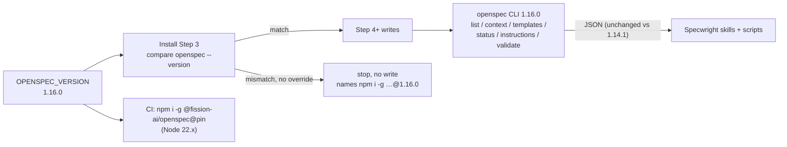

# Design

## Triage

| Trigger | Applies? | Evidence |
|---|---|---|
| T1 Components (new component, or 3+ with directed relationships) | No | No component is added; the pin check in the install prompt (README Steps 1 and 3) and `update.sh` keep their shape. |
| T2 State (persistent state, caches, 3+ state machine) | No | `OPENSPEC_VERSION` changes value, not format; no new state. |
| T3 Concurrency (background work, workers/isolates, async, retries) | No | Nothing runs concurrently. |
| T4 Boundaries (data format, migration, shared interface, IPC, external) | Yes | Specwright parses an external tool's output (`openspec list/context/templates/status/instructions --json`, `validate`), and the public install contract changes: adopters must run OpenSpec 1.16.0, whose npm package needs Node.js 22.12+. |
| T5 Volume (grows without a fixed bound) | No | No collection grows. |
| T6 Risk (security, money, data loss, unrecoverable user data) | No | The pin check stops before any write on a mismatch (README Step 3); nothing user-owned is rewritten. |

TIER: FULL

## Context

- The pin is one file, `OPENSPEC_VERSION` (`1.14.1`), read by the install prompt (README Step 3) and by CI (`.github/workflows/evals.yml:82`, `npm i -g @fission-ai/openspec@$(cat OPENSPEC_VERSION)`, on `node-version: '22'` at :80, which resolves to the newest 22.x).
- `CONTRIBUTING.md:59` lists every place an upgrade must touch; `TestOpenSpecPin` (`evals/git-workflow/test_instructions.py:1248`) fails while the README, CONTRIBUTING or the badge disagree with `OPENSPEC_VERSION` (`pin_drift`, :1216).
- `openspec/strategy.md:34`: OpenSpec "is upgraded deliberately, in its own change".
- Evidence gathered against 1.16.0 through `npx -y @fission-ai/openspec@1.16.0` (global CLI untouched), recorded in #164: `validate --all --strict` passes all 22 specs; `schema validate specwright` passes; `list`, `context`, `templates --schema specwright`, `new change`, `status` and `instructions` for all six artifacts give byte-identical JSON after path normalisation; a `skip_specs: true` change validates `--strict` the same way.
- Upstream between `v1.14.1` and `v1.16.0` changed `schemas/spec-driven/schema.yaml` by one added line (the WHEN/GIVEN + THEN rule, under "Each scenario"); `schemas/specwright/schema.yaml:118` is the matching spot in our fork.
- The generated `opsx` skills (`/.claude/skills/openspec-*/`) and the installed schema copy are gitignored, so regenerating them is a local step, not part of this change.

## Decisions

### D1: Move the exact pin to 1.16.0

- **Choice:** keep the exact-version pin and set it to `1.16.0`, updating every file `CONTRIBUTING.md:59` names in the same change.
- **Rejected:** a version range (`>=1.14.1 <2`) checked by the install, because the pin exists so that a new OpenSpec release cannot change parsed output under adopters without a deliberate check like the one in Context; a range would drop that and needs a new requirement in `install-update`.
- **Reversal cost:** low. Moving back is the same edit with another value.

### D2: State the Node.js requirement next to the npm command, not a binary install

- **Choice:** the README prerequisites and `CONTRIBUTING.md` say the npm package needs Node.js 22.12 or later (written two-part, so `pin_drift`'s three-part "or later" rule at `test_instructions.py:1238` does not flag it).
- **Rejected:** switching the documented install to OpenSpec's standalone binary (`OPENSPEC_VERSION=v1.16.0` with `install.sh`/`install.ps1`), because the install prompt's stop messages, the `install-update` scenarios and `TestOpenSpecPin` are all built on `npm i -g @fission-ai/openspec@<pin>`; changing the install channel is a requirement change for its own change.
- **Reversal cost:** low.

### D3: Port upstream's one schema line verbatim

- **Choice:** add upstream's line ("Every scenario MUST have a WHEN/GIVEN step … `openspec validate --strict` fails on it.") after the fork's "Each THEN MUST be an assertable outcome" bullet (`schemas/specwright/schema.yaml:124-125`), directly before the description-length bullet, so it sits next to the other validate-warning rule as upstream places it; and update the README's "forked from `spec-driven` (…)" note to 1.16.0.
- **Rejected:** leaving our fork at 1.14.1's text, because then the note would name a version our schema does not match, and agents would not learn why `--strict` fails a scenario without THEN.
- **Reversal cost:** low.

### D4: Release as a patch (0.14.1), no spec deltas

- **Choice:** `skip_specs: true`; release 0.14.1 as the user decided, recorded in the M6 section of the roadmap.
- **Rejected:** rewriting the `install-update` scenarios to use 1.16.0, because they use example versions to describe the comparison (found vs pinned) and stay correct with any pin; rewriting them changes no behavior.
- **Reversal cost:** low.

### D5: Move README Step 3's edge-case examples with the pin, and derive their tests from the pin

- **Choice:** `pin_drift` (`evals/git-workflow/test_instructions.py:1232`) forces Step 3's "a pin of <pin>" to read 1.16.0, so the examples beside it move too: a newer patch `1.16.1`, the pre-release `1.16.0-beta.1` and the build `1.16.0+vendor.1` (README:165), and the run-on tokens `1.16.0.0` and `1.16.0vendor` (README:168). In `test_instructions.py`, `test_exact_match_counts_prerelease_as_mismatch` (:1326), `test_exact_match_counts_build_metadata_as_mismatch` (:1334), `test_step3_run_on_token_is_unreadable` (:1379) and `test_readme_token_rule_on_sample_outputs` (:1395) build their expected strings from `openspec_pin()` (pin, `<pin>-beta.1`, `<pin>+vendor.1`, `<pin>.0`, `<pin>vendor`, and the next patch), so the next upgrade only edits the README.
- **Rejected:** keeping the 1.14.x examples under a 1.16.0 pin, because the prompt agents follow would then show edge cases of a version that is no longer the pin, and "not a match on its first part" would compare against the wrong version.
- **Reversal cost:** low.

## Diagrams (FULL)

T4 - the external boundary this change moves:

## State & Ownership (FULL)

| State | Owner (sole writer) | Lifetime | Invalidation / rebuild | Authoritative copy |
|---|---|---|---|---|
| `OPENSPEC_VERSION` | Maintainer, through an upgrade change | Until the next upgrade change | Replaced by the next upgrade | `OPENSPEC_VERSION` on main |

## Failure & Visibility (FULL)

| Component | Fails / dies mid-operation → | Recovery | Retry safe? | Who finds out |
|---|---|---|---|---|
| Install/update on a machine still on 1.14.1 | Stops at Step 3 before any write | Install 1.16.0, or state the override for one run | Yes | The user, from the stop message naming both versions and the install command |
| `npm i -g` on Node < 22.12 | npm refuses the install | Upgrade Node, or use OpenSpec's standalone binary | Yes | The user, from npm's engine error; the prerequisites name the requirement |
| CI OpenSpec install | Job fails at the install step | Fix the pin or Node version | Yes | PR checks on all three OSes |
| A 1.16.0 output difference not covered by the comparison | An eval fails in CI | Fix forward in this change | Yes | PR checks (every suite runs on 1.16.0 here) |

## Resource Bounds (FULL)

No queue, buffer, cache, transfer or in-flight work is added or changed; nothing grows with use.

## Flow & State Gaps (FULL)

- **Changes in flight in adopters' projects:** an update validates them against the staged schema with the installed OpenSpec (`update.sh`, Workflow-update requirement). Under 1.16.0 a scenario without WHEN/GIVEN or THEN is a warning, so plain `validate` still passes and only `--strict` (used by `pr.validate` when configured) fails on it; the ported schema line tells agents why.
- **Partial upgrade:** a project updated to 0.14.1 on a machine still running 1.14.1 is refused at Step 3 before any write, so there is no half-installed state.
- **Other new strict failures since 1.14.1:** delta-spec text that archive would drop now warns (1.14.2, #2054), and an unreadable or invalid `openspec/config.yaml` makes `validate` exit 1 (1.16.0, #2127). Specwright's spec template has only `## Purpose` and the delta sections, and the install writes `config.yaml` through `update.sh`, so neither is expected; the release notes name both so adopters know where a new `--strict` failure comes from.
- **No-root error with a matching store (1.16.0, #2077):** the error now suggests `--store <id>`. Install Step 1 reads only the `root` field and the `Declared in` / `Invalid store declaration in` prefixes, which are unchanged; its existing advice for a project with no root is out of scope here.

## Mechanism Ledger (FULL)

| Mechanism | Built? | Why (harm nobody catches / expensive later) | Evidence that would change the call |
|---|---|---|---|
| Automated JSON-output comparison between pins in CI | No | The one-off comparison in Context plus every suite running on 1.16.0 in CI covers this upgrade; the next upgrade can repeat it by hand | An upgrade where a suite misses an output change the comparison would have caught |
| Binary install channel in the install prompt | No | D2 | Users without Node 22.12 asking for it |

## Risks / Trade-offs

- [An adopter on Node 20 can no longer `npm i -g` the pin] → the prerequisites name Node.js 22.12, and OpenSpec's own binary needs no Node.
- [Strict validation in adopters' projects fails on scenarios without WHEN/GIVEN or THEN] → only with `--strict`; Specwright's template already writes WHEN/THEN, and the ported line explains the rule.

## ADRs

- **In force, constraining this change:** none specific; the pin rule lives in `openspec/strategy.md` (Assumptions) and the `install-update` spec.
- **To record during apply:** none.
