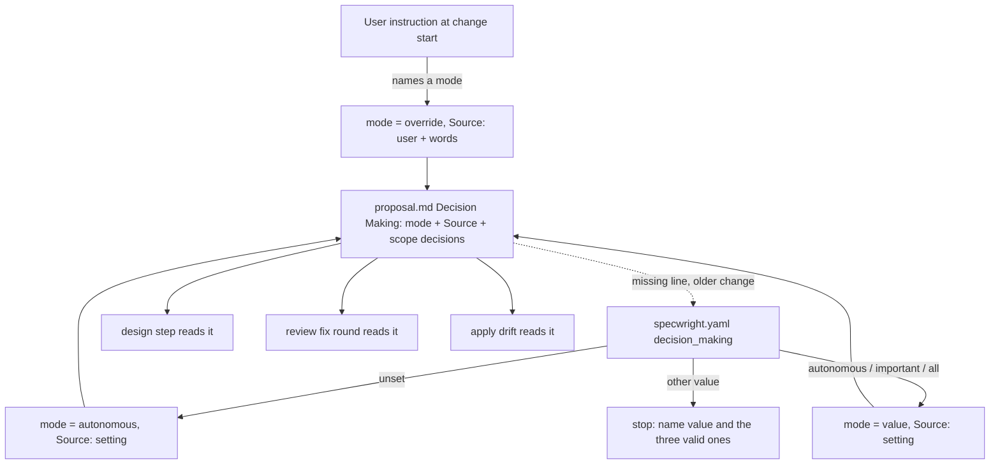

# Design

## Triage

| Trigger | Applies? | Evidence |
|---|---|---|
| T1 Components (new component, or 3+ with directed relationships) | no | No new skill, agent or script: the behaviour is schema instruction text (`schemas/specwright/schema.yaml`) read through `openspec instructions` |
| T2 State (persistent state, caches, 3+ state machine) | yes | The per-change mode and each decision's `Chosen by` are recorded in `proposal.md` and `design.md` and read back by later sessions (design, apply, review fix rounds) |
| T3 Concurrency (background work, workers/isolates, async, retries) | no | Planning is one interactive session; nothing runs in the background |
| T4 Boundaries (data format, migration, shared interface, IPC, external) | yes | New `specwright.yaml` key; new machine-read lines in `proposal.md` and `design.md` that the reviewer, apply and later sessions parse |
| T5 Volume (grows without a fixed bound) | no | Decisions per change are few; question batches are bounded below |
| T6 Risk (security, money, data loss, unrecoverable user data) | no | No credentials, network or user data |

TIER: FULL

## Context

Settings are read by the agent from `openspec/specwright.yaml` with no script when a wrong read cannot cause harm, as `commit_granularity` is (`skills/specwright-commit/SKILL.md:24`: the agent reads it once, and an unknown value stops). `cheap_tier` goes through `pr-pair.sh tier` because a wrong read changes the model that writes code (ADR 0013). The design instruction already makes every Decisions entry state choice, rejected alternative, why it lost and reversal cost (`schemas/specwright/schema.yaml:226-230`), and `schemas/specwright/templates/design.md` gives each entry `Choice`, `Rejected`, `Reversal cost`. The ADR test (`schema.yaml:281-283`: binds future changes, boundary, contract, data format) already exists. Apply's drift rule (`schema.yaml:536-541`) amends the artifact and re-runs review. The design review writes only `review.md`; the author applies required changes (`schema.yaml:367-370`).

Specwright extends OpenSpec only through schema, skills, agents and templates (ADR 0001), and leaves to the agent what it can follow as instructions (ADR 0002). Several harnesses run the flow (Claude Code, Codex, OMP, pi), and each offers an ask tool that lets the user pick an option instead of typing. Their limits differ: Claude Code's takes at most 4 questions with 2-4 options each; Codex's `request_user_input` at most 3 questions with 2-3 options each, and only in Plan mode (review round 2). See `proposal.md` for scope.

## Decisions

The mode in force and the scope decisions (S1, S2) are in `proposal.md`'s Decision Making section (D2).

### D1: Setting name and shape

- **Choice:** one top-level key `decision_making: autonomous | important | all`, default `autonomous`.
- **Rejected:** `decision_process`, or a nested `decisions: { mode: ... }` block, because the user picked `decision_making`, and a block with one key adds a level nothing else needs.
- **Reversal cost:** medium: renaming a key every project may set needs a migration note.
- **Important:** yes - a config key users see.
- **Chosen by:** user

### D2: Where the mode in force lives per change

- **Choice:** a `## Decision Making` section in `proposal.md`, placed before `## Release Notes`: a `DECISION_MAKING: <mode>` line, a `Source:` line (`setting`, or `user` with the user's quoted words), and the scope decisions as `S1`, `S2`... entries with the same fields as design decisions. The proposal is the first artifact written, so the mode and the user's scope answers are on disk before any design decision is made, and a session resumed without the conversation reads them back. Design, review fix rounds and apply read the mode there; a `proposal.md` without the line falls back to the setting. `design.md` does not repeat the mode line.
- **Rejected:** the line in `design.md` (round 1's choice), because an interruption between proposal and design lost the override and the scope answers (review round 1, finding 1); a key in the change's `.openspec.yaml`, because that file is OpenSpec's metadata (ADR 0001) and reviewers and the user read the artifacts, not it; re-reading the setting each session, because it would lose the per-change override.
- **Reversal cost:** medium: the line is parsed by later runs of in-flight changes; moving it means reading both places for one release.
- **Important:** yes - a format later runs parse.
- **Chosen by:** agent

### D3: How the rule is enforced

- **Choice:** schema instruction text (proposal, design, review, tasks and apply) plus the design template's fields; the agent reads `decision_making` itself, like `commit_granularity`. An unknown value stops planning, naming the valid values.
- **Rejected:** a script reader (`pr-pair.sh decisions`, as `pr-pair.sh tier` reads `cheap_tier`), because a wrong read only changes who is asked, never what code is written or merged, and the scripts are about to be rewritten as the `sw` CLI (M7). Falling back to `autonomous` with a note on an unknown value was rejected too: a user who set a value meant to be asked, and a silent fallback would ignore that.
- **Reversal cost:** low: a reader script can be added later without changing the setting or the record.
- **Important:** no - tactical, no format.
- **Chosen by:** agent

### D4: What makes a decision important

- **Choice:** a fixed test of four criteria, any one enough: high reversal cost; binds future changes (contract, data format, config key, boundary: the existing ADR test); changes behaviour or settings users see; chosen on weak evidence. Each entry records `Important: yes|no` and the criterion it meets.
- **Rejected:** the agent's own judgement of "meaningful", because it varies between models and runs and gives the user nothing to check; a numeric score, because it invents weights nobody can calibrate.
- **Reversal cost:** low: wording in the schema.
- **Important:** yes - it decides what the user sees in `important` mode.
- **Chosen by:** agent (the user agreed the four criteria when they were proposed)

### D5: When questions are asked

- **Choice:** while the artifact that holds the decision is written: the mode is resolved and scope and non-goal choices are asked before `proposal.md` is written, and the proposal is written as soon as they are answered; design decisions before `design.md` is written, each in batches of at most 4 questions, or fewer when the usable ask tool takes fewer (more decisions: more batches, every decision still asked). Each question offers 2 to 4 options, cut to the tool's option limit, always keeping the recommended one marked and a way to discuss: the tool's free-text answer when it has one, else a discuss option. The agent puts each batch through its harness's ask tool when that tool is usable in the current session and mode, so the user picks rather than types; plain text with lettered options is the fallback only when no ask tool is usable. The instruction names no one tool and no one limit, since each harness has its own.
- **Rejected:** one batch at the end of planning, because answers that change a decision would force rewriting artifacts already written (and a voided review); one question at a time, because it costs a round trip per decision; plain-text questions by default, because the user would have to type every answer; batches with no size cap, because a long batch is hard to read and fits no ask tool; a fixed batch of exactly 4, because Codex's tool takes 3.
- **Reversal cost:** low: instruction text.
- **Important:** yes - the user-visible flow.
- **Chosen by:** user (batches of 4 and the ask tool); agent (per-artifact timing)

### D6: The summary table

- **Choice:** every `design.md` gets a `### Decision summary` table (decision, choice, rejected, reversal cost, important, chosen by) after its last decision, in every mode, with one row per scope decision from `proposal.md` (`S1`...) and per design decision (`D1`...); the tasks step shows it to the user at the end of planning. In `autonomous` mode nothing waits for an answer.
- **Rejected:** the table in `autonomous` mode only, because one rule is easier to follow and check, and in `important` mode the user still needs to see what the agent decided alone; a summary only in the chat, because the user asked for a note that carries into the design.
- **Reversal cost:** low.
- **Important:** yes - user-visible output.
- **Chosen by:** user (table and carry on in autonomous); agent (every mode)

### D7: Protecting a user's choice

- **Choice:** a decision recorded `Chosen by: user`, in any mode, `autonomous` included, changes only after the user agrees; until they answer, its entry and summary row stay as they are. The review instruction tells the author to put any required change that reverses one to the user before applying it; apply's drift rule does the same. A decision the user already stated before planning (in the conversation, or in the issue they approved) is recorded `Chosen by: user` without asking again. "You decide" records `Chosen by: agent` with a note.
- **Rejected:** letting `APPROVE_WITH_CHANGES` override it, because the reviewer never saw why the user chose it and the user would find out only from the diff.
- **Reversal cost:** low.
- **Important:** yes - user-visible behaviour.
- **Chosen by:** agent

### D8: Decisions after planning, and the override

- **Choice:** a decision changed by a review fix round or by apply drift follows the change's recorded mode (D2). An instruction from the user when a change starts sets the mode for that change only, recorded with the user's words; an instruction given mid-planning applies from then on, and decisions already written stay unless the user asks to revisit them.
- **Rejected:** apply always deciding alone, because a drift fix is where an important decision is most likely to change unseen.
- **Reversal cost:** low.
- **Important:** yes - user-visible behaviour.
- **Chosen by:** user

### D9: Installation and docs

- **Choice:** `templates/openspec/specwright.yaml` gains an active `decision_making: autonomous` line with a comment naming the three values; the README settings block and its planning section describe it; init asks nothing new. `architecture.md`'s Contracts list gains a bullet for the `proposal.md` and `design.md` lines (D2, D4, D7), since later runs parse them; `schemas/specwright/templates/proposal.md` gains the Decision Making section (a workflow change, minor version).
- **Rejected:** an init question, because the default keeps today's behaviour and the user declined it.
- **Reversal cost:** low.
- **Important:** no.
- **Chosen by:** user

### Decision summary

| # | Decision | Choice | Rejected | Reversal cost | Important | Chosen by |
|---|---|---|---|---|---|---|
| S1 | Scope | every change start | roadmap next only | low | yes | user |
| S2 | Placement in M6 | change 8, 0.17.0 | after gamedev-pack; fold into user-verified-tasks | low | no | user |
| D1 | Setting name and shape | top-level `decision_making`, default `autonomous` | `decision_process`; nested block | medium | yes | user |
| D2 | Mode per change | `## Decision Making` in `proposal.md`: mode, source, scope decisions | line in `design.md`; `.openspec.yaml` key; re-read setting | medium | yes | agent |
| D3 | Enforcement | schema text, agent reads the key; unknown value stops | reader script; silent fallback | low | no | agent |
| D4 | Importance test | four fixed criteria | agent judgement; score | low | yes | agent |
| D5 | When and how to ask | per artifact, batches of at most 4 (or the tool's lower limit), through the usable ask tool, plain text as fallback | one batch at the end; one at a time; plain text by default; no cap | low | yes | user |
| D6 | Summary table | in `design.md` every mode, shown at end of planning | autonomous only; chat only | low | yes | user |
| D7 | User choice protected | changes only with the user, in every mode | review may override | low | yes | agent |
| D8 | Later decisions, override | follow recorded mode; override per change | apply decides alone | low | yes | user |
| D9 | Install and docs | active template line, README, Contracts bullet; no init question | init question | low | no | user |

## Diagrams (FULL)

T2 and T4: how the mode is resolved and recorded, and where each step reads it.



```mermaid
sequenceDiagram
  participant U as User
  participant A as Agent (planning)
  participant F as Artifacts
  A->>A: resolve mode (setting or override)
  A->>A: draft scope choices, classify Important
  alt mode asks for some of them
    A->>U: batch (<=4): options, recommended, discuss
    U-->>A: choices / discuss / "you decide"
  end
  A->>F: proposal.md (mode, source, scope decisions)
  A->>A: read mode from proposal.md, draft design decisions, classify
  alt mode asks for some of them
    A->>U: batch(es)
    U-->>A: choices
  end
  A->>F: design.md (entries, summary table)
  Note over A,F: review; a required change to a user choice goes to U first
  A->>F: tasks.md
  A->>U: summary table (autonomous: no wait)
```

## State & Ownership (FULL)

| State | Owner (sole writer) | Lifetime | Invalidated / rebuilt | Authoritative copy |
|---|---|---|---|---|
| `decision_making` setting | The user (or the install template once) | Project | Edited by the user; read once per planning run | `openspec/specwright.yaml` in the code repo |
| Per-change mode (`DECISION_MAKING:` + `Source:`) | The planning agent, written with `proposal.md`; changed only on the user's instruction | Life of the change, archived with it | Never rebuilt; a missing line means the setting | The change's `proposal.md` |
| Scope decisions (`S1`...) with `Important`, `Chosen by` | The planning agent; `Chosen by: user` changes only with the user's agreement | Life of the change | Updated in the same edit as the decision | The change's `proposal.md` |
| Design decisions (`D1`...) with `Important`, `Chosen by` | The planning agent; `Chosen by: user` changes only with the user's agreement | Life of the change | Updated in the same edit as the decision | The change's `design.md` |
| Decision summary table | The planning agent, derived from the S and D entries | Life of the change | Rewritten whenever an entry changes, in the same edit | The S and D entries; the table is a view of them |

## Failure & Visibility (FULL)

| Component | Fails how | Recovers | Retry safe | Who finds out |
|---|---|---|---|---|
| Setting read | Unknown value | User fixes the value; planning starts again | yes, nothing written | User, from the stop message |
| Question batch | Session ends before the user answers | The next session resumes the change; the unanswered decisions were never written, so it asks again | yes | User, who sees the questions again |
| Planning session | Ends after `proposal.md`, before `design.md` | The next session, with or without the conversation, reads the mode, source and scope answers from `proposal.md` and asks the design decisions per that mode | yes | User, asked per the recorded mode |
| Planning session | Ends after an override or scope answers, before `proposal.md` is written | Nothing was written; the next session resolves the mode again (the user restates an override) and asks the scope decisions again | yes | User, asked again |
| Summary table | Out of step with the entries | The design review checks it (instruction); the author fixes it in the same edit | yes | Reviewer, then user |
| Review applying a change to a user choice | Author skips the ask | Instruction in the review step; the decision still shows `Chosen by: user` in the diff | yes | User, from the PR diff and pre-ship review |

## Resource Bounds (FULL)

| Item | Bound | At the bound |
|---|---|---|
| Questions per batch | 4, or the usable ask tool's lower limit | Further decisions go in the next batch |
| Options per question | 2 to 4, cut to the ask tool's option limit; the recommended one and a way to discuss always kept | The agent drops the weakest alternatives |
| Summary table rows | One per decision | No cap needed: a change with more than about 10 decisions is a sign it should be split, which review already reports |

## Flow & State Gaps (FULL)

- **Override mid-planning:** applies from the moment it is given; recorded in `Source:` with the words; earlier decisions stay unless the user asks to revisit them.
- **Setting changed while a change is in flight:** the change keeps the mode recorded in its `proposal.md`; the new setting applies to the next change.
- **Interrupted after `proposal.md`:** the mode, its source and the scope answers are on disk; the resumed session uses them with no conversation history.
- **Interrupted before `proposal.md` exists:** nothing is recorded; the window is one batch of scope questions, and the resumed session asks them again (the user restates an override). An unanswered or unwritten decision is asked again, never decided for the user.
- **Proposal amended after design:** a new scope choice is a decision like any other and goes through the mode.
- **Store-backed planning:** the setting is read from the code repo's `openspec/specwright.yaml`, as every other setting is; `design.md` lives in the store.

## Mechanism Ledger (FULL)

| Mechanism | Built? | Why |
|---|---|---|
| Script reading `decision_making` | no | A wrong read only changes who is asked; would build only if a harness keeps misreading it (D3) |
| Validator checking table rows against entries | no | The reviewer checks it; would build if reviews keep missing drift between them |
| Update migrating existing `specwright.yaml` files | no | Unset already means `autonomous` |
| Stop on unknown value | yes | Cheap, and a silent fallback would ignore a value the user set on purpose |

## Risks / Trade-offs

- [The agent under-classifies a decision as not important to avoid asking] → the four criteria are fixed and the reason is recorded per entry, so the reviewer and user can see a wrong `no`.
- [Instruction-only enforcement drifts between harnesses] → wording evals pin the schema text; the summary table makes a skipped question visible.
- [`all` mode makes small changes slow] → the user chose that mode; the per-change override lets them drop to `autonomous` for one change.

## ADRs

- In force and constraining: ADR 0001 (extend only through schema, skills, templates), ADR 0002 (agent instructions, thin scripts).
- New: none. No boundary, process or technology changes; the `design.md` lines are recorded as a contract bullet in `architecture.md` (D9).

## Open Questions

None.
