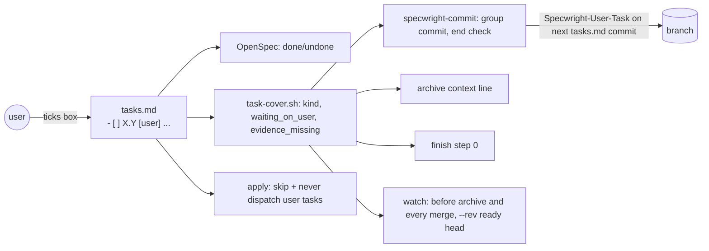

# Design

## Triage

| Trigger | Applies? | Evidence |
|---|---|---|
| T1 Components (new component, or 3+ with directed relationships) | no | No new component; existing schema, skills and `task-cover.sh` gain rules |
| T2 State (persistent state, caches, 3+ state machine) | no | The tick lives in `tasks.md` as today; no new store or cache |
| T3 Concurrency (background work, workers/isolates, async, retries) | no | Watch's existing wait loop only gains a stop condition |
| T4 Boundaries (data format, migration, shared interface, IPC, external) | yes | `tasks.md` line format is read by OpenSpec, `task-cover.sh`, packs' rules and implementers; `task-cover.sh` JSON gains fields |
| T5 Volume (grows without a fixed bound) | no | Bounded by the tasks of one change; `task-cover.sh` keeps its commit bound |
| T6 Risk (security, money, data loss, unrecoverable user data) | no | A wrongly ticked check is a process failure, covered by the gates below |

TIER: FULL

## Context

- `tasks.md` lines are parsed by OpenSpec (checkbox done/undone) and by `task-cover.sh`, whose task pattern is `^[ \t]*-[ \t]+\[([^\]\r\n]*)\][ \t]+(\d+)\.(\d+)(?=\s|$)` (`skills/specwright-commit/scripts/task-cover.sh:101`). Text after the id is not read today, so a marker after the id is invisible to every existing reader.
- A task subject `<type>(<change>): task X.Y ` already counts as coverage in both modes, and sets the commit's group from X (`task-cover.sh:136-141`), so a tick commit in that form raises no `cross_group`.
- Group completeness ("every task of the group is ticked") lives in `skills/specwright-commit/SKILL.md` §2 Group mode; the end-of-apply check in §3.
- Delegation is the apply instruction's DELEGATION paragraph (`schemas/specwright/schema.yaml:627`); implementers report `DONE | DRIFT | BLOCKED` (`agents/claude/specwright-implementer.md:24`).
- The archive gate today is the DEFERRED context line (`templates/openspec/config.yaml:6`), the finish deferred check (`skills/specwright-finish/SKILL.md:63`) and watch's archive-before-merge (`skills/specwright-pr/SKILL.md:152`). This change adds a sibling check at each of the three points.
- Scope decisions S1-S3 are in proposal.md.

## Decisions

### D1: Mark the kind right after the task id

- **Choice:** `[user]` or `[evidence]` as the first token after `X.Y`, lowercase, exact. Anything else is an agent task.
- **Rejected:** a separate `## User checks` section, because group membership, coverage and ordering all key on the id and a second section would need its own rules for each; also an HTML-comment tag, because the user reading `tasks.md` must see whose task it is.
- **Reversal cost:** medium (packs and projects will write the marker)
- **Important:** yes (binds future changes: packs write it)
- **Chosen by:** agent

### D2: Only the user writes the tick

- **Choice:** the user ticks a `[user]` box in `tasks.md` themselves. The agent asks for that and then commits the tick; it never writes the `x`, even when the user reports the result in chat.
- **Rejected:** the agent ticks on the user's quoted words (as `VERDICT: WAIVED` records them), because the exit criterion says an agent never ticks it, and a quoted line is easy for an agent to produce on its own.
- **Reversal cost:** low
- **Important:** yes (changes what users see)
- **Chosen by:** agent

### D3: The user's tick rides the next `tasks.md` commit

- **Choice:** a ticked user task is covered by a `Specwright-User-Task: X.Y` trailer. Every commit that stages `tasks.md` carries one for each user tick it brings in that no earlier commit covers, whatever its subject or group, and the trailer is never cross-group. With no agent work pending the agent commits `tasks.md` alone as `<type>(<change-name>): record user checks <ids>`; otherwise the tick waits for the task or group commit that covers the pending agent ticks. A group commit covers only its agent and evidence tasks with `Specwright-Task`.
- **Rejected:** an isolated `task X.Y` commit per user tick (round-1 design), because `tasks.md` is committed as a whole file: with agent ticks pending, an isolated commit would also commit those ticks and break **Pending ticks wait for their group commit**; partial staging of one file is not available on every backend `vcs.sh` drives (jj, GitButler). Also holding the group commit until the user ticks, because one late playtest would block every later group.
- **Reversal cost:** low
- **Important:** no
- **Chosen by:** agent

### D4: `task-cover.sh` is the one reader of kinds

- **Choice:** `task-cover.sh` adds `kind` per task, `waiting_on_user` (unticked user tasks), `user_uncommitted` (ticked user tasks with no `Specwright-User-Task` trailer) and `evidence_missing`, and reads `Specwright-User-Task` trailers as coverage for user tasks only. `pending_groups` and `uncovered` count only agent and evidence tasks, so a user tick never makes its group pending. A new `--rev <sha>` reads `tasks.md` from that commit (a regular-file blob only; a symlink or directory there is `no_tasks`) instead of the working tree, for the merge gate (D6). Commit, finish and watch read these fields instead of re-parsing `tasks.md`.
- **Rejected:** each skill matching the marker in its own prose, because three readers would drift on case and position, which is exactly what the marker-position scenarios pin.
- **Reversal cost:** low
- **Important:** no
- **Chosen by:** agent

### D5: Evidence is a committed file under the change

- **Choice:** an `[evidence]` task names one path starting `evidence/`, relative to the change folder; it is ticked only when that file exists, is non-empty and is committed with the task. It is archived with the change. `task-cover.sh` reads the file's entry from the index of the repository that holds `tasks.md` (the planning repo, whatever `--repo` names, so the store-backed call against the code repo reports the same evidence as the store call; with `--rev`, from that revision's tree in `--repo`, which holds `tasks.md` there) and counts only a regular, non-empty blob; it never opens the path through the working tree, so a symlink, a UNC or drive path, or a swap during the check cannot make another file count (amended after PR review: three rounds of filesystem-walk fixes each left a hole).
- **Rejected:** evidence attached to the PR (comments, artifacts), because it would not survive in the repo and `task-cover.sh` cannot read it offline.
- **Reversal cost:** medium
- **Important:** no
- **Chosen by:** agent

### D6: Gates sit next to the DEFERRED gates, and the merge reads the ready head

- **Choice:** the archive context line and finish step 0 stop on `waiting_on_user` (finish on the archived `tasks.md`, showing the same undo plan the DEFERRED stop shows). Watch runs `task-cover.sh --rev <ready head>` on the planning repo's change `tasks.md`, active folder first, else the archived one, before it archives and again before every merge request; an unticked user task stops both, and an unreadable file is `unknown` and stops the merge (fail closed). This also covers a change already archived on the branch, which skips watch's archive step.
- **Rejected:** relying on OpenSpec's incomplete-task warning, because it asks for a confirmation the agent can give itself in agent-merge mode; also reading the working tree in watch, because ADR 0020 already treats the local checkout as possibly different from the reviewed head.
- **Reversal cost:** low
- **Important:** no
- **Chosen by:** agent

### D7: Person-judged scenarios map to the user task

- **Choice:** the test map row names the `[user]` task id with state `user`, turning `green` on the tick. The "never prose sign-off" rule stays for everything else, and mapping a testable scenario to a user task is a review finding.
- **Rejected:** keeping such scenarios out of specs, because then nothing records that the check was ever made.
- **Reversal cost:** low
- **Important:** no
- **Chosen by:** agent

### Decision summary

| # | Decision | Choice | Rejected | Reversal cost | Important | Chosen by |
|---|---|---|---|---|---|---|
| S1 | User tick after ready | normal push and review | tick-only carry-over | low | no | agent |
| S2 | Milestone close | unchanged, still asks the user | ticked task counts as the criterion | low | no | agent |
| S3 | Evidence tasks | in this change | user tasks only | medium | no | agent |
| D1 | Marker | `[user]`/`[evidence]` after the id | separate section; HTML comment | medium | yes | agent |
| D2 | Who ticks | only the user, in `tasks.md` | agent ticks on quoted words | low | yes | agent |
| D3 | Tick commit | `Specwright-User-Task` trailer on the next `tasks.md` commit | isolated tick commit; hold the group | low | no | agent |
| D4 | Kind reader | `task-cover.sh` fields, `--rev` | each skill parses | low | no | agent |
| D5 | Evidence | committed file under `evidence/` | PR attachments | medium | no | agent |
| D6 | Gates | beside the DEFERRED gates; merge reads the ready head | OpenSpec's warning; working tree | low | no | agent |
| D7 | Test map | row → user task, state `user` | scenario left out of specs | low | no | agent |

## Diagrams (FULL)

T4: the `tasks.md` line and who reads it.

## State & Ownership (FULL)

| State | Owner (sole writer) | Lifetime | Invalidation / rebuild | Authoritative copy |
|---|---|---|---|---|
| `[user]` box tick | the user | until archive | user unticks it | `tasks.md` on the branch |
| `[agent]`/`[evidence]` box tick | the orchestrating agent | until archive | drift amendment | `tasks.md` on the branch |
| `evidence/<file>` | the agent task that captures it | archived with the change | re-run the task | committed file |
| Kind and waiting lists | none (derived) | per call | re-run `task-cover.sh` | `tasks.md` |

## Failure & Visibility (FULL)

| Component | Fails / dies mid-operation → | Recovery | Retry safe? | Who finds out |
|---|---|---|---|---|
| Apply skipping a user task | agent ticks it anyway | the tick commit is a normal reviewable diff; the review and verify rules name it | yes | reviewer, user |
| Tick commit | stops after the user ticked | `user_uncommitted` lists it; the next `tasks.md` commit carries its trailer | yes | agent at next apply/commit |
| Evidence capture | file missing or empty | `evidence_missing` stops the hand-off | yes | agent, in the report |
| Archive gate | user task open | archive moves nothing and names it | yes | user |
| Watch | waiting on the user, or `tasks.md` unreadable at the ready head | reports and merges nothing; next watch after the tick re-judges | yes | user |

## Resource Bounds (FULL)

| Queue / buffer / cache / transfer | Bound | At the bound | Timeout | At 10x / 100x |
|---|---|---|---|---|
| `task-cover.sh` commit range | existing `MAX_COMMITS` | stops `range_too_large` | none | unchanged |
| Evidence file check | one `stat` per ticked evidence task | n/a | none | linear in tasks; trivial |

## Flow & State Gaps (FULL)

- User unticks a task after archive: archive already happened; nothing re-opens it (the archive copy keeps the tick history in git).
- User ticks while watch waits: the agent commits and pushes; watch sees a new head (S1).
- User ticks while a group is pending: the tick is listed in `user_uncommitted`, does not make its group pending, and the pending group commit carries its `Specwright-User-Task` trailer (it stages the whole `tasks.md`).
- Interrupted group plus a user tick in another group: only the agent group is pending; the resume commit carries both trailer kinds.
- A later commit unticks a user task after archive on the branch: watch reads the archived `tasks.md` at the ready head and stops the merge.
- Local and remote `tasks.md` differ: watch reads the ready head, never the working tree.
- Bulk archive: a change with a user task open is skipped like a DEFERRED one; the rest archive.
- Store-backed: `tasks.md` is in the store, so the tick commit is a store commit with `Code-Changes: none`, and watch reads the store's ready head.

## Mechanism Ledger (FULL)

| Mechanism | Built? | Why (harm nobody catches / expensive later) | Evidence that would change the call |
|---|---|---|---|
| `kind`/`waiting_on_user` in `task-cover.sh` | yes | three gates would drift otherwise | n/a |
| `evidence_missing` | yes | a ticked evidence task with no file passes silently | n/a |
| `task-cover.sh --rev` | yes | a merge authorised by a local copy that differs from the reviewed head (review round 1) | n/a |
| Partial staging of `tasks.md` | no | the trailer rule removes the need; not portable to jj/GitButler | a backend-neutral partial stage in the Dart CLI |
| Detecting who wrote a tick | no | git cannot tell the user's edit from the agent's in a working tree | a harness that signs user edits |
| Tick-only review carry-over | no | S1 | a project paying repeated review rounds for ticks |

## Risks / Trade-offs

- [An agent ticks a user task anyway] → the rule is in apply, the implementer and the commit skill; the tick commit holds only the tick, so a reviewer sees it.
- [Marker typo leaves a check as an agent task] → evals pin exact matching; the tasks instruction shows the form.

## ADRs

- **In force, constraining this change:** 0023 (packs are additive; packs use the markers through rules), 0020 (agent merge policy from main; the new stop does not relax it).
- **To record during apply:** 0024 "Tasks the user checks are marked in tasks.md and only the user ticks them" (D1, D2, D6).
