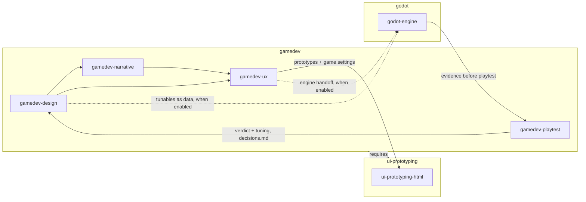
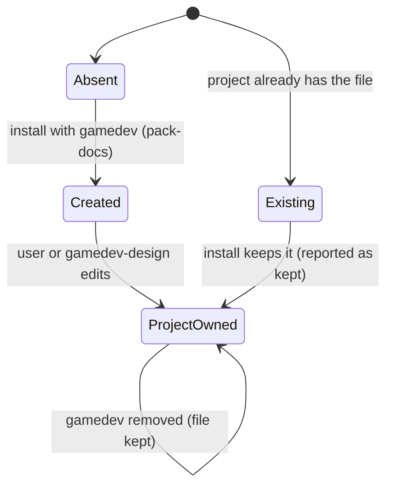
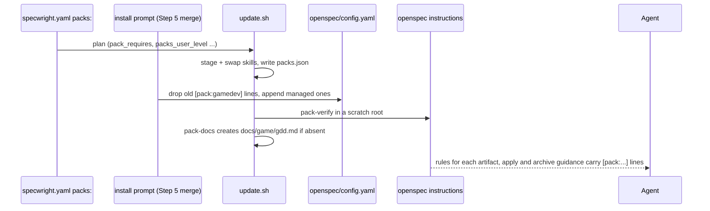

# Design

## Triage

| Trigger | Applies? | Evidence |
|---|---|---|
| T1 Components (new component, or 3+ with directed relationships) | yes | Three new packs (`packs/ui-prototyping/`, `packs/gamedev/`, `packs/godot/`) with six skills that hand off to each other, and `gamedev` requires `ui-prototyping`. |
| T2 State (persistent state, caches, 3+ state machine) | yes | Installing `gamedev` creates `docs/game/gdd.md` in the user's project. The project owns the file and it outlives the pack. The mechanism exists (`update.sh pack-docs`); the document is new. |
| T3 Concurrency (background work, workers/isolates, async, retries) | no | Static content. Install concurrency is `update.sh`'s, unchanged. |
| T4 Boundaries (data format, migration, shared interface, IPC, external) | yes | Pack names, skill names, the GDD's default path and the `[pack:<name>]` lines become what projects enable, record in `packs.json` and receive through `openspec instructions`. The `ui-prototyping-html` parameter contract is the interface later domain packs call. |
| T5 Volume (grows without a fixed bound) | no | A fixed set of files. Lines are capped by `pack-check` (40 per pack, 2048 bytes of context). |
| T6 Risk (security, money, data loss, unrecoverable user data) | no | No credentials or user data. The GDD is never overwritten (`packs` spec). No third-party notice ships with the skills (D8). |

TIER: FULL

## Context

- `packs/` holds only `README.md`. The mechanism is complete:
  - `update.sh pack-check` (`scripts/update.sh:2381` and nearby), `pack-verify` and `pack-docs`;
  - the `packs.json` record (`scripts/update.sh:2449-2513`);
  - install copies a skill's whole tree (`scripts/update.sh:1969`, `rglob`), so `references/`, `assets/` and `templates/` travel with each skill.
- **Pack operations:** `operations.apply` and `operations.archive` guidance reach the agent as `operationGuidance` from `openspec instructions apply|archive`. `evals/packs/test_pack_verify.py:98-113` already proves the path.
- **The prototype:** Tower of Lament (`F:/Dev/Godot/Projects/tower-of-lament`, commits `cb12f7c`, `6aad6fc`). It has three skills, about 157 KB, plus four hand-written `[pack:gamedev]` lines. Its Godot material is spread over all three skills.
- **Research done during planning:** a gap review of the prototype against public game-design material. Its High and Medium items are in the spec and the tasks (S8).
- **Existing evals:** the shipped-pack checks `evals/packs/test_pack_check.py:226` (every pack under `ROOT/packs` passes) and `:240` (shipped context fits the OpenSpec limit) pass vacuously today. `evals/packs/packenv.py:30` `make_download` copies only fixture packs. `test_pack_verify.py:22` `delivered()` runs a real `openspec instructions` against a merged `config.yaml`.
- **Task markers:** `[user]` and `[evidence]` exist since 0.18.0 (`user-tasks` spec, ADR 0024). An evidence task names one file under the change's `evidence/`. The packs use these markers and add none.
- **Release:** stamping covers `skills/*/SKILL.md` only (`release.version_files`), not `packs/**`.
- **Scope decisions:** proposal.md, S1-S8.

### Pack contents

| Pack | Skills (shipped files) | Lines | Document | Init questions | Signals |
|---|---|---|---|---|---|
| `ui-prototyping` | `ui-prototyping-html` (`assets/prototype-template.html`, a prototyping reference, the token schema) | proposal: an undecided layout or flow is settled with a clickable prototype first | none | none | none |
| `gamedev` (requires `ui-prototyping`) | **`gamedev-design`**: references for the GDD guide, ideation, genres, systems and balance, levels and encounters, game architecture and game code checks; templates for `brief` and `decisions`. **`gamedev-narrative`**: story-craft and delivery references; `narrative` template. **`gamedev-ux`**: game UX craft reference; `ux` template. **`gamedev-playtest`**: playtest craft reference. | **context:** where the game documents live. **proposal (3):** classification, sources and sinks, feel words. **specs/design (5):** tuning in data, frame budget, save compatibility, feel vs layout, idle doesn't win. **tasks (2):** `[user]` playtest with who plays, input-device evidence. **apply (1):** game code checks. **archive (1):** name the sections implemented and any verdict that changed them. | `gdd` → `docs/game/gdd.md` (own skeleton) | six, each prefixed with the GDD heading it fills (D2) | `project.godot`, `**/project.godot`, `*.uproject`, `ProjectSettings/ProjectVersion.txt`, `game.project`, `docs/game/gdd.md` |
| `godot` | `godot-engine` (the evidence and testing reference, a Godot 4 changes table, the hand-editing rules for scene and resource files) | **design:** tunables in `.tres` resources. **tasks:** the tool-neutral `[evidence]` task that names its state, placed before any playtest. | none | none | `project.godot`, `**/project.godot` |

About 14 gamedev lines, 2 godot lines and 1 ui-prototyping line, well under the 40-line cap. Every line uses conditional wording ("A change that ..."), so it costs nothing outside its domain. The final wording is written during apply and must pass `pack-check`'s `relaxes_gate` check. File names inside skills are set during apply; the spec fixes only the names it states.

## Decisions

### D1: Where prototypes are saved

- **Choice:** `ui-prototyping-html` saves to the folder the calling domain skill or the project's instructions name, else `docs/prototypes/`. `gamedev-ux` names `docs/game/prototypes/`.
- **Rejected:** a fixed `docs/prototypes/` for every domain. Game projects would split their design files over two trees, and Tower of Lament's existing prototypes would sit outside the default.
- **Reversal cost:** low. The location is skill guidance only; no manifest field or record holds it.
- **Important:** yes. It changes files users see.
- **Chosen by:** user

### D2: Which packs ask init questions, and how answers find their section

- **Choice:** only `gamedev` asks, six questions. Each question starts with the exact GDD heading it fills (`Genre and References: ...`), and the GDD template has that heading. The template is the pack's own short skeleton:
  - Pitch, with `### Genre and References` and `### Core Fantasy and Pillars`;
  - Core Loop;
  - Mechanics;
  - Progression and Difficulty;
  - World and Story, with `### Narrative Weight`;
  - Look, Sound and Feel;
  - Platforms and Input;
  - Accessibility Floor;
  - First Playable;
  - Out of Scope;
  - Open Questions.

  `godot` and `ui-prototyping` ask nothing: `godot-engine` reads the version and renderer from `project.godot`, and each evidence task chooses its own check method.
- **Rejected:** giving `godot` its own `docs/game/engine.md` with three questions: one more file per project, holding facts that `project.godot` already has.
- **Reversal cost:** low. A later version can add questions or a document. Answers already written stay in the GDD.
- **Important:** yes. It changes what roadmap init asks users.
- **Chosen by:** user

### D3: gamedev's signals

- **Choice:** the major engines' project files: Godot at the root or nested, Unreal, Unity and Defold, plus `docs/game/gdd.md`. `godot` matches only `project.godot`. `ui-prototyping` has none and is offered through `requires`.
- **Rejected:** Godot files only. Unity and Unreal projects would never be offered the engine-neutral pack.
- **Reversal cost:** low
- **Important:** yes. It changes which packs users are offered.
- **Chosen by:** user

### D4: How the skills find the game documents

- **Choice:** each skill uses `packs.gamedev.documents.gdd` from `openspec/specwright.yaml` when set, else the paths the project's AGENTS.md or CLAUDE.md name, else `docs/game/`. `brief.md`, `narrative.md`, `ux.md` and `decisions.md` sit beside the GDD. The `gamedev` context line states the default.
- **Rejected:** reading the paths from `openspec/.specwright/packs.json`. The record is the installer's ownership file (ADR 0023), and making skills read it would turn its internal layout into a contract with skill content.
- **Reversal cost:** low
- **Important:** no. It reads a key that already exists, and no new contract is made.
- **Chosen by:** agent

### D5: Engine material lives only in the stack pack

- **Choice:** everything engine-specific goes into `godot-engine` and nowhere else. The `gamedev` and `ui-prototyping` skills name no engine. Where they need it, they say "when a stack pack is enabled, use its skill for the engine handoff", or use a neutral phrase such as "the engine's UI layer". Unit wording (pixels, tiles, seconds, frames at a stated tick rate) stays in `gamedev-design`, because it is engine-neutral.

  The prototype's Godot topics are input to the `godot-engine` task, not text to move:
  - `gamedev-design` "Godot notes";
  - the narrative `.tres` and localization paragraphs;
  - `gamedev-ux` and `prototyping.md` "Godot handoff";
  - the Theme mapping in `ux-guide.md`.

  D6 (d) checks every file of the neutral skills.
- **Rejected:** keeping engine notes in the gamedev skills behind an "if Godot" condition. Every gamedev project would load Godot guidance, and a later Unity pack would have to edit gamedev's skills instead of shipping its own.
- **Reversal cost:** low
- **Important:** no. It follows from S1.
- **Chosen by:** agent

### D6: How the shipped packs are tested

- **Choice:** a new module, `evals/packs/test_shipped_packs.py`. `packenv.make_download` gains a `source` argument so it can copy the repository's real `packs/` instead of the fixtures. The module checks:
  - **(a)** `pack-check` over the three packs.
  - **(b)** the Step 5 merge, then real `openspec instructions` for proposal, specs, design, tasks, `apply` and `archive`, three times: with `ui-prototyping` + `gamedev`, then with `godot` added, then with no packs.
  - **(c)** `pack-docs` creating the GDD, keeping an existing one, and creating no other document.
  - **(d)** static checks over every file of the pack trees:
    - descriptions of at most 600 characters;
    - named `references/`, `assets/` and `templates/` paths exist in their skill;
    - the four document templates exist under `templates/`;
    - no third-party notice: no file named `LICENSE*`, `LICENCE*`, `NOTICE*` or `COPYING*`, and no `Adapted from` or `Ported from` in any file;
    - engine-neutral wording: no `godot` (any case), `.tres` or `MCP` in the gamedev and ui-prototyping lines, skills and documents;
    - the neutral prototype template: a `system-ui` font stack and no fixed stage size in pixels;
    - the D9 contract: `gamedev-ux` gives a value for `stage`, `scaling`, `font`, `input model` and `save folder` (`docs/game/prototypes/`), and `ui-prototyping-html` lists the same five names with neutral defaults; a missing or unknown setting fails, naming it;
    - the godot tasks line names a headless run and `--write-movie`;
    - init questions match GDD headings;
    - nested signals have a root form.
  - **(e)** the real installer with the shipped packs, through the end-to-end harness of `evals/update/test_packs.py` (`checkout`, `download`, `one_run`, `:767`), whose download is given the repository's `packs/` instead of the fixtures:
    - all three packs install, the six skill trees are equal to the download's bytes in every chosen skills directory, and `packs.json` records each skill under its pack;
    - `gamedev` without `ui-prototyping` is refused with `pack_requires`, and no file changes;
    - `godot` alone installs only `godot-engine`;
    - removal deletes the skills and the `[pack:` lines and keeps an edited GDD byte for byte;
    - the catalogue the install writes in `packs.json` carries the signals.
  - **(f)** signal matching over that installed catalogue against three file lists: root `project.godot`, nested `Source/Game/project.godot`, and none. It uses both readings of `**/`: zero or more leading directories (gitignore), and at least one.

  (e) and (f) live in the update suite (`evals/update/test_shipped_packs.py`), because they drive the journaled install. Both modules are written before the pack content they check and run red first (tasks 1.2 and 1.3). The line checks in (b) assert the required concepts by fixed keywords held in the test (D10 table), not by reading the manifest under test. The rest lives in `evals/packs/test_shipped_packs.py`. The `openspec`-dependent tests skip when the CLI is missing, like `test_pack_verify.py:36`; CI has the CLI, so they run there.

  Test map, scenario → check:

  | Spec scenario | Check |
  |---|---|
  | The shipped packs pass pack-check | (a) |
  | gamedev without its shared pack; godot on its own; Skills installed with their packs | (e) |
  | A description too long; References resolve; A reference left behind by the split | (d) |
  | Clean skill trees; A leftover credit | (d) |
  | GDD created at install; An existing GDD | (c), and (e) for the real install |
  | Templates shipped with their skills | (d) |
  | Questions with a home; A question with no document | (d) |
  | Proposal lines delivered; gamedev specs lines delivered; gamedev design lines delivered; Tasks and apply lines delivered; No pack enabled | (b) |
  | Engine-neutral wording | (d) |
  | Prototype line delivered | (b) |
  | The line's pack is removed | (e) |
  | Neutral template; Game settings passed; A missing game setting | (d) |
  | godot with gamedev; Design line delivered | (b) |
  | Not tied to one tool | (d) |
  | A nested Godot project; No engine file; Root file under the strict reading | (f) |
  | A nested signal without its root form | (d) |
- **Rejected:** extending `pack-check` in `update.sh` with description, reference and notice checks. That is a core script change for first-party content, and these checks are about this repo's packs, not about the format.
- **Reversal cost:** low
- **Important:** no
- **Chosen by:** agent

### D7: Pack skills carry no version stamp

- **Choice:** pack skills have no `metadata.version`, and `release.version_files` is unchanged. `packs.json` records the Specwright version each pack was installed from, and ownership compares bytes (ADR 0023).
- **Rejected:** stamping every pack skill at each release. Each release would touch six more files, and installs would gain no information.
- **Reversal cost:** low
- **Important:** no
- **Chosen by:** agent

### D8: How the skill content is written

- **Choice:** each skill is written by an implementer whose prompt holds only:
  - this spec;
  - the skill's task;
  - the pack format rules (`packs/README.md`);
  - public documentation, such as Godot's docs through ctx7.

  Each implementer is a fresh-context subagent, never a fork of the orchestrator's context. The orchestrator reviews the written skill against the spec and the task and sends gaps back as requirement-level requests; it writes no skill prose itself.
- **Rejected:**
  - Rewording the Tower of Lament skills: they carry their own third-party licence.
- **Reversal cost:** low
- **Important:** yes. It decides what users receive (S5).
- **Chosen by:** user

### D9: The ui-prototyping parameter contract

- **Choice:** `ui-prototyping-html` takes settings from the calling skill, and both skills carry the same table:
  - the question the prototype answers, and its surfaces;
  - stage and scaling;
  - font;
  - input model and prompt glyphs;
  - placeholders and the safe-area guide;
  - token extensions;
  - the save folder;
  - the spec link.

  Each setting has a neutral default. `gamedev-ux` passes the game values: a fixed, integer-scaled stage, a pixel font when the art calls for it, gamepad-first input, and `docs/game/prototypes/`. `ui-prototyping-html` owns the token schema and its CSS mapping; `gamedev-ux` owns the game token roles (health, rarity, faction), which it adds as `--color-game-<role>`.
- **Rejected:** shipping Tower of Lament's template with game defaults. The shared pack would be game-flavoured, and the first web pack would have to rework it.
- **Reversal cost:** medium. Later domain packs call this contract.
- **Important:** yes. It sets the interface other packs will use.
- **Chosen by:** user

### D10: Which artifact each line attaches to

- **Choice:**
  - proposal: the gamedev classification, sources and sinks, and feel-word lines;
  - specs and design: tuning in data, frame budget, save compatibility, feel vs layout, and idle doesn't win;
  - tasks: the playtest with who plays, and input-device evidence;
  - `apply`: the game code checks;
  - `archive`: the existing line;
  - godot: design (`.tres`) and tasks (evidence).

  The five shared concerns are each written once, under the artifact where they act first:

  | Concern | Artifact | Why there | Test keyword |
  |---|---|---|---|
  | Tuning in data | design | where values live is a method | data the game loads |
  | Frame budget | design | a budget and how it is measured | frame budget |
  | Save compatibility | specs | it is a scenario: load the previous save | previous version's save |
  | Feel vs layout | specs | it decides which scenarios map to `[user]` and which to `[evidence]` | playtest |
  | Idle doesn't win | specs | it is a scenario: an automated check | doing nothing |

  The design review still sees both artifacts' lines through the instructions.
- **Rejected:** putting the game code checks in a design line only. Implementers would not see them when writing code, and the pre-ship reviewer cannot load pack skills yet (#189).
- **Reversal cost:** low
- **Important:** no. It follows from S7.
- **Chosen by:** agent

### Decision summary

| # | Decision | Choice | Rejected | Reversal cost | Important | Chosen by |
|---|---|---|---|---|---|---|
| S1 | Skill split across packs | By layer: ui-prototyping-html; gamedev design/narrative/ux/playtest; godot-engine | ToL's three as-is; gamedev + godot only | medium | yes | user |
| S2 | Documents gamedev creates | GDD only, own skeleton; brief/narrative/ux/decisions from skill templates when needed | GDD+narrative+UX at install; a published template | low | yes | user |
| S3 | In-engine check | Tool-neutral `[evidence]` task naming its state; headless gives a log, a windowed run or `--write-movie` gives a screenshot | Require Godot MCP | low | yes | user |
| S4 | Playtest support | `gamedev-playtest` skill | Rule line only | low | yes | user |
| S5 | Content source | Written fresh; no third-party notice | Shipping the Tower of Lament skills | low | yes | user |
| S6 | Tower of Lament migration | Out of scope; a README note | Migrate in this change | low | no | agent |
| S7 | Rule lines | The listed gamedev, godot and ui-prototyping lines | ToL's four lines only | low | yes | user |
| S8 | Content scope | High + Medium learned items; Low as notes | High only; everything | low | yes | user |
| D1 | Prototype location | Domain decides, else `docs/prototypes/` | Always `docs/prototypes/` | low | yes | user |
| D2 | Init questions | gamedev only, six, matching the own GDD skeleton | A godot engine document with questions | low | yes | user |
| D3 | gamedev signals | Major engines' project files + GDD | Godot only | low | yes | user |
| D4 | Finding the documents | `specwright.yaml` override, else project instructions, else `docs/game/` | Read `packs.json` | low | no | agent |
| D5 | Engine material | Only in `godot-engine` | "If Godot" sections in gamedev | low | no | agent |
| D6 | Testing shipped packs | Static and instruction checks in `evals/packs/`, real-installer checks in `evals/update/` | New checks in `update.sh pack-check` | low | no | agent |
| D7 | Version stamp | None on pack skills | Stamp at each release | low | no | agent |
| D8 | Writing the skill content | Fresh-context implementers from the spec and tasks | Rewording ToL copies | low | yes | user |
| D9 | Prototyping contract | Caller supplies settings; neutral defaults; tokens split by owner | Game defaults in the shared pack | medium | yes | user |
| D10 | Line attachment | Lines by artifact, game code checks as an apply line | Design line only | low | no | agent |

## Diagrams (FULL)

T1, the packs and their skills:

T2, the GDD in a project:

T4, how a pack line reaches a change:

## State & Ownership (FULL)

| State | Owner (sole writer) | Lifetime | Invalidation / rebuild | Authoritative copy |
|---|---|---|---|---|
| `packs/<name>/` content | This repo (PRs) | Per release | Replaced by the next release's download | The release tag |
| Installed pack skill directories | `update.sh` (swap) | While the pack is enabled | Re-installed at each update; removed when the pack is disabled | `packs.json` + the download's bytes |
| `[pack:<name>]` lines in `config.yaml` | Install prompt (Step 5 merge) | While the pack is enabled | Removed and re-added on every install | The pack manifest in the download |
| `docs/game/gdd.md` | The project (the user, through `gamedev-design`) after `pack-docs` creates it | Forever, including after pack removal | Never rebuilt or overwritten | The project's file |
| `brief.md`, `narrative.md`, `ux.md`, `decisions.md`, prototypes | The project, through the gamedev and ui-prototyping skills | Forever | Never rebuilt | The project's files |

## Failure & Visibility (FULL)

| Component | Fails / dies mid-operation → | Recovery | Retry safe? | Who finds out |
|---|---|---|---|---|
| A shipped pack's manifest or line (bad wording, unknown artifact) | `pack-check` refuses it | Fix in this repo | yes | This repo's CI (`test_pack_check.py:226`), before release |
| A skill names a file it does not carry | The skill would point at nothing at run time | Fix in this repo | yes | `evals/packs/test_shipped_packs.py` (D6 d) in CI. Without that check, nobody would notice until a user ran the skill. |
| A skill carries a leftover licence file or credit line | A third-party notice would ship | Remove it in this repo | yes | The notice check (D6 d) in CI |
| Install with gamedev but not ui-prototyping | Plan refuses `pack_requires` before any write | User enables both | yes | User, through the refusal message |
| Install where hand copies of `gamedev-*` exist (Tower of Lament) | Plan stops `unmanaged_skill` | User deletes the hand copies (packs/README note) | yes | User, through the refusal and the README note |
| `pack-docs` interrupted | Existing behaviour: no partial document (`test_pack_docs.py:102`) | Rerun completes | yes | User, through the report |
| Evidence task method unavailable (no display, no MCP) | The agent cannot produce a screenshot | A headless log is the fallback where it answers the question; otherwise the task stays unticked, and `task-cover.sh` reports `evidence_missing` once it is ticked without the file | yes | User, through the apply report |

## Resource Bounds (FULL)

| Queue / buffer / cache / transfer | Bound | At the bound | Timeout | At 10x / 100x |
|---|---|---|---|---|
| Pack lines per pack | 40 lines, 500 chars each, 2048 B context (`pack-check`) | Refused in CI | n/a | Fixed content: about 15 gamedev, 2 godot, 1 ui-prototyping. |
| Session-loaded skill descriptions | 6 skills × ≤600 chars ≈ 3.6 KB per session with all three packs | Eval fails above 600 chars per skill | n/a | Each later pack adds its own few skills. The cap keeps it linear and small. |
| Installed skill content | About 200-250 KB, loaded on demand: SKILL bodies stay short, and the detail lives in references read when needed | n/a | n/a | Fixed per release |
| Shared `context:` under OpenSpec's 50 KB limit | Checked by `test_pack_check.py:240` over core + all shipped packs | Eval fails | n/a | About 1 line of context per pack. Many packs fit. |

## Flow & State Gaps (FULL)

- **Tower of Lament (a hand-made pack, enabled later).** Plan stops with `unmanaged_skill` on its hand copies. Its four hand-written `[pack:gamedev]` lines are removed by the merge once `gamedev` is enabled (ADR 0023 D5), so no line is duplicated. `docs/game/gdd.md` does not exist there yet, so the template is created. Its existing `docs/game/prototypes/` is the `gamedev-ux` default (D1).
- **godot without gamedev** (a Godot tool, not a game): the evidence line applies on its own. Its "before any playtest task" clause is conditional, so a change with no playtest task needs none.
- **A pack removed mid-change:** the lines disappear from later `openspec instructions`. Artifacts already written keep their tasks. A `[user]` playtest task already in `tasks.md` still blocks archive (user-tasks spec), which is the intended additive behaviour.
- **User override of the GDD path** after the GDD was created at the default: the old file is kept, and the new path is created from the template if absent (existing `pack-docs` behaviour). The skills follow the override (D4).
- **Stale download** (a project on 0.19.0 enabling `gamedev`): `pack_unknown` refuses it, naming the packs that download has (existing).
- **A tuning-only request** (D10 classification): no GDD edit is required; `gamedev-design` drafts a tuning line for `decisions.md`. The class grants no exemption: the change still goes through proposal, triage, review, test-first tasks and, when player-visible, the playtest task. The skill never edits data or code itself.

## Mechanism Ledger (FULL)

| Mechanism | Built? | Why (harm nobody catches / expensive later) | Evidence that would change the call |
|---|---|---|---|
| Static checks on shipped skills (D6 d) | yes | A broken reference, a leftover notice or engine leakage reaches every user, and nobody catches it until a skill runs | n/a |
| Real `openspec instructions` round trip for artifacts, apply and archive | yes | The milestone exit criterion, and the only proof the lines reach the agent | n/a |
| Real-installer run with the shipped packs (D6 e) | yes | The fabricated record in `packenv.make_project` installs no skill, so only the real install proves ownership, refusals and removal for these manifests | n/a |
| Moving the static checks into `update.sh pack-check` | no | Only first-party packs exist, and CI covers them | External packs (`source`) being accepted |
| Version stamp on pack skills | no | `packs.json` and byte comparison already identify the content | An update path that needs a per-skill version |
| Migration script for hand-made packs | no | One known project. The refusal plus a README note suffice. | A second project with hand-made packs |
| Graded agent eval of the skills' content | no | Content quality is judged by the PR review and the deferred dogfood check in Tower of Lament | A dogfood report of a skill misleading the agent |

## Risks / Trade-offs

- [Fresh-context writers produce thinner skills than the prototype] → The tasks list each skill's jobs and files, the orchestrator reviews each skill against them, and the PR review reads the content. The deferred dogfood check is the real test.
- [Wrong engine facts in `godot-engine`] → The writer checks each engine fact against the Godot docs through ctx7, and the PR review checks them again.
- [Shorter descriptions trigger the skills less often] → Keep the trigger phrases, drop the examples. The SKILL body and the references hold the guidance.
- [More lines add text to every game change] → Each line is conditional and short. Lines that would apply to most changes are the ones a game project needs.
- [A rule line reads as relaxing a gate] → `pack-check`'s crude check plus review of this PR. Lines use conditional, additive wording.

## ADRs

- **In force, constraining this change:**
  - 0023: packs are additive bundles in the release; structural additive-only; ownership from `packs.json`;
  - 0024: `[user]` and `[evidence]` tasks; only the user ticks a user task;
  - 0021: installed skills are the user's; packs narrow it to in-repo directories;
  - 0001: OpenSpec unmodified.
- **To record during apply:** none. The packs use the v1 surface as ADR 0023 defines it. The layering (domain packs require shared packs, stack packs stand alone) and the D9 contract are pack content, documented in `packs/README.md` and the skills.

## Open Questions

- Exact wording of each line and each description: written during apply within the bounds above.
- File names inside each skill: set during apply, keeping the spec's named paths.
