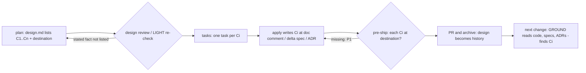

# Design

## Triage

| Trigger | Applies? | Evidence |
|---|---|---|
| T1 Components (new component, or 3+ with directed relationships) | no | No new skill, agent or script. The behaviour is schema instruction text (`schemas/specwright/schema.yaml:290-400`) and the pre-ship brief (`skills/specwright-review/references/brief.md:12-23`) |
| T2 State (persistent state, caches, 3+ state machine) | no | The entries live in design.md, which exists per change. Their destinations are ordinary files of the project |
| T3 Concurrency (background work, workers/isolates, async, retries) | no | Planning, apply and review run one at a time, as today |
| T4 Boundaries (data format, migration, shared interface, IPC, external) | yes | A new design.md section (`## Carried constraints`, ids `C1`...) that the design review, the tasks step and the pre-ship review read, in every installed project |
| T5 Volume (grows without a fixed bound) | no | Entries are per change and bounded by its decisions. Nothing reads across changes; avoiding that growth is the point (proposal S3) |
| T6 Risk (security, money, data loss, unrecoverable user data) | no | No credentials, network or user data |

TIER: FULL

## Context

- Nothing reads archived designs today. The proposal and design instructions send planners to specs (`openspec list --specs`), code, the architecture file and in-force ADRs (`schemas/specwright/schema.yaml:290-294`, `:387-391`), never `changes/archive/`.
- Three homes already outlive a change:
  - Main specs, through delta specs at archive. They hold "observable behavior users or downstream systems rely on" (`schemas/specwright/schema.yaml:145-146`).
  - ADRs, "only for decisions that bind future changes … written during apply, after review approves" (`schemas/specwright/schema.yaml:394-398`), with the first task group writing them (`schemas/specwright/schema.yaml:585-586`).
  - Code, which the GROUND step makes the planner read (`schemas/specwright/schema.yaml:290-291`). No rule sends a design fact into code comments.
- Finish commits only archive paths (`skills/specwright-finish/SKILL.md:78`). Ship judges an archive-only push against the ready head and skips `pr.validate` for it (`skills/specwright-finish/SKILL.md:93`). A pre-ship pass also carries over to a head whose only later commit is the archive commit (spec `preship-review`, "Ship and local merge require a pass"). That is why S1 puts the work in apply.
- The pre-ship brief already checks one planning artifact against the diff: the Release Notes, as P1 `docs` (`skills/specwright-review/references/brief.md:18-23`; spec `preship-review`, "checks the Release Notes section"). The new check follows the same pattern.
- `verify-design-claims` (#197, planned before this change) adds `## Assumptions` above the template's LIGHT boundary and changes the schema's LIGHT list to "Triage, Context, Decisions and Assumptions". This change extends both, so it applies on top of that one (A1).

## Decisions

### D1: `## Carried constraints` with ids, after Assumptions and above the LIGHT boundary

- **Choice:** a section in both tiers, after `## Assumptions` and above the template's LIGHT boundary. Each entry has an id (`C1`, `C2`...), the fact, its kind (invariant, deliberate gap or rejected alternative), and exactly one destination:
  - `doc comment: <path> <symbol>`
  - `spec: specs/<capability>/spec.md → Requirement: <name>`
  - `ADR NNNN`

  The section reads `None` when nothing outlives the change. The LIGHT list becomes "Triage, Context, Decisions, Assumptions and Carried constraints".
- **Rejected:** a `Carried to:` line on each Decisions entry. It misses facts that are not decisions, such as a deliberate data gap found while grounding, and it gives the tasks and pre-ship nothing to enumerate.
- **Reversal cost:** medium (a design format installed projects start writing)
- **Important:** yes (binds future changes: data format)
- **Chosen by:** user

### D2: Destination by kind of fact

- **Choice:** the design instruction gives the rule:
  - a fact about specific code (what an input holds, why a path is not taken) goes in that code's doc comment, where the next planner reads it during GROUND;
  - a guarantee users or downstream systems rely on goes in the delta spec;
  - a decision that binds future changes beyond one module goes in an ADR, under the existing ADR rules.

  When the constrained code is in a file that cannot hold a comment, the destination is the nearest owning code or the spec.
- **Rejected:** always an ADR. That inflates the ADR set with module-level facts, and the next planner of that module would read the code but not the ADR.
- **Reversal cost:** low
- **Important:** no
- **Chosen by:** agent

### D3: The design review checks completeness; Moderate

- **Choice:** the review instruction's checklist gains a **Carried constraints** item. A stated fact that a future change could break and that is not listed is a Moderate finding. So is an entry with zero or several destinations. The LIGHT re-check, run by the author, applies the same test as a gate (`schemas/specwright/schema.yaml:414-417`). A failed test is recorded in review.md as a Moderate finding under `## Findings`, with no `VERDICT:` line. Without a verdict the tasks precheck stops (`schemas/specwright/schema.yaml:534-542`). The author then adds the missing entry, or fixes its destination, in design.md and re-runs the re-check. When it passes, review.md gets `VERDICT: SKIPPED_LIGHT` with each earlier finding marked fixed. A clean first re-check still writes the metadata-only `SKIPPED_LIGHT`, as today. This matches how `verify-design-claims` has the LIGHT re-check fix a contradicted citation before any verdict.
- **Rejected:** leaving the list to the author. The blackgrid fact was stated in its design and still was not carried anywhere.
- **Reversal cost:** low
- **Important:** yes (changes behaviour users see: review findings)
- **Chosen by:** user

### D4: A task per entry; the pre-ship review checks each at P1

- **Choice:** the tasks instruction adds a task per entry that writes it at its destination. ADR destinations ride the existing first-group ADR task. The pre-ship brief gains a check: each entry is present at its destination in the reviewed range. A missing entry, or one whose text contradicts the design, is P1 `docs`.
- **Rejected:** P2 advisory, which lets the fact be lost exactly when the design is archived.
- **Reversal cost:** low
- **Important:** yes (changes behaviour users see: ship can block)
- **Chosen by:** user

### D5: No script reads the section

- **Choice:** reviewers read the section as text. No script parses `C` ids or destinations.
- **Rejected:** a checker that greps destinations for the fact. It cannot judge whether a paraphrased comment carries the fact, and the shipped scripts move to the Dart CLI in M7/M8.
- **Reversal cost:** low
- **Important:** no
- **Chosen by:** agent

### Decision summary

| # | Decision | Choice | Rejected | Reversal cost | Important | Chosen by |
|---|---|---|---|---|---|---|
| S1 | When constraints are carried | During apply, reviewed | Harvest in finish before archive | low | yes | user |
| S2 | Where the record lives | design.md section | Line in the archive commit | low | yes | user |
| S3 | Backfill | Forward only | Backfill mode over archives | low | no | user |
| S4 | Pre-ship check | Brief checks destinations | Ticked tasks only | low | yes | user |
| S5 | #190 | Closed by this change | Keep open for `learnings.md` | low | no | user |
| D1 | Record format | `## Carried constraints`, ids `C1`.., above LIGHT boundary | `Carried to:` line on Decisions | medium | yes | user |
| D2 | Destination rule | Doc comment / spec / ADR by kind | Always an ADR | low | no | agent |
| D3 | Completeness check | Design review and LIGHT re-check, Moderate | Author's call | low | yes | user |
| D4 | Task and pre-ship severity | Task per entry; missing = P1 | P2 advisory | low | yes | user |
| D5 | Mechanical checker | None | Destination grep script | low | no | agent |

## Assumptions

- **A1:** `verify-design-claims` is on main before this change is applied. Its `## Assumptions` section in `schemas/specwright/templates/design.md` and its LIGHT list wording in `schemas/specwright/schema.yaml` are what D1 extends. Not checked because that change is planned but not yet applied. Depends on it: D1, task groups 2 and 3.

## Carried constraints

- **C1** (rejected alternative): constraints are never harvested at archive time. The archive commit holds only archive paths, and code edits there would ship unreviewed. Destination: ADR 0026.
- **C2** (invariant): no workflow step reads `changes/archive/` designs for planning. Destination: ADR 0026.
- **C3** (invariant): the `## Carried constraints` format is shared by the design review, the LIGHT re-check, the tasks step and the pre-ship review. That covers the heading, the `C1`... ids, the kinds, exactly one destination in one of the three forms, `None` when empty, and the placement above the LIGHT boundary. Destination: ADR 0026.

<!-- ===== LIGHT tier ends here. Delete everything below for LIGHT. ===== -->

## Diagrams (FULL)

## State & Ownership (FULL)

| State | Owner (sole writer) | Lifetime | Invalidation / rebuild | Authoritative copy |
|---|---|---|---|---|
| `## Carried constraints` entries | The design author (fix rounds under the decision mode) | The change | A design edit voids the review verdict, as today | design.md, until archive |
| The carried fact at its destination | The apply task for that entry | Beyond the change | A later change that alters the code updates or removes the comment in its own reviewed diff | The destination (code, main spec, ADR) |

## Failure & Visibility (FULL)

| Component | Fails / dies mid-operation → | Recovery | Retry safe? | Who finds out |
|---|---|---|---|---|
| Author omits a constraint | Not listed, so not carried | The design review's completeness check (D3) | yes | The reviewer, then the author |
| Task ticked without the text written | Destination lacks the fact | Pre-ship P1 blocks ship (D4) | yes | The pre-ship reviewer |
| Destination removed by an earlier task | Task cannot write it | Drift rule amends the entry (spec scenario) | yes | The orchestrator during apply |
| A later change edits the code and drops the comment | The fact is lost again | Residual risk: that change's GROUND step reads the comment before changing the code, and #197's claim check covers designs that cite it | n/a | The next planner, if at all |

## Resource Bounds (FULL)

| Queue / buffer / cache / transfer | Bound | At the bound | Timeout | At 10x / 100x |
|---|---|---|---|---|
| Entries per design | Bounded by that design's decisions and facts | A long list is a sign the change is too big. No cap | n/a | Flat in project history: each change's facts land in files the next planner reads anyway |

## Flow & State Gaps (FULL)

- **Store-backed change:** a doc comment destination is in the code repo, and a spec destination is in the store's change. The pre-ship review already covers both ranges together (spec `preship-review`, "runs when every task is committed"), so both are in its diff.
- **Pre-ship after the archive commit:** the review reads the archived artifacts (spec `preship-review`, "A review after the archive commit reads the archived artifacts"), so the section is still found.
- **Designs planned earlier:** no section counts as `None` (spec scenario), with no rewrite.

## Mechanism Ledger (FULL)

| Mechanism | Built? | Why (harm nobody catches / expensive later) | Evidence that would change the call |
|---|---|---|---|
| Section + task per entry | yes | The blackgrid fact was in an archived design that nobody read | - |
| Design-review completeness check | yes | The author is the one who forgot to list it | - |
| Pre-ship destination check | yes | A ticked task does not prove the text landed | - |
| Archive-time harvest | no | Unreviewed code edits in the archive commit (S1) | - |
| Backfill of archives | no | Cost grows with history (S3) | Several projects reporting the same archived-fact misses |
| Destination checker script | no | Cannot judge paraphrase; scripts move to `sw` (D5) | Pre-ship reviews repeatedly missing absent entries |

## Risks / Trade-offs

- [Doc comments grow with rationale] → only facts a future change could break are listed, and the review flags padding no more than any other text.
- [A later change silently drops a carried comment] → residual risk (Failure & Visibility). That change's own design review and #197's citation check read the code it changes.
- [Conflict with `verify-design-claims` on the same lines] → A1 and task 1.1: apply starts from a main that already has it.

## ADRs

- **In force, constraining this change:** 0002 (instructions with thin scripts), 0007 (orchestrator / implementer / reviewer split and reviewer routes), 0025 once `verify-design-claims` lands (the Assumptions format this section sits beside).
- **To record during apply:** 0026 "Design constraints are carried into code, specs or ADRs during apply". It is the destination of C1, C2 and C3: the rejection of archive-time harvest, the invariant that no step reads archived designs, and the section format. It also records the destination rule (D2) and the review and pre-ship checks (D3, D4). Written in the first task group, with its architecture-index row; that task names C1-C3.

## Open Questions

None.
