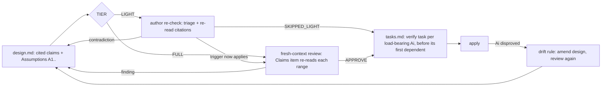

# Design

## Triage

| Trigger | Applies? | Evidence |
|---|---|---|
| T1 Components (new component, or 3+ with directed relationships) | no | No new skill, agent or script. The behaviour is schema instruction text served by `openspec instructions` (`schemas/specwright/schema.yaml:290-294`, `:414-417`, `:460-478`) |
| T2 State (persistent state, caches, 3+ state machine) | no | No new stored state. The Assumptions ids live inside design.md, which already exists per change |
| T3 Concurrency (background work, workers/isolates, async, retries) | no | Planning and review run one at a time, as today |
| T4 Boundaries (data format, migration, shared interface, IPC, external) | yes | A new design.md section (`## Assumptions`, ids `A1`...) that the review step, the LIGHT re-check and the tasks step read, in every installed project |
| T5 Volume (grows without a fixed bound) | yes | Review cost grows with the number of citations in a design. The bound is below |
| T6 Risk (security, money, data loss, unrecoverable user data) | no | No credentials, network or user data |

TIER: FULL

## Context

- The GROUND step already asks for `file:line` citations of existing patterns. It requires a check, or an "unverified assumption" label, only for claims that something does **not** exist (`schemas/specwright/schema.yaml:290-292`). Positive claims about behaviour have no rule, and the template's Context comment says only "cite existing patterns" (`schemas/specwright/templates/design.md:21`).
- The FULL review checklist says to break the design "using the code as evidence". It has no item on whether the design's own citations hold (`schemas/specwright/schema.yaml:460-478`).
- The LIGHT path has the author "re-check the triage against the code" and nothing more (`schemas/specwright/schema.yaml:414-417`).
- Both reviewer agent definitions defer to the review instruction and template for design reviews (`agents/claude/specwright-reviewer.md:19`, `agents/omp/specwright-reviewer.md:20`). CLI routes get the same instruction through the request (`skills/specwright-review/SKILL.md:42`). So the schema is the one place that reaches every route.
- The roadmap baseline review uses "the same way a FULL design is reviewed" (`skills/specwright-roadmap/SKILL.md:64`), so a checklist item there also covers baseline reviews.
- Two precedents shape the tasks side. "If design.md lists new or superseding ADRs, the first task group writes those ADR files" (`schemas/specwright/schema.yaml:585-586`) shows a design list that forces tasks. The drift rule already handles a design found wrong during apply (`schemas/specwright/schema.yaml:692-696`).
- The wording tests assert the key terms of a rule in the flattened schema block (`evals/git-workflow/test_user_tasks.py:27-33`).

## Decisions

### D1: Unchecked claims go in a `## Assumptions` section with ids

- **Choice:** design.md gets a `## Assumptions` section in both tiers. It sits after the Decision summary, above the template's LIGHT boundary (`schemas/specwright/templates/design.md:42`), and the schema's LIGHT list becomes "Triage, Context, Decisions and Assumptions" (`schemas/specwright/schema.yaml:285`), so a LIGHT author never deletes it. Each entry has an id (`A1`, `A2`...), the claim, why it was not checked, and the decisions or tasks that depend on it (or `none`). The section reads `None` when every claim is cited.
- **Tested by:** wording tests in `evals/git-workflow/test_design_grounding.py`. One asserts that `## Assumptions` appears in `schemas/specwright/templates/design.md` above the LIGHT deletion boundary. Another asserts that the schema's LIGHT section list (the design instruction's "No trigger → LIGHT tier" line) names Assumptions.
- **Recorded as:** ADR 0025, written in the first task group with its row in the architecture index (`schemas/specwright/schema.yaml:394-398`, `:585-586`), because the section's format and its consumers bind future changes.
- **Rejected:** inline `Assumption:` markers where the claim sits. The review and the tasks step would have to scan the whole design to find them, and a verify task would have nothing stable to point at.
- **Reversal cost:** medium (a design format that installed projects start writing)
- **Important:** yes (binds future changes: data format)
- **Chosen by:** user

### D2: Claim findings are Critical when load-bearing

- **Choice:** a contradicted citation that a decision or task depends on is Critical, so it blocks `APPROVE`. Any other claim finding is at least Moderate: a missing citation, a citation that does not show its claim, or an assumption the code settles.
- **Rejected:** always Critical, which blocks approval over incidental context lines. Also rejected: leaving severity to the reviewer, which is what let the blackgrid contradiction through as an approvable design.
- **Reversal cost:** low
- **Important:** yes (changes behaviour users see: review verdicts)
- **Chosen by:** user

### D3: Citations are as narrow as the claim allows, with no line cap

- **Choice:** the rule is to cite the lines that show the claim. The reviewer flags a range too broad to show it as a finding.
- **Rejected:** a fixed cap (for example 30 lines). Some claims honestly span a function, and a number invites splitting one range into several to fit.
- **Reversal cost:** low
- **Important:** yes (changes behaviour users see)
- **Chosen by:** user

### D4: The check lives in the schema's review instruction

- **Choice:** add a **Claims** item to the "Try to break the design" checklist and a citation clause to the LIGHT paragraph, both in `schema.yaml`. The reviewer agent definitions also name the claim check in their design-review line, so a subagent route cannot skip it.
- **Rejected:** a separate reference file in `specwright-review`. CLI routes see only the request and the instruction, so a reference file would reach the subagent but not codex, claude or omp CLI reviews.
- **Reversal cost:** low
- **Important:** no
- **Chosen by:** agent

### D5: Verify-first tasks go before their first dependent task, not in a fixed group

- **Choice:** the tasks instruction requires one task per load-bearing assumption. It names the id, says what to read or run to settle it, and comes before the first task that relies on it. An assumption that nothing depends on gets no task.
- **Rejected:** always putting all verify tasks in a first group. That works, but it forces verification of assumptions that only a late group needs. The ADR precedent is about writing files, not ordering checks.
- **Reversal cost:** low
- **Important:** no
- **Chosen by:** agent

### D6: No script checks citations

- **Choice:** the check is review instruction text only. No script parses `path:line` citations.
- **Rejected:** a citation checker in `review-run.sh`. A script can tell that a range exists, not that it supports the claim, which is the failure this change targets. And the shipped scripts move to the Dart CLI in M7/M8.
- **Reversal cost:** low
- **Important:** no
- **Chosen by:** agent

### Decision summary

| # | Decision | Choice | Rejected | Reversal cost | Important | Chosen by |
|---|---|---|---|---|---|---|
| S1 | Scope of this change | #197 only; #198 is the next change | One combined change | low | no | user |
| S2 | LIGHT designs | Author re-check re-reads citations | FULL only; reviewer run per LIGHT change | low | yes | user |
| S3 | Placement | M7, before `native-cli-spike` | Outside any milestone | low | yes | user |
| S4 | Pre-ship review | Unchanged | Add claim checks there | low | no | agent |
| D1 | Marking unchecked claims | `## Assumptions` with ids | Inline markers | medium | yes | user |
| D2 | Severity | Critical when load-bearing, else at least Moderate | Always Critical; reviewer judges | low | yes | user |
| D3 | Citation width | Narrow, no cap | Fixed line cap | low | yes | user |
| D4 | Where the check lives | Schema review instruction, plus the reviewer agents | Reference file in specwright-review | low | no | agent |
| D5 | Verify-task placement | Before the first dependent task | Fixed first group | low | no | agent |
| D6 | Mechanical checker | None | Citation checker script | low | no | agent |

## Assumptions

None. Every claim above cites the lines it rests on.

<!-- ===== LIGHT tier ends here. Delete everything below for LIGHT. ===== -->

## Diagrams (FULL)

## State & Ownership (FULL)

| State | Owner (sole writer) | Lifetime | Invalidation / rebuild | Authoritative copy |
|---|---|---|---|---|
| `## Assumptions` entries in design.md | The design author (and fix rounds under the decision mode) | The change | Editing it voids the review verdict, as for any design edit | design.md |
| Verify tasks in tasks.md | The tasks step | The change | Rewritten when a drift amendment changes the Assumptions | tasks.md |

## Failure & Visibility (FULL)

| Component | Fails / dies mid-operation → | Recovery | Retry safe? | Who finds out |
|---|---|---|---|---|
| Reviewer skips the Claims item | The design passes with an unchecked citation | None assured. Verify tasks cover only declared assumptions, not a false claim presented as cited fact. A wrong cited claim can still surface late in apply, under the drift rule, as in #197. This is residual risk | yes | The user, at drift time, as today |
| Cited range moved since the design was written | The citation does not show the claim | Finding: re-cite or correct | yes | The reviewer (spec scenario) |
| Verify task disproves an assumption | Dependent work stops | Drift rule: amend, review, resume | yes | The user, through the drift report |

## Resource Bounds (FULL)

| Queue / buffer / cache / transfer | Bound | At the bound | Timeout | At 10x / 100x |
|---|---|---|---|---|
| Ranges the reviewer reads | One read per citation. Each range is as narrow as its claim (D3) | A design with dozens of citations costs a few hundred tokens per claim. Too-broad ranges are findings | The route's existing review timeout (`review-run.sh`) | Cost grows with the claims in one design, not with project history. A design that big is already flagged by the triage |

## Flow & State Gaps (FULL)

- **Design edited after review:** voids the verdict as today, so a new round re-reads all citations. No partial re-check.
- **APPROVE_WITH_CHANGES re-check:** that run re-checks only the Required Changes. A Required Change that adds or changes a citation brings that citation into the re-check.
- **Store-backed change:** citations point at the code checkout, which the reviewer already reads. The Claude route is passed `--store` to read planning files (`skills/specwright-review/SKILL.md:42`). No new path handling.
- **Designs planned before this change:** they have no `## Assumptions` section. Review treats the missing section as `None` and still checks any citations they carry. No rewrite is required.

## Mechanism Ledger (FULL)

| Mechanism | Built? | Why (harm nobody catches / expensive later) | Evidence that would change the call |
|---|---|---|---|
| Claims checklist item + LIGHT clause | yes | The blackgrid failure: an approvable design whose citation said the opposite | - |
| Verify-first tasks | yes | Catches assumptions no reviewer could settle before dependent work starts | - |
| Citation-existence script | no | It cannot judge support, and scripts are moving to `sw` (D6) | Reviews that repeatedly miss dead citations |
| Pre-ship claim check | no | Too late to save apply work (S4) | Shipped code that contradicts an approved design claim |

## Risks / Trade-offs

- [Reviewers report citation nits on incidental context] → D2 keeps non-load-bearing findings at Moderate, so they never block alone.
- [Authors dodge citations by labelling everything an assumption] → the review flags an assumption the code settles (spec), and each load-bearing one costs a verify task.
- [A reviewer skips the Claims item and a wrong cited claim reaches apply] → residual risk. The Claims item is in the one instruction every route reads (D4), and the reviewer agents name it.
- [Wording tests prove only that the rule is in the text] → as for earlier instruction changes. A graded agent eval stays out of scope.

## ADRs

- **In force, constraining this change:** 0002 (agent instructions with thin scripts: the check is instruction text), 0007 (the orchestrator / implementer / reviewer split it carries over from the superseded 0005, and reviewer routes with a Specwright-owned contract: no change to the verdict contract).
- **To record during apply:** 0025 "Design claims cite code; unchecked claims are numbered assumptions". It covers the citation rule, the `## Assumptions` section in both tiers with ids `A1`..., its consumers (the FULL review's Claims item, the LIGHT re-check, verify-first tasks), and the severity rule. Written in the first task group, with its architecture-index row.

## Open Questions

None.
