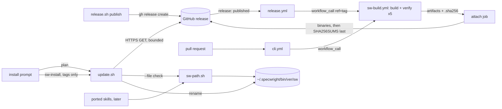
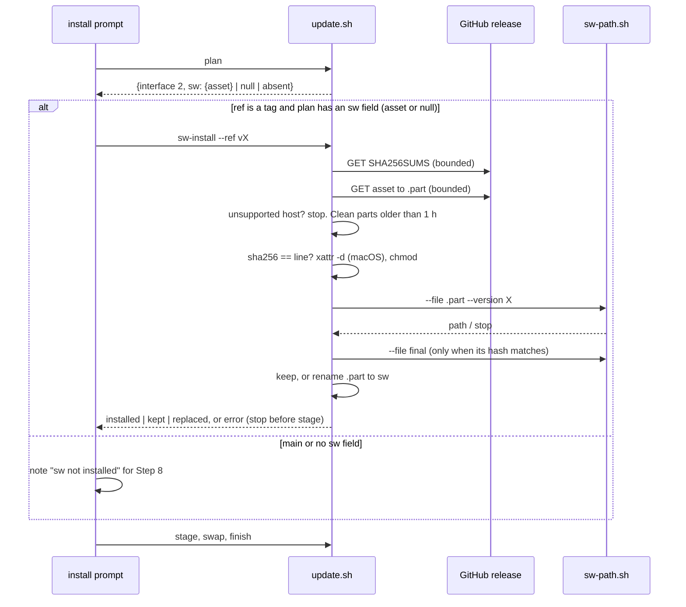

# Design

## Triage

| Trigger | Applies? | Evidence |
|---|---|---|
| T1 Components (new component, or 3+ with directed relationships) | yes | New release workflow, new resolver script and a new `update.sh` subcommand; the install prompt, `update.sh`, the resolver and `sw` form a chain |
| T2 State (persistent state, caches, 3+ state machine) | yes | New per-user files under `<home>/.specwright/bin/<version>/`, and release assets on GitHub |
| T3 Concurrency (background work, workers/isolates, async, retries) | yes | Ten parallel CI jobs feed one attach job; two installs of the same version on one machine can race on one path |
| T4 Boundaries (data format, migration, shared interface, IPC, external) | yes | Asset names and the `SHA256SUMS` format, the `plan` JSON `sw` field, the `sw-install` subcommand, the resolver's contract, GitHub's release download |
| T5 Volume (grows without a fixed bound) | yes | One binary per installed version accumulates under `<home>/.specwright/bin/` |
| T6 Risk (security, money, data loss, unrecoverable user data) | yes | The install runs an executable it downloaded |

TIER: FULL

## Context

The proposal covers why. This section lists the facts the design builds on.

- **The build today.** `cli.yml` builds and checks three targets only (`.github/workflows/cli.yml:26-35`, and the verify matrix at `:78-87`). It writes a per-binary `<name>.sha256` file as `<hash>  <name>` (`.github/workflows/cli.yml:63`). It sets and clears `com.apple.quarantine` on macOS (`.github/workflows/cli.yml:114`, `:124-127`). `verify_artifact.py` reads the expected hash from the first token of a `.sha256` file (`cli/tool/verify_artifact.py:33-36`) and compares only `version`, not `interface` (`cli/tool/verify_artifact.py:41-50`). The version is compiled in with `--define=SW_VERSION=` (`cli/tool/build.dart:18`), and the interface is the Dart constant `interfaceVersion = 1` (`cli/lib/src/commands/version.dart:10`).
- **The toolchain.** It is pinned to Dart 3.13.7 through mise (`mise.toml:2`), and every CI step goes through mise tasks (`mise.toml:4-27`).
- **Releases.** `release.sh publish` creates the GitHub release with `gh release create --verify-tag` (`skills/specwright-release/scripts/release.sh:69`), run under the fenced run login. This repository has `github_release: true` (`openspec/specwright.yaml:134`).
- **The install.** The prompt picks the highest `v*` tag, or `main` (`README.md:141-157`). It clones the ref without authentication (`README.md:158-159`). Before `stage` it accepts `update.sh plan` reporting interface 2, plus interface 1 only when `specwright.yaml` enables no pack and the installed `packs.json` lists no enabled pack (`README.md:209-224`). `update.sh` lists its subcommands at `scripts/update.sh:281` and dispatches them at `:962-971`. Its interface constant is `INTERFACE = 2` (`scripts/update.sh:991`).
- **Bounds in `update.sh`.** It already loads `bounded.py` from the download and runs a network command under a deadline (`scripts/update.sh:1453-1468`), taking the origin URL from the download (`scripts/update.sh:1450`). `bounded.run_bounded` decodes stdout as UTF-8 (`skills/specwright-pr/scripts/bounded.py:376-378`), so it cannot carry binary bytes. The environment can only lower its bounds (`skills/specwright-pr/scripts/bounded.py:267-277`), and its CLI is `bounded.py [--paged] [--secret] -- cmd...` (`skills/specwright-pr/scripts/bounded.py:381-404`).
- **Cross-skill scripts.** Other skills already call a script in another skill's folder: `specwright-roadmap` runs `bash <specwright-pr>/scripts/vcs.sh` (`skills/specwright-roadmap/SKILL.md:20`).
- **Eval routing.** `cli/**`, `mise.toml` and `.github/workflows/cli.yml` route to the `cli` suite (`evals/suites.json:26`), and `scripts/**` routes to `update` and `packs` (`evals/suites.json:13`).

## Decisions

### D1: The `sw` step is an `update.sh` subcommand run between `plan` and `stage`

- **Choice:** add `update.sh sw-install --code <code> --download <download> --ref <tag> [--release-url <base>]`. It prints one JSON document: `{ok, interface, subcommand, action: installed | kept | replaced, path, asset, version}`, or `error` and `message` on a stop (exit 1). `plan` gains an `sw` field: `{asset, target}` for a supported host, or `{asset: null, reason}` (`unsupported_platform`). The prompt reads that field to decide. A download whose `plan` has no `sw` field ships no `sw` (an older release). Install of `main` skips the step. For a tag whose `plan` has an `sw` field, a null asset included, the prompt always runs `sw-install` after `plan` and before `stage`, and stops the install on a non-zero exit. `sw-install` itself stops with `unsupported_platform` on a host with no target, so the prompt never decides that case on its own. The interface stays 2: a new subcommand and a new field break no existing caller.
- **Rejected:** prompt-only steps, because nothing would test them. Making the binary a journaled target of `stage` and `swap`, because it ties a per-user file into per-project recovery and needs journal format 3.
- **Reversal cost:** medium (the subcommand and the `plan` field become part of the prompt's contract)
- **Important:** yes (binds future changes: the `update.sh` interface the prompt drives)
- **Chosen by:** user

### D2: The resolver is `skills/specwright-pr/scripts/sw-path.sh`

- **Choice:** a bash script beside `vcs.sh`, with a short Python body run under `python3 -I`, like the other PR scripts. Usage: `sw-path.sh --code <toplevel>` derives the version from `VERSION`. `--version <x>` overrides it, for the install before `VERSION` is stamped. `--file <path>` checks a given file instead of the derived path, so `sw-install` checks its temp file with the same code. It runs `<sw> version --json` through the `bounded.py` beside it, with `SPECWRIGHT_NET_DEADLINE=10` and `SPECWRIGHT_NET_MAX_BYTES=1048576` (both only lower the bounds). The script holds `SW_INTERFACE=1`, the interface the skills in that release were written for. Success prints the absolute path and exits 0. Every failure prints the stop line and a detail line on stderr and exits 1 (spec: `A missing or mismatched sw stops with one message`).
- **Rejected:** prose in each skill, because three copies would drift and none would be tested. A Python module, because the ports call `sw` from bash and would need a wrapper anyway.
- **Reversal cost:** high (every ported skill will call it). The evidence is the three upcoming ports, which all run from bash today.
- **Important:** yes (high reversal cost; binds future changes)
- **Chosen by:** user

### D3: Unauthenticated HTTPS download in a bounded child process

- **Choice:** `sw-install` derives `<owner>/<repo>` from the download's `origin` and accepts only a github.com `https` URL. Otherwise it stops with `no_github_origin`, unless `--release-url` is given. It fetches `<base>/releases/download/<tag>/SHA256SUMS`, then the asset. Each fetch runs `python3 -I -c <reader>` under `bounded.run_bounded` with a 120 s deadline. The child streams the response with `urllib` into a temp file and exits 3 once it has read more than 64 MiB. It refuses a redirect to any scheme other than `https`, `file://` being allowed only as the `--release-url` base, for tests. Missing asset (HTTP 404) → `asset_missing`. A missing `SHA256SUMS` or one with no line for the asset → `assets_not_uploaded`, and the message says to rerun once the release workflow has attached them.
- **Rejected:** `gh release download` through `as.sh`, because the install would then need a logged-in `gh` and a run login, which today's unauthenticated clone (`README.md:158-159`) does not. `curl`, because it adds a dependency whose bounds are set by its own flags.
- **Reversal cost:** low (one function)
- **Important:** yes (changes what users see: what the install needs and touches on the network)
- **Chosen by:** user

### D4: One reusable build workflow for pull requests and releases

- **Choice:** move the build and verify jobs into `.github/workflows/sw-build.yml` (`on: workflow_call`, with input `ref`) over the five-target matrix: `ubuntu-24.04` linux-x64, `ubuntu-24.04-arm` linux-arm64, `windows-latest` windows-x64, `macos-latest` macos-arm64, `macos-15-intel` macos-x64. `cli.yml` calls it for pull requests. The new `release.yml` (`on: release: [published]` and `workflow_dispatch` with input `tag`) calls it at the tag, then runs one `attach` job. `release.yml` has `concurrency: {group: sw-release-<tag>, cancel-in-progress: false}`, with `<tag>` taken from the release event or the input, so runs for one tag from both triggers queue and never overlap (the group in `.github/workflows/cli.yml:15-17` covers pull requests only). The verify job also checks `interface` against `sw-path.sh`'s `SW_INTERFACE` (D6).
- **Rejected:** a separate build in `release.yml`, because pull requests would then prove a different build from the one that ships.
- **Reversal cost:** low (CI only)
- **Important:** no
- **Chosen by:** agent

### D5: Attach after every target passes; `SHA256SUMS` last, as the seal

- **Choice:** the `attach` job (`contents: write`, the only job with it) needs every verify job. It checks that `VERSION` at the tag equals the tag, and that the tag has a release. When the release already has `SHA256SUMS`, it is sealed: with all five binaries present, the job reports the release complete and changes nothing; with one missing, it fails for the owner and uploads nothing. Otherwise it uploads the five binaries from this run with `gh release upload --clobber`, downloads each one back from the release and fails, uploading no seal, when a hash differs from this run's. Then it builds `SHA256SUMS` from the five `.sha256` files, sorted by name, and uploads it last. The seal check runs inside the per-tag concurrency group (D4), so it sees the state the previous run left. The install reads `SHA256SUMS` first and stops without it (D3), so no install ever accepted a binary uploaded before the seal, and replacing one is safe. Recovery therefore does not need the rebuild to be byte-identical.
- **Rejected:** comparing each existing asset with a fresh build by hash, because it needs reproducible builds that nothing establishes (`cli/tool/build.dart:15-22` compiles afresh), so a partial release could never be repaired. Replacing assets after the seal, because users may already have checked a binary against it.
- **Reversal cost:** low
- **Important:** no
- **Chosen by:** agent

### D6: The skills' interface is one constant, pinned to the Dart one by a test

- **Choice:** `SW_INTERFACE` in `sw-path.sh` is the skills' side. A test in `evals/cli` reads it and `interfaceVersion` (`cli/lib/src/commands/version.dart:10`) and fails when they differ. `sw-install` gets the expected interface from the download's `sw-path.sh`, the skills it is about to install.
- **Rejected:** a separate `SW_INTERFACE` file at the repository root, because it is not installed with the skills, so the resolver could not read it in a project.
- **Reversal cost:** low
- **Important:** no
- **Chosen by:** agent

### D7: Placement by temp name and rename, outside the journal

- **Choice:** create `<home>/.specwright/bin/<version>/` with parents. Delete only the `.sw-*.part` files last modified more than one hour ago, so a concurrent install's part file is never touched (a run takes at most about five minutes: two 120 s downloads and a 10 s check). Download to `.sw-<random>.part` inside it. Check the hash. On macOS, `xattr -d com.apple.quarantine` the part file when the attribute is present. `chmod 0755` on POSIX. Check the file with `sw-path.sh --file <part> --version <to>`. Then: a final file with the same SHA-256 that also passes `sw-path.sh --file <final> --version <to>` → delete the part, `kept`. Otherwise (missing, another hash, or not runnable, for example a lost executable bit or quarantine) → `os.replace(part, final)`, `installed` or `replaced`. When the rename fails (on Windows, another process is running the final file), it deletes the part and checks the final file again: matching hash and a passing check → `kept`; otherwise `sw_in_use`, naming the path. The part file is deleted on every stop. The step writes nothing in the project and no journal entry.
- **Rejected:** a journal entry under ADR 0011, because the file is per user and per version, and an unfinished placement leaves only a `.part` file that the next run removes.
- **Reversal cost:** low
- **Important:** no
- **Chosen by:** agent

### D8: Host target from the Python platform

- **Choice:** map `platform.system()` (`Linux`, `Darwin`, `Windows`) and `platform.machine()` (`x86_64` or `AMD64` → `x64`; `aarch64` or `arm64` → `arm64`) to a target. Anything else → `unsupported_platform`, naming the host and the five targets. An x64 Python under Rosetta reports `x86_64` and gets `macos-x64`, which runs there.
- **Rejected:** asking the user for the platform, because it is redundant and error-prone.
- **Reversal cost:** low
- **Important:** no
- **Chosen by:** agent

### Decision summary

| # | Decision | Choice | Rejected | Reversal cost | Important | Chosen by |
|---|---|---|---|---|---|---|
| S1 | Release targets | Five targets on native runners | Three only; four without macOS x64 | medium | yes | user |
| S2 | How binaries reach a release | Release workflow on publish, plus manual runs; `release.sh` unchanged | `release.sh` waits; manual dispatch only | medium | yes | user |
| S3 | Install without a matching `sw` | Tags with binaries stop; `main` and older tags skip, with a report | Always warn; always stop | low | yes | user |
| S4 | Where the skill-side check lands | One shared resolver, unused until the ports | Gate every change start | high | yes | user |
| S5 | Old binary versions | Kept; no pruning | Prune on update | low | no | agent |
| S6 | Signing | Out of scope (ADR 0027) | Sign now | low | no | agent |
| D1 | Where the `sw` step lives | `update.sh sw-install` between `plan` and `stage`; `plan` reports `sw`; interface stays 2 | Prompt-only steps; journaled stage target | medium | yes | user |
| D2 | Resolver form | `specwright-pr/scripts/sw-path.sh` with `--version` and `--file` | Prose per skill; Python module | high | yes | user |
| D3 | Download transport | Unauthenticated HTTPS, bounded child | `gh release download` fenced; `curl` | low | yes | user |
| D4 | Build workflow shape | Reusable `sw-build.yml` for pull requests and releases; per-tag queueing concurrency on `release.yml` | Separate release build | low | no | agent |
| D5 | Attaching assets | After all verify jobs; binaries, read back, then `SHA256SUMS` as the seal; nothing changes after the seal | Per-asset hash compare against a rebuild; changes after the seal | low | no | agent |
| D6 | Interface source | `SW_INTERFACE` in `sw-path.sh`, test-pinned to Dart | Repository-root file | low | no | agent |
| D7 | Placement | `.part` then rename; keep a file only when its hash and the check pass; re-check after a failed rename; clean parts older than 1 h; no journal | Journal entry | low | no | agent |
| D8 | Host target | From `platform.system()` and `platform.machine()` | Ask the user | low | no | agent |

## Assumptions

- **A1:** a GitHub release created by `release.sh` through a personal token (not `GITHUB_TOKEN`) triggers `on: release: published` in this repository. Not checked because it can only be observed when a real release is published. Depends on it: D4 and S2. If it does not trigger, the `workflow_dispatch` path attaches the assets, and task 6 records this.
- **A2:** the `ubuntu-24.04-arm` and `macos-15-intel` runner labels are available to this public repository. Not checked because only a CI run proves it. Depends on it: D4 and S1. The first pull-request run of this change settles it, before any release depends on it.
- **A3:** mise installs Dart 3.13.7 on linux-arm64 and macOS x64, and `dart compile exe` works there with no change to `cli/`. Not checked because there is no such host locally. Depends on it: D4. It is settled by the same first pull-request run.
- **A4:** GitHub's release download URL redirects only to `https` hosts and serves the asset bytes unchanged. Not checked against the code because it is GitHub's behaviour. Depends on it: D3. A redirect to another scheme is refused anyway, and the hash check catches changed bytes.

## Carried constraints

- **C1:** asset names (`sw-<target>[.exe]`) and the `SHA256SUMS` line format are read by every later install. Changing either is a workflow change. Kind: invariant. Destination: spec: specs/native-cli/spec.md → Requirement: Release assets have fixed names and one checksum file
- **C2:** `SW_INTERFACE` in `sw-path.sh` and the Dart `interfaceVersion` must change together, in the change that makes a command incompatible. A test pins them. Kind: invariant. Destination: doc comment: cli/lib/src/commands/version.dart interfaceVersion
- **C3:** `bin/` is outside the update journal: recovery never touches it, and a binary placed before a rollback stays. Kind: invariant. Destination: spec: specs/install-update/spec.md → Requirement: Recovery leaves placed binaries in place
- **C4:** nothing prunes old versions under `<home>/.specwright/bin/`. Another project on the machine may pin any of them. Kind: deliberate gap. Destination: doc comment: scripts/update.sh sw_install
- **C5:** `SHA256SUMS` comes from the same release as the binary, so it proves integrity, not authorship. Authenticity waits for ADR 0027's signing trigger. Kind: deliberate gap. Destination: doc comment: scripts/update.sh sw_install
- **C6:** the resolver never falls back to another version or to an `sw` on `PATH`. Kind: rejected alternative. Destination: spec: specs/native-cli/spec.md → Requirement: A missing or mismatched sw stops with one message
- **C7:** the `plan` field `sw` and the `sw-install` subcommand are additive, so `update.sh` stays at interface 2. A change that alters an existing subcommand's output or exit codes bumps it. Kind: invariant. Destination: doc comment: scripts/update.sh INTERFACE
- **C8:** the `sw` download is anonymous HTTPS and needs no `gh` login or run login, like the clone. Kind: rejected alternative (`gh release download`). Destination: doc comment: scripts/update.sh sw_download
- **C9:** `SHA256SUMS` is uploaded last and seals a release, and nothing changes a sealed release's assets. Kind: invariant. Destination: spec: specs/native-cli/spec.md → Requirement: SHA256SUMS is uploaded last and seals the release
- **C10:** the resolver's version check runs under `bounded.py` with a 10 s deadline and 1 MiB per stream. Kind: invariant. Destination: doc comment: skills/specwright-pr/scripts/sw-path.sh header
- **C11:** each download has a 120 s deadline and a 64 MiB bound. Kind: invariant. Destination: spec: specs/install-update/spec.md → Requirement: The sw download is bounded
- **C12:** installing `main`, or a download with no `sw` step, installs no binary and changes nothing under `bin/`. Kind: invariant. Destination: spec: specs/install-update/spec.md → Requirement: An install without release binaries says so
- **C13:** a failed download is never retried within a run; the user reruns the install. The one-hour part-file age in D7 relies on a run lasting minutes. Kind: rejected alternative (automatic retry). Destination: doc comment: scripts/update.sh sw_download
- **C16:** the SHA-256 check comes before the macOS quarantine removal and before the downloaded file first runs. Kind: invariant. Destination: spec: specs/install-update/spec.md → Requirement: The macOS install clears quarantine only on the file it checked
- **C17:** the checksum and resolver checks complete before the temporary file is placed, by a rename within the version directory. The final executable is never written in place. Kind: invariant. Destination: spec: specs/install-update/spec.md → Requirement: Placing sw is atomic and keeps other versions
- **C14:** pull requests and releases build and check `sw` through the one reusable `sw-build.yml`, so a release binary never takes a path that pull requests did not exercise. Kind: rejected alternative (a separate release build). Destination: doc comment: .github/workflows/sw-build.yml header
- **C15:** the downloader follows only `https` redirects, and a `--release-url` base must be `https://` or a local `file://` tree (`release_url_not_https` otherwise; plain `http` only for the evals' local server under `SPECWRIGHT_TEST_HTTP=1`), before any downloaded file runs. Kind: invariant. Destination: doc comment: scripts/update.sh sw_download

## Diagrams (FULL)

Components and data flow (T1, T4):

Install sequence (T2, T3):

## State & Ownership (FULL)

| State | Owner (sole writer) | Lifetime | Invalidation / rebuild | Authoritative copy |
|---|---|---|---|---|
| Release assets (five binaries, `SHA256SUMS`) | `release.yml` attach job | Permanent once sealed by `SHA256SUMS` | Before the seal, a manual run replaces the binaries and seals; after it nothing changes, and a missing binary fails the run for the owner | The GitHub release |
| `<home>/.specwright/bin/<version>/sw[.exe]` | `update.sh sw-install` | Until the user deletes it | A rerun keeps a matching file, replaces another one; a deleted file makes the resolver stop until the install runs again | The release asset, by hash |
| `.sw-<random>.part` | The `sw-install` run that created it | That run | Deleted by its own run on every stop; one left by a killed run is removed by a later run once it is more than one hour old | None |
| `SW_INTERFACE` | Whoever changes a command contract, in `sw-path.sh` | Per release | Test-pinned to `interfaceVersion` | `sw-path.sh` in the installed skills |

## Failure & Visibility (FULL)

| Component | Fails / dies mid-operation → | Recovery | Retry safe? | Who finds out |
|---|---|---|---|---|
| `sw-build.yml` job | No artifact for that target | Rerun the workflow | yes | The pull request's checks, or the release run |
| `attach` job | Some binaries attached, no `SHA256SUMS` | `workflow_dispatch` for the tag uploads the binaries again and seals | yes (no install accepted an unsealed binary) | The owner from the failed run. Users see `assets_not_uploaded` from the install meanwhile |
| Release event not delivered (A1) | Release without assets | Manual run | yes | The owner. The install stops with `assets_not_uploaded` |
| `sw-install` download | `.part` left, or deleted | Next run deletes leftovers and downloads again | yes | The user, from the stop message with the cause |
| `sw-install` killed between check and rename | `.part` only | As above | yes | The next run's report |
| Rename over a running `sw.exe` (Windows) | `os.replace` fails | Check the final file again: it matches → `kept`; otherwise stop with `sw_in_use`, naming the path | yes, once no process runs it | The user, only when the file does not match |
| `sw-path.sh` | Binary missing, broken or mismatched | Rerun the install prompt | yes | The user, from the stop line |

## Resource Bounds (FULL)

| Queue / buffer / cache / transfer | Bound | At the bound | Timeout | At 10x / 100x |
|---|---|---|---|---|
| Asset download | 64 MiB per file (the binary is about 5 to 10 MB) | Child stops, `response_too_large`, part file deleted | 120 s per file | 10x binary size still fits under the bound; 100x is refused, which is the point |
| `SHA256SUMS` download | 64 MiB (the same reader); valid content is six lines | Invalid format → no hash used | 120 s | n/a |
| `sw version --json` in the resolver | 1 MiB per stream | `bounded` stops it, the resolver fails closed | 10 s | n/a |
| Versions under `bin/` | Unbounded, about 10 MB each | Nothing prunes them (C4) | n/a | 100 updates are about 1 GB; the user deletes old directories by hand. That is justified because another project may pin any version |
| CI jobs per run | 5 build + 5 verify + 1 attach | n/a | 30 / 15 / 15 min per job | Fixed by the matrix |

## Flow & State Gaps (FULL)

- **Two installs of one version at once** (two projects on one machine). Each writes its own random `.part`, and cleanup removes only parts older than one hour, so neither run deletes the other's. Both renames carry the same bytes, so the last one wins harmlessly. A reader between them sees a whole file, because a rename is atomic on one filesystem. On Windows a rename over an `sw.exe` the other run is checking can fail; the run then checks the final file again and reports `kept` when it matches (D7), so both succeed.
- **Install before the assets exist.** `assets_not_uploaded` stops the install before `stage`, and a rerun after the workflow succeeds.
- **Overlapping release runs.** The release event and a manual run for one tag queue in one concurrency group (D4). The later run sees the seal the earlier one left. A binary changed between upload and seal fails the read-back, and no seal is written (D5).
- **Partial assets.** Binaries without `SHA256SUMS` are an unsealed release: the install stops with `assets_not_uploaded`. A sealed release that is missing the host's binary stops with `asset_missing`.
- **Rollback after placement.** Covered by spec C3: `bin/` is left as it is.
- **Stale file at the final path.** Replaced only by a checked part file (spec: `Placing sw is atomic and keeps other versions`).
- **`VERSION` changes after placement** (a later update). The resolver derives the path anew from `VERSION`, so the old binary is simply no longer used.
- **Fork or mirror origin.** A download whose origin is not github.com stops `no_github_origin` for a tag. Nothing guesses a URL.

## Mechanism Ledger (FULL)

| Mechanism | Built? | Why (harm nobody catches / expensive later) | Evidence that would change the call |
|---|---|---|---|
| SHA-256 check before running | yes | A truncated or corrupted download would run, and ADR 0027 requires it | n/a |
| Interface check in CI verify and in the install | yes | A version-matched but interface-mismatched binary would pass `verify_artifact.py` today (`cli/tool/verify_artifact.py:41-50`) | n/a |
| `SHA256SUMS` as the seal | yes | Without it, a partial release could never be repaired, or a published binary could be replaced silently | n/a |
| Download bounds | yes | A stalled server would hang the install, and ADR 0014 bounds network commands | n/a |
| Journal entry for placement | no | The placement is version-scoped and atomic by rename, so a killed run leaves only a `.part` | A placement that needs more than one rename |
| Pruning old versions | no | It could delete a version another project pins | Users reporting disk use |
| Signature or provenance check | no | ADR 0027: unsigned first, with a signing trigger | AV or Gatekeeper blocks, or a supply-chain requirement |
| Retry of a failed download | no | The user reruns the install, and a retry loop would hide outages | Flaky downloads reported in practice |
| Cleaning `.part` files left by killed runs | yes, only when older than one hour | They would accumulate; the age limit keeps a concurrent run's part safe | A run that can legitimately take an hour |

## Risks / Trade-offs

- [The `SHA256SUMS` file and the binary come from one origin, so a compromised release passes] → that is accepted under ADR 0027's unsigned-first stance and recorded as C5. HTTPS protects the transport.
- [The release event may not fire for a release created with a token (A1)] → `workflow_dispatch` attaches the assets. The install stops with a clear retry message, never with a half-installed project.
- [`macos-15-intel` is on a retirement path] → when it goes, a cross-build or dropping the target becomes a new decision (S1's reversal cost is medium).
- [Installs now hit `github.com/.../releases/download`, which a corporate proxy may block] → the stop names the URL and cause. `--release-url` allows a mirror.
- [Users with only the old prompt text] → an older prompt never calls `sw-install` and still installs. The skills need no `sw` in this release.

## ADRs

- **In force, constraining this change:** 0027 (install root, the exact version and interface check, unsigned-first stance and the quarantine step, targets), 0011 (staged install; this change keeps the journal unchanged), 0014 (bounds: the download and the version check run under `bounded.py`), 0010 (release flow unchanged), 0008 (the unauthenticated download runs no `gh` or git network call, so the fence does not apply; this matches the existing unauthenticated clone), 0021 (the install root is per user and the user manages it), 0003 (no new workflow state is stored).
- **To record during apply:** none. ADR 0027 already decides the install root, the version check and the targets, and the asset contract is in the spec (C1). The architecture file's `sw` row (`openspec/architecture.md:92`) and the install rows are updated in the same task as the docs.

## Open Questions

None.
