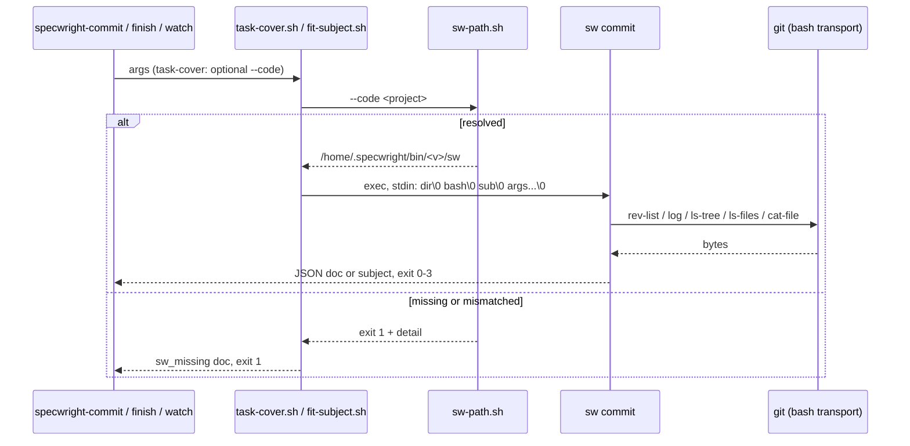
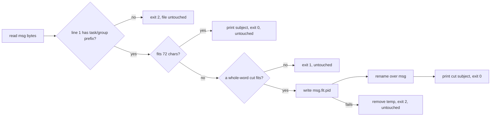

# Design

## Triage

| Trigger | Applies? | Evidence |
|---|---|---|
| T1 Components (new component, or 3+ with directed relationships) | yes | A new `sw commit` command with two subcommands. The chain is skill → shim → `sw-path.sh` → `sw` → `git`. |
| T2 State (persistent state, caches, 3+ state machine) | no | Both commands are read-only, apart from `fit-subject`'s in-place rewrite of the caller's message file. They keep no state of their own. |
| T3 Concurrency (background work, workers/isolates, async, retries) | no | Each command runs its `git` calls one after another and has no retries (`skills/specwright-commit/scripts/task-cover.sh:89-101`). |
| T4 Boundaries (data format, migration, shared interface, IPC, external) | yes | New `sw` command names and arguments that M8 callers bind to. The ADR 0028 stdin handoff. Two JSON and stdout contracts kept byte for byte. A file rewritten in place. |
| T5 Volume (grows without a fixed bound) | no | The bounds stay as they are: 1 MiB `tasks.md`, 10,000 commits, 64 KiB fields (`task-cover.sh:60-62`). The message file holds one commit message. |
| T6 Risk (security, money, data loss, unrecoverable user data) | yes | `fit-subject` rewrites the agent's message file, and evidence checks must never read through the working tree (`task-cover.sh:253-254`), so a path trick cannot make a file count. |

TIER: FULL

## Context

- `task-cover.sh` is a bash wrapper. It finds Python 3.8+ or prints `no_python` and exits 2 (`task-cover.sh:47-51`), then runs a heredoc program under `-I -X utf8` (`task-cover.sh:53`). The program prints one `json.dumps(doc, ensure_ascii=False)` document plus `\n` (`task-cover.sh:65-66`). Unlike `vcs.sh`, it does not escape U+2028 and U+2029. Its usage line is at `task-cover.sh:76`.
- Every `git` call runs as `git --no-replace-objects -c log.showSignature=false -C <repo> ...` in the inherited working directory, with no deadline. A failure is `git_failed`, exit 3, unless the call is `soft` (`task-cover.sh:89-101`).
- `tasks.md` is decoded with `errors="replace"` (`task-cover.sh:144`) and split with `str.splitlines()` (`task-cover.sh:156`). It is matched with Python `re` patterns that use `\d`, `\s` and `\S` (`task-cover.sh:151-154`, `194-195`). A box is done when `box.strip()` is `x` or `X` (`task-cover.sh:148`). Git log output is decoded with `replace` (`task-cover.sh:184`). The `rev-list --count` output is decoded strictly (`task-cover.sh:178`).
- With `--rev`, the tasks path is made relative lexically against `abspath(repo)`, `abspath(top)` and `realpath(repo)`, in that order (`task-cover.sh:110-123`). Evidence is read from the index (`ls-files -s` with `:(literal)`) or from the tree at `--rev`, never from the working tree (`task-cover.sh:232-268`).
- `fit-subject.sh` reads line 1 with `IFS= read -r` and strips one trailing CR (`fit-subject.sh:22-24`). awk runs on bytes (`LC_ALL=C`) and counts characters as bytes outside 0x80-0xBF (`fit-subject.sh:31-32`). The prefix is `[^ ]+: task [0-9]+\.[0-9]+ ` or `[^ ]+: group [0-9]+ `, with ASCII digits (`fit-subject.sh:35`). The script cuts only at a space and exits 1 or 2 with fixed stderr texts (`fit-subject.sh:48-52`). It rewrites through `<msg>.fit.<pid>` and `mv` (`fit-subject.sh:54-64`).
- The `sw vcs` port already has the pieces this change reuses. `parseHandoff` splits the ADR 0028 stdin records (`cli/lib/src/vcs/args.dart:25-40`), but its usage text names `sw vcs` (`args.dart:18-20`). `documentText` writes `json.dumps(ensure_ascii=False)` text and then escapes U+2028 and U+2029 (`cli/lib/src/vcs/document.dart:16-23`). `documentLineEnd` gives Python's `\r\n` on Windows (`document.dart:30-31`). `decodeReplacing` is CPython's `replace` decoding (`cli/lib/src/vcs/codec.dart:68-71`). `encodeEscaped` and `decodeEscaped` round-trip raw bytes (`codec.dart:15-60`). `runTool` runs a command through the bash transport with no deadline (`cli/lib/src/vcs/tool_runner.dart:158-197`). It accepts any directory `Directory.fromRawPath` finds, `.` included (`tool_runner.dart:145-156`).
- `vcs.sh` is the shim pattern: Python for the `sw_missing` document, a project walk to the first `.git`, `sw-path.sh`, then `exec "$sw" vcs --args-stdin` (`skills/specwright-pr/scripts/vcs.sh:8-46`). `sw-path.sh` itself needs Python (`skills/specwright-pr/scripts/sw-path.sh:74-78`).
- `runCli` dispatches `vcs` before the `args` parser (`cli/lib/src/cli.dart:47-54`). Its usage text lists the commands (`cli.dart:12-19`).
- The store-backed callers run `task-cover.sh --repo <store toplevel>`: watch from the planning repo at the ready head (`skills/specwright-pr/SKILL.md:152`), and finish for the archived change (`skills/specwright-finish/SKILL.md:67`). The commit skill runs one read per repo (`skills/specwright-commit/SKILL.md:54`).
- Nothing outside `task-cover.sh` reads its usage text: it is defined and used only at `task-cover.sh:76-85`. The evals that check a `usage` error compare only the `error` field, and only for other scripts (`evals/vcs/test_shim.py:133`, `evals/pr-pair/test_pr_pair.py:689`). The instruction evals check that the arguments are present, not the usage line (`evals/git-workflow/test_instructions.py:2121-2122`). So D6's added ` [--code <dir>]` has no consumer to break.
- The git-workflow evals run `task-cover.sh` in the test process's own working directory (`evals/git-workflow/test_task_cover.py:76-83`). They run `fit-subject.sh` in a temporary directory that is not a repo, under three `LC_ALL` values (`evals/git-workflow/test_fit_subject.py:148-161`). `evals/vcs/vcs_test_support.py` already builds an `sw` home (`vcs_test_support.py:31-58`) and writes an excluded `VERSION` stamp (`vcs_test_support.py:61-75`).
- A new command is not an incompatible interface change. `interface` changes only when an existing command's arguments, output or exit codes change incompatibly (`openspec/specs/native-cli/spec.md`, requirement on `sw version --json`).

## Decisions

### D1: `sw commit` lives in `cli/lib/src/commit/` and reuses the vcs codec, document and transport

- **Choice:** add `commands/commit.dart`, which dispatches `task-cover` and `fit-subject` from the handoff, plus `commit/task_cover.dart` and `commit/fit_subject.dart`. They import `vcs/codec.dart`, `vcs/document.dart` and `vcs/tool_runner.dart`. `parseHandoff` takes the usage text as a parameter, so each command names itself.
- **Rejected:** moving codec, document and transport into a shared `lib/src/common/` first, because it renames files the vcs port just landed and gains nothing until M8 adds more users. **Rejected:** a separate binary or package for commit, which ADR 0027 rules out (one `sw`).
- **Reversal cost:** low
- **Important:** no
- **Chosen by:** agent

### D2: `task-cover`'s document is written without the U+2028/U+2029 escape

- **Choice:** `documentText` gets a named flag `escapeLineSeparators` (default `true`, as `vcs` needs). `task-cover` passes `false` and so prints plain `json.dumps(ensure_ascii=False)`. Both use `documentLineEnd`.
- **Rejected:** a second JSON writer for commit, which duplicates the escaping rules. **Rejected:** escaping them in `task-cover` too, which changes its bytes (S3).
- **Reversal cost:** low
- **Important:** no
- **Chosen by:** agent

### D3: `git` runs through the vcs bash transport, from the inherited working directory, with no deadline

- **Choice:** each call is `runTool(bash, '.', ['git', '--no-replace-objects', '-c', 'log.showSignature=false', '-C', repo, ...])`. `bash` comes from the handoff, and `.` means the shim's working directory, which `sw` inherits. A started `git` that exits non-zero maps to `git_failed` (exit 3) with `git  failed: <stderr>`, or to the soft `null`, as at `task-cover.sh:97-100`. A start failure is separate, as at `task-cover.sh:93-96`: the transport's exit 127 (bash could not start, the directory is gone, or bash found no `git`, `cli/lib/src/vcs/tool_runner.dart:158-197`) always stops with `git_failed`, exit 3, and `cannot run git: <transport stderr>`, also for a soft call, so a start failure never reads as missing evidence. A real `git` does not exit 127.
- **Rejected:** `Process.run('git', ...)` directly. Argument bytes would go through Dart's argv encoding (constraint C3 of the vcs port), and the two `sw` commands would start tools in two different ways. **Rejected:** `sw run --bounded`, which adds a deadline: a behaviour change outside S3.
- **Reversal cost:** low
- **Important:** no
- **Chosen by:** agent

### D4: Python's text rules are matched explicitly, task and group ids are ASCII digits

- **Choice:** split lines on Python's documented `str.splitlines` boundaries (`\n`, `\r`, `\r\n`, `\v`, `\f`, `\x1c`-`\x1e`, `\x85`, U+2028, U+2029). `\s` is the set `str.isspace()` accepts, `strip()` removes that set, and `.` matches any character except `\n`. A field is cut at 64 Ki code points, not UTF-16 units. Ids match `[0-9]` only. Each rule is written from the documented behaviour and checked by tests. No CPython source is translated.
- **Rejected:** Dart's own `\s`, `\d` and `LineSplitter`. Their sets differ from Python's (for example `\x1c`-`\x1f` and U+FEFF), so a `tasks.md` with those characters would parse differently. **Rejected:** Unicode decimal digits as in Python's `\d` plus a digit-value table: extra code for ids no real `tasks.md` holds.
- **Reversal cost:** low
- **Important:** yes: it changes behaviour users see (a non-ASCII-digit id is no longer a task)
- **Chosen by:** user

### D5: `fit-subject` works on bytes and rewrites through a sibling temporary file

- **Choice:** read the file as bytes through `File.fromRawPath(encodeEscaped(path))`. Line 1 runs to the first `\n`, with one trailing CR stripped. Characters are counted as bytes outside 0x80-0xBF, the ASCII prefix patterns are matched on bytes, and the cut is made at 0x20 only. The fitted line, the CR if there was one, and every byte from the first `\n` on are written to `<msg>.fit.<pid>`. That file is then renamed over `<msg>`, and removed on failure. stdout is the subject and `\n`, and the stderr texts are those of `fit-subject.sh:50-51`.
- **Rejected:** decoding to a Dart `String`. Invalid UTF-8 bytes would change length and the rewrite would no longer be byte-exact. **Rejected:** writing `<msg>` in place, because a failure part-way would truncate the agent's message.
- **Reversal cost:** low
- **Important:** no
- **Chosen by:** agent

### D6: `task-cover.sh` takes an optional `--code` that only picks the project

- **Choice:** the shim looks for the project at or above `--code` when it is given and is a directory, else at or above the current directory, up to the first `.git` entry. It passes `--code` on to `sw`, which accepts it and does nothing else with it. The usage line gains ` [--code <dir>]`. In store-backed runs the commit, finish and watch skills add `--code <code toplevel>`.
- **Rejected:** having store-backed callers run it from the code checkout, a rule hidden in the working directory that a `cd` into the store breaks. **Rejected:** walking up from `--repo` first, which fails whenever the store is both `--repo` and the working directory.
- **Reversal cost:** medium
- **Important:** yes: it binds future changes (a new script argument M8 callers keep)
- **Chosen by:** user

### D7: The shims follow `vcs.sh`; `fit-subject.sh` without Python stops as `sw_missing`

- **Choice:** both shims copy `vcs.sh`'s structure: Python lookup, scripts directory and bash, project walk, `sw-path.sh`, then `exec "$sw" commit --args-stdin`. The stdin records are `<scripts dir>`, `<bash>`, `` and every argument. Without Python, `task-cover.sh` keeps its `no_python` document and exit 2. `fit-subject.sh` prints a fixed ASCII `sw_missing` document saying the resolver needs Python 3.8+, and exits 1. `sw-path.sh` cannot run without Python anyway, and exit 2 would tell the skill to fix the message file.
- **Rejected:** a bash-only JSON writer to drop Python from the shims. It has to escape arbitrary resolver text, and Python stays required by `sw-path.sh` until M8. **Rejected:** a `no_python` exit 2 for `fit-subject.sh`, which the skill reads as a bad message file and would retry.
- **Reversal cost:** low
- **Important:** no
- **Chosen by:** agent

### D8: The evals keep their assertions; the harness gives each run an `sw` home and a project

- **Choice:** setup at the fixture level, so every invocation is covered, the ones that bypass the helpers included. The checked inventory: `test_task_cover.py` runs the script in `run_script` (`test_task_cover.py:76-83`) and directly in `test_bad_range_exits_3` (`test_task_cover.py:557-560`), both without `cwd` or with an environment built from `os.environ`. `test_fit_subject.py` runs it in `run_script` (`test_fit_subject.py:34`) and three times directly in the locale loop, with `cwd=self.tmp` and `env` from `os.environ` (`test_fit_subject.py:148-161`). `evals/vcs/test_commit.py` runs it once (`evals/vcs/test_commit.py:66-71`). `test_user_tasks.py` only reads skill text and runs neither script. Each module gets a `setUpModule` that puts `SPECWRIGHT_HOME` (from `vcs_test_support.sw_home()`, or a shared copy of it in `evals/cli/swharness.py`) into `os.environ`, so every environment built from it carries it. For `task-cover`, the module also changes into a stamped temporary project for its run and changes back in `tearDownModule`; the script's paths are absolute. For `fit-subject`, `setUp` stamps `self.tmp`, every run's working directory. In `test_commit.py` the coverage call gets `SPECWRIGHT_HOME` and a stamped `self.repo`. No assertion changes. The `git-workflow` CI job already builds `sw` (`.github/workflows/evals.yml:146-152`).
- **Rejected:** pointing the shims at `SPECWRIGHT_SW` through a test-only environment variable, which would be a fallback path in shipped code (ADR 0028).
- **Reversal cost:** low
- **Important:** no
- **Chosen by:** agent

### D9: On Windows, path arguments in Git Bash form are converted through the handoff's bash

- **Choice:** before any native file access or relative-path logic, `sw commit` converts each path argument (`fit-subject`'s message file; `task-cover`'s `--tasks` and `--repo`) that starts with `/` on Windows by running `cygpath -m -- <path>` through the transport with the handoff's bash. The converted drive form (`C:/Users/x/m.txt`, Git Bash's `/tmp` mapped to its Windows directory) is used everywhere after that, `git -C` included. This is the form native Python received before, because Git Bash converts POSIX-looking arguments when it starts a native program. The handoff reaches `sw` on stdin, so nothing converts them on the way (`skills/specwright-pr/scripts/vcs.sh:13-15,46`). On POSIX, and for a drive-form or relative path, nothing runs and the bytes are used as given. An absolute native path is accepted as the result: the drive form (`C:/...`) or the UNC form (`//server/share/...`). A failed conversion (non-zero exit, empty output, or output that is neither absolute form) stops before any file access or `git` call, because the unconverted `/tmp/m.txt` would name a different file on Windows (`\tmp\m.txt` on the current drive): `task-cover` prints `"error": "bad_path"` with the path and exits 2, and `fit-subject` prints `fit-subject.sh: could not convert path: <path>` on stderr, leaves every file untouched and exits 2. Verification: Dart unit tests of the conversion with a stub `cygpath` on `PATH` cover accepted drive-form output, accepted UNC output (`//server/share/m.txt`), and rejected non-zero, empty and relative output, each asserting that no file is read on a rejection. A Windows-only test in `evals/git-workflow/test_fit_subject.py` fits a message reached through a Git Bash `/tmp/...` path and through a UNC path to the same file (`//localhost/<drive>$/...`, skipped when the administrative share is not reachable). A second test makes `cygpath` fail through a stub and asserts neither file changes.
- **Rejected:** converting in the shims with `cygpath` before the handoff, because ADR 0028 hands the arguments over unchanged and the shim would have to know which arguments are paths. **Rejected:** mapping `/c/...` to `C:/...` in Dart by rule, which misses Git Bash's mount table (`/tmp`, `/usr`).
- **Reversal cost:** low
- **Important:** no
- **Chosen by:** agent

### Decision summary

| # | Decision | Choice | Rejected | Reversal cost | Important | Chosen by |
|---|---|---|---|---|---|---|
| S1 | How callers reach `sw` | Scripts become ADR 0028 shims | Switch callers now | low | no | agent |
| S2 | `sw` command names | `sw commit task-cover`, `sw commit fit-subject` | Top-level commands; `sw tasks ` | medium | yes | user |
| S3 | Scope | Parity only, defects filed | Fix during port | low | no | agent |
| S4 | `finish.sh`'s user-task read | Stays until `native-cli-finish` | Route through `sw` now | low | no | agent |
| D1 | Code layout | `lib/src/commit/` reusing vcs codec/document/transport | Shared module first; separate binary | low | no | agent |
| D2 | JSON bytes | Flag to skip U+2028/9 escape | Second writer; escape anyway | low | no | agent |
| D3 | Running git | vcs bash transport, inherited cwd, no deadline; start failure always `cannot run git` | Direct `Process.run`; bounded run | low | no | agent |
| D4 | Text rules | Python's documented sets; ASCII-digit ids | Dart defaults; Unicode digits | low | yes | user |
| D5 | Fitting | Bytes, sibling temp file and rename | Dart strings; in-place write | low | no | agent |
| D6 | Finding the project | Optional `--code` on `task-cover.sh` | Run from code checkout; walk from `--repo` | medium | yes | user |
| D7 | Shim form | As `vcs.sh`; `fit-subject` w/o Python → `sw_missing` | Bash JSON writer; `no_python` exit 2 | low | no | agent |
| D8 | Evals | Fixture-level `sw` home and stamped project for every invocation | Test-only override variable | low | no | agent |
| D9 | Windows paths | `cygpath -m` through the handoff's bash for `/`-paths; a failed conversion stops | Convert in the shims; Dart mapping rule | low | no | agent |

## Assumptions

- **A2:** Each `cygpath -m` conversion in D9 gives the same absolute native path, in drive form or UNC form (`//server/share/...`), that Git Bash gives a native program for that argument. I did not check this on Windows. Depends on it: D9, task 1.2.
- **A3:** Python's `json.dumps` writes a code point above U+FFFF as raw UTF-8 under `ensure_ascii=False`, and `documentText` with D2's flag writes the same bytes. I did not check this against a run. Depends on it: D2, task 1.3.

## Carried constraints

- **C1:** Task and group ids are ASCII digits only. That differs from Python's `\d` on purpose (D4). Kind: deliberate gap. Destination: spec: specs/task-commits/spec.md → Requirement: sw commit task-cover keeps task-cover.sh's contract
- **C2:** `sw commit` runs `git` with no deadline and no byte bound, as `task-cover.sh` did. Adding bounds is a behaviour change for its own change. Kind: deliberate gap. Destination: doc comment: cli/lib/src/commit/task_cover.dart taskCover
- **C3:** Evidence files are read only from the index or from the tree at `--rev`, never through the working tree, and paths are opened only by raw bytes. Kind: invariant. Destination: doc comment: cli/lib/src/commit/task_cover.dart evidenceOk
- **C4:** `task-cover.sh`'s `--code` only picks the project whose `sw` runs, and `sw` ignores it. Store-backed callers must pass it. Kind: invariant. Destination: spec: specs/task-commits/spec.md → Requirement: task-cover.sh finds the project from --code
- **C6:** `tasks.md` is parsed with Python's text rules: `str.splitlines` line boundaries, `str.isspace` whitespace for `\s`, `strip` and the `TASK` lookahead, `.` excluding only `
`, fields cut at 64 Ki code points, and `rev-list --count` decoded strictly. A simpler Dart default changes which tasks and user checks are found. Kind: invariant. Destination: doc comment: cli/lib/src/commit/task_cover.dart parseTasks
- **C7:** On Windows, path arguments starting with `/` are converted with `cygpath -m` through the handoff's bash before any use (D9), because the stdin handoff skips Git Bash's own argument conversion. A failed conversion stops (`bad_path`, exit 2; `fit-subject` exit 2) and is never replaced by the unconverted path. Kind: invariant. Destination: doc comment: cli/lib/src/commit/paths.dart nativePath
- **C5:** `fit-subject` rewrites the message file only through a sibling temporary file and a rename, and leaves it untouched on every non-zero exit. Kind: invariant. Destination: doc comment: cli/lib/src/commit/fit_subject.dart fitSubject

## Diagrams (FULL)

T1 and T4: the call chain and the handoff.

T4, the message-file rewrite:

## State & Ownership (FULL)

| State | Owner (sole writer) | Lifetime | Invalidation / rebuild | Authoritative copy |
|---|---|---|---|---|
| Message file | The agent writes it, and `sw commit fit-subject` rewrites line 1 once | One commit | Rewritten by the agent for the next commit | The file on disk |
| `<msg>.fit.<pid>` | `sw commit fit-subject` | Until the rename or the removal on failure | Removed on failure | None (transient) |
| Coverage document | None (computed) | One call | Recomputed on every call | Git history plus `tasks.md` at the read |

## Failure & Visibility (FULL)

| Component | Fails / dies mid-operation → | Recovery | Retry safe? | Who finds out |
|---|---|---|---|---|
| Shim | No Python, or no `sw` that resolves | Rerun the install prompt | yes | The agent, from the `sw_missing` or `no_python` document. Apply stops (spec "Apply stops on a missing sw") |
| `sw commit task-cover` | A `git` failure, or `sw` killed | None needed, it is read-only | yes | The agent: `git_failed` exit 3, or the shell's signal exit. Every caller treats a non-zero exit as a stop or as unknown |
| `sw commit fit-subject` | Killed before the rename | The temporary file is left beside `<msg>`. `<msg>` is intact | yes | The agent sees a non-zero exit and makes no commit. The leftover file is in the agent's own temp directory, which it cleans up |
| `sw commit fit-subject` | Killed after the rename | The file is already fitted | yes, it is idempotent: a fitted subject fits | Nobody needs to |
| Unexpected Dart exception | — | — | yes | `task-cover`: an `internal_error` document, exit 1. `fit-subject`: one stderr line, exit 2 (spec) |

## Resource Bounds (FULL)

| Queue / buffer / cache / transfer | Bound | At the bound | Timeout | At 10x / 100x |
|---|---|---|---|---|
| `tasks.md` read | 1 MiB | `tasks_too_large`, exit 2 | none | Unchanged: rejected |
| Commits in the range | 10,000 (`TASK_COVER_MAX_COMMITS` lowers it) | `range_too_large`, exit 1 | none | Unchanged: rejected |
| Subject or trailer field | 64 Ki code points | Cut | none | Unchanged |
| `git log` output in memory | At most 10,000 commits × 3 fields × 64 KiB after the cut. Read in full first, as in Python | Held in memory | none (C2) | 100x commits is refused by the commit bound |
| Message file | One commit message, read whole | none, as before | none | Not a growth path |
| Handoff on stdin | Read whole (`readByteSync`) | none, as for `sw vcs` | none | A few hundred bytes |

## Flow & State Gaps (FULL)

- **The tree changes during a read.** `task-cover` reads the index or the tree at `--rev`, never the working tree, so a concurrent edit cannot make an evidence file count (C3). `tasks.md` without `--rev` is read once, as before.
- **Two `fit-subject` runs on one file.** The temporary name has the pid in it, and the last rename wins. Both write a valid fit of the same input. The skill runs one at a time anyway.
- **The project upgrades between calls.** Each shim call resolves `sw` again, so an install that changes `VERSION` between two calls makes the next call use the new binary, or stop with `sw_missing`.
- **Interrupted apply.** Nothing new: coverage is recomputed from Git at resume, as before.

## Mechanism Ledger (FULL)

| Mechanism | Built? | Why (harm nobody catches / expensive later) | Evidence that would change the call |
|---|---|---|---|
| Temp-file-and-rename in `fit-subject` | yes | Writing in place could truncate the agent's message on a failure, and nobody would see it before the commit | — |
| Raw-byte file paths (`fromRawPath`) | yes | Parity with the scripts on non-UTF-8 paths. It is cheap, because `encodeEscaped` exists | — |
| Python whitespace and line-break sets | yes | Without them a `tasks.md` holding those characters would parse differently and the coverage would be wrong without anyone noticing | — |
| Unicode-digit ids | no | No real `tasks.md` uses them (D4) | A user report of such ids |
| Deadline on `git` | no | Parity (S3, C2) | A hung `git` seen in practice |
| `interface` bump | no | Adding a command is compatible (Context) | — |
| A shared `common/` module | no | No harm now (D1) | M8 adding more ported commands |

## Risks / Trade-offs

- [The Python text rules are subtle: splitlines, isspace, `$` before a trailing newline] → Dart unit tests per rule with the edge characters, plus the unchanged eval suite on three OSes.
- [Windows newline translation: Python writes `\r\n` for `\n` on stdout, bash `printf` does not] → `task-cover` uses `documentLineEnd`. `fit-subject` writes `\n` as `printf` did. Both are checked by the Windows CI run of the unchanged evals.
- [Each `git` call now starts `bash` as well as `git`. `task-cover.sh` started `git` directly from Python (`task-cover.sh:89-101`), so D3 adds one process per call, which costs more on Windows] → A run makes `rev-list` and `log` (`task-cover.sh:178-183`). With `--rev` it adds `rev-parse`, `ls-tree` and `cat-file` (`task-cover.sh:110-133`). Each evidence task adds `ls-tree` or `ls-files` plus `cat-file`. So a run is about 2 to 5 calls plus 2 per evidence task, each now one extra `bash` start, plus one `cygpath` per path argument on Windows (D9). The cost is not measured. It is accepted because the read runs a few times per change; if CI timings show it matters, the first step is to batch the evidence reads.
- [Store-backed callers that forget `--code` stop with `sw_missing`] → the skills pass it, and the stop is visible and safe. The instruction evals check the skill text.

## ADRs

- **In force, constraining this change:** 0027 (one `sw` binary, exact version), 0028 (shims, the stdin handoff, no fallback), 0016 (task evidence and group commits), 0024 (kinds read by `task-cover.sh`, user-task trailers), 0014 (bounded processes; not applied here, per C2).
- **To record during apply:** none. ADR 0028 already covers this port, and `--code` is a script argument recorded in the spec (C4).
