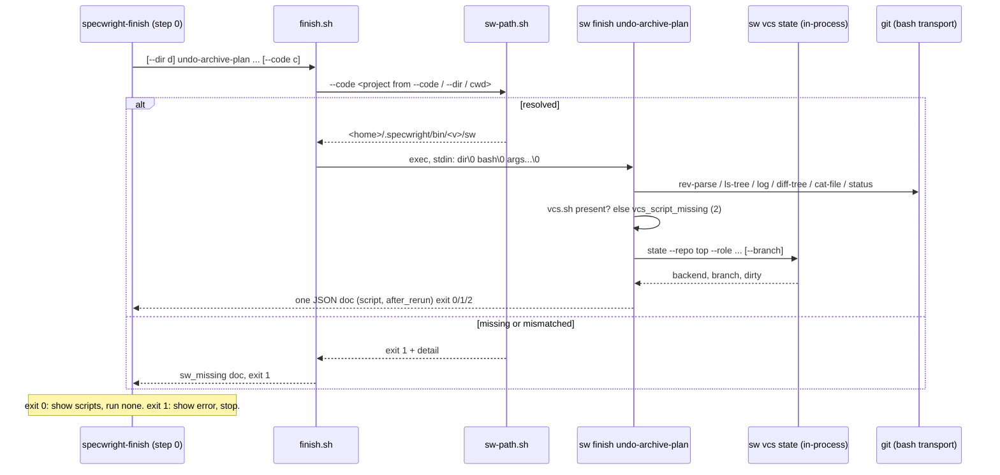
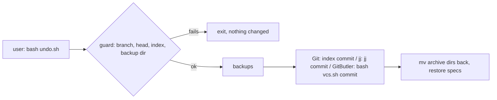

# Design

## Triage

| Trigger | Applies? | Evidence |
|---|---|---|
| T1 Components (new component, or 3+ with directed relationships) | yes | A new `sw finish` command. The chain is skill → shim → `sw-path.sh` → `sw` → (`git`, the in-process VCS state read). |
| T2 State (persistent state, caches, 3+ state machine) | no | The plan only reads the repo and prints scripts (`skills/specwright-finish/scripts/finish.sh:2-4`). It keeps no state of its own. |
| T3 Concurrency (background work, workers/isolates, async, retries) | no | `git` runs one call at a time with no retries (`finish.sh:108-112`). |
| T4 Boundaries (data format, migration, shared interface, IPC, external) | yes | A new `sw` command name that M8 callers bind to. The ADR 0028 stdin handoff. A JSON contract and two printed bash scripts kept byte for byte. |
| T5 Volume (grows without a fixed bound) | no | The plan reads the members of one archive and their main specs. `finish.sh` sets no bounds (ADR 0012 lists it as an exception, `docs/adr/0012-pr-scripts-and-reviewer-runs-are-bounded.md:20`), and S3 keeps it that way. |
| T6 Risk (security, money, data loss, unrecoverable user data) | yes | The printed script moves archive directories, restores main specs and commits. A wrong path, a weaker guard or a different quote in that text would lose the user's edits when they run it. |

TIER: FULL

## Context

- `finish.sh` is a bash wrapper. It finds Python 3.8+ or prints `no_python` and exits 2 (`finish.sh:56-60`). It sets `FIN_DIR` (its own directory, in `cygpath -m` form on Windows) and `FIN_BASH` (`finish.sh:61-64`), then runs a heredoc program (`finish.sh:66`). Every run prints one document through `emit`: `json.dumps(ensure_ascii=False)` with U+2028 and U+2029 escaped (`finish.sh:103-105`). A stop prints `ok`, `error` and `message`, then any extra keys (`finish.sh:90-96`). An unexpected exception prints `internal_error` with exit 1 (`finish.sh:624-631`).
- Arguments: a leading `--dir <d>` comes before the subcommand. Each option takes one value, and the last one given wins. An unknown option or a missing value is a `usage` stop with exit 2 (`finish.sh:144-157`, `610-621`).
- `git` runs as `git <args>` with `cwd` set, `GIT_TERMINAL_PROMPT` defaulting to `0`, and no deadline. A start failure becomes exit 127 (`finish.sh:74-75`, `108-112`). Output is decoded with `replace` and `strip()`ped (`finish.sh:115-120`).
- The backend state comes from a subprocess, `bash <vcs.sh> state --repo <top> (--role code | --role store --code <c>) [--branch <b>]`. A missing `vcs.sh` is `vcs_script_missing` with exit 2. It runs with `cwd=top`, so a relative `--code` is checked and resolved from the planning repo's toplevel (`finish.sh:131-132`). A document with `ok` false becomes a stop with its `error` and `message` and exit 1 (`finish.sh:123-141`). The path is `normpath(<FIN_DIR>/../../specwright-pr/scripts/vcs.sh)` with `/` separators (`finish.sh:76`). The printed GitButler and jj scripts call that same path (`finish.sh:438`, `453`, `524`).
- The patterns use Python `re`. `DATE_RX` is `^\d{4}-\d{2}-\d{2}-`, `DEFERRED_RX` is `(?m)^VERDICT: DEFERRED[ \t]*\r?$`, and `USER_TASK_RX` is `(?m)^[ \t]*-[ \t]+\[...\][ \t]+(\d+\.\d+)[ \t]+\[user\](?=[ \t]|\r?$)` (`finish.sh:78-87`). In Python, `(?m)` `^` and `$` anchor only at `\n`.
- The script text is built with `shlex.quote` (`finish.sh:160`), a jj string quoter `dq` (`finish.sh:163-165`), `json.dumps(plan_branch, ensure_ascii=False)` inside a `case` pattern (`finish.sh:440`, `458`), and a jj revset-symbol test that uses an ASCII class (`finish.sh:451`). Filesystem checks use `os.path.isdir`, `exists` and `isfile`, which follow symlinks (`finish.sh:212`, `253`, `303`). The uncommitted mode walks directories with `os.walk` (`finish.sh:296`, `313`). Lists are ordered with `sorted()` (`finish.sh:281`, `300`, `474`, `512`).
- The `sw` side has the pieces this change reuses. `parseHandoff` takes a usage text (`cli/lib/src/vcs/args.dart:26`), and `runCommitCommand` shows the dispatch pattern (`cli/lib/src/commands/commit.dart:31-63`). `VcsStop.object()` gives `ok`, `error`, `message` and then the extras (`cli/lib/src/vcs/stop.dart:4-26`). `documentText` and `documentBytes` write the Python JSON form, with an escape flag (`cli/lib/src/vcs/document.dart:19`, `40`). `runTool` is the bash transport, and it takes an `environment` (`cli/lib/src/vcs/tool_runner.dart:178-199`). `nativePath` is D9 of the commit port (`cli/lib/src/commit/paths.dart:31`). `pySplitLines`, `isPySpace` and `pyStrip` are public Python text rules (`cli/lib/src/commit/task_cover.dart:669-723`). `sw vcs state` is `parseVcsArguments` → `openSession` → the backend's state document (`cli/lib/src/vcs/args.dart:160-198`, `cli/lib/src/commands/vcs.dart:44-75`). Its `_state` dispatch is private (`commands/vcs.dart:70`). `parseVcsArguments` checks `--repo` and `--code` against the process's working directory (`args.dart:175`), and `openSession` resolves them from there (`commands/vcs.dart:44-53`).
- `runCli` dispatches `commit` and `vcs` before the args parser, and its usage text lists them (`cli/lib/src/cli.dart:13-21`, `52-66`).
- Adding a command is not an incompatible interface change (`openspec/specs/native-cli/spec.md:10`).
- Evals: the GitButler undo tests run `finish.sh` through the inherited `script` → `GitButlerFlowCase.run_argv`, which sets `SPECWRIGHT_HOME` and stamps the repo (`evals/vcs/test_gitbutler_undo.py:30`, `evals/vcs/test_gitbutler_flows.py:50-58`, `65-66`). `but` is installed only on Linux, and the macOS and Windows gap is #154 (`.github/workflows/evals.yml:117-119`). `run_finish` already passes `SPECWRIGHT_HOME` (`evals/finish/fixtures.py:208-212`), and `make_repo` stamps `VERSION` (`fixtures.py:99`), because `finish.sh` already calls the `vcs.sh` shim. `TestVcsScriptMissing` copies `finish.sh` alone into a fake skills tree and expects `vcs_script_missing` with exit 2 (`evals/finish/test_undo_jj.py:173-187`). The network scan reads `finish.sh` and skips `#` comment lines. Its injected-line test inserts at index 40 and expects line 41 (`evals/finish/test_undo_plan.py:112-155`). `carried_edits` is compared sorted (`test_undo_plan.py:381`). Every CI suite job builds `sw` (`.github/workflows/evals.yml:140-151`).
- `specwright-finish` already stops on an exit 1 from the plan: it shows `error` and `message` (`skills/specwright-finish/SKILL.md:65`, the `exit 1` branch of step 0).

## Decisions

### D1: `sw finish` lives in `cli/lib/src/finish/` and reuses the vcs and commit helpers

- **Choice:** add `commands/finish.dart`, which reads the handoff, parses a leading `--dir` and dispatches `undo-archive-plan`, plus `finish/undo_plan.dart` for the plan and `finish/script_text.dart` for the quoting helpers. They import `vcs/args.dart`, `vcs/stop.dart`, `vcs/document.dart`, `vcs/codec.dart`, `vcs/tool_runner.dart`, `commit/paths.dart` and the Python text rules from `commit/task_cover.dart`. `runCli` gains `finish`.
- **Rejected:** moving the shared helpers into a `lib/src/common/` module now. That renames files two earlier ports landed, and M8 is the better time for it. **Rejected:** a separate binary, which ADR 0027 rules out.
- **Reversal cost:** low
- **Important:** no
- **Chosen by:** agent

### D2: The backend state is read in-process, after the `vcs.sh` presence check

- **Choice:** `sw finish` first checks that `<pr scripts>/vcs.sh` is a file, where `<pr scripts>` is the lexical normalisation of `<scripts dir>/../../specwright-pr/scripts`. If not, it stops with `vcs_script_missing` and exit 2, at the same point as `finish.sh:126-127`. Then it builds the argument list `finish.sh` passed (`state --repo <top> --role … [--branch …]`). A relative `--code` is first joined to `top` lexically, so it names the directory the subprocess's `cwd=top` named (`finish.sh:131-132`). It then parses it with `parseVcsArguments`, runs `openSession` with `VcsScripts(<pr scripts>, bash)`, and calls the state dispatch, which becomes public as `stateDocument`. A `VcsStop` from any of these becomes a finish stop with the same `error` and `message` and exit 1, as `finish.sh:139-140` maps a failed document.
- **Rejected:** passing `--code` through unchanged. `parseVcsArguments` and `openSession` would read a relative value from the caller's directory, not from `top`, and probe another checkout's settings. **Rejected:** spawning `bash vcs.sh state` as `finish.sh` does. That runs the shim, Python, the resolver and a second `sw` on every plan, and it adds a `sw_missing` failure in the middle of a plan whose own `sw` already resolved. The code is the same either way, so the document is the same.
- **Reversal cost:** low
- **Important:** no
- **Chosen by:** agent

### D3: `git` runs through the bash transport, from the plan's directory, with no deadline

- **Choice:** each call is `runTool(bash, <cwd>, ['git', ...args])`, where `<cwd>` is the directory `finish.sh` passed as `cwd`. The environment is the parent's, with `GIT_TERMINAL_PROMPT=0` added when it is unset. A transport exit 127 counts as a failed `git`, as Python's `OSError` → 127 does (`finish.sh:109-112`). There is no deadline and no output cap (ADR 0012's exception for `finish.sh`, #111).
- **Rejected:** `Process.run('git', ...)`. Argument bytes would go through Dart's argv encoding (constraint C3 of the vcs port, `tool_runner.dart:168-176`). **Rejected:** `sw run --bounded`, which adds a deadline, a behaviour change outside S3.
- **Reversal cost:** low
- **Important:** no
- **Chosen by:** agent

### D4: Python's text, pattern and ordering rules are matched explicitly; digits are ASCII

- **Choice:**
  - Git output is decoded with `decodeReplacing` and stripped with `pyStrip`. Porcelain output is split with `pySplitLines`.
  - `DEFERRED_RX` and `USER_TASK_RX` are matched per line of a split on `\n` only, with the `\r?` before the line end handled explicitly, so `^` and `$` anchor where Python's `(?m)` does. Dart's multiline mode would also anchor at `\r`, U+2028 and U+2029.
  - The id, the box and the `[ \t]` classes keep their meaning, and `\d` becomes `[0-9]` in the id and in `DATE_RX`. The box counts as done when `pyStrip(box)` is `x` or `X`.
  - `sorted()` becomes a comparison by Unicode code point, not by UTF-16 unit, and tuples compare element by element.
  - `os.walk` becomes a byte-preserving walk. `Directory.list()` exposes only a lossy `path`, which is why the VCS walker avoids it (`cli/lib/src/vcs/walk.dart:23-31`), so names come from `find ROOT/ -mindepth 1 -print0`, run through the transport as `BASH -c 'command -p find "$@"'`, the way the VCS walker starts it (`walk.dart:41-60`). Names are decoded with `decodeEscaped`, so `encodeEscaped` gives back the original bytes for every later read and for the names printed in `carried_edits`. Nothing is pruned. Each entry is classified by a stat that follows links, on its raw path: a directory, including a link to one, goes in `dirs`; anything else goes in `files`, as `os.walk` sorts them. `find` without `-L` does not descend into a linked directory, and `os.walk` without `followlinks` does not either. The records are then regrouped by parent into `os.walk`'s top-down order: a directory's files in listing order, then its subdirectories in listing order, each in turn. Records that `find` could not list are absent, as `os.walk` skips a directory it cannot list. A last record with no NUL is dropped.
  - `exists`, `isdir` and `isfile` follow links, and paths are opened by raw bytes (`encodeEscaped`).
  - Each rule is written from Python's documented behaviour and checked by unit tests. No CPython source is translated.
- **Rejected:** Dart's default `RegExp` multiline anchors, `\d`, `String.compareTo`, and `Directory.list(recursive: true)` (lossy names, and a different order). **Rejected:** reusing `walkFiles` as it is: it prunes `.git` and `.jj` and keeps only regular non-link files (`walk.dart:17-20`), which is not `finish.sh`'s walk. Each differs from Python on some input, and the difference would change members, waiting tasks or the order of printed lines. **Rejected:** Unicode `\d`, which the user ruled out: the plan would then count user tasks that `sw commit task-cover` does not.
- **Reversal cost:** low
- **Important:** yes: it changes behaviour users see (a non-ASCII-digit user task or date prefix no longer matches)
- **Chosen by:** user

### D5: The printed scripts are built with Python-equivalent quoting

- **Choice:**
  - `shellQuote` returns `''` for an empty string. It returns the text unchanged when every character is in `[A-Za-z0-9_@%+=:,./-]`. Otherwise it returns the text in single quotes, with each `'` written as `'"'"'`.
  - `jjString` is `dq`: `"` around the text, with `\` and `"` escaped by a backslash.
  - The branch inside the `case` pattern is `documentText(branch, escapeLineSeparators: false)`. The whole document is escaped later, as `emit` does.
  - The VCS path printed in the scripts is the D2 `<pr scripts>/vcs.sh`, with `/` separators.
  - Unit tests pin each helper with cases whose expected text was produced by Python 3.8 and 3.12. The unchanged evals check the effects of running the scripts. D9 checks the whole document and both scripts byte for byte.
- **Rejected:** printing `sw` commands in the scripts instead of `bash vcs.sh`. That changes what the user runs, outside S3, and the shim still exists until M8.
- **Reversal cost:** low
- **Important:** no
- **Chosen by:** agent

### D6: On Windows, `--dir` and `--code` in Git Bash form are converted; a failure stops with `bad_path`

- **Choice:** before any use, each of `--dir` and `--code` that starts with `/` on Windows goes through `nativePath` (the commit port's D9). A failed conversion prints `"error": "bad_path"`, `"message": "could not convert path: <path>"` and `"path": <path>`, and exits 2 before any `git` call. Other options are not paths, and none of them starts with `/` in finish's calls.
- **Rejected:** converting in the shim, which ADR 0028 forbids, because the shim would then need to know which arguments are paths. **Rejected:** using the unconverted path. On Windows `/c/x` names another directory, and the plan would answer `not_a_repo` or read the wrong repo.
- **Reversal cost:** low
- **Important:** no
- **Chosen by:** agent

### D7: The shim follows `task-cover.sh` and walks from `--code`, then `--dir`

- **Choice:** the shim has the same structure as `task-cover.sh`: the Python lookup (`no_python`, exit 2, same text as `finish.sh:60`), the scripts directory and bash, a project walk, `sw-path.sh`, then `exec "$sw" finish --args-stdin`. The planning repo is the first directory with a `.git` entry at or above a leading `--dir` (else the current directory). A relative `--code` is read from that planning repo, as the old subprocess read it. The walk then starts from `--code` when it is a directory, else from the planning repo, and goes up to the first `.git`. No Git command runs. The stdin records are `<scripts dir>`, `<bash>` and then every argument in the order given, a leading `--dir <d>` included. ADR 0028 names "the subcommand and every argument". `finish.sh`'s own grammar puts its global `--dir` first, and the shim passes the command line through unchanged rather than reordering it. The shim's header comment keeps the usage and exit contract, and the file keeps at least 40 lines, which the injected-line scan test relies on.
- **Rejected:** having the shim move `--dir` after the subcommand, which is argument logic in the shim (ADR 0028). **Rejected:** a separate project option, which `finish.sh` does not need because `--code` exists (S5).
- **Reversal cost:** low
- **Important:** no
- **Chosen by:** agent

### D8: Evals keep their assertions; one fixture reaches `sw`, and a new scan covers the Dart code

- **Choice:**
  - `TestVcsScriptMissing` copies `sw-path.sh` and `bounded.py` into the fake `specwright-pr/scripts`, but not `vcs.sh`, and runs with `SPECWRIGHT_HOME`. The run then reaches `sw`, which reports `vcs_script_missing` as before. Its assertions do not change.
  - New tests in `test_undo_plan.py` scan `cli/lib/src/finish/**/*.dart` with the same pattern, skipping `//` comment lines, and check that an injected line is named. A new test checks that a stub `sw-path.sh` failure gives `sw_missing`.
  - New Dart unit tests cover D4, D5 and D6.
  - `evals/suites.json` maps `cli/lib/src/finish/**` and `cli/lib/src/commands/finish.dart` to `finish` and `vcs`.
- **Rejected:** a test-only variable that points the shim at a binary, which would be a fallback path in shipped code (ADR 0028).
- **Reversal cost:** low
- **Important:** no
- **Chosen by:** agent

### D9: A differential eval compares `sw` with a frozen copy of the old script

- **Choice:** `evals/finish/oracle/finish.sh` is the last `finish.sh` before this change. Its one edit: `FIN_DIR` comes from `ORACLE_FIN_DIR` when that is set, so its printed `vcs.sh` path is the real one. A new `evals/finish/test_parity.py` plans the same fixture repos with the oracle and with the shim, and asserts equal stdout bytes and exit codes. The cases are an uncommitted single archive, a committed single archive, a bulk archive with a deferred member and amendments, a waiting user task, a resume from another branch, and the refusals `target_exists`, `no_archive` and `dirty_tree`. They run on Git and jj on all three OSes. On Linux, one more case is an uncommitted archive holding a file whose name has invalid UTF-8 bytes. macOS and Windows file systems refuse such names, so the case is skipped there. The GitButler cases are in `evals/vcs/test_gitbutler_parity.py`, which runs in the `vcs` suite job, the only job that installs `but` (`.github/workflows/evals.yml:117-119`). It calls `require_but()`, so with `SPECWRIGHT_REQUIRE_BUT=1` on Linux CI a missing `but` fails the job instead of skipping. The macOS and Windows gap stays C8 (#154). Both modules share the oracle runner from `evals/finish/fixtures.py`. The oracle is test-only, ships nowhere (the install copies skills, schema and templates only), and is listed in `evals/suites.json`. M8 deletes it together with the shim.
- **Rejected:** golden files recorded once. Paths, dates and commit ids change per run, so each golden would need masking that could hide a real difference. **Rejected:** relying on the effect-based evals alone. They cannot see a quoting, ordering or spacing difference that still runs.
- **Reversal cost:** low
- **Important:** no
- **Chosen by:** agent

### Decision summary

| # | Decision | Choice | Rejected | Reversal cost | Important | Chosen by |
|---|---|---|---|---|---|---|
| S1 | How callers reach `sw` | `finish.sh` becomes an ADR 0028 shim | Switch callers now | low | no | agent |
| S2 | `sw` command name | `sw finish undo-archive-plan` | Top-level `sw undo-archive-plan` | medium | yes | user |
| S3 | Scope | Parity only, defects filed | Fix or bound during the port | low | no | agent |
| S4 | What "finish operations" means | `finish.sh` | Also port the PR and release scripts | low | no | agent |
| S5 | Finding the project | Existing `--code`, then `--dir` | New project option | low | no | agent |
| D1 | Code layout | `lib/src/finish/` reusing vcs and commit helpers | Shared module first; separate binary | low | no | agent |
| D2 | Backend state | In-process `sw vcs` state after the `vcs.sh` check; relative `--code` joined to `top` | Pass `--code` unchanged; spawn `bash vcs.sh state` | low | no | agent |
| D3 | Running git | Bash transport, plan's cwd, no deadline | Direct `Process.run`; bounded run | low | no | agent |
| D4 | Text rules | Python's anchors, strip, sort; byte-preserving `find` walk in `os.walk` order; ASCII digits | Dart defaults; `Directory.list`; Unicode digits | low | yes | user |
| D5 | Script text | Python-equivalent quoting; still `bash vcs.sh` | Print `sw` commands | low | no | agent |
| D6 | Windows paths | `nativePath` for `--dir`/`--code`; `bad_path` on failure | Convert in shim; use as given | low | no | agent |
| D7 | Shim form | As `task-cover.sh`; relative `--code` from the planning repo; walk `--code`, then planning repo; args as given | Reorder `--dir` in the shim | low | no | agent |
| D8 | Evals | Fixture reaches `sw`; Dart scan added; no assertion changes | Test-only override variable | low | no | agent |
| D9 | Byte parity check | Differential eval against a frozen oracle copy; GitButler cases in the `vcs` job | Golden files; effect evals only | low | no | agent |

## Assumptions

- **A1:** `find`'s order within one directory is the same as Python's `os.scandir`, since both read the OS listing (`readdir`, and Git Bash's `readdir` over `FindFirstFileW`). The D9 differential eval checks it on each CI OS. Not checked because the order is platform-dependent and no eval pins it: `carried_edits` is compared sorted (`evals/finish/test_undo_plan.py:381`), and `caps` is sorted before use (`finish.sh:300`). Depends on it: D4, task 2.3.
- **A2:** A plan makes about 20 to 40 `git` calls, and each now starts `bash` too. That is offset by no longer spawning the `vcs.sh` shim, Python, the resolver and a second `sw` (D2). Not measured. Depends on it: none (the Risks entry says what to do if CI timings grow).

## Carried constraints

- **C1:** User-task ids and archive date prefixes match ASCII digits only, unlike Python's `\d`, on purpose (D4). Kind: deliberate gap. Destination: spec: specs/change-finish/spec.md → Requirement: sw finish undo-archive-plan keeps finish.sh's contract
- **C2:** `sw finish` runs `git` with no deadline and no byte bound, as `finish.sh` did (ADR 0012 exception, #111). Adding bounds is a behaviour change for its own change. Kind: deliberate gap. Destination: doc comment: cli/lib/src/finish/undo_plan.dart undoArchivePlan
- **C3:** The printed `script` and `after_rerun` call `bash <specwright-pr>/scripts/vcs.sh` by path, never an `sw` binary, so a user who runs them needs nothing new. Kind: invariant. Destination: spec: specs/change-finish/spec.md → Requirement: sw finish undo-archive-plan keeps finish.sh's contract
- **C4:** Line-anchored patterns anchor at `\n` only, `sorted()` order is by code point, the walk is `os.walk`'s top-down order with names that keep their original bytes from listing through reads to output (never `Directory.list()`), and filesystem checks follow links. A Dart default changes members, waiting tasks or printed lines. Kind: invariant. Destination: doc comment: cli/lib/src/finish/undo_plan.dart undoArchivePlan
- **C5:** `shellQuote` and `jjString` produce exactly `shlex.quote`'s and `dq`'s text. The printed scripts are run by users, so a quoting change is a safety change. Kind: invariant. Destination: doc comment: cli/lib/src/finish/script_text.dart shellQuote
- **C6:** `sw finish` and the `finish.sh` shim run no network command. Kind: invariant. Destination: spec: specs/change-finish/spec.md → Requirement: finish.sh runs no network command
- **C7:** A relative `--code` is read from the planning repo's toplevel, not from the caller's directory, both for the in-process state read and for the shim's project walk. Kind: invariant. Destination: spec: specs/change-finish/spec.md → Requirement: finish.sh finds the project from --code, then --dir
- **C8:** GitButler parity of the undo plan is checked only on Linux, because `but` has no standalone build for macOS and Windows (#154). Kind: deliberate gap. Destination: doc comment: cli/lib/src/finish/undo_plan.dart undoArchivePlan

## Diagrams (FULL)

T1 and T4: the call chain and the handoff.

T4, the printed script calls the old path at the user's run:

## State & Ownership (FULL)

| State | Owner (sole writer) | Lifetime | Invalidation / rebuild | Authoritative copy |
|---|---|---|---|---|
| Plan document | None (computed by `sw finish`) | One call | Recomputed on every call | The repo at the read |
| Printed scripts | The user, who saves and runs them | Until run | A new plan after any repo change. The guard refuses a stale one | The plan document |
| Backup directory `<git-dir>/specwright-undo/<archived>/` | The printed script, when run | Kept, never deleted by any step | None | The directory itself |

## Failure & Visibility (FULL)

| Component | Fails / dies mid-operation → | Recovery | Retry safe? | Who finds out |
|---|---|---|---|---|
| Shim | No Python, or no `sw` that resolves | Rerun the install prompt | yes | The agent, from `no_python` (exit 2) or `sw_missing` (exit 1). Finish stops and shows it (spec "Finish stops on a missing sw") |
| `sw finish` | `git` fails, or `sw` is killed | None needed, it is read-only | yes | The agent: a stop document, or the shell's signal exit. Finish stops on any non-zero exit |
| In-process state read | A probe or state stop (`not_managed`, `tool_missing` and so on) | Fix the repo setup, as with `vcs.sh` | yes | The agent: that `error` and `message`, exit 1, as before |
| Windows path conversion | `cygpath` fails | Pass a drive-form path | yes | The agent: `bad_path`, exit 2 |
| Unexpected Dart exception | — | — | yes | The agent: `internal_error`, exit 1 |
| Printed script | Fails part-way | As its warnings say, unchanged (`finish.sh:529-546`) | per warning | The user, at the failing command (`set -euo pipefail`) |

## Resource Bounds (FULL)

| Queue / buffer / cache / transfer | Bound | At the bound | Timeout | At 10x / 100x |
|---|---|---|---|---|
| `git` output in memory | None, as in `finish.sh` (C2) | Held in memory | none (C2, #111) | A bulk archive of 10x members makes about 10x calls of small output. No growth path beyond the archive's own files |
| Handoff on stdin | Read whole (`readAllStdin`) | none | none | A few hundred bytes |
| Archive files walked (uncommitted mode) | The files of the archive's members | none | none | Each file costs one `cat-file`. 100x files is 100x calls, as before |

## Flow & State Gaps (FULL)

- **The repo changes between the plan and the run.** Unchanged: the printed guard checks the branch, the head, the index and the backup directory (`finish.sh:465-466`).
- **The project's `sw` is upgraded between calls.** Each shim call resolves again. A plan from the old binary and a script run later are both plain text, and the script calls `vcs.sh` by path (C3), so nothing breaks.
- **Interrupted plan.** It writes nothing, so a rerun is safe.

## Mechanism Ledger (FULL)

| Mechanism | Built? | Why (harm nobody catches / expensive later) | Evidence that would change the call |
|---|---|---|---|
| Python-equivalent quoting with pinned tests | yes | A quoting slip in a script the user runs could move or delete the wrong path, and nobody would see it before the run | — |
| `\n`-only anchors and code-point sort | yes | Without them, members or waiting tasks would differ on some inputs without anyone noticing | — |
| `vcs.sh` presence check before the in-process read | yes | The printed scripts call it. Without the check, a plan would print a script that cannot run | — |
| Deadline on `git` | no | Parity (S3, C2) | A hung `git` seen in practice, or #111 |
| `interface` bump | no | Adding a command is compatible (`openspec/specs/native-cli/spec.md:10`) | — |
| Shared `common/` module | no | No harm now (D1) | M8 adding more ported commands |
| Batched `git cat-file --batch` reads | no | Same results, fewer processes. Not needed unless the calls are slow (A3) | Windows CI timings for `finish` grow by minutes |

## Risks / Trade-offs

- [The Python rules are subtle: `(?m)` anchors, `strip`, `sorted`, `os.walk`, `shlex.quote`] → Dart unit tests per rule with edge inputs, plus the unchanged `evals/finish` and GitButler undo suites on three OSes.
- [Windows: Python's stdout writes `\r\n`] → the document uses `documentLineEnd`, as `sw vcs` does. The printed scripts keep `\n` inside the JSON strings.
- [Each `git` call starts a `bash` (A3)] → measure with the `finish` job timings in CI. If the Windows job grows by more than a few minutes, batch the `cat-file` reads in a follow-up issue.
- [GitButler parity is checked on Linux only (C8, #154)] → Git and jj run on all three OSes. The GitButler code paths share their builders with Git and jj except the guard and commit lines, which the Linux run covers. #154 turns them on elsewhere once `but` ships there.
- [The ADR 0028 wording names the subcommand first, and `--dir` comes before it] → D7 passes the command line unchanged, as the ADR intends (bytes over stdin, no logic in the shim). The ADR is not edited.

## ADRs

- **In force, constraining this change:** 0027 (one `sw` binary, exact version), 0028 (shims, the stdin handoff, no fallback), 0017 (the `vcs.sh` contract the printed scripts call), 0012 and 0014 (`finish.sh` unbounded and network-free), 0019 and 0024 (the GitButler and user-task rules the plan keeps).
- **To record during apply:** none. ADR 0028 covers this port, and the new command name is recorded in the spec.
