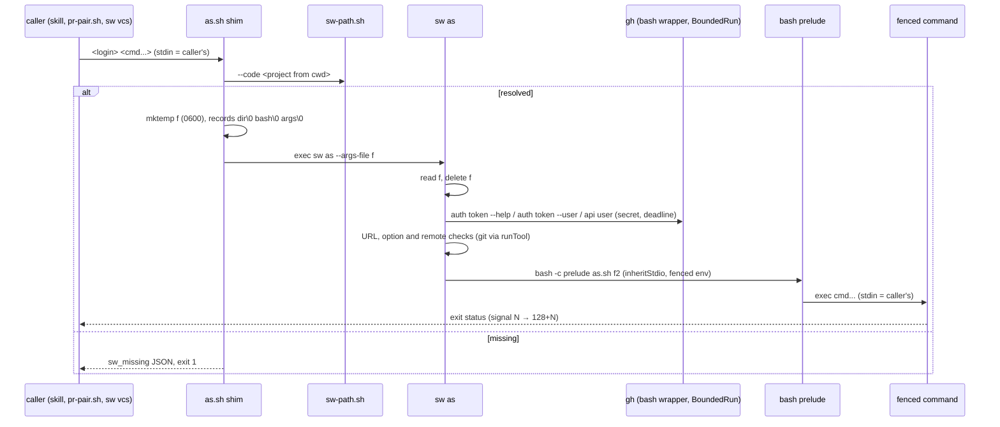
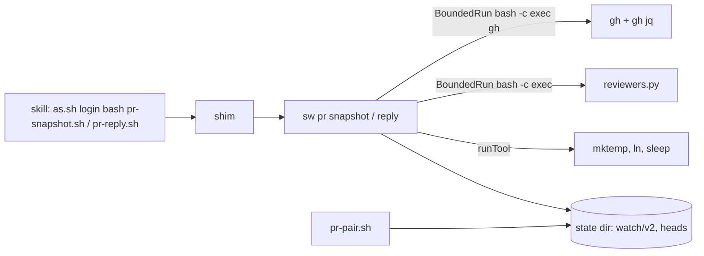
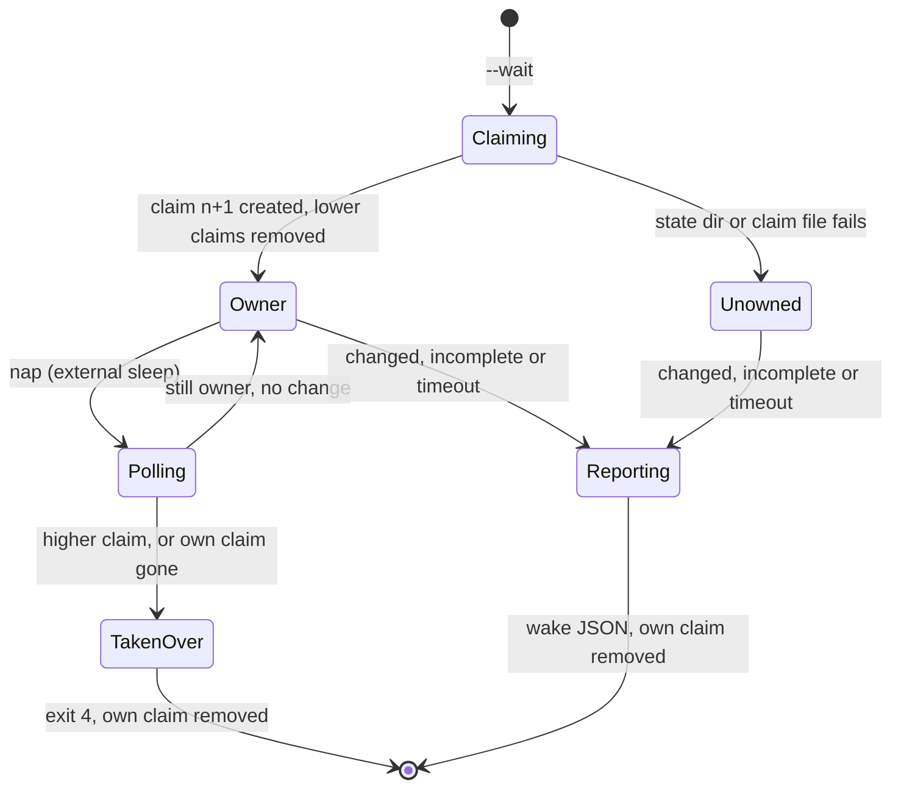

# Design

## Triage

| Trigger | Applies? | Evidence |
|---|---|---|
| T1 Components (new component, or 3+ with directed relationships) | yes | New `sw as`, `sw pr snapshot` and `sw pr reply` commands. The chains are skill → shim → `sw-path.sh` → `sw` → (`gh`, `git`, `bash`, `reviewers.py`), and `sw vcs` → `as.sh` shim → `sw as` (`cli/lib/src/vcs/scripts.dart:157-162`). |
| T2 State (persistent state, caches, 3+ state machine) | yes | The watch claims under `<state>/watch/v2/...` and the head records under `<state>/heads/...`, shared with `pr-pair.sh` and with a watcher of the old script (`skills/specwright-pr/scripts/pr-snapshot.sh:143-192`, `438-452`). |
| T3 Concurrency (background work, workers/isolates, async, retries) | yes | The `--wait` poll loop, concurrent watchers on one PR, and the first-writer-wins head record (`pr-snapshot.sh:556-597`, `444-447`). |
| T4 Boundaries (data format, migration, shared interface, IPC, external) | yes | Three new `sw` command names that M8 callers bind to. A second handoff form beside ADR 0028 (S3). Snapshot JSON, reply markers and the state file formats kept byte for byte. |
| T5 Volume (grows without a fixed bound) | no | Each `gh` call is bounded at 32 MiB per stream and 120 s (300 s paged) (`cli/lib/src/process/limits.dart:8-10`). Threads and comments are read at 100 per page, with `complete: false` past that (`pr-snapshot.sh:206-219`). Neither changes. |
| T6 Risk (security, money, data loss, unrecoverable user data) | yes | `sw as` holds a GitHub token and decides which identity a push or a comment uses. A weaker URL check, a leaked token or a wrong credential helper posts or pushes as someone else. |

TIER: FULL

## Context

**The three scripts.**
- `as.sh` probes for Python 3.8+ and otherwise exits 2 with `as.sh: no_python: ...` (`as.sh:81`). It saves the caller's values once in `AS_SH_ORIG_*` (`as.sh:58-67`) and unsets the gh host and token variables (`as.sh:72`). It then runs its gh lookups through `bounded.py --secret` wrapped as `bash -c 'exec gh "$@"'` (`as.sh:86-87`), and maps the limit exits 124, 125 and 126 to exit 3 (`as.sh:89-95`). In order it checks `gh auth token --help` for `--user` (`as.sh:99-104`), handles `--resolve` (`as.sh:106-115`), reads the token with the gh variables unset (`as.sh:118-121`), exports it as `GH_TOKEN` (`as.sh:122`) and verifies the login with that token (`as.sh:124-127`). The `--help` probe and `--resolve` run with no token in the environment, so `--resolve` reads the active account. The userinfo checks follow: on the arguments (`as.sh:134-164`), on git global options (`as.sh:168-183`), on `but` (`as.sh:189-210`) and on `jj` (`as.sh:216-231`), then on the repo's remotes and rewrite rules (`as.sh:233-249`). The script exports the transport settings and the command-scoped config with the credential helper (`as.sh:258-276`) and ends with `exec "$@"` (`as.sh:278`). Its own git reads have no deadline (`as.sh:233-249`). No arguments at all is `${1:?...}`, which exits 1 (`as.sh:47`). A missing command or `--resolve` with other arguments exits 2 (`as.sh:49`, `as.sh:44`).
- `pr-reply.sh` checks all arguments and body files before any GitHub call, with exit 4 (`pr-reply.sh:75-87`). It looks the repo up with `gh repo view` (`pr-reply.sh:88`), checks pending reviews (exit 2, `:91-102`) and the revision with `--rev` (exit 5 or 3, `:107-131`). It writes the body plus marker to a `mktemp` file (`:133-142`), posts with REST or `gh pr comment` (`:179`, `:197`), resolves and reacts, and exits with `$failed` (`:210`).
- `pr-snapshot.sh` parses its options with exit 2 on any error (`pr-snapshot.sh:86-112`). `--full` is one GraphQL call (`:113-129`). The reviewer config is checked with `reviewers.py --check-config` before any gh call (`:132-138`). It holds one GraphQL query (`:202-225`) and one jq program (`:227-419`) that `gh --jq` runs (`query_pr`, `:496-499`), so gh produces the snapshot bytes. Other parts: the head and cutoff lookup (`prepare_cfg`, `:464-495`), the head record (`resolve_first_seen`, `:438-452`), the reaction re-check batches (`snapshot`, `:516-534`), the reviewer evaluation through a material file and `bounded.py` (`evaluate`, `:504-511`), the watch claims (`:143-192`) and the poll loop with an external `sleep` and `$SECONDS` (`:556-597`). `--logs` runs `gh run view ... --log-failed | tail -n 80` (`:601-611`).
- `pr-reply.sh` and `pr-snapshot.sh` wrap gh the same way as `as.sh` (`pr-reply.sh:48`, `pr-snapshot.sh:84`), and each has its own `no_python` line with exit 2 (`pr-reply.sh:43`, `pr-snapshot.sh:79`).

**What `sw` already has.**
- `BoundedRun` runs one command under limits and returns its exit, its limit and its stdout and stderr bytes held in memory (`cli/lib/src/process/bounded_run.dart:14-44`, `72-108`, `138-139`). `resolveLimits` applies the `SPECWRIGHT_NET_*` rules, `SPECWRIGHT_NET_DEADLINE_AT` included (`limits.dart:48-73`). `limitLine` names `bash -c` wrappers by the wrapped command (`limit_line.dart:22-37`). On Windows the `bash -c` arguments travel on stdin, so a bounded command never sees its caller's stdin (`transport.dart:36-55`, `14-20`). The tree stop uses a process group on POSIX and a job object on Windows (`posix_tree.dart:56-62`, `windows_tree.dart:141-183`).
- No API runs a child with the caller's own stdio. The only `inheritStdio` is the `__exec` helper's (`exec_helper.dart:146-152`).
- `resolveCommand` drops empty `PATH` entries on both platforms (`resolve.dart:19-23`), which is #202.
- `parseHandoff` splits NUL records into the scripts directory, bash and argv (`cli/lib/src/vcs/args.dart:26-42`). `readAllStdin` reads stdin with `readByteSync` (`commands/vcs.dart:159-170`). `runTool` runs a tool through bash with framed arguments and no deadline (`tool_runner.dart:178-199`, `8-21`). `documentText` writes Python's JSON form (`document.dart:6-27`). `nativePath` converts a Git Bash path on Windows (`cli/lib/src/commit/paths.dart:31`).
- `sw vcs` calls `as.sh --resolve` and `as.sh <who> <cmd>` as subprocesses, without stdin input (`scripts.dart:133-162`). It maps exit 3 to `fence_failed` (`git_common.dart:104-128`). On GitButler that also needs the `as.sh:` prefix on stderr (`gitbutler_backend.dart:679-695`).
- `runCli` dispatches commands by name before its args parser (`cli.dart:30-103`). `interfaceVersion` is 1 (`commands/version.dart:8-12`), and a new command is not an incompatible change (`openspec/specs/native-cli/spec.md:10`).
- The `vcs.sh` and `task-cover.sh` shims print `sw_missing` through a Python one-liner (`skills/specwright-pr/scripts/vcs.sh:37-40`).

**Evals.**
- `test_as_sh.py`, `test_as_jj.py` and `test_as_gitbutler.py` run the tree's `as.sh` with no `SPECWRIGHT_HOME` and in unstamped directories (`evals/pr-pair/test_as_sh.py:116-124`, `138-143`; `test_as_jj.py:62-71`; `test_as_gitbutler.py:53-62`). They pipe stdin into a fenced `git credential fill` (`test_as_sh.py:306`, `419-434`).
- `snapfix.py` runs `pr-snapshot.sh` and `pr-reply.sh` from a bare temp directory with no `SPECWRIGHT_HOME` (`evals/pr-pair/snapfix.py:140-154`).
- The fake `gh` is an extensionless `#!/bin/sh` script (`evals/git-workflow/fixtures.py:116-120`), which `resolveCommand` does not find on Windows (`resolve.dart:24-34`). Only the `bash -c 'exec gh "$@"'` wrapper reaches it.
- `test_pr_reply.py` injects a failing `mktemp` (`test_pr_reply.py:220-235`). The watch tests drive their clock through a fake `sleep` (`test_pr_snapshot.py:406-428`, `459-468`, `607-634`, `812-839`) and assert the `SPECWRIGHT_NET_DEADLINE_AT` each gh call received (`test_pr_snapshot.py:675-700`).
- `vcs_test_support.sw_home()` and `stamp_version()` place the CI-built `sw` and stamp `VERSION`, and `test_pr_pair.py` already uses them (`evals/vcs/vcs_test_support.py:31-76`; `evals/pr-pair/test_pr_pair.py:35`, `115`). Every CI suite job builds `sw` and sets `SPECWRIGHT_SW` and `SPECWRIGHT_REQUIRE_SW=1` (`.github/workflows/evals.yml:139-152`).
- `evals/suites.json` maps `cli/**` only to the `cli` suite, apart from the commit and finish paths (`evals/suites.json:26-29`).

## Decisions

### D1: Code layout and command dispatch

- **Choice:** `cli/lib/src/fence/` holds the fence (`as_command.dart` for the handoff and dispatch, `fence.dart` for the checks and environment, `urls.dart` for the userinfo rules, `exec_inherit.dart` for the final run). `cli/lib/src/pr/` holds `reply.dart`, `snapshot.dart`, `watch_state.dart`, `queries.dart` (the GraphQL and jq text) and `gh.dart` (the bounded gh wrapper both commands share). `runCli` gains `as` and `pr` before its args parser, and `pr` dispatches `snapshot` and `reply`. In this change the three commands take only the shim handoff, as `sw vcs` takes only `--args-stdin` (`cli/lib/src/commands/vcs.dart:100-116`): `sw as --args-file <path>`, `sw pr snapshot --args-stdin` and `sw pr reply --args-stdin`. Anything else on argv is a usage stop with exit 2. Callers keep calling the shims. A direct argv form (`sw as <login> <command...>`) arrives with `native-cli-retire-scripts`, when callers switch to `sw`. The `interface` stays 1.
- **Rejected:** putting the fence under `cli/lib/src/vcs/`, where `sw vcs` would be its only visible owner although the PR, release and update steps use it. A shared `common/` move of the vcs helpers now, which renames files that earlier ports landed (as in the finish port's D1).
- **Reversal cost:** low
- **Important:** no
- **Chosen by:** agent

### D2: The `as.sh` handoff is a private temp file, read and deleted first

- **Choice:** the `as.sh` shim writes the ADR 0028 records (scripts directory, bash, then every argument, each ending in NUL) to a file from `mktemp`, created mode 0600 under `TMPDIR`. It runs `exec "$sw" as --args-file <path>`, with the path in `cygpath -m` form on Windows. `sw as` reads the whole file, deletes it, and only then parses the records. It cannot reuse `parseHandoff`, which stops with exit 2 below three records (`cli/lib/src/vcs/args.dart:39-41`): `fence/as_command.dart` parses the same NUL framing and accepts exactly the two header records with no argument, which is `as.sh` called with none and exits 1 with `as.sh: line 47: 1: usage: as.sh <login> <command> [args...] | as.sh --resolve` (`as.sh:47`). Fewer than two records, or a last byte that is not NUL, is a broken handoff: exit 3 with `as.sh: handoff: malformed`. A file it cannot read or delete is exit 3 with `as.sh: handoff: <reason>` on stderr, and nothing runs. `sw as` accepts nothing else on argv. A new ADR 0029 records the exception: it applies to `sw as` only, because only the fence hands its stdin to another command.
- **Rejected:** an extra file descriptor (`3< <(...)`). Native Windows processes started from Git Bash do not inherit it. Arguments on `sw`'s command line, which ADR 0028 rejected because argv is decoded lossily.
- **Reversal cost:** medium
- **Important:** yes: binds future changes (a second handoff form, S3)
- **Chosen by:** user (S3)

### D3: The fenced command runs through bash with the caller's stdio, from a second private file

- **Choice:** after the checks pass, `sw as` writes the command's arguments as NUL records to a file inside a fresh directory from `Directory.systemTemp.createTemp` (mode 0700 on POSIX). It starts `bash -c '<prelude>' as.sh <file>` with `ProcessStartMode.inheritStdio`, in the directory `as.sh` started in, with the D5 environment. The prelude reads the records with a loop that bash 3.2 runs, `a=(); while IFS= read -r -d '' x; do a+=("$x"); done < "$1"`, because macOS `/bin/bash` is 3.2 and has no `mapfile` (`evals/git-workflow/fixtures.py:554`). In `bash -c '<prelude>' as.sh <file>`, `$0` is the label `as.sh` and `$1` is the file. Reading from the file leaves the command's stdin alone. `sw as` writes one more record after the arguments, the end marker `--sw-end--`. The prelude checks that the last record read is that marker and drops it, so a missing, unreadable or truncated file exits 126 with `as.sh: handoff: malformed` and runs nothing, as the transport prelude's marker check does (`transport.dart:14-20`). The prelude then removes the file and its directory, and runs `exec "${a[@]}"`. bash's own lookup finds the command as `as.sh`'s `exec` found it: extensionless scripts on Windows, functions excluded, `PATH` order, and 127 with `bash: ...: command not found` for a missing one. `sw as` waits for the child. Its exit is the child's status. A negative status on POSIX (death by signal N) becomes 128+N (Q1). On POSIX, `sw as` forwards SIGINT, SIGTERM and SIGHUP to the child while it waits. A bounded caller's tree stop reaches the child, because `sw as` neither starts a new session nor creates its own job, so the child stays in the caller's process group or job (`posix_tree.dart:56-62`, `windows_tree.dart:141-183`).
- **Rejected:** `Process.start(command, args, mode: inheritStdio)` directly. Dart's argv encoding is lossy for non-UTF-8 bytes, the Windows lookup cannot run an extensionless script, and the 8,191-character command line of Git Bash would cut long arguments. Exit by re-raising the signal on POSIX: it relies on unverified Dart signal behaviour, and bash callers already see 128+N (Q1).
- **Reversal cost:** low
- **Important:** yes: changes behaviour users see (a Python caller sees 128+N instead of -N)
- **Chosen by:** user

### D4: The fence's checks are ported rule by rule, with ASCII case folding

- **Choice:** every `as.sh` rule becomes Dart with the same order and the same messages: the gh version probe, `--resolve`, token, identity, argument checks, git, `but` and `jj` option scans, then remotes and rewrite rules. `lower` is ASCII-only, as `tr A-Z a-z` is (`as.sh:133`). The three URL patterns become Dart `RegExp`s over the decoded argument text (`decodeEscaped`, so a non-UTF-8 byte cannot match a pattern character), with the same anchors and classes (`as.sh:134-136`). `mask` keeps the scheme and replaces the userinfo with `***` (`as.sh:137`). `git rev-parse`, `git remote`, `git remote get-url` and `git config` run through `runTool` in the starting directory, unbounded as before. Each lookup's output is split into lines as bash's `read -r` splits it. The `gh` lookups run through D6's wrapper with `secret` set and their limit exits mapped as `limit_stop` maps them.
- **Rejected:** running the old checks as a bash snippet from `sw`. That is a fallback in all but name, and it keeps Python's `bounded.py` on the path. Unicode case folding through Dart's `toLowerCase`, which would fold non-ASCII letters that bash does not.
- **Reversal cost:** low
- **Important:** no
- **Chosen by:** agent

### D5: The fenced environment is built as a full map

- **Choice:** `sw as` starts from its own environment. It adds `AS_SH_ORIG_SET` and `AS_SH_ORIG_<v>` for each listed variable that is set, only when `AS_SH_ORIG_SET` is not already set (the `GIT_CONFIG_(KEY|VALUE)_N` names are matched by the same regex as `as.sh:62`). It removes `GH_TOKEN`, `GITHUB_TOKEN`, `GH_HOST`, `GH_ENTERPRISE_TOKEN` and `GITHUB_ENTERPRISE_TOKEN`. Discovery runs with none of them: the `gh auth token --help` probe, `--resolve`'s `gh api user` and `gh auth token --user <login>`. Verification runs with `GH_TOKEN` set to the token just read, as `as.sh` exports it before `gh api user` (`as.sh:122-127`), so the check is of that token and not of the active account. The fenced command gets the same token as `GH_TOKEN`. It sets `GIT_SSH_COMMAND`, `GIT_TERMINAL_PROMPT=0`, `GCM_INTERACTIVE=never` and empty `GIT_ASKPASS` and `SSH_ASKPASS`. Finally it sets `GIT_CONFIG_KEY_n`/`VALUE_n` from 0 (an empty `http.extraHeader`, one empty reset per `http.<url>.extraheader` key from `git config --name-only --get-regexp`, sorted and deduplicated as `sort -u` orders bytes in the C locale, then the two `credential.helper` entries, the helper text byte for byte) and `GIT_CONFIG_COUNT`. The child is started with `includeParentEnvironment: false` and this map, so a removed variable is really absent. On Windows, keys are compared case-insensitively when one is removed.
- **Rejected:** `includeParentEnvironment: true` with overrides, which cannot remove a variable. Verifying with no token in the environment, which checks the active account instead of the token read for `<login>`: it refuses a configured account that is not the active one, and passes a wrong token whenever the active account is `<login>`.
- **Reversal cost:** low
- **Important:** no
- **Chosen by:** agent

### D6: Every gh call runs in-process through `BoundedRun` with the bash wrapper

- **Choice:** `pr/gh.dart` runs every gh call and every `reviewers.py` run as `[bash, -c, '<framed prelude>; exec "$@"', <name>]` through `BoundedRun`, with `bash` the absolute path from the handoff and the logical command (`gh ...args`, or `<python> -I <scripts>/reviewers.py ...`) sent on stdin as `frameCommand(cwd, command)` records on every OS. The prelude is the count-framed reader of `runTool`, which runs on bash 3.2 and carries `encodeEscaped` bytes, so a non-UTF-8 byte in a path or argument reaches the command unchanged on POSIX as on Windows (`cli/lib/src/vcs/tool_runner.dart:8-21`, `66-80`, `171-177`). Dart's argument encoding is lossy on POSIX (`transport.dart:36-43` returns the command unchanged there, and `bounded_run.dart:125-130` passes it as process arguments), and Git Bash cuts long arguments on Windows, so nothing but the short prelude rides the command line. A broken framing exits 126 before anything runs, as in `runTool`, with the prefix `bounded:` instead of `vcs:`, so the prelude takes its prefix as a parameter. The limit line is built by `limitLine` from the logical `[bash, -c, 'exec gh "$@"', gh, ...args]`, so it reads as before. `BoundedRun` has no environment parameter today, and its helper inherits `sw`'s own environment (`bounded_run.dart:73-83`, `125-130`). This change adds an optional `environment` map: when it is given, the helper starts with `includeParentEnvironment: false` and that map, and the helper's own start of the command passes it on unchanged (`exec_helper.dart:146-152` sets no environment, so the child inherits the helper's). `sw run --bounded` passes none and keeps its behaviour. Each gh call gets the D5 map for its step, and each watch poll's map holds that poll's `SPECWRIGHT_NET_DEADLINE_AT`. It returns the exit, stdout, stderr and limit. On a limit the caller prints `limitLine` (`bounded: <limit>: gh <first arg>`) where the script's `bounded.py` printed it, and exits as the script's failure path did. On the `as.sh` path, the caller prints `as.sh: <limit>: <command>` and exits 3. The wrapper is the same one `bounded.py` was handed, so the extensionless eval fake and gh shell shims resolve through bash on every OS. `reviewers.py` runs through the same runner as `[bash, -c, 'exec "$@"', reviewers.py, <python>, -I, <scripts>/reviewers.py, ...]`, so its limit line names `reviewers.py` as before (`pr-snapshot.sh:509`).
- **Rejected:** spawning `sw run --bounded` as a child per call, which doubles the process count and adds nothing. Calling `gh` by `resolveCommand`, which does not find the extensionless fake on Windows (`resolve.dart:24-34`).
- **Reversal cost:** low
- **Important:** no
- **Chosen by:** agent

### D7: The snapshot keeps its query and jq text and lets gh run them

- **Choice:** `queries.dart` holds the GraphQL query, the jq program (`pr-snapshot.sh:202-419`), the `--full`, pending, revision, reaction and resolve queries, and their `--jq` programs, all byte for byte as raw Dart strings. The code that built `CFG` and the `rtimes` definitions (`pr-snapshot.sh:464-495`, `516-534`) builds the same text in Dart and passes it through `-f query=` and `--jq` exactly as the script did. gh produces the snapshot line, so its bytes are what they were. The text tools around it (`grep -o`, `sed -n`, `paste`, `tr`, `head`, `tail -n 80`) become Dart functions with the same results on the same input. Their patterns are ASCII, and `paste`'s grouping of 25 ids per line and 4 lines per batch is kept (`pr-snapshot.sh:520-522`).
- **Rejected:** re-implementing the jq shaping in Dart: about 230 lines to match byte for byte, with no benefit while gh is a prerequisite anyway.
- **Reversal cost:** low
- **Important:** yes: chosen with the user because it decides how parity is reached
- **Chosen by:** user

### D8: `mktemp`, `ln` and `sleep` stay external commands through bash

- **Choice:** the reply's body file, the evaluator's material file and the head record's temp file come from `mktemp` run through `runTool`. The head record is published with `ln` through `runTool`. The watch naps run `sleep <n>` through `runTool`. The script's `date +%s` deadline fallback has no counterpart: it ran only when `bounded.py --deadline-at` printed nothing, and `sw` works out the same now-plus-120 deadline in-process, so `date` never runs (amended during apply). Each keeps the script's error path when the command fails: exit 4 `no temp file`, `cannot create a temp file for the reviewer evaluator` exit 1, `first_seen_unsaved`. On Windows, `mktemp` output is converted with `cygpath -m` in the same bash call before `sw` opens the file. `native-cli-retire-scripts` replaces them, together with the eval hooks that fake them.
- **Rejected:** native temp files and timers with test-only environment hooks. The eval fixtures would change, so the unchanged evals would no longer prove parity for those tests (Q2).
- **Reversal cost:** low
- **Important:** yes: binds future changes (retire-scripts replaces the hooks)
- **Chosen by:** user

### D9: Watch claims and head records keep their paths, names and order

- **Choice:** the state base is `SPECWRIGHT_STATE_DIR`, else `$HOME/.cache/specwright`. On Windows a value starting with `/` goes through `nativePath`, so a Git Bash `HOME` names the same directory the old script used. The claim directory, its lower-case path (ASCII folding, as `tr` does), the `<n>-<nonce>` file name with the nonce `<pid>.<5 digits><5 digits>` (`pr-snapshot.sh:173`), the no-clobber create, the removal of lower claims, the ownership check before each poll and before the report, and removal by own name at exit (`:168-198`) are ported unchanged. Nonces compare as strings by bytes. bash's `[[ > ]]` compares by the locale's collation, and the two can differ only for two claims with the same number, which needs two watchers to claim within one directory listing. Exit cleanup runs on every exit path, signals included, by a `try`/`finally` plus SIGINT, SIGTERM and SIGHUP handlers on POSIX.
- **Rejected:** a new state layout (`v3`), which would let an old watcher and a new one both own the PR during an update.
- **Reversal cost:** medium
- **Important:** yes: binds future changes (a shared on-disk format with `pr-pair.sh`)
- **Chosen by:** agent

### D10: Shims follow `vcs.sh`, with the project found from the current directory

- **Choice:** each of the three shims keeps its `no_python` line and exit 2, sets its directory and bash (`cygpath -m` and `-w`), and walks up from the current directory to the first `.git` entry (else the current directory) to find the project. It runs `sw-path.sh --code <project>` with its stderr discarded. Only when that fails does it run the resolver a second time to capture its stderr in a variable (`2>&1 >/dev/null`), then prints `sw_missing` through the Python one-liner of `vcs.sh:37-40` from that variable and copies it to stderr. Unlike `vcs.sh:34`, the `pr-snapshot.sh` and `pr-reply.sh` shims call no `mktemp` before `sw` runs, so the eval's fake `mktemp` (`test_pr_reply.py:220-235`) is first called by `sw pr reply` for the body file, as it was by `pr-reply.sh`. The `as.sh` shim's one `mktemp` is its handoff file (D2). No eval fakes `mktemp` around an `as.sh` call: `snapfix.py` runs `pr-reply.sh` directly (`evals/pr-pair/snapfix.py:152-154`). The resolver reads only files and writes nothing, so a second run gives the same answer. Then it runs `exec "$sw" pr snapshot --args-stdin` or `pr reply --args-stdin` with the ADR 0028 stdin records, or D2's file for `as.sh`. None of the three takes a project option today, and fenced calls start inside the repo (`as.sh:233`), so the current directory is the right start.
- **Rejected:** taking the project from `--repo o/n` (a GitHub slug, not a path) or from the git toplevel (a Git command in the shim).
- **Reversal cost:** low
- **Important:** no
- **Chosen by:** agent

### D11: `sw vcs` keeps calling `as.sh`

- **Choice:** `scripts.dart`'s `fenceLogin` and `runAs` stay as they are. Each fenced VCS call goes through the `as.sh` shim, so the `as.sh:` stderr prefix and exit 3 that the backends map keep coming from the same place (`gitbutler_backend.dart:679-695`). `native-cli-retire-scripts` moves `sw vcs` to the in-process fence.
- **Rejected:** calling `sw as`'s code in-process from `sw vcs` now. It is faster, but it changes `sw vcs` in this PR and needs its own proof that the error mapping is unchanged (Q3).
- **Reversal cost:** low
- **Important:** yes: binds future changes (retire-scripts does the switch)
- **Chosen by:** user

### D12: Evals reach `sw` through fixtures, and a differential eval checks the bytes

- **Choice:**
  - `snapfix.py`, `test_as_sh.py`, `test_as_jj.py` and `test_as_gitbutler.py` set `SPECWRIGHT_HOME` from `vcs_test_support.sw_home()` and stamp `VERSION` in their working directory, or in a stamped parent for the non-repo cases, with `stamp_version` or a plain write. No assertion changes.
  - New shim tests cover `sw_missing` and `no_python` for each shim, the stdin and argument passthrough, 128+N, the deleted handoff file, a truncated or missing fenced-args file (exit 126, nothing runs), `as.sh` with no arguments (exit 1), and SIGTERM forwarding on POSIX. On Windows, a snapshot with the real query and jq program runs through the fake gh, which checks that the jq text arrived whole.
  - `evals/pr-pair/oracle/` holds frozen copies of the three scripts. Each changes only its `SW_DIR=` line to take `ORACLE_SW_DIR`, so it uses the tree's `bounded.py` and `reviewers.py`. `evals/pr-pair/test_parity.py` runs the oracle and the shim on the same fake-gh state and asserts equal stdout bytes, stderr lines and exit codes. The cases: a snapshot with threads, comments and reviews (markers with and without `rev`, reactions, clipped bodies, a cut-off list), `--full` for each kind and `not_found`, a reviewer config, and each `pr-reply.sh` kind with `--rev` matching and stale. For `as.sh`: `--resolve`, an identity mismatch, each userinfo refusal, and `env` output under the fence with the token masked by the test before comparing.
  - The differential eval adds a `--reviewer-config` file whose name holds a non-UTF-8 byte, on Linux, for both the config check and the evaluation.
  - Dart unit tests cover D4's URL rules, D5's environment (discovery with no token, verification with the token read), D6's `BoundedRun` environment (a variable removed from the map is absent in the command, a poll's `SPECWRIGHT_NET_DEADLINE_AT` arrives), D9's nonce and claim order, and D7's text helpers.
  - Shim evals cover a configured `<login>` that is not the active account (passes) and a token for `<login>` that resolves to another login while the active account is `<login>` (refused, exit 3). On macOS CI, a fenced command with an empty argument and argument bytes runs under `/bin/bash`.
  - `evals/suites.json` maps `cli/lib/src/fence/**` and `commands/as.dart` to `pr-pair` and `vcs`, `cli/lib/src/pr/**` and `commands/pr.dart` to `pr-pair`, and `evals/pr-pair/oracle/**` to `pr-pair`.
- **Rejected:** golden files. Times, PIDs and paths vary per run. A test-only variable pointing a shim at a binary, which would be a fallback path in shipped code (ADR 0028).
- **Reversal cost:** low
- **Important:** no
- **Chosen by:** agent

### D13: #202 keeps empty POSIX `PATH` entries as the current directory

- **Choice:** on POSIX, `resolveCommand` maps an empty `PATH` entry to `.` in its position, and the found path is used as `./<name>`, so it is relative to the command's working directory. Windows keeps dropping empty entries, as `bounded.py`'s Windows lookup does not search the current directory either. A test goes in `evals/cli/test_sw_args.py`, as the issue says, and a unit test in `cli/test/`.
- **Rejected:** prepending the current directory always, which `execvp` does not do.
- **Reversal cost:** low
- **Important:** no
- **Chosen by:** agent

### Decision summary

| # | Decision | Choice | Rejected | Reversal cost | Important | Chosen by |
|---|---|---|---|---|---|---|
| S1 | How callers reach `sw` | The three scripts become ADR 0028 shims | Switch callers now | low | no | agent |
| S2 | Command names | `sw as`, `sw pr snapshot`, `sw pr reply` | `sw pr as`; flat `sw pr-reply` | medium | yes | user |
| S3 | Fenced command's stdin | Kept; handoff in a private temp file, new ADR | ADR 0028 stdin handoff (command reads EOF) | medium | yes | user |
| S4 | `reviewers.py` | Bounded subprocess until `native-cli-pr-pair` | Port it here | low | yes | user |
| S5 | Scope | Parity only, #202 the one fix, other defects filed | Fix or reshape during the port | low | no | agent |
| D1 | Code layout | `lib/src/fence/`, `lib/src/pr/`; `as` and `pr` in `runCli`, handoff-only argv; interface 1 | Fence under `vcs/`; shared module first | low | no | agent |
| D2 | `as.sh` handoff | Private `mktemp` file, read and deleted first, `--args-file`; ADR 0029 | Extra fd; argv | medium | yes | user |
| D3 | Running the fenced command | bash 3.2 prelude from a private file, inherited stdio, 128+N, POSIX signal forwarding | Direct `Process.start`; re-raise the signal | low | yes | user |
| D4 | Fence checks | Rule-by-rule port, ASCII folding, unbounded git reads | Bash snippet; Unicode folding | low | no | agent |
| D5 | Fenced environment | Full map, `includeParentEnvironment: false`; discovery without a token, verification with it | Overrides on the parent's environment | low | no | agent |
| D6 | gh calls | In-process `BoundedRun` with a bash 3.2 framed prelude, arguments as escaped records on stdin on every OS, and a new `environment` map; `reviewers.py` likewise | `sw run --bounded` child; `resolveCommand`; `planLaunch` (argv on POSIX) | low | no | agent |
| D7 | Snapshot shaping | Same GraphQL and jq text, run by `gh --jq`; text tools in Dart | Jq logic re-implemented in Dart | low | yes | user |
| D8 | `mktemp`, `ln`, `sleep` | External through bash until retire-scripts | Native with test hooks | low | yes | user |
| D9 | Watch state | Same paths, names, nonce and order; `nativePath` on Windows | New `v3` layout | medium | yes | agent |
| D10 | Shim form | As `vcs.sh` but with no `mktemp`; project from the current directory | From `--repo`; from git toplevel | low | no | agent |
| D11 | `sw vcs` fence | Keeps calling `as.sh` | In-process fence now | low | yes | user |
| D12 | Evals | Fixtures reach `sw`; oracle differential eval; Dart unit tests; map rules | Golden files; test-only override | low | no | agent |
| D13 | #202 | Empty POSIX entry is `.` in position; Windows unchanged | Always search the current directory | low | no | agent |

## Assumptions

- **A1:** a child started with `ProcessStartMode.inheritStdio` and killed by signal N on POSIX makes Dart's `Process.exitCode` complete with -N. The normal exit is settled: `__exec` starts its command in that mode and returns `process.exitCode` (`exec_helper.dart:146-164`). The signal case is not checked because no test in `cli/` kills a child started in that mode. Depends on it: D3, task 2.4.
- **A2:** a process `sw as` starts with `inheritStdio` stays in `sw as`'s process group on POSIX and in its job on Windows, so a bounded caller's tree stop reaches it. Not checked because the tree tests start their commands through the `__exec` helper, not through `inheritStdio`. Depends on it: D3, task 2.4.
- **A3:** a `HOME` value that Git Bash hands to a native `sw` is either already Windows form or a `/`-path that `nativePath` converts to the directory the old script used. Not checked because the watch evals set `SPECWRIGHT_STATE_DIR` (`snapfix.py:140-150`) and no eval reads the `HOME` default on Windows. Depends on it: D9, task 4.3.

## Carried constraints

- **C1:** the `as.sh` handoff is a file that `sw as` deletes before any gh call or command. The fenced command keeps the caller's stdin, and every other shim keeps ADR 0028's stdin handoff. Kind: invariant. Destination: ADR 0029
- **C2:** the fenced command runs through bash's own lookup (`exec` in a bash prelude), never through `resolveCommand`, so extensionless scripts and bash's 127 behave as `as.sh` did. Kind: rejected alternative. Destination: doc comment: cli/lib/src/fence/exec_inherit.dart runFenced
- **C3:** a fenced command that dies by signal N gives 128+N, not the signal itself. Kind: deliberate gap. Destination: spec: specs/github-identity/spec.md → Requirement: The fenced command keeps the caller's stdin, arguments and exit status
- **C4:** the snapshot's GraphQL and jq text is the script's, byte for byte, and gh runs the jq. Changing one byte changes the snapshot's bytes and the `sig` that watchers compare. Kind: invariant. Destination: doc comment: cli/lib/src/pr/queries.dart snapshotQuery
- **C5:** `mktemp`, `ln` and `sleep` run as external commands through bash, because the evals fake them on `PATH`. The script's `date +%s` deadline fallback is not ported: `sw` computes the poll deadline in-process. `native-cli-retire-scripts` replaces them together with those hooks. Kind: deliberate gap. Destination: doc comment: cli/lib/src/pr/snapshot.dart runSnapshot
- **C6:** watch claims and head records keep the v2 layout, the nonce format and the byte order of nonces, and are shared with `pr-pair.sh` and with old-script watchers. Kind: invariant. Destination: spec: specs/pr-script-runtime/spec.md → Requirement: Watch claims and head records stay shared across implementations
- **C7:** `sw vcs` reaches the fence through the `as.sh` shim until `native-cli-retire-scripts`. Its exit-3 and `as.sh:` prefix mapping depends on that. Kind: deliberate gap. Destination: doc comment: cli/lib/src/vcs/scripts.dart runAs
- **C8:** `sw as` lower-cases URLs with ASCII folding only, as `tr A-Z a-z` did. Kind: invariant. Destination: doc comment: cli/lib/src/fence/urls.dart lowerAscii
- **C9:** on POSIX an empty `PATH` entry is the current directory in its position. On Windows empty entries are dropped. Kind: invariant. Destination: spec: specs/native-cli/spec.md → Requirement: Commands resolve as the shell would find them
- **C10:** identity verification (`gh api user`) runs with `GH_TOKEN` set to the token just read for `<login>`. Discovery runs with no token in the environment. Kind: invariant. Destination: doc comment: cli/lib/src/fence/fence.dart verifyIdentity
- **C11:** the fence's bash prelude runs on bash 3.2 (macOS `/bin/bash`): no `mapfile` and no bash 4 expansions. Kind: invariant. Destination: doc comment: cli/lib/src/fence/exec_inherit.dart fencedPrelude
- **C12:** `BoundedRun`'s `environment`, when given, is the whole environment of the helper and the command, with nothing inherited from `sw`. Kind: invariant. Destination: doc comment: cli/lib/src/process/bounded_run.dart BoundedRun.environment
- **C13:** the fence's own git reads (`git rev-parse`, `git remote`, `git remote get-url`, `git config`) and the fenced command run with no deadline and no size bound, as in `as.sh`. Only the gh lookups are bounded. Kind: deliberate gap. Destination: doc comment: cli/lib/src/fence/fence.dart checkRemotes
- **C14:** the `pr-snapshot.sh` and `pr-reply.sh` shims call no `mktemp` before `sw` runs: the resolver's stderr is captured by running it again on failure. The evals fake `mktemp` for the reply's body file. Kind: invariant. Destination: doc comment: skills/specwright-pr/scripts/pr-reply.sh header
- **C15:** an `sw` watcher and an old-script watcher can both own a PR when their claims have the same number, because `sw` orders nonces by bytes and `pr-snapshot.sh` by the locale's collation. This is accepted: it needs two claims within one directory listing during the update window. Reconsider if a duplicate owner is ever seen in a run. Kind: deliberate gap. Destination: spec: specs/pr-script-runtime/spec.md → Requirement: Watch claims and head records stay shared across implementations
- **C16:** gh and `reviewers.py` arguments reach the command only as escaped records on stdin, never through Dart's process arguments. Kind: invariant. Destination: doc comment: cli/lib/src/pr/gh.dart runGh

## Diagrams (FULL)

T1 and T4: the fence call chain and its handoff.

T1: the PR I/O chain.

T2 and T3: a watcher's ownership.

## State & Ownership (FULL)

| State | Owner (sole writer) | Lifetime | Invalidation / rebuild | Authoritative copy |
|---|---|---|---|---|
| `as.sh` handoff file | The shim creates it, and `sw as` deletes it | Until `sw as` reads it | None: read once | The file |
| Fenced-args file and its directory | `sw as` creates it, and the bash prelude deletes it | Until the prelude runs | None | The file |
| Watch claim `<state>/watch/v2/<o>/<n>/<pr>/<n>-<nonce>` | The watcher that created it. A newer watcher may remove lower claims | The watch | Removed at exit, or by a newer claim | The directory listing |
| Head record `<state>/heads/<o>/<n>/<pr>/<oid>` | The first writer, by no-clobber `ln`. A later writer may remove the PR's other heads' records | Until the PR's head changes | Replaced on a new head | The record file. `pr-pair.sh` reads it |
| Reply body temp file, evaluator material file | The one `sw pr` process | One run | Removed on every exit | The file |
| Token | `sw as`, in memory and in the child's environment | The fenced command | Read per call | gh's credential store |

## Failure & visibility (FULL)

| Component | Failure | Recovery | Retry safe? | Who finds out |
|---|---|---|---|---|
| Shim | No matching `sw` | Install or `mise run install-sw` | Yes | The agent and the user, from `sw_missing` |
| `sw as` handoff | File unreadable or not deletable | Rerun | Yes, nothing ran | The agent, from exit 3 and `as.sh: handoff:` |
| `sw as` lookup | Deadline or size limit | Rerun | Yes, nothing ran | The agent, from exit 3 and the limit line |
| `sw as` checks | Userinfo URL, foreign repo option, wrong identity | User fixes the remote or the credential | Yes | The agent, from exit 3 and the masked message |
| Fenced command | Its own failure or a signal | The caller decides | The caller decides | The caller, from the exit status (128+N for a signal) |
| `sw pr reply` | Limit or failure before the post | Rerun | Yes, nothing posted | The agent, from the exit status and stderr |
| `sw pr reply` | Post done, resolution or reaction failed | The retry command printed on stderr | Yes, for that step only | The agent, from the retry line and exit 1 |
| `sw pr snapshot` | A poll fails | The next poll; the last good snapshot is kept | Yes | The agent: `the last poll failed` with exit 1 if the last poll failed |
| `sw pr snapshot` | Killed mid-watch | A new `--wait` claims; a stale claim is removed by the next claim | Yes | The next watcher |
| Head record | Cannot be published or read | `first_seen_unsaved` for this process | Yes | The agent, from `head_cutoff.source` |

## Resource bounds (FULL)

| Item | Bound | At the bound | Timeout |
|---|---|---|---|
| Each gh call, `reviewers.py` run | 32 MiB per stream, 300 s paged (`limits.dart:8-10`) | Tree stopped, limit named (D6) | 120 s; one 120 s deadline per watch poll through `SPECWRIGHT_NET_DEADLINE_AT` |
| `as.sh` handoff file | The caller's argument list. The OS argv limit already bounds it | n/a | n/a |
| Reaction re-check | 100 ids per query, as before (`pr-snapshot.sh:520-522`) | More queries, each bounded | Per call |
| Watch | `--timeout` (default 1800 s) as elapsed time | Wake `timeout` | Reported within one poll deadline plus 10 s |
| `--logs` | The last 80 lines of each failing run's log, read under the call's bound | Limit named, exit 1 after the snapshot | Per call |
| git reads in `sw as`, the fenced command | Unbounded, as in `as.sh` (ADR 0012 bounds only the lookups) | n/a | The caller's own bound, if any |

At 10x and 100x more threads or comments nothing changes: pages stay at 100, with `complete: false` past that.

## Flow & state gaps (FULL)

- **Old and new watchers during an update:** both use the v2 layout and the same nonce format (D9), so the newer claim wins whichever implementation made it.
- **Two watchers claiming at once:** each takes the highest number plus one. With equal numbers the nonce decides, by bytes in `sw` and by collation in the old script. With digits and `.` only, the two orders differ only where the locale ignores punctuation. Accepted (D9).
- **Killed between the post and the resolution:** the marker is on GitHub, the next snapshot lists the thread as `resolve_pending`, and the retry line is the script's.
- **`sw as` killed before it deletes the handoff file:** the file stays in `TMPDIR`. It holds arguments, never a token (spec). Deleting it is the first thing `sw as` does, so the window is one read.
- **Restart mid-watch:** a new watcher takes a new claim, and the stale claim of the dead one is removed as a lower claim.

## Mechanism ledger (FULL)

| Mechanism | Built? | Why |
|---|---|---|
| Handoff file delete before anything runs | Built | A leftover file in `TMPDIR` is easy to miss, and the fenced command might list `TMPDIR` |
| POSIX signal forwarding in `sw as` | Built | `exec` meant a signal reached the command directly, and agents interrupt commands |
| Windows kill-on-close job in `sw as` | Not built | Callers that stop the tree already use a job (A2). A direct kill of only `sw as`'s PID on Windows did not stop `exec`'s child under Git Bash either. Would change: a caller found leaving orphans |
| Re-raising the signal on POSIX | Not built | Q1: bash callers see 128+N already |
| Native temp files and timers | Not built | Q2: the evals fake the commands |
| Nonce order by collation | Not built | Two equal claim numbers need a race inside one listing. Would change: a duplicate owner seen in a run |
| A token check that `sw as`'s own stderr never holds the token | Built, as a test | A leaked token is T6 |

## Risks / Trade-offs

- [Risk] An unchanged eval passes while a byte differs that no eval looks at → the D12 differential eval compares whole outputs against the frozen scripts.
- [Risk] The usage messages from bash's `${1:?}` carry a line number (`as.sh: line 51: 1: usage: ...`), which `sw` cannot reproduce exactly → `sw` prints the same text with the line number of the old script. No caller parses it.
- [Risk] Each fenced `sw vcs` call now runs the resolver, Python and `sw as` → the cost is that of the vcs port's shims. If CI timings grow noticeably, `native-cli-retire-scripts` removes it (D11).
- [Risk] A1 or A2 is false → tasks 2.1 and 2.4 check them first. A false A1 means the prelude traps the signal and reports it through a status file. A false A2 means `sw as` joins the caller's group explicitly. Either is design drift, so stop and revise.

## ADRs

- In force and constraining: 0012 (bounded network commands and their exceptions), 0014 (one bounded runner, secret mode), 0018 (fenced network calls of the VCS backends), 0022 (reviewer detection in `reviewers.py`), 0027 (one Dart binary, exact version, no fallback) and 0028 (shims).
- New: **0029, the identity fence hands its arguments over in a private file**. It adds to 0028: `as.sh` alone writes its records to a `mktemp` file that `sw as` deletes before any other step, so the fenced command keeps the caller's stdin. It is written during apply, with the architecture index row.

## Open Questions

None.
