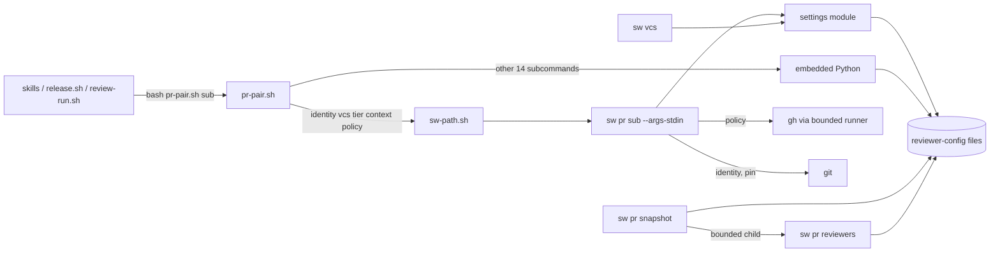
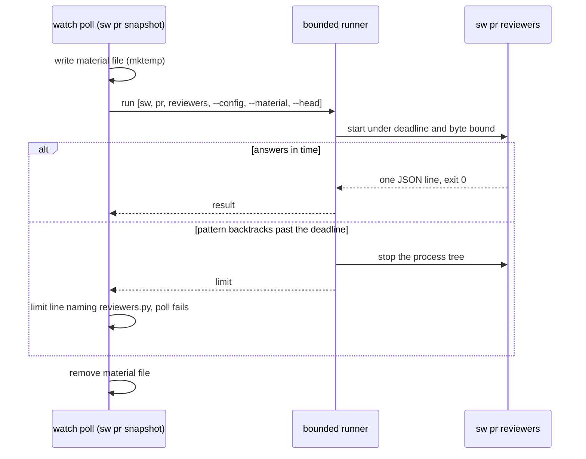

# Design

## Triage

| Trigger | Applies? | Evidence |
|---|---|---|
| T1 Components (new component, or 3+ with directed relationships) | yes | New `sw pr identity`, `vcs`, `tier`, `context`, `policy` and `reviewers`, plus a settings module that `sw vcs` and the five commands share. The chains are skill → `pr-pair.sh` shim → `sw-path.sh` → `sw pr ` → (`git`, `gh`), and `sw pr snapshot` → `sw pr reviewers` (today `reviewers.py`, `cli/lib/src/pr/snapshot.dart:433-466`). |
| T2 State (persistent state, caches, 3+ state machine) | yes | The content-addressed reviewer-config files under `<state>/reviewers/` or `<temp>/specwright/reviewers/`, written by `context` and `policy` and read by every snapshot (`skills/specwright-pr/scripts/pr-pair.sh:922-949`). |
| T3 Concurrency (background work, workers/isolates, async, retries) | yes | Concurrent writers of one reviewer-config name (two sessions, or the old and the new implementation during an update), settled by a rename (`pr-pair.sh:937-949`). One evaluator child per watch poll. |
| T4 Boundaries (data format, migration, shared interface, IPC, external) | yes | Six new `sw pr` command names that `native-cli-retire-scripts` binds to. The reviewer-config bytes and digest that `pr-snapshot.sh`, `pair-state` and `policy` compare (`pr-pair.sh:915-920`, `2823-2837`). The `report` regex dialect in user settings (S6). The GitHub contents API read behind agent merge (`pr-pair.sh:2765-2783`). |
| T5 Volume (grows without a fixed bound) | no | Every `gh` call is bounded at 32 MiB per stream and 120 s (300 s paged) (`cli/lib/src/process/limits.dart:8-10`). Flow collections nest at most 32 deep (`pr-pair.sh:596`). The 20-reviewer and 64 KiB limits only report a problem: `reviewers_of` keeps reading an oversized set (`pr-pair.sh:886-900`) and `write_reviewer_config` still writes the whole file (`:927-940`). Both grow only with the user's own settings file, which the user edits by hand. |
| T6 Risk (security, money, data loss, unrecoverable user data) | yes | `policy` decides whether the agent may merge, from the default branch's settings (ADR 0020). A user `report` regex runs over untrusted PR text (ADR 0022). A read that is lenient where the script was strict could authorize a merge the script refused. |

TIER: FULL

## Context

**`pr-pair.sh` today.**
- The script probes for Python 3.8+ and otherwise prints `{"ok":false,"error":"no_python",...}` and exits 2 (`skills/specwright-pr/scripts/pr-pair.sh:123-127`). It unsets `GH_REPO` (`:128`), exports `PR_PAIR_BASH` and `PR_PAIR_DIR` (`:130-136`), and runs its embedded program with `python -I -X utf8 -` (`:138`). The program dispatches on `COMMANDS` (`:2980-2984`). A missing or unknown subcommand is a usage stop that lists all 19 (`:2986-2990`). Every answer is one line from `emit`: `json.dumps(ensure_ascii=False)` with U+2028 and U+2029 escaped (`:202-205`). An unexpected exception is `internal_error` with `<Type>: <text>`, exit 1 (`:2994-2996`). `Stop` carries an error, a message, an exit code and extra fields (`:185-191`), and `usage` is exit 2 (`:198-199`).
- `parse_args` takes flags with one value, `+dest` repeats, and stops on an unknown `--` option (`:347-366`). `need` stops on a missing or empty one (`:369-373`).
- **Settings reader.** `settings_text` reads `openspec/specwright.yaml` from the directory, else its git toplevel, as UTF-8 with `errors="replace"` (`:847-853`). `parse_yaml` is lenient: block maps, flow collections, quoted and plain scalars, `|` and `>` blocks, and it skips lines it cannot read (`:497-531`). It splits with `str.splitlines` and keys on a regex using Python's Unicode `\s` (`:498`, `:507`). `scalar` reads `true`/`yes`/`false`/`no` case-insensitively, `null`/`~`, and `-?\d+` as int, where Python's `\d` and `int()` take any Unicode digit (`:419-442`). `Map.text` keeps each plain scalar as written, for messages (`:490-494`, `:979-985`). `yaml_problem` is the strict check: the first line `parse_yaml` would skip, drop or misread, as `line N: why` (`:680-785`). It looks for controls, line separators and the space characters Python's `\s` takes but YAML does not (`:687-694`), and for tabs in indentation, document markers, block sequences, merge keys, duplicate keys, block-scalar headers and flow syntax (`:696-785`, with `flow_node` `:599-656` and `plain_ok` `:555-569`).
- **Setting rules.** `duration` reads `<int>[s|m|h]` with Python's `\d` and `\s` (`:788-797`). `settle_of` reads `pr.settle` strictly, `1m` to `1h`, else 300 and a problem (`:903-912`). `reviewers_of` strips a trailing `[bot]` with `re.sub(r"\[bot\]$")`, where Python's `$` also matches before a final newline. It caps a set at 20 (`too_many_reviewers`) and checks each `report` (`:873-900`). `merge_mode` and `merge_options` read `pr.merge`, `pr.merge_method` and `pr.delete_branch` (`:988-1007`). `repo_ctx` and `contexts` build each repo's context (`:952-976`, `1010-1028`).
- **Reviewer config.** `reviewer_config_bytes` is `json.dumps(sort_keys=True, separators=(",", ":"), ensure_ascii=False)`, sorted by login, with no `request` (`:915-919`). `write_reviewer_config` names the file by the SHA-256 of those bytes. It reuses an equal file, writes through `mkstemp` and `os.replace`, and falls back from `<state>/reviewers/` to `tempfile.gettempdir()/specwright/reviewers/`. It returns `None` when neither place is writable, and a problem at 64 KiB or more (`:922-949`). `<state>` is `SPECWRIGHT_STATE_DIR`, else `Path.home()/.cache/specwright` (`:929`).
- **`identity`** reads origin's fetch URL and every push URL and matches each with `GH_URL` (`:180-182`, `800-820`). It stops with `not-a-repo`, `no-origin`, `not-github` or `mismatch` (`:805-820`).
- **`context`** handles `--after-merge`, `--only repos` and `--branch` (`:1218-1227`). It pins the settings on GitButler: `gitbutler_pins` is `vcs: gitbutler` in the work-tree file, or `gitbutler/` in the common dir with `gitbutler.project.targetRef` set (`:1186-1203`). `settings_pinned` compares `git hash-object --path=<rel>` with `git ls-tree <ref>` (`:1148-1183`), and `pin_ref` picks the branch or the target ref (`:1206-1215`). The command then builds both contexts, adds each repo's `repo` and `reviewer_config`, and reports the first `settings_problem` (`:1228-1249`).
- **`tier`** and **`vcs`** read `cheap_tier.enabled` and the two backends. `vcs` names an unknown value in its message with Python's `repr` (`{value!r}`, `:1252-1290`), which D11 leaves free.
- **`policy`** reads `repos/<repo>` for the default branch, then `contents/openspec/specwright.yaml?ref=` at that branch and at the head, through `gh` with a 404 read as absent (`:2750-2762`, `2840-2870`). `policy_file` requires `type: file` and `encoding: base64`, decodes with `b64decode(validate=True)` and `utf-8-sig`, runs `yaml_problem` and fails closed with Python's exception text in the message (`:2765-2783`). `policy_side`, `same_setting` (`json.dumps(sort_keys=True, default=str)`), `reported_check` and the rest of `cmd_policy` build drift, invalid, `merge_ready`, `reported` and `reviewer_config` (`:2786-2914`). `read_snapshots` stops with `snapshot_unreadable` and `<path>: <Python exception>` (`:1706-1716`).
- **gh calls.** `gh` runs `bash -c 'exec gh "$@"'` through `bounded.py` with `ENV` minus `GH_REPO`. A limit is exit 3, `GitHub state unknown: <limit>: gh <first arg>` (`:175`, `219-231`, `297-307`). `policy` maps that to `merge policy unknown: ...` (`:2746-2762`).

**`reviewers.py` today.** It compiles `sha_pattern` and `ignore` with Python's `re` and requires a group in `sha_pattern` (`skills/specwright-pr/scripts/reviewers.py:93-100`). It reads the config as bytes, digests them and stops with `cannot read: <strerror>` or `not valid JSON: <json error>` (`:144-154`). It parses times with `calendar.timegm` (`:50-68`), cuts excerpts at 300 code points (`:163-164`), searches with `ignore.search` and `rx.finditer` (`:180`, `234-238`), base64s `sig` and `attn` (`:289`), and writes errors as `reviewers.py: ...` with exit 2 or 1 (`:298-325`).

**What `sw` already has.**
- `sw pr` dispatches `snapshot` and `reply`, both through `--args-stdin` (`cli/lib/src/commands/pr.dart:16-46`). `interfaceVersion` is 1 (`cli/lib/src/commands/version.dart:12`).
- `sw pr snapshot` checks the config with `ctx.tool([py, -I, reviewers, --check-config, …])` and passes its stderr through (`cli/lib/src/pr/snapshot.dart:185-196`). It evaluates through `ctx.bounded` with a material file and builds the limit line with the `reviewers.py` label (`snapshot.dart:433-466`). It still needs `ctx.python()` for the `no_python` stop (`snapshot.dart:108-116`).
- `sw vcs` reads the backend and logins by running `pr-pair.sh vcs` and `context --only repos` (`cli/lib/src/vcs/scripts.dart:59-128`). The GitButler push re-runs `context --branch` (`cli/lib/src/vcs/gitbutler_backend.dart:766-800`).
- Python's text rules already exist in Dart: `pyStrip`, `pySplitLines` and `isPySpace` (`cli/lib/src/commit/task_cover.dart:666-720`), and code-point slicing (`cli/lib/src/finish/undo_plan.dart:1248-1260`). `documentText` writes Python's `json.dumps(ensure_ascii=False)` form. It supports no `double` (`cli/lib/src/vcs/document.dart:5-27`).
- `runGh` runs gh through the bounded helper with framed arguments (`cli/lib/src/pr/gh.dart:40-60`).

**Evals.** `test_pr_pair.py` runs the script with `SPECWRIGHT_HOME` already set, from `self.tmp` (`evals/pr-pair/test_pr_pair.py:108-128`). `test_reviewers.py` runs `python -I reviewers.py` (`evals/pr-pair/test_reviewers.py:20`, `89-90`). The parity eval compares a frozen script with its shim on stdout bytes, stderr bytes, exit code, fake-gh state and gh calls (`evals/pr-pair/test_parity.py:1-12`). The frozen `pr-snapshot.sh` takes `bounded.py` and `reviewers.py` from `ORACLE_SW_DIR` (`evals/pr-pair/oracle/pr-snapshot.sh:3`, `83`, `138`, `511`). `evals/suites.json` maps `cli/lib/src/pr/**` to `pr-pair` only (`evals/suites.json:30`).

**ADRs.** ADR 0022 requires that a user regex runs inside the poll's deadline, so a pathological pattern fails the poll instead of hanging it (`docs/adr/0022-reviewer-detection-is-generic.md:34`).

## Decisions

### D1: Code layout and command forms

- **Choice:** `cli/lib/src/settings/` holds `yaml.dart` (the lenient reader, `Map.text`, and the strict check), `rules.dart` (`duration`, `settle`, reviewer sets, merge mode and options, both contexts) and `reviewer_config.dart` (the canonical bytes and the writer). `cli/lib/src/pr/` gains `identity.dart`, `settings_commands.dart` (`vcs`, `tier`, `context`), `policy.dart` and `reviewers.dart`. `commands/pr.dart` dispatches `identity`, `vcs`, `tier`, `context` and `policy` through `--args-stdin`, like `snapshot`, with the handoff's scripts directory and bash. It takes `reviewers` on argv as `sw pr reviewers <reviewers.py's arguments>`, because no shim calls it. Its callers are `sw pr snapshot` and the evals. `interface` stays 1: new commands are not an incompatible change.
- **Rejected:** one `pr_pair.dart` file holding the whole port, which `native-cli-pr-pair-flow` would then grow past 4,000 lines. Putting the reader under `cli/lib/src/vcs/`, where `sw vcs` would look like its only owner.
- **Reversal cost:** low
- **Important:** no
- **Chosen by:** agent

### D2: The shim dispatches on the first argument, after the Python probe

- **Choice:** `pr-pair.sh` keeps lines 123-127 (the probe and `no_python`) first, so every subcommand keeps that stop. For `identity|vcs|tier|context|policy` it then sets its directory and bash (`cygpath -m` and `-w`). It finds the project from `--code` when that names a directory, else from the current directory, then walks up to the first `.git` entry, as `vcs.sh` does (`skills/specwright-pr/scripts/vcs.sh:18-31`). It resolves `sw` with `sw-path.sh` the way the `as.sh` shim does, with no `mktemp` before `sw` runs (`skills/specwright-pr/scripts/as.sh:23-30`). On failure it prints one `sw_missing` line through the Python one-liner and copies the resolver's text to stderr, exit 1. Otherwise it runs `exec "$sw" pr "$1" --args-stdin` with the ADR 0028 records (scripts directory, bash, then `"${@:2}"`). Every other first argument, none included, falls through to the embedded program unchanged. A store has no `VERSION`, so `identity <store toplevel>` runs from the code checkout, as `specwright-pr` already runs it (`skills/specwright-pr/SKILL.md:69`, `81`). Its skill text gains the rule that every `pr-pair.sh` call runs from the code checkout. Run from inside a store checkout, a ported subcommand stops with `sw_missing`, as the `as.sh` shim does. When the skills call `sw` directly (`native-cli-retire-scripts`), the same rule carries over.
- **Rejected:** taking the project from `identity <dir>`'s positional directory. In a store-backed run that is the store, which has no `openspec/.specwright/VERSION`, so the resolver would stop. Falling back to the store's `STORE` record: it holds the store owner's version, which only has to match this machine's in `major.minor`, so the exact `sw` it names may not be installed here, and it changes the resolver every shim shares. Keeping `identity` in Python: it only moves the same question to `native-cli-retire-scripts`. A second script for the five subcommands, which changes every caller's command line.
- **Reversal cost:** low
- **Important:** yes: it sets where every ported script and, later, every direct `sw` call finds its binary for a store
- **Chosen by:** user (after the round 2 review, "From the code checkout")

### D3: Python's text and number rules are reproduced where a field's value depends on them

- **Choice:** the port uses the existing `pyStrip`, `pySplitLines`, `isPySpace` and code-point slices, imported from where they live, as `undo_plan.dart` does. The script's own fixed regexes are rewritten with explicit classes for the behaviour they get from Python: `isPySpace` for `\s`, Unicode decimal digits for `\d` in `scalar` and `duration`, with `int()`'s conversion of them, and `$` that also matches before a final `
` in the `[bot]` strip. These decide which settings are read and what values the JSON fields hold. Small helpers add `str(bool).lower()` and `json.dumps(sort_keys=True)` key order by code point, which sets the reviewer-config digest. `documentText` gains doubles in Python's `repr` form, and a compact-separator option for the reviewer-config bytes and the evaluator's output. Message text is not reproduced (D11).
- **Rejected:** Dart's own `trim`, `split('
')`, ASCII `\d` and `\s`, and `jsonEncode`. They differ on the inputs `yaml_problem` exists to catch, and on key order, which sets the digest.
- **Reversal cost:** low
- **Important:** no
- **Chosen by:** agent

### D4: A JSON reader that accepts what `json.loads` accepts

- **Choice:** `cli/lib/src/settings/pyjson.dart` accepts the inputs `json.loads` accepts and refuses the ones it refuses: `NaN`, `Infinity` and `-Infinity` are read, integers of any size stay `int` or `BigInt`, and the last of two duplicate keys wins. A refusal gives the same error code and exit status as the script, with a message in our own words that names the file and the position (D11). It reads the snapshots `policy` takes and the config and material `sw pr reviewers` takes. A file error names the path and Dart's `OSError` text.
- **Rejected:** Dart's `jsonDecode`, which refuses the `NaN` and `Infinity` that `json.loads` reads, so material the script evaluated would stop the snapshot. Reproducing CPython's decoder messages, which no caller parses (D11).
- **Reversal cost:** low
- **Important:** no
- **Chosen by:** agent

### D5: The evaluator runs as a bounded `sw pr reviewers` child

- **Choice:** `sw pr snapshot` keeps both call sites and changes only the command. The check runs `[<sw>, pr, reviewers, --check-config, <file>]` through `ctx.tool`, and the evaluation runs `[<sw>, pr, reviewers, --config …, --material <file>, --head <oid>]` through `ctx.bounded` with the same material file, deadline and poll environment (`snapshot.dart:185-196`, `433-466`). `<sw>` is `Platform.resolvedExecutable`. The limit line keeps the `reviewers.py` label. `snapshot.dart`'s `ctx.python()` stays only for the `no_python` stop (`snapshot.dart:108-114`), which `native-cli-retire-scripts` removes. `sw pr reviewers` compiles `sha_pattern` and `ignore` with `RegExp(p, unicode: true)`, case-sensitive and not multiline (S6). It counts groups by matching `(?:
)|` against the empty string and reading `groupCount`, since `RegExp` exposes no group count before a match. A `FormatException` is `does not compile: <its message>`.
- **Rejected:** evaluating in-process. A Dart regex cannot be interrupted, so a backtracking pattern over a comment would hang the watch, against ADR 0022. An isolate with a timeout: `Isolate.kill` is not shown to stop a running regex, so each timed-out poll could leave a spinning isolate behind.
- **Reversal cost:** low
- **Important:** no: it keeps the contract `reviewers.py` had
- **Chosen by:** agent

### D6: `sw vcs` reads the settings in-process, without the reviewer-config side effect

- **Choice:** `readSettings` calls the settings module for the backend (the `vcs` rules) and for each repo's `main` and `login` (the `repo_ctx` rules), and maps a stop to the same `VcsStop` error, message and capped exit code it built from the script's JSON (`scripts.dart:69-127`). It writes no reviewer-config file and runs no `identity` lookup: `--only repos` did both, and `sw vcs` used neither result. The GitButler push calls the same pin check `context --branch` runs (`gitbutler_backend.dart:769-800`), with the same `settings_not_pinned` and `git_error` stops and their `file` and `ref` fields.
- **Rejected:** running `sw pr context` as a child of `sw vcs`, which keeps one process per VCS call for no gain now that the code is in the same binary.
- **Reversal cost:** low
- **Important:** no
- **Chosen by:** agent

### D7: `policy` keeps its reads and its strictness

- **Choice:** the three reads use `runGh` with `sw`'s environment minus `GH_REPO`, the same endpoints and the `quote(ref, safe='')` encoding, and map a limit or failure to `lookup_failed` with exit 3 and a 404 to absent. The contents check is `type: file`, `encoding: base64`, then a strict base64 decode: whitespace removed, the standard alphabet only, correct padding, which Dart's lenient decoder does not enforce. Then `utf-8-sig` (BOM stripped, invalid UTF-8 refused), the strict YAML check (D3) and the lenient read. Each failure keeps the script's error code and exit status, and its message starts with `merge policy unknown:` as before, in our own words after that (D11).
- **Rejected:** Dart's `base64.decode` and `utf8.decode` as they are. They accept URL-safe characters and missing padding, and authorizing a merge from a file the script refused is the T6 risk.
- **Reversal cost:** low
- **Important:** no
- **Chosen by:** agent

### D8: The parity oracle gains frozen `pr-pair.sh` and `reviewers.py`

- **Choice:** `evals/pr-pair/oracle/` gains `pr-pair.sh` and `reviewers.py`, frozen from `main` before the port. The one edit to the frozen `pr-pair.sh` is that `PR_PAIR_DIR` takes `ORACLE_SW_DIR` when set. `test_parity.py` builds `ORACLE_SW_DIR` as a temp directory holding the tree's `bounded.py`, `as.sh` and `sw-path.sh` and the oracle's `reviewers.py`. The frozen `pr-snapshot.sh` therefore keeps running the old evaluator after `reviewers.py` leaves the tree, and none of the three frozen scripts changes. New parity cases cover each of the five subcommands (settings files with each strict problem, Unicode digits and spaces, a `[bot]` login with a final newline, an oversized set, a GitButler pin mismatch, policy drift, invalid and `reported` with each base64 or UTF-8 failure), and `sw pr reviewers` against the oracle evaluator, `NaN` material and a non-JSON config included. `test_reviewers.py` runs `sw pr reviewers` from `SPECWRIGHT_SW` or the test `sw` home. Fixtures stamp `VERSION` in each repo `--code` names. No assertion changes, apart from the regex dialect cases below, the format migration (D10) and assertions on free text, which check the code, the field and the prefix instead (D11). The assertions that expect `"format": 1` (`evals/pr-pair/test_pr_pair.py:4560`) expect 2, and `test_config_wrong_format` (`evals/pr-pair/test_reviewers.py:390-391`) checks that format 1 is refused. Snapshot parity hands the oracle a format 1 config and the shim the same rules as a format 2 config. Each side's config bytes and digest are checked exactly on their own, and every other output is compared unchanged, the `reviewer_config` digest field and free text (D11) excepted. The `context` and `policy` parity cases check the shim's config bytes as the oracle's with `"format": 2`, and its path as the digest of those bytes.
- **Rejected:** keeping `reviewers.py` in the tree only for the oracle, which ships a file no code calls.
- **Reversal cost:** low
- **Important:** no
- **Chosen by:** agent

### D9: A new ADR records the regex dialect

- **Choice:** ADR 0030 records that `report.sha_pattern` and `ignore` are JavaScript regular expressions in Unicode mode, as Dart's `RegExp` reads them, and why Unicode mode was chosen. It updates the architecture index and does not supersede ADR 0022, which names no dialect. The evals that wrote a Python-only pattern switch to the new dialect, and new cases check that `(?P<`, `\A`, `\Z`, `(?i)` and `{,3}` are refused.
- **Rejected:** recording the dialect only in the spec. It binds every future reader of the settings, the snapshot's evaluator included.
- **Reversal cost:** medium
- **Important:** yes: binds future changes (a settings format)
- **Chosen by:** user (S6)

### D10: The reviewer config moves to format 2

- **Choice:** `reviewerConfigBytes` writes `"format": 2`, and `sw pr reviewers` accepts only format 2 (`format must be 2`). The dialect change (S6) alters what some patterns match while both engines accept them: `\W`, `` and `\w` treat `é` differently. With the bytes unchanged, a snapshot the Python evaluator decided, saved or taken by a watcher running across the update, would carry the same digest and pass `reported_check` (`skills/specwright-pr/scripts/pr-pair.sh:2823-2837`). A new format changes every digest, so such a snapshot is `rules_mismatch` and watch waits for a fresh one. An old `reviewers.py` handed a format 2 config refuses it, and the new evaluator refuses a format 1 config from an old `pr-pair.sh`, so a mixed install stops loudly instead of deciding under the wrong dialect. The differential parity eval expects this one difference in the config bytes and digest, and `test_config_wrong_format` checks the new message.
- **Rejected:** keeping format 1 and documenting a watch restart after the update, which leaves a merge authorized from evidence the new rules did not decide (T6). Adding an evaluator-dialect field to the snapshot, which needs a second check in `policy` for the same effect.
- **Reversal cost:** low
- **Important:** yes: it changes the config format every snapshot names
- **Chosen by:** user (after the round 3 review, "Bump the config format")

### D11: Parity covers what programs read; message text is free

- **Choice:** every JSON field name and value, error code, exit code and file format stays as the script had it, and the parity eval compares them exactly. Free text may say the same thing in other words: the `message` field, the text of `settings_problem` after its `line N:` prefix, the `merge policy unknown:` reason, and stderr lines after their `reviewers.py:` or `pr-pair.sh:` prefix. The parity eval compares those by prefix, not byte for byte. An existing eval that asserts free text is changed to assert the code, the field and the prefix, and a skill that quotes a message is not changed, since it shows the message rather than parsing it.
- **Rejected:** byte-exact output, which needs CPython's decoder, base64, OSError and `repr` texts reproduced in Dart for text no skill parses. Changing JSON shapes now, which would touch the skills, `release.sh`, `review-run.sh` and the 14 subcommands still in Python, and leave the old tests without the oracle role they have.
- **Reversal cost:** low
- **Important:** yes: it sets what the remaining M8 ports must keep
- **Chosen by:** user ("Fields exact, messages free")

### Decision summary

| # | Decision | Choice | Rejected | Reversal cost | Important | Chosen by |
|---|---|---|---|---|---|---|
| S1 | Split the pr-pair port | Settings and policy side now, flow side in `native-cli-pr-pair-flow` | One change for all 19 subcommands | low | yes | user |
| S2 | Command names | `sw pr ` | `sw pr pair `; `sw settings` | medium | yes | user |
| S3 | `reviewers.py` | Port as `sw pr reviewers` and remove it | Python shim until retire | low | yes | user |
| S4 | Shims | Five subcommands become ADR 0028 shims | Switch callers now | low | no | agent |
| S5 | Parity only | Keep every field, code and format; file defects | Fix during the port | low | no | user |
| S6 | Regex dialect | JavaScript regexes in Unicode mode | Python translator; keep Python | medium | yes | user |
| D1 | Layout and forms | `settings/` plus `pr/` files; `reviewers` on argv | One file; under `vcs/` | low | no | agent |
| D2 | Shim dispatch | After the Python probe; project from `--code` or the code checkout, also for `identity <store>` | Positional dir; the store's `STORE`; identity in Python; a second script | low | yes | user |
| D3 | Python rules | Reuse and add Python text and number helpers where fields depend on them | Dart's own text rules | low | no | agent |
| D4 | JSON reader | Accepts what `json.loads` accepts; own messages | `jsonDecode`; CPython messages | low | no | agent |
| D5 | Evaluator process | Bounded `sw pr reviewers` child | In-process; isolate | low | no | agent |
| D6 | `sw vcs` settings | In-process, no reviewer-config writes | Child `sw pr context` | low | no | agent |
| D7 | Policy reads | Strict base64 and UTF-8, same codes | Dart's lenient decoders | low | no | agent |
| D8 | Oracle | Frozen `pr-pair.sh` and `reviewers.py`, `ORACLE_SW_DIR` assembled | Keep `reviewers.py` for the oracle | low | no | agent |
| D10 | Config format | `"format": 2`; evaluator accepts only 2 | Keep 1 and document; a dialect field | low | yes | user |
| D11 | Parity scope | Fields, codes and formats exact; message text free | Byte-exact output; new JSON shapes now | low | yes | user |
| D9 | Dialect ADR | ADR 0030 | Spec only | medium | yes | user |

## Assumptions

- None. Each claim about existing behaviour cites the code.

## Carried constraints

- **C1:** `sw pr snapshot` must run every user report pattern under the poll's deadline, never in its own process without a bound. Kind: invariant. Destination: doc comment: `cli/lib/src/pr/snapshot.dart` `evaluate`
- **C2:** The reviewer-config bytes (`"format": 2`, sorted logins, sorted keys, compact, no `request`) and their SHA-256 name are what every snapshot and `policy` compare. Any change to what a pattern matches must raise `format`, so evidence decided under the old rules never carries a matching digest (D10). Kind: invariant. Destination: doc comment: `cli/lib/src/settings/reviewer_config.dart` `reviewerConfigBytes`
- **C3:** The settings reader must stay as strict as `yaml_problem` for `policy`'s remote read. A construct it cannot read whole is `lookup_failed`, never a best-effort parse. Kind: invariant. Destination: spec: `specs/pr-script-runtime/spec.md` → Requirement: The ported pr-pair subcommands keep the script's contracts
- **C4:** `report` patterns are compiled with `unicode: true`. The default mode reads `\A` and `\Z` as letters. Kind: rejected alternative. Destination: ADR 0030
- **C5:** The `no_python` probe stays first in `pr-pair.sh` and in `sw pr snapshot` until `native-cli-retire-scripts`, though the ported paths no longer need Python. Kind: deliberate gap. Destination: doc comment: `skills/specwright-pr/scripts/pr-pair.sh` header
- **C6:** A writer killed mid-write leaves its `.tmp-*.json` beside the target, and nothing removes it. Reconsider if users report the reviewer-config directory growing. Kind: deliberate gap. Destination: doc comment: `cli/lib/src/settings/reviewer_config.dart` `writeReviewerConfig`

## Diagrams (FULL)

## State & Ownership (FULL)

| State | Owner (sole writer) | Lifetime | Invalidation / rebuild | Authoritative copy |
|---|---|---|---|---|
| Reviewer-config file `<digest>.json` | `sw pr context` and `sw pr policy`, plus the unported Python only through the same bytes (C2) | Until the user clears the state or temp directory | Content-addressed: equal rules give the same name and bytes, so a rewrite is idempotent | The bytes behind the digest; any writer's copy is identical |
| `openspec/specwright.yaml` | The user | Repo | Read fresh on every call | Work tree, except on GitButler (the branch's committed copy) and in `policy` (the default branch's copy on GitHub) |
| Material file | `sw pr snapshot` | One poll | Removed after the evaluation, on every path | The snapshot's own |

## Failure & Visibility (FULL)

| Component | Fails / dies mid-operation → | Recovery | Retry safe? | Who finds out |
|---|---|---|---|---|
| `pr-pair.sh` shim | No matching `sw`: `sw_missing`, exit 1, no `gh` call | Rerun the install prompt | yes | The agent, from the JSON line; the skill reports it |
| `sw pr context` | Killed while writing the config: a `.tmp-*.json` beside the target may be left | The next call writes the target again; the leftover is not read by any reader | yes | Nobody; the leftover is as large as the config, which is a few KiB for real settings and has no hard cap (the 64 KiB limit only reports a problem) |
| `sw pr policy` | A read fails, is cut off or is not strictly readable: `lookup_failed`, exit 3 | Watch reports the merge as not decided | yes (reads only) | The agent and the user, through watch's report |
| `sw pr reviewers` child | Backtracks past the deadline, or crashes: limit line or exit 1, the poll fails | The next poll runs it again; a pathological pattern keeps failing until the user fixes it | yes | The user, from watch's stderr naming `reviewers.py` and the limit |
| `sw vcs` settings read | A bad settings file: the same `VcsStop` as before | The user fixes the file | yes | The agent, from the stop |

## Resource Bounds (FULL)

| Queue / buffer / cache / transfer | Bound | At the bound | Timeout | At 10x / 100x |
|---|---|---|---|---|
| `policy` gh reads | 32 MiB per stream (`limits.dart:8-10`) | `response_too_large` → `merge policy unknown`, exit 3 | 120 s per read | Settings files are a few KiB; 100x stays far below |
| Reviewer set | 20 reviewers, reported only | `too_many_reviewers` (problem in `context`, exit 2 in `policy` on main); `context` still reads and writes the whole set | none | Grows only with the user's settings file |
| Reviewer-config bytes | 64 KiB, reported only | problem, file still written in full | none | Grows only with the user's settings file; 100x of a real one is still under 1 MiB |
| Strict YAML nesting | 32 levels | a `line N:` problem | none | Fixed cap |
| Evaluator child | 32 MiB per stream, the poll's deadline | limit line, poll fails | 120 s or the poll's `SPECWRIGHT_NET_DEADLINE_AT` | Material grows with comments, bounded by the snapshot's gh read |
| Reviewer-config directory | one file per distinct rule set | never evicted | none | A file per settings edit that changes the rules; tens over a project's life |

## Flow & State Gaps (FULL)

- **Update mid-session.** An old `pr-pair.sh` and a new `sw pr context` may run in one session across an update. The old one writes a format 1 config, which the new evaluator refuses, and the new one a format 2 config, which `reviewers.py` refuses: the poll stops with the config error until the session uses one implementation. A snapshot the old evaluator decided carries a format 1 digest, so the new `policy` reports `rules_mismatch` and watch waits for a fresh snapshot (D10).
- **Concurrent writers.** Two writers of one digest race on `os.replace`-equivalent renames of equal bytes. The loser re-reads the target and returns it (`pr-pair.sh:943-948`), and the port keeps that.
- **Settings edited between `context` and `policy`.** Not new: `policy` reads GitHub's copies, `context` the work tree, and `rules_mismatch` reports a snapshot taken under other rules.
- **Python missing.** The shim stops with `no_python` before resolving `sw`, as before (C5).
- **Old regex in a project's settings.** After the update, a Python-only pattern fails `--check-config`, so every snapshot with that config exits 2, naming the reviewer and key, until the user rewrites it. This is the S6 break, and the release notes say so.

## Mechanism Ledger (FULL)

| Mechanism | Built? | Why (harm nobody catches / expensive later) | Evidence that would change the call |
|---|---|---|---|
| Bounded evaluator child (D5) | yes | A hung regex would hang the watch with no output (ADR 0022) | A Dart API that interrupts a running regex |
| JSON reader that accepts what `json.loads` accepts (D4) | yes | `NaN` material the script evaluated would stop the snapshot | None: retire-scripts can simplify once no oracle is compared |
| Strict base64 and UTF-8 in `policy` (D7) | yes | A lenient decode could authorize a merge from a file the script refused (T6) | None |
| Python-to-Dart regex translator | no | S6 chose the Dart dialect | Users reporting broken patterns they cannot rewrite |
| Cleanup of leftover `.tmp-*.json` files | no | A kill mid-write leaves one file per kill, as large as the config (a few KiB for real settings), which no reader opens | Reports of the cache directory growing |

## Risks / Trade-offs

- [The port is ~2,000 lines of Dart reproducing Python's text rules] → the differential parity eval runs every subcommand against the frozen script on three OSes. Unit tests pin the Python rules with the inputs `yaml_problem` names.
- [Users' Python-only patterns stop working (S6)] → `--check-config` refuses them loudly with the reviewer and key, the release note lists the constructs, and ADR 0030 records the choice.
- [An agent runs `identity <store>` from inside the store checkout, which has no `VERSION`] → it stops with `sw_missing` instead of answering. The skill text says to run every `pr-pair.sh` call from the code checkout (D2), and the store scenario in `pr-script-runtime` covers the supported form.
- [Two implementations of the settings reader coexist until `native-cli-pr-pair-flow`] → the flow subcommands only read settings the five ported ones also read, and the parity eval covers both on the same files.

## ADRs

- **In force, constraining this change:** ADR 0012 (bounded PR scripts and reviewer runs), ADR 0020 (agent merge takes its policy from the default branch), ADR 0022 (generic reviewer detection; user regexes inside the poll's deadline), ADR 0027 (one Dart binary), ADR 0028 (ported scripts are shims resolving the project's `sw`).
- **To record during apply:** ADR 0030, report patterns are JavaScript regular expressions in Unicode mode (D9).

## Open Questions

- Whether a Dart `RegExp` in Unicode mode refuses every construct that changed meaning, beyond the five D9 tests. Answerable during apply with more probes, without changing the approach: anything it accepts with another meaning goes into the release note.
