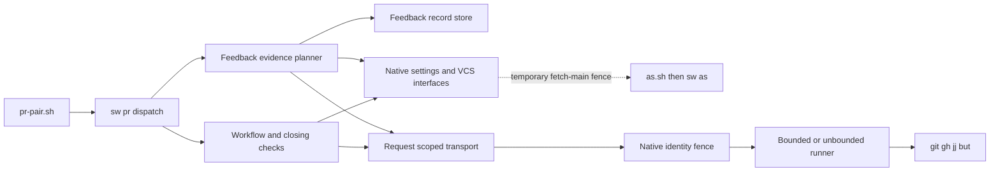
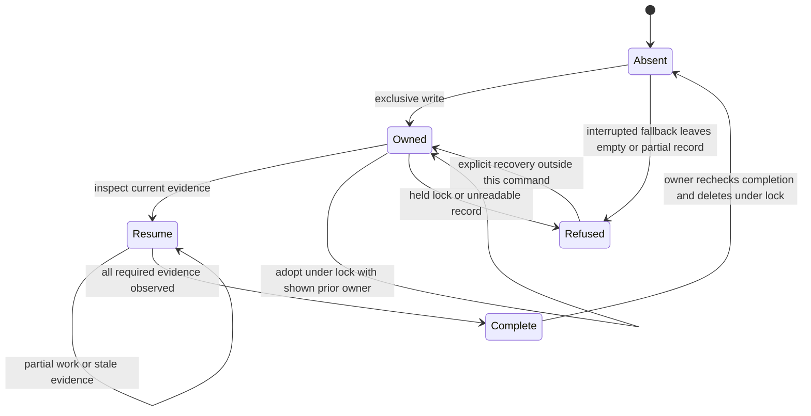
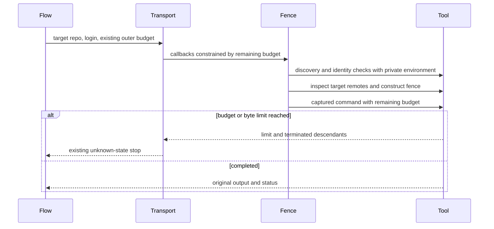
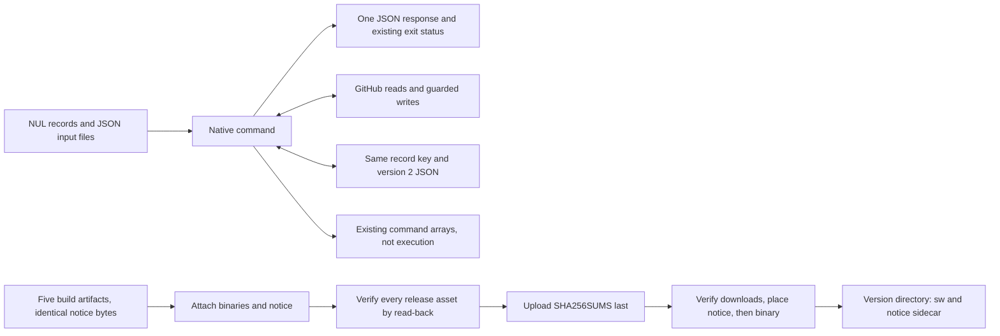

# Design

## Triage

| Trigger | Applies? | Evidence |
|---|---|---|
| T1 Components | yes | The pre-port dispatch crosses GitHub, records and VCS: `evals/pr-pair/oracle/pr-pair.sh:2982-2986`, `2599-2641`. |
| T2 State | yes | Feedback records include heads, marker and owner: `evals/pr-pair/oracle/pr-pair.sh:2125-2151`. |
| T3 Concurrency | yes | Exclusive publication and record locks: `evals/pr-pair/oracle/pr-pair.sh:1895-1920`, `1978-1995`. |
| T4 Boundaries | yes | Shim handoff and native dispatch: `cli/lib/src/commands/pr.dart:13-35`, `49-110`; merge read-back: `evals/pr-pair/oracle/pr-pair.sh:2708-2731`. |
| T5 Volume | yes | Paged issue read and marker index: `evals/pr-pair/oracle/pr-pair.sh:2961-2979`. |
| T6 Risk | yes | Per-login credentials: `evals/pr-pair/oracle/pr-pair.sh:322-336`; remote deletion: `2919-2949`. |

TIER: FULL

## Context

Scope and milestone boundaries are in proposal.md. Before this port, the five settings/policy commands dispatched natively (`cli/lib/src/pr/pair.dart:4-5`) and the other commands remained in Python. The oracle was frozen before `native-cli-pr-pair` (`evals/pr-pair/oracle/pr-pair.sh:2`), so its dispatch table lists all nineteen commands in Python (`evals/pr-pair/oracle/pr-pair.sh:2982-2986`). The delivered native entries are in `cli/lib/src/commands/pr.dart:13-35`, `83-110`.

`PairStop`, argument parsing and the single-JSON error boundary are reusable (`cli/lib/src/pr/pair.dart:9-25`, `44-77`, `81-114`). VCS exposes its handlers, session and state document (`cli/lib/src/commands/vcs.dart:38-64`, `86-115`). The fence exposes injected GitHub, Git and launch callbacks (`cli/lib/src/fence/fence.dart:22-38`) and the credential/remote/launch sequence (`536-577`). These are the integration points; the sole temporary indirect VCS fence exception is D5.

The old `git_net` wraps a target-repository `as.sh` invocation in `net`, then maps a fence-prefixed exit 3 separately (`evals/pr-pair/oracle/pr-pair.sh:274-293`). `net` returns unknown on a limit, except mutation callers using `limit_ok` (`221-232`). Plain local Git reads use `run` rather than `net` (`210-219`). Native fence Git reads and its launched command are deliberately unbounded outside a caller-supplied budget (`cli/lib/src/fence/fence.dart:435-438`). Preserve that distinction.

Feedback keys include a truncated readable prefix and identity hash (`evals/pr-pair/oracle/pr-pair.sh:1881-1892`). Legacy migration is identity-aware and refuses unreadable sole legacy records (`1933-1967`). Write publishes exclusively from a sibling temporary file (`2137-2151`); adopt uses a record lock and atomic replacement (`2499-2527`); failed lock cleanup is reported as `lock_left` (`1978-1995`, `2992-2998`). Pass-plan derives completion from current snapshots and repository evidence, including incomplete edits after a trailer commit (`2280-2324`, `2463-2472`).

Closing checks derive prose from GitHub-rendered HTML rather than scanning Markdown source (`evals/pr-pair/oracle/pr-pair.sh:1401-1457`). Merge sends one PUT and always reads back (`2708-2731`). Cleanup returns commands without executing them (`2644-2693`). These boundaries stay intact.

## Decisions

### D1: Direct calls with caller-owned execution budgets

- **Choice:** A request-scoped workflow context calls existing native settings functions, the fence logic and `vcsHandlers`, with the temporary indirect VCS fence exception in D5. Reuse `verifyIdentity`, remote checking and fenced-environment construction. For captured PR reads, supply runner callbacks tied to the target directory and remaining caller budget. Keep typed refusal/limit results until the PR command maps them to its existing JSON. Record the direct-call, explicit project selection and allowed-isolation rules in ADR 0031 during apply.
- **Rejected:** Run `as.sh`, `vcs.sh` or another `sw` for ordinary internal work. Each adds transport and can reset the deadline. Changing global `Directory.current` or process environment would make concurrent requests inspect the wrong repository or inherit a token.
- **Reversal cost:** medium
- **Important:** yes, binds the boundary used by following ports.
- **Chosen by:** user, "Use direct native calls, preserving deadline boundaries" and the approved M8 amendment.

### D2: Preserve feedback records with SDK-exclusive file creation

- **Choice:** Keep the keys, version 2, owner fields, timestamps, record JSON semantics, LF bytes, exclusive publication, atomic replacement and existing legacy migration. Use Dart SDK `File.createSync(exclusive: true)` for lock files at the existing `.lock` path and for publication fallback. Creation is the exclusive operation, never an existence check followed by non-exclusive creation. After failed creation, recognize an existing legacy directory or other occupied lock path as busy; unrelated filesystem failures remain errors. A native call releases only its own created file, never a legacy directory or foreign lock. Legacy Python directory creation also refuses when a native lock file occupies the path. Keep hard-link success as the publication fast path; any failed link may attempt SDK-exclusive creation, which must refuse an occupied destination without modifying it. Do not branch on `errno` or `GetLastError` read in a later FFI call. Keep the private OS adapter only for hard-link success and atomic same-directory replacement, and POSIX permission changes where needed; check success directly and report generic filesystem failures without unreliable numeric error capture. Preserve private record permissions before writing any content and preserve raw POSIX paths. The SDK create-then-open fallback can leave an empty or partial unreadable record if interrupted; Set private POSIX permissions on a created file through the minimal adapter before opening it for content, and never change the process umask. Ordinary failures after exclusive creation, including a failed permission change or an open, write or close failure, remove only the file this request created and report a generic filesystem error; a failed permission change writes no content. Keep write's publication path separate from adopt/done's locked mutations. Reuse the existing codec/JSON helpers. JSON key order, indentation and non-ASCII escaping are not part of the protocol: readers parse the record (`evals/pr-pair/oracle/pr-pair.sh:2002-2008`). Legacy migration compares and moves existing file bytes (`1944`, `1960`), so migration copies them unchanged, but a native writer need not reproduce Python's serialized form.
- **Rejected:** A new database or record version, automatic lock stealing, and the original FFI directory-lock/error-code design. Repeated real concurrent-call failures exposed unreliable error capture between FFI calls; the owner approved SDK-exclusive lock files and the documented fallback interruption window.
- **Reversal cost:** low for implementation, high for changing the stored protocol.
- **Important:** yes, the stored protocol binds future changes; the lock representation is an explicitly approved refinement of S2.
- **Chosen by:** user, "Use the SDK approach", approving exclusive lock files, legacy directory blocking and create-then-open fallback without a new package.

The owner additionally approved a small POSIX environment reader for feedback-directory paths. When using the process environment, read `SPECWRIGHT_STATE_DIR` and `HOME` through `getenv`, copy their bytes, and decode with the existing escaped-byte codec. This preserves a configured directory even when `Platform.environment` omits a non-UTF-8 value. An explicitly supplied `PrContext.environment` remains authoritative, including absent or empty values; never supplement it with ambient values. Windows keeps its existing Unicode environment handling. Keep these raw values local to feedback path selection, never merge them into credential environments or mutate the process environment. Reuse the existing `ffi` dependency and add a pinned-SDK POSIX child-process test starting from actual raw environment bytes. No package or handoff field is added. A state-directory override never consults home. With no nonempty state value and no usable home, feedback path selection refuses as `_home` does (`cli/lib/src/settings/reviewer_config.dart:83-99`): the command reports internal_error with exit 1, writes no record and chooses no substitute directory. POSIX has no passwd lookup for an unset `HOME`; this differs from the frozen `Path.home()` fallback (`evals/pr-pair/oracle/pr-pair.sh:1874`), and adding one needs separate owner approval. The first-seen head read uses the same selected state root as the frozen script (`evals/pr-pair/oracle/pr-pair.sh:2213`).

- **Rejected:** `Platform.environment` alone, which omits non-UTF-8 entries and would select a different default directory; a general environment retrofit; a new package; passwd ABI bindings for an unset `HOME`.
- **Reversal cost:** low
- **Important:** yes, changes where records are found and how a missing home is reported.
- **Chosen by:** user, "Preserve raw paths with the small adapter".

### D3: Cohesive workflow collaborators

- **Choice:** Extend `commands/pr.dart` and keep request-scoped logic in proposed `pr/workflow.dart`, `pr/workflow_transport.dart`, `pr/closing.dart`, `pr/feedback_record.dart` and `pr/feedback_pass.dart`. Keep discovery/creation/linking/state/rounds in workflow code, rendering and closing references in closing code, and record persistence separate from evidence planning. Factor further only when a cohesive tested responsibility needs it. No public settings key is needed. The earlier no-new-package assumption is withdrawn by the user; D6 governs the approved HTML parser dependency.
- **Rejected:** One translated multi-thousand-line dispatch, or a subprocess adapter per old function. Both retain the old coupling and make byte, ownership and budget tests harder to target.
- **Reversal cost:** low, internal file layout and private interfaces.
- **Important:** no, tactical organization without a new public contract.
- **Chosen by:** agent

### D4: Complete shim dispatch and explicit project selection

- **Choice:** Add the fourteen `sw pr <subcommand> --args-stdin` entries alongside the existing five. An internal `sw pr pair --args-stdin` entry handles missing/unknown script commands using their original records. Both shims accept one optional leading `--project <code-checkout>` pair, consumed before dispatch. A relative project path is resolved against the caller's directory without changing that directory. An explicit selector wins over pr-pair's existing --code/cwd discovery. It must select a usable code project with its own installed VERSION; never search a store registry or select another binary on failure. Keep the Python probe first. A malformed selector (missing/empty value or a repeated leading selector) is usage exit 2 before resolution or authenticated work; an unusable selected project is sw_missing exit 1. Tokens never enter the selector or handoff. Without the prefix, retain current discovery. Preserve the five native entries, stdin/file handoffs and command arguments. Resolution precedes native missing/unknown-command usage. Update store-caller instructions and cleanup arrays to include the prefix on both as.sh and a nested pr-pair.sh when both resolve a binary; retain all other arguments and cwd exactly.
- **Rejected:** Infer a project from a shared store, move store calls to code cwd, keep Python usage fallback, or define general direct argv now. Each either selects ambiguous state, checks the wrong repository or preempts the later entry contract.
- **Reversal cost:** medium
- **Important:** yes, shared CLI and command-array compatibility; S4 supplies the owner's choice.
- **Chosen by:** user, through S4. The private invalid-command dispatch is a tactical implementation of S1.

### D5: Retain the nested VCS fetch fence until the immediate retrofit

- **Choice:** Call native VCS fetch-main from non-Git branch-check, but keep its existing nested as.sh/sw-as fence hop until native-cli-internal-calls. The nested hop's project is branch-check's own `--code`, in the absolute form VCS resolved for its session, since fetch-main is reached only with `--code`; no handoff record is added. Both as.sh calls in that hop, login resolution when no `--login` was given and the fenced fetch, carry `--project <that directory>` without changing the target repository or login. This is selector plumbing, not removal of the hop. Other workflow fence calls, VCS state and VCS plan calls use D1 directly. Test the exception by observing the permitted nested fence hop, including its login-resolution call when no `--login` is given, and its project selector, target and login.
- **Rejected:** Fold all earlier VCS fencing retrofits into this port, or claim the nested path is already direct.
- **Reversal cost:** low
- **Important:** yes, a deliberate exception to the cross-module rule.
- **Chosen by:** user, "Keep that existing nested path until the next retrofit; document and test the temporary exception".

### D6: Use the approved HTML parser and test the product contract

- **Choice:** Use the public API of Dart's `html` package to parse rendered descriptions and decode entities. Write only the closing-reference and prose-boundary adapter needed by this workflow, not an HTML tokenizer/parser or copied entity table. Verify the resolved package graph has no build hooks, review licences/notices and SDK/platform support, and use the existing recordings plus focused workflow cases for code exclusion, entities, Unicode and line boundaries. Standard library parsing behavior may replace incidental Python quirks when producers/consumers remain coherent and tests prove the same workflow outcomes. Document any concrete differences with their consumer checks; do not weaken mutation guards, identity, resource bounds or interrupted-pass recovery. A difference that changes a product outcome returns to the user. Other dependency adoptions also return to the user.
- **Rejected:** Write an HTML parser or entity table solely to reproduce Python internals; choose another package without the user's approval; replace workflow assertions with unchecked normalization.
- **Reversal cost:** medium, parser dependency and its adapter tests.
- **Important:** yes, changes the parser technology and the acceptance contract.
- **Chosen by:** user, "Approve html package, subject to checks" and "the same behavior of the overall product, NOT byte for byte replica".

The user also chose "Use the library's HTML5 interpretation" for malformed HTML. In particular, `Fixes <table>#1</table>` recognizes issue 1 after HTML5 tree construction moves the table text. Do not add an event-parser compatibility workaround for this case or other malformed-markup normalization covered by that choice. Record observed differences and their workflow tests; changes to closing business rules or safety beyond this approved HTML5 interpretation still return to the user.

### D7: Ship the notice file beside the binary

- **Choice:** Ship `THIRD_PARTY_NOTICES.txt` beside `sw`. Keep the source notice at `cli/THIRD_PARTY_NOTICES.txt`, covering every direct and transitive package compiled into `sw`, plus the Dart runtime embedded by `dart compile exe` when its licence requires a notice. Packaging is gated by a numeric MAJOR.MINOR.PATCH comparison of the VERSION at the ref being built or released, never by whether a notice is present. At 0.30.0 or later, each build artifact includes byte-identical `THIRD_PARTY_NOTICES.txt` and `THIRD_PARTY_NOTICES.txt.sha256`, and a missing source notice fails the build. Below 0.30.0, the build packages no notice, so a manual run for an older tag still reaches its sealed-release result. `.gitattributes` pins `cli/THIRD_PARTY_NOTICES.txt` to `text eol=lf`. From release 0.30.0, attach/read back the notice with the five unchanged binary names, include its hash in `SHA256SUMS`, and upload that seal last. A sealed new-format release missing its notice is incomplete and is never repaired automatically. Keep old five-binary manifests and sealed releases valid before 0.30.0. For a release at 0.30.0 or later, the downloader verifies the notice and binary hashes before quarantine removal or the first run. After the part binary passes every check, and before the kept-binary decision or binary rename, it places the notice once. A notice already matching the manifest is left untouched. Otherwise a `.sw-<token>.notice.part` file replaces it. If that replacement fails and the final notice now matches, the run continues; otherwise it stops with `notice_write_failed` and the binary is not replaced. A new-format `SHA256SUMS` without a notice line is `sums_invalid`, a 404 for the notice is `asset_missing`, and a wrong notice hash is `checksum_mismatch`. The source-build installer uses the same order: check the build, place the notice, rename the binary, then run the final resolver check. Do not add `sw licenses`. Record this additive distribution decision in ADR 0032 and update architecture/build/install documentation without editing accepted ADR 0027.
- **Rejected:** Embed notices behind a new CLI command, leave notices only in the repository, mutate a sealed release, or require notices retrospectively from old releases.
- **Reversal cost:** medium, release manifest and both installation paths.
- **Important:** yes, changes the distributed asset/install contract.
- **Chosen by:** user, "Ship a notice file alongside the binary".

### Decision summary

| # | Decision | Choice | Rejected | Reversal cost | Important | Chosen by |
|---|---|---|---|---|---|---|
| S1 | Workflow scope | All fourteen commands, four pass operations | Another split | low | yes | user |
| S2 | Workflow preservation | Same product outcomes with coordinated producer/consumer changes | Byte replicas; producer-only changes | low | yes | user |
| S3 | Milestone boundaries | Retrofit, launcher and remaining ports stay separate | Whole migration in this PR | low | yes | user |
| S4 | Store binary selection | Leading --project; preserve store cwd and nested hop | Store inference; move cwd | medium | yes | user |
| D1 | Internal integration | Direct calls, explicit target and caller budget | Shims/self-launch; global cwd/env | medium | yes | user |
| D2 | Feedback persistence | Existing record protocol, SDK-exclusive lock files and publication fallback ; raw POSIX feedback environment reader, injected environments authoritative| New store/version; FFI error-code branching; lock stealing ; Platform.environment alone; general environment retrofit; passwd bindings| low implementation; high protocol | yes | user |
| D3 | Organization | Cohesive native workflow collaborators | One translation or subprocess per function | low | no | agent |
| D4 | Shim dispatch/project | Explicit selector, existing handoff and native dispatch | Inference; moved cwd; Python fallback; direct argv now | medium | yes | user |
| D5 | Nested VCS fence | Retain fetch-main hop; resolved --code selects project for login resolution and fetch | Pull retrofit into this port | low | yes | user |
| D6 | HTML parsing and acceptance | Approved html package, workflow contracts and consumer checks | Custom HTML parser; unapproved dependencies; unchecked normalization | medium | yes | user |
| D7 | Notice delivery | Checksummed sidecar at release and install, old releases supported | Embedded CLI command; repo-only notice; sealed-release edits | medium | yes | user |

## Assumptions

None. The new interfaces and modules above are proposed additions, not claims that they already exist.

## Carried constraints

- **C1:** Ported operations call Dart interfaces, with D5's named temporary nested VCS fetch fence exception; helper isolation, reviewer evaluation and checks of another installed/downloaded binary remain allowed. Kind: invariant. Destination: ADR 0031.
- **C2:** Caller-owned budgets must not become a fresh timeout per identity check, and unbounded VCS operations stay unbounded. Kind: invariant. Destination: spec: specs/pr-script-runtime/spec.md → Requirement: Native workflow integration preserves caller boundaries.
- **C3:** Feedback keys, ownership, exclusive publication, legacy migration and atomic replacement remain interoperable. Kind: invariant. Destination: spec: specs/pr-script-runtime/spec.md → Requirement: Feedback records interoperate across the port.
- **C4:** Printed cleanup commands remain script-based until retirement; add only the explicit project-selector prefixes required by S4, preserving all other arguments and cwd. Kind: deliberate gap. Destination: doc comment: cli/lib/src/pr/workflow.dart cleanupPlan.
- **C5:** Each native transport receives its target directory explicitly and never mutates global cwd/environment; preserve distinct fence refusal and command exit 3. Kind: invariant. Destination: doc comment: cli/lib/src/pr/workflow_transport.dart WorkflowTransport.
- **C6:** Existing shim handoff and compatibility prerequisites remain until their named M8 removals. Kind: deliberate gap. Destination: ADR 0031.
- **C7:** Whole-file inputs, feedback records and derived rows retain their existing uncapped behavior until a separate change defines a size policy. Kind: deliberate gap. Destination: doc comment: cli/lib/src/pr/workflow.dart readWorkflowJson.
- **C8:** SDK-exclusive publication fallback creates then opens its own file. Interruption can leave an empty or partial record: `pass write` refuses it as record_exists, the other pass operations as record_unreadable, and it is never treated as absent or silently replaced. An ordinary permission, open, write or close failure cleans up only the request-created file. Native lock files and legacy lock directories occupy the same `.lock` path and block each other; native cleanup never removes a legacy directory. Kind: deliberate gap and invariant. Destination: doc comment: cli/lib/src/pr/feedback_record.dart FeedbackRecordStore.
- **C9:** Non-Git branch-check retains the nested VCS fetch-main fence hop only until native-cli-internal-calls, forwarding the code-project selector while preserving target cwd and login. Kind: deliberate gap. Destination: ADR 0031.
- **C10:** Explicit binary project selection does not select the target repo or login and never changes cwd; store callers and nested resolver invocations must name it. Kind: invariant. Destination: ADR 0031.
- **C11:** Network operations run through `sw vcs` on a GitHub-origin store other than D5's branch-check fetch-main, including the `vcs.sh pull` that cleanup-plan prints for a jj store, keep their existing as.sh hop without a project selector, so they still stop with sw_missing from the store until native-cli-internal-calls. Kind: deliberate gap. Destination: ADR 0031.
- **C12:** Closing prose comes from the `html` package's public parser plus a closing-reference adapter. No HTML tokenizer, parser or entity table is authored to match Python, and each observed parser difference is listed here with its consumer check. Kind: rejected alternative. Destination: doc comment: cli/lib/src/pr/closing.dart renderedLines.
- **C13:** Each representation difference from the frozen oracle is listed with its producer/consumer contract test, and one that changes a workflow outcome needs the user's decision. Kind: invariant. Destination: doc comment: evals/pr-pair/test_workflow_parity.py WorkflowParity.
- **C14:** From 0.30.0, the checksummed third-party notice accompanies the binary in release artifacts and installs; it is verified before executing a downloaded binary, and older release manifests remain usable. A change to the compiled dependency set updates the notice. Kind: invariant. Destination: ADR 0032.
- **C15:** The feedback record store classifies outcomes from SDK exceptions, post-failure occupancy and one-call OS success results. Numeric `errno` or `GetLastError` branching across FFI calls (dart-lang/sdk#38832), exists-then-create exclusivity and process-wide umask changes stay rejected. Kind: rejected alternative. Destination: doc comment: cli/lib/src/pr/feedback_record.dart FeedbackRecordStore.
- **C16:** Feedback path selection preserves raw POSIX process-environment values through the existing byte codec. Injected environments remain authoritative; no ambient supplementation, credential-map overlay or process-environment mutation is allowed. Kind: invariant. Destination: doc comment: cli/lib/src/pr/feedback_environment.dart feedbackDirectory.
- **C17:** The raw reader covers only feedback record paths and the first-seen head read. `context`'s reviewer-config writer and `stateBase` still read `Platform.environment`: with a non-UTF-8 state value they use the default directory, so a head written there is not found by pass plan, and with a non-UTF-8 or unset `HOME` and no override `context` stops with internal_error before a pass starts. An unset POSIX `HOME` has no passwd fallback, unlike the frozen script. Kind: deliberate gap. Destination: doc comment: cli/lib/src/pr/feedback_environment.dart feedbackDirectory.
- **C18:** The third-party notice also covers the Dart runtime embedded by `dart compile exe`, inventoried for the pinned SDK and its default desktop build. Changing the SDK pin or build flags requires a new runtime notice inventory; binary hashes cannot detect stale attribution. Kind: invariant. Destination: doc comment: mise.toml tools.dart.

## Diagrams (FULL)

T1, proposed component relationships:

T2, record lifecycle. Resume/complete are computed results, not new persisted states:

T3, bounded fenced read:

T4, persistent and external contracts:

## State & Ownership (FULL)

| State | Owner (sole writer) | Lifetime | Invalidation / rebuild | Authoritative copy |
|---|---|---|---|---|
| Request target, settings and transport | One command context | Invocation | Re-read on new invocation | Explicit input and current repo |
| Verified credentials | Request-scoped identity service, keyed by exact login | Invocation | Discard on exit; never persist or print | Verified lookup result |
| Feedback record | Successful exclusive publisher; then current owner under lock for adopt/done | Across invocations | Evidence-based completion or explicit adoption | Record file, not cached plan |
| Record lock | Call that exclusively created the lock file | One locked mutation | Remove only own file; legacy directories and foreign locks remain; report cleanup failure | Existing `.lock` path, native file or legacy directory |
| Sibling temp record / render request | Call that created it | One operation | Finally cleanup; interrupted leftovers never treated as a live record | Published record / GitHub response |
| Reviewer config | Existing content-addressed settings writer | Shared immutable content | Different config gives a different digest | Existing format-2 bytes |
| Installed notice | `sw-install` or the source-build installer | Beside its version's binary | Replaced only when absent or not matching the release hash; source installs use the tree notice | Release `SHA256SUMS` for release installs; `cli/THIRD_PARTY_NOTICES.txt` for source builds |
| GitHub PRs, comments, issues and refs | GitHub, with other actors allowed | External | Read-back and next snapshot | Current GitHub state |
| Resume plan / rounds / cleanup plan | One command, read-only derived result | Invocation | Recompute; never replay stale results as proof | Current snapshots, history and refs |

## Failure & Visibility (FULL)

| Component | Fails / dies mid-operation | Recovery | Retry safe? | Who finds out |
|---|---|---|---|---|
| Shim/dispatch | Missing binary, invalid handoff or command | Resolver refusal or native usage | Read-only retry after correction | Agent sees JSON/status |
| Transport/fence | Limit, wrong identity, unsafe target or failed lookup | Structured stop, no guessed evidence | Reads may repeat; writes follow command-specific read-back | Agent sees existing error and unknown fields |
| PR create/link | Side effect may precede lost response | Re-discover existing PR/own marker | Preserve original rerun behavior; no blind loop | Agent sees result/failure |
| Closing parser | Render read fails, or the parser or adapter raises | Render read: unknown result, no closing proof. Parser or adapter error: internal_error, no closing proof | Read may repeat | Agent sees exit 3, or internal_error exit 1; never `match` |
| Notice delivery | Missing, corrupt, unplaceable or concurrently replaced notice | Rerun the install; a sealed release lacking its notice needs its owner | Yes; placement is idempotent | User sees `ok: false` with the code and release; a concurrent identical result continues |
| Record publisher | Concurrent write, failed publication, or death during the SDK fallback | Exclusive refusal; cleanup own incomplete fallback/temp file on ordinary failure; a record left by death stays for explicit recovery | Retry only after observing record | Agent sees record_exists, record_unreadable or internal_error |
| Feedback directory selection | No usable state value or home, or the POSIX reader cannot be bound | Set `HOME` or `SPECWRIGHT_STATE_DIR` and rerun | Yes; nothing was written | Agent sees internal_error, exit 1 |
| Locked record mutation | Held lock or cleanup failure | Refuse held lock; report lock_left without replacing primary outcome | Never delete another owner's lock | Agent sees owner/lock fields |
| Pass planner | Partial edit/commit/push/reply or stale snapshot | Return resume, ask or stop rows from evidence | Plan is repeatable; actions follow plan | Agent sees rows and needs_user |
| Merge/delete | Server accepted write but answer lost | Existing read-back/unknown sequencing | Never add a second merge PUT or speculative delete | Agent sees merged/refused/unknown or retained branch |

## Resource Bounds (FULL)

This section owns the proposed execution-budget policy. Reuse the configured defaults and override parser in `cli/lib/src/process/limits.dart:3-16`, `48-78`: ordinary/paginated network limits, per-stream byte bounds and stop grace stay unchanged. The Python `net` and reaction paging behavior being preserved is in `evals/pr-pair/oracle/pr-pair.sh:221-232`, `2250-2277`.

| Work / transfer | Bound | At bound | Timeout / 10x and 100x behavior |
|---|---|---|---|
| Network output | Existing 32 MiB per stream, lowered by existing overrides | Stop tree; retain named unknown result | Existing ordinary/paginated deadline; growth fails instead of returning partial proof |
| One fenced Git read previously wrapped in net | One monotonic outer deadline beginning at the old wrapper boundary; each nested lookup also keeps its own smaller applicable limit | Stop active runner and descendants; map outer limit to PR error | No resetting the outer budget between lookup, target checks and command. Existing preflight token lookup outside that wrapper keeps its own bound |
| Secret lookups | Existing secret-mode bounds; memory only | Refuse without outputting captured credentials | No token in files, diagnostics, parent environment or unrelated login |
| Manual reaction paging | Existing 50-page limit | response_too_large, never absence | Network limits apply to every read |
| Rendered description parse | Render output within the existing 32 MiB stream bound; one DOM per check, released after line extraction | Limited read stays unknown; a parser or adapter error is internal_error and gives no closing proof | Memory grows with response size up to the bound; the adapter walks the DOM iteratively, so nesting depth cannot overflow its stack |
| Notice download | Existing per-download 120 s and 64 MiB bounds | Stop, delete the part, report the limit | One small file per install; unchanged at 10x or 100x installs |
| Local Git/VCS state and plan | Existing unbounded calls | No new cap | Deliberate parity constraint; history can increase memory/time at 10x/100x |
| Input snapshots, intent, record and derived rows | Existing whole-file/whole-result reads, no new cap | Preserve current validation and errors | Deliberately unchanged; 10x/100x consumes proportional memory and may fail. Do not silently introduce truncation or a new size policy |
| Request token, repo-identity caches | One entry per identity/repo touched by the invocation | No cross-request retention | Grows only with this invocation's inputs |
| PR lists and issue-marker index | Bounded by network response bytes; retain original ordering and duplicate selection | Fail limited reads before using partial data | Paged calls retain configured deadline; no extra business-level retry |
| Record locks and temporary files | One record operation's own lock/temp files; no wait queue or automatic lock stealing | Refuse busy record; report cleanup failure | Finally cleanup on ordinary exits. SIGKILL can leave state, handled by the existing explicit recovery protocol |

Cancellation uses bounded runner callbacks for every external step inside an outer budget, including the fence's own Git reads. Pure native checks consult the same monotonic deadline before continuing. Do not replace cancellation with a Future timeout that leaves the child alive. Outside that outer budget, fence Git reads and VCS operations retain their unbounded mode. Share runner infrastructure, not deadlines across unrelated operations.

## Flow & State Gaps (FULL)

- If an install dies after notice placement but before binary rename, the correct notice remains; the next run repeats binary placement and preserves a notice already matching its manifest.
- Preserve the old sequence rather than parallelizing GitHub reads/writes. A head change or stale snapshot returns the same refresh/stop decision. Differential tests cover the ordering.
- Preserve pass-write's exclusive publish and native/script interoperability. A failed hard link may use SDK-exclusive creation; an occupied destination always refuses. Document and test the approved create-then-open empty/partial-record interruption window and cleanup on ordinary open/write/close failure.
- An adopt request names the owner it saw; recheck under the lock. A done request re-plans completion under the lock before deleting. A held or abandoned lock stays the owner's recovery decision.
- Resume rechecks file content even when a fix trailer exists. A partially committed edit, unreadable snapshot or unreachable recorded head cannot count as complete. Keep GitButler unassigned-path separation.
- Keep `AS_SH_ORIG_*` restoration for non-GitHub reads and verify repository B in B's explicit directory. Do not let a code token become a store token or leak through an ambient environment map.
- Classify outer expiry separately from a nested lookup reaching its own smaller limit. Outer net expiry maps to the PR limit stop. Pass-plan propagates that stop; rounds catches non-refusal stops and reports remote_unreadable with ok true. An inner fence lookup limit that occurs before the outer budget expires retains the old as.sh-prefixed exit-3 mapping to fence_refused, which rounds propagates. A normal command exit 3 without the fence prefix remains a command failure. These existing distinctions come from `evals/pr-pair/oracle/pr-pair.sh:290-293`, `1853-1861` and `cli/lib/src/fence/fence.dart:151-159`. On simultaneous limits, expiry of the enclosing budget takes precedence as it did when the outer runner stopped the fence process.
- Direct VCS adapters preserve each old wrapper's mapping: vcs_json returns exit 3 only for a VCS exit 3 and otherwise exit 1, retaining only error/message; vcs_plan and vcs_branch map failures to exit 1. Do not leak native VcsStop extras or exit 2. The old mappings are at `evals/pr-pair/oracle/pr-pair.sh:2606-2611`, `2615-2623`, `2632-2640`.
- Keep failed lock-cleanup paths in a request-owned list. The outer JSON boundary appends `lock_left` to either a successful document or a structured/unexpected error, preserving the original outcome rather than replacing it with a cleanup failure.
- Keep merge's single mutation and read-back, deletion's head/base guards and creation/link marker discovery. No generic retry engine is added.
- Cleanup plans may still name scripts and native VCS plans may still print shell commands; these are output data until retirement, not proof of an internal launch.
- Use the frozen oracle to expose workflow differences. Existing exact comparisons remain useful where the interface is retained. When removing unnecessary custom compatibility, record the concrete representation/parser difference and test the coordinated CLI/skill contract and workflow outcome instead of insisting on byte equality. Never normalize away identity, ownership, mutation order/guards, deadline outcomes or recovery evidence. Bind generated owner ids, timestamps and temporary names consistently across output and later reads. Printed command tests must still prove the correct target, login and argument values reach execution.

## Mechanism Ledger (FULL)

| Mechanism | Built? | Concrete reason | Evidence that would change the call |
|---|---|---|---|
| Explicit target and private environment | yes | Existing target-repo fence would otherwise inspect cwd or inherit another token | Removed only if external identity/repo model changes |
| Caller-budget adapter | yes | Replacing one bounded script with separately timed callbacks can exceed the prior deadline | New owner-approved runtime contract |
| Exclusive publication and owned locks | yes | Concurrent writers and interrupted pass recovery already exist | New owner-approved storage protocol |
| Private filesystem primitive adapter | yes | SDK-exclusive lock/publication creation; minimal hard-link/atomic-replace adapter without cross-FFI error-code branching | Concurrent callers, legacy lock, occupied destination, open/write/close cleanup, private permissions and replacement OS tests |
| POSIX feedback environment reader | yes | `Platform.environment` omits non-UTF-8 entries, so a raw state directory would silently select the default record location | Dart exposes raw environment bytes, or a later change owns a general environment boundary |
| Leading project selector and forwarding | yes | Store has no project VERSION; resolving from store cwd otherwise blocks workflow dispatch | Store-started fenced and unfenced command tests |
| Library HTML parser and workflow adapter | yes | Approved html package handles HTML/entities; adapter extracts closing prose with code and line boundaries | A library difference changes the workflow outcome; ask the user before changing that outcome |
| Automated notice-completeness check | no | Task 4.4's evidence and C14 cover this change; it would need a runtime-graph-to-licence mapping | A dependency change ships with a stale notice |
| Frozen oracle and black-box native dispatch tests | yes | Port can match common outputs yet change calls, persistence or failure sequencing | Retire only after every port proves parity |
| New persistent cache, record schema, background worker or automatic lock recovery | no | No requirement needs it; each would alter storage or recovery | Separately approved feature |
| All-port retrofit, native shell replacement, new direct CLI argv protocol | no, named later changes | Already approved milestone boundaries | User amendment of M8 |

## Risks / Trade-offs

- Standard HTML5 parsing can differ from Python's event parser on malformed markup. Use the existing rendered-body corpus (`evals/pr-pair/closing_bodies.py:1-42`) and focused cases with non-ASCII, entities, code and line boundaries to prove intended closing behavior. Document incidental differences and their consumer tests rather than adding custom HTML parsing to reproduce them. Changes to actual closing targets, mutation decisions or safety require the user's decision. Regex dialect, numeric/text formatting and other compatibility code may be simplified only with the same coordinated workflow evidence, not silently rewritten throughout the repository.
- Filesystem atomicity and byte-preserving paths differ by OS. Use native filesystem adapters, concurrent-process tests and cross-implementation record fixtures on all CI platforms. Local success alone does not prove the matrix.
- Sharing fence logic must not change the standalone `sw as` contract. Add a captured, budget-aware native adapter without changing its inherited-stdio/default unbounded mode, and run existing fence/VCS coverage in CI.

## ADRs

- **In force:** 0008 (identity), 0014 (bounds), 0018 and its applicable additions (VCS interfaces), 0020 (trusted merge policy), 0022/0030 (reviewer evidence), 0025/0026 (grounding and carried constraints), 0027/0028/0029 (native runner and shim handoff). These are preserved, not superseded by this port.
- **To record during apply:** ADR 0031, direct native calls, explicit shim project selection and retained isolation boundaries/temporary nested VCS exception, adding to 0027/0028/0029. Update the architecture's native component, Script I/O and identity boundary. The accepted ADRs stay immutable.
- ADR 0032, third-party notice distribution, carrying C14 and adding to 0027.

## Open Questions

None that changes this change's scope or approach. The shell-free launcher and direct CLI byte-entry contract are explicitly scheduled later in M8.
