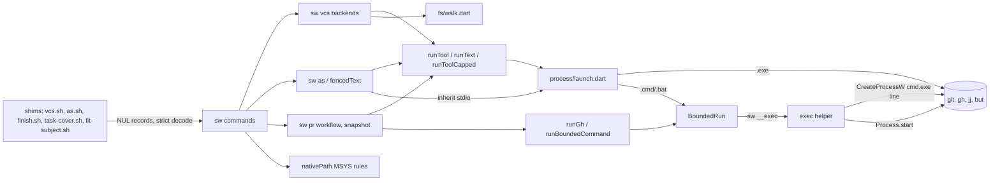
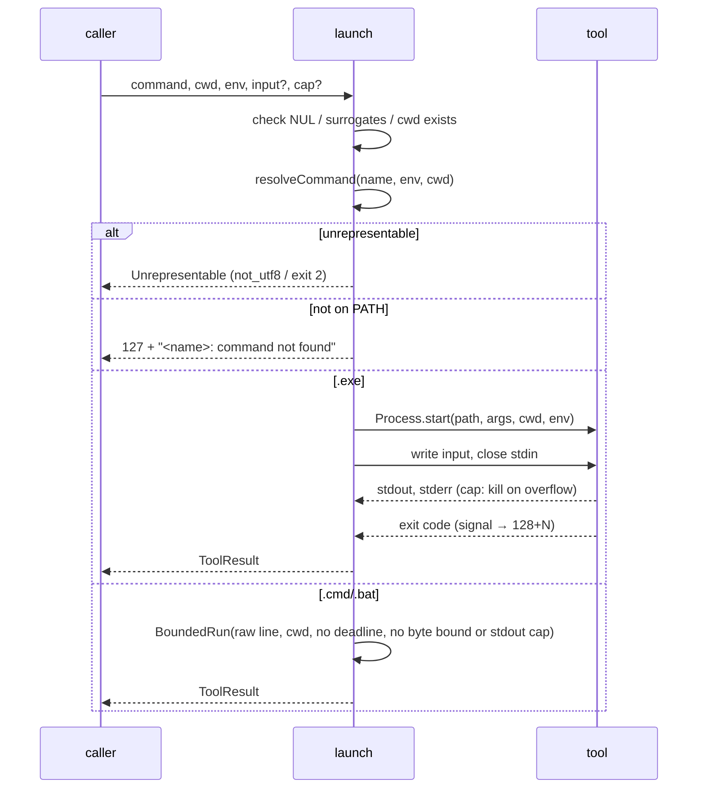

# Design

## Triage

| Trigger | Applies? | Evidence |
|---|---|---|
| T1 Components (new component, or 3+ with directed relationships) | yes | A new launcher module replaces the bash transport under `runFramed` (`cli/lib/src/vcs/tool_runner.dart:240-253`), the bounded `gh` prelude (`cli/lib/src/pr/gh.dart:122-123`) and the fence's inherited launch (`cli/lib/src/fence/exec_inherit.dart:64-70`). The callers in `sw vcs`, `sw commit`, `sw finish`, `sw pr` and `sw as` all depend on it, and so do the exec helper and the bounded runner. |
| T2 State (persistent state, caches, 3+ state machine) | no | No stored format changes. Feedback records, head records and watch claims keep their layout. Only the refusal of non-UTF-8 paths is new. |
| T3 Concurrency (background work, workers/isolates, async, retries) | yes | Launches are async child processes with stdout/stderr readers, an optional stdout cap that kills the child (`tool_runner.dart:268-273`), signal forwarding (`exec_inherit.dart:75-85`) and the helper's deadline state machine (`cli/lib/src/process/bounded_run.dart:118-130`), which gains an unbounded mode. |
| T4 Boundaries (data format, migration, shared interface, IPC, external) | yes | The argument contract with every external tool changes from exact bytes to UTF-8 values. The shim handoff records (`cli/lib/src/vcs/args.dart:27-44`, `cli/lib/src/pr/context.dart:48-63`) gain a strict decode. A new ADR adds to 0027. |
| T5 Volume (grows without a fixed bound) | yes | The native directory walk (`cli/lib/src/vcs/walk.dart:34-82`, `cli/lib/src/finish/walk.dart:114-145`) lists a tree of any size, and it now holds a whole tree's names to sort them. |
| T6 Risk (security, money, data loss, unrecoverable user data) | yes | The fenced command's token-carrying environment moves from a bash child to a direct launch (`exec_inherit.dart:57-70`). Batch-file quoting is an injection boundary (`cli/lib/src/process/command_line.dart:44-64`). A missed non-UTF-8 name would let a safety check skip a file. |

TIER: FULL

## Context

proposal.md gives the why and the scope (S1-S4). The current state the approach needs:

- **One framed bash transport carries every unbounded tool run.** `runFramed` starts `bash -c '<vcsPrelude>; exec "$@"'` (`tool_runner.dart:248-253`). It writes the working directory, the count and the argument records on stdin (`tool_runner.dart:66-80`), encoded with surrogate escapes (`tool_runner.dart:83-86`). `runTool` returns 127 with a text for a missing directory or a bash that cannot start (`tool_runner.dart:183-202`). `runToolCapped` turns those into `tool_missing` (`tool_runner.dart:207-230`). The prelude's `cd` failure is also 127 (`tool_runner.dart:26`).
- **Callers.** `runText`, a wrapper over `runTool` (`cli/lib/src/vcs/scripts.dart:15-22`), runs every git and jj read and write in `sw vcs` (for example `cli/lib/src/vcs/git_common.dart:16`, `cli/lib/src/vcs/jj_backend.dart:28`). `runTool` also serves `git check-ignore -z --stdin` with input (`jj_backend.dart:381-388`), `but pull --json` (`cli/lib/src/vcs/gitbutler_backend.dart:670`), commit and finish git reads (`cli/lib/src/commit/task_cover.dart:54`, `cli/lib/src/finish/undo_plan.dart:205`), `PrContext.tool` (`cli/lib/src/pr/context.dart:155-158`) and the fence's git reads and captured command (`cli/lib/src/fence/as_command.dart:63`, `cli/lib/src/fence/fenced_text.dart:51-57`). `runToolCapped` runs `but` (`gitbutler_backend.dart:125`).
- **Bounded runs.** `runGh` and `runBoundedCommand` start `[bash, -c, boundedPrelude; exec "$@", name]` under `BoundedRun` (`gh.dart:112-128`). `BoundedRun` always arms a deadline timer (`bounded_run.dart:126-130`), and `RunLimits.deadline` is not nullable (`cli/lib/src/process/limits.dart:18-27`). `sw run` resolves the command first (`cli/lib/src/commands/run.dart:66`), then builds a `LaunchPlan` (`commands/run.dart:73`).
- **Launch plans.** `planLaunch` sends `.cmd`/`.bat` to `cmd.exe /d /s /c "<line>"` as a raw command line (`command_line.dart:90-103`), which the helper starts through `CreateProcessW` (`cli/lib/src/process/exec_helper.dart:131-144`). Anything else goes through `transportFor`, which uses a bash stdin transport only for `bash -c` on Windows (`command_line.dart:104-106`, `cli/lib/src/process/transport.dart:36-42`). The helper starts native commands with `Process.start(command.first, ...)` (`exec_helper.dart:146-152`). That is the path the existing 20,000-character native-argument scenario of `native-cli` exercises on Windows.
- **Working directory and bounds of a bounded run.** `runBoundedCommand` takes a `cwd` (`gh.dart:95`) that only the framed prelude enters. `BoundedRun` starts the helper with no `workingDirectory` (`bounded_run.dart:135-140`), and the helper starts its command in its own directory (`exec_helper.dart:146-152`). `RunLimits.maxBytes` is required and bounds stdout and stderr separately (`limits.dart:18-26`, `bounded_run.dart:160-162`). The helper's stdout and stderr are pipes: the parent strips the hello and ready frames from stderr and writes the command's stdin after the go byte (`bounded_run.dart:47-70`, `exec_helper.dart:126-129`).
- **Raw command lines in process.** `runWithCommandLine` calls `CreateProcessW` with inherited handles, a null environment and a null directory, so the child gets this process's stdio, environment and working directory, and it waits for the exit (`cli/lib/src/native/kernel32.dart:226-252`).
- **Lookup.** `resolveCommand` honours a name containing a separator, POSIX empty `PATH` entries, and on Windows only `PATHEXT` extensions, so an extensionless file is never chosen (`cli/lib/src/process/resolve.dart:13-44`). It checks a name with a separator, and the `.` an empty POSIX entry stands for, against the process's own directory (`resolve.dart:21-31`). Its only caller is `sw run` (`commands/run.dart:66`). The VCS probes key `tool_missing` on exit 127 (`cli/lib/src/vcs/probe.dart:169-178`, `:216-222`).
- **The fence.** `runFenced` writes the command to a private temp file and starts `bash -c fencedPrelude as.sh <file>` with inherited stdio. It drops `PWD` on Windows, forwards SIGINT/SIGTERM/SIGHUP on POSIX and maps a signal to 128+N (`exec_inherit.dart:38-96`).
- **POSIX utilities.** `makeTemp` runs `mktemp` then `cygpath -m` through bash (`pr/context.dart:170-180`). The first-seen record is published with `ln` (`cli/lib/src/pr/watch_state.dart:179-182`). The snapshot naps with `sleep` (`cli/lib/src/pr/snapshot.dart:698`). `ARG_MAX` comes from `getconf`, with a 100000 fallback (`jj_backend.dart:335-338`, `gitbutler_backend.dart:475-477`). `resolvePath` runs `pwd -P` for escaped paths (`probe.dart:29-37`). `fit-subject` replaces the file with `mv -f` (`cli/lib/src/commit/fit_subject.dart:122-129`). `nativePath` runs `cygpath -m` (`cli/lib/src/commit/paths.dart:31-50`). `date` is not launched. It appears only in comments (`pr/context.dart:29`, `snapshot.dart:30`).
- **FFI already present.** POSIX `link` and `rename` and Windows `CreateHardLinkW` and `MoveFileExW` live in `cli/lib/src/pr/feedback_record_files.dart:127-239`. `setsid` and `kill` live in `cli/lib/src/native/libc.dart`. `getenv` lives in `cli/lib/src/pr/feedback_environment.dart:10-31`.
- **Walks.** The VCS walk runs `bash -c 'command -p find "$@"'` and orders the result like `os.walk` (`vcs/walk.dart:34-82`, `:119-140`). It collects every record before ordering them (`vcs/walk.dart:72-82`). Its only caller is the jj oversize check (`jj_backend.dart:373-376`), which walks each named directory, `.` (the whole working copy) included (`jj_backend.dart:431-446`). A `but` call over its cap stops with `but_output_too_large` (`gitbutler_backend.dart:132-136`). The finish walk is `find`-based with listing order (`finish/walk.dart:114-145`). It feeds spec capabilities, which are sorted afterwards (`undo_plan.dart:527-538`), and carried edits in uncommitted mode, which are not (`undo_plan.dart:556-572`).
- **Codec.** `decodeEscaped`, `encodeEscaped` and `hasEscapedBytes` carry non-UTF-8 bytes as U+DC80..U+DCFF (`cli/lib/src/vcs/codec.dart:16-60`). `decodeText` and `decodeReplacing` are the other two entry points (`codec.dart:69-75`). Thirty-three files under `cli/lib/src` import the codec. The handoff decoders use `decodeEscaped` (`args.dart:36`, `pr/context.dart:57`, `as_command.dart:92`).
- **Shims hand over a Windows-form bash.** The records are the scripts directory (`cygpath -m`), then bash as `cygpath -w "$BASH"` (`skills/specwright-pr/scripts/vcs.sh:13-15`), then the arguments (`vcs.sh:43`). The bash path reaches every context that converts paths (`cli/lib/src/commands/vcs.dart:16-20`, `commit/paths.dart:31-34`).
- **Launch-site test.** `cli/test/launch_sites_test.dart` scans the runner symbols (`:236-253`) against `launchAllowlist` (`:769-906`), with the four kinds at `:30-38` and two self-launches at `:842-857`.

## Decisions

### D1: One native launcher; batch files through the helper with an optional deadline

- **Choice:** A new `cli/lib/src/process/launch.dart` owns every internal start of an external tool. It checks the input (D5), resolves the command with `resolveCommand`, and starts a native executable directly with `Process.start(<resolved path>, args, workingDirectory: cwd)`. Results are exit code, stdout bytes and stderr bytes. Missing command, missing directory and start failure keep their 127 results. A signal maps to 128+N. The optional stdout cap kills the child. A `.cmd` or `.bat` command goes through `BoundedRun` with the `planLaunch` raw line. `RunLimits` makes both the deadline and the byte bound optional and adds a stdout-only cap: an unbounded call passes neither, so it stays unbounded, and a capped call passes only its stdout cap, whose overflow `launch` maps to the same `outputTooLarge` result as the native path. `BoundedRun` gains a `workingDirectory`, passed to the helper's start; the helper's child, started by `Process.start` or `CreateProcessW` with a null directory, inherits it. `resolveCommand` gains the call's working directory and resolves a separator name and an empty POSIX entry against it, so neither lookup nor the run ever depends on `sw`'s own directory. `runFramed`, `vcsPrelude`, `boundedPrelude`, `frameCommand` and `cwdRecord` are deleted. `runTool`, `runToolCapped` and `runText` keep their names and results but drop the `bash` parameter.
- **Rejected:** Start every launch through the `sw __exec` helper, because it adds a second `sw` process to each of the dozens of git/jj calls in one `sw vcs` run. Also rejected: `CreateProcessW` with pipes in FFI, which means owning pipes, read loops and quoting, the fallback ADR 0027 rejected.
- **Reversal cost:** medium
- **Important:** yes, binds future changes: every later port launches through it.
- **Chosen by:** user, chose "Helper, deadline optional". The design review (round 1) added the optional byte bound, the stdout-only cap and the working directory, which complete that choice without changing it.

### D2: Bounded `gh` and `runBoundedCommand` launch the tool, not bash

- **Choice:** `gh.dart` resolves `gh` (or the given command) and hands `BoundedRun` the `planLaunch` result for the resolved path and arguments, as `sw run` does (`commands/run.dart:66-78`). The deadline, byte bounds and tree stop stay as they are.
- **Rejected:** Keep the bash prelude only for bounded calls, because the exit criterion forbids bash for `sw`'s own work.
- **Reversal cost:** low
- **Important:** no
- **Chosen by:** agent

### D3: `sw as` starts the fenced command directly with inherited stdio

- **Choice:** `runFenced` loses its temp file and prelude. It resolves `command[0]` and starts it with `ProcessStartMode.inheritStdio`, `includeParentEnvironment: false` and the fenced environment. It keeps the signal forwarding, the 128+N mapping, the Windows `PWD` removal and 127 with `as.sh: <name>: command not found` on stderr. A `.cmd`/`.bat` fenced command runs in `sw as` itself through `runWithCommandLine` with the `planLaunch` raw line, which gains an environment block (`CREATE_UNICODE_ENVIRONMENT`) and a working directory. The child inherits `sw as`'s own stdio, which is the caller's, so no helper, frame or pipe stands between them. The call blocks the isolate until the child exits, which the fence only waits for anyway; console Ctrl+C reaches the child's process group directly. ADR 0029's shim-side handoff file is unchanged.
- **Rejected:** Keep the bash prelude for the fence, because the fence is `sw`'s own work. A caller that asks for `bash` as the fenced command still gets it. Also rejected: running a batch fenced command through the helper, because the helper pipes stdio to parse its frames (Context), so the caller's stdin and live output would need a relay.
- **Reversal cost:** low
- **Important:** yes, changes what users see: a Windows fenced name resolves by `PATHEXT` (D9).
- **Chosen by:** agent

### D4: Strict UTF-8 where a name or path is acted on; replacement for display text

- **Choice:** The codec becomes `decodeStrict(bytes, what)`, which returns the string or throws `NotUtf8`. That exception renders each invalid byte as `\xHH`, except for names found by a directory walk, whose bytes Dart does not expose (D6). `decodeReplacing` and a newline-normalising `decodeText` built on it stay. Strict decode applies to handoff records and the `as` args file, to tool stdout that lists names (`git status -z`, `ls-files -z`, `diff --name-only -z`, jj path lists) and to directory listings (D6). A `NotUtf8` becomes `"error": "not_utf8"` with exit 1 in a document, the named stderr line in `fit-subject` (exit 2) and `as.sh:` (exit 2). Display text (stderr, messages, PR bodies) decodes with replacement. `encodeEscaped`, `decodeEscaped`, `hasEscapedBytes`, `rawFile`/`rawDirectory` and every `File.fromRawPath(encodeEscaped(...))` site go.
- **Rejected:** Strict decoding everywhere, because a localised tool error with a stray byte would turn a plain git failure into `not_utf8`.
- **Reversal cost:** medium
- **Important:** yes, changes what users see.
- **Chosen by:** user, chose "Replace with U+FFFD".

### D5: The launcher refuses input it cannot represent

- **Choice:** Before starting anything, `launch` rejects a NUL in any argument, environment key or value, or the working directory, and any lone surrogate. It throws `Unrepresentable(command, what)`. Document callers map it to `not_utf8` with exit 1. `sw run --bounded` prints `bounded: unrepresentable argument: <cmd>` with exit 2, beside the existing batch refusal. A command line over 32,767 UTF-16 units on Windows is refused the same way before the start. These checks run before the batch rules of `planLaunch`, so a NUL in an argument to a `.cmd`/`.bat` command is `unrepresentable`, while `%`, `!`, a quote, CR or LF stay `bounded: unsafe batch argument: <cmd>`.
- **Rejected:** Let `Process.start` fail on such input, because Dart's behaviour for a NUL or a lone surrogate is not documented (A2). The failure would surface as a start error with exit 127 instead of a named refusal.
- **Reversal cost:** low
- **Important:** no
- **Chosen by:** agent

### D6: Native directory walks, sorted by UTF-8 bytes, with a U+FFFD existence check

- **Choice:** One `cli/lib/src/fs/walk.dart` lists a tree with `Directory.listSync(followLinks: false)`, recursing by hand. It never descends into a linked directory. A link policy keeps each caller's handling: the VCS walk skips links and `.git` and `.jj`; the finish walk keeps today's `find` classification (`finish/walk.dart:61-76`, `:139-141`), listing a link to a directory under `dirs` without descending and any other link under `files`, so a linked capability `spec.md` (`undo_plan.dart:527-538`) and a linked carried edit stay in the plan. A directory that throws is skipped. Names are sorted by their UTF-8 bytes per relative path. A listed name containing U+FFFD was not UTF-8 on disk when the path built from that name does not exist, or when another entry of the same directory decodes to the same name; the walk then throws `NotUtf8` for it (A1). The duplicate check catches a raw `a<0xFF>.txt` beside a valid `a<U+FFFD>.txt`, whose path exists. The walk's `NotUtf8` names the file as listed, each invalid sequence shown as U+FFFD, because the listing keeps the raw bytes private. Sizes are read from the listed entity, which stats the raw name. Both callers use it: the VCS walk with sizes, and the finish walk regrouped as `(rel, dirs, files)`. Regrouping is top-down by directory (`finish/walk.dart:58-105`), and the carried-edits loop emits each directory's files together (`undo_plan.dart:558-570`), so the plan sorts the finished `carried_edits` list once more by the UTF-8 bytes of each path; a root `b.md` then follows `a/z.md`.
- **Rejected:** Read raw names through libc `readdir`, because it is more FFI for a case S1 refuses anyway. Also rejected: a `find` launch kept only for the check, which contradicts S2.
- **Reversal cost:** low
- **Important:** yes, weak evidence: Dart's listing behaviour is A1.
- **Chosen by:** user, chose "U+FFFD + existence check", then, after the design review showed the collision and the lost bytes, "Keep listSync, add dup check" over `readdir` FFI.

### D7: MSYS paths convert by fixed rules from the handed-over bash

- **Choice:** `nativePath(path, bash)` keeps its signature and errors. On Windows, a path starting with `/` converts as follows. `/x` or `/x/...` with one drive letter becomes `X:/...`. `//host/share/...` stays UNC. `/tmp` and `/tmp/...` map under `%TEMP%`, the Git for Windows `usertemp` mount. Any other `/...` goes under the Git root, which is the handed-over bash path with a trailing `\usr\bin\bash.exe` or `\bin\bash.exe` removed (case-insensitive). No Git root found throws `BadPathException`. `PrContext.makeTemp` stops converting entirely, because its path is now native (D8).
- **Rejected:** Parsing `<git root>/etc/fstab`, which covers custom mounts the shims never produce. Also rejected: launching `cygpath.exe` directly, which keeps a Git for Windows dependency the roadmap removes.
- **Reversal cost:** low
- **Important:** yes, binds future changes (ADR).
- **Chosen by:** user, chose "Fixed rules".

### D8: POSIX utilities become Dart or existing FFI

- **Choice:**
  - `mktemp` becomes `Directory.createTempSync`, or for a template an exclusive `File.createSync(exclusive: true)` with a random suffix and retry on `PathExistsException`.
  - `ln` becomes the no-clobber hard link already in `feedback_record_files.dart` (POSIX `link`, Windows `CreateHardLinkW`), moved to a shared `cli/lib/src/fs/link.dart`.
  - `mv -f` becomes the same file's replacing rename (POSIX `rename`, Windows `MoveFileExW` with replace).
  - `sleep` becomes `Future.delayed`.
  - `getconf ARG_MAX` becomes `sysconf(_SC_ARG_MAX)` through `native/libc.dart`, with the same 100000 fallback.
  - `pwd -P` goes: `resolvePath` keeps only `resolveSymbolicLinksSync`.
- **Rejected:** Starting the utilities directly without bash, which still needs a POSIX userland on Windows.
- **Reversal cost:** low
- **Important:** no
- **Chosen by:** agent

### D9: Extensionless commands are not runnable on Windows

- **Choice:** Windows lookup stays `PATHEXT`-only, as `resolveCommand` does today. A command found only as an extensionless file gives 127 naming it. Eval fakes that run on Windows gain a `.cmd` wrapper beside their script.
- **Rejected:** Running a `#!` script through the handed-over Git Bash, which keeps a bash dependency.
- **Reversal cost:** low
- **Important:** yes, binds future changes (ADR) and changes what users see.
- **Chosen by:** user, chose "Not runnable; fakes get .cmd".

### D10: A strict `getenv` read for `SPECWRIGHT_STATE_DIR` and `HOME`

- **Choice:** On POSIX, `feedbackDirectory` reads the process values of `SPECWRIGHT_STATE_DIR` and `HOME` through the existing `getenv` FFI in `feedback_environment.dart` and decodes them with `decodeStrict`. A value that is present but not UTF-8 throws `NotUtf8` naming the variable. An injected environment map is used as given. Windows reads `Platform.environment`, whose values are UTF-16. Only the raw-byte path through `encodeEscaped` goes.
- **Rejected:** A U+FFFD in a `Platform.environment` value means not UTF-8, because Linux CI showed that Dart drops a non-UTF-8 variable entirely (A3), so a non-UTF-8 `SPECWRIGHT_STATE_DIR` would look unset and feedback would fall back to the default directory. Also rejected: treating the dropped variable as unset, for the same fallback.
- **Reversal cost:** low
- **Important:** yes, changes what users see.
- **Chosen by:** user, first chose "U+FFFD means not_utf8", then, after task 1.2 disproved A3, "Strict getenv FFI".

### D11: Record ADR 0034, adding to 0027

- **Choice:** ADR 0034 states the following:
  - `sw` starts external tools without a shell.
  - Arguments are UTF-8 on POSIX and UTF-16 through Dart's native quoting on Windows. Batch files take the `planLaunch` raw `cmd.exe` line: through the helper when output is captured or bounded, through in-process `runWithCommandLine` for the inherited-stdio fenced command (D3). No launch gains a deadline it did not have.
  - The refusal rules of D5 apply.
  - MSYS paths convert by D7.
  - Extensionless commands are not runnable on Windows (D9).
  - Non-UTF-8 names stop with `not_utf8` (S1, S4).
- **Rejected:** Folding these rules into the delta specs only, because the launcher contract binds every later port and the retire change, beyond one capability.
- **Reversal cost:** medium
- **Important:** yes, binds future changes.
- **Chosen by:** user, the proposal's scope ("an ADR adding to 0027").

### Decision summary

| # | Decision | Choice | Rejected | Reversal cost | Important | Chosen by |
|---|---|---|---|---|---|---|
| S1 | Non-UTF-8 names | Named stop wherever a safety check would skip | Keep byte-preserving names | medium | yes | user |
| S2 | Walk form | Native listing, stable sorted order | Keep `find -print0` | low | no | user |
| S3 | Design timing | Design at this change's turn | Full artifacts up front | low | yes | user |
| S4 | Env paths | Same named stop for state dir and HOME | Keep raw bytes there | low | yes | user |
| D1 | Launcher | `launch.dart`; batch via helper with optional deadline and bytes, stdout cap, cwd | All via helper; CreateProcessW pipes | medium | yes | user |
| D2 | Bounded gh | Launch the tool through `planLaunch` | Keep the bash prelude | low | no | agent |
| D3 | Fence launch | Direct inherited-stdio start; batch via in-process `CreateProcessW` | Keep the fence prelude; batch via the helper | low | yes | agent |
| D4 | Decoding | Strict for names, replacement for display | Strict everywhere | medium | yes | user |
| D5 | Unrepresentable input | Named refusal before start | Let `Process.start` fail | low | no | agent |
| D6 | Walk check | `listSync`, byte sort, U+FFFD existence and duplicate check | `readdir` FFI; keep `find` | low | yes | user |
| D7 | MSYS paths | Fixed rules from the handed-over bash | Parse fstab; launch cygpath | low | yes | user |
| D8 | Utilities | Dart and existing FFI | Start them without bash | low | no | agent |
| D9 | Extensionless | Not runnable on Windows | Run `#!` via Git Bash | low | yes | user |
| D10 | Env check | Strict `getenv` read for the two variables | U+FFFD in `Platform.environment`; treat as unset | low | yes | user |
| D11 | ADR | ADR 0034 adds to 0027 | Specs only | medium | yes | user |

## Assumptions

- **A1:** On Linux and macOS, `Directory.listSync` yields an entry whose name is not valid UTF-8 with U+FFFD in place of the invalid bytes, keeps the raw bytes inside the entity (so `existsSync` and `lengthSync` on that entity use them), and a path built from the name does not exist. The Dart SDK 3.13.7 source suggests this (the lister builds entities with `fromRawPath`, and `path` decodes with `allowMalformed: true`), but that source is outside the repository and the behaviour was not run, because the local machine is Windows and WSL runs need the owner's go-ahead. Depends on it: D6 and task group 1. The first task proves it in Linux CI before the walk is built on it.
- **A2:** `Process.start` gives no named error for a NUL or a lone surrogate in an argument. This was not checked against the Dart runtime source. Depends on it: D5. That decision refuses such input before the start, so it holds either way.
- **A3 (disproved):** `Platform.environment` on POSIX decodes a non-UTF-8 value with U+FFFD rather than dropping the variable. Task 1.2 ran it in Linux CI: the child's `Platform.environment` has no such variable at all. D10 was amended to read the two feedback variables through `getenv`; the test now records the observed drop.
- **A4:** Dart's Windows argument quoting for a native executable round-trips every value through `CommandLineToArgvW`. This was not checked in the Dart source. The existing `native-cli` scenario "A long argument to a native executable" passes through `exec_helper.dart:146-152` on Windows CI, which is evidence for the bounded path only. Depends on it: D1 and the launcher argument tests in group 2.

## Carried constraints

- **C1:** Internal launches start no shell. A `.cmd`/`.bat` command runs through the `planLaunch` raw `cmd.exe` line in one of two ways: a captured or bounded call goes through the `sw __exec` helper, and the fenced command of `sw as`, which inherits the caller's stdio, goes through `runWithCommandLine` in process. A call that had no deadline gets none either way. Kind: invariant. Destination: ADR 0034
- **C2:** A name or path that `sw` acts on or reports as a path is decoded strictly. Display text is decoded with replacement. Kind: invariant. Destination: doc comment: `cli/lib/src/vcs/codec.dart` `decodeStrict`
- **C3:** The walk sorts by UTF-8 bytes of the relative path and never descends into a linked directory; whether links are skipped (VCS) or listed (finish: directory links under `dirs`, others under `files`) is the caller's policy. A U+FFFD name whose path does not exist, or that another entry of its directory decodes to, is a non-UTF-8 name, reported with U+FFFD because the raw bytes are not exposed. Kind: invariant. Destination: doc comment: `cli/lib/src/fs/walk.dart` `walkTree`
- **C4:** MSYS conversion is fixed rules from the handed-over bash, with no `cygpath` and no fstab parsing. Kind: rejected alternative. Destination: ADR 0034
- **C5:** Extensionless commands are not runnable on Windows. Lookup is `PATHEXT` only. Kind: invariant. Destination: ADR 0034
- **C6:** `RunLimits` without a deadline or byte bound exists only for batch files on unbounded or capped paths; a capped path bounds stdout only. A bounded caller always passes both. Kind: invariant. Destination: doc comment: `cli/lib/src/process/limits.dart` `RunLimits`
- **C8:** On POSIX the process values of `SPECWRIGHT_STATE_DIR` and `HOME` are read through `getenv` and decoded strictly, because `Platform.environment` drops a non-UTF-8 variable and the state directory would silently fall back to the default. Kind: invariant. Destination: doc comment: `cli/lib/src/pr/feedback_environment.dart` `feedbackDirectory`
- **C9:** A capped native executable is not run under a tree stop: overflow kills the direct child only, as before. Kind: deliberate gap. Destination: doc comment: `cli/lib/src/process/launch.dart` `launch`
- **C10:** Native executables start directly, not through the `sw __exec` helper, which stays for bounded runs and batch files. Kind: rejected alternative. Destination: ADR 0034
- **C11:** Every launch takes its working directory from the caller and resolves relative lookups against it; nothing changes `sw`'s own directory. Kind: invariant. Destination: doc comment: `cli/lib/src/process/launch.dart` `launch`
- **C7:** `sw run --bounded` keeps the Windows `bash -c` stdin transport (`transport.dart`) for callers that ask for bash, until `native-cli-retire-scripts`. Kind: deliberate gap. Destination: doc comment: `cli/lib/src/process/transport.dart` `transportFor`

<!-- ===== LIGHT tier ends here. Delete everything below for LIGHT. ===== -->

## Diagrams (FULL)

Components after the change (T1, T4):

One unbounded launch (T3):

## State & Ownership (FULL)

| State | Owner (sole writer) | Lifetime | Invalidation / rebuild | Authoritative copy |
|---|---|---|---|---|
| Child process and its pipes | `launch` (or `BoundedRun` for batch) | One call | Exit, cap kill or caller's deadline | The OS process |
| Fenced environment with token | `runFence` builds it; `runFenced` passes it once | One fenced command | Dropped when the call returns | In memory only, never on disk (ADR 0029) |
| Temp files and dirs (`makeTemp`) | The calling command | Until the caller deletes them | Caller's `finally` | Filesystem |
| First-seen record link | `watch_state` publish | Across polls | Replaced only by a new head | The linked file |
| Walk result list | `walkTree` | One call | Rebuilt per call | Filesystem |

## Failure & Visibility (FULL)

| Component | Fails / dies mid-operation → | Recovery | Retry safe? | Who finds out |
|---|---|---|---|---|
| `launch` (start) | Tool missing or not startable → 127 with name | Caller's existing 127 mapping (`tool_missing`) | yes | user (document) |
| `launch` (input) | NUL, surrogate or over-limit line → `Unrepresentable` | None, the input is wrong | no | user (`not_utf8` / stderr) |
| Tool run | Non-zero exit or signal → code, or 128+N | Caller's existing mapping | per caller, as before | user |
| Capped run | Stdout past cap → child killed, `outputTooLarge` (batch: the helper's tree is stopped) | Caller's existing stop, `but_output_too_large` (`gitbutler_backend.dart:132-136`) | yes | user |
| Batch via helper | Helper not identified or start error → existing helper errors | As in `sw run` | yes | user (stderr) |
| Batch fenced command | `CreateProcessW` fails → 127 with `as.sh: <name>: command not found` style line naming the Win32 error | None | yes | user (stderr) |
| Fenced command | `sw as` killed → child keeps running, as with bash before | None (ADR 0027 accepts the same) | n/a | nobody, as before |
| Walk | Unreadable dir → skipped. Non-UTF-8 name → `NotUtf8` | Rename the file | yes after rename | user |
| `nativePath` | No Git root → `BadPathException` | Shim from Git Bash | yes | user (`bad_path`) |
| Strict handoff decode | Invalid record → `not_utf8` before any work | Rename | yes after rename | user |

## Resource Bounds (FULL)

| Queue / buffer / cache / transfer | Bound | At the bound | Timeout | At 10x / 100x |
|---|---|---|---|---|
| Unbounded `runTool` stdout/stderr | none, as today (`tool_runner.dart:255-316`) | n/a | none (unbounded by contract) | Same memory use as the bash path; git outputs stay small |
| Capped stdout (`but`) | caller's cap | Child killed, `outputTooLarge` | none | Unchanged |
| Unbounded batch run | none, as for a native executable | n/a | none | Same as the native path |
| Bounded `gh` | 32 MiB per stream, 120/300 s (`limits.dart:8-10`) | Tree stop, limit line | yes | Unchanged |
| Walk list | All files under the named directory, the whole working copy for `.` (`jj_backend.dart:431-446`) | n/a | none | Today's walk also holds every record before ordering (`vcs/walk.dart:72-82`), so memory is the same order: 100k files is a few MB, 1M files some 100 MB, sorted in memory. The jj path itself already lists every tracked file for the same call |
| Windows command line | 32,767 UTF-16 units | Refused before start (D5) | n/a | n/a |
| POSIX argv | `sysconf(ARG_MAX)`, else 100000 | Existing `too_many_paths` stop | n/a | Unchanged |

## Flow & State Gaps (FULL)

- **Partial completion.** A `not_utf8` stop happens before any write: handoff decode is first, and the walk and name-list decodes come before commit, plan or record writes. A batch run killed by its cap leaves the helper's tree stopped, as `sw run` does.
- **Concurrency.** Stdout and stderr are drained concurrently, and stdin input is written before closing, so a tool that fills stderr while reading stdin cannot deadlock. This keeps today's reader order (`tool_runner.dart:255-316`).
- **Stale data.** The walk re-lists on every call. A file without U+FFFD that vanishes after the listing is skipped, as today (`vcs/walk.dart:84-107`). A U+FFFD name whose path vanishes between the listing and the existence check cannot be told from a non-UTF-8 name and stops with `not_utf8`; a rerun lists again and passes.
- **Restart.** No state survives a crash beyond temp files the callers already delete. A fence killed mid-run leaves no args file, because the file no longer exists in `sw`.
- **Out of order.** Signals delivered before the child starts are not forwarded, the same as today's bash.

## Mechanism Ledger (FULL)

| Mechanism | Built? | Why (harm nobody catches / expensive later) | Evidence that would change the call |
|---|---|---|---|
| Strict decode at boundaries | yes | A skipped non-UTF-8 name would let a safety check pass silently (S1) | none |
| U+FFFD existence check in walk | yes | Without it, a non-UTF-8 name is silently mangled (A1) | CI showing Dart drops such entries instead, which would mean `readdir` FFI |
| Duplicate-name check in walk | yes | Without it, a raw name beside its valid look-alike passes, and the jj oversize check misses the raw file | none |
| Working directory through the helper | yes | Without it, a bounded or batch call runs in `sw`'s directory, in the wrong repository (ADR 0031) | none |
| No-deadline helper mode | yes | Without it, batch tools on unbounded paths gain a deadline, which the spec forbids | none |
| Strict `getenv` for the feedback variables | yes | Without it, a non-UTF-8 `SPECWRIGHT_STATE_DIR` is dropped by Dart and feedback silently uses the default directory (A3) | A Dart API that exposes raw environment bytes |
| Pre-start NUL/surrogate refusal | yes | Unnamed start failures would read as "command not found" | none |
| Tree stop for unbounded `.exe` runs | no | No deadline exists to trigger it, and a cap kills only the direct child, as today | A capped tool that leaves descendants holding pipes |
| fstab mount parsing | no | Shims only hand over drive, UNC and `/tmp` paths | A bug report with a custom mount |
| Retry of failed launches | no | Callers own retry semantics. None retried before | none |

## Risks / Trade-offs

- [A1 is wrong and Dart drops or mangles entries differently] → Task 1.1 proves the behaviour on Linux CI before the walk depends on it. If it fails, the fallback is `readdir` through FFI, which can be swapped in within D6's interface.
- [Dart's Windows quoting differs from the bash transport for some value] → The launcher eval records the argument values a native recorder receives on Windows: empty values, quotes, trailing backslashes, 20,000 characters (A4).
- [Eval fakes relied on bash running extensionless scripts on Windows] → Group 5 adds `.cmd` wrappers where those fakes run on Windows. CI on Windows catches any that are missed.
- [The sorted walk changes `carried_edits` order against the frozen `finish.sh`] → The spec lists it as a difference, and the parity eval compares that list sorted.
- [Thirty-three codec importers change at once] → The codec functions are removed. The compiler then lists every remaining use, and each file is reviewed in its group.
- [Projects with tracked non-UTF-8 names stop] → A named message asks for a rename, and the release notes call it out (BREAKING).
- [A checkout whose real path is not UTF-8 (reached through a UTF-8 symlink, or as the working directory) aborts the Dart VM] → Dart's path APIs (`Directory.current`, `resolveSymbolicLinksSync`) return strings, and the VM aborts with exit 255 (`Dart_NewStringFromUTF8 expects ... valid UTF-8`) before any `sw` code can map it to `not_utf8`. No eval covers this; a path that `sw` reads from tool output is still refused by name (D4).

## ADRs

- **In force, constraining this change:** 0014 (bounds and process rules), 0022 (the reviewer evaluator stays a killable child), 0027 (one binary, the helper and `CreateProcessW` for batch), 0028 (shim handoff records), 0029 (fence handoff file), 0031 (direct native calls, caller-owned budgets, no new deadlines), 0033 (no new package needed here).
- **To record during apply:** 0034, "sw launches tools without a shell", adding to 0027 (D11). The same task adds its row to `openspec/architecture.md`'s index and updates the process rows there.
