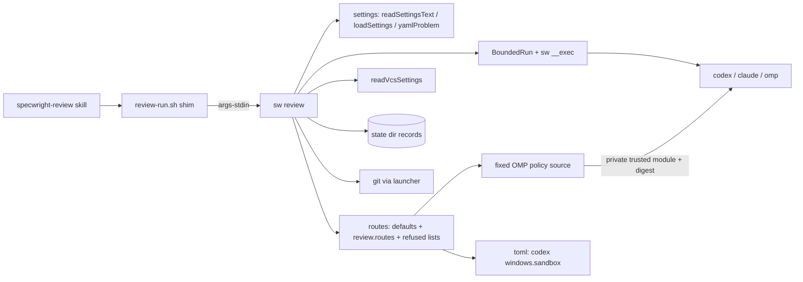
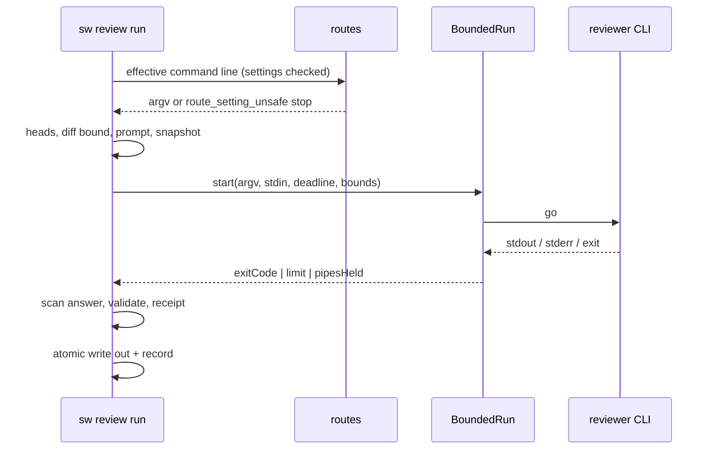
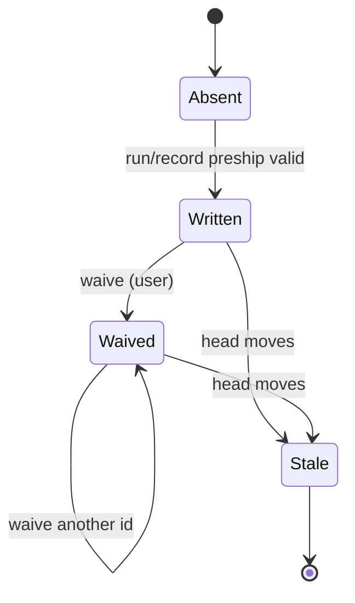

# Design

## Triage

| Trigger | Applies? | Evidence |
|---|---|---|
| T1 Components (new component, or 3+ with directed relationships) | yes | A new `sw review` component. It uses the shim, the settings reader, the VCS settings, BoundedRun and the launcher, and it starts three reviewer CLIs and `git`. |
| T2 State (persistent state, caches, 3+ state machine) | yes | Pre-ship records under the state directory (`review-run.sh:825-867`) must stay readable across the port. Receipts gain fields. |
| T3 Concurrency (background work, workers/isolates, async, retries) | yes | Reviewer runs race a deadline against stream readers and an exit, and stop a process tree (`review-run.sh:382-392`). |
| T4 Boundaries (data format, migration, shared interface, IPC, external) | yes | A new `review.routes` settings key, the shim's stdin contract (ADR 0028), the record format, and the command lines of three external CLIs. |
| T5 Volume (grows without a fixed bound) | yes | Event streams up to 64 MiB, the diff, and the tip snapshot, which today reads every blob of the tree into memory at once (`review-run.sh:963`). |
| T6 Risk (security, money, data loss, unrecoverable user data) | yes | Reviewer isolation: today's defaults let OMP and Codex reviewers write outside the checkout, reach the network and make paid calls (proposal.md, Why). |

TIER: FULL

## Context

- **What is ported.** `review-run.sh` is a bash wrapper around embedded Python (`review-run.sh:47-59`). It has eight subcommands (`review-run.sh:6-36`) and its own YAML reader (`review-run.sh:162-321`). It loads the `bounded.py` copy beside it by path (`review-run.sh:103-117`).
- **How the VCS backend is read.** It starts `bash pr-pair.sh vcs` (`review-run.sh:504-530`). `sw` already reads this in process through `readVcsSettings` (`cli/lib/src/pr/settings_commands.dart:221-248`).
- **How settings are read.** `review-run.sh` searches the cwd and its toplevel (`review-run.sh:580-590`) and reads leniently: `yes` and `no` become booleans (`review-run.sh:220-223`). The `review.*` defaults are at `review-run.sh:593-627`.
  - `sw` has the same lenient read, `readSettingsText` and `loadSettings` (`cli/lib/src/settings/rules.dart:567-581`), and a strict check, `yamlProblem` (`cli/lib/src/settings/yaml.dart:668-675`).
  - `policy` uses `yamlProblem` to refuse a file the lenient read would misread (`cli/lib/src/pr/policy.dart:163-164`). `context` computes the same problem (`cli/lib/src/pr/settings_commands.dart:344-346`) but still returns `ok: true`, reporting it as `settings_problem` (`cli/lib/src/pr/settings_commands.dart:378-385`).
- **Command lines.** Each route's command line is fixed in `command_line` (`review-run.sh:1035-1070`):
  - Codex: `exec -s read-only --ephemeral --ignore-rules --ignore-user-config` (`review-run.sh:1041`).
  - Claude: `--safe-mode --disable-slash-commands --tools Read,Grep,Glob --restricted` (`review-run.sh:1055`).
  - OMP: `--tools read,grep,find,glob` (`review-run.sh:1066`).
  - On Windows, Codex's `windows.sandbox` is read from `config.toml` with `tomllib` and passed on when it is a plain name (`review-run.sh:1014-1032`, `review-run.sh:1051-1052`).
- **Capture.** `capture` streams stdout and stderr to temp files under per-stream bounds and fails a run whose child still holds a pipe 2 s after the exit (`review-run.sh:382-392`, `review-run.sh:1283-1284`). The bounds are at `review-run.sh:79-86`. The receipt records how the tree was held together (`review-run.sh:1158-1167`).
- **BoundedRun.** Group 2 has added the held-pipe result field and its caller invariant (`cli/lib/src/process/bounded_run.dart:46-50`); the post-exit branch preserves the command exit while setting it (`cli/lib/src/process/bounded_run.dart:522-543`). The review port consumes this field rather than building a second runner.
  - The launcher already starts Windows batch commands through `BoundedRun` (`cli/lib/src/process/launch.dart:153-164`).
- **Records.** A record lives at `<state>/reviews/<sha256(common dir)[:16]>/<change>/<code>[+<store>].json` (`review-run.sh:825-836`). It is written atomically as indented JSON (`review-run.sh:839-867`).
- **Tip snapshot.** On GitButler the reviewer reads a copy of the tip. `snapshot_tip` reads the output of `git cat-file --batch` for the whole tree into memory before it writes any file (`review-run.sh:944-995`).
- **Shims.** Shims follow ADR 0028: resolve `sw` through `sw-path.sh`, hand the scripts directory, bash and the arguments as NUL records on stdin, and print `sw_missing` on failure (`docs/adr/0028-ported-scripts-are-shims-that-resolve-the-projects-sw.md:13-18`). The snapshot shim formats that JSON with Python (`skills/specwright-pr/scripts/pr-snapshot.sh`, last lines).
- **ADR 0007 conflict.** It records "fixed, isolated command lines ... never assembled by the agent" (`docs/adr/0007-reviewer-routes-with-a-specwright-owned-contract.md`, Decision). `review.routes` changes the first half, which is why a new ADR is planned below.
- **Packages.** ADR 0033 allows a focused package only with the user's approval for that package (`docs/adr/0033-sw-may-ship-focused-hook-free-packages.md:14`). The current dependencies include the group-2 `toml` addition (`cli/pubspec.yaml:18-24`).
- **Observed CLI behaviour (2026-11-12, this machine).** OMP 18.19.0, Codex 0.166.0 and Claude Code 2.1.319, described in proposal.md:
  - OMP: `find` is a semantic search that makes model calls. A `--config` overlay setting `autolearn.enabled` and `memories.enabled` to false removed `learn` and `manage_skill`.
  - Codex: `--disable` with an unknown feature exits 1 (`Error: Unknown feature flag`) before any model call. `--disable goals` and `--disable sleep_tool` removed those tools. `collaboration.*` stayed with `--disable multi_agent`.
- **Round-5 network finding and supported mechanism.** The recorded inventories are not network-denial proof. The user selected the fixed trusted local-target gate in proposal S5; source references, exact native prototype denials, successful local operations and failure controls are retained in `evidence/cli-tools.md:138-168`. The prototype is deliberately not the full production grammar.

## Decisions

### D1: Reviewers run through an extended BoundedRun

- **Choice:** `sw review run` starts each reviewer CLI through `BoundedRun` (the `sw __exec` helper, job object or session, deadline, per-stream bounds). `BoundedResult` gains `pipesHeld`, set when the tree had to be stopped after the exit because a pipe was still held. The review run treats that as `status: failed`, as `review-run.sh` does. Output stays in memory under the existing bounds. The no-job-object reason is taken from the note callback into the receipt.
- **Rejected:** A separate reviewer runner that streams to temp files like the Python, because it would be a second process-tree implementation to keep correct on three OSes. The memory it saves (72 MiB of combined stream payload, plus chunk overshoot, buffer copies, decoding and parsing; not measured) does not matter for a CLI run once per review.
- **Reversal cost:** low (one added result field; other callers ignore it)
- **Important:** yes: binds future changes (a shared interface used by `sw run`, `gh` calls and the launcher)
- **Chosen by:** user

### D2: Isolation is guarded by per-route refused lists

- **Choice:** Each route has a refused-tools list and a refused-flags list in `sw`, and a `review.routes` value that hits either is a `route_setting_unsafe` stop. Tool names are compared case-insensitively. A flag matches when an argument equals it, starts with `<flag>=`, or, for a single-letter flag, starts with it (`-sread-only`). A `-c`/`--config` value counts as an argument for key matching: its key is the text before the first `=`, trimmed, with each dotted segment unquoted (`"features"."apps"` is `features.apps`). A key is refused when it equals a protected key, lies under one, or is an ancestor table of one (`features={...}`, `windows={...}`, `sandbox_workspace_write={...}`). Known aliases of refused flags must appear in the static lists too; an alias cannot bypass the fixed core. The lists:
  - **claude**
    - Refused tools: `Bash`, `PowerShell`, `Edit`, `MultiEdit`, `Write`, `NotebookEdit`, `WebFetch`, `WebSearch`, `Task`, `Agent`, and any `mcp__` name.
    - Refused flags: `-p`, `--print`, `--tools`, `--allowedTools`, `--allowed-tools`, `--disallowedTools`, `--disallowed-tools`, `--permission-mode`, `--dangerously-skip-permissions`, `--add-dir`, `--settings`, `--setting-sources`, `--mcp-config`, `--plugin-dir`, `--agents`, `--restricted`, `--safe-mode`, `--disable-slash-commands`, `--output-format`, `--json-schema`, `--model`, `--effort`, `-c`, `--continue`, `-r`, `--resume`, `--fork-session`.
  - **omp**
    - Refused tools: `bash`, `edit`, `write`, `python`, `notebook`, `browser`, `computer`, `task`, `web_search`, `ask`, `learn`, `manage_skill`, `find`, `eval`, `ast_edit`, `debug`, `ida`, `github`, `security_scan`, `checkpoint`, `rewind`, `context_notes`, `new_context`, `memory_edit`, `retain`, `recall`, `reflect`, `goal`, `vibe_spawn`, `vibe_send`, `vibe_wait`, `vibe_kill`, `vibe_list`.
    - Refused flags: `-p`, `--print`, `--tools`, `--no-tools`, `--no-skills`, `--no-extensions`, `--no-rules`, `--session-dir`, `--no-session`, `-c`, `--continue`, `-r`, `--resume`, `--restore`, `-e`, `--extension`, `--trusted-extension`, `--hook`, `--skills`, `--config`, `--profile`, `--mode`, `--model`, `--thinking`, `--goal`, `--plan-yolo`, `--prewalk`, `--prewalk-into`.
  - **codex**
    - Refused flags: `-s`, `--sandbox`, `--dangerously-bypass-approvals-and-sandbox`, `--yolo`, `--dangerously-bypass-hook-trust`, `--approve-for-me`, `--not-so-yolo`, `--full-auto`, `--enable`, `-p`, `--profile`, `--add-dir`, `-C`, `--cd`, `--worktree`, `--ephemeral`, `--ignore-rules`, `--ignore-user-config`, `--output-schema`, `-o`, `--output-last-message`, `--json`, `-m`, `--model`.
    - Refused `-c` keys: `sandbox_mode`, `sandbox_workspace_write.*`, `approval_policy`, `permissions*`, `features.*`, `tools.*`, `web_search`, `mcp_servers.*`, `hooks*`, `model`, `model_reasoning_effort`, `windows.sandbox`.
    - Codex has no `tools` key, and `disable` values are accepted as given, since they only remove features.

  The refused list for each flag that has a setting of its own names that setting in the message: `review.models`, `review.thinking` or `review.routes.<route>.tools`.
- **Rejected:** An allowlist of tools and flags, because every CLI rename (`find` → `glob`) would again need a Specwright release, the failure the user hit.
- **Reversal cost:** medium (users will write values against these lists)
- **Important:** yes: security, and binds future changes (it decides which settings are valid)
- **Chosen by:** user

### D3: Codex's Windows sandbox value is read with the `toml` package

- **Choice:** Add `toml` (pub.dev 0.18.0, `petitparser`, `collection`, `meta` and `web` with it) under ADR 0033 after the hook-free, licence and notice checks. Only `[windows] sandbox` is read, and only on Windows, with the same plain-name check as today. An unreadable file or a parse error yields no value, as now.
- **Rejected:** Dropping the read for an explicit `review.routes.codex` setting, because Windows users who rely on the forward would lose it without warning. A hand reader for one line, because it is custom parsing of the kind ADR 0033 removes.
- **Reversal cost:** low (behind one function)
- **Important:** yes: binds future changes (a shipped dependency)
- **Chosen by:** user

### D4: Settings come from the shared reader, refused when `yamlProblem` finds a line

- **Choice:** `sw review` reads `openspec/specwright.yaml` (or `--settings`) with `readSettingsText` and `loadSettings`, searching the cwd and then its toplevel as now. Before any probe, it stops with `bad_settings` naming the line when `yamlProblem` reports one, as `policy` does. This is a deliberate change for reviews: `review-run.sh` read such a file leniently, and `context` only reports the problem. `review.routes` is checked against its schema at the same point.
- **Rejected:** Keeping a lenient read for review settings alone, because it would be a second reader with its own quirks, which `native-cli-yaml-settings` would have to remove again.
- **Reversal cost:** low
- **Important:** yes: changes what users see (a malformed settings file now stops `select` and `run`)
- **Chosen by:** user

### D5: OMP memory, auto-learn and native web fetching are turned off by a per-run overlay

- **Choice:** `run` writes `omp-overlay.yml` in its private work directory, holding `autolearn: {enabled: false}`, `memories: {enabled: false}`, `find: {enabled: false}` and `fetch: {enabled: false}`, and passes `--config <file>`. The user's OMP files are not touched. The receipt lists the overlay's keys. The OMP probe requires `omp --version` at or above 18.19.0, the version used for the overlay and trusted-hook trials (`evidence/cli-tools.md`). Below it OMP is unavailable at `select`, and `run --route omp` stops with `omp_too_old`. The floor moves only after a newer check, recorded as evidence. The overlay does not replace D12's remote-URI gate.
- **Rejected:** `--profile <fresh>`, because a new profile also isolates OMP's authentication, so the reviewer could not reach a model. Disabling the tools by name alone, because `--tools` did not remove `learn` or `manage_skill` (Context). Trusting any OMP version, because an OMP that ignores the overlay would run with memory on (review round 2, C1).
- **Reversal cost:** low
- **Important:** yes: changes what users see (an older OMP is skipped)
- **Chosen by:** user (version floor and S5 web-fetch disable); the original memory overlay by the agent

### D6: Codex features are turned off by a list in `sw`, with web search set by `-c`

- **Choice:** The default disable list is `apps`, `browser_use`, `browser_use_external`, `computer_use`, `in_app_browser`, `image_generation`, `memories`, `hooks`, `plugins`, `remote_plugin`, `tool_suggest`, `skill_search`, `skill_mcp_dependency_install`, `goals` and `sleep_tool`. Each is passed as `--disable <name>`, followed by `-c web_search="disabled"`. `review.routes.codex.disable` adds to the list and never removes from it. An unknown name makes Codex exit 1, so the run fails closed (spec scenario "Codex version without a listed feature"). The `specwright-review` skill lists the defaults.
- **Rejected:** A Specwright-made `CODEX_HOME` with its own config, because Codex reads authentication from `CODEX_HOME` (`codex exec --help`, `--ignore-user-config`), so the reviewer would lose its login.
- **Reversal cost:** low
- **Important:** no (the user chose closing the gaps in S2; the list is how)
- **Chosen by:** agent

### D7: `review-run.sh` becomes an ADR 0028 shim that needs no Python

- **Choice:** The shim resolves `sw` through `sw-path.sh` and runs `sw review --args-stdin` with the ADR 0028 records. On a failed resolution it prints `sw_missing` with the resolver's text escaped in bash (backslash, quote and control characters), not through Python as `pr-snapshot.sh` does.
- **Rejected:** Keeping the Python formatter of the other shims, because this would be the one review step that still needs Python, against the M8 exit criteria.
- **Reversal cost:** low (`native-cli-retire-scripts` removes every shim)
- **Important:** no
- **Chosen by:** agent

### D8: The existing black-box evals are the contract, with no frozen oracle

- **Choice:** `evals/review-routes/test_review_run.py` keeps testing through the script path, now a shim, on the three CI platforms. Records the Python wrote (a fixture captured once before the switch) must pass `gate` after it. New cases cover `review.routes`, the refused lists, the defaults, and runs with Python and bash absent.
- **Rejected:** A frozen copy of the Python as a test oracle, as `pr-pair` has. The evals already pin outcomes through fake CLIs, and an oracle would keep 1,600 lines of Python in the tests for no extra coverage.
- **Reversal cost:** low
- **Important:** no
- **Chosen by:** agent

### D9: The tip snapshot streams one object at a time

- **Choice:** `snapshot` reads `git cat-file --batch` incrementally and copies each blob's content to its file in 64 KiB chunks, using the size from the object header, so no blob is held whole in memory. The list of tree entries (path, mode, object id) and of link targets is kept in memory; it grows with the number of files, as `ls-tree` output already does. A path that is not valid UTF-8 is a named stop, as the launcher change made it everywhere else. Link handling is unchanged.
- **Rejected:** Porting the whole-tree read as is, because memory then grows with the repository size and nothing bounds it (T5). Reading one blob at a time whole, because a single large blob would still be one allocation of its size (review round 2, M2).
- **Reversal cost:** low
- **Important:** no
- **Chosen by:** agent

### D10: `review.routes` is an additive replacement for part of ADR 0007

- **Choice:** Record ADR 0035, "Reviewer command lines are a fixed isolating core plus checked user settings". It replaces only ADR 0007's "Fixed, isolated command lines" point. Command lines are still never assembled by the agent: they come from code and from `specwright.yaml`, which the user writes. ADR 0007 stays unedited, and the architecture index marks it as amended by 0035.
- **Rejected:** Superseding ADR 0007 whole, because its routes, input bound, fail-closed rule and record exception all stand.
- **Reversal cost:** medium
- **Important:** yes: binds future changes (it records a contract)
- **Chosen by:** agent

### D11: Isolation evidence uses native inventories with mode equivalence

- **Choice:** Task 1.1 captures machine-generated tool definitions and the complete mounted-tool inventory, then grounds their equivalence to the exact reviewer command in the installed version's source and effective settings. Diagnostic RPC/debug modes alone are not proof: their protocol defaults, settings sources and tool mounting must be accounted for. Model-authored tool lists and refusals only corroborate the captures; they never stand in for runtime unknown-tool rejections. Missing equivalence or mounted-tool coverage keeps task 1.1 blocked. Inventory alone does not establish argument-level remote-target denial; D12 additionally requires actual native errors and no-request fixture evidence.
- **Codex child probe:** Keep every D6 and fixed isolation flag, including `--ephemeral` and `-s read-only`. Request `fork_turns="none"` for the actual child write trial. Record the denied attempt and before/after porcelain, distinguishing a child tool result from a parent-relayed report. Retain the failed full-history spawn separately; it does not prove sandbox inheritance. The observed failure and fresh-child result are in `evidence/cli-tools.md`; the installed-version handler maps `none` to a fresh child and defaults omission to `all` ([Codex 0.166.0 source](https://github.com/openai/codex/blob/rust-v0.166.0/codex-rs/core/src/tools/handlers/multi_agents_v2/spawn.rs)).
- **Scope:** This is an apply-time and manual CLI-version-check evidence method, not runtime tool discovery in `sw`; S3 and the OMP version floor remain in force. D12 adds a fixed trusted control without removing any existing isolation flag. ADR 0035 carries the inventory/child acceptance rules (C11).
- **Rejected:** Counting a model's inability or refusal to call an unknown name as dispatcher rejection; treating a diagnostic-mode inventory as print/exec-mode proof without equivalence; dropping `--ephemeral` to make the child probe work; accepting an unverified assumption to unblock implementation.
- **Reversal cost:** low (evidence procedure only)
- **Important:** yes: replaces a required security-verification method
- **Chosen by:** user (approved the design and task amendments during apply)

### D12: One fixed trusted OMP module enforces local targets and read-only operations

- **Choice:** Emit one Specwright-owned JavaScript module from `cli/lib/src/review/omp_policy.dart` into the private run directory and pass its absolute path through fixed `--trusted-extension`, retaining `--no-extensions`. The module runs inside OMP; `sw` starts no separate JavaScript interpreter. It registers only a `tool_call` hook, never tools, devices or native-tool delegation. D2 prevents users from adding/replacing trusted modules or re-enabling known unsafe tools; the hook also blocks those known unsafe tool names if mounted.
- **Target grammar:** For `read`, `grep`, `glob` and local-file arguments of supported optional read helpers, reject HTTP(S)/`www`, SSH, opaque MCP/internal-resource URIs, UNC/network-root targets and URI aliases before execution, including compound roots, exclusion entries, JSON-encoded lists and mixed local/remote inputs. Every interpretation available to the native path parser must remain local; checking only the whole-string prefix is insufficient. Do not approve ambiguous inputs merely because a delimiter-bearing literal currently exists: a filesystem change must not turn approval into remote dispatch. Preserve normal local paths, spaces, Unicode, read selectors, literal delimiters and multiple local roots. Use supported schema-revalidated input replacement only where needed to force local interpretation; otherwise preserve native local-path behavior. Rejection is an explicit tool error, never a fallback remote read.
- **Selector disambiguation:** A single bare extensionless read path with an open-ended selector (for example `README:50-` or `README:17-:raw`) is local-selector syntax. OMP 18.19.0 can misclassify it as an opaque MCP URI; `evidence/cli-tools.md` records the pinned-source dispatch evidence. The fixed hook schema-replaces that path with `./` plus the original path, then checks the effective input before dispatch. Do not merely widen the URI detector's selector regex. No file-existence test grants permission; compound/encoded/aliased inputs retain the all-interpretations-local rule. Emitted-module tests and task 6.5 must prove the effective local path and native local contents.
- **Optional LSP:** The existing `[read, grep, glob, lsp]` setting remains accepted. The hook restricts `lsp` to `diagnostics`, `definition`, `type_definition`, `implementation`, `references`, `hover`, `symbols`, `status` and `capabilities`; file arguments receive the same local-target check. Other actions, including rename, edits, raw requests and reload, fail closed. `lsp` stays out of defaults because it starts trusted language-server processes.
- **Trust boundary:** This is a tool-target/operation policy, not an OS-wide network or filesystem sandbox. Provider transport is allowed. Underlying local filesystem mounts and trusted native tool/language-server implementations are outside the lexical target boundary. The sole extension exception is fixed first-party policy code; ambient/user extensions remain disabled.
- **Ownership and failure:** `run` writes the module before starting OMP, records `local-only-v1` and its SHA-256 in the receipt, and removes it with the work directory. No user-authored module path or source enters the policy. A missing/invalid module fails startup; a callback exception blocks the affected call. Never retry without the module, with user extensions, or with relaxed overlay keys.
- **Proof:** Task 1.5 records the supported mechanism and failure controls, not completed production isolation. Task 3.5 exercises the actual emitted JavaScript under development-only Node 22, using the existing eval CI runtime convention; add the same setup to the CLI test workflow. Task 6.5 replays the emitted production module through native OMP with paired results and an all-TCP fixture counter, local compatibility cases, full target grammar, load/callback faults, exact flags, policy digest and before/after state. Source-grounded inventory correspondence remains required by D11.
- **Rejected:** Fetch-disable alone, because it leaves non-HTTP transports; weakening the ban to permit other remote resources, because the user retained it; ambient extensions or an OS firewall/sandbox, because neither is the chosen narrow first-party hook boundary; a separate shipped JavaScript process, because OMP already hosts the supported hook.
- **Reversal cost:** medium (a trusted reviewer-runtime boundary and compatibility contract)
- **Important:** yes: changes the fixed extension boundary and the isolation contract
- **Chosen by:** user (proposal S5, after round 5)

### Decision summary

| # | Decision | Choice | Rejected | Reversal cost | Important | Chosen by |
|---|---|---|---|---|---|---|
| S1 | How per-reviewer parameters are configured | Typed `review.routes.<route>` keys within fixed isolation | Free-form args; no settings | medium | yes | user |
| S2 | Isolation gaps | Closed in this change | Separate issue | low | yes | user |
| S3 | Tool discovery | Defaults plus settings, no runtime probe | Parse CLI help at select | low | yes | user |
| S4 | Scope | Settings land with the port | Separate change | low | yes | user |
| S5 | OMP remote-target boundary | Native fetch off plus one fixed trusted local-target gate | Fetch-only; permit other remote resources; ambient extensions | medium | yes | user |
| D1 | Reviewer run engine | Extend BoundedRun with `pipesHeld`, in memory | Separate disk-backed runner | low | yes | user |
| D2 | Refusal of weakening values | Per-route refused lists | Allowlist | medium | yes | user |
| D3 | Codex `windows.sandbox` read | `toml` package | Explicit setting; hand reader | low | yes | user |
| D4 | Settings reader | Shared reader plus `yamlProblem` stop | Lenient review-only reader | low | yes | user |
| D5 | OMP memory and fetching off | Per-run `--config` overlay plus OMP ≥ 18.19.0; D12 for non-HTTP targets | Fresh `--profile`; tools only; any version | low | yes | user (floor/fetch) / agent (original overlay) |
| D6 | Codex features off | `--disable` list plus `-c web_search` | Own `CODEX_HOME` | low | no | agent |
| D7 | Shim | ADR 0028 shim, bash-escaped `sw_missing` | Python formatter | low | no | agent |
| D8 | Evals | Black-box evals plus a pre-port record fixture | Frozen Python oracle | low | no | agent |
| D9 | Tip snapshot | Copy each blob in 64 KiB chunks | Whole-tree read; whole-blob read | low | no | agent |
| D10 | ADR | ADR 0035 amends ADR 0007's command-line point | Supersede 0007 whole | medium | yes | agent |
| D11 | Isolation evidence | Native inventories plus source-grounded mode equivalence and complete mounted-tool coverage; fresh-child write probe | Model-only proof; unequated diagnostic modes; dropping isolation flags; accepting missing proof | low | yes | user |
| D12 | OMP trusted local-target policy | Fixed private in-process hook, operation checks and production native replay | Fetch-only; weakened remote ban; ambient extensions; OS sandbox; separate JS process | medium | yes | user |

## Assumptions

Original checks **A1–A3** are resolved for the captured versions by `evidence/cli-tools.md:47-124` (native inventory correspondence and direct child denial); **A4** is resolved by the completed task 2.1 and `evidence/toml-package.md`. Those results do not establish the later production target grammar.

- **A5:** The emitted production policy preserves the native local-path grammar and denies every remote-target interpretation for its supported operations. The production module and tasks 3.5/4.10 exist, but selector disambiguation (task 4.11) and renewed native production acceptance (task 6.5) remain pending. The supported hook, basic target denials and load/callback failure behavior have native prototype evidence (`evidence/cli-tools.md:138-168`), deliberately limited to single roots. Depends on it: D12; the final grammar and actual emitted-module replay must pass before the change is done.

## Carried constraints

- **C1:** Pre-ship record paths and JSON fields stay readable by `gate`, `waive` and `rounds` across the port. A record written by the Python passes `gate` under `sw`. Kind: invariant. Destination: doc comment: cli/lib/src/review/records.dart recordPath
- **C2:** A `review.routes` value never removes a fixed isolating flag. New CLI tools that write, run code, reach the network, start agents or keep memory are added to the route's refused list when found. Kind: invariant. Destination: ADR 0035
- **C3:** Codex's `collaboration.*` agent tools have no known switch in 0.166 and stay under the read-only sandbox. Kind: deliberate gap. Destination: doc comment: cli/lib/src/review/routes.dart codexDefaultDisable
- **C4:** A pipe held after the reviewer's exit fails the review even though BoundedRun keeps the command's exit code. Callers that pass output on must check `pipesHeld`. Kind: invariant. Destination: doc comment: cli/lib/src/process/bounded_run.dart BoundedResult.pipesHeld
- **C5:** Runtime discovery of tool lists was rejected because CLI help text is not a contract. Kind: rejected alternative. Destination: ADR 0035
- **C6:** A `sw` killed by SIGKILL or a task kill can leave the reviewer running (ADR 0027 Consequences): the job has no kill-on-close and the POSIX session is independent. The review accepts this limitation and does not claim cleanup after its own death. Kind: deliberate gap. Destination: doc comment: cli/lib/src/review/run.dart runReviewer
- **C7:** Reviewer output is held in memory under the stream bounds; disk-backed capture was rejected (D1). Kind: rejected alternative. Destination: doc comment: cli/lib/src/review/run.dart runReviewer
- **C8:** The review evals are black-box tests through the shim with a pre-port record fixture; a frozen Python oracle was rejected (D8). Kind: rejected alternative. Destination: doc comment: evals/review-routes/test_review_run.py module docstring
- **C9:** The tip snapshot has no deadline, as before the port, and copies blobs in chunks (D9). Kind: deliberate gap. Destination: doc comment: cli/lib/src/review/snapshot.dart snapshotTip
- **C10:** OMP below 18.19.0 is unavailable because the memory overlay was verified only from that version (D5). Kind: invariant. Destination: doc comment: cli/lib/src/review/routes.dart ompMinVersion
- **C11:** Manual isolation checks require native tool definitions, complete mounted-tool inventory and demonstrated equivalence to the exact reviewer invocation; model lists and refusals are corroboration only. Child-write trials require an actual denied attempt with every fixed isolation flag retained; an infrastructure failure or unequated diagnostic mode is not proof. Kind: invariant. Destination: ADR 0035
- **C12:** OMP has exactly one fixed Specwright-owned trusted local-target policy module while user extensions remain disabled. It is a tool-target/operation boundary, not an OS-wide network or filesystem sandbox; provider transport and trusted host implementations remain outside it. A missing/failed policy never triggers an unguarded retry. Kind: invariant. Destination: ADR 0036
- **C13:** Local-target checks cover every native path interpretation, including compound/encoded roots and aliases, without using mutable literal-file existence as permission to dispatch a remote candidate. Bare extensionless open-ended read selectors are schema-replaced with explicit `./` local inputs before effective-input validation. Regex-only relaxation is rejected because native opaque-resource routing can remain reachable. The fixed module only hooks calls, never re-registers or invokes tools. Kind: invariant. Destination: doc comment: cli/lib/src/review/omp_policy.dart OmpLocalPolicy

## Diagrams (FULL)

Components (T1):

Run sequence (T3, T4):

Record lifecycle (T2):

## State & Ownership (FULL)

| State | Owner (sole writer) | Lifetime | Invalidation / rebuild | Authoritative copy |
|---|---|---|---|---|
| Pre-ship record `<state>/reviews/<key>/<change>/<heads>.json` | `sw review run`, `record` and `waive` | Until removed by the user | Ignored once heads move; a new review writes a new record | The file |
| Design review file (`review.md`) | `sw review run` and `record --out` (atomic) | In the change | Replaced each round | The file |
| Run work directory (prompt, overlay, schema, snapshot, fixed OMP policy) | `sw review run` | One run | Removed at the end of the run | n/a |
| OMP session directory | OMP, created by `run` | One run; kept on failure and named in the output | Removed on success | n/a |
| `review.routes` settings | The user | Project | Read on each call | `openspec/specwright.yaml` |

## Failure & Visibility (FULL)

| Component | Fails / dies mid-operation → | Recovery | Retry safe? | Who finds out |
|---|---|---|---|---|
| Shim | `sw` unresolved → `sw_missing`, exit 1 | Install or update `sw` | yes | The agent, then the user |
| Settings check | `bad_settings`, `bad_route_setting` or `route_setting_unsafe`, exit 1, before any probe | Fix `specwright.yaml` | yes | The user, through the message |
| Reviewer CLI | Timeout, bound, held pipe or non-zero exit → exit 3, tree stopped, no record | The caller stops; rerun after the cause is fixed | yes (no record written) | The agent and the user; the receipt is in the output |
| OMP trusted policy | Missing/invalid module → startup failure; callback fault → affected tool call blocked | Fix the policy/compatibility issue; no unguarded retry | yes | The user, through CLI stderr/tool errors and the receipt policy identity |
| Unknown Codex feature or rejected flag | Codex exits non-zero → exit 3 `failed` with Codex's message | Update the settings or the CLI | yes | The user |
| Record write | `record_failed`, exit 1 | Free the state directory | yes (atomic rename) | The user |
| `sw` killed mid-run (SIGKILL, task kill) | The reviewer and its helper can keep running, since the job has no kill-on-close and the POSIX session is independent (ADR 0027 Consequences, accepted); the work directory remains; no record or review file is written, because both are written only after a validated answer | The user stops the orphaned CLI; the next run uses a new work directory | yes | The user, through the still-running CLI or its spend. Accepted limitation, carried as C6 |

## Resource Bounds (FULL)

| Queue / buffer / cache / transfer | Bound | At the bound | Timeout | At 10x / 100x |
|---|---|---|---|---|
| Reviewer stdout | 2 MiB on claude, 64 MiB on codex and OMP | Tree stopped, `invalid`, `output too large` | `review.timeout` (default 20m) | Bounded: 72 MiB combined stream payload, plus chunk overshoot, buffer copies, decoding and parsing (not measured) |
| Reviewer stderr | 8 MiB | Same as stdout | Same | Same |
| One event line | 16 MiB | `invalid`, `output too large` | n/a | Same |
| Answer | 2 MiB | `invalid`, `output too large` | n/a | Same |
| Diff | `review.max_diff_kb` (default 1024) | `diff_too_large` before any reviewer starts | n/a | Same |
| Fixed OMP policy module | One compiled source constant; no repo/settings-derived source or imports beyond the fixed runtime library | Does not grow with inputs | n/a | Same fixed-size source and digest |
| OMP target inspection | Linear in the current call's input; temporary state proportional to that input, no cross-call cache | No separate target-length cap: retain native path/list compatibility; normal reviewer stream/deadline bounds still apply | No independent timer; reviewer deadline | 10x/100x inputs scale linearly, not with the repository; no retained aggregate |
| Probe streams | 1 MiB each | Probe failed, route skipped | 10 s | Same |
| Tip snapshot | 64 KiB copy buffer per blob; entry list grows with the file count (D9) | n/a | No deadline (unchanged, C9) | Disk grows with the tree, as before. Memory grows only with the number of paths |
| Findings | 100 per document | `invalid` | n/a | Same |

## Flow & State Gaps (FULL)

- **Head moves during a run.** Heads are captured before the reviewer starts, and the record is keyed by them. A later `gate` sees a stale record and reports `missing`, unchanged.
- **Two runs for one change at once.** Each has its own work and session directories. Record writes are atomic renames, so the last one wins on the same heads.
- **A Python install and an `sw` install both present mid-update.** The shim is replaced in the same install step as the binary pin. Records are compatible in both directions (C1).
- **A user's earlier hand edit of `review-run.sh`.** The update replaces the file. The upgrade note says to move the edit into `review.routes`.

- **A policy cannot load, or a callback throws.** Startup or the affected call fails closed (D12). The controller never drops the module or relaxes flags to recover. Concurrent runs use separate module files; no shared policy file is rewritten.

## Mechanism Ledger (FULL)

| Mechanism | Built? | Why (harm nobody catches / expensive later) | Evidence that would change the call |
|---|---|---|---|
| Refused lists for `review.routes` | yes | Without them a pasted flag removes read-only isolation and nobody sees it (T6) | — |
| Receipt fields for effective tools, overlay and extra arguments | yes | They are the only record of what a reviewer could do | — |
| Runtime tool discovery | no | Rejected (S3, C5) | A CLI that prints its effective tool set in a stable format |
| `pipesHeld` flag | yes | Without it a reviewer's orphan could cut the answer and pass | — |
| Disk-backed capture | no | Bounded memory is enough (D1) | Memory pressure reports on CI or user machines |
| Frozen Python oracle | no | The black-box evals cover outcomes (D8) | A parity defect the evals miss |
| Version floor for the OMP overlay | yes | An OMP that ignores the overlay would run with memory on, and nobody would see it (round 2, C1) | — |
| Fixed OMP target/operation hook | yes | Native fetch-disable leaves SSH/opaque-resource routes, and inventories do not catch argument-level access (round 5) | A supported native gate covering every relevant transport |
| OS-wide network sandbox | no | S5 chose a narrow tool-target boundary; model transport must remain available and cross-platform OS policy is outside scope | A separately approved stronger isolation contract |

## Risks / Trade-offs

- [The refused lists fall behind a new risky CLI tool] → C2 requires adding it when found. The documented check procedure (task 5.2) tells users how to look.
- [The diagnostic or model-reported tool lists do not match the reviewer invocation] → Task 1.1 proves native-inventory mode equivalence and mounted-tool coverage under D11; model answers are corroboration only. Missing proof stops dependent implementation.
- [A partial lexical check permits a native parser reinterpretation] → C13, actual emitted-policy tests over compound/encoded/alias forms, and the native no-request replay in task 6.5. The prototype is not accepted as production grammar proof.
- [`toml` brings four transitive packages] → The ADR 0033 checks and notices (task 2.1). Reversal is low.
- [A strict settings read stops reviews in projects with sloppy YAML] → The stop names the line. `policy` already refuses the same files; `context` only reports them, so a project can see `settings_problem` there first. The refusal in reviews is new and listed in the release notes.

## ADRs

- **In force, constraining this change:** 0007 (reviewer routes), 0022 (the reviewer evaluator stays a separate process), 0027 (one Dart binary; `sw __exec`), 0028 (shims), 0031 (direct calls), 0033 (focused packages; what a port preserves), 0034 (no shell launches).
- **Recorded and accepted during apply:** 0035 amends ADR 0007's command-line point and carries C2, C5 and C11. 0036 records D12's fixed trusted-module exception and boundary (C12), with its architecture-index entry. Both accepted ADRs remain unchanged.

## Open Questions

- None affecting scope. Optional `lsp` remains accepted, outside defaults, with D12's read-only action/local-target checks; trusting its language-server implementation is an explicit opt-in rather than an unqualified read-only-tool claim.
