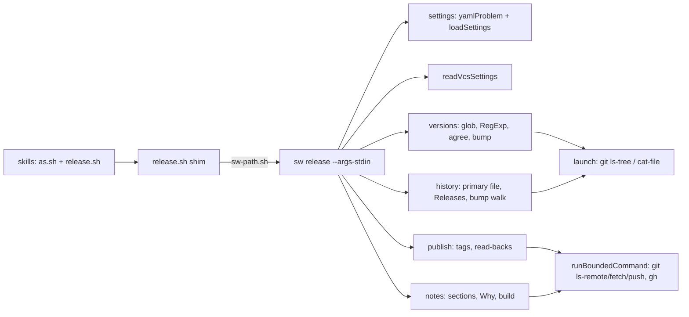
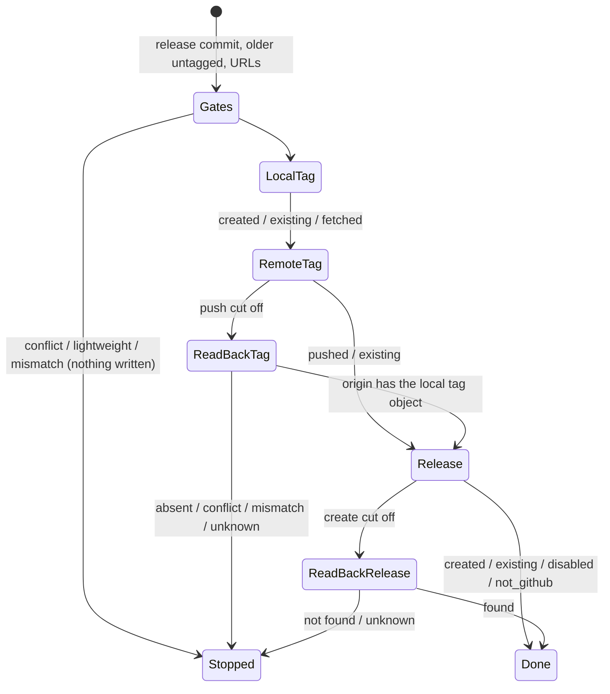
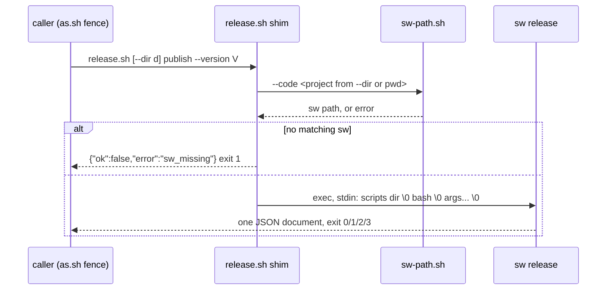
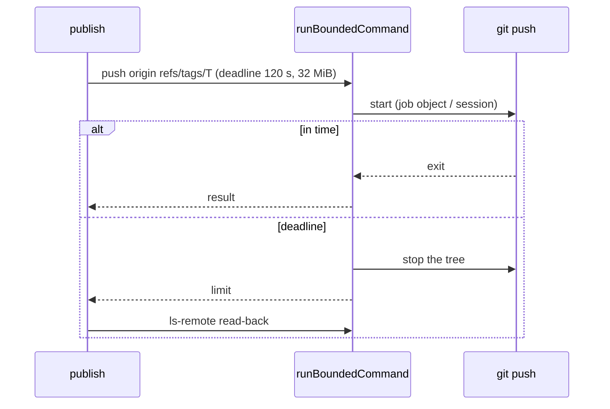

# Design

## Triage

| Trigger | Applies? | Evidence |
|---|---|---|
| T1 Components (new component, or 3+ with directed relationships) | yes | A new `sw release` component. It uses the shim, the shared settings reader, the VCS settings, the bounded runner and the launcher, and it starts `git` and `gh`. |
| T2 State (persistent state, caches, 3+ state machine) | yes | Publish walks a resumable state machine over the local tag, origin's tag and the GitHub release (`release.sh:1750-1815`). Bump rewrites version files in place (`release.sh:822-887`). |
| T3 Concurrency (background work, workers/isolates, async, retries) | yes | Network commands race a deadline and stop their process tree (`release.sh:87-92`); a cut-off push or release is read back (`release.sh:1680-1748`). Another clone can push the same tag concurrently (`release.sh:1720-1726`). |
| T4 Boundaries (data format, migration, shared interface, IPC, external) | yes | The JSON documents and exit codes callers read, the shim's stdin contract (ADR 0028), the `release.version_files` regex dialect, and the `git` and `gh` command lines. |
| T5 Volume (grows without a fixed bound) | yes | The primary file's first-parent history (`release.sh:902-963`), the paginated closed-PR list (`release.sh:1369-1392`) and the archive directories in a release range. |
| T6 Risk (security, money, data loss, unrecoverable user data) | yes | A pushed tag and a GitHub release are public and are never moved (ADR 0010). Bump rewrites user files. Publish runs under the caller's fenced GitHub token. |

TIER: FULL

## Context

- **What is ported.** `release.sh` is a bash wrapper (`release.sh:94-104`) around embedded Python with six subcommands: `check`, `bump`, `status`, `notes`, `untagged` and `publish` (`release.sh:6-82`, `release.sh:1818-1825`). `--dir` and `notes` are handled before the repository and the opt-in gate (`release.sh:1828-1838`). Uncaught errors still print one JSON document (`release.sh:1855-1863`).
- **Settings.** Its own YAML reader (`release.sh:231-388`) feeds `Settings` (`release.sh:390-408`): `release.enabled` only when it is `True`, `tag` defaulting to `v{version}`, `github_release` unless `False`, `pr.merge_method`, `finish` and `main_branch`. The gate refuses releases off, a tag template without `{version}` and, for bump and publish, `rebase` merges (`release.sh:410-420`). `entries` checks each `version_files` entry and compiles its pattern with `re.M`, requiring exactly one group (`release.sh:422-441`).
  - `sw` has the shared lenient reader `loadSettings` (`cli/lib/src/settings/rules.dart:567-581`) and the strict check `yamlProblem` (`cli/lib/src/settings/yaml.dart:672-675`). `sw review` reads settings through both, stopping with `bad_settings` (`cli/lib/src/review/settings.dart:46-50`).
- **Version files.**
  - In the working tree, `WorkTree.files` uses Python's recursive `glob` and refuses matches reached through a symlink (`release.sh:482-506`). At a commit, `CommitTree` matches `git ls-tree -r` names against `glob_regex` and refuses symlink entries (`release.sh:445-468`, `release.sh:537-573`). Blobs are read through one `git cat-file --batch` (`release.sh:516-534`).
  - Text is decoded with `surrogateescape` (`release.sh:576-577`), and matching treats CRLF as LF while keeping the original offsets (`release.sh:598-610`).
  - `agree` requires exactly one match per file and one shared version (`release.sh:652-662`).
- **Bump.** It computes every replacement in memory, then writes each file through `mkstemp` in its directory, `chmod` and `os.replace`, reporting written and pending files on a failure (`release.sh:850-887`). A rerun to the same target completes an interrupted bump (`release.sh:841-842`).
- **History and gates.**
  - `primary_history` reads the primary file at each first-parent commit that touches it (`release.sh:902-963`), and `Releases` records each version's first appearance (`release.sh:946-963`).
  - `check --main` runs the bump-detection walk (`release.sh:694-776`).
  - `require_release_shape` refuses a release commit that is neither a merge nor a `(#n)` squash (`release.sh:1031-1049`).
  - The older-untagged gate is at `release.sh:1498-1503`.
- **The VCS backend** is read by starting `bash pr-pair.sh vcs --code <repo>`, skipped when the settings never mention `gitbutler` (`release.sh:777-800`). `sw` reads the same backend in process through `readVcsSettings` (`cli/lib/src/pr/settings_commands.dart:218-248`).
- **Network commands.**
  - `ls-remote`, `fetch` and `push` run under `bounded.py` (`release.sh:172-195`).
  - `gh` runs through `bash -c 'exec gh "$@"'`, so a shell-script `gh` works on Windows, with `GH_REPO` removed (`release.sh:1361-1366`). The token comes from the caller: the skill runs `release.sh` through `as.sh <run login>` (`skills/specwright-release/SKILL.md:56-60`).
  - The closed-PR read concatenates `--paginate` pages and parses them one by one (`release.sh:1369-1392`).
  - `sw` already has a bounded runner for any command, `runBoundedCommand`, which resolves Windows batch files through `planLaunch` (`cli/lib/src/pr/gh.dart:72-86`, `cli/lib/src/pr/gh.dart:115-138`). It has `--slurp` pagination with the `gh` 2.48 floor (`cli/lib/src/pr/workflow.dart:317-321`). The limits and their test overrides, which can only lower them, are in `cli/lib/src/process/limits.dart:72-101`. Unbounded tools start through `launch` (`cli/lib/src/process/launch.dart:136-185`).
- **Publish.** The order is: push-destination check, release-commit gate, older-untagged gate and status document (`release.sh:1750-1762`). Then come the conflict, lightweight and object-mismatch stops (`release.sh:1765-1781`), and then only the missing steps: tag, push and release (`release.sh:1782-1815`). Read-backs after a cut-off are at `release.sh:1680-1691` and `release.sh:1728-1748`.
- **Notes.** The proposal is capped at 64 KB, a Why line at 300 characters and listed changes at 100 (`release.sh:1045-1049`). The section parser is `parse_release_notes` (`release.sh:1108`), and `cmd_notes` runs with no repository (`release.sh:1189`). `read_sections` and `build_notes` assemble the notes (`release.sh:1226`, `release.sh:1457`). Store-backed notes use the code-merge proof (`release.sh:1411-1441`).
- **Shims.** `review-run.sh` finds the project by walking up from `pwd` to `.git`, resolves `sw` through `sw-path.sh` and execs `sw review --args-stdin` with NUL records (`skills/specwright-review/scripts/review-run.sh:7-13`, last 8 lines). `sw review` reads those records (`cli/lib/src/commands/review.dart:8-23`).
- **Launch sites.** `cli/test/launch_sites_test.dart` lists every process-runner call per file and fails on an unlisted one (`cli/test/launch_sites_test.dart:1-36`).
- **Regex dialect.** ADR 0030 made reviewer patterns JavaScript regexes in Unicode mode, so a Python-only pattern fails instead of matching under another meaning (`docs/adr/0030-report-patterns-are-javascript-regexes.md:9-15`). This repository's own patterns are `^(\d+\.\d+\.\d+)$`, `badge/version-(\d+\.\d+\.\d+)-blue` and `^  version: (\S+)$` (`openspec/specwright.yaml:136-139`).
- **#211.** `TestBoundedNetwork` sets `SPECWRIGHT_NET_DEADLINE` to 5 s for the whole publish (`evals/release/test_release.py:1740`, `evals/release/test_release.py:1759-1766`), and `test_release_create_cut_off_not_found` hangs only `gh release create` (`evals/release/test_release.py:1855-1865`).

## Decisions

### D1: `sw release` behind an ADR 0028 shim, reached through `--args-stdin`

- **Choice:** A new `cli/lib/src/release/` package and `sw release`. The shim resolves the project from `--dir` when that is the first argument, else by walking up from `pwd`, and execs `sw release --args-stdin` with the scripts directory, bash path and arguments as NUL records, as `review-run.sh` does. `sw release  [options]` also takes plain argv with the same options, for `native-cli-retire-scripts`. `--dir` and `notes` keep their position before the repository check.
- **Rejected:** A shim that execs `sw release  <args>` with argv only, because it differs from the review and PR shims and drops their named refusal for arguments the platform cannot pass.
- **Reversal cost:** low (one shim and one entry point)
- **Important:** yes: binds future changes (the `sw` interface the retire-scripts change calls)
- **Chosen by:** user

### D2: Settings come from the shared reader, refused when `yamlProblem` finds a line

- **Choice:** Every subcommand except `notes` reads `openspec/specwright.yaml` from the repository root with `yamlProblem` first, then `loadSettings`, and maps the values as `Settings` does (`release.sh:390-408`). A problem is `bad_settings`, exit 1, before any git or network call. A missing file reads as empty, as today. This carries proposal S2.
- **Rejected:** Porting the script's YAML reader, because `native-cli-yaml-settings` would then have one more reader to remove.
- **Reversal cost:** low
- **Important:** yes: changes behaviour users see
- **Chosen by:** user

### D3: Version patterns are `RegExp(multiLine: true, unicode: true)`, recorded in ADR 0037

- **Choice:** Compile each pattern with Dart's `RegExp` in multiline and Unicode mode. A compile error is `bad_version_files` naming the entry and the error. Exactly one capture group is still required; Dart counts groups with `RegExpMatch.groupCount`. CRLF needs no translation: a multiline `$` matches before `\r`, and the match offsets index the original text, so bump keeps the CRLF. ADR 0037 extends ADR 0030's dialect to `release.version_files`. This carries proposal S1.
- **Rejected:** Translating Python syntax, for the reason in proposal S1.
- **Reversal cost:** medium
- **Important:** yes: binds future changes (a config format) and changes settings users see
- **Chosen by:** user

### D4: Version files decode lossily; bump refuses a file that is not UTF-8

- **Choice:** Reads (`check`, `status`, `untagged`, the history walk) decode with `utf8.decode(allowMalformed: true)`, since versions are ASCII. Bump first checks that every file it would rewrite is valid UTF-8, and stops with `bad_version_files`, exit 1, naming the file, before the first write. The spec requirement "Bump refuses a version file that is not UTF-8" carries it.
- **Rejected:** A byte-preserving decode carried through the regex and back, because it needs the surrogate codec the launcher change shrank, for a rare file.
- **Reversal cost:** low
- **Important:** yes: changes behaviour users see (a bump that used to succeed now stops)
- **Chosen by:** user

### D5: One glob matcher, over a native listing in the work tree and `ls-tree` names at a commit

- **Choice:** A single matcher with the `glob_regex` rules: `*` and `?` stop at `/`, `**/` spans directories, and `[...]` classes. At a commit it runs over `git ls-tree -r -z` names, as today. In the work tree it runs over a sorted native listing that skips a name starting with `.` when a wildcard segment matches it, as Python's `glob` does. Links are found by `lstat` on each path segment and refused as today. Each pattern is matched against whole relative paths, with `/` separators.
- **Rejected:** `git ls-files` for the work tree, because bump and check also read an untracked or newly added version file today. A glob package, because ADR 0033 asks the owner's approval for each package and the matcher is about 30 lines.
- **Reversal cost:** low
- **Important:** no
- **Chosen by:** agent

### D6: Network commands run through `runBoundedCommand`; local `git` through `launch`

- **Choice:** `git ls-remote`, `fetch`, `push` and every `gh` call run through `runBoundedCommand(['git' | 'gh', ...])` with the ADR 0012 limits from `resolveLimits` (paged for the closed-PR read). `gh` is started directly with `GH_REPO` removed from its environment, so the `bash -c` wrapper goes. On Windows the launcher finds a command only through `PATHEXT` (`cli/lib/src/process/resolve.dart:56-68`); an extensionless shell-script `gh`, which the wrapper used to run, is no longer found there, as ADR 0034 states for every ported command (`docs/adr/0034-sw-launches-tools-without-a-shell.md:19`). The real `gh` is `gh.exe`, so only a hand-made shim is affected; the evals use `.cmd` wrappers (D8). Local `git` calls start through `launch` with no deadline, as they had none. `cat-file --batch` gets its spec list as stdin. The closed-PR read uses `gh api --paginate --slurp`. The caller's environment, including the fenced `GH_TOKEN`, is inherited unchanged.
- **Rejected:** A release-specific runner, because `runBoundedCommand` already gives the tree stop, the limit lines and the launch-site registration that the evals check.
- **Reversal cost:** low
- **Important:** no
- **Chosen by:** agent

### D7: The VCS backend is read in process

- **Choice:** `check` without `--branch` but with `--main` calls `readVcsSettings(role: 'code')` and stops with the existing usage error when the backend is `gitbutler`. The settings shortcut goes, since reading in process costs nothing. A settings error from it surfaces as its own error, as `vcs_error` did.
- **Rejected:** Keeping `pr-pair.sh vcs`, because it starts bash and Python, which the M8 exit criteria forbid.
- **Reversal cost:** low
- **Important:** no
- **Chosen by:** agent

### D8: The existing black-box evals are the contract, with no frozen oracle

- **Choice:** `evals/release/test_release.py` and `test_release_jj.py` run against the shim, apart from assertions on message text no caller reads. Their fixtures change in two ways, as the review evals did. Each fixture repository gets a matching `sw` through `sw_home()` and `stamp_version()` (`evals/vcs/vcs_test_support.py:51-70`); without them the shim stops at `sw_missing` before any release code runs (`evals/release/fixtures.py:92-130` sets up neither). The fake `gh` in both modules is written with `fakeexe` (`evals/fakeexe.py:1-12`), so Windows finds a `.cmd` or `.exe` beside the script. Each fixture asserts that the fake recorded the calls the test expects, so a real `gh` on `PATH` cannot stand in unnoticed. New eval cases cover a publish with failing `python`, `python3`, `bash` and `sh` first on `PATH`, the GitButler backend with `pr-pair.sh` absent, `sw_missing`, the regex dialect, `bad_settings` and a non-UTF-8 bump. Dart unit tests under `cli/test/release/` cover the glob matcher, the bump-detection walk, the notes parser and the semver order. A status document recorded from the Python script on one fixture is compared field by field (spec scenario "Status keeps its document"). The `sw_missing` case runs with no matching `sw` and asserts that no `git ls-remote` or `gh` call was recorded. `evals/suites.json` gets a rule routing `cli/lib/src/release/**`, `cli/lib/src/commands/release.dart`, `cli/test/release/**` and the shared code release depends on (`cli/lib/src/process/**`, `cli/lib/src/settings/**`, `cli/lib/src/pr/gh.dart`, `cli/lib/src/pr/settings_commands.dart`, `cli/lib/src/fs/**`) to the `release` suite, next to the existing `cli` rule, and the map test runs after each added file.
- **Rejected:** Running Python and `sw` side by side on generated inputs, because ADR 0033 keeps guarantees, not bytes, and the evals already pin the guarantees.
- **Reversal cost:** low
- **Important:** no
- **Chosen by:** agent

### D9: #211 is fixed by publishing the tag before the cut-off run

- **Choice:** In `test_release_create_cut_off_not_found`, a first publish runs under the normal bound with the fake `gh` failing `release create`: it pushes the tag and stops with `release_create_failed`. The second publish, with `SPECWRIGHT_NET_DEADLINE` at 5 s and `release create` hung, finds both tags done, so only `ls-remote` reads and `gh release view` come before the hung call. This carries proposal S3.
- **Rejected:** A per-command deadline override in `sw`, because it adds a test-only knob to `limits.dart`.
- **Reversal cost:** low
- **Important:** no
- **Chosen by:** agent

### D10: The `bounded.py` copy in `specwright-release` is removed

- **Choice:** Delete `skills/specwright-release/scripts/bounded.py` with the shim, and drop it from `evals/suites.json`. This carries proposal S4.
- **Rejected:** Keeping it until `native-cli-retire-scripts`, because nothing calls it.
- **Reversal cost:** low
- **Important:** no
- **Chosen by:** agent

### Decision summary

| # | Decision | Choice | Rejected | Reversal cost | Important | Chosen by |
|---|---|---|---|---|---|---|
| S1 | Regex dialect | JavaScript, Unicode mode | Python-syntax translator | medium | yes | user |
| S2 | Misreadable settings | `bad_settings` stop | Lenient read | low | yes | user |
| S3 | #211 | Fixed in the eval | Change publish's bounds | low | no | agent |
| S4 | `bounded.py` copy | Removed now | Kept until retire-scripts | low | no | agent |
| D1 | Entry point | Shim → `sw release --args-stdin`, plus argv | Argv-only shim | low | yes | user |
| D2 | Settings reader | Shared reader + `yamlProblem` | Port the YAML reader | low | yes | user |
| D3 | Regex compile | `RegExp(multiLine, unicode)`, ADR 0037 | Translator | medium | yes | user |
| D4 | Non-UTF-8 files | Lossy read, bump refuses | Byte-preserving codec | low | yes | user |
| D5 | Glob | One matcher, native listing | `git ls-files`; a package | low | no | agent |
| D6 | Process starts | `runBoundedCommand` for network, `launch` for local | A release runner | low | no | agent |
| D7 | VCS backend | `readVcsSettings` in process | `pr-pair.sh vcs` | low | no | agent |
| D8 | Contract | Existing evals with matching `sw`, `fakeexe` fakes and a release suite rule, plus new cases | Side-by-side oracle | low | no | agent |
| D9 | #211 fix | Tag published before the cut-off run | Per-command test bound | low | no | agent |
| D10 | `bounded.py` | Deleted | Kept | low | no | agent |

## Assumptions

- **A1:** Dart's `RegExp(unicode: true)` refuses `(?P<name>`, `\A`, `\Z` and `(?i)`, and in multiline mode `$` matches before `\r`. Not checked here: ADR 0030 states the refusals, but the CRLF behaviour is from the ECMAScript line-terminator rule, not a run. Depends on it: D3, task 2.2 (a unit test checks both before the matcher is used).
- **A2:** Python's `glob` skips names starting with `.` for wildcard segments, including under `**`. Not checked because it is standard-library behaviour, not repository code. Depends on it: D5 (a unit test pins the chosen rule either way).
- **A3:** No caller reads the text of a `release.sh` message, only `error`, `ok` and the named fields. Not checked across every caller's prose. Depends on it: D8 (task 1.2 greps the skills and evals for message assertions).

## Carried constraints

- **C1:** `release.version_files` patterns are JavaScript regexes in Unicode and multiline mode; a refused pattern stops with `bad_version_files`, never matching under another meaning. Kind: invariant. Destination: ADR 0037
- **C2:** Release network commands keep ADR 0012's bounds, and a local `git` call gets no deadline it did not have. Kind: invariant. Destination: doc comment: cli/lib/src/release/git.dart `ReleaseGit`
- **C3:** Bump never rewrites a file that is not valid UTF-8, so a file's other bytes are never altered; every planned rewrite is checked before the first write. Kind: invariant. Destination: spec: specs/releases/spec.md → Requirement: Bump refuses a version file that is not UTF-8
- **C4:** The work-tree glob skips dot-names under wildcards, while the commit glob matches them: kept from the script, not a goal. Kind: deliberate gap. Destination: doc comment: cli/lib/src/release/glob.dart `VersionGlob`
- **C5:** A per-command test deadline in `sw` was rejected; evals arrange their own ordering instead. Kind: rejected alternative. Destination: doc comment: cli/lib/src/process/limits.dart `resolveLimits`
- **C6:** The fallback Why read takes each listed proposal's whole blob and cuts it to 64 KB afterwards; only the section read is size-checked first. Kind: deliberate gap. Destination: doc comment: cli/lib/src/release/notes.dart `whyLines`

## Diagrams (FULL)

Components (T1):

Publish state machine (T2):

Shim handoff (T4):

Network call under a bound (T3):

## State & Ownership (FULL)

| State | Owner (sole writer) | Lifetime | Invalidation / rebuild | Authoritative copy |
|---|---|---|---|---|
| Version files in the work tree | `bump` | Until the next bump commit | A rerun to the same target completes it | The work tree, then the bump commit |
| Local tag `refs/tags/<tag>` | `publish` (create, or fetch from origin) | Permanent; never moved (ADR 0010) | None; the user deletes it by hand on `tag_mismatch` | Origin's tag |
| Origin's tag | `publish` (one push) | Permanent | None | Origin |
| GitHub release | `publish` (`gh release create`) | Permanent | None; an existing one is left unchanged | GitHub |
| Notes temp file | `publish` | One `git tag` or `gh release create` call | Removed after the call | The tag message |
| Settings in memory | `sw release` | One run | Read again every run | `openspec/specwright.yaml` |

## Failure & Visibility (FULL)

| Component | Fails / dies mid-operation → | Recovery | Retry safe? | Who finds out |
|---|---|---|---|---|
| Shim | `sw` missing or mismatched | Rerun the install prompt | yes | User: `sw_missing` JSON |
| Settings | Misreadable line | User fixes the line | yes | User: `bad_settings` names the line |
| Bump | Write fails part-way | Rerun `bump --to` the same target | yes | User: `write_failed` lists written and pending |
| Bump | Killed between renames | Same rerun; each file is whole (rename) | yes | User: next `check` reports `version_files_disagree` |
| Publish, tag create | `git tag` fails | Rerun | yes | User: `tag_create_failed` |
| Publish, push | Fails or is cut off | Read-back decides; rerun pushes | yes | User: `tag_push_failed`, the limit, or `state: unknown` |
| Publish, release | Fails or is cut off | Read-back decides; rerun creates only the release | yes | User: `release_create_failed`, the limit, or `state: unknown` |
| Any network read | Cut off or fails | Rerun | yes | User: exit 3 naming the command |
| `sw` crash (bug) | Unexpected exception | Fix the bug | Depends on the step reached | User: `internal_error` JSON, as the script printed |

## Resource Bounds (FULL)

| Queue / buffer / cache / transfer | Bound | At the bound | Timeout | At 10x / 100x |
|---|---|---|---|---|
| Each network command's stdout and stderr | 32 MiB each (ADR 0012) | Tree stopped, exit 3 `response_too_large` | 120 s; 300 s for the closed-PR read | Bounded |
| Closed-PR list (`--slurp`) | 32 MiB of JSON | Exit 3, no partial list | 300 s | 100x the PRs (~30,000) reaches the bound and stops loudly |
| Primary-file history | One blob per first-parent commit touching it, in memory | None (local reads, as today) | None | A 1 KB `VERSION` over 10,000 commits is 10 MB; acceptable |
| Proposal section read for notes | 64 KB per proposal, checked by size before the read (`release.sh:1212-1224`) | Falls back to the Why line, with a warning | None | Bounded per change |
| Fallback Why read | None: the whole blob is read, then cut to 64 KB (`release.sh:1274-1277`) | Kept from the script: at most one blob per listed change (100), each an archived proposal | None | A 1 MB proposal costs 1 MB once; accepted (C6) |
| Listed changes in notes | 100 lines, then `…and <n> more` | Truncated | None | Bounded |
| Items in notes | 150 | Truncated as the script does | None | Bounded |
| `cat-file --batch` output | Sum of the requested blobs | None (local) | None | As history above |

## Flow & State Gaps (FULL)

- **Partial completion.** Bump renames file by file; an interrupted bump leaves two versions, and a rerun to the same target completes it (`release.sh:841-842`). Publish does only the missing steps, so a rerun resumes after any stop.
- **Concurrent publishes.** Another clone can push the same tag first: the push fails, or a read-back finds another tag object, and publish stops with `tag_mismatch` or `tag_conflict` without moving anything. A `gh release create` that loses the race reads back `existing`.
- **Stale data.** `--main` is fetched by the caller before publish (skill step 1); `sw` reads refs as given.
- **Restart mid-operation.** Same as partial completion: every step reads state before it writes.
- **Out-of-order events.** None: one run, sequential steps.

## Mechanism Ledger (FULL)

| Mechanism | Built? | Why (harm nobody catches / expensive later) | Evidence that would change the call |
|---|---|---|---|
| Bounded network commands | yes | A hung push or `gh` call would block a merge flow (ADR 0012) | — |
| Read-back after a cut-off | yes | Without it a landed push would be reported as failed, and a rerun would stop on `tag_mismatch` | — |
| `bad_settings` refusal | yes | A misread `release.enabled` or `version_files` decides on wrong input (S2) | — |
| Non-UTF-8 bump refusal | yes | A lossy write would corrupt user bytes silently (D4) | — |
| Byte-preserving codec | no | Rare files; refusing is loud | A user report of a non-UTF-8 version file |
| Regex timeout or separate evaluator | no | The patterns are the user's own, over the user's own files; ADR 0022's evaluator is for PR text from others | A report of a slow pattern |
| Bound on local `git` reads | no | They had none; adding one is a behaviour change (C2) | A hung local `git` in the field |
| Glob package | no | 30 lines of matcher; a package needs owner approval (ADR 0033) | A glob rule the matcher gets wrong |

## Risks / Trade-offs

- [A user pattern with Python-only syntax stops every release] → The stop names the entry and the dialect, the release notes and the upgrade note say so, and the shipped patterns already mean the same in both dialects.
- [Subtle dialect differences, such as `\w`, `\b` and `\s` around non-ASCII text, change a match without failing] → Version captures are ASCII digits; the docs name the dialect, and ADR 0037 records the differences ADR 0030 lists.
- [A field changes value in the port without an eval noticing] → D8's field-by-field status comparison against the Python output, plus the 143 existing evals on three OSes.
- [The #211 fix stops testing a push and a release creation cut off in the same run] → The push cut-off and its read-back have their own tests (`evals/release/test_release.py:1867-1878`), and the release read-back logic does not depend on which run pushed the tag.

## ADRs

- **In force, constraining this change:** 0010 (tags never moved), 0012 (bounded network calls), 0014 (one bounded process module), 0015 (notes from each proposal), 0017 (VCS writes through one backend), 0027 (one Dart binary), 0028 (shims resolve the project's `sw`), 0030 (JavaScript regex dialect), 0031 (direct native calls), 0033 (focused packages), 0034 (launch without a shell).
- **To record during apply:** 0037, which extends ADR 0030's JavaScript Unicode-mode dialect to `release.version_files`, with multiline mode, and names the refused Python syntax and the `bad_version_files` stop.
