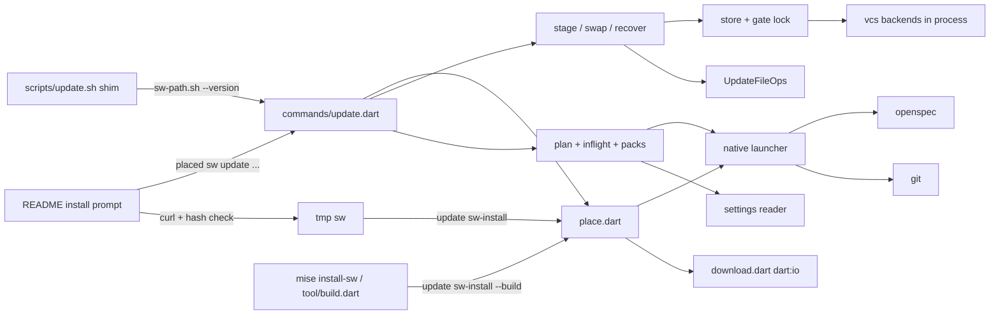
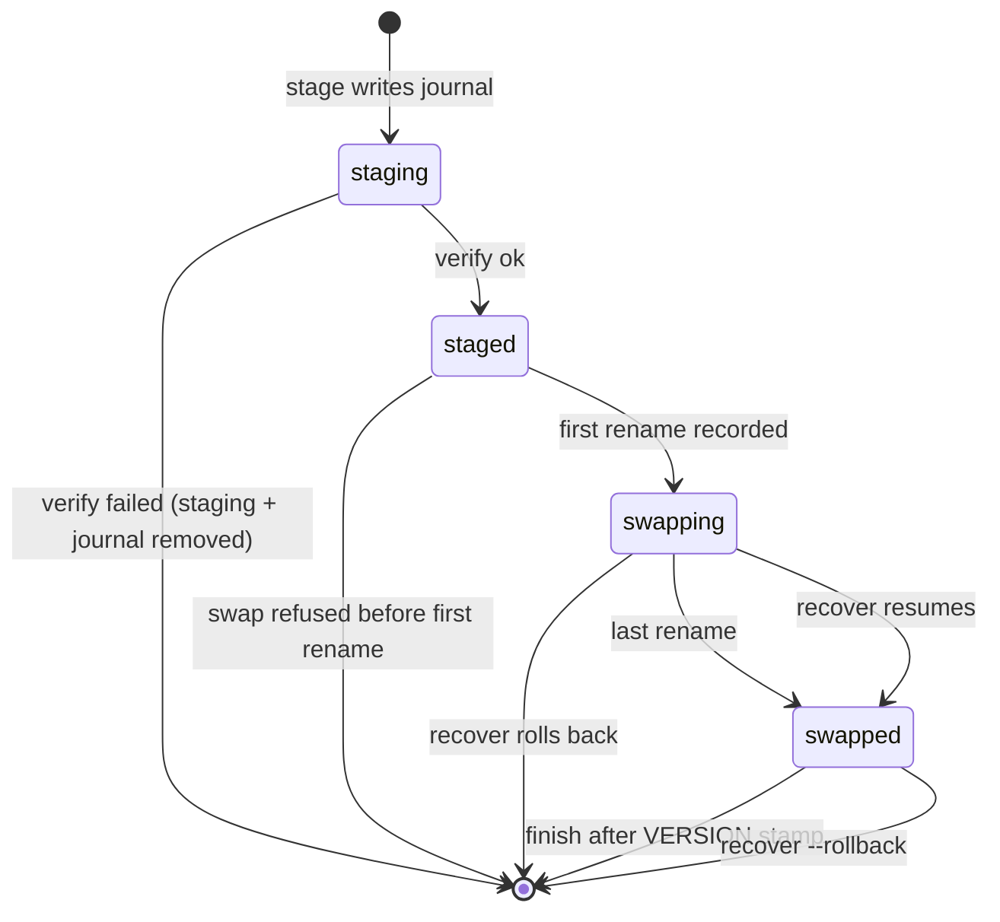

# Design

## Triage

| Trigger | Applies? | Evidence |
|---|---|---|
| T1 Components (new component, or 3+ with directed relationships) | yes | A new `sw update` command family drives the settings reader, the VCS backends, the native launcher, `git`, `openspec` and the release download; the prompt, the shim and `mise` call it |
| T2 State (persistent state, caches, 3+ state machine) | yes | The journal phases (staging, staged, swapping, swapped) and per-target states (pending, staged, old-moved, swapped) move to a new writer (`scripts/update.sh:220-226`) |
| T3 Concurrency (background work, workers/isolates, async, retries) | yes | The update lock and the store gate lock are shared with other runs and sessions (`scripts/update.sh:227-229`, `scripts/update.sh:119-122`); two installs may place one version's `sw` at once |
| T4 Boundaries (data format, migration, shared interface, IPC, external) | yes | Journal format, the JSON documents the prompt reads, the update interface (2 to 3), the release download and the README prompt |
| T5 Volume (grows without a fixed bound) | yes | Staged files and the SHA-256 manifest grow with the number of skills and packs; downloads and `git ls-remote` output are bounded transfers |
| T6 Risk (security, money, data loss, unrecoverable user data) | yes | A wrong swap or rollback can destroy installed skills or a user's `config.yaml`; the bootstrap runs a downloaded binary |

TIER: FULL

## Context

- `update.sh` runs from the download and does its file work in bash, with every decision in a Python helper embedded in the same file and loaded through `-c` (`scripts/update.sh:257-264`). It needs bash and Python 3.8+ and stops with `no_python` without them (`scripts/update.sh:233-240`).
- Its subcommands, options, documents and refusal codes are listed in its header (`scripts/update.sh:9-219`). Journal format 2 and its fields are at `scripts/update.sh:220-226`, and the update lock (a `mkdir` directory holding `pid:` and `host:`, replaced when stale) at `scripts/update.sh:227-229`.
- File operations use only the external `mv`, `cp` and `rm`, so that the evals can count them (`scripts/update.sh:230-231`). Staging copies directories with `cp -R` (`scripts/update.sh:780`). `evals/update/test_interrupt.py:1-10` kills the script at every counted call through the shims in `evals/update/shims/`.
- Settings are read with a lenient line regex (`scripts/update.sh:1126-1149`, used by `scripts/update.sh:1185-1192`). The store's `vcs` is read through the download's `sw pr vcs`, falling back to `pr-pair.sh` and then the regex (`scripts/update.sh:1608-1637`). A jj store's branch comes from the download's `sw vcs state`, launched with `vcs.sh`'s records (`scripts/update.sh:1640-1658`).
- `openspec` runs as a child process with `OPENSPEC_TELEMETRY=0` and an optional timeout (`scripts/update.sh:1270-1281`). `git ls-remote --tags` runs under the download's `bounded.py` with a 60-second deadline (`scripts/update.sh:1473-1503`).
- `sw-install` downloads with Python's `urllib` in a bounded child, refusing redirects to a URL that is not https (`scripts/update.sh:3019-3048`, `scripts/update.sh:3127-3157`). It checks a binary through the download's `sw-path.sh` run by bash (`scripts/update.sh:3158-3167`), and clears macOS quarantine with `xattr` only after the hash check (`scripts/update.sh:3199-3213`).
- The resolver expects `SW_INTERFACE=1` (`skills/specwright-pr/scripts/sw-path.sh:26`), and `sw` reports `interfaceVersion = 1` (`cli/lib/src/commands/version.dart:12`). `evals/cli/test_sw_interface_pin.py:19-20` keeps the two equal. This is the skills' interface. The update interface (2) is a separate number in `plan`'s document (`scripts/update.sh:32`).
- `sw` already has the pieces the port needs:
  - the native launcher, which takes an explicit working directory and an optional stdout cap (`cli/lib/src/process/launch.dart:136-186`);
  - the fail-closed settings reader (`cli/lib/src/settings/reader.dart:40`, file lookup `cli/lib/src/settings/rules.dart:624`);
  - the jj state document (`cli/lib/src/vcs/jj_backend.dart:296`);
  - sorted tree walks (`cli/lib/src/fs/walk.dart:86-117`).
- `scripts/install-sw.sh:1-43` checks a build with `sw-path.sh`, places the notice, then renames the binary into place. `mise.toml` runs it with `bash` in the `install-sw` task.
- The README prompt checks bash and Python in Step 1 (`README.md:76-82`), clones the ref (`README.md:158-160`), runs `update.sh sw-install` (`README.md:224-244`), and runs every Step 4-7 call with `bash` (`README.md:246-259`).

## Decisions

### D1: The target version's `sw` runs the whole update in process

- **Choice:** New `cli/lib/src/update/` modules (options, journal, lock, plan, inflight, store, stage and swap, recover, packs, download, place) behind `sw update <subcommand>`. Each subcommand prints one document, as today. Settings, the VCS state of a jj store and the fenced reads are called directly through `sw`'s interfaces, and `git`, `openspec` and `xattr` start through `launch()`.
- **Rejected:** keeping a thin bash driver around a native core (the milestone removes bash), or having the installed (older) `sw` drive the update (an old binary would run the new version's install logic, against ADR 0011's "run from the download").
- **Reversal cost:** high. The evidence that settles it is the `evals/update` suite passing through the shim on three OSes, with its behavioural assertions unchanged. Only its fixtures adapt: the kill seam (D3) and versioned binaries (D8).
- **Important:** yes, binds future changes (the `sw update` contract)
- **Chosen by:** agent. It follows S1, S2 and S4 and the roadmap entry.

### D2: Journal format 2, unchanged, with `plan` reporting interface 3

- **Choice:** `sw update` writes the same format-2 journal (fields and states as `scripts/update.sh:220-226`) and reads formats 1 and 2. Only `plan`'s `interface` moves to 3, because the prompt contract changed (S2). A 0.36.0 `update.sh` can therefore still recover a journal that `sw update` left, if a user goes back to an older prompt.
- **Rejected:** a format 3 journal with typed fields, because older scripts would refuse it as unreadable and nothing in the port needs a new field.
- **Reversal cost:** medium
- **Important:** yes, binds future changes (stored data format)
- **Chosen by:** agent. It follows S2.

### D3: File operations are native, counted, and an env-gated self-kill interrupts them

- **Choice:** Every copy, rename, remove and directory create in `sw update` goes through one counting wrapper. When `SPECWRIGHT_UPDATE_KILL_AT=<n>` and `SPECWRIGHT_UPDATE_COUNT=<file>` are set, the wrapper appends `<n> <op> <args>` to the log before each operation. At operation `n` it ends the process at once with `exit(137)`, which runs no `finally` and does no cleanup. The fixtures' `run_update` sets these variables in place of putting the `mv`/`cp`/`rm` shims on `PATH`. The eval keeps its matrix of one run per counted operation. The seam stops only `sw` itself, and without the variables it does nothing.
- **Rejected:** a separate fault-injection build (CI would build twice per OS and test a binary that does not ship); Dart-only interruption tests with an injected filesystem (the black-box kill matrix on three OSes is the evidence for the recovery exit criterion).
- **Reversal cost:** low
- **Important:** yes, weak evidence (whether `exit` mid-operation reproduces a kill closely enough). Settled by a verify task that compares the counted operation list with the bash run's.
- **Chosen by:** user

### D4: Release files are downloaded in process with `dart:io`

- **Choice:** `HttpClient` with `findProxy` from the environment (`HTTPS_PROXY`, `NO_PROXY`), automatic redirects off and each redirect followed by hand. The start URL and every redirect must be https, and a redirect to http is refused as today. A 120-second deadline and a 64 MiB cap apply per file, and a partial file is deleted at a limit. `file://` serves mirrors and the evals, and `http://` is refused (`scripts/update.sh:26-27`).
- **Rejected:** launching `curl` (the prompt needs it, but `sw` would depend on curl's flags and versions on each OS).
- **Reversal cost:** low
- **Important:** yes, weak evidence (Dart's trust store and proxy handling against Python's on corporate hosts)
- **Chosen by:** user

### D5: Settings go through the shared fail-closed reader

- **Choice:** `main_branch`, `planning_store.main_branch`, `planning_store.vcs` and `vcs` are read with `readSettingsText` and `readSettingsYaml`. A refused file stops with `settings_invalid` (file, line, why). The regex fallback and the `pr vcs` subprocess go.
- **Rejected:** a lenient reader for the update only (a second YAML reader, against ADR 0038).
- **Reversal cost:** low
- **Important:** yes, changes what users see (a new refusal)
- **Chosen by:** user

### D6: The running binary is the reference for a downloaded binary's check

- **Choice:** `sw-install` checks a downloaded or placed binary by running it with `version --json` (the one allowed self-check) under a 10-second deadline and a 1 MiB cap. The `version` must equal the download's `VERSION`, and the `interface` must equal the running binary's `interfaceVersion`. That constant equals `SW_INTERFACE` of the same commit through the pin test.
- **Rejected:** reading `SW_INTERFACE` out of the download's `sw-path.sh` text (it ties `sw` to a script file that `native-cli-retire-scripts` removes).
- **Reversal cost:** low
- **Important:** no
- **Chosen by:** agent

### D7: `sw-install` never moves its own file, and `mise run install-sw` uses a `--build` source

- **Choice:** `sw update sw-install` always downloads its own copy and places it, even when the running binary is the agent's checked temporary copy, so the running file is never renamed. `sw update sw-install --build <file> --download <tree>` takes `<file>` as the source with no download. It applies the same checks, places the notice from `<tree>/cli/THIRD_PARTY_NOTICES.txt` before the binary, and renames atomically. `cli/tool/build.dart --install` builds to a temporary path inside `cli/build/` and then runs the built binary with `--build`. With `--expect-update-interface <n>` it first runs the built binary's `sw update interface` (D11). On a different number, or when the run fails, it deletes the build and stops before `sw-install`, so no binary, notice, journal or installed file changes. The `mise` `install-sw` task calls it and passes its arguments through (`mise run install-sw -- --expect-update-interface 3`), so no shell syntax or `.exe` naming reaches the task. A contributor's plain `mise run install-sw` skips that check, because the build is its own reference.
- **Rejected:** a separate `sw place` command (a second placement path to keep identical); moving the agent's checked temporary file into place (a Windows binary cannot rename itself while it runs).
- **Reversal cost:** low
- **Important:** no. It is contributor tooling behind the same task name.
- **Chosen by:** agent

### D8: The shim resolves the download's version

- **Choice:** `scripts/update.sh` becomes an ADR 0028 shim. It reads `<download>/VERSION`, resolves `sw` through `sw-path.sh --version <that version>` beside it in the download (`skills/specwright-pr/scripts/sw-path.sh`), and hands over its arguments plus `--download <its tree>` when none is given. A missing `sw` prints `sw_missing` and exits 1.
- **Eval fixtures:** the update evals build downloads at synthetic versions (`0.0.1`, `0.5.0`, `0.6.0`, `0.6.1`; `evals/update/fixtures.py:120`), and the shim needs a binary that reports each one. A new fixture helper, `provision_sw(home, version)`, builds `sw` once per version per test run with `cli/tool/build.dart --version <v> --output <cache>/<v>/sw[.exe]`. Both flags are new, and without them the tool keeps reading `VERSION` and writing `cli/build/sw` (`cli/tool/build.dart:1-26`). That is the same `--define=SW_VERSION` the release build uses (`cli/lib/src/commands/version.dart:1-6`), from the Dart SDK the CI job already has. It caches the result for the run, and copies it into each test's isolated `SPECWRIGHT_HOME` at `.specwright/bin/<v>/`, along with the notice. `make_download` and `make_mini_download` call it, so the interruption matrix (`evals/update/test_interrupt.py:37`, downloads `0.5.0` and `0.6.0`) runs against binaries that pass the shim's exact version and interface checks. The shipped resolver and `sw-install` keep their checks: nothing reads a test-only override. A test that asserts `sw_missing` skips the helper for its version. Cost: four extra compiles per OS job.
- **Rejected:** resolving the project's version, which would run the old binary for the new install (D1). A test-only environment override of the reported version (it weakens the check the evals exist to prove). Stamping every download with the real `VERSION` (the upgrade, downgrade and same-version cases need distinct versions).
- **Reversal cost:** low
- **Important:** no
- **Chosen by:** agent

### D9: Messages are ported word for word

- **Choice:** Every `message` and every recover message keeps `update.sh`'s wording. The prompt reports them, and the evals assert them, for example `evals/update/test_update.py:313` and `evals/update/test_update.py:348`.
- **Rejected:** rewording to native phrasing under ADR 0033 (eval churn with no user gain).
- **Reversal cost:** low
- **Important:** no
- **Chosen by:** agent

### D10: The prompt's bootstrap gives commands per OS family, with no bash syntax

- **Choice:** Step 1 checks `git`, `openspec`, `curl` and the hash tool. Step 3 fetches the host asset, `THIRD_PARTY_NOTICES.txt` and `SHA256SUMS`, each with `curl -fL --proto =https --proto-redir =https --max-time 120 --max-filesize 64M -o <file>` (`curl.exe` on Windows). A failed fetch deletes its partial file and stops. Both files' hashes are checked against `SHA256SUMS`, with PowerShell's `Get-FileHash -Algorithm SHA256` or POSIX `sha256sum` / `shasum -a 256`. This is the same notice-before-execution order as `scripts/update.sh:3280-3291` (ADR 0032). Only after both match does the POSIX form run `chmod 0755` on the asset, which a fresh download lacks, and macOS `xattr -d com.apple.quarantine` when the flag is present. The agent then runs `<tmp>/sw version --json` (the tag's version), `<tmp>/sw update interface` (D11) and `<tmp>/sw update sw-install`. From then on it calls the placed `<home>/.specwright/bin/<version>/sw[.exe] update ...`. A `main` ref runs `mise run install-sw -- --expect-update-interface 3` in the clone. The task checks the built binary's interface before placement (D7), so a mismatch stops before any write. The prompt then calls the placed build.
- **Rejected:** one command form for every shell (Windows PowerShell and POSIX shells quote and redirect differently).
- **Reversal cost:** low
- **Important:** no. It is the wording of S1, which the user chose. Review round 2 (C1, C2, M1) settled its details.
- **Chosen by:** agent

### D11: A read-only `sw update interface` is checked before any write

- **Choice:** `sw update interface` prints `{"ok":true,"interface":3}` and reads and writes nothing else: no journal recovery, no lock, no settings. The prompt runs it on the checked temporary binary before `sw-install`, so an interface mismatch stops before placement, recovery or any project write. `plan` still reports the same number.
- **Rejected:** an `update_interface` field in `sw version --json` (it changes the document every resolver and pin test reads); learning the interface from `plan` (`plan` recovers a pending journal first, `scripts/update.sh:35-41`, and runs after placement).
- **Reversal cost:** low
- **Important:** yes, binds future changes (a contract the prompt reads)
- **Chosen by:** user

### Decision summary

| # | Decision | Choice | Rejected | Reversal cost | Important | Chosen by |
|---|---|---|---|---|---|---|
| S1 | First `sw` without bash | Agent fetches with curl, checks with the OS hash tool, hands placement to `sw update sw-install` | Old `sw` fetches new; sh/PowerShell bootstrap scripts | medium | yes | user |
| S2 | Installable releases | Only this release and later; interface 3; old journals recovered | Keep a `bash update.sh` path | medium | yes | user |
| S3 | `main` installs | Build `sw` with `mise run install-sw` | Tags only; latest release's `sw` | low | yes | user |
| S4 | `update.sh` | ADR 0028 shim until retire | Remove now | low | yes | user |
| S5 | `install-sw.sh` | Removed; built `sw` places itself | Shim it | low | no | agent |
| D1 | Who runs the update | Target `sw`, in process | Bash driver; installed old `sw` | high | yes | agent |
| D2 | Journal | Format 2 unchanged, interface 3 | Format 3 | medium | yes | agent |
| D3 | Interruption evals | Counted native ops, env-gated self-kill | Fault build; Dart-only tests | low | yes | user |
| D4 | Downloads | In-process `dart:io`, https-only redirects | Launch curl | low | yes | user |
| D5 | Settings | Shared fail-closed reader, `settings_invalid` | Lenient update reader | low | yes | user |
| D6 | Binary check reference | Running binary's interface, `version --json` | Parse `sw-path.sh` | low | no | agent |
| D7 | Placement source | Always its own download; `--build` for contributors, interface checked before placement with `--expect-update-interface` | `sw place`; move own file | low | no | agent |
| D8 | Shim resolution | Download's `VERSION`; evals build one `sw` per synthetic version | Project's `VERSION` | low | no | agent |
| D9 | Messages | Word for word | Reword | low | no | agent |
| D10 | Prompt commands | Per OS family, bounded https-only curl, notice and asset hashed before chmod, quarantine and run | One form for all shells | low | no | agent |
| D11 | Interface probe | Read-only `sw update interface` before `sw-install` | Field in `sw version`; learn from `plan` | low | yes | user |

## Assumptions

- **A1:** The release after 0.36.0 that carries this change is 0.37.0, the minimum release the specs and the prompt name. Not checked because the release is cut when the change merges. Depends on it: the spec scenarios and the README minimum; the version-bump task confirms it.
- **A2:** Dart's `File.copy` keeps the source's POSIX mode bits (as `cp` without `-p` does), so staged `.sh` files stay executable. Not checked because it is SDK behaviour across three OSes. Depends on it: D1 staging; a verify task checks it before the stage port, and on failure sets the mode explicitly.
- **A3:** Dart's `exit(137)` ends the process without running pending `finally` blocks or flushing journal writes that have not happened yet, so it reproduces an external kill between operations. Not checked because it needs a run. Depends on it: D3; a verify task kills at a journal write and inspects the file.
- **A4:** `curl` ships as `curl.exe` on supported Windows 10 and 11 builds and on the GitHub Windows runners, and as `curl` on the macOS and Linux runners. Not checked because it is host state. Depends on it: S1 and D10; the bootstrap eval runs it on each runner.
- **A5:** Dart's `HttpClient` trusts GitHub's certificate chain on the three runners and on hosts with the OS trust store. Not checked because it needs a run. Depends on it: D4; the bootstrap eval downloads from a real release on each runner.

## Carried constraints

- **C1:** `SPECWRIGHT_UPDATE_KILL_AT` and `SPECWRIGHT_UPDATE_COUNT` are a test seam that ends only `sw` itself and counts only file operations. Every new file operation in `sw update` must go through the counting wrapper, or the interruption matrix silently skips it. Kind: invariant. Destination: doc comment: cli/lib/src/update/file_ops.dart `UpdateFileOps`
- **C2:** The journal stays format 2 and readable by 0.36.0's `update.sh`, and formats 1 and 2 stay recoverable. Kind: invariant. Destination: ADR 0039
- **C3:** The install prompt drives only `sw update` at interface 3, its minimum installable release is the first with `sw update`, and the first `sw` is fetched and checked by the agent. Kind: invariant. Destination: ADR 0039
- **C4:** The `update.sh` shim stays only until `native-cli-retire-scripts`, which removes it with the other shims. Kind: deliberate gap. Destination: doc comment: scripts/update.sh header
- **C5:** Downloads use Dart's TLS and the environment's proxy settings, not the OS's curl. A host whose trust store Dart cannot read fails `download_failed`, and the fix is a mirror (`--release-url`) or the host's CA setup, never an http URL. Kind: deliberate gap. Destination: doc comment: cli/lib/src/update/download.dart `downloadReleaseFile`
- **C6:** A downloaded binary is checked against the running binary's `interfaceVersion`, never by reading a script. Kind: rejected alternative. Destination: doc comment: cli/lib/src/update/place.dart `checkBinary`

## Diagrams (FULL)

Components (T1):



Journal state machine (T2), unchanged from `update.sh`:



Bootstrap sequence (T3, T4):

```mermaid
sequenceDiagram
  participant A as Agent (prompt)
  participant R as GitHub release
  participant T as tmp sw
  participant H as home/.specwright/bin/v
  A->>R: curl asset, notice, SHA256SUMS (https only, 120 s, 64 MiB)
  A->>A: OS hash tool checks asset and notice; then chmod 0755 (POSIX), xattr -d (macOS)
  A->>T: version --json (tag version?)
  A->>T: update interface (3? else stop, nothing written)
  A->>T: update sw-install --ref vX --download clone
  T->>R: download asset, SHA256SUMS, notice (bounded)
  T->>T: hash check, quarantine, run part version --json
  T->>H: notice, then rename part to sw
  A->>H: sw update plan / stage / swap / ...
```

## State & Ownership (FULL)

| State | Owner (sole writer) | Lifetime | Invalidation / rebuild | Authoritative copy |
|---|---|---|---|---|
| Journal `openspec/.specwright/update.json` | `sw update` stage, swap, note-config, recover, finish (one run at a time under the update lock) | From stage to finish or recover | Written to `.tmp` and renamed; recover decides from journal and disk | The renamed file |
| Update lock `openspec/.specwright/update.lock/` | The run that made it | One subcommand | Stale when its pid is dead on this host, or no owner after 60 s | Directory plus owner file |
| Staging `.specwright-update-*/{new,old,prev}` | stage creates; swap and recover move; finish removes | Until finish or recover | Removed on discard or finish | The manifest in the journal |
| Store gate lock | swap and recover (claim and owner roles), shared format with `specwright-branch` | One swap or recovery | Released by token match; an unverified one is the user's | The lock directory's owner file |
| `STORE` record, store `config.yaml` | swap (write), recover (restore) | Persistent, uncommitted until the user commits | Saved in `prev/` before the swap | The store's work tree |
| `VERSION` stamp | The prompt (Step 7), or recover when it finishes an update that is not the download's own | Persistent | Never written by swap | The file |
| `packs.json` | swap (the record group) | Persistent | Restored on rollback | The file |
| `<home>/.specwright/bin/<v>/sw[.exe]` and notice | `sw-install`, `--build`; never recover | Persistent, across projects | Replaced only by rename after checks | The final path |
| Kill-seam count log | The eval harness, appended by `sw` | One eval run | Deleted by the harness | The log file |

## Failure & Visibility (FULL)

| Component | Fails / dies mid-operation → | Recovery | Retry safe? | Who finds out |
|---|---|---|---|---|
| stage | Partial staging, journal in `staging` | Next `plan` runs recover and discards it | yes | User, through the `recovered` message |
| swap | Some targets swapped | recover resumes when the staged copy is complete, else rolls back | yes | User, through the recover message |
| swap store half | Gate lock held, STORE not written | recover takes over the lock by token, or stops with `gate_lock_unverified` | yes | User, through a named error |
| sw-install download | Partial `.part` file | Deleted at the limit; stale parts older than 1 h removed on the next run | yes | User, through `deadline_exceeded` or `response_too_large` |
| sw-install placement | Killed before rename | Final path untouched; rerun downloads again | yes | User reruns; nothing half-placed |
| Settings read | Refused file | Stops before any write with `settings_invalid` | yes, after a fix | User |
| openspec or git child | Timeout or exit | Mapped to the existing refusal or error with its message | yes | User |
| Bootstrap (agent) | Hash mismatch or wrong version | Stop before any write; file deleted unrun | yes | User |
| Kill seam misuse | Variable set outside the evals | `sw` ends itself at operation n; recover handles the journal as for any kill | yes | User sees the run end; journal recovery reports it |

## Resource Bounds (FULL)

| Queue / buffer / cache / transfer | Bound | At the bound | Timeout | At 10x / 100x |
|---|---|---|---|---|
| Release file download | 64 MiB per file | Stop, delete partial, `response_too_large` | 120 s per file | Assets are about 10 MiB; 10x would hit the cap and fail loudly, by design |
| Bootstrap `curl` fetch (agent, D10) | 64 MiB per file (`--max-filesize`), https only (`--proto`, `--proto-redir`) | curl fails, the agent deletes the partial file and stops before any write | 120 s per file (`--max-time`) | Same as above |
| `git ls-remote --tags` | 32 MiB stdout | Kill tree, tag not named, reason in the refusal | 60 s | Thousands of tags fit; 100x still under 32 MiB |
| `openspec` validations | stdout and stderr captured in memory, no cap, as today | n/a | 120 s each for pack-verify runs, none for in-flight checks, as today | Output per change is small; the number of changes in flight is the multiplier |
| Downloaded binary check | 1 MiB per stream | Treated as a failed check | 10 s | Fixed-size output |
| Staged files and manifest | Bounded by the download's tree and the enabled packs | n/a | none | 10x skills is still a few hundred files |
| Kill-seam log | One line per operation | n/a | n/a | Test only |

## Flow & State Gaps (FULL)

- **Old journal, new binary.** A format-1 or format-2 journal from `update.sh` is recovered by `sw update`'s first `plan` (spec requirement). A `.tmp` left mid-write is removed, as today.
- **Two updates at once.** The update lock serializes them. A second run gets `locked`, and a dead holder's lock is replaced with `lock_replaced`.
- **Two placements of one version.** Each writes its own `.part` name and renames onto the final path. A rename blocked on Windows by a running file is judged by rechecking the final file (`sw_in_use` otherwise).
- **Agent's temporary `sw` running while it places.** It never renames itself (D7). The prompt deletes the temporary directory after Step 7.
- **Settings change between plan and swap.** swap re-reads through the same reader, and a newly refused file stops with `settings_invalid` before the first rename.
- **Store changes mid-update.** As today: swap re-checks STORE, the store branch, dirt and the changes in flight under the gate lock.
- **Restart mid-operation.** Covered by the kill matrix (D3), which runs one interruption per counted operation.

## Mechanism Ledger (FULL)

| Mechanism | Built? | Why (harm nobody catches / expensive later) | Evidence that would change the call |
|---|---|---|---|
| Kill seam (D3) | yes | Without it the recovery criterion has no black-box evidence | A Dart-level fault model shown equivalent on three OSes |
| Format-1/2 journal reader | yes | Users interrupted on 0.36.0 would be stuck | No journal format 1 left in the field (can't be measured) |
| https-only redirect check | yes | A downgrade to http would let a network attacker swap the binary before the hash check | None; the hash check covers content, the check covers transport |
| Re-download in `sw-install` after the agent's check | yes | Keeps one placement path, and the running file is never moved | None |
| Retry on download failure | no | The user reruns the prompt, which is safe | Frequent transient failures in CI |
| Cache of downloaded assets | no | Placement is idempotent and kept files are reused | Slow networks making reruns costly |
| Signature verification beyond SHA256SUMS | no | Same trust as today (ADR 0027: unsigned first) | A measured block or a signing decision |

## Risks / Trade-offs

- [The port is large, about 3,300 lines, and a behaviour drifts unnoticed] → The `evals/update` suite runs through the shim on three OSes with its behavioural assertions unchanged. Its fixtures change only the kill seam (D3) and provision versioned binaries (D8). Dart unit tests cover each module.
- [Dart TLS or proxy handling differs from Python's on a user's host] → C5 documents it. `--release-url` gives a mirror path, and the error names the cause.
- [The agent runs bootstrap commands wrongly in an unusual shell] → Two explicit forms (PowerShell and POSIX), and `sw-install` re-verifies everything itself.
- [Users on an interface-2 prompt after this lands] → An old prompt run against a 0.37.0 or later tag stops: the shim needs the target's `sw` placed before the old prompt's `plan` and reports `sw_missing`, and a placed `sw` reports interface 3, which the old prompt refuses. Both stops happen before staging. The fix is the current README prompt. Old prompts keep working against the older tags they were written for.
- [Removing `install-sw.sh` breaks a contributor's habit] → Same `mise run install-sw` task name. CONTRIBUTING is updated.

## ADRs

- **In force, constraining this change:** 0011 (staged update, journal, recovery), 0021 (install locations), 0023 (packs), 0027 (one Dart binary, home layout, quarantine), 0028 (shims, no fallback), 0031 (direct calls), 0032 (notices), 0033 (focused packages, workflow guarantees over bytes), 0034 (no shell launches), 0038 (one fail-closed YAML reader).
- **To record during apply:** 0039 "The install runs in `sw`, and the agent fetches the first `sw`". It adds to 0011 and 0027 and holds C2 and C3.

## Open Questions

None.
