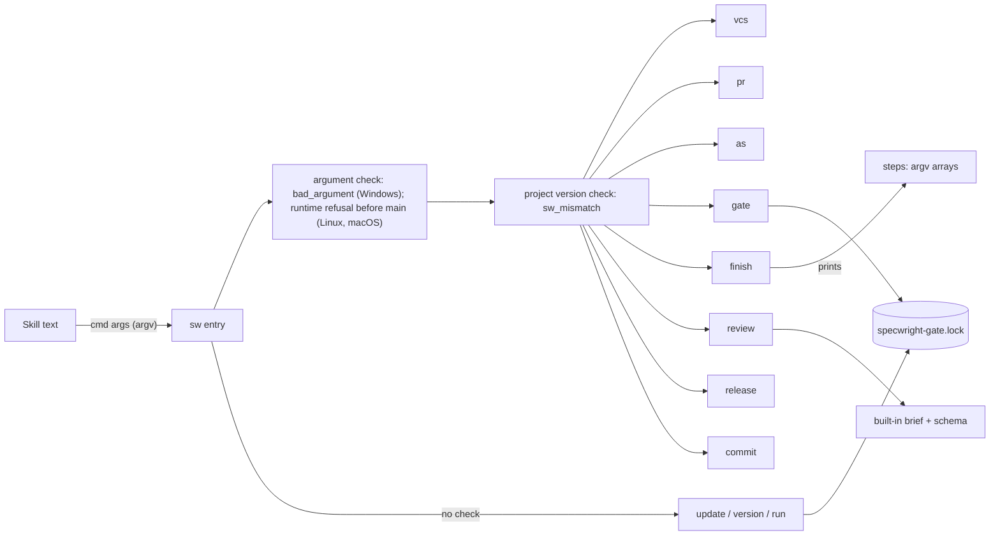
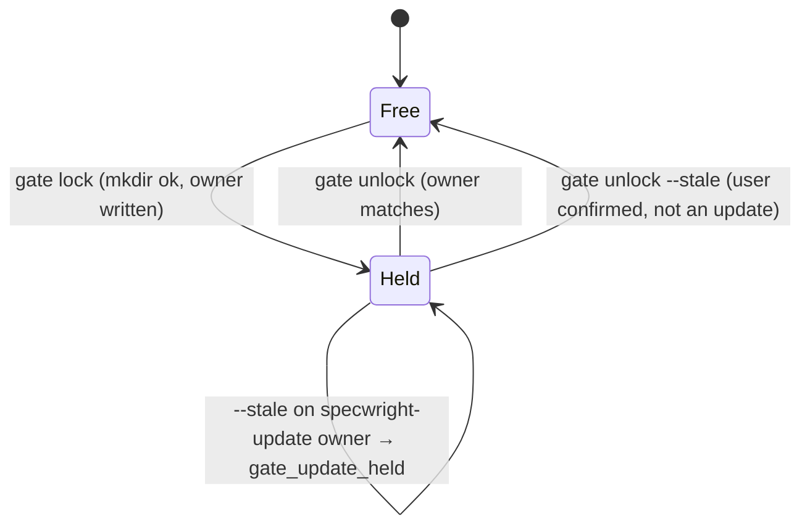

# Design

## Triage

| Trigger | Applies? | Evidence |
|---|---|---|
| T1 Components (new component, or 3+ with directed relationships) | yes | Skills → `sw` entry → version check → command modules; a new `sw gate` command; the eval runner gains its own process helper |
| T2 State (persistent state, caches, 3+ state machine) | yes | The store gate lock (free → held → released/stale) moves into `sw`; the undo plan's backup directory is now written by `sw finish` steps |
| T3 Concurrency (background work, workers/isolates, async, retries) | yes | The gate lock is the cross-session mutual exclusion between a change gate, a roadmap gate and `sw update` |
| T4 Boundaries (data format, migration, shared interface, IPC, external) | yes | The CLI argument contract (handoff removed, interface 1 → 2), the undo plan's output format (`script` → `steps`), and the lock's on-disk form shared with older versions |
| T5 Volume (grows without a fixed bound) | no | No new collection; argument lists and plans are bounded as before |
| T6 Risk (security, money, data loss, unrecoverable user data) | yes | The undo steps restore and back up specs (data loss if a guard is skipped); `GH_REPO` and the fence affect which repository a write hits |

TIER: FULL

## Context

The proposal (proposal.md) states the goal. The current state this design builds on:

- Every shipped script is a shim. `vcs.sh` resolves `sw` through `sw-path.sh` and runs `exec "$sw" vcs --args-stdin`, handing the scripts directory, the bash path and the arguments as NUL records (`skills/specwright-pr/scripts/vcs.sh:36-43`). `as.sh` uses a file instead (`skills/specwright-pr/scripts/as.sh:54`). The other shims do the same (`skills/specwright-pr/scripts/pr-pair.sh:191`, `skills/specwright-release/scripts/release.sh:54`, `skills/specwright-review/scripts/review-run.sh:48`, `skills/specwright-commit/scripts/task-cover.sh:50`).
- Eight shims probe for Python 3.8+ before handing over. Seven stop with `no_python`, exit 2: `skills/specwright-pr/scripts/vcs.sh:9-12`, `skills/specwright-pr/scripts/pr-pair.sh:127-130`, `skills/specwright-pr/scripts/as.sh:12-15`, `skills/specwright-pr/scripts/pr-reply.sh:42-45`, `skills/specwright-pr/scripts/pr-snapshot.sh:76-79`, `skills/specwright-commit/scripts/task-cover.sh:16-19`, `skills/specwright-finish/scripts/finish.sh:58-61`. `skills/specwright-commit/scripts/fit-subject.sh:17-24` instead reports `sw_missing`, exit 1. Each probe's assertions retire with its shim; the refusals behind them are covered by the native evals. `sw-path.sh` runs `bounded.py` for its version probe under a 10-second, 1 MiB bound (`skills/specwright-pr/scripts/sw-path.sh:85-98`).
- CI verifies each built artifact's interface against the `SW_INTERFACE=` line of `sw-path.sh` (`.github/workflows/sw-build.yml:160`, `cli/tool/verify_artifact.py:47-51`).
- `sw-path.sh` derives `<home>/.specwright/bin/<version>/sw[.exe]` from `VERSION`, rejects a non-version value, and accepts the binary only when `sw version --json` reports the same version and `SW_INTERFACE=1` (`skills/specwright-pr/scripts/sw-path.sh:46-75` builds the path, `:26` sets the interface, `:110-120` compares both). `sw` reports `interfaceVersion = 1` (`cli/lib/src/commands/version.dart:12`).
- `sw`'s entry dispatches on the first argument (`cli/lib/src/cli.dart:45-117`). Commands parse the stdin handoff into scripts dir, bash and args (`cli/lib/src/pr/context.dart:53-59`, `cli/lib/src/vcs/args.dart:11-23`).
- The scripts directory is still used for three things. Review reads `brief.md` and `findings.schema.json` from `<scripts>/../references` (`cli/lib/src/review/run.dart:497-498`, `:1161`, `:1528`). Printed commands name scripts: the PR cleanup plan prints `bash <scripts>/as.sh` (`cli/lib/src/pr/workflow.dart:1053-1056`), and the undo plan prints `bash <vcs.sh>` (`cli/lib/src/finish/undo_plan.dart:199-204`, `:891-892`).
- `sw` converts MSYS paths itself because the stdin handoff skips Git Bash's own conversion (`cli/lib/src/commit/paths.dart:16-30`).
- The undo plan is a bash script: `set -euo pipefail`, `test`/`case` guards, backups and restores (`cli/lib/src/finish/undo_plan.dart:891-936`), returned as `script` (`:1230`).
- The gate lock is inline shell in two skills (`skills/specwright-branch/SKILL.md:35`, `:43`; `skills/specwright-roadmap/SKILL.md:33`, `:36`). `sw update` already takes the same lock in process: `gateTake` makes the directory with an exclusive `mkdir` (`cli/lib/src/update/swap.dart:42-48`, called at `:564`), and `gateWriteOwner` then writes the owner file in place with a fourth line, `token:`, that a resumed update uses to recognise its own lock (`cli/lib/src/update/store_gate.dart:115-130`, read back by `gateInspect` at `:93-104`).
- The `pr-pair.sh` shim unsets `GH_REPO` for every subcommand (`skills/specwright-pr/scripts/pr-pair.sh:131`). Native code drops it only in policy reads and release (`cli/lib/src/pr/policy.dart:77`, `cli/lib/src/release/git.dart:115`).
- The eval runner starts each test file through `bounded.py`'s `spawn`/`kill` (`evals/run.py:5-8`). The `evals/vcs` GitButler fixture points `SPECWRIGHT_HOME` at the test home that holds the built `sw` (`evals/vcs/butenv.py:155-160`) and stamps its repo through `stamp_version` (`evals/vcs/vcs_test_support.py:61-83`); where each other fixture family writes its `VERSION` is not yet audited (A4).

## Decisions

### D1: One version check at the entry

- **Choice:** `runCli` runs the project version check once, before dispatching `vcs`, `pr`, `as`, `commit`, `finish`, `review`, `release` and `gate`. It reads the leading `--project`, else the command's own code-checkout argument, else the current directory (proposal S1, spec native-cli "The project is chosen by --project, then the command's own argument"). `pr reviewers` is exempt (D12).
- **Rejected:** a check inside each command module, because seven copies of discovery drift apart, and a module that forgets it runs at the wrong version silently.
- **Reversal cost:** low
- **Important:** no
- **Chosen by:** agent

### D2: A global leading `--project`

- **Choice:** any project command accepts one leading `--project <code checkout>`. It selects only the `VERSION` to check and changes neither the working directory, the targets nor the login.
- **Rejected:** requiring `--code` on every store-started command, because `pr snapshot` and `as` would each need a new argument.
- **Reversal cost:** medium
- **Important:** yes (binds future changes: CLI contract)
- **Chosen by:** user

### D3: Refuse unrepresentable arguments at the entry

- **Choice:** before dispatch, `sw` checks every argument against the raw argument list the OS holds (`GetCommandLineW` on Windows, `/proc/self/cmdline` on Linux, `_NSGetArgv` on macOS) and prints `bad_argument` naming its position, exit 2. On Linux and macOS the Dart runtime refuses non-UTF-8 argv before `main` (task 1.1, A1), so there the refusal is the runtime's: non-zero exit, empty stdout, nothing run; the user accepted that loss (C6). ADR 0034's launch-time refusals stay as a second line.
- **Rejected:** refusing only where each value is used, because that scatters error names and allows partial work before the stop.
- **Reversal cost:** low
- **Important:** yes (binds future changes: CLI contract)
- **Chosen by:** user

### D4: Printed commands start with the running binary's path

- **Choice:** every printed command that runs Specwright's own work starts with `Platform.resolvedExecutable` (already used for the helper, `cli/lib/src/process/bounded_run.dart:95`), followed by `--project <code>` where it works on a project; `git`, `jj` and `openspec` commands stay as the old plans printed them (D7). None names a script or `bash`.
- **Rejected:** a `<sw>` placeholder for the agent to substitute, because a human cannot paste it and the agent can substitute the wrong path.
- **Reversal cost:** low
- **Important:** yes (changes what users see)
- **Chosen by:** user

### D5: Interface 2

- **Choice:** `interfaceVersion` becomes 2, and the main native-cli requirement that pins 1 is modified with it. The interface-2 build gets its own version: the cutover commit, which is the last group's, also bumps `VERSION` from 0.37.0 to 0.38.0 (the release bump task the schema puts in the last group), so no build of 0.37.0 ever reports interface 2 and a `main` install of the cutover never replaces the 0.37.0 binary that projects on `v0.37.0` still pin. An eval places a 0.37.0 binary and the cutover's 0.38.0 binary in one test home and runs each version's skill probe against its own project. The flip lands in the same task group, and the same commit, as the skill, schema, agent and README rewrite (D13 makes the rewritten skills require interface 2), the removal of `sw-path.sh` and the shims the update of `evals/cli/test_sw_interface_pin.py`, and the retarget of the artifact check: `sw-build.yml` passes `--interface-from` a file the skills read their required interface from (the shipped `specwright-pr` skill text's one `interface 2` line), and `verify_artifact.py` fails on a mismatch, as it does today: before it, every shim-driven eval still runs against interface 1; after it, no caller that pins 1 remains. `sw update`'s check of a downloaded binary already compares it against the running `sw`.
- **Rejected:** keeping 1, because an old shim pointed at a new `sw` would then fail with an unknown option instead of a clear mismatch.
- **Reversal cost:** low
- **Important:** yes (binds future changes)
- **Chosen by:** user

### D6: `sw gate` shares `sw update`'s lock code

- **Choice:** `sw gate lock|show|unlock` call the same exclusive-`mkdir` lock and owner-record code that `sw update` uses (`cli/lib/src/update/store_gate.dart`), moved to a shared module. Every lock gets a fresh random `token:` line, the line updates already write, and `sw gate lock` writes its owner file by rename so it is never half-written. `unlock --token` reads the owner and removes the lock only on a matching token; `--stale` takes the token `show` printed to the user, or `--ownerless` for a lock without one, and refuses `specwright-update…` owners with `gate_update_held`. This is parity with the inline lock it replaces, which ran `rm -r` after the user's word with no check at all: the read-then-remove is not atomic, and an ownerless lock can be an update paused between its `mkdir` and its owner write. Closing those windows is tracked as an issue (C7).
- **Rejected:** folding the commands into `sw vcs`, because that mixes planning into the VCS boundary. Also rejected: a second lock implementation, because two writers of one lock format would drift.
- **Reversal cost:** medium
- **Important:** yes (changes what users see; binds the lock's on-disk form). After two review rounds the user chose parity over a race-free protocol (C7).
- **Chosen by:** user

### D7: The undo plan prints argument arrays and runs its guards as `sw finish` steps

- **Choice:** `steps` and `after_rerun_steps` are lists of `{cwd, argv}` objects: `cwd` is the absolute checkout the old script `cd`-ed into, so the plan runs from anywhere, and `argv` starts with the running `sw`, `git`, `jj` or `openspec`. The jj operations the script runs today (`jj new`, `jj restore`, `jj commit`, `jj bookmark set`, `cli/lib/src/finish/undo_plan.dart:1014`, `:1063`) become `jj` steps. Each other shell construct becomes either a `git`/`openspec` array or a small `sw finish undo-step <kind>` primitive: `check` (branch, tip, clean paths, empty index, path absent; the branch check reads the backend's structured branch in process, the jj role and the named GitButler branch included, replacing the substring search of rendered `vcs.sh state` JSON at `cli/lib/src/finish/undo_plan.dart:884`), `mkdir`, `copy`, `move`, `remove`, `rmdir-if-empty` (the script's best-effort `rmdir` of emptied spec directories, `cli/lib/src/finish/undo_plan.dart:1026-1032`, which never fails), `write-blob`, `write-text` and `merge-back` (the after-rerun three-way restore). The script's `bash vcs.sh` calls become `sw vcs` steps: on GitButler the `printf` of the commit message becomes `write-text` and the path-scoped commit becomes `<sw> --project <code> vcs commit --repo <code> --role code --branch <branch> --message-file <file> -- <paths>` (`--repo` is required by `cli/lib/src/vcs/args.dart:166-170`, which throws the usage error when it is empty; `--project` only selects the version) (`cli/lib/src/finish/undo_plan.dart:1040-1058`). The primitives run in the plan's repository and exit non-zero with a message on failure. The planner keeps its decisions; only the rendering changes. Each `sw` step carries `--project <code toplevel>`, so a store-backed plan passes the version check from any directory. The `mv`, `rm -f`, `cp`, `mkdir -p`, `git cat-file --filters >` and `printf >` lines become `undo-step move`, `remove`, `copy`, `mkdir`, `write-blob` and `write-text`. The steps keep the script's order, backups and warnings exactly: `jj new` before the backups, as now (`cli/lib/src/finish/undo_plan.dart:926`, backups from `:955`), and the per-backend recovery text the plan already prints (`:1066`, `:1091`, `:1097`). The user chose parity here after two review rounds; stronger recovery after a mid-plan failure is tracked as an issue (C7).
- **Rejected:** running the whole undo in one `sw finish undo-archive` command, because that turns a plan the user reviews into an action the agent runs, against "A deferred archive's undo is planned by a script that runs nothing". Also rejected: keeping a bash script, which fails the M8 criterion.
- **Reversal cost:** medium
- **Important:** yes (binds future changes: output format; changes what users see)
- **Chosen by:** user (steps); agent (the primitive split)

### D8: `sw as` and `sw pr` keep `GH_REPO` out

- **Choice:** `sw as` removes `GH_REPO` from the fenced command's environment and from its own lookups. `sw pr` removes it for every `gh` call, as the shim did.
- **Rejected:** an opt-in flag, because every skill call would have to remember it.
- **Reversal cost:** low
- **Important:** yes (changes what users see)
- **Chosen by:** user

### D9: References built in from generated source

- **Choice:** the build tool generates a Dart source file holding `brief.md` and `findings.schema.json` as constants. A CI test compares them with `skills/specwright-review/references/`. When a reviewer needs the schema as a file, `sw review` writes it into the run directory.
- **Rejected:** `--define` strings at compile time, because they are size-limited and invisible to the drift test.
- **Reversal cost:** low
- **Important:** no
- **Chosen by:** agent

### D10: The eval runner gets its own process helper

- **Choice:** the job and session `spawn`/`kill` that `evals/run.py` needs move into a module under `evals/`, still Python and contributor-only. Evals that test `bounded.py`'s contract move to `sw run --bounded` (`evals/cli`).
- **Rejected:** starting test files through `sw run --bounded`, because the runner would then depend on the binary under test for its own isolation, and a broken build would hide its own failures.
- **Reversal cost:** low
- **Important:** no
- **Chosen by:** agent

### D11: Skills name `<sw>` once per skill

- **Choice:** each skill defines `<sw>` in one line (the version-pinned path built from the project's `VERSION`) and rewrites `[vcs]` and `[as]` as `<sw> vcs <sub> ...` and `<sw> as <login> ...`. The gate lock steps become `<sw> gate ...`. `gh api` paths are written without a leading slash, because Git Bash converts a leading-slash argument it hands to a Windows executable.
- **Rejected:** a shared include file, because skills are installed independently and an include is one more file to drift.
- **Reversal cost:** low
- **Important:** no
- **Chosen by:** agent

### D14: Differential parity evals compare against recorded oracle runs

- **Choice:** the `evals/pr-pair` parity evals (`test_workflow_parity.py`, the snapshot parity fixture in `evals/pr-pair/snapfix.py:37-45`) stop running the frozen scripts live, because the frozen side copies `bounded.py`, `as.sh`, `sw-path.sh` and `vcs.sh` from the shipped scripts directory and hands over through `--args-stdin`, all of which this change deletes. The commit before the cutover runs each case through the frozen side once on each OS in CI, through the same pre-PR path as the A1 gate: a dispatched `evals.yml` run on a throwaway branch, whose capture job uploads the records as a run artifact per OS; apply downloads them with `gh run download`, checks that each OS's set is complete and that the three agree after normalization, and commits them and stores its exit status, `gh` calls, stderr prefixes, parsed stdout (with a run-generated feedback owner id checked against that run's record, then replaced by a placeholder, as `evals/pr-pair/test_workflow_parity.py:604-617` does today), final fake-gh state and written comment bodies as records under `evals/pr-pair/oracle/records/`, with machine paths normalized. Fixture commits get a pinned author, committer and dates (today they take ambient dates: the `setUp` at `evals/pr-pair/test_parity.py:602-615` builds `git_env` with no `GIT_AUTHOR_DATE` or `GIT_COMMITTER_DATE`; the workflow fixture's `git` helper at `evals/pr-pair/test_workflow_parity.py:37-39` runs with that environment, makes the fixture's base commit at `:142`, and the branch case at `:219-240` makes the commits whose ids it compares), so the commit ids a branch check reports (`lacking[].sha`) repeat in every run and stay compared exactly. From the cutover on, the evals compare `sw pr` with those records.
  The same rule covers every eval that runs a frozen side (eval-runner "Frozen-oracle evals are migrated before the cutover"): the feedback-record interoperability cases (`evals/pr-pair/test_workflow_records.py`) keep both directions: the native reader reads frozen-writer records kept as recorded bytes, and a native-written record is checked for UTF-8 and LF, its generated fields (owner id, write time, checkout, host) are checked for form and against the run, and its other fields are compared with the fixture the frozen reader accepted before removal (pr-script-runtime "Feedback records interoperate across the port on UTF-8 paths"); the finish and GitButler undo parity cases (`evals/finish/test_parity.py`, `evals/vcs/test_gitbutler_parity.py`) become outcome checks that run the printed steps. The cutover's first task lists every eval that names the scripts directory or an oracle (today `evals/finish/{fixtures,test_parity}.py`, `evals/pr-pair/{snapfix,test_bounded,test_parity,test_pr_shims,test_workflow_parity,test_workflow_records,test_workflow_transport}.py`, `evals/review-routes/test_review_run.py`, `evals/vcs/test_gitbutler_parity.py`) with its migration, and a CI check fails on any eval still naming a removed script.
- **Rejected:** keeping test-only copies of the shims and `bounded.py`, because the frozen side's shims call `sw` through the removed handoff and would need an interface-1 binary. Also rejected: dropping the comparison, because the outcome tests do not cover every case the oracle did.
- **Reversal cost:** low
- **Important:** no
- **Chosen by:** agent

### D12: The reviewer evaluator checks no project version

- **Choice:** `sw pr reviewers` joins `version`, `run --bounded` and `update` in doing no project version check. The snapshot starts it as `[Platform.resolvedExecutable, 'pr', 'reviewers', ...]` (`cli/lib/src/pr/snapshot.dart:514-523`) from the store's directory, where no `VERSION` exists; the evaluator reads only the files it is handed and runs no tool, so a version check guards nothing there.
- **Rejected:** passing `--project` to the child, because a store-started child would then depend on the parent's argument reaching it, and the evaluator would fail a check it has no use for.
- **Reversal cost:** low
- **Important:** no
- **Chosen by:** agent

### D13: Skills check VERSION and the interface before running sw

- **Choice:** before building `<sw>`, a skill checks `VERSION` against `x.y.z[-pre][+build]` and stops on anything else, so a planted value never selects an executable outside `bin/`. Before the first other command of a run it runs `<sw> version --json` with a 10-second tool timeout and stops unless it exits 0 in time with one JSON object reporting the project's version and interface 2. The deadline is the one `sw-path.sh` applied, carried by the agent's tool timeout. Its 1 MiB output cap is dropped: the probed binary is the one the install placed after a checksum check, not an arbitrary executable, and the agent's tool already limits what it captures (C8). An older project served by newer user-level skills then stops with "update this project", never with an unknown-option error from an interface-1 binary.
- **Rejected:** relying on the entry check alone, because it runs inside a binary the bad value already chose. Also rejected: keeping old argv syntax for interface-1 binaries, because skills would carry two calling conventions.
- **Reversal cost:** low
- **Important:** yes (changes what users see: older projects must update before newer skills work)
- **Chosen by:** user (S1: pinned path plus self-check)

### Decision summary

| # | Decision | Choice | Rejected | Reversal cost | Important | Chosen by |
|---|---|---|---|---|---|---|
| S1 | How skills find `sw` | Pinned path + self-check | Stable launcher; per-project copy | medium | yes | user |
| S2 | Review reference files | Built into `sw` | `--skill-dir` argument | low | yes | user |
| S3 | Old handoff | Removed, MSYS conversion too | Hidden compat entry | medium | yes | user |
| S4 | Change size | One change | Split in two | low | yes | user |
| S5 | Spec updates | Name map + targeted deltas | Rewrite every mention | low | yes | user |
| S6 | Evals and CI tools | Stay Python | Port the harness | low | no | agent |
| D1 | Where the version check runs | Once at the entry | Per command | low | no | agent |
| D2 | Store-started project selection | Global leading `--project` | `--code` everywhere | medium | yes | user |
| D3 | Bad arguments | Refused at entry: `bad_argument` on Windows; the runtime's refusal on Linux and macOS (C6) | Refused where used | low | yes | user |
| D4 | Printed commands | Running binary's absolute path | `<sw>` placeholder | low | yes | user |
| D5 | Interface | 2 | Keep 1 | low | yes | user |
| D6 | Gate lock | `sw gate`, shared lock code, token check then remove (parity), `--stale` refuses updates | In `sw vcs`; second implementation | medium | yes | user |
| D7 | Undo plan | `{cwd, argv}` steps incl. `jj`, `--project` on `sw` steps, script parity | One undo command; bash script | medium | yes | user |
| D8 | `GH_REPO` | Dropped by `sw as` and `sw pr` | Opt-in flag | low | yes | user |
| D9 | Embedding | Generated source + drift test | `--define` strings | low | no | agent |
| D10 | Eval runner helper | Own module under `evals/` | Run files through `sw run --bounded` | low | no | agent |
| D11 | Skill wording | `<sw>` defined per skill; no leading-slash `gh api` paths | Shared include | low | no | agent |
| D14 | Parity evals | Recorded oracle runs, captured before the cutover | Test-only shim copies; drop the comparison | low | no | agent |
| D12 | Evaluator child | No version check for `pr reviewers` | Pass `--project` to the child | low | no | agent |
| D13 | Skill-side checks | Validate `VERSION`, then require interface 2 | Entry check only | low | yes | user (S1) |

## Assumptions

- **A1 (failed, task 1.1; loss accepted under C6):** the probe run https://github.com/sh1ny/specwright/actions/runs/44410098089 showed that on Linux and macOS the compiled `sw` never reaches `main` with a non-UTF-8 argument: the runtime exits 255 with `Dart_NewStringFromUTF8 expects argument 'str' to be valid UTF-8.` on stderr and nothing on stdout. The user chose to accept the runtime's refusal (non-zero exit, empty stdout, nothing run) in place of the `bad_argument` document, without pinning its exit code or text; every affected requirement was amended together. Original assumption: On Linux and macOS, the Dart VM either hands `main` invalid UTF-8 argument bytes in a form `sw` can detect, or replaces them with U+FFFD. Not checked because it depends on the VM's argv decoding, which the repo does not show. Depends on it: D3 and every requirement that names `bad_argument` (native-cli, change-finish, vcs-backends, github-identity). Resolved by a decision gate in the first task: compiled-binary probes on Linux, Windows and macOS, run before any PR exists by pushing the probe commit to a throwaway branch and dispatching `evals.yml` on it (`workflow_dispatch`, `.github/workflows/evals.yml:5`); apply reads the run's conclusion and job logs with `gh run view` and goes on only when the run is green on all three OSes. The gate passes on an OS only when the compiled `sw` reaches `main` with a malformed argument, tells it apart from a valid argument that holds U+FFFD, and prints the `bad_argument` document with exit 2; silent replacement, or a VM refusal before `main`, fails it. If the result differs from A1 or A2, apply stops before any dependent task, amends every affected requirement together, records the accepted loss in C6, and sends the amended contract back for design review.
- **A2 (holds for the gate, task 1.1):** on Windows the same run passed: `sw` reads the raw command line with `GetCommandLineW` and `CommandLineToArgvW`, tells the lone surrogate apart from a valid U+FFFD, and prints `bad_argument` with exit 2. Original assumption: On Windows, an unpaired surrogate in the command line reaches `main` as a lone surrogate in a Dart `String`. Not checked for the same reason. Depends on it: D3. Resolved by the same first-task decision gate as A1.
- **A3:** Git Bash converts `/c/...` and `/tmp/...` arguments to Windows form when it starts a native `.exe`, so dropping `sw`'s own conversion loses nothing for Git Bash callers. Known MSYS behaviour, not checked in this repo. Depends on it: S3; checked by a Windows eval in the eval task.
- **A4:** Every eval fixture that runs a shim today can give the eval helper a project whose `VERSION` equals the built `sw`'s. The `evals/vcs` GitButler fixture already provides it: `tracked_repo` (`evals/vcs/butenv.py:180-192`, the stamp call at `:191`) stamps the repo through `stamp_version` (`evals/vcs/vcs_test_support.py:61-83`, the exclusion write at `:83`), which writes the tree's `VERSION` and adds it to `info/exclude` so status reads never see it, and the test home holds the built `sw` (`evals/vcs/butenv.py:155-160`). The other fixture families are unchecked. Depends on it: the eval retarget task, which starts with an audit of every fixture family that writes `VERSION` or selects a separate code checkout, and lists the ones the helper must give `--project`.

## Carried constraints

- **C1:** The gate lock's path (`<store common dir>/specwright-gate.lock`) and its `owner` lines (`time:`, `change:`, `code:`, and `token:` as updates already write it) stay byte-compatible, so sessions on older versions and `sw update` keep seeing each other's locks. Kind: invariant. Destination: spec: specs/planning-stores/spec.md → Requirement: The gate lock keeps its on-disk form
- **C2:** `sw` never falls back to an `sw` on `PATH` or another version's binary; the version check is the only resolution. Kind: invariant. Destination: ADR 0040
- **C3:** Skills write `gh api` paths without a leading slash, because Git Bash converts leading-slash arguments for native executables and `sw` no longer undoes that. Kind: invariant. Destination: ADR 0040
- **C4:** The built-in brief and schema must equal `skills/specwright-review/references/`; the drift test guards it. Kind: invariant. Destination: doc comment: cli/lib/src/review/references.g.dart reviewBrief
- **C6:** The first-task probes showed that on Linux and macOS `sw` cannot see a non-UTF-8 argument: the Dart runtime refuses it before `main` (exit 255, empty stdout, its own stderr text). That loss of the `bad_argument` document is accepted and stated, not hidden; Windows keeps it. Kind: invariant. Destination: ADR 0040
- **C7:** `sw gate unlock`'s read-then-remove and an ownerless update lock, and recovery after an undo step fails mid-plan, stay at the parity of the scripts they replace; the user chose this after two design review rounds. Kind: rejected alternative. Destination: issue: harden the store gate unlock and undo-plan recovery (#232)
- **C8:** The skill's version probe keeps the 10-second deadline but drops the 1 MiB output cap that `bounded.py` gave `sw-path.sh`, because the probed binary is checksum-verified at install. Kind: rejected alternative. Destination: ADR 0040
- **C9:** `sw run --bounded` keeps its Windows stdin transport for a caller-requested `bash -c`, which ADR 0034 left to this change; it is never used for `sw`'s own work. Kind: invariant. Destination: spec: specs/native-cli/spec.md → Requirement: sw run --bounded keeps its Windows bash -c transport
- **C5:** The undo primitives exist so a plan stays something the user runs step by step; no command may run a whole undo. Kind: rejected alternative. Destination: doc comment: cli/lib/src/finish/undo_step.dart runUndoStep

<!-- ===== LIGHT tier ends here. Delete everything below for LIGHT. ===== -->

## Diagrams (FULL)

Components after the change:



Gate lock states:



A store-started call:

```mermaid
sequenceDiagram
  participant A as Agent (cwd = store)
  participant S as sw 0.38.0
  A->>S: sw --project <code> pr pair-state ...
  S->>S: check args (bad_argument on Windows; Linux and macOS: refused by the runtime before this point)
  S->>S: read <code>/openspec/.specwright/VERSION == 0.38.0?
  alt mismatch or missing
    S-->>A: {"error":"sw_mismatch"} exit 1
  else match
    S->>S: run pair-state in the store (cwd unchanged, GH_REPO dropped)
    S-->>A: JSON document
  end
```

## State & Ownership (FULL)

| State | Owner (sole writer) | Lifetime | Invalidation / rebuild | Authoritative copy |
|---|---|---|---|---|
| Store gate lock (`specwright-gate.lock` + `owner`) | the shared lock module, called by `sw gate` and `sw update` | one gate or one update swap | `unlock` by its owner; `--stale` after user confirmation | the directory on disk |
| `openspec/.specwright/VERSION` | `sw update` (install/update) | until the next update | rewritten by update | the file; read-only to every other command |
| Built-in brief and schema | the build tool (generated source) | one binary | regenerated each build; drift test fails CI on a mismatch | `skills/specwright-review/references/` |
| Undo backup directory (`<git dir>/...` path the plan names) | the plan's `sw finish undo-step` steps | from undo to after-rerun | the plan's guard refuses an existing one; the user removes it after the rerun | the directory on disk |
| Schema copy in a review run directory | `sw review run` | one review run | removed with the run directory | the built-in constant |

## Failure & Visibility (FULL)

| Component | Fails / dies mid-operation → | Recovery | Retry safe? | Who finds out |
|---|---|---|---|---|
| Entry argument check | refuses before any work | caller fixes the argument | yes | agent (`bad_argument`, exit 2 on Windows; on Linux and macOS a non-zero exit, empty stdout and no work, the exit code and diagnostic text unspecified, C6) |
| Version check | refuses before any work | run the named binary, or rerun install | yes | agent, then user (`sw_mismatch`) |
| Missing binary at the pinned path | the shell cannot start it | skill: stop, rerun the install prompt | yes | agent → user |
| `sw gate lock` | crash after `mkdir`, before the owner rename | `show` reports a lock with no token; the user confirms, then `unlock --stale --ownerless` | yes | agent (`show`), user confirms |
| `sw update` paused between `mkdir` and owner write | lock has no token for a moment | as today: only the user's confirmation removes it, and `show` names it ownerless; C7 | yes | user |
| `sw gate unlock` | crash mid-remove | lock may remain; `show` reports it | yes, idempotent (`removed: false`) | agent |
| `sw gate unlock --stale` | the lock was replaced after the user confirmed | refused, `gate_not_owner`; the new lock stays | yes | agent → user |
| Undo step before the first changing step | a guard or copy exits non-zero | stop; nothing changed yet | yes | user (step message, exit status) |
| Undo step after a changing step | the index, working copy or a ref changed, then a step fails | stop at the step; the plan's `warnings` give the per-backend recovery, as the script's plan did; C7 | no: the guards refuse a second run once the backup exists | user (step, warnings) |
| Skill-side `VERSION` or interface check | malformed `VERSION`, interface 1, a probe past 10 s, or an answer that is not one JSON object | stop before any `sw` command; rerun install, or update the project | yes | agent → user |
| Evaluator child of a store snapshot | a pattern backtracks past the deadline | killed at the poll deadline, as today; no version check in the way (D12) | yes | agent (snapshot error) |
| Embedded references drift | build passes a stale copy | CI drift test fails | n/a | contributor (CI) |
| Eval runner helper | a test file hangs | job/session kill, as today | yes | contributor (CI) |

## Resource Bounds (FULL)

| Queue / buffer / cache / transfer | Bound | At the bound | Timeout | At 10x / 100x |
|---|---|---|---|---|
| Command line | OS limit (32,767 UTF-16 units on Windows) | the shell or OS refuses before `sw` starts | none | unchanged |
| `VERSION` read | the file must be a single version line; reads stop at 4 KiB | longer reads are `sw_mismatch` (not a version) | none (local file) | n/a |
| Undo `steps` list | one step per touched file plus fixed guards; the planner's existing bounds on touched files apply | unchanged from today | none | grows linearly with archived files, as today |
| Built-in references | fixed at build time (a few KiB) | n/a | n/a | n/a |
| `gh` and network calls | unchanged (ADR 0012 deadlines and 32 MiB) | unchanged | unchanged | unchanged |

## Flow & State Gaps (FULL)

- **Partial completion of the undo:** steps run in order and stop at the first failure. The guard steps come first. A failure after the backup step leaves the backup directory, and a rerun refuses at the "path absent" guard, as the script does today.
- **Concurrent gates:** two `sw gate lock` calls race on `mkdir`; exactly one wins and the other gets `gate_locked` with the owner. An older session's `mkdir` lock and a new `sw gate lock` exclude each other, because they use the same directory.
- **Stale lock:** an interrupted session leaves a lock. Nothing removes it automatically; `--stale` needs the user's word (skill text), and it refuses update owners.
- **Stale binary path:** the agent built `<sw>` from `VERSION`, and an update changed `VERSION` mid-session. The next call stops with `sw_mismatch` naming the new path, and the agent rebuilds `<sw>`.
- **Mixed versions during update:** the update runs from the download's `sw`, which does no project version check. The project's `VERSION` changes only at the update's finish, so a gate running alongside is excluded by the lock.

## Mechanism Ledger (FULL)

| Mechanism | Built? | Why (harm nobody catches / expensive later) | Evidence that would change the call |
|---|---|---|---|
| Project version check at entry | yes | without it a stale `<sw>` path silently runs the wrong version's rules against a project | none |
| Argument refusal at entry | yes | a mangled path or login reaches git or gh unnoticed | A1/A2 showing the VM already refuses |
| Compatibility `--args-stdin` entry | no | no shipped caller remains; each binary is versioned | a user report of a script that calls it |
| Fallback to `sw` on `PATH` | no | breaks the exact-version guarantee | none |
| Embedded reference drift test | yes | a stale brief or schema would pass every other test | none |
| Rename-and-verify unlock, ownerless age floor | no | review round 2 showed each adds a new race; the user chose parity (C7) | the hardening issue |
| Automatic stale-lock expiry | no | an expiry could free a lock a live, slow session holds; the user's word is the existing rule | repeated user reports of stuck locks |
| A whole-undo command | no | turns a reviewed plan into an action (C5) | the user asking for a one-shot undo |
| A Python copy of `sw run --bounded` for evals | yes (D10) | the runner must not depend on the binary under test | none |

## Risks / Trade-offs

- [Git Bash converts any leading-slash argument, not only paths, such as `gh api /repos/...` or a value like `/main`] → skill text uses `gh api repos/...` (C3), and a Windows Git Bash eval passes a slash-leading non-path value to confirm what `sw` receives.
- [A1 or A2 fails] → the first task is a decision gate: CI probes on three OSes; on a difference, every `bad_argument` requirement is amended together, C6 records the loss in ADR 0040, and the contract goes back to design review before dependent tasks.
- [Older projects share user-level skills with a newer install] → D13: the skill stops with "update this project" before any direct-argument call; a two-project eval with one shared skill directory checks it.
- [Large PR: about 150 skill references, 96 eval files, script deletions] → task order: new `sw` features first (interface still 1), then evals retargeted through one helper while the shims still exist, the parity oracle records captured on three OSes (D14), then the last group, the cutover, whose single commit bumps `VERSION` to 0.38.0 with `<sw> release bump --to 0.38.0` (the release task the schema requires in the last group, checked with `<sw> release check`), rewrites the skills, schema, agents and README to call `sw` directly, flips the interface to 2, deletes `sw-path.sh` and the shims, retargets the artifact check, and updates the interface pin eval, and adds the absence evals, with a cutover check that runs the skills' version probe against the binary built from that commit, so no commit has interface-2 skills over an interface-1 binary and no second bump is needed. The rewritten release skill and schema instructions name `<sw> release bump`, `check` and `notes`.
- [Users with hand-written scripts calling `vcs.sh`] → release notes mark the removal as breaking, and the name map in the spec says what to call instead.
- [Undo primitives grow into a scripting language] → only the six kinds the current script needs; a new kind needs a design change (C5).

## ADRs

- **In force, constraining this change:** 0008 (fenced identity), 0012 (bounds), 0014 (process trees), 0022/0030 (reviewer evaluator stays separately killable), 0027 (one binary, exact version), 0028 (shims, superseded here), 0029 (as.sh handoff file, superseded here), 0031 (direct native calls, `--project`), 0033 (focused packages), 0034 (launcher without a shell; its MSYS clause is superseded), 0039 (install runs in `sw`).
- **To record during apply:** ADR 0040, "Skills call the project's sw directly". It supersedes 0028 and 0029, and replaces 0034's MSYS-conversion clause. It covers the direct argument entry and its UTF-8 refusals, the kept Windows `bash -c` transport for caller-requested shells (C9, closing ADR 0034's deferral), the probe's dropped output cap (C8), version-pinned resolution with the entry check and no fallback (C2), the global `--project`, interface 2, the leading-slash rule for Git Bash callers (C3), and A1's result. The same task updates `openspec/architecture.md`: the index, the component rows for the removed scripts, Script I/O, and the prerequisites.

## Open Questions

- Settled in apply (task 3.2): the `sw gate` field names beyond those the planning-stores delta fixes (`held`, `owner`, `removed`). `lock` prints `{ok, lock, token, owner}`; `show` prints `{ok, lock, held, owner}`, with `owner` only when held; `unlock` prints `{ok, lock, removed}`. The refusals `gate_locked`, `gate_not_owner` and `gate_update_held` print `{ok: false, error, message, owner}`, and `gate_update_held` adds `code`. `owner` is always `{time, change, code, token}`, with an empty string for a missing line; `lock` is the lock path with forward slashes.
