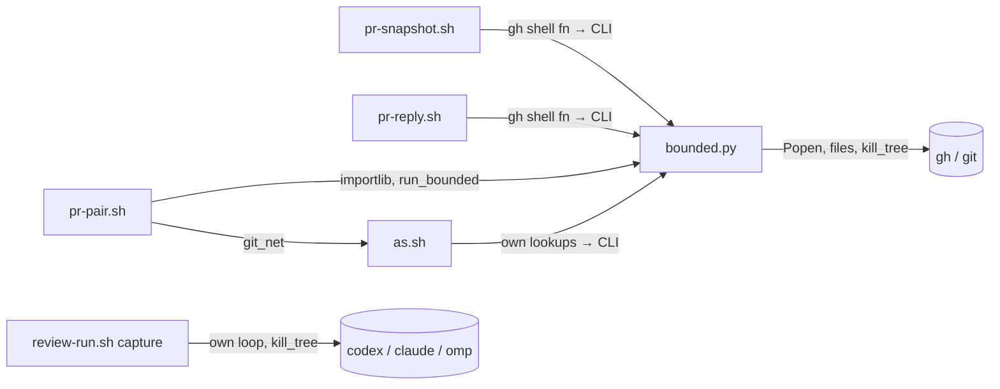
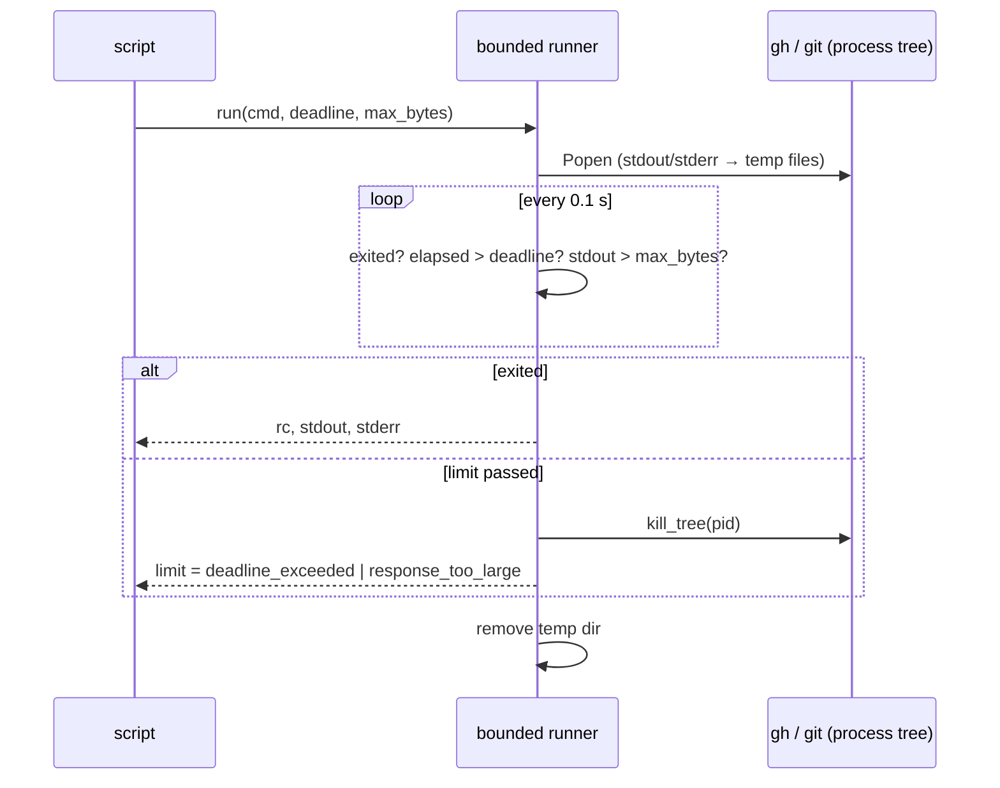
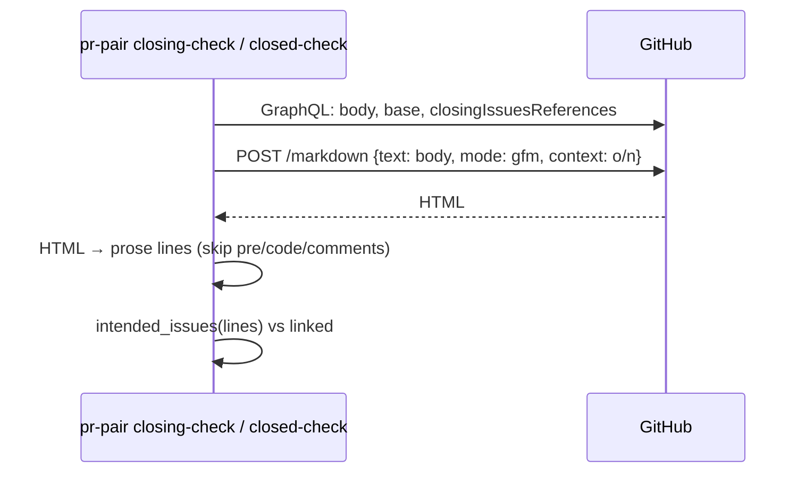
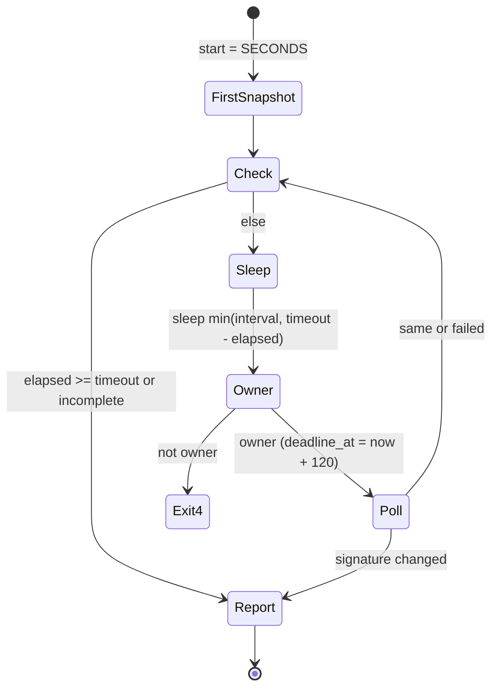

# Design

## Triage

| Trigger | Applies? | Evidence |
|---|---|---|
| T1 Components (new component, or 3+ with directed relationships) | yes | A new shared runner (`bounded.py`) is used by four scripts: `pr-pair.sh`, `pr-snapshot.sh`, `pr-reply.sh` and `as.sh`. |
| T2 State (persistent state, caches, 3+ state machine) | no | No persistent state is added. The watch's ownership claim (`pr-snapshot.sh` `claim_watch`) is unchanged, and temp dirs live only for one command. |
| T3 Concurrency (background work, workers/isolates, async, retries) | yes | Child processes run under timers and are killed by process tree. The watch loop timing changes. The review runner polls while its child runs. |
| T4 Boundaries (data format, migration, shared interface, IPC, external) | yes | New external call `POST /markdown`. New `pr-pair.sh item-issues` JSON output. New named error codes in the scripts' JSON/stderr contracts. |
| T5 Volume (grows without a fixed bound) | yes | Paged lists, the reaction cursor loop, the issue scan, and reviewer stdout/stderr are unbounded today (proposal.md). |
| T6 Risk (security, money, data loss, unrecoverable user data) | yes | Killing a write mid-flight (`gh pr create`, the merge PUT, a reply post) leaves GitHub state unknown. A wrong closing-reference read can close the wrong issue at cleanup (the user is asked first). |

TIER: FULL

## Context

The proposal (proposal.md) lists the problems. Current code:

- **`pr-pair.sh`** is bash wrapping embedded Python (`exec "$py" -I -X utf8 -`, `skills/specwright-pr/scripts/pr-pair.sh:80`). Its process helpers have no deadline:
  - `run` (`:130-134`) is `subprocess.run(..., capture_output=True)`;
  - `gh` (`:205-217`) runs `bash -c 'exec gh "$@"'`, so a shim or fake `gh` resolves as it does for the caller;
  - `git_net` (`:181-199`) runs `as.sh <login> git ...` for other GitHub repos;
  - `token_for` (`:230-245`) and `ambient_login` (`:643-650`) each make their own `gh` calls.
- **Paged reads.** `gh_list` (`:612-627`) buffers all `--paginate` output and then decodes it. The reaction loop in `has_reaction` (`:1737-1752`) is `while True` with no page cap. A failed read is `unknown()` → `lookup_failed`, exit 3 (`:597`).
- **`pr-snapshot.sh`** watch loop (`:468-481`): `waited` grows by `interval` per loop, so poll time is never counted. Its `gh` calls (`prepare_cfg` `:408-437`, `snapshot` `:447-465`) use gh's `--jq` and no Python. `evals/pr-pair/test_pr_snapshot.py:365` relies on "timeout counts polls".
- **`pr-reply.sh`** `gh` calls are at `:76-181`. A trap removes its temp file (`:130`).
- **`as.sh`** makes `gh auth token --help`, `gh auth token --user` and `gh api user` calls (`:69-86`), then `exec "$@"` (`:181`). Every refusal exits 3.
- **Process-tree deadline today.** Only one exists in the skills: `review-run.sh` `capture`/`kill_tree` (`skills/specwright-review/scripts/review-run.sh:308-363`). It writes output to files ("a killed process tree cannot leave a pipe open") and uses `taskkill /T /F` on Windows and `killpg` on POSIX. Its size checks run after exit only (`:352-361`). `cmd_run` maps results to `timeout`, `failed` or `invalid` (`:1008-1074`), and writes `--out` and the pre-ship record only on success.
- **Closing references.** `without_code` (`pr-pair.sh:887-972`) and its helpers (`:800-884`) approximate CommonMark. `intended_issues` (`:988-1018`) applies the keyword rules to its lines. The callers are `cmd_closing_check` (`:1021`), with one GraphQL read, and `cmd_closed_check` (`:1084`).
- **The `after_limit: issues` scan.** It is in skill text, `skills/specwright-pr/SKILL.md:119-123`: one `gh api --paginate` over every issue for each finding.
- **Fakes.** `evals/fakes/gh.py` has failure injection (`"fail"`) but no delay, no flood and no `/markdown`. `evals/fakes/reviewcli.py` has `FAKE_<CLI>_DELAY` and `_PID_FILE`.

## Decisions

### D1: One shared bounded runner, file-backed, in Python

- **Choice:** `skills/specwright-pr/scripts/bounded.py` (stdlib only) runs one command.
  - **Process and output.** It starts the command with `Popen`, sending stdout and stderr to files in a fresh temp dir; the child is its own session on POSIX. It polls every 0.1 s. It stops the process tree when the deadline passes or stdout passes the byte bound, using `review-run.sh`'s `kill_tree` logic: taskkill `/T /F` by PID on Windows, `killpg` on POSIX, never by name. The temp dir is removed in `finally`.
  - **Importable function.** `run_bounded(cmd, deadline, max_bytes, env, cwd) -> Result(rc, stdout, stderr, limit)`, where `limit` is `None`, `"deadline_exceeded"` or `"response_too_large"`. `pr-pair.sh` loads it by path from `PR_PAIR_DIR` with `importlib.util.spec_from_file_location`, because `-I` drops the script dir from `sys.path`.
  - **CLI.** `python bounded.py [--paged] [--secret] -- cmd...`, used by the bash scripts. It copies the command's stdout and stderr through after the command ends and exits with its rc. On a limit it prints `bounded: <limit>: <cmd[0]> <cmd[1]>` on stderr and exits 124 (deadline) or 125 (too large).
  - **Secret mode.** A credential lookup (`gh auth token`) must never reach a file. With `secret=True` (CLI `--secret`), the runner captures through pipes with `communicate(timeout=deadline)`.
    - On the deadline it calls `kill_tree`, then `communicate(timeout=5)` once more to collect what the killed tree left. If a process that survived the kill still holds a pipe open, it closes its own ends of the pipes, stops waiting and reports `deadline_exceeded`. A token lookup never waits past its deadline plus 5 s.
    - The byte bound is checked on the result, which is at most a token. Nothing is written to disk.
    - Only commands that print a token use this mode:
      - `gh auth token` in `token_for` (`pr-pair.sh:235`);
      - `gh auth token` in as.sh's fenced path (`as.sh:82`) and in its `--resolve` path (`as.sh:79`). The latter currently discards the token to `/dev/null`; through the runner it would otherwise reach a file.

      `gh auth token --help` (`as.sh:69`), `gh api user` (`as.sh:78`, `:86`, `pr-pair.sh:238`) and `ambient_login` print no token, so they use the file-backed mode.
  - **How the bash scripts call it.** `pr-snapshot.sh`, `pr-reply.sh` and `as.sh` share one header block, copied from `pr-pair.sh:66-78`:
    - find Python 3.8+ (`python3`, else `python`);
    - set `SW_DIR` to the script's own directory (`cygpath -m` when present) and `SW_BASH` to `$BASH` (`cygpath -w` when present);
    - define `gh() { "$py" -I "$SW_DIR/bounded.py" ${SW_PAGED:+--paged} -- "$SW_BASH" -c 'exec gh "$@"' gh "$@"; }`.

    The `bash -c 'exec gh "$@"'` wrapper lets native Windows Python start a `#!/bin/sh` `gh` shim or the eval fake, as `pr-pair.sh`'s `gh()` does (`:207`). `bounded.py` sits next to the scripts in `skills/specwright-pr/scripts/`.
- **Rejected:**
  - coreutils `timeout` in the bash scripts. It is missing on stock macOS, has no output bound, and on Windows does not reliably stop a native `gh.exe` started through an MSYS shim.
  - A bash background-and-kill loop. It has the same tree-kill problem, a second copy of the logic per script, and no byte bound.
  - Bounding inside each script separately. That would make four copies of kill-tree code.
- **Reversal cost:** low. It sits behind one function and one CLI.

### D2: Fixed bounds, with environment overrides for tests

- **Choice:** the defaults live in `bounded.py` only:
  - 120 s per command;
  - 300 s for a paginated read (`--paged`, or `paged=True` from `gh_list` and any `--paginate` call);
  - 32 MiB of stdout per command;
  - 50 pages in a cursor loop a script drives itself (`has_reaction`).

  Evals lower them through `SPECWRIGHT_NET_DEADLINE`, `SPECWRIGHT_NET_PAGED_DEADLINE` and `SPECWRIGHT_NET_MAX_BYTES`, which are named only in `bounded.py`'s header. `SPECWRIGHT_NET_DEADLINE_AT` (epoch seconds) caps each deadline to the time left; the watch uses it for its per-poll deadline (D5).
- **Rejected:** `pr.command_timeout` and `pr.max_response` keys in `specwright.yaml`. These are new configuration surface, so the release would be a minor version, not the planned 0.7.2. Every script would also have to read config before its first call, and `as.sh` reads none. Nobody has asked to tune them.
- **Reversal cost:** low. A config key can be added later and read into the same variables.

### D3: A limit is a named stop, not a lookup failure

- **Choice:** in `pr-pair.sh`, `gh()`, `git_net()`, `token_for()` and `ambient_login()` raise `Stop(<limit>, "GitHub state unknown: <limit>: <command>", code=3, unknown=True)` when the runner reports a limit. The error is `deadline_exceeded` or `response_too_large`, not `lookup_failed`, so the cause is visible.
  - `cmd_merge` opts out with `limit_ok=True` on its PUT, so the existing read-back (`:2096-2107`) decides: the merge may have landed.
  - `has_reaction` raises `response_too_large` after 50 pages.
  - Local `git()` calls are not network calls and stay unbounded.

  In the bash scripts, a `gh` shell function routes every call through `bounded.py`:
  - `pr-snapshot.sh` and `pr-reply.sh` keep their existing failure exits. A failed poll still sets `ok=0`, and `pr-reply.sh` still removes its temp file through the trap. The runner's stderr line names the limit.
  - `as.sh` maps exit 124 or 125 to `as.sh: deadline_exceeded|response_too_large: <command>` and exits 3, as for its other refusals. Its five lookups now discard their exit status:
    - `$(gh auth token --help 2>&1 || true)` (`:69`);
    - in `--resolve`: `|| login=` (`:78`) and the `gh auth token ... ||` test (`:79`);
    - `|| token=` (`:82`);
    - `|| actual=` (`:86`).

    Each is restructured to capture the status first and check it for 124 or 125 before its existing message. A limit is then never reported as "upgrade gh", "no active gh account" or "no gh credential".

  Without Python 3.8+, `pr-snapshot.sh` and `pr-reply.sh` exit 2 with `no_python`, as `pr-pair.sh` does (`:66-69`), and `as.sh` exits 2. Python is already a stated, install-checked prerequisite of the PR scripts.
- **Rejected:** a limit returned as an ordinary failed rc, mapped by callers to `lookup_failed`. The cause would be lost, and the spec requires the name.
- **Reversal cost:** low.

### D4: Existing PR-item issues in one `item-issues` read

- **Choice:** `pr-pair.sh item-issues --repo o/n --item <id> [--item <id>...]` makes one paginated, bounded read.
  - The read is `gh api --paginate "repos/o/n/issues?state=all&per_page=100" --jq '.[] | select(.pull_request == null and ((.body // "") | contains("specwright:pr-item "))) | {number, body}'`. gh's `--jq` keeps the output to marked issues only, so the 32 MiB bound applies to marked issues, not to every body.
  - Python matches each id against a whole marker line, `specwright:pr-item <id>`, and takes the lowest number when several issues match.
  - Output: `{"ok":true,"found":{"<id>":N},"missing":["<id>"]}`.
  - A failure or limit exits 3 and names the error.

  The `SKILL.md` step calls it once per repository per pass, before filing: once for a repo-local pass, and at most twice for a store-backed one. Each call passes only the items from that repository's PR and runs as that repository's login: `[as]` with the run login for the code repository, and with the store login in the store's checkout, as the step's existing reads do. On exit 3 the pass files nothing and reports the lookup as not done, with the error name.
- **Rejected:** the search API (`"specwright:pr-item <id>" in:body`). Its index lags, so an issue filed earlier in the pass would not be found and a duplicate would follow. The current text rules out search for that reason.
- **Reversal cost:** low.

### D5: The watch measures elapsed time, with one deadline per poll

- **Choice:** `pr-snapshot.sh --wait` takes `start=$SECONDS` before the first snapshot.
  - Each loop: `elapsed=$((SECONDS-start))`; stop when `elapsed >= timeout`; `sleep` for `min(interval, timeout-elapsed)`; check ownership; then poll.
  - Each poll, the first snapshot included, runs with `SPECWRIGHT_NET_DEADLINE_AT=$(( $(date +%s) + 120 ))` exported, so all of its `gh` calls together finish within 120 s. The variable is unset right after the poll, so `--logs` and anything else after the loop get the normal per-command deadline.
  - Ownership is checked before each poll and again before the timeout is reported, so a watcher taken over during a hung poll exits 4, not 1.
  - A failed first snapshot is a failed poll. Today `prepare_cfg; base=$(snapshot)` (`pr-snapshot.sh:470`) leaves `ok=1` and an empty `base`. Now the first snapshot sets `ok=0` when it fails, keeps no base signature, and goes on polling. A later good poll becomes the base, `ok=1`, and the loop waits for a change from there. When the timeout passes with `ok=0`, the watcher exits 1 ("the last poll failed"), as for a failed loop poll. It never prints an empty snapshot with exit 0.
  - `"waited"` in the output becomes the elapsed seconds.
  - The tests that relied on counted polls use `--timeout 3 --interval 1`. The timing checks allow 10 s for process start and kill (specs/pr-watch).
- **Rejected:** a watchdog subprocess that kills the poll at `timeout`. That is a second concurrent actor in the loop, and the ownership check would have to cope with being killed mid-claim. Per-command deadlines already bound every poll.
- **Reversal cost:** low.

### D6: Reviewer output is checked while it runs

- **Choice:** `review-run.sh` `capture` replaces `p.wait(timeout)` with a 0.25 s loop:
  - it checks the elapsed time against `timeout`;
  - it checks the stdout and stderr file sizes, and the size of an optional `watch` file (codex's `-o` last-message path), against the bounds `cmd_run` passes in;
  - over a bound, it calls `kill_tree` and returns `Captured(over="stdout"|"stderr"|"answer")`.

  `cmd_run` maps `over` to `stop("invalid", "invalid_output", f"output too large: {stream}")` before any other result check, so nothing is written. The bounds:
  - stdout: 2 MiB on claude, 64 MiB on codex and OMP;
  - stderr: 8 MiB;
  - codex answer file: 2 MiB, the existing `MAX_OUTPUT`;
  - probes: 1 MiB per stream.

  `review-run.sh` keeps its own `kill_tree`, because the review skill is installed separately from `specwright-pr`.
- **Rejected:** importing `bounded.py` from the review skill. That would create a cross-skill dependency between independently installed folders.
- **Reversal cost:** low.

### D7: Closing references from GitHub's rendering

- **Choice:** `closing-check` and `closed-check` render the PR body after reading it:
  - The call is `gh api -X POST markdown --input <tmp.json>`, where the file holds `{"text": body, "mode": "gfm", "context": "<o/n>"}`. The body goes in a file because Windows caps command lines at 32K characters and a PR body can be 64K. The call runs as the PR repository's login (`repo=`).
  - An `html.parser.HTMLParser` subclass turns the HTML into lines:
    - text inside `<pre>` and `<code>` is dropped and replaced by one space, as `strip_code_spans` does today (`:820-837`), so the text on either side never joins into a keyword (``Fi`x`xes #52`` stays two words);
    - comments are dropped;
    - block elements end a line, at both their start and their end: `p`, `pre`, `ul`, `ol`, `li`, `h1`–`h6`, `blockquote`, `div`, `table`, `tr`, `td`, `th`, `dl`, `dt`, `dd`, `details`, `summary`, `hr`, `br`;
    - a newline in text data ends a line, so a soft line break never joins two source lines into one closing list;
    - entities are decoded;
    - link text is kept as shown. GitHub shows an issue URL as `#N` or `owner/repo#N`, which the existing `ISSUE_REF` reads, and a same-repo `#N` already resolves to the PR's repository through `issue_key`.
  - `intended_issues` takes these lines in place of `without_code(body)`. `without_code`, `strip_code_spans`, `backtick_span`, `inline_comments`, `indent_columns`, `container_content`, `quote_content` and `LIST_CODE` are removed.
  - A failed or limited render is `unknown`, exit 3.
  - The temp file is removed on every exit.
- **Rejected:** extending the hand parser with per-list content columns (#64's open case). Each review round on #62 found another construct it missed, and only GitHub's renderer is exactly GitHub's renderer.
- **Reversal cost:** medium. The removed parser would have to be restored from history. Evidence that would reverse it: the `/markdown` API dropping `context` or charging for it.

### D8: Eval renderings are recorded from the real API

- **Choice:** a recorder, `evals/pr-pair/record_markdown.py`, renders every PR body the closing tests use through the real `POST /markdown` with `mode: gfm` and `context: sh1ny/specwright`, run through `as.sh KintsugiBot`. No test repository (`acme/code`, `acme/plans`) exists on GitHub. It stores them in `evals/pr-pair/fixtures/markdown.json`, keyed by the SHA-256 of `mode` + `text` only, with the context it was recorded under kept beside each entry. The fake `gh` serves `POST markdown` by the same key and ignores the request's `context`.
  - Ignoring the context is sound for this parser. The context only changes link targets and link text for references. A same-repository `#N` shows as `#N` either way. A cross-repository reference or issue URL shows as `owner/repo#N` or as the URL, and `ISSUE_REF` reads both to the same issue. The parser reads text only, never `href`.
  - The scenarios' repositories (`acme/widget`, `other/tool`) do not exist, so GitHub leaves their URLs and references as text, which is what the tests check. A body with no recording makes the fake exit 1 with `no recorded rendering`, so a new test cannot pass on a made-up rendering. A test checks that every body the closing tests use has a recording.
- **Rejected:** a fake renderer in `gh.py` (a CommonMark approximation again), or the real API in every eval run (network, account and rate-limit dependence in CI).
- **Reversal cost:** low.

## Diagrams (FULL)

T1 components:

T3: a bounded command:

T4: the closing check:

T3: the watch loop:

## State & Ownership (FULL)

| State | Owner (sole writer) | Lifetime | Invalidation / rebuild | Authoritative copy |
|---|---|---|---|---|
| Runner temp dir (stdout/stderr files) | the `run_bounded` call that made it | one command | removed in `finally`; on a kill, removed after `kill_tree`. A runner itself killed by SIGKILL leaves it in the temp dir (non-secret output only) | none; a scratch copy of the child's output |
| A fenced login's token (in memory) | `token_for` / as.sh's lookup, captured in secret mode (D1) | the process; `TOKENS` cache in `pr-pair.sh`, `GH_TOKEN` in as.sh's exec'd env | never written to disk; gone with the process | the gh keyring |
| `/markdown` request file | `cmd_closing_check` / `cmd_closed_check` | one render call | removed in `finally` (temp-file requirement) | the PR body on GitHub |
| `SPECWRIGHT_NET_DEADLINE_AT` | the `pr-snapshot.sh` poll that exports it | one poll | unset right after the poll | the watcher's own clock |
| Review capture files | `capture` | one reviewer run | removed in `finally` (unchanged) | none |
| Recorded renderings `markdown.json` | `record_markdown.py` (a human-run tool) | in the repo | re-recorded when a test body changes | GitHub's API at recording time |

## Failure & Visibility (FULL)

| Component | Fails / dies mid-operation → | Recovery | Retry safe? | Who finds out |
|---|---|---|---|---|
| bounded runner, read command | tree killed at the limit; the script stops with `deadline_exceeded` or `response_too_large`, exit 3 (pr-pair), or the script's failure exit | the caller reruns later | yes (read) | the agent: a JSON error or stderr line naming the limit and command |
| bounded runner, `gh pr create` | stopped; GitHub may hold the new PR | `ensure-pr` discovers before it creates (`:770-781`), so a rerun finds it | yes | the agent: `deadline_exceeded`, state unknown |
| bounded runner, merge PUT | stopped; the merge may have landed | `limit_ok` lets the read-back decide, else `lookup_failed`/unknown (D3) | yes, after the read-back | the agent: `merged`, or unknown |
| bounded runner, reply post or resolve (`pr-reply.sh`) | stopped; the reply may have posted | the feedback rules re-snapshot before any retry: a posted reply shows with its marker, so it is not posted again | only after a fresh snapshot | the agent: stderr names the limit; non-zero exit |
| as.sh lookup | exit 3 naming the limit; the fenced command never runs | rerun | yes | the agent; `[as]` callers report it as a refusal with the message |
| bounded runner killed itself (the parent died) | the child may outlive it (POSIX: its own session) | none needed: a child `gh` ends on its own; a hung one is a leaked process | n/a | nobody: accepted, see Risks |
| `/markdown` render | exit 3, unknown | rerun | yes | the agent: ship reports the check not done; cleanup closes nothing |
| `item-issues` | exit 3; the pass files nothing | the next pass looks up again | yes | the agent: lookup reported not done, with the error name |
| review capture over a bound | tree killed; `invalid`, `output too large: <stream>`; nothing written | rerun the review | yes | the agent and user: the review step stops (fail-closed, ADR 0007) |

## Resource Bounds (FULL)

D2 and D6 own the numbers; this table applies them.

| Queue / buffer / cache / transfer | Bound | At the bound | Timeout | At 10x / 100x |
|---|---|---|---|---|
| stdout of one network command | 32 MiB | kill, `response_too_large` | 120 s (300 s paged) | discover/list pages are ~100 items × ~5 KB, so 10x is fine. At 100x a list hits the bound and is a named stop, not an OOM |
| `has_reaction` cursor loop | 50 pages (5,000 reactions) | `response_too_large` | 120 s per page | as above |
| `item-issues` output | 32 MiB of marked issues only (gh `--jq` filter) | exit 3, lookup not done | 300 s | 1k issues ≈ 10 pages, about 5 s. 100k issues ≈ 1,000 pages, which can pass 300 s: a named stop and the pass files nothing |
| gh's own memory per call | one page (`per_page=100`, `first:100`) | gh's own limit | — | unchanged by this change |
| watch poll, the first snapshot included | 120 s for all its commands | the poll fails (`ok=0`) | 120 s | unchanged |
| reviewer stdout | 2 MiB claude, 64 MiB codex/OMP | kill, `invalid` | `review.timeout` | an OMP event stream for a 20-minute review is single-digit MiB (the 3 MiB scenario), so 64 MiB leaves 10x |
| reviewer stderr | 8 MiB | kill, `invalid` | `review.timeout` | as above |
| `/markdown` request | PR body ≤ 65,536 characters (GitHub's own cap) | — | 120 s | n/a |

## Flow & State Gaps (FULL)

- **Partial write.** A limited write is reported as state unknown (D3, Failure table). No write is retried inside a script.
- **The watch's last poll fails and the timeout passes.** It exits 1, "last poll failed", as now. The last good snapshot is not printed, as now.
- **Clock jumps.** `$SECONDS` and `time.monotonic()` (runner) are monotonic within a process. `SPECWRIGHT_NET_DEADLINE_AT` uses wall-clock epoch time. A backward jump during a poll lengthens that poll's deadline only up to the per-command 120 s, and a forward jump shortens it, which makes the poll fail early (`ok=0`). Both are accepted.
- **The deadline lands at the moment the command exits.** The runner checks exit before deadline in each tick, so a finished command is never reported as a limit.
- **Concurrent watchers.** Ownership logic is unchanged. A hung poll now ends within 120 s, so an older watcher exits 4 within one poll deadline of a takeover.
- **A rendering differs from what GitHub uses for closing.** GitHub decides closing references from the body, not the rendered HTML. The rendering is the closest observable. A mismatch in either direction is shown at ship (`missing`/`extra`), and cleanup always asks before closing.

## Mechanism Ledger (FULL)

| Mechanism | Built? | Why (harm nobody catches / expensive later) | Evidence that would change the call |
|---|---|---|---|
| Per-command deadline + byte bound | yes | A hung `gh` blocks watch and pass flows with no report: #40 and the exit criterion | — |
| Per-poll deadline in watch | yes | Without it, several slow-but-answering calls stretch a poll to 5 × 120 s, and the spec's report bound fails | — |
| Streaming/incremental page processing | no | The cap gives a bounded, named stop. Streaming adds a JSON-stream parser for no observed need: lists stay well under 32 MiB at 10x | a real repo hitting `response_too_large` on a list it must read whole |
| Retry on deadline | no | A retry hides a hang and doubles the wait. Callers already rerun on exit 3 | repeated transient deadlines in real use |
| Config keys for the bounds | no | D2 | a user who needs a longer deadline (slow proxy) |
| Leaked-child reaper when the runner itself is killed | no | Only a hung `gh` would leak, and it holds no lock or claim. The harness kills the runner only on its own tool timeout | reports of stray `gh` processes |
| Re-checking a reply post after a deadline inside `pr-reply.sh` | no | The feedback rules already re-snapshot before acting on an item | a duplicate reply seen in practice |
| Fallback to the hand parser when `/markdown` fails | no | Unknown is the safe answer (ship: not done; cleanup: closes nothing). A fallback would bring back the wrong answers #64 removes | — |

## Risks / Trade-offs

- **[Risk]** `taskkill /T` may not reach a native `gh.exe` started through MSYS `bash -c exec`. → Mitigation: the evals assert by PID file that the fake `gh`'s process (a Python child of `sh`) is gone after the deadline, on the Windows CI runner and locally. The runner kills by PID only (never-kill-by-pattern).
- **[Risk]** Each bounded `gh` adds a Python start, about 50–150 ms on Windows, in `as.sh`, `pr-snapshot.sh` and `pr-reply.sh`. → Accepted. `as.sh` makes 3 calls, so it is under 0.5 s.
- **[Risk]** The `/markdown` rendering may differ in small ways from what GitHub's closing logic reads (D7's last flow gap). → Mitigation: ship already shows `missing`/`extra` against GitHub's own `closingIssuesReferences`, and cleanup asks before closing.
- **[Risk]** The recorded renderings drift as GitHub's renderer changes. → Mitigation: the recorder is rerun when bodies change. The tests pin behaviour against a recording, and live drift shows at ship as `missing`/`extra`.
- **[Trade-off]** The bash scripts gain a Python dependency (`pr-snapshot.sh`'s header said "needs only gh"). → Python 3.8+ is already a checked prerequisite of the PR scripts.

## ADRs

- **In force, constraining this change:**
  - 0002: thin bash + git + gh + python3 scripts. The runner is one more such script.
  - 0007: reviewer routes fail closed. An output bound is a failed review, with no fallthrough.
  - 0008: every `gh` call is fenced. The runner sits inside the fence: `pr-pair.sh` passes the same env, `GH_TOKEN` included, and `as.sh` bounds only its own lookups before `exec`.
  - 0003: no workflow state is added.
- **To record during apply:** **ADR 0012, "PR scripts and reviewer runs are bounded"**. Every network command run by the PR scripts (`pr-pair.sh`, `pr-snapshot.sh`, `pr-reply.sh`, `as.sh`'s own lookups), and every reviewer run by `review-run.sh`, has a deadline and an output bound. It kills its process tree at either and reports the limit by name, never as a generic failure. A write cut off this way is reported as GitHub state unknown and decided by a read-back. New PR scripts follow it.
  - **Known exceptions:** `release.sh` (`ls-remote`, `--paginate`, `gh release create`, `push`), `finish.sh` and `update.sh` stay unbounded. They are listed in the ADR, and an issue is filed for them during apply.
  - **Architecture updates in the same task:**
    - the index row;
    - the "Network commands" and "Review run" Resource-bounds rows (`openspec/architecture.md:145`, `:148`);
    - the #40 Known-gaps row (`:169`), narrowed to the exceptions issue;
    - the Script I/O contract (`:131`): Python 3.8+ for all four PR scripts, `item-issues`' output, and the `deadline_exceeded`/`response_too_large` errors.

## Open Questions

- Does GitHub's `POST /markdown` in `gfm` mode turn soft line breaks into ` ` or keep `\n`? The parser treats both as line ends, so the recording settles it without changing the approach.
