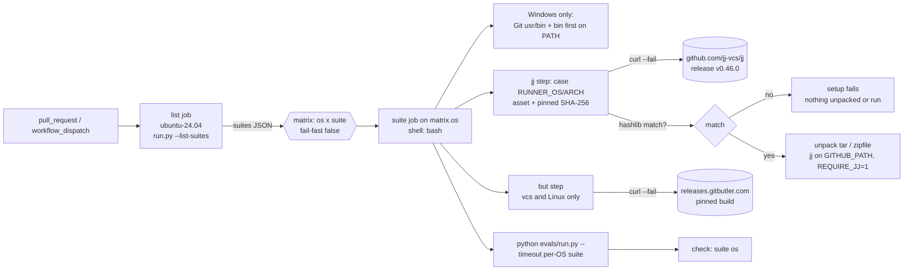

# Design

## Triage

| Trigger | Applies? | Evidence |
|---|---|---|
| T1 Components (new component, or 3+ with directed relationships) | no | No new script or skill. The `list` → `suite` job graph exists today (`.github/workflows/evals.yml`); this change widens the matrix, not the graph. |
| T2 State (persistent state, caches, 3+ state machine) | no | No stored state. Pinned versions and checksums are constants in the workflow, as today. |
| T3 Concurrency (background work, workers/isolates, async, retries) | no | CI jobs already run in parallel per suite, with `cancel-in-progress` per PR. Adding OSes adds jobs but no new ordering between them. |
| T4 Boundaries (data format, migration, shared interface, IPC, external) | yes | External downloads per OS (jj release assets) and the GitHub check names change from `<suite>` to one per suite and OS. |
| T5 Volume (grows without a fixed bound) | no | Jobs = 3 × suites, bounded by the suite list. |
| T6 Risk (security, money, data loss, unrecoverable user data) | yes | Supply chain: binaries downloaded and run in CI. Two new archives (macOS, Windows) must be checksum-verified before use. |

TIER: FULL

## Context

The proposal gives the why. Current state the approach builds on:

- `.github/workflows/evals.yml`: the `list` job prints `run.py --list-suites`, and `suite` is a matrix over suites on `ubuntu-24.04` with `fail-fast: false` and `timeout-minutes: 45`. Steps run under the default shell (bash on Linux).
- The jj step has one hardcoded asset (`x86_64-unknown-linux-musl`). It checks with `sha256sum --check`, unpacks with `tar` and installs with `install -m 0755`. `JJ_VERSION`/`JJ_SHA256` env overrides exist only so `evals/runner/test_ci_workflow.py:55-128` can run the step's body against a fake `curl` and a local archive.
- The `but` step has `if: matrix.suite == 'vcs'`. `SPECWRIGHT_REQUIRE_BUT: '1'` is set at job level, and `test_ci_workflow.py:229-232` asserts that line.
- `evals/vcs/butenv.py:35` and `jjenv.py` treat only the value `"1"` as required.
- `evals/runner/test_workflow.py:51` asserts `runs-on: ubuntu-24.04`, a Linux-only check that this change replaces.
- Upstream assets, read from the jj v0.46.0 release API on 2026-10-31:
  - `x86_64-unknown-linux-musl.tar.gz` `fce02711…fc08` (matches today's pin);
  - `aarch64-apple-darwin.tar.gz` `43daa37c…4ab58`;
  - `x86_64-pc-windows-msvc.zip` `c42316b1…99b83`.
- GitButler's manifest (`app.gitbutler.com/releases`) lists a bare `but` only for `linux-*`. `darwin-*` is `GitButler.app.tar.gz`, whose `Contents/MacOS/` holds `gitbutler-tauri` and `gitbutler-git-askpass` and no `but`. `windows-x86_64` is an MSI zip. The user chose a Linux-only `but`.
- `.gitattributes` pins `*.sh`, `*.md`, `*.yaml` and `evals/update/shims/*` to LF. Every other text file follows the checkout's `core.autocrlf`, which is `true` on GitHub's Windows images, as on a default Git for Windows install. That includes the pin files `OPENSPEC_VERSION`, `JJ_VERSION`, `BUT_VERSION` and `VERSION` (`git ls-files --eol` shows `i/lf w/crlf` for them on this machine). The workflow reads them with `$(cat …)`, which keeps a trailing `\r`.
- Existing per-OS skips (`os.name`) live in:
  - `evals/pr-pair/test_bounded.py:242,253,446` and `evals/review-routes/test_review_run.py:1033,1072`. Each tests a mechanism that exists on one OS only (job objects, SIGSTOP, the Windows argument transport).
  - `evals/pr-pair/test_pr_reply.py:209-210`, a `skipTest` inside `if os.access(...) or os.name == "nt"`, because Windows cannot make a file unreadable with `chmod`.
- `run.py` prints `suite: F files, T tests, S.Ss` (`evals/run.py:451`) and keeps only failed files' logs. A test skipped on one OS only is therefore invisible today, whatever its cause (a missing symlink right, Python 3.8, `jq`, `sh`, `ssh-keygen`).
- No shipped skill names `run.py --changed`. Only `AGENTS.md`, `CONTRIBUTING.md`, `README.md:629`, `openspec/architecture.md:92` and the `eval-runner` spec do. `CONTRIBUTING.md:44-51` and `README.md:629` also tell the reader to run whole suites with `python -m unittest discover evals/<suite>` (pr-pair takes about an hour on Windows).
- Local Windows suite wall times (`evals/timings.md`) range from 118 s (finish) to 2077 s (pr-pair) on a 24-thread machine. #145 records pr-pair at about 6 min in Linux CI.

## Decisions

### D1: One matrix job over OS × suite

- **Choice:** the `suite` job's matrix gains `os: [ubuntu-24.04, windows-latest, macos-latest]` next to `suite`. `runs-on: ${{ matrix.os }}`, `fail-fast: false`, and the job name is `${{ matrix.suite }} (${{ matrix.os }})`. The `list` job stays on Linux, since it only prints JSON.
- **Rejected:** three jobs, one per OS, each with its own copy of the steps, because every step would exist three times and drift. The tests that run step bodies would have to pick one copy.
- **Reversal cost:** low. It is one workflow file, and no branch protection or ruleset names the checks (`gh api …/rulesets` returns none, and branch protection is 404).

### D2: Every step under `bash`; Git for Windows' tools first on Windows

- **Choice:** set `defaults: run: shell: bash` on the `suite` job. On Windows, Actions resolves that to Git for Windows' `bash.exe`. The first step, `if: runner.os == 'Windows'`, writes `C:\Program Files\Git\usr\bin` and then `C:\Program Files\Git\bin` to `GITHUB_PATH`. Later steps and every `bash`, `cygpath`, `sed` or `find` that Python starts then resolve to Git's, not to `C:\Windows\System32\bash.exe` (the WSL launcher) or to Windows' own `find.exe`. The step logs `command -v bash cygpath sed` and `python -c "import shutil; print(shutil.which('bash'))"`, so a wrong resolution shows in the log (spec scenario "Windows runs the POSIX userland of Git Bash").
- **Rejected:** `msys2/setup-msys2`, because users run Git for Windows' Git Bash, not a full MSYS2. Its different `cygpath` and PATH conversion would test a setup nobody uses.
- **Reversal cost:** low.

### D3: One jj step, an OS/arch table, a portable checksum before unpacking

- **Choice:** the `Install pinned jj` step picks its asset and SHA-256 from a `case "$RUNNER_OS/$RUNNER_ARCH"` table in the step body:
  - `Linux/X64`: `x86_64-unknown-linux-musl.tar.gz`;
  - `macOS/ARM64`: `aarch64-apple-darwin.tar.gz`;
  - `Windows/X64`: `x86_64-pc-windows-msvc.zip`.

  Any other pair fails with `no pinned jj for <os>/<arch>` before any download. After `curl --fail`, it compares the digest with `python -c` (`hashlib.sha256`), which runs the same on all three OSes. macOS has no `sha256sum`. Only on a match does it unpack: `tar -xzf` for `.tar.gz`, `python -m zipfile -e` for `.zip`, since Git Bash has no `unzip`. It then copies `jj` or `jj.exe` into `$RUNNER_TEMP/jj-bin`. The Python setup steps move before this step. The `JJ_SHA256` override stays for the tests. Two new overrides, `RUNNER_OS` and `RUNNER_ARCH` (which Actions sets itself), let the tests take each branch of the table on any host.
- **Rejected:** a separate step per OS behind `if: runner.os == …`, because the tests read one step's body by name (`install_run_block`). Three bodies would need three test paths and could drift in their checks. Also rejected: a checksum file in the repo (`JJ_SHA256S`), because nothing besides this step reads it and the pin would move away from the URL it guards.
- **Reversal cost:** low.

### D4: `but` only on Linux; the requirement flag set by a step

- **Choice:** the `but` step's condition becomes `matrix.suite == 'vcs' && runner.os == 'Linux'`. `SPECWRIGHT_REQUIRE_BUT` leaves the job-level `env`. A step `if: runner.os == 'Linux'` writes `SPECWRIGHT_REQUIRE_BUT=1` to `GITHUB_ENV`. On macOS and Windows it is unset, and the GitButler tests skip with `but not installed`. Task 1.1 files an issue for the macOS/Windows gap, and the workflow names it in a comment on the `but` step.
- **Rejected:** a job-level `env` expression on `matrix.os` that yields `'1'` or `''`. An empty value would be "set", which the spec does not mean, and the expression ties the rule to an image name instead of the OS. Also rejected: extracting a CLI from the macOS app or the Windows MSI. The macOS bundle has no `but`, and the user chose Linux-only.
- **Reversal cost:** low. When GitButler publishes standalone macOS or Windows builds, the step gains a table like D3's.

### D5: Per-OS timeouts from measurement

- **Choice:** `matrix.include` adds per-OS `timeout` (job minutes) and `run_timeout` (`run.py --timeout` seconds), used as `timeout-minutes: ${{ matrix.timeout }}` and `--timeout ${{ matrix.run_timeout }}`. The first push starts generous: Linux 45/1200, macOS 60/1800, Windows 120/3600. After the first complete matrix run, each OS's values become about 1.5 × that OS's slowest job (job minutes) and 1.5 × its slowest test file (run seconds), rounded up. The measured numbers go into `evals/timings.md` as a CI section, which `test_timings.py` still checks.
- **Rejected:** one timeout for all OSes, sized for Windows, because a hung Linux job would then hold a runner for two hours before failing.
- **Reversal cost:** low.

### D6: Keep the Windows checkout's CRLF conversion

- **Choice:** keep `actions/checkout`'s default, so Windows jobs see the CRLF conversion a default Git for Windows user sees. A file that breaks under CRLF is fixed for users too: an `eol=lf` rule in `.gitattributes`, or code that tolerates CRLF, with a regression test. The first such fix is known now. `.gitattributes` gains `*VERSION text eol=lf`, which covers `OPENSPEC_VERSION`, `JJ_VERSION`, `BUT_VERSION` and `VERSION`, so the workflow's `$(cat …)` reads carry no `\r`. A CRLF version string would give a 404 jj URL and a bad `npm i` spec. `test_ci_workflow.py` asserts the rule with `git check-attr eol` on each of the four files.
- **Rejected:** `git config --global core.autocrlf false` before checkout, because it hides the CRLF class #145 asks CI to exercise.
- **Reversal cost:** low.

### D7: Per-OS skips are checked by an AST scan

- **Choice:** a new `evals/runner/test_platform_skips.py` parses every `evals/**/test_*.py` with `ast`. It finds:
  - `unittest.skipIf`/`skipUnless` decorators and calls whose condition names `os.name`, `sys.platform` or `platform.system`;
  - `self.skipTest(...)` and `raise unittest.SkipTest(...)` inside an `if` whose test names those.

  Each reason must be a string constant that matches `#\d+` or starts with `platform:`. Otherwise the test fails with `<file>:<line>`. The six existing reasons (Context) gain the `platform:` prefix, so their behaviour does not change. The scan covers only conditions that read the OS. Skips that depend on a tool or interpreter on PATH are made visible by D10 instead.
- **Rejected:** a regex over source lines, because decorators span lines and conditions are built from variables. Also rejected: leaving it to review, because a per-OS skip that a reviewer misses is exactly the hidden gap #145 forbids.
- **Reversal cost:** low.

### D8: Instructions move to CI-first

- **Choice:** `AGENTS.md` and `CONTRIBUTING.md` replace the `--changed main` step:
  - During a change, rely on the `.github/workflows/evals.yml` matrix on the PR.
  - Locally, run only the module you are writing (`python -m unittest evals/<suite>/test_<x>.py`), red then green, and after adding a tracked file the map test (`python -m unittest evals/runner/test_suite_map.py`).
  - At a milestone close, rely on a green `workflow_dispatch` run of the workflow on `main` (`gh workflow run evals.yml --ref main`), with no local full run.

  The per-area bullets in `CONTRIBUTING.md:44-51` stop naming `python -m unittest discover evals/<suite>`. Each says which suite CI runs for that area and to run locally only the module being written. The Python 3.8 note for `test_pass_write_on_python38` stays, naming that module. `README.md:629` and the architecture's evals row say the same. `run.py --changed` stays as a tool and is no longer the instruction. `test_agent_instructions.py` checks the new needles. It fails when `AGENTS.md`, `CONTRIBUTING.md` or `README.md` holds `python evals/run.py --changed main` or `python -m unittest discover evals/`, naming the file and the command.
- **Rejected:** keeping `--changed main` as an optional local step, because the point of #145 is that local Windows runs take over the machine. An optional step gets run.
- **Reversal cost:** low.

### D9: Triage the first matrix run inside this change, bounded

- **Choice:** the first matrix push is the probe. Each failure it shows is either fixed in this change with a regression test, or filed as an issue, its test skipped on that OS with `#<n>` in the reason (D7) and listed in the PR. The `test_git_backend` crash (`0xC0000005`) is judged by the Windows job:
  - It passes in CI: the crash is recorded as machine-local in the PR and #145.
  - It fails in CI: fix or file.

  Triage also compares each suite's skipped count (D10) across the three OSes. A count that is higher on one OS is triaged like a failure: fix it, or file an issue and give each such skip an `#<n>` reason. The GitButler skips on macOS and Windows are the expected difference, with the issue from D4.

  Fixes stay in this change only when they are in shipped scripts or eval helpers and small. Anything that needs its own design goes to an issue, as `large-pr-triage` already does for review findings. That does not apply to a whole file that times out: D5 and the Risks section handle it inside this change.
- **Rejected:** a follow-up change for all fixes, because the exit criterion needs every job green on the PR that adds the matrix.
- **Reversal cost:** low.

### D10: `run.py` prints each suite's skipped count

- **Choice:** `run.py` reads unittest's `skipped=N` from each file's closing `OK (...)` or `FAILED (...)` line, sums it per suite, and prints `suite: F files, T tests, K skipped, S.Ss`. Each OS's job log then shows a one-OS-only skip as a count difference, whatever its cause.
- **Rejected:** keeping every passing file's log, or printing every skip reason, because CI logs would grow by every test's output to answer a question a count answers. The kept failure logs stay as they are.
- **Reversal cost:** low. It is one more field on an output line that only humans and `test_run.py` read.

## Diagrams (FULL)

T4 and T6 apply: the external downloads and the check boundary.

## State & Ownership (FULL)

| State | Owner (sole writer) | Lifetime | Invalidation / rebuild | Authoritative copy |
|---|---|---|---|---|
| jj asset/checksum table | the `Install pinned jj` step body in `evals.yml` | until `JJ_VERSION` changes | a version bump edits `JJ_VERSION` and all three rows in one commit; the test asserts each row | `evals.yml` |
| `but` build and checksum | the `Install pinned but` step | until `BUT_VERSION` changes | unchanged from today | `evals.yml` + `BUT_VERSION` |
| Per-OS timeouts | `matrix.include` in `evals.yml` | until re-measured | re-measured when a suite's CI time drifts past its bound | `evals.yml`; numbers recorded in `evals/timings.md` in a CI section whose rows do not match `test_timings.py`'s suite-row pattern (a separate table header or a list), so the local before/after table stays the one it checks |
| Job PATH/env (`GITHUB_PATH`, `GITHUB_ENV`) | the job's own steps | one job | rebuilt each job | runner |

## Failure & Visibility (FULL)

| Component | Fails / dies mid-operation → | Recovery | Retry safe? | Who finds out |
|---|---|---|---|---|
| jj download | `curl --fail` non-zero; the step fails | rerun the job | yes | PR author, via a failed check |
| jj checksum | mismatch; the step fails before unpacking | investigate upstream, never re-pin blindly | yes (same result) | failed check, log names expected and actual digest |
| Unknown runner OS/arch (image change, e.g. macOS back to x86_64) | the step fails naming the pair, no download | add the row with its pinned digest | yes | failed check |
| Windows PATH step | wrong `bash` resolved | fix the step | yes | the log line from D2; tests that need `cygpath` fail loudly |
| A suite hangs | job timeout per D5 | rerun or fix | yes | timed-out check |
| macOS concurrency cap (free plan runs 5 macOS jobs at a time) | jobs queue, never fail | none needed | n/a | wall time on the PR |
| A test skipped on one OS without an issue | `test_platform_skips.py` fails | add the issue or `platform:` reason | yes | failed `runner` check |
| A test file exceeds `run_timeout` on one OS | `run.py` stops it, reports `timeout after S s`, and the job fails | raise that OS's `run_timeout` and job timeout (up to the 360-minute hosted-runner cap); if one file still cannot fit, split it into smaller files in this change | yes | failed check on that OS |
| A pin file checked out with CRLF | without the `.gitattributes` rule, the jj URL 404s and `npm i` gets a bad version | the `*VERSION` rule (D6), asserted by a test | yes | failed check; the rule's test fails first |

## Resource Bounds (FULL)

| Queue / buffer / cache / transfer | Bound | At the bound | Timeout | At 10x / 100x |
|---|---|---|---|---|
| Jobs per push | 3 × suites (24 today) | GitHub queues past the free-plan concurrency (20 jobs, 5 macOS) | per-OS job timeout (D5) | 10× suites = 240 jobs: queueing time grows, nothing breaks; suites are directories, so 10× is not expected |
| jj download | one archive, about 10–20 MB | `curl --fail` errors on HTTP failure | runner's step default; the job timeout bounds it | n/a |
| `but` download | one binary, Linux `vcs` job only | as today | as today | n/a |
| Runner output per job | `run.py` prints one line per suite and failed files' output | as today | `--timeout` per file | as today |

## Flow & State Gaps (FULL)

- **Superseded push:** `cancel-in-progress` cancels all 24 jobs of the earlier run. Unchanged.
- **Image drift:** `windows-latest`/`macos-latest` move to new images over time. The D3 table catches an architecture change. Other drift (Git for Windows' path, tool versions) shows as a failing check on the next PR, not a silent pass, because nothing on that path is skipped.
- **Partial matrix:** with `fail-fast: false` one OS failing leaves the others' results, so a platform-only failure is visible as such.
- **Milestone close with a stale main run:** the close takes the dispatch run on the head of `main` it is closing at, not an older green run.

## Mechanism Ledger (FULL)

| Mechanism | Built? | Why (harm nobody catches / expensive later) | Evidence that would change the call |
|---|---|---|---|
| Per-OS jj checksum before unpack | yes | supply chain: running an unverified binary is harm nobody catches | none |
| Unknown OS/arch stop | yes | without it a new image would download the wrong asset and fail later with a confusing error, or not at all | none |
| Per-OS skip scan (D7) | yes | a quiet per-OS skip hides the gap #145 is meant to expose | none |
| Download retry in `curl` | no | a failed download fails visibly, and a rerun fixes it | repeated flaky download failures on the PRs |
| Cache of jj/`but` between runs (`actions/cache`) | no | the downloads are small, and a cache adds a second source to verify | download time becomes a large share of short jobs |
| Windows `but` via the MSI / macOS app | no | no standalone CLI in them (Context); the user chose Linux-only | GitButler publishes standalone macOS/Windows `but` builds |
| Separate macOS x86_64 row | no | `macos-latest` is arm64 | `RUNNER_ARCH` reports X64 on `macos-latest` (the stop fires) |

## Risks / Trade-offs

- [Windows suites far slower than Linux, close to the timeout] → inside this change, in order:
  1. Start at 120 min (D5), measure, and record the result in `evals/timings.md`.
  2. Raise the Windows job timeout toward the 360-minute hosted-runner cap, with `run_timeout` to match.
  3. If a suite still does not fit, split its slow files across matrix jobs. Each slow file becomes its own matrix entry, run as `run.py <suite>/<file>`; `run.py` gains that target form if it lacks it.
  4. If a single file exceeds `run_timeout`, split that file.

  The exit criterion needs every job green on this PR, so none of these goes to a follow-up.
- [The first matrix run surfaces many failures and the change balloons] → D9's bound: fix small ones here, file the rest with `#n` skips the scan enforces.
- [Check names change, so earlier PRs show stale `<suite>` checks] → no branch protection names them; later PRs only see the new names.
- [Dropping the local `--changed` instruction means a contributor without CI access sees failures later] → the repo's PRs always run CI, and the single-module local run still catches the test being written.

## ADRs

- **In force, constraining this change:** 0002 (scripts are `bash` with a POSIX userland, Git Bash on Windows, so Windows CI must run Git Bash, D2); 0014 (Windows job objects; its tests are among the `platform:` skips, D7); 0018 (GitButler backend; `but` tests stay required where `but` is installed, D4).
- **To record during apply:** none. The CI platform and the contributor instructions bind no product boundary or format.

## Open Questions

- The final per-OS timeouts come from the first complete matrix run (D5). The numbers change no spec or task.
