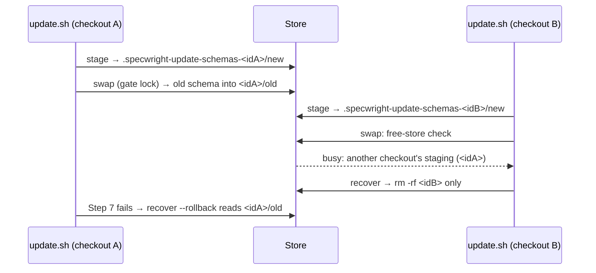
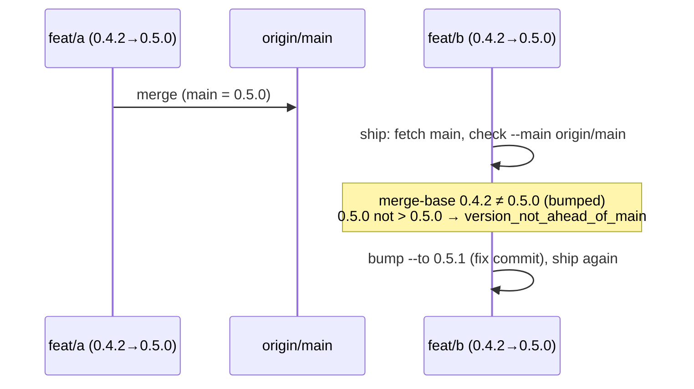
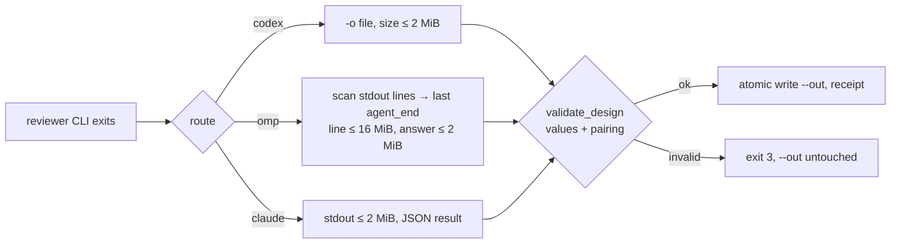

# Design

## Triage

| Trigger | Applies? | Evidence |
|---|---|---|
| T1 Components (new component, or 3+ with directed relationships) | no | No new component. Each fix stays inside an existing one: the README install prompt, `release.sh` and its three callers, `review-run.sh`, `update.sh`, and `specwright-debug`. |
| T2 State (persistent state, caches, 3+ state machine) | yes | #97 changes where an update's store staging directory lives (state recorded in the update journal, `scripts/update.sh:1735-1740`). #53 gives `specwright-debug` a named stash: state it now owns until the stash is restored. |
| T3 Concurrency (background work, workers/isolates, async, retries) | yes | #97: two checkouts updating one store. #94: two change branches merging the same version. |
| T4 Boundaries (data format, migration, shared interface, IPC, external) | yes | New script options `release.sh untagged --local` and `check --main <ref>`, consumed by skill text. The codex command line gains a setting read from an external file (`$CODEX_HOME/config.toml`). The store staging path changes; journals written by an older version still name the old path. |
| T5 Volume (grows without a fixed bound) | yes | The OMP event stream is unbounded on disk today (`review-run.sh:314-347`). Its answer is now read by scanning that stream. |
| T6 Risk (security, money, data loss, unrecoverable user data) | yes | #97 loses a rollback copy. #53 can strand the user's uncommitted files. #93 is an unfenced GitHub read (ADR 0008). #95 records a review that read nothing as a success, overwriting a valid one. |

TIER: FULL

## Context

See `proposal.md` for the seven issues. Current code:

- **#91.** README Step 1 (`README.md:78-81`) and Step 3 (`README.md:134-140`) take the first match of `\d+\.\d+\.\d+(-[0-9A-Za-z.-]+)?(\+[0-9A-Za-z.-]+)?`, with nothing required after it. `TestOpenSpecPin` (`evals/git-workflow/test_instructions.py:1250`) asserts the README text only, including the verbatim token in both steps (`test_exact_match_counts_build_metadata_as_mismatch`, `:1336`).
- **#93.** `specwright-finish` says the local path never resolves a login (`skills/specwright-finish/SKILL.md:16`), yet its Release step (`:85`) calls `untagged` "fenced with the run login". `cmd_untagged` (`release.sh:1187-1192`) always calls `published_tags` (`:735-755`), which runs `git ls-remote --tags --refs origin` whenever an `origin` remote exists. There is no local-only option.
- **#94.** `primary_history` (`release.sh:661-708`) keeps only first-parent commits that touch the primary file, so a second merge to an identical version is invisible to it. `cmd_check` (`:576-578`) reads the working tree only. `bump` compares the target with the working tree (`:599`). Nothing compares the branch with main. `check` is called only by the bump task's verification (`skills/specwright-release/SKILL.md:28`).
- **#95.**
  - Codex runs with `--ignore-user-config` (`review-run.sh:737-770`). Windows is handled only in process management (`:297-299`, `:322`).
  - `validate_design` (`:587-595`) counts the `VERDICT:` and `CHANGES_APPLIED:` lines but never checks their values. On success `run` writes `--out` atomically (`:980`, `atomic_write` `:628-640`). `record` validates the subagent's file in place (`:1064-1069`).
  - The non-codex size check (`:930`) applies `MAX_OUTPUT` (2 MiB, `:65`) to OMP's raw `--mode json` event stream. `capture` returns only the first `MAX_OUTPUT+1` bytes (`:314-347`), so the final `agent_end` event of a long stream is never seen by `omp_last_text` (`:782-795`).
  - The review fixtures use values the new check refuses: `VERDICT_OK = "...VERDICT: approve\nCHANGES_APPLIED: none"` (`evals/review-routes/test_review_run.py:26`).
- **#97.** `mk_group` (`update.sh:1569-1572`) names every staging directory `<parent>/.specwright-update-<base>`, so the store schema group is `<store>/openspec/.specwright-update-schemas` for every checkout. Its path is copied into the journal (`:1735-1740`) and used by:
  - `remove_staging` (`:382-387`), called from stage (`:668`), failed stage (`:673`, `:685`), finish (`:854`) and `recover_cleanup` (`:396-400`);
  - the swap and rollback (`:709-724`, `:536-552`, `:493-495`);
  - the free-store check, which allows the journal's staging paths (`:1476-1477`), through `store_busy_reason` (`:1393-1409`).
  
  The journal is per checkout (`openspec/.specwright/update.json`, `:920-925`). Its `code` field is the checkout path.
- **#99.** `check_change(scratch, name)` (`update.sh:1155-1188`) validates a scratch copy against whatever schema `inflight_entries` (`:1196-1239`) copied in. Both refusal sites name only the target: `make_plan` (`:1653-1665`) and `cmd_swap_check` (`:1848-1877`). The installed schema is still on disk at both, at `<root>/openspec/schemas/specwright` (`:1608`): planning precedes staging, and swap-check precedes the first rename (`:764`, `:810`).
- **#53.** `skills/specwright-debug/SKILL.md:15` says "test with `git stash push -u` and restore". The stash has no message and is not reported. The architecture lists the component as owning no state (`openspec/architecture.md:84`). `specwright-branch` already names its stash `specwright-branch: pre-<change-name>` and reports the ref (`skills/specwright-branch/SKILL.md:19`).

## Decisions

### D1: A run-on version token is unreadable output (#91)

- **Choice:** Both README steps keep taking the first match of the same token. Then they look at the character right after it: when it is a digit, a letter, `.`, `+` or `-`, the output counts as unreadable. Step 3 takes its existing "no version number" stop, and Step 1 treats the version as unknown and names the pin. The README states the rule once, in Step 3, and Step 1 refers to it ("as Step 3 takes it", already the wording). A new test runs the rule as the README states it against sample outputs (`1.14.1`, `1.14.1.0`, `1.14.1vendor`, `1.14.1+vendor.1`, `openspec 1.14.1\n`), so the prose and its examples cannot drift apart.
- **Rejected:** Append a negative lookahead `(?![0-9A-Za-z.+-])` to the token. A regex search then backtracks and finds a later token: in `1.14.1.0` it matches `14.1.0`, so the agent would report a mismatch against a version that was never printed. Treating the run-on as unreadable reports what was actually printed.
- **Reversal cost:** low. Install prompt text only.

### D2: Local finish reads local tags only (#93)

- **Choice:** `release.sh untagged --local` takes local tags as the published set, exactly as the no-origin case already does (`release.sh:735-755`). It runs no `ls-remote`. Its JSON gains `"tags"`: `"local"` with `--local` or with no `origin` remote, and `"origin"` only when origin's tags were read (review S2). `specwright-finish` uses `--local` in `finish: local`, unfenced, with no login. It reports the versions as untagged according to local tags, and publish runs only after `main` is pushed. Publish itself, watch and roadmap close keep the fenced origin read.
- **Rejected:** Resolve and pin a run login before the read in local mode. That puts a GitHub network call, and possibly an `as.sh --resolve`, into a path that the run-login rule and the `finish: local` spec keep offline. It would also fail on machines with no gh account, where local mode works today. Local mode never publishes, so origin's view adds nothing it acts on.
- **Reversal cost:** low. An additive flag and one skill line.

### D3: A bumped branch must be ahead of main, checked at ship, local merge and watch (#94)

- **Choice:** `release.sh check --main <ref>` first runs today's agreement check. Then it computes `git merge-base HEAD <ref>` and reads the primary file's version there and at `<ref>` (with the current `version_files` pattern).
  - The branch **bumped** when either holds:
    - the working-tree version differs from the merge-base version (no readable version at the merge base counts as different);
    - the newest commit listed by `git log --no-merges --topo-order --format=%H <ref>..HEAD -- <primary file>` that reads a different version in the primary file than its first parent does (a root commit: any readable version) raised it; a change to or from a version that is not `major.minor.patch` counts as raising it, and a commit that leaves no readable version does not. A bump later reverted on the branch is therefore not a bump (round 3, M4), and a re-bump still is. A commit of the branch's own changed the version, which still holds after main was merged into the branch (GitHub's "Update branch", or `git merge <main>` before a local finish): that merge moves the merge base to main's tip (review M1). An edit that keeps the version, such as a dependency change in a `package.json` primary file, is not a bump (codex trial in task 3.5).
  - A bumped branch whose version is not greater than `<ref>`'s version stops with `version_not_ahead_of_main`, naming both versions and saying to rerun `bump` with a greater target.
  - When `<ref>` has no primary file or no readable version, nothing can collide: exit 0 (the first release-enabled change, which adds `VERSION`).
  - Without `--main`, `check` behaves as today.
  
  It runs only with `release.enabled` true, at three points:
  - `specwright-pr` ship, against `origin/<main>` after a fenced `git fetch origin <main>`, next to `pr.validate` before any push;
  - `specwright-finish` local merge, against local `<main>` before `git merge`;
  - `specwright-pr` watch, against a refreshed `origin/<main>` before it reports a PR ready or sends the agent merge.
  
  A refusal at watch reports the duplicate and neither reports ready nor merges. The fix is a new bump commit on the branch, as a tracked fix.
- **Rejected:** Detect the duplicate after the fact in `primary_history`, by treating a merge that did not change the primary file as a release commit. By then two changes are on main under one version and nothing can be re-released without moving a tag, which ADR 0010 forbids. Another rejected option was to check at bump time only: main can move after the bump, which is exactly this issue's timeline.
- **Reversal cost:** low. An additive option, and three call sites in skill text.

### D4: Codex on Windows gets only the user's `windows.sandbox` (#95)

- **Choice:** Keep `--ignore-user-config`. When `os.name == "nt"`, read `$CODEX_HOME/config.toml` (default `~/.codex/config.toml`) with `tomllib`. When `windows.sandbox` is a string matching `^[a-z][a-z0-9-]*$` (codex accepts `elevated` and `unelevated`; newer builds add `mxc`), append `-c windows.sandbox="<value>"`. A missing or unreadable file, a TOML error, any other value, or a Python without `tomllib` (before 3.11) adds nothing, which is today's behaviour. The receipt records the forwarded value. A recorded trial on Windows confirms that the review reads the checkout, appended to `evals/review-routes/trial.md`.
- **Rejected:** Drop `--ignore-user-config` on Windows. That brings back the user's MCP servers, profiles, model providers and project rules, which ADR 0007's isolation was built to remove (#27). A new `review.codex_windows_sandbox` key was also rejected: it duplicates a setting the user already made for codex, and a new key is a minor-version workflow change in a patch release. So was a `select` probe that makes codex read a file: it costs an extra model run per review. The value check (D5) already turns a review that read nothing into a failed run.
- **Reversal cost:** low.

### D5: Design verdict values are checked against what a reviewer may emit (#95)

- **Choice:** `validate_design` requires these whole lines (trailing whitespace stripped), shared by `run` and `record`:
  - exactly one `VERDICT: <v>`, with `<v>` in {`APPROVE`, `APPROVE_WITH_CHANGES`, `REVISE`};
  - exactly one `CHANGES_APPLIED: <c>`, with `<c>` in {`no`, `yes`} after `APPROVE_WITH_CHANGES` and `n/a` after the other two.
  
  Anything else is `invalid_output` naming the value. `SKIPPED_LIGHT` and `USER_OVERRIDE` are refused, because the agent and the user write those without a review run: nothing routes them through `run` or `record` (`schema.yaml:294-296`, `:361-364`). The test fixtures move to valid values.

  The subagent route gets the same guarantee as the CLI routes: a refused review never replaces the earlier `review.md` (review M2). The change directory is untracked while a change is planned, so git cannot restore it.
  - The dispatch names a scratch result file outside the change: `review-run.sh`'s state dir, `<state dir>/design/<change>/<timestamp>.md`, returned by a new `record --kind design --scratch` call.
  - `record --kind design --result <scratch> --out <review file>` validates the scratch file. Only on success does it write `--out` atomically, with the same `atomic_write` as `run`, and remove the scratch file.
  - On exit 3 it leaves `--out` untouched and keeps the scratch file, so its path can go in the report.
  - `record` without `--out` keeps today's in-place validation, so a caller from an older install still works. The skill text no longer uses that form for design reviews.
  
  Text edits: `schemas/specwright/schema.yaml` (the review instruction's subagent route), `skills/specwright-review/SKILL.md` (Design reviews, `subagent`), `skills/specwright-roadmap/SKILL.md` (init step 5) and both `specwright-reviewer` agent files ("write the single output file the request names"). The schema edit changes only instruction text: no artifact, path or dependency changes, so a change in flight is not affected.
- **Rejected:** Leave values to the tasks precheck, which already refuses `BLOCKED`. The script would still report `status: ok`, write the receipt and overwrite the earlier `review.md`, which is the data loss in the issue.
- **Reversal cost:** low.

### D6: The OMP answer is read from the last `agent_end` event, bounded as an answer (#95)

- **Choice:** For the OMP route, the post-exit size check moves from stdout to the answer.
  - `capture` gains a per-route reader. For OMP it scans the stdout file line by line in binary with `readline(MAX_EVENT_LINE + 1)`, so memory stays bounded before a line is measured. It keeps only the last line whose JSON `type` is `agent_end`, and refuses any single line over `MAX_EVENT_LINE` (16 MiB) as `output too large`.
  - `omp_last_text` then extracts the last assistant text from that one event, and `MAX_OUTPUT` (2 MiB) applies to that text.
  - No `agent_end` event leaves the run invalid.
  - The codex and claude paths are unchanged.
  
  Bounding the stream while the CLI runs stays with #80 (`bound-pr-scripts`).
- **Rejected:** Read the answer from the session `.jsonl` in `--session-dir`. That file is OMP's internal session format, it can be split across files, and today it is read only for the actual model (`omp_session_actual`). The documented `--mode json` stream is the contract the route already uses. Raising `MAX_OUTPUT` was also rejected: a review that reads more files breaks again.
- **Reversal cost:** low.

### D7: The store staging directory is keyed by the code checkout (#97)

- **Choice:** For the store schema group only, `mk_group` takes a suffix: the first 12 hex digits of SHA-256 over the journal's `code` path, as `update.sh` already normalises it (forward slashes, as `norm` does, lower-cased on Windows). The path becomes `<store>/openspec/.specwright-update-schemas-<id>`.
  - Code-side groups keep their names, because they live inside the checkout (`evals/update/test_update.py:175-177` stays valid).
  - The path is still a string in the journal, so the journal format stays `format: 1`.
  - Every user reads the path from the journal: stage, swap, recover, finish, rollback and the free-store check. Only `mk_group` builds it, so a journal from an older version still names, and cleans, the shared path.
  - `store_busy_reason` recognises an untracked `openspec/.specwright-update-schemas-*` that is not this journal's. It reports `another checkout's update is staged in the store: <path>; finish or recover it by rerunning the update in that checkout`, ahead of the generic dirty-tree reason.
  - A swap refused before its first rename (a busy store, changes in flight that differ from the plan, a failed verification) removes this update's staging directories and journal, as `recover` does for a swap that never started (review round 2, M1). A refused checkout therefore never keeps the store busy for another, and the update prompt's rerun plans and stages again from scratch. Refusing in `plan` or `stage` while a foreign staging exists was rejected: a rerun would first recover its own staging and then stop, so it converges one rerun later and adds a second place that reads the store's staging.
- **Rejected:** A random id per update. A plan with no journal yet cannot find the directory of an interrupted earlier stage, so each rerun would leave an orphan behind in the store. A per-checkout key makes stage's pre-clean (`:668`) remove exactly its own leftover. Also rejected: holding the store gate lock from stage to finish, so that only one checkout stages at a time. A failed Step 7 can keep a lock open for days, and that would block every other project's change gate (`planning-stores` "The store gate is exclusive").
- **Reversal cost:** low. Directory name only; old journals keep working.

### D8: The installed schema is checked only when the target check fails (#99)

- **Choice:** After `inflight_entries` finds an invalid entry (plan, or swap-check), `update.sh` validates that one change again against the installed schema directory (`<root>/openspec/schemas/specwright`), in its own scratch directory (`{i}-{name}-installed`).
  - The label is the installed version: the project's `VERSION`, or for a store the `STORE` record's version, since the store's schema on disk is the owner's.
  - When there is no installed `VERSION` or no schema directory, the second check is skipped.
  - `check_change` returns the failing step along with its error: `schema`, `validate` or `status`, or `error` when an `openspec` run exits non-zero without a result that says the change fails, or prints output it cannot read (codex trial in task 3.5).
  - The message adds `; it already fails on <installed> (<that error>), so the update to <to> did not cause it` only when the installed schema passes `openspec schema validate` and the change then fails `validate` or `status` against it; an `error` step is no such failure.
  - When the installed schema itself fails `schema validate` under the current OpenSpec, or `openspec` errors, the message keeps only the target error and makes no claim about the installed version (review M3).
  - The refusal code and the outcome are unchanged.
- **Rejected:** Validate every change against both schemas on every plan. That doubles the three `openspec` calls per change on the common path, where everything validates, to improve a message on the rare failure path.
- **Reversal cost:** low.

### D9: The debug stash is named, reported and looked for at the start (#53)

- **Choice:** In `specwright-debug`:
  - Step one of every run is `git stash list`, filtered for messages that start with `specwright-debug: `. Each one found is reported with its ref and topic, together with an offer to restore it (`git stash apply <ref>`, then `git stash drop <ref>` only once the apply succeeded). The run does not stash again until the user decides.
  - `stash@{n}` shifts whenever another stash is pushed. So right before each `apply` and each `drop`, the ref is looked up again by its exact message in a fresh `git stash list`, never taken from an earlier report (review S5). A message that is not found, or that matches twice, stops with the list shown.
  - The test step uses `git stash push -u -m "specwright-debug: <topic>"`, reports the ref, restores with `apply`, and drops the stash only after checking that the files are back.
  - A conflicting restore keeps the stash and stops.
  - The architecture row now says the component owns that named stash until it is restored.
- **Rejected:** Test in a temporary `git worktree` at `HEAD` instead of stashing. That leaves the user's tree untouched, but the worktree lacks ignored build state (dependencies, generated files). A test there can fail or pass for reasons the user's tree does not share, which defeats a step meant to find out whether the dirty files matter. It also needs its own cleanup and recovery rule.
- **Reversal cost:** low.

## Diagrams (FULL)

T2/T3: store staging with two checkouts (#97), after this change.

T3: a duplicate version caught before the merge (#94).

T4: the design-review run path, with the new checks (#95).

## State & Ownership (FULL)

| State | Owner (sole writer) | Lifetime | Invalidation / rebuild | Authoritative copy |
|---|---|---|---|---|
| Store staging directory `.specwright-update-schemas-<id>` | The `update.sh` of the checkout whose `code` path hashes to `<id>`, through its own journal | From `stage` to `finish`, a discard or a rollback | Never rebuilt. Removed only by its own checkout's stage pre-clean, finish or recover. Another checkout treats it as a reason the store is busy | The directory, as named in that checkout's journal |
| Legacy shared staging `.specwright-update-schemas` (journals from before 0.6.1) | The checkout whose journal names it | Until that journal's recover or finish | Never created by 0.6.1. Any other checkout sees it as busy | That journal |
| Named debug stash `specwright-debug: <topic>` | `specwright-debug` creates it; restore and drop need the run or the user's yes | Until restored and dropped | Found by message on every debug run; never dropped without a verified restore or the user's yes | The git stash list |
| `review.md` | `review-run.sh run` (CLI routes) or `review-run.sh record --out` (subagent route, from its scratch file); the author only for Rebuttals and USER_OVERRIDE | Life of the change | A failed run or a refused `record` never writes it | The file in the change |
| Design review scratch file (`<state dir>/design/<change>/<timestamp>.md`) | The `specwright-reviewer` subagent writes it; `record --out` reads it and removes it on success | One review attempt | A refused one is kept for its report; the next attempt gets a new name | Not authoritative: `review.md` is |

## Failure & Visibility (FULL)

| Component | Fails / dies mid-operation → | Recovery | Retry safe? | Who finds out |
|---|---|---|---|---|
| `check --main` at ship | The fetch fails, or the fence refuses | Ship stops before the push, as for a failed fetch today | yes, read-only | The user, from ship's report |
| `check --main` at watch | Refusal after the PR was ready | No ready report and no merge. The user re-bumps on the branch, and watch continues on the new head | yes | The user, from watch's report |
| `untagged --local` | A local tag that is missing on origin is counted as published | Publish, run after the push, reads origin and lists it again | yes | The user: the report says the list comes from local tags |
| Codex sandbox forwarding | The config can't be read, or the value is odd | Nothing is forwarded; the review runs as today and D5 refuses a `BLOCKED` result | yes | The user, from the invalid run's error |
| `validate_design` | Refuses a valid but odd format (for example `VERDICT:  APPROVE` with two spaces) | Exit 3, with the value named; rerun or fix the reviewer prompt | yes; `--out` is untouched | The user |
| OMP answer scan | Killed by the timeout mid-scan (scan happens after exit) | n/a | yes | n/a |
| Store staging per checkout | B's recover runs while A is mid-swap | B removes only `<idB>` | yes | — |
| Store staging per checkout | A's swap is refused before its first rename | A removes its own staging and journal; the installed version is unchanged and a rerun stages again | yes | The user, from the refusal |
| Store staging per checkout | A's `recover --rollback` after a failed Step 7 finds B's staging (B staged, not yet swapped) | Refused as busy, naming B's directory. B's swap is then refused by A's staging and removes B's, after which A's rollback runs | yes | The user, from the refusal |
| Installed-schema recheck | The installed schema fails `schema validate` under the current OpenSpec, or `openspec` errors | `check_change` reports the failing step; the message keeps only the target error and makes no claim (D8) | yes | The user |
| `record --out` (subagent design review) | Refuses the scratch result | `review.md` is untouched, and the scratch path is reported; rerun the review | yes | The user |
| Debug stash | The session dies after stash, before restore | The next debug run finds `specwright-debug: <topic>` and offers to restore it | yes; `apply` before `drop` | The user, at the next debug run |

## Resource Bounds (FULL)

| Queue / buffer / cache / transfer | Bound | At the bound | Timeout | At 10x / 100x |
|---|---|---|---|---|
| OMP stdout scan | One event line in memory, at most `MAX_EVENT_LINE` 16 MiB (`readline(MAX_EVENT_LINE + 1)`); the file is read in streaming fashion | `output too large`, exit 3 | `review.timeout` for the CLI; the scan runs after exit | Scan time grows linearly with the stream: 200 MB takes about 1-2 s. The file itself stays unbounded until #80. `agent_end` carries every message, tool results included, so the line grows with what the reviewer reads. 16 MiB is about 12x the 1.35 MB session in #95: a 10x review fits, but a 100x review hits `output too large` again even with a small answer. Reading the answer from a smaller event, if OMP adds one, or raising the bound together with #80's streaming cap would settle that (review S3) |
| Design review scratch file | One file per subagent design-review attempt in the state dir | Removed by a successful `record --out`; a refused one is kept for its report | — | One file per failed attempt, at review size (KB) |
| OMP answer | `MAX_OUTPUT` 2 MiB | `output too large`, exit 3 | — | Reviews are 10-50 KB, far below the bound |
| Installed-schema recheck | Only for failing changes: 3 `openspec` calls each | — | As for the existing check | A plan with 100 failing changes costs 300 extra calls; it fails anyway, so this is acceptable |
| Store staging dirs | One per checkout that staged against the store | Another checkout's directory makes the store busy | — | 10 projects on one store means at most 10 directories, each cleaned by its own checkout |
| Stash scan | `git stash list`, size of the user's stash list | — | — | negligible |

## Flow & State Gaps (FULL)

- **#97, A abandoned forever.** A's staging blocks every owner swap in the store. The busy message names A's directory and says to finish or recover it from that checkout. Nobody else deletes it, because only A's journal knows whether its `old/` is still needed.
- **#97, both checkouts staged before either swapped.** The first swap to run is refused by the other's staging and removes its own staging and journal; the other's swap then runs. A rerun of the refused update after the other finished stages again and is not refused for staging. A swap that ignored a foreign `new/` was rejected: it would read another checkout's directory contents, which only that checkout's journal describes.
- **#97, upgrade in flight.** A checkout whose interrupted update was journaled by 0.6.0 recovers with the 0.6.1 script, using the journal's shared path. If another checkout then stages with 0.6.1, it gets its own directory, and the shared one makes the store busy, as any untracked path does today.
- **#94, both PRs open at once.** Whichever passes watch first merges. The other's watch check refuses before ready or merge. With `pr.merge: user`, a user who merges on GitHub without waiting for ready bypasses the check; this is the same trust boundary as every other ready condition, and the issue stays visible: `untagged` lists the version once, and its notes cover both changes.
- **#94, re-bump.** A bump to a greater version on the branch is an ordinary fix commit after review. The pre-ship review does not rerun for it (the existing fix-round rules apply).
- **#93, local tag never pushed.** Covered by publish's origin read later.
- **#95, re-check run.** `APPROVE_WITH_CHANGES` with `CHANGES_APPLIED: yes` passes. The author can still not set it, because only `run` and `record` write or validate it, and the schema rule is unchanged.
- **#53, two interrupted runs.** Both stashes are listed, newest first, each with its own topic. The user picks.
- **#99, store with a project version different from the store's.** The label is the store's `STORE` version, because that is the schema on disk.

## Mechanism Ledger (FULL)

| Mechanism | Built? | Why (harm nobody catches / expensive later) | Evidence that would change the call |
|---|---|---|---|
| `check --main` at ship, local merge and watch | yes | A duplicate version merged twice can never be re-released without moving a tag | — |
| Detect a reviewer that read nothing from codex's event stream (`reviewer_could_not_read`) | no | D5 already fails the run when the reviewer says it could not review. A reviewer that read nothing and still approves is not seen in any trial | A codex or OMP run that returns `APPROVE` without having read a file |
| `select` probe for codex readability | no | Costs a model run per review; D4 plus D5 cover the observed failure | Repeated Windows failures after D4 |
| Streaming output bound while the CLI runs | no (#80) | Out of scope here; the post-exit scan keeps memory bounded | — |
| Hash key for code-side staging groups | no | Code-side groups live inside the checkout | A user-level skills directory shared between checkouts |
| Version check at bump time against origin | no | Main moves after the bump; ship/watch/merge cover it | — |
| Recheck against the installed schema for every change | no | See D8 | — |
| Graded agent eval for the debug stash | no | Skill-text tests cover the rule. A graded eval costs an agent run per CI pass, and the M2 lesson was that graded evals need re-runs after late edits | A dogfood report of a stash that was not offered |

## Risks / Trade-offs

- [`tomllib` missing on Python 3.8-3.10 means no sandbox forwarding] → The run behaves as today, and D5 refuses a `BLOCKED` result. The receipt shows that no sandbox was forwarded, and the skill's route notes say Windows codex needs Python 3.11+.
- [Forwarding a user setting weakens the "fixed command line" of ADR 0007] → One key with a name-only value, sandbox policy only (it cannot widen `-s read-only`), recorded in the receipt. Everything else in the user config stays ignored.
- [Stricter verdict parsing refuses formatting variants (lowercase, extra spaces)] → The template and the reviewer agent files already emit the exact form. The error names the value, so a reviewer prompt fix is obvious.
- [`check --main` false positive when the branch's merge base itself has an odd version] → The check compares only primary-file versions with the existing agreement rules, and the error names both versions.
- [Lower-casing the path on Windows could collide two checkouts that differ only in case] → Windows paths are case-insensitive, so they are the same checkout.

## ADRs

- **In force, constraining this change:**
  - 0007: reviewer isolation and fail-closed validation. D4 forwards a single sandbox setting and keeps the rest of the user config out; D5 and D6 tighten validation.
  - 0008: fenced identity. D2 removes a network read from the local path instead of fencing it.
  - 0009: the agent merge from watch's ready state. D3 adds one ready condition.
  - 0010: tags are never moved. D3 prevents the duplicate instead of repairing it.
  - 0011: update journal and staging. The journal format is unchanged; D7 changes only the directory name.
- **To record during apply:** none. Each decision is a fix within its ADR. `openspec/architecture.md` gets these row edits:
  - the `specwright-debug` state;
  - the staging name in the update journal row;
  - the review validation sentence in Contracts. It now names the allowed verdict and `CHANGES_APPLIED` values, the subagent's scratch file with `record --out`, and the OMP answer bound, and says that this tightens ADR 0007's validation. Accepted ADR 0007 is not edited (review S4).
