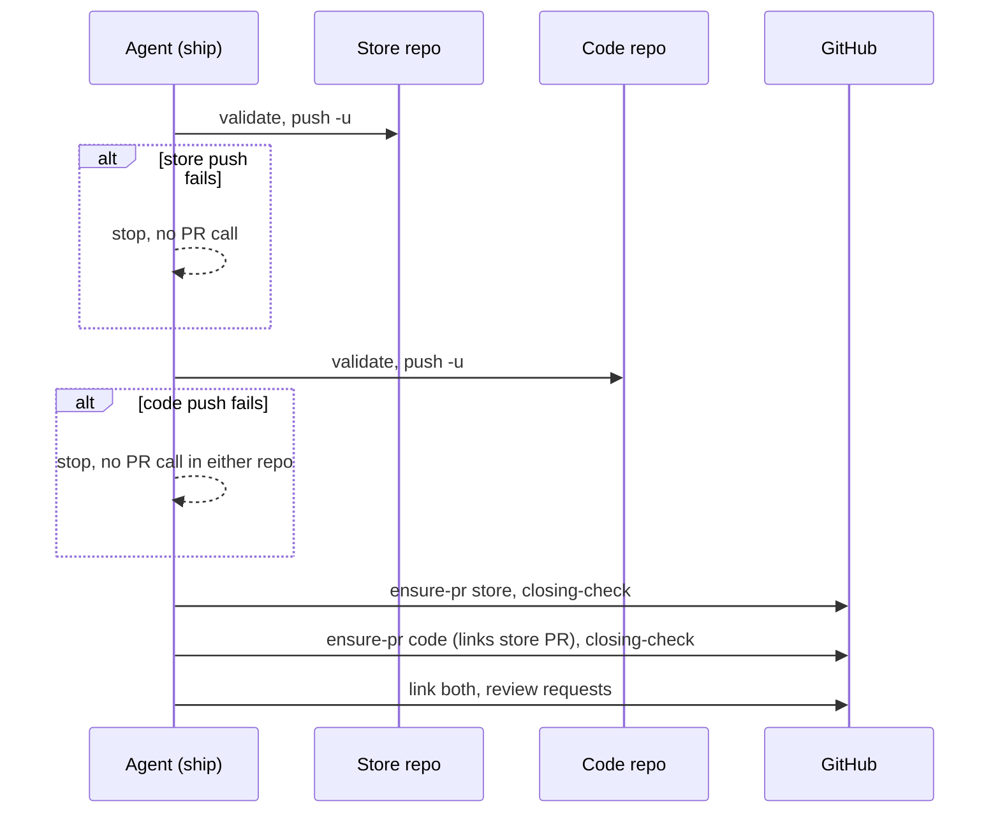
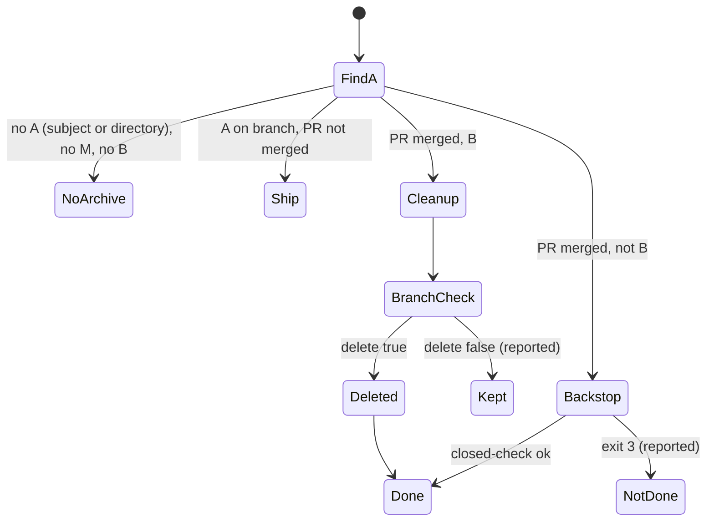
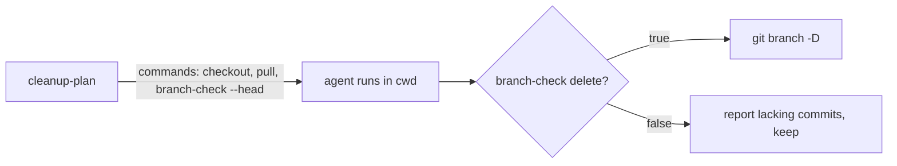

# Design

## Triage

| Trigger | Applies? | Evidence |
|---|---|---|
| T1 Components (new component, or 3+ with directed relationships) | No | No new component. The new `pr-pair.sh branch-check` is a subcommand of an existing script (`COMMANDS`, `skills/specwright-pr/scripts/pr-pair.sh:1895-1897`). |
| T2 State (persistent state, caches, 3+ state machine) | Yes | The pass record gains `written_at` (`pass_write`, `pr-pair.sh:1519`). The finish resume table is a state machine over facts A/M/B (`skills/specwright-finish/SKILL.md:21-44`) that gets a new fact source and a new row. |
| T3 Concurrency (background work, workers/isolates, async, retries) | Yes | Ship pushes two repos and opens two PRs in a fixed order (`skills/specwright-pr/SKILL.md:70-75`). The re-request decision races GitHub's activity log lag (`request_state`, `pr-pair.sh:1577-1589`). |
| T4 Boundaries (data format, migration, shared interface, IPC, external) | Yes | The `cleanup-plan` JSON contract changes (`pr-pair.sh:1858-1892`, read by the skill). The pass record format gains a field that 0.1.12 records lack. The `pass plan` re-request row gains a cutoff source. `pr-reply.sh`'s exit contract adds a refusal. |
| T5 Volume (grows without a fixed bound) | No | The only listing added is `branch-check`'s commit list, which is bounded by the commits on one branch. Temp files go from leaked to removed. |
| T6 Risk (security, money, data loss, unrecoverable user data) | Yes | #55 loses commits; #56 hides a reviewer's finding behind an empty reply; #54 leaves reply bodies in the system temp directory. |

TIER: FULL

## Context

See proposal.md for the issues. Current code each fix touches:

- **Ship order (#58).** Ship step 4 runs validate, push and find-or-open per repo, the store first (`skills/specwright-pr/SKILL.md:70-74`). In a pair, the store's 4.3 opens its PR before the code repo's 4.2 push. Step 5 links once both PRs exist, and step 6 posts review requests. `eval-store-ship-push-rejected` (`evals/git-workflow/evals.json` id 29) covers only a failed *store* push.
- **Re-request (#57).** `request_state` takes the push time from `repos/<repo>/activity` and counts a request only when `pushed` is truthy (`pr-pair.sh:1580-1588`). The pass plan calls it per destination (`pr-pair.sh:1714-1727`). The snapshot already handles a missing push time for reviewer cutoffs: it records the first GitHub `Date` it saw a head in `$SPECWRIGHT_STATE_DIR/heads/<owner/name/pr, lowercased>/<oid>`, one HTTP-date line (`pr-snapshot.sh:386-405`), and pr-evidence's requirement *Reviewer reports count only for the current head* rules out the commit date.
- **Reply body (#56) and temp files (#54).** `body_with_marker` runs inside `$(...)`, so `errexit` does not stop it when `cat` fails (`pr-reply.sh:90-96`). The temp file is removed only on the success paths (`:123`, `:144`), and the script has no `trap`. `pr-snapshot.sh` already removes its own temp file (`:400`), and `pr-pair.sh`'s `temp_beside` users unlink on `BaseException` (`:1846-1852`). The skill text tells the agent to write body files in ship 4.3 and 6, feedback replies, after-limit issues (`SKILL.md:74,76,109`) and the closing-line rewrite, with no cleanup step.
- **Branch deletion (#55).** Store-backed: `cleanup-plan` emits `checkout`, `pull --ff-only`, `branch -d`, plus `-D` with `force_delete_allowed` when the PR head equals the tip (`pr-pair.sh:1868-1874`). The plan is computed **before** the pull, so it cannot judge whether the updated main holds the tip. Repo-local: `SKILL.md:135` and `specwright-finish/SKILL.md:66` run `git branch -d`, which tests the upstream when one is set (ship sets it with `git push -u`).
- **Resume (#63, #65).** Fact A is matched only by subject (`specwright-finish/SKILL.md:22`). The row `pr, the branch's PR merged` sends a repo whose branch is gone to cleanup, which runs `git branch -d` and fails (`:42`). Roadmap status already derives an archive from the directory on main (`git ls-tree -d`, `skills/specwright-roadmap/SKILL.md`).

Constraints: ADR 0002 (thin scripts, JSON contracts, exit codes as stops), ADR 0003 (evidence in git and GitHub; local state is only recoverable working state under `~/.cache/specwright/`), ADR 0004 (`gh` through `as.sh`), ADR 0006 (store-backed pairs).

## Decisions

### D1: Ship pushes every expected repo, then opens PRs (#58)

- **Choice:** Split ship step 4 into two loops over the expected set, store first. **4a** validates and pushes each repo. **4b** runs only when every push succeeded, and finds or opens each PR and runs the closing check. Steps 5-6 are unchanged and still follow 4b. A failed validate or push in 4a stops before any PR call in either repo, so the existing failure rule holds as written.
- **Rejected:** Keep the per-repo loop and narrow the rule to "open no further PR and report the store PR already opened". This leaves an unlinked store PR that reviewers may start on, and every later step has to treat a half-shipped pair as a state. The cost of pushing first is only that a push is not undone when the other repo fails, and a pushed branch with no PR is invisible to reviewers.
- **Reversal cost:** low (skill text only).

### D2: Re-request cutoff falls back to the first-seen record, then the pass write time (#57)

- **Choice:** `request_state` takes its cutoff from the first source available: the activity push time (`push`); the first-seen record for that PR and head that `pr-snapshot.sh` writes, parsed from its HTTP date (`first_seen`); the pass record's new `written_at`, or the owner's `at` in a record written before this change (`pass_written`). The row reports `push_time` (unchanged, null when missing) plus `cutoff` and `cutoff_source`. A request comment from the poster with the exact body, created at or after the cutoff, is done. `pass_written` is used only when no first-seen record for the head can be read. `pass write` adds `written_at` (UTC, `%Y-%m-%dT%H:%M:%SZ`). The record stays version 2: readers ignore unknown keys, and the owner-`at` fallback covers old records.
  - **Ordering (the skill text, `specwright-pr` feedback step 9 and the resume `rerequest` row):** the snapshots of step 1 are taken before the fix, so no snapshot has seen the new head when step 9 runs. After each push and before any re-request, feedback takes a fresh `pr-snapshot.sh` of each pushed PR, which records the head's first sighting. It then runs `pass plan` with those snapshots and posts only the requests whose `rerequest` row is not done. The first-seen record therefore precedes the request. A request for an earlier head of the same pass (a `partial_commit` push) precedes the new head's first sighting, so it does not count for the new head.
  - **Scope of the Settings rule:** feedback step 9 and the resume rows ("as in steps 7-9") point to the Settings **Re-request review** paragraph (`skills/specwright-pr/SKILL.md:52`), which says "If the push time is not found, post anyway". That sentence is the #57 behaviour. The paragraph is therefore split. **Inside a feedback pass** (a pass record exists), the `pass plan` `rerequest` row alone decides what to post, and "post anyway" does not apply. **Outside a pass** (watch's CI-fix push and the archive-before-merge push, which have no pass record), the existing rule stays: compare with the push time, post anyway when it is missing, at most once per pushed head.
- **Rejected:** (a) The fix commit's committer date. It is a local clock, and pr-evidence already rejects it for the same purpose. (b) A local "request posted" flag per head. It is a second source of truth beside the GitHub comment (ADR 0003), and it is lost on another machine.
- **Reversal cost:** low. The extra field is optional and the cutoff logic is internal to the plan.

### D3: `pr-reply.sh` checks the body and owns its temp file with a trap (#56, #54)

- **Choice:** Before `pending_check`, a `thread` or `comment` reply checks the body file with `[ -f "$f" ] && [ -r "$f" ] && [ -s "$f" ]`. On failure it prints `pr-reply: body file <path> is missing, unreadable or empty; nothing was posted` and exits 2, the usage-error status, with no GitHub call. `body_with_marker` stops being a command substitution: it writes into a global `tmp` made once at the top of those two kinds, under `trap 'rm -f "${tmp:-}"' EXIT`. Its marker-kind variable is renamed (`mkind`), because once it runs in the main shell, the current `kind=handled` would overwrite the script's `kind` argument (`pr-reply.sh:93`). Each `cat` and `printf` is checked (`|| exit 1`), so a short write cannot post a partial body. The explicit `rm -f "$file"` lines go away. In the skill text, every step that writes a body or message file adds "remove the file once the command has run, whatever its outcome".
- **Rejected:** Keep the subshell and add `shopt -s inherit_errexit`. It needs bash 4.4, while Git Bash and macOS's bash 3.2 differ here. It would still not remove the temp file on a later failure, and failing on a missing file should not depend on errexit subtleties.
- **Reversal cost:** low.

### D4: A shared `branch-check` command decides deletion after the pull (#55)

- **Choice:** New `pr-pair.sh branch-check --dir <d> --branch <b> --main <m> [--head <sha>]`. It is read-only and has no network access. It reports `{"ok": true, "delete": bool, "reason": "on_main"|"pr_head"|"lacking"|"head_unknown", "lacking": [{"sha","subject"}]}`. It returns `delete` when `git merge-base --is-ancestor refs/heads/<b> refs/heads/<m>` succeeds (`on_main`), or when `--head` resolves locally (`git cat-file -e <sha>^{commit}`) and the tip is that head or an ancestor of it (`pr_head`). When the tip is not on main and the head is absent, the reason is `head_unknown` and `lacking` is `<m>..<b>`, so nothing is deleted. Otherwise `lacking` lists `git log <m>..<b>` minus the commits reachable from the head. Every cleanup path runs it **after** `checkout <main> && pull --ff-only`, then deletes with `git branch -D <b>` only on `delete: true`. Git's check is no longer the safeguard, and `-D` avoids `-d` refusing a squash-merged branch that has no upstream.
  - `cleanup-plan` changes its per-repo `commands` to `checkout`, `pull`, `branch-check` (with `--head` from the merged PR), plus `delete: ["git","branch","-D",b]`, which the skill runs only when the check returns `delete: true`. `force_delete` and `force_delete_allowed` are removed. The empty-code-branch path is unchanged (`-d`, no upstream, no commits after main).
  - Repo-local cleanup (`specwright-pr` **Cleanup after merge** and `specwright-finish` **After the PR is merged**) runs the same check, with `--head` from the merged PR's `head_sha` in `[as] bash scripts/pr-pair.sh discover --repo <owner>/<name> --branch <branch> --base <main> --state merged`, the complete, fenced discovery, instead of `gh pr view <branch>`, which can pick another PR from the same branch name. When discovery returns several merged PRs from that branch into main, `--head` is the `head_sha` of `discover`'s `newest` (the highest PR number, `pr-pair.sh:556-564`), the PR most recently opened from the branch and so the one its latest pushes went into. If an older PR's head is what the local tip matches, the check keeps the branch and reports it, which is the safe failure. Store-backed `--head` comes from `cleanup-plan`'s own `pr.head_sha`, which reads the store with its internal per-login fence, not from a separate `discover` call. It keeps and reports the branch otherwise.
- **Rejected:** (a) Let `cleanup-plan` judge before the pull, against `refs/remotes/origin/<main>`. That depends on a fetch the plan does not do, so it is wrong after a stale fetch. (b) Keep `git branch -d` and only add the ancestor check to the skill text. The decision would then live in prose, untested, in three places.
- **Reversal cost:** medium. `cleanup-plan`'s JSON contract changes. Its only consumer is the skill text shipped in the same release.

### D5: Resume reads fact A from the archive directory on main (#63)

- **Choice:** Fact A on main also holds when `git ls-tree -d --name-only <main> -- 
/changes/archive/` lists `<archived-name>`, the name from the **Archive name** rule. `ls-tree` prints full paths (`
/changes/archive/<name>`), so the match is on the last path component. For a change name without a date, that component must match exactly `^\d{4}-\d{2}-\d{2}-<change-name>$`, never a substring. This is the same evidence roadmap status already uses. Subject matching on the branch (`<main>..<branch>`) stays, because a branch archive is not on main yet.
- **Rejected:** In pr mode, use `pr-pair.sh discover --state merged` as the evidence. It needs GitHub and fails offline, while the directory on main is local and also covers the bulk path in local mode.
  - **Local-mode row:** in `finish: local` a bulk archive merges one branch, as `merge: <that branch's change name>`. The other change in the bulk then has its archive on main, no `merge: <change-name>` and no branch, so it matches no row. A new row covers it, placed after `M, not B`: `local`, A on main through the archive directory, not M, not B → repo done. The archive reached main through another change's merge, and no branch is left to merge or delete. In pr mode the same state is D6's merged-PR row.
- **Reversal cost:** low.

### D6: A new resume row for a merged PR whose branch is gone (#65)

- **Choice:** Split the row `pr, the branch's PR merged` into two rows. When B holds, it runs **After the PR is merged** cleanup (now under D4). When B does not, it runs only the issues-left-open backstop (`closed-check`, as in **Cleanup after merge**) and the repo counts as done. When `closed-check` exits 3, the repo is not done, and the report says the backstop did not run. The PR is found with `pr-pair.sh discover --state merged` for `<prefix>/<change-name>`. A repo-local change whose archive was found only by D5 lands in this row when its PR merged.
- **Rejected:** Make the cleanup commands conditional on B inside **After the PR is merged**. That section is shared with the "the user says the PR merged" entry, where a missing branch is unexpected and worth reporting. A distinct row keeps resume's done rule explicit.
- **Reversal cost:** low.

## Diagrams (FULL)

T3: ship sequence after D1 (store-backed, both PRs expected).

T2: finish resume rows for a `finish: pr` repo after D5 and D6 (first match wins, as in the table).

T4: the `cleanup-plan` entry contract per repo.

## State & Ownership (FULL)

| State | Owner (sole writer) | Lifetime | Invalidation / rebuild | Authoritative copy |
|---|---|---|---|---|
| Pass record `written_at` | `pr-pair.sh pass write` (adopt keeps it) | Until `pass done` removes the record | Never rewritten. Missing in old records → owner `at` | The record file under `$SPECWRIGHT_STATE_DIR` |
| First-seen head record | `pr-snapshot.sh` (unchanged); `pass plan` only reads it | Until a newer head of that PR replaces it | Unreadable → next cutoff source | The record file |
| Review-request comment | The poster, through `gh pr comment` | GitHub | n/a | GitHub |
| Reply temp file | `pr-reply.sh` | One process | Removed on EXIT | n/a |
| Local change branch | Cleanup, deleting only after `branch-check` | Until deleted | n/a | The local repo; its remote copy is GitHub's |

## Failure & Visibility (FULL)

| Component | Fails / dies mid-operation → | Recovery | Retry safe? | Who finds out |
|---|---|---|---|---|
| Ship 4a, push | One repo pushed, the other not | Rerun ship: pushes are idempotent, and 4b runs only after both succeed | Yes | User: the report names the failed repo and its error |
| Ship 4b, ensure-pr | Store PR open, code PR not yet | Rerun ship: `ensure-pr` reports `found` | Yes | User |
| `request_state` fallback | All three sources unavailable (only possible for a record missing both `written_at` and owner `at`, which `pass write` never produces) | The row stays `todo`, so at worst a duplicate request is posted | Yes (one duplicate, bounded per plan) | User: the row shows `cutoff_source: none` |
| Re-request posted before the head's first sighting | Ordering skipped: the plan sees no first-seen record before the request, and the later snapshot records first-seen after it | The post-push snapshot in feedback step 9 and in resume prevents it. If skipped, one more request is scheduled, and it counts | Yes (bounded to one duplicate per head) | User: the row's `cutoff_source` and the duplicate comment on the PR |
| `pr-reply.sh` | Fails before the post | Nothing posted. The trap removes the temp file | Yes | User: stderr, non-zero exit |
| `pr-reply.sh` | Post succeeded, a later step fails | Unchanged retry hints (resolve or react only). The trap removes the temp file | Yes, per hint | User: stderr |
| `branch-check` | git error | `ok: false` JSON, exit 1. Cleanup deletes nothing and reports | Yes | User |
| Cleanup, kill between pull and delete | Branch still present | Resume: the PR-merged-with-B row reruns the check | Yes | Resume |
| Resume backstop | `closed-check` exit 3 | The repo is not done. A later finish retries | Yes | User: "backstop not done" |

## Resource Bounds (FULL)

| Queue / buffer / cache / transfer | Bound | At the bound | Timeout | At 10x / 100x |
|---|---|---|---|---|
| `branch-check` `lacking` list | Commits on one branch after main | Listed in full: a branch of hundreds of commits is still small JSON | git, local | Fine |
| Request comments read by `request_state` | Existing `gh_list` paging (unchanged) | Unchanged | Unchanged | Unchanged |
| Temp files | One per `pr-reply.sh` run, removed on exit | n/a | n/a | n/a |

## Flow & State Gaps (FULL)

- **Push lag in the activity log (#57):** covered by D2's fallback chain. When the push entry appears later, `push` becomes the source. The push precedes the first sighting of its head, so a request already counted after first-seen still counts after the push, and the row does not turn back to `todo`. With the D2 ordering, every request for the new head is posted after its first sighting. Earlier rounds' requests precede the record's write. A request for an earlier head of the same pass precedes the new head's first sighting. Neither can count for the new head while a first-seen record exists.
- **Request posted before the head's first sighting** (an agent skipped the post-push snapshot): the next snapshot records first-seen after that request, so the plan schedules one more request. The bound is one duplicate per head: the second request follows first-seen and counts.
- **No first-seen record readable and two heads pushed in one pass:** `pass_written` precedes both pushes, so the first head's request also counts for the second, and the second head gets no fresh request. This only happens when the state directory cannot be written or read (`first_seen_unsaved` in the snapshot). The row reports `cutoff_source: pass_written` and the skill text tells the agent to report it. Accepted: there is no GitHub-only evidence to do better while the activity log lacks the push.
- **Ship interrupted between 4a and 4b:** both branches pushed, no PR. A rerun pushes (no-op) and opens both. Watch is not offered until 4b completes.
- **Store PR existed before a failed code push (spec scenario):** 4b never runs, so no link, description or request is added to the store PR. Only the push to an existing PR's branch happened, which GitHub shows as new commits.
- **Late push after a merge (#55), seen from another checkout:** `branch-check` judges the local tip only. A commit that exists only on the remote is out of scope, and it stays on the remote.
- **Bulk archive with one change's PR unmerged:** D5 finds A on main only after the merge. Before that, the branch subject rule applies (one commit naming them all, `specwright-finish` step 3).
- **Squash-merged repo-local PR with the branch still present:** D6's B row → D4 `pr_head` → deleted.

## Mechanism Ledger (FULL)

| Mechanism | Built? | Why (harm nobody catches / expensive later) | Evidence that would change the call |
|---|---|---|---|
| D1 push-all-first ordering | Yes | A half-shipped pair otherwise exists with an unlinked PR (#58) | n/a |
| D2 three-source cutoff | Yes | Without it a resumed pass re-requests on every plan (#57) | n/a |
| `written_at` field | Yes | The only GitHub-free fallback once first-seen is missing. A format field is cheaper to add now than to migrate later | n/a |
| Body checks and trap in `pr-reply.sh` | Yes | A hidden finding nobody sees (#56); body files left behind (#54) | n/a |
| `branch-check` subcommand | Yes | Commit loss, otherwise caught only after GitHub auto-deletes the remote branch (#55) | n/a |
| Undo a successful store push when the code push fails | No | The pushed branch is harmless without a PR, and a force-delete of a remote branch is riskier than leaving it | A reviewer bot that reviews branches without PRs |
| Trap-based cleanup in `pr-snapshot.sh` and `pr-pair.sh` | No | They already remove their temp files on failure (`pr-snapshot.sh:400`, `pr-pair.sh:1846-1852`) | A new `mktemp` user. The test greps every `mktemp` in `skills/*/scripts` and asserts a cleanup path |
| D5 fallback to merged-PR discovery | No | The directory on main covers squash and bulk without the network | An archive directory renamed on main by hand |
| Inherit-errexit hardening across scripts | No | D3 removes the only command substitution that wrote a file | A future substitution doing I/O |

## Risks / Trade-offs

- [`cleanup-plan` contract change breaks an installed older skill text that reads `force_delete_allowed`] → The scripts and skill text install together (ADR 0001 copies). Release notes for 0.1.13 name the field removal, and `test_skill_text.py` asserts the skill no longer mentions `force_delete_allowed`.
- [`branch-check` keeps a branch that was safe to delete because the PR head is not fetched locally] → It is reported with `head_unknown` and the user decides. Keeping work is the safe failure.
- [Deleting with `-D` after the check is wrong if the check has a bug] → Unit tests cover every reason (on_main, pr_head, ancestor of head, lacking, head_unknown), using real git repositories in the fixture.
- [The new eval for #58 needs a store push that succeeds while the code push fails, and both origins must stay on GitHub, because `identity` rejects any other push URL (`pr-pair.sh:393-397`) and `get-url --push` expands `pushurl`, `insteadOf` and `pushInsteadOf`] → The fixture puts a `git` shim first on the eval's `PATH`. It runs the real git for everything except `push` in the store checkout, which it sends to a local bare repo (`git push <bare> HEAD:refs/heads/<branch>`, then it sets `refs/remotes/origin/<branch>` so upstream state looks pushed), and it prints git's normal success output. The code push still dies at the existing unreachable proxy (`unreachable_proxy`, `evals/git-workflow/fixtures.py:357`). The first task checks that `identity`, `as.sh` and ship's push run through the shim with both URLs on GitHub. If they do not, the regression test for #58 falls back to `test_skill_text.py`: it asserts that ship's text pushes every repo before any `ensure-pr`, and the fallback is recorded in the task.

- [D6's backstop asks again, on every resume, about issues the user declined to close] → Accepted: resume runs only when the user asks to finish, and the question lists the same issues, so declining again changes nothing. Recording declines locally would add state outside ADR 0003's inventory.

## ADRs

- **In force, constraining this change:** 0002 (thin scripts and JSON contracts: `branch-check`), 0003 (evidence on GitHub and in git; `written_at` is working state in the pass record, and the first-seen record is read, not owned), 0004 (repo-local `branch-check --head` comes from `discover --state merged`, run as `[as]`, that is, through `as.sh` when a login is configured; store-backed `--head` comes from `cleanup-plan`, which reads the store under its internal per-login fence; `specwright-finish`'s post-merge `gh pr view <branch> --json state,...` merge check stays as it is, the unfenced exception ADR 0004 lists, until #38 (`default-identity-fencing`) closes it, and it is never a source of `--head`), 0006 (store-backed pairs and the expected set).
- **To record during apply:** none.
