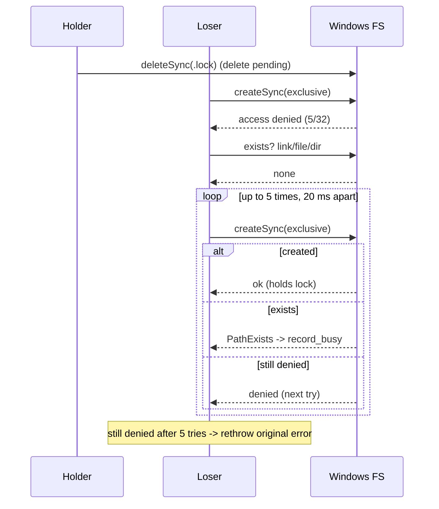
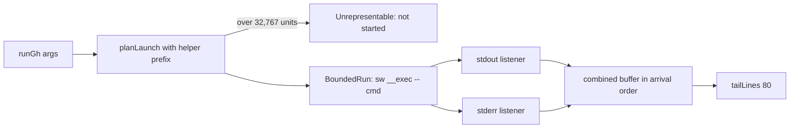

# Design

## Triage

| Trigger | Applies? | Evidence |
|---|---|---|
| T1 Components (new component, or 3+ with directed relationships) | no | Each fix stays inside one existing module: `vcs/`, `finish/undo_plan.dart`, `pr/snapshot.dart`, `pr/feedback_record_files.dart`, `process/`, `update/sw_install.dart`. No new component. |
| T2 State (persistent state, caches, 3+ state machine) | no | No new stored state. The feedback-record lock file keeps its path and protocol (`cli/lib/src/pr/feedback_record_files.dart:48-70`). |
| T3 Concurrency (background work, workers/isolates, async, retries) | yes | #227 adds a bounded retry to a lock create that races another process's release. #215 merges two concurrently read pipes. |
| T4 Boundaries (data format, migration, shared interface, IPC, external) | yes | Exit codes, error codes and stderr of `sw pr snapshot`, `sw finish undo-archive-plan` and `sw vcs commit` change. The helper's command line (the `sw __exec` argv) is now counted. |
| T5 Volume (grows without a fixed bound) | no | The merged log buffer is bounded by one `maxBytes` budget over both streams (`cli/lib/src/process/bounded_run.dart:229-253`). |
| T6 Risk (security, money, data loss, unrecoverable user data) | no | No credential, history or user file is rewritten. The retry never removes a lock it did not create. |

TIER: FULL

## Context

The proposal lists the ten issues and the scope decisions (S1-S5). The current code behind each one:

- **#206 CRLF message.**
  - GitButler reads the message file strictly and commits with `but commit -F <file>` (`cli/lib/src/vcs/gitbutler_backend.dart:566-579`). It then compares the stored message with the file text, trimming only trailing newlines (`cli/lib/src/vcs/gitbutler_backend.dart:624-629`). A CR inside the text survives `_rstripNl`, so a CRLF file never matches.
  - Git commits with `git commit -F <file>` (`cli/lib/src/vcs/git_backend.dart:192-197`) and has no read-back check.
  - jj reads the file "with its newlines untouched" (`cli/lib/src/vcs/jj_backend.dart:704-714`) and passes it as `-m` (`cli/lib/src/vcs/jj_backend.dart:342`, `:1036`), so CRs reach the stored message.
- **#209 undo plan.**
  - The resume's dirty check reads `git status --porcelain` through `textOf`, which strips the whole output (`cli/lib/src/finish/undo_plan.dart:158`). It then cuts 3 code points from each line (`cli/lib/src/finish/undo_plan.dart:578-589`), so the first line's leading space is lost and its first path character goes with it.
  - Non-`-z` porcelain also C-quotes names with special characters, and the dirty check reads that form.
  - The `carried_edits` loop cuts 3 code points from every NUL record of `status --porcelain=v1 -z` (`cli/lib/src/finish/undo_plan.dart:728-750`), including a rename's unprefixed source record.
  - `vcsState` rethrows every state stop with the default code 1 and drops the stop's own code (`cli/lib/src/finish/undo_plan.dart:209-213`; the default is `cli/lib/src/vcs/stop.dart:11`).
- **#214 snapshot `--timeout`.**
  - The value is taken as given (`cli/lib/src/pr/snapshot.dart:209-211`). It is parsed only in the wait loop by `int.tryParse`, where `null` ends the wait at once as a timeout (`cli/lib/src/pr/snapshot.dart:660-661`).
  - Dart's `int.tryParse` already reads `08` as 8, so item 2 no longer occurs in `sw`. It also accepts a sign and `0x` hex, which the old script did not.
  - The material-file write returns exit 1 with nothing on stderr (`cli/lib/src/pr/snapshot.dart:509-512`).
- **#215 logs.** The failed-log call joins all of stdout and then all of stderr (`cli/lib/src/pr/snapshot.dart:331-336`). `BoundedRun` reads the helper's two pipes with separate listeners (`cli/lib/src/process/bounded_run.dart:295-339`). The helper starts the target with `inheritStdio` (`cli/lib/src/process/exec_helper.dart:148-151`), so the target writes straight into those two pipes.
- **#223 command line.**
  - `planLaunch` checks only the tool's own line (`cli/lib/src/process/command_line.dart:169`; the check is at `cli/lib/src/process/command_line.dart:129-138`).
  - `BoundedRun` then starts `helperCommand` with `--` and the whole command on its argv (`cli/lib/src/process/bounded_run.dart:202-204`).
  - `runGh` and `runBoundedCommand` reach it through `planLaunch` (`cli/lib/src/pr/gh.dart:120`).
  - `sw run --bounded` and the reviewer runner each call `planLaunch` and build `BoundedRun` themselves (`cli/lib/src/commands/run.dart:91-109`, `cli/lib/src/review/run.dart:1885-1904`). `sw run --bounded` maps `Unrepresentable` to `bounded: unrepresentable <what>: <cmd>`, exit 2 (`cli/lib/src/commands/run.dart:95-99`).
- **#224 lookup.** `_isFile` accepts any execute bit (`cli/lib/src/process/resolve.dart:105-111`). The libc binding has no `access` or `faccessat` yet (`cli/lib/src/native/libc.dart:12-30`). `package:ffi` is already a dependency (`cli/pubspec.yaml:21`).
- **#227 lock.** `_create` rethrows a `FileSystemException` when nothing exists at the path (`cli/lib/src/pr/feedback_record_files.dart:48-65`). It serves both `acquireLock` and the publication fallback's exclusive create (`cli/lib/src/pr/feedback_record_files.dart:68`, `:93`). The eval asserts every loser's error is `record_busy` or `not_owner` and prints nothing on failure (`evals/pr-pair/test_workflow_records.py:318-325`).
- **#231 folder names.** Subtest repos are named `w-{len(name)}-{abs(hash(name)) % 1000}` (`evals/pr-pair/test_parity.py:454`), and `hash()` is salted per process, so two cases can share a folder in one run. The fix names each folder by the case's ordinal in `cases` (`w-<n>`), unique within the run and the same in every run.
- **#235 install cleanup.** The `finally` block deletes the part files with `files.remove` (`cli/lib/src/update/sw_install.dart:248-255`). `remove` deletes with `deleteSync`, which throws (`cli/lib/src/update/file_ops.dart:100-110`), so a throw in `finally` replaces the install's result. Parts older than an hour are swept by a later run (`cli/lib/src/update/sw_install.dart:26`, `:340`).

In-force ADRs:

- ADR 0034: over-long Windows lines are refused before the start, which #223 restores for the helper path; ADR 0041, recorded by this change, amends its named-refusal clause for lines a bounded launch newly refuses (D5).
- ADR 0027: the self-spawned helper.
- ADR 0018: backend commit contracts.

## Decisions

### D1: jj normalises CRLF; GitButler's read-back reads line endings alike on both sides

- **Choice:**
  - jj replaces each CRLF with LF in the message it already reads and passes as `-m` on commit only (`cli/lib/src/vcs/jj_backend.dart:1014-1036`). A lone CR is left as it is, and the spec makes no promise about it. `_readMessage` (`:704-714`) also serves `jjMerge` (`:706-738`), so it is left as it is: the commit path normalises its result, and merge messages and jj's existing missing-file diagnostic are unchanged. A Dart test pins that a merge message keeps its CRLF bytes.
  - GitButler keeps `but commit -F` for every message file, unchanged (`cli/lib/src/vcs/gitbutler_backend.dart:571-579`), and passes the path resolved against the directory `sw` runs in, where `sw` already reads it (`:566`). Nothing about the message text goes on the command line, and `sw`'s own fallback diagnostic, built from the argv (`:144-151`), cannot hold it; what `but` itself prints on stderr or stdout is relayed as `but_error` unredacted (`:133-154`), as today (C18). The size guard does change. `_argvCheck` (`:475-501`) today estimates `['jj', 'commit', ...filesets, '-m', message]` with the message file's spelling (`:564`), not the real launch (`:571-579`), and rounds 18 and 19 showed that any separate estimate drifts from the launcher: on Windows `but` can resolve to `but.cmd`, which `launch` routes through `_batch` with its 8,191-unit payload cap and a raw `cmd.exe` line behind the helper (`cli/lib/src/vcs/tool_runner.dart:41-58`, `cli/lib/src/process/launch.dart:169-185`, `:204-232`, `cli/lib/src/process/command_line.dart:44-65`, `:156-164`). So on Windows the guard stops estimating and takes the launcher's own refusal:
    - No preflight on Windows. `launch` already refuses an over-long line before anything starts and throws the typed refusal to its caller (`Unrepresentable` from `checkLaunchInput` and `planLaunch`, `UnsafeBatchArgument` from the batch quoting, `cli/lib/src/process/launch.dart:67-123`; `runToolCapped` does not catch either, `cli/lib/src/vcs/tool_runner.dart:41-58`). The commit's `butRun` call catches them around the real launch and maps only the length refusals to `too_many_paths`: `Unrepresentable` whose `what` is `command line`, and `UnsafeBatchArgument` whose reason is `line too long` (`cli/lib/src/process/command_line.dart:61-63`). Every other refusal (a NUL, a `%` or `"` in a batch argument) propagates as it does today. Because the mapping sits at the one launch that resolves `but`, a `PATH` change between any earlier read and the commit cannot make a checked line fail unchecked. D5 returns a new bounded refusal (a raw `cmd.exe` line or a helper line over the limit) as a failed helper start instead of throwing, which a `but.cmd` reaches through `launch._batch` (`launch.dart:218-245`) and `runToolCapped` would report as `tool_missing` (`tool_runner.dart:41-58`). So `BoundedResult` carries a structured `lineTooLong` cause beside its `startError`, `_batch` copies it into `LaunchResult.startFailed`, and `runToolCapped` throws it as a typed length refusal only when its caller asks (`lengthRefusals: true`); only the commit's `butRun` asks, and maps it to `too_many_paths`. Every other caller keeps today's failed-start result, the reviewer's and `sw pr reply`'s included. The planner checks the raw line before the helper line and both set the same `lineTooLong` cause, so which of them fires first does not change the mapping. A Windows Dart test (run by `cli.yml` on Windows, since `evals/run.py --changed` selects Python modules only, `:385-410`) keeps a native `but.exe` first on `PATH` through every read before the commit, then removes it so the commit resolves to `but.cmd`, with no usable `COMSPEC` and a long `SYSTEMROOT`; it asserts that the reads completed, that the commit's batch payload fit the batch cap, that the planner refused the commit's raw line (the helper line is over the limit too, since it carries the interpreter path twice, `command_line.dart:156-164`, `bounded_run.dart:202-204`), and that the cause reached the mapper as `too_many_paths` with `but commit` never started. A Git commit takes no length flag: a Windows test keeps a native `git.exe` first on `PATH` through repository discovery, the branch check and `git add` (`cli/lib/src/vcs/probe.dart:55-65`, `cli/lib/src/vcs/git_backend.dart:118-128`, `:190-197`), then removes it so the commit resolves to `git.cmd`, with no usable `COMSPEC` and a long `SYSTEMROOT`, and asserts `git_commit_failed`, today's exit, the full message `cannot start git: cannot start the helper: its command line is too long` (the adapter's prefix, `launch.dart:241-243`, relayed by `git_backend.dart:198-203`) and `git commit` never started.
    - The message path is resolved once; the read and the launch use that one absolute path. This adds one refusal: when `but` resolves to a `.cmd` or `.bat` shim, `quoteBatchLine` refuses an argument holding `%` or `!` (`cli/lib/src/process/command_line.dart:44-52`), so a relative `-F msg.txt` that passed before now stops when the resolved message path (against `sw`'s working directory, which need not be the repository) holds either character. The refusal is kept (passing the relative path would bring back the wrong-directory read the change fixes); it reaches `sw vcs` as an uncaught `UnsafeBatchArgument` and is reported through the existing catch-all (`cli/lib/src/commands/vcs.dart:118-121`) as today for any batch refusal. The vcs-backends exception lists it, and a Windows test with a `but.cmd` shim, run with `sw`'s working directory under a directory named `a%b` and a relative message path, lets the earlier `but` reads succeed and asserts `internal_error`, exit 1, with the unsafe-batch-argument diagnostic, and that `but commit` was never invoked.
    - POSIX gets no estimate either: any estimate misses what the kernel counts (the resolved path is passed both as `argv[0]` and as the executable name, `cli/lib/src/process/launch.dart:169-196`, `:270-280`). The OS's own refusal is used instead. `_native` today turns a `ProcessException` into a generic failed start (`:279-280`), which `runToolCapped` reports as `tool_missing` (`cli/lib/src/vcs/tool_runner.dart:41-58`). `LaunchResult` now keeps the start's OS error code, and `runToolCapped` takes an optional `tooLong` stop: when it is set and the start failed with `E2BIG` (7 on Linux and macOS), it throws that stop instead of `tool_missing`. Only the commit sets it, to `too_many_paths`; every other caller is unchanged. `_argvCheck` (`:475-501`) is removed.
    - Tests: a Windows native `.exe` boundary (fits with a short relative spelling, not with the real line → `too_many_paths`, no start); a Windows case where `but.exe` sits earlier on `PATH` during the branch-tip reads and is removed before the commit, leaving `but.cmd`, with a payload between the batch cap and the native limit → `too_many_paths`, not `internal_error`; a `but.cmd` case with a `%` in a path → the unsafe-argument refusal unchanged; a Linux test whose `but commit` argv and environment pass `ARG_MAX` → `too_many_paths`, and a commit whose fake `but` is removed after the last pre-commit read (the probe would stop earlier with `tool_missing`, `cli/lib/src/vcs/probe.dart:147-159`) → `tool_missing` from the commit launch's lookup; and, for the OS start-error branch (`cli/lib/src/process/launch.dart:270-280`) itself, a fake `but` swapped at commit time for an executable script whose `#!` interpreter does not exist, so the start fails with `ENOENT`, asserting `tool_missing`, not `too_many_paths`. A further test pins the delta's other boundary: paths over the old 32,000-byte quoted estimate whose real launch fits now commit. The estimator's tests (`cli/test/vcs/gitbutler_backend_test.dart:669-710`: the synthetic Windows limit, the 100,000-byte and injected `ARG_MAX` cases) are replaced by these, and the now-dead `argMax` seam in its helper (`:185-201`) is removed.
  - The read-back is where #206 fails today. It runs after `but commit` has made the commit (`:571-629`); on a mismatch it stops with `commit_mismatch` and leaves the new tip in place (`:643-648`), and that stays so. The stored body is read through `runText`, whose `decodeText` already folds CRLF and a lone CR to LF (`cli/lib/src/vcs/scripts.dart:15-21`, `cli/lib/src/vcs/codec.dart`), while the file text keeps its CRs (`:566`), so a CRLF file never matches. The fix folds the file text the same way before `_rstripNl` (`:624-629`), so both sides are read alike. `sw` makes no promise about the line endings `but` stores; that is `but`'s behaviour (C11).
  - Tests: a Dart unit test of the comparison with a CRLF file against a folded body (match), with a file holding an interior lone CR (match, a listed change from today's `commit_mismatch`), and with a body whose text differs (mismatch); the real-`but` Linux fixture asserts exit 0, no `commit_mismatch` and the folded message; the relative-path fixtures run from a directory outside the repo.
  - ADR 0018 ("with the message file") and the main requirement "On GitButler a commit takes only its named paths into the change branch" hold unchanged: `but commit -F` still gets the message file.
  - Git is unchanged: it passes the file to `git commit -F` as given (`cli/lib/src/vcs/git_backend.dart:171-197`), and Git's default cleanup strips the CRs at the line ends, and a configured `commit.cleanup` mode (such as `verbatim`) is honoured as now. A Git test with the CRLF fixture and no cleanup setting pins the default case.
  - The jj and Git CRLF checks read the stored message as raw bytes (`git log --format=%B` captured without text-mode newline translation, unlike `evals/vcs/vcs_test_support.py:208-213`) and assert the exact LF subject, blank line and body. Real `but` is installed only in the Linux eval job (`.github/workflows/evals.yml:119-136`, issue #154), so the GitButler commit fixtures run on Linux; Git and jj fixtures and the Dart unit tests of the comparison and the path resolution run on all three OSes.
  - `evals/suites.json` gains a rule mapping `cli/lib/src/vcs/**` and `cli/test/vcs/**` to the `vcs` suite (and `cli/lib/src/process/launch.dart`, `command_line.dart`, `resolve.dart` and `bounded_run.dart`, which produces the `lineTooLong` cause, to it as well, since the GitButler guard is their plan and its `but.exe` to `but.cmd` fixture depends on `resolveCommand`), and `cli/lib/src/vcs/git_backend.dart` (home of the shared record parser) to `finish` as well; today no rule sends a backend edit to either. `cli/lib/src/commands/vcs.dart` and `cli/lib/src/pr/settings_commands.dart`, which D2 maps to `finish`, also map to `vcs`, the only suite whose job installs `but` (`.github/workflows/evals.yml:119-136`) and the home of the real GitButler undo fixture (`evals/vcs/test_gitbutler_parity.py`). That fixture imports `evals/finish/fixtures.py` (`:19-23`) to build its archives and plan arguments, so that shared fixture maps to `vcs` and to `finish` too (`evals/finish/test_undo_plan.py:22` and `evals/finish/test_undo_steps.py:31` load it, and a covered path never falls back to all suites, `evals/run.py:385-410`), beside its existing rule (`evals/suites.json:43-44`).
- **Rejected:** a private LF temp copy passed to `but commit -F` (rounds 3-10). Keeping the copy out of the committed paths needed physical containment checks, alias handling, a fallback location and a leftover sweep, and each round found another gap.
- **Rejected:** passing the normalised text with `but commit -m`, for every message (round 10) or for CRLF files only (rounds 11-12). The message then sits on the command line: per-argument and aggregate size limits that differ by OS and page size, an `E2BIG` start failure reported as a missing tool, a failing `but` that echoes the message into the error, and the message visible to other processes' argument listings.
- **Rejected:** normalising in Git too. Under default cleanup Git already stores LF for CRLF, and Git is left as it is.
- **Rejected:** folding line endings only in a comparison for jj as well. jj would then store CRs, while jj already takes the message as text, so normalising it costs nothing.
- **Reversal cost:** low.
- **Important:** no. The spec states the observable behaviour; how it is read is internal.
- **Chosen by:** agent

### D2: the undo planner keeps each porcelain record whole

- **Choice:**
  - Scope: this applies wherever the planner runs its own `git status`: the Git branches and the GitButler committed-archive branch, which takes the same carried-edits read (`cli/lib/src/finish/undo_plan.dart:257-280`, `:722-750`; GitButler skips the staged guard, `:325-327`). On GitButler a failed carried-edits read now stops too, and a Linux GitButler fixture (real `but`) covers that path's carried edits and its failure. The jj branches use the state document's `dirty_paths` (`:568-577`, `:722-727`) and the uncommitted-archive branch walks the directory (`:489`); both are unchanged.
  - The planner is read-only, so every `git status` it causes, its own reads and the one inside the earlier `vcsState` read (`:202-207`, `:250`, which reaches plain `git status` in `gitState`, `cli/lib/src/vcs/git_backend.dart:59-68`), runs with `GIT_OPTIONAL_LOCKS=0` in its environment. The probe's `git rev-parse` and `git config` calls (`cli/lib/src/vcs/probe.dart:55-103`, the `config` read at `:81-103`) and the settings reader's `git rev-parse` and `git show-ref` calls (`cli/lib/src/pr/settings_commands.dart:50-81`, `:184`) never refresh the index and keep the caller's environment. The override is passed through the planner's own runner and through the session `vcsState` opens (`cli/lib/src/finish/undo_plan.dart:150-152`, `:202-207`; `cli/lib/src/commands/vcs.dart:42-50`; `cli/lib/src/vcs/git_common.dart:14-16`), carried as C10, and those files, with `cli/lib/src/vcs/scripts.dart` (`runText`, which every forwarded call goes through), `cli/lib/src/vcs/tool_runner.dart` and `cli/lib/src/process/launch.dart` (the hops from `runText` to the launched Git), map to `finish` in `evals/suites.json`, together with the settings reads the wrapper fixture also checks (`cli/lib/src/pr/settings_commands.dart`, `cli/lib/src/pr/context.dart`) and the strict decoder the path fixtures rely on (`cli/lib/src/vcs/codec.dart`) and the strict name-result adapter `gitRoot` and `gitCurrent` use (`cli/lib/src/vcs/text_result.dart`) and the probe whose `rev-parse` and `config` calls the environment fixture checks (`cli/lib/src/vcs/probe.dart`), the backend-settings loader (`cli/lib/src/settings/rules.dart`), the lookup that selects the fixtures' `git` wrapper (`cli/lib/src/process/resolve.dart`), the walk (`cli/lib/src/fs/walk.dart`), the root discovery that fixes the checkout's identity (`cli/lib/src/entry/project_version.dart`, `projectRoot`), the entry gate that runs the version check and dispatches (`cli/lib/src/cli.dart:87-109`) the finish parser shared with it (`cli/lib/src/commands/finish.dart`) the shared eval helper the finish fixtures import for `stamp_version` and `sw_home` (`evals/vcs/vcs_test_support.py`, today mapped to `vcs`, `release` and `review-routes` only), the real-jj helper the finish jj fixtures import for `require_jj()` and `Scratch()` (`evals/vcs/jjenv.py`, today mapped to `vcs` only), the Git call recorder `test_finish_shim.py` uses to prove a refusal ran no Git (`evals/vcs/gitlog.py`), the bounded collector a `git.cmd` shim's streamed output passes through (`cli/lib/src/process/bounded_run.dart`, `launch.dart:205-232`, with the files that build, execute and recognize that launch, `process/command_line.dart`, `process/exec_helper.dart`, `process/frame.dart` the Win32 start adapter `native/kernel32.dart`, the POSIX lookup that decides which `git` and `but` the fixtures run (`process/resolve.dart` and its `faccessat` binding `native/libc.dart`, also mapped to the `finish` and `vcs` suites, and `native/libc.dart` also to the `pr-pair` module holding the merged-log outcome case, since `runGh` finds `gh` through that lookup, `pr/gh.dart:116`), and `process/platform_tree.dart` and `process/windows_tree.dart` (tree selection, hello identity and the `hello`/`ready` gate), also mapped to the Windows finish tests; a Windows test runs the incremental index-flag scan through a forwarding `git.cmd` and asserts a flagged entry is found), the shared whitespace parser rerun eligibility uses (`pyStrip` in `cli/lib/src/commit/task_cover.dart`, called by `waitingOnUser`, `undo_plan.dart:1265-1275`; outcome test `evals/finish/test_undo_plan.py:687-706`), the option grammar that parser uses (`cli/lib/src/options.dart:3-31`) and the VCS argument parser that the planner and the non-Git branch guard call for the store role and `--code` (`cli/lib/src/vcs/args.dart:107-150`), so a change to either selects the module holding the real-CLI relative-`--code` fixtures, and the jj state producer whose `dirty` and `dirty_paths` drive uncommitted member discovery and the resume refusal (`cli/lib/src/vcs/jj_backend.dart:267-297`, read at `undo_plan.dart:388-398`, `:568-577`), mapped to `finish` beside its `vcs` rule. A test leaves a stale stat entry in the index, sets `GIT_OPTIONAL_LOCKS=1` in the caller's environment, runs the whole planner, and compares the index bytes before and after with no `git status` in between. The fixture's Git wrapper logs each call's subcommand and `GIT_OPTIONAL_LOCKS`; the fixture is a plain Git repository with no `gitbutler/` directory (a metadata-only `gitbutler/` is now a `gitbutler_workspace` refusal fixture). The test first requires at least one logged `status`, `rev-parse` and `show-ref` call, then asserts `0` on every `status` and the caller's `1` on the others, so forwarding the override to every Git call fails it and no assertion passes vacuously.
  - Both planner status reads run `git --no-optional-locks status --porcelain=v1 -z --untracked-files=all`, as the step guard does (`cli/lib/src/finish/undo_step.dart:203-220`), so `status.showUntrackedFiles` cannot hide a file and the read-only planner does not rewrite the index. A test sets `status.showUntrackedFiles=no` with a nested untracked file.
  - A lossless `-z` record parser, `parseZRecords`, is split out of `parsePorcelain` (`cli/lib/src/vcs/git_backend.dart:24-46`): it frames and pairs raw records, lets the caller drop records first (the carried-edits read keeps only records under a member), then strictly decodes the kept ones (every path in the resume report, both ends of a kept carried-edits record), cuts the `XY ` prefix once and pairs rename and copy records, and changes no character. `parsePorcelain` keeps its `pathText` slash rewrite (`cli/lib/src/vcs/git_common.dart:8-9`) at its own call, so VCS state is unchanged, while the planner uses the lossless parser and never rewrites a path. A POSIX test with a literal backslash in a name, alone and in a rename pair, pins that. Each planner status read checks its exit status: a failed read stops the plan with `vcs_error`, exit 1 and no steps, its message naming `git status` with Git's stderr or, when that is empty, the exit status, so it is never taken for a clean tree (today `cli/lib/src/finish/undo_plan.dart:578-589` and `:728-750` read stdout without the exit code). Dart tests fake a non-zero exit with empty stdout and stderr for each of the two reads, the resume dirty check and the carried-edits read, separately from the malformed-UTF-8 case. The `staged_changes` guard on the change branch is now in the delta spec too.
  - That one `-z` reader serves both places: it cuts the `XY ` prefix once per record, and for a rename or copy (`R` or `C` in either status column) it also takes the next NUL record as the source path. Paths come out unquoted and whole.
  - The dirty check reads `status --porcelain=v1 -z` for `files`. Its message renders each record as `XY <path>` (`XY <source> -> <path>` for a rename or copy), joined by `; `, with only the status's padding trimmed, so ordinary names read exactly as before and a name's own trailing space stays. A newline, carriage return or tab in a name is shown as `\n`, `\r` or `\t` in the message only; `files` keeps the bytes. A Linux test uses a name with a CR and a trailing space. Paths are decoded strictly, so a non-UTF-8 name still stops with `not_utf8` (`cli/lib/src/finish/undo_plan.dart:744-747`), as ADR 0034 requires.
  - The quoted-name test uses `café.md`, which Git quotes by default and which every OS can create.
  - The resume dirty check now decodes strictly too, where it used `textOf` with replacement (`cli/lib/src/finish/undo_plan.dart:578-589`). A Linux resume fixture with a non-UTF-8 untracked name asserts exit 1, one `not_utf8` document and no undo steps, so a return to `textOf` fails a test. Since the earlier state read no longer decodes its status output (C10), that real-CLI fixture exercises the strict decode in the resume status read itself; a unit test also injects a successful state read through `ctx.stateReader` (`:202`) and asserts the same refusal.
  - `carried_edits` is sorted in UTF-8 byte order after the rename paths are added.
  - A real staged rename reaches the planner only on resume: on the change branch, a non-empty index stops with `staged_changes` (`cli/lib/src/finish/undo_plan.dart:592-600`) before the carried-edits status read (`:728-750`), and that guard stays. So the real rename fixture is the resume `dirty_tree` case. The carried-edits loop switches to the same record reader. Rename pairing there is covered by a Dart planner test that answers the carried-status read through the planner's runner seam with a `-z` rename pair (and an empty staged diff, so the guard passes as on a real change branch) and asserts both names, in byte order, in the returned `carried_edits`; the existing committed-archive test (`cli/test/finish/undo_plan_test.dart:929-939`) covers only a modification and an untracked file. The uncommitted-archive branch walks the archive directory (`:489`) and is unchanged.
  - Both index checks move to the plumbing command `git diff-index --cached --ignore-submodules=none HEAD --`, which never runs an external diff helper or textconv: the planner's read with `--name-only -z` (today `git diff --cached --name-only -z`, `cli/lib/src/finish/undo_plan.dart:325-327`) and the emitted `check index` step with `--quiet` (today `git diff --cached --quiet`, `cli/lib/src/finish/undo_step.dart:198-202`). With porcelain `git diff --quiet`, a trusted external helper that exits 0 decides the result and can hide a staged path; a fixture stages an unrelated path after planning, configures such a helper (`diff.external` with `diff.trustExitCode`), and asserts `check index` refuses and no undo commit is made. Without it, `diff.ignoreSubmodules=all` hides a staged gitlink from both, and the undo commit, `git commit -q -m <subject>` with no path restriction (`undo_plan.dart:882-905`), would take it. Two Git fixtures with a submodule cover a gitlink staged before planning (`staged_changes`) and one staged after planning but before the steps run (`check index` refuses, no commit). The two cleanliness checks take the same flag: the resume `git status` read (`undo_plan.dart:578-589`) and the `check clean` step's `git status --porcelain` (`cli/lib/src/finish/undo_step.dart:203-220`), which the plan emits before `git checkout` (`undo_plan.dart:855-860`). Without it, a submodule configured `ignore = all` with an unstaged change passes both and the steps switch branches from a dirty `main`; the index check cannot catch it, since the index is unchanged. Two bulk members whose restore destinations differ only by letter case (`2026-10-18-add-x` and `2026-10-19-Add-X`) would pass both the exact-string `uniqueMembers` check (`undo_plan.dart:331-347`, `:692`) and each `check absent` on a case-insensitive checkout, and the second move would then fail after the undo commit (`:882-909`); `uniqueMembers` now treats two names as one when they are equal after `toUpperCase()` or after `toLowerCase()` (upper-casing is how NTFS and APFS fold case, and catches pairs lower-casing keeps apart, such as `σ` and `ς`), and stops with the existing `duplicate_member` naming both, before any step is printed, on every file system (C40). A second fixture, run only where the test volume is case-insensitive (it first creates one spelling and checks the other resolves to it, and skips otherwise), uses `2026-10-18-add-σ` and `2026-10-19-add-ς` and asserts `duplicate_member`, unchanged index and HEAD, and both archives intact. A fixture with those two members asserts `duplicate_member`, no steps, no undo commit and both archives intact. The emitted checkout becomes `git checkout -q --no-overwrite-ignore --no-recurse-submodules <branch> --` (`undo_plan.dart:855-860`), so `submodule.recurse=true` cannot let the switch update an initialized submodule to the archive branch's gitlink and detach its HEAD, which would change a path outside the archive (`openspec/specs/change-finish/spec.md:225-226`); a fixture with a clean initialized submodule on a local branch, different gitlinks on `main` and the archive branch and `submodule.recurse=true` asserts the undo completes with the submodule's HEAD, branch and files unchanged. On `--no-overwrite-ignore`: the status-based checks never list ignored files, and Git's default overwrites an ignored work-tree file the target branch tracks, which would lose a user's file before any backup. A resume fixture with an ignored local file the branch tracks asserts the checkout refuses, the file's bytes and the branch are unchanged, and no later step runs. Two more submodule fixtures cover a change present at planning (`dirty_tree`, no steps) and one made after planning (`check clean` refuses, no checkout). `check clean` is emitted only where it is today: on Git for a committed archive that needs a branch switch, on GitButler for a committed archive (`undo_plan.dart:831`, `:855-860`); an uncommitted undo gets none, since its job is to keep the uncommitted changes, so the step-time scenarios are scoped to those modes. The same non-jj `check clean` serves the committed GitButler undo (`undo_plan.dart:805-833`), so GitButler now refuses a dirty submodule under a touched path that passed before with `ignore = all`; the Linux real-`but` fixture gains that case and asserts the refusal before any move or restore. The GitButler `check unchanged` step (`cli/lib/src/finish/undo_step.dart:222-237`, emitted at `undo_plan.dart:814-833`) compares the planned tip with workspace HEAD by porcelain `git diff --quiet`, so a trusted external helper that exits 0 could hide another applied branch's committed edit, which `check clean` cannot see because it is already in HEAD; it moves to plumbing `git --literal-pathspecs diff-tree -r --quiet <tip> HEAD -- <paths>`, recursive like the planner's own `diff-tree` (`undo_plan.dart:602-610`), so a touched nested spec is compared itself and an edit to an untouched sibling under the same ancestor does not stop the undo. The real-`but` fixture adds a committed edit on another applied branch under a touched path, configures such a helper, and asserts the refusal before any backup, move or restore. A paired case commits on the other branch only a sibling of a touched path under the same ancestor directory and asserts the undo runs. The touched paths are exact tree names (`undo_plan.dart:612-625`, `:711-720`, `:805-829`), so every Git command the undo planner runs or emits runs with `--literal-pathspecs`: the planner's own reads (the carried-edits `git status` scoped to the archive paths, `undo_plan.dart:728-736`, and the staged and status reads), the guards (`check unchanged`, `check clean`, `check index`) and the mutation steps (`git rm --cached` and `git restore`, `:882-905`, `:929-937`, before the unrestricted undo commit). Without it, a touched `openspec/specs/a[1]/spec.md` is a pattern that matches an untouched `openspec/specs/a1/spec.md`. Git refuses `--literal-pathspecs` together with an inherited `GIT_GLOB_PATHSPECS`, `GIT_NOGLOB_PATHSPECS` or `GIT_ICASE_PATHSPECS`, and the archive-presence read (`git ls-tree -r --name-only <head> -- <archive>`, `undo_plan.dart:292-301`) ignores its exit code today, so a refused read would make a committed archive look uncommitted. The emitted Git steps are argv the caller runs directly, in the caller's environment (`skills/specwright-finish/SKILL.md:74`, `evals/finish/fixtures.py:245-260`), so `sw` cannot clear those variables for them; the plan refuses them instead, under one Git environment rule that also covers routing. Any variable that changes which repository, work tree, index or object store a printed step uses would let the guards check one index while the writes go to another: an alternate `GIT_INDEX_FILE` equal to HEAD passes `check index`, and the emitted `rm`, `read-tree`, restore and commit then advance HEAD through it while the checkout's own index stays at the archive state. So the planner, before its first Git read, and the plan's preflight step (below) stop when the environment holds a `GIT_GLOB_PATHSPECS`, `GIT_NOGLOB_PATHSPECS` or `GIT_ICASE_PATHSPECS` that Git reads as true (anything but empty, `0`, `false`, `no` or `off`, case-insensitive), or a non-empty `GIT_NAMESPACE` or `GIT_ALTERNATE_OBJECT_DIRECTORIES`: the planner with a new stop code `git_env` naming the variable and no steps, a guard with the same message. The same test also refuses a partial clone, because a missing promised blob would make `cat-file` fetch from the remote and write the object store, and no flag stops that on every supported Git. It decides from what object reads use, not from `git config`, which `GIT_CONFIG` can redirect while other commands keep the repository's configuration: a partial clone is one whose object directory (the effective view's `objects`) holds any `pack/*.promisor` file, or whose configuration, read with `GIT_CONFIG` removed from that read's environment, sets `extensions.partialClone` (exit-checked `git config --get extensions.partialClone`, exit 1 with no output meaning unset) or has a `remote.<name>.promisor` that Git reads as true (exit-checked `git config --type=bool --get-regexp '^remote\..*\.promisor$'`, judged per line, so `false` does not count; exit 1 with no output means none; any other failure is `vcs_error`); either stops the plan with `git_env` naming the partial clone, before any blob read. The planner, and `sw finish undo-step` for the Git commands it starts itself, also set `GIT_NO_LAZY_FETCH=1`, which newer Git honours, as a second barrier; the Git steps the plan prints for the caller to run directly carry only `{cwd, argv}` and do not get it, so for them the preflight refusal is the only barrier. A full clone with `remote.origin.promisor=false`, no `extensions.partialClone` and no `.promisor` pack plans normally. Fixtures, each with a missing promised blob: a blobless clone; a repository with only `remote.origin.promisor=true` and no `extensions.partialClone`; and a blobless clone planned with `GIT_CONFIG` naming an empty file; each asserts the stop, no remote invocation and an unchanged object store. Routing is not judged by a list of variables, since config can reroute too (`core.worktree` through `GIT_CONFIG_COUNT`/`GIT_CONFIG_PARAMETERS`, which the fence itself uses, `cli/lib/src/fence/fence.dart:502-534`, or through `GIT_CONFIG`). Instead the planner reads Git's effective view with one exit-checked `git rev-parse --show-toplevel --absolute-git-dir --git-common-dir --git-path index --git-path objects` and stops with `git_env` when the top level is not the planned root or the index or object path is not under the common dir, and the plan records the view in its `check preflight` step, which repeats the read before any checkout, backup or write and stops with `git_env` naming the first value that differs. The view is not trusted because it matches itself: an override set both at planning and at step time (`GIT_INDEX_FILE` naming `<repo>/.git/undo-index`, a copy of the real index) would match. The root is not taken from Git either: `top` comes from `git rev-parse --show-toplevel` today (`undo_plan.dart:236-250`), which inherited `GIT_DIR` and `GIT_WORK_TREE` can point at another checkout that then agrees with its own defaults. So the planner first finds the planned root on the filesystem, as the first directory at or above `--dir` that holds a `.git` entry (`projectRoot`, `cli/lib/src/entry/project_version.dart:66-77`), stops with `git_env` when Git's top level differs from it, and derives the expected values independently of Git's routing, from that root's own `.git` entry: a `.git` directory is the Git directory, and a `.git` file's `gitdir:` line names it (a linked worktree); the common directory is that Git directory, or the one its `commondir` file names; the expected index is `<git dir>/index`, which is per worktree, and the expected objects are `<common dir>/objects`. Any effective value that differs from these stops planning with `git_env`. So whatever reroutes Git, environment or config, set at planning or only when the steps run, the steps either see the view the planner saw or stop before writing. `GIT_LITERAL_PATHSPECS` agrees with `--literal-pathspecs` and is allowed. The object view is pinned the same way, without relying on the environment: every Git command the planner runs or emits also passes `--no-replace-objects`, so `refs/replace/`, `core.useReplaceRefs` and `GIT_NO_REPLACE_OBJECTS` change nothing, and the restore steps name the archive parent by the OID the planner resolved, never by `<archive>^` resolved again at step time (`undo_plan.dart:899`, `:925-937`). A grafts file (`info/grafts`, located through `git rev-parse --git-path`), which `--no-replace-objects` does not disable, stops the planner and the first guard with `git_env` naming it. A fixture gives the archive parent a replacement commit whose spec bytes differ, plans and runs the steps with and without `GIT_NO_REPLACE_OBJECTS`, and asserts the restored spec equals the true parent's bytes both times. The supported boundary is that the steps run in one environment, the one the guards see; the plan's warning says to run them without those variables, and a caller that changes its environment between steps is outside it, as one that edits files is today. The first guard runs before any checkout, backup or write, so a variable set between planning and the steps is caught before anything changes. Separately, every planner Git read whose output the plan uses checks its exit code, and a non-zero exit stops the plan with `vcs_error` and no steps: the archive-presence `ls-tree` (`undo_plan.dart:292-301`), the untracked listing (`:400-409`), and sibling discovery for an uncommitted bulk archive (`:383-432`) keeps today's `ls-files --others --exclude-standard` rule. Two rounds showed that admitting ignored directories as siblings cannot be made safe by more evidence (an ignored, never-committed older copy passes every test), so ignored archive content is an ambiguity the plan refuses instead: before classifying any member, an uncommitted-archive plan runs one exit-checked `git ls-files -z --others --ignored --exclude-standard --directory -- <archive root>`, read incrementally (one NUL record at a time, at most 20 kept for the message, as C45), and stops with `git_env` naming the ignored archive directories when it lists any, telling the user to unignore or remove them and plan again. Git can warn that it could not open a directory and still exit 0. Since this class came back for a second read, the rule now covers every inventory read the undo trusts to be complete rather than a list of commands: every `ls-files` and `ls-tree` listing and `git status` read in the planner (the ignored-archive listing, sibling discovery, the rerun delta listing of the pinned tip, `undo_plan.dart:1041-1062`, the pinned-tip gitlink listing of destination ancestors, the resume status and the carried-edits status, `undo_plan.dart:578-589`) and in the emitted steps (`check clean`, `check tracked`, the index-flag scans) treats any stderr output at exit 0 as a failed read (`vcs_error` in the planner, a guard stop naming the warning in a step). A regression delivers one complete `ls-tree` record of the rerun delta listing, then a pipe error, with Git exit 0, and asserts `vcs_error`, no steps and no checkout. Since this class came back a third time (status and `ls-files`, then `ls-tree`, then the archive's `diff-tree --name-status -z`, `undo_plan.dart:602-669`), the fix moves to the source: the native and bounded launchers (`launch.dart:362-386`, `bounded_run.dart:321-342`) record a stream error on stdout or stderr on the result instead of reading it as end of stream (C49), and the shared reader fails on it, and every Git read the planner or steps parse into records (listings, diffs, `rev-list`, `for-each-ref`) goes through the shared reader, whose logical record is the command's own (a status/path pair for `--name-status`, two paths for a rename). A launcher unit test injects a stream error after a complete chunk with exit 0 and asserts the outcomes C49 sets; a bulk regression injects the pipe error between complete `diff-tree` pairs and asserts `vcs_error`, no steps and no checkout. These reads use one shared reader that streams stdout record by record and takes stderr through its own sink, which on the first stderr chunk marks the listing failed and stops parsing stdout, but keeps draining and discarding it, then keeps reading stderr until it closes or holds 4 KiB before stopping the process, so a diagnostic split across chunks reaches the message whole up to that cap (a fixture whose `git` wrapper writes its stderr line in two writes, with more than a pipe buffer of stdout between them, asserts the whole line in the message and no hang); it sets no `stderrCap`, which on Windows would also cap stdout (`launch.dart:129-133`), so a long valid listing is never cut. The reader counts a listing complete only when the child exits 0, both pipes reach end-of-stream without a stream error (today `launch.dart:362-386` and `bounded_run.dart:321-342` turn a stream error into end-of-stream; the shared reader records it instead), no stderr byte arrived, and stdout ends between records: zero bytes (no records) or the command's own record terminator closing a whole logical record. Framing is per command: NUL with that format's field count for each `-z` read (a porcelain rename or copy counting as one record with its source path, a `--name-status` status/path pair as one), and LF for line formats (`for-each-ref` in its default format, `rev-list`); a unit test gives each framing a complete non-empty listing, which passes, and the same listing cut before its final terminator, which fails; anything else is a failed read, kept distinct from the reader's own early stop on a refusal. Unit tests: one valid record, then a pipe error, with exit 0 and no stderr, gives `vcs_error` and no steps; zero bytes with exit 0 is a complete empty listing, as a clean resume and an uncommitted undo with no ignored entries need (`evals/finish/test_undo_plan.py:417-441` stay green); a rename record cut before its source path is a failed read. On the Windows `git.cmd` path a pipe error can come before the helper's hello frame, while `BoundedRun`'s startup wait (`bounded_run.dart:349-365`) waits only for the hello or a limit and the helper waits for its go byte (`exec_helper.dart:126-135`); rather than patching each startup wait, the rule now covers the whole phase before the go byte: any stream error or helper exit before go is sent (before the hello, or after it while waiting for ready, `bounded_run.dart:349-365`, `:412-414`) ends the start as failed, so no go byte is sent, the control pipe is closed, the helper identity rules are unchanged, and the read fails with `vcs_error`. Windows tests through the batch path inject a stderr pipe error before the hello, and after a complete hello in place of ready, and each asserts `vcs_error` within the test's deadline and that Git never starts. A deterministic fixture uses a `git` wrapper that exits 0 with empty stdout and a directory warning on stderr for `status`: before planning it gives `vcs_error` and no steps; after a valid plan it stops `check clean` before `git checkout`; a non-root POSIX fixture makes the archived `add-y` beside an uncommitted archive of `add-x` unreadable (mode 000) and asserts `vcs_error`, no steps, and specs and archives unchanged. `--directory` reports an ignored directory once, not each file below it, and the ordinary discovery is unchanged in size. Fixtures: an archived `add-y` hidden by `.git/info/exclude` beside an uncommitted archive of `add-x` (refused, no steps), and an ignored, never-committed older copy of `add-y` under the archive root (refused, no steps, nothing changed); the visible-sibling success case stays as today (`evals/finish/test_undo_plan.py:417-428`); then the archive-history `log` (`:540-550`), whose range today is the bare names `$main..$branch`, which Git resolves to a same-named tag before the branch; the planner now walks `<main oid>..<tip oid>`, so the history walk, the guards and `read-tree` all use the one branch tip. `<main oid>` is the `--main` operand resolved once as given (`rev-parse --verify <main>^{commit}`, today's contract, so `refs/heads/main` or `origin/main` still work). `<tip oid>` comes from an exact local-ref lookup, `git for-each-ref refs/heads/<branch>` with its default record format (`<oid> SP <type> TAB <refname>`, so no `%` reaches the argv and a forwarding `git.cmd` shim can carry it through `quoteBatchLine`, `process/command_line.dart:44-52`), which takes no ref-name fallback, so a tag literally named `refs/heads/<branch>` is never the tip: on exit 0 the tip is the OID on the record whose refname, the text after the tab, equals `refs/heads/<branch>` exactly (the pattern also lists refs below it, which are ignored), and a successful listing with no such line is a missing branch (`no_archive`, positive evidence; C44); a non-zero exit is `vcs_error`; the OID is then checked as a commit (`rev-parse --verify <oid>^{commit}`). The emitted resume `check tip` for a branch (`undo_step.dart:185-195`, which compares the looked-up OID with the planned one) uses the same exact lookup, while its detached `HEAD` form keeps `rev-parse`; a valid resume passes it, as the positive real-Git resume test (`evals/finish/test_undo_plan.py:430-441`) keeps proving, and a Windows test runs an emitted branch `check tip` through a real forwarding `git.cmd` shim and asserts it passes for the planned tip and refuses a moved one, so a branch deleted after planning stops before `git checkout` even when tags named `refs/heads/<branch>` and `<branch>` sit at the planned tip; fixtures cover an absent branch with such a tag at planning (`no_archive`) and a branch deleted before the steps run (refused before checkout, HEAD, index and work tree unchanged); a fixture adds a tag `feat/add-x` on another archive of the same member, runs the printed steps and asserts the restored bytes equal the branch archive's parent, the archive `diff-tree` (`:602-612`), whose empty output on failure would otherwise shrink a bulk undo to the requested member, the rerun `ls-tree` (`:1044-1052`), and the status and staged reads already checked. Rerun eligibility is read from the files the undo restores, as they will be on disk: on the current branch the undo moves the work-tree member back, so the planner reads `review.md` and `tasks.md` from the work tree there, and a work-tree file absent by `lstat` is absent, with no fallback to the committed copy (today `tk ??= await blob(...)`, `undo_plan.dart:677-687`); on resume the checkout materializes the tip, and the planner keeps reading the raw blobs, running no filter: `cat-file --filters` would take attributes from the current work tree rather than the archive branch, and it runs external smudge drivers, which a read-only plan must not do. Instead, for every member of a resume plan, before any member is classified as deferred, waiting or eligible (so a filter that would make a raw-ineligible member eligible is caught too), the planner asks `git check-attr -z --all --source=<tip> -- <member>/review.md <member>/tasks.md` and the same read with `--source=HEAD` (both exit checked; `--all` lists only attributes that are set, unset or given a value, so any `filter` or `working-tree-encoding` line counts as present, even one whose value is the literal `unspecified`, which the named-attribute form cannot tell from absence; an explicit unset (`-filter`) is refused too, since `--all` renders it as `unset`, the same text as the literal value `filter=unset` (C39); a real-Git fixture configures a smudge driver named `unspecified` that writes a sentinel file, assigns `filter=unspecified` to an archived `tasks.md`, and asserts `unsupported_filter`, no steps and no sentinel; an inherited `GIT_ATTR_SOURCE` or a configured `attr.tree` would give the checkout a third attribute view the two probes never read, so both join the `git_env` environment refusals, at planning and in the first step before any checkout (real-Git regression with a benign driver sentinel, including the variable set only when the printed steps run: `git_env`, no checkout, no sentinel); and since configuration supplied only when the steps run (such as `core.attributesFile` through `GIT_CONFIG_COUNT`) changes the attribute view without changing any file, the last guard before the emitted checkout reruns the same `check-attr --source=<tip>` and `--source=HEAD` reads over the restored decision files under the steps' own environment and stops with `unsupported_filter` (real-Git regression: plan from clean `main`, then run the steps with `core.attributesFile` given through `GIT_CONFIG_COUNT` naming a file that gives a sentinel-writing driver to an archive-only `tasks.md`; no checkout, no sentinel); since checkout can also read a work-tree `.gitattributes` that its index lacks, the planner on resume refuses with `unsupported_filter`, before any checkout, any `.gitattributes` on disk at the checkout root or in a directory on a restored decision file's path that `HEAD` does not track (one `lstat` per ancestor, checked against `HEAD`'s tree listing), naming it and telling the user to remove or commit it (real-Git fixture: an ignored `openspec/.gitattributes` absent from both trees gives a smudge filter that writes a sentinel to a `tasks.md` only the archive branch has; asserts no steps, no checkout and no sentinel); each reads attributes from that commit's tree, `info/attributes` and `core.attributesFile` without running any driver; the `HEAD` read matters because checkout keeps a tracked file whose blob and mode are unchanged, so a file the current branch materialized through its own filter would stay as that filter wrote it, and a refusal on either side leaves only unfiltered files, whose work-tree bytes are the stored bytes up to line endings; this needs Git 2.40 or later for `--source`, so a resume plan first reads `git version` and, below 2.40, stops with `tool_too_old` naming `git check-attr --source`, the minimum 2.40 and the version found, separately from a failed read, which stays `vcs_error`; plans that do not resume need no new Git floor; README Step 1 prerequisites (`README.md:56`, `:72-78`) gain one line: a Git undo that resumes the archive branch needs Git 2.40 or later, and nothing else does), and stops with a new stop code `unsupported_filter`, naming the path, the attribute and the commit (`tip` or `HEAD`) that sets it, before printing any step when either attribute is set on either side. A line-ending conversion alone is accepted: the verdict check allows a trailing CR (`_deferredLine`, `undo_plan.dart:1246`) and the task check reads the box and id from the line start (`_userTaskLine`, `:1247-1249`), so CRLF bytes decide as LF bytes do. Both decision files must also be regular-file entries in the tip (mode `100644` or `100755`): a `120000` entry is a blob holding the link's target name, not its contents, so the planner stops with `unsupported_filter` naming the path and `symlink` before printing any step. Fixtures: a resume whose archive branch alone commits a `.gitattributes` assigning a smudge filter to a member's `tasks.md` stops with `unsupported_filter` and no steps, and that file's smudge command, which would write a sentinel file, never runs; a real Git repository with the same regular `tasks.md` blob at the archived path on both branches, where `main` alone assigns smudge and clean filters (smudge adds an unchecked `[user]` task, clean removes it, so `main` is clean) and the archive branch assigns none, stops with `unsupported_filter` naming `HEAD`, with no backup, index write or checkout; the same with a sibling whose stored `tasks.md` has an unchecked `[user]` task and whose filter would tick it (raw-ineligible, checkout-eligible) stops the same way; a member whose `tasks.md` is committed as an absolute symlink to a file with a pending `[user]` task stops with `unsupported_filter`; a resume under a `git` that reports 2.39 stops with `tool_too_old`; a resume whose `tasks.md` is stored with CRLF line endings decides as with LF; and a current-branch sibling whose work-tree `tasks.md` was deleted while the committed one holds a pending `[user]` task, asserting it is archived again as a member with no tasks file would be; the rerun's delta inventory (`syncedByRerun`, `:1041-1072`, today the tip's `ls-tree`) comes from the same copy, through the strict walk of the work-tree member when the undo restores that copy and the tip listing otherwise, and a fixture adds to the deleted-spec outcome case a work-tree-only delta for the deleted capability in an eligible sibling and asserts the re-delete step is emitted; the finish skill decides to undo from the work-tree verdict (`skills/specwright-finish/SKILL.md:74`). Edits to the archive after the plan is printed are outside the undo's contract, as they are today: the steps are a fixed list, the plan already says `Do not edit files ... while the steps run`, and that warning now says `after this plan is printed` instead, so the rerun decision and its delta inventory are judged on the files as they are at planning and are not re-guarded. A member snapshot guard was tried and rejected (rejected alternatives below); C33 carries the gap. Rerun inputs that resolve differently once moved (a relative `review.md` symlink) are inside the same gap: the main requirement "The undo planner keeps its decisions" keeps treating linked files as regular files, and no new refusal is added. A bulk fixture whose member's committed `review.md` says `APPROVE` and whose work-tree copy says `DEFERRED` asserts that member is restored and not archived again while an eligible sibling is. The archive-branch tip is read by the exact `for-each-ref` lookup below, not `rev-parse --verify -q`: a successful listing without the exact ref is a missing branch (`no_archive`, `undo_plan.dart:535-555`), and any non-zero exit is a failed read that stops with `vcs_error`. A fixture whose `git` wrapper fails only that lookup of an existing archive branch with exit 128 asserts `vcs_error`, not `no_archive`. Presence and content are no longer inferred from a failure: a failed probe, a failed content read and an unreadable work-tree file each made a missing file look absent, and an absent `review.md` or `tasks.md` reads as not deferred and no pending user task (`:677-688`), so the plan would emit `openspec archive <member> --yes` for a member that must not be archived again (`:1029-1035`, `:1094-1096`). So the planner needs positive evidence of absence everywhere. A committed member, the requested archive or a sibling (`:560-565`, `:653-657`), must be a tree entry: the listing's object type is checked, and a member path that a later commit replaced with a file stops the plan with `vcs_error` naming it, before any step is printed, so `git rm --cached` never runs ahead of a `read-tree` that would fail (`:882-886`); a fixture replaces an archived member directory with a tracked file in a later commit and asserts the stop with no checkout or index write. In a tree, presence (`has`, today `cat-file -e`, `:307-308`, used at `:421`, `:472`, `:513`, `:560`, `:656`, `:695`, `:711-722`, `:756`) comes from `git ls-tree -z <tree> -- <path>` with its exit checked: a successful listing with no entry is absent, an entry is present, and a non-zero exit stops with `vcs_error`. A content read (`blob`, `blobWd`, `:310-320`) runs only on a path the listing showed and reads that entry's object; any failure stops with `vcs_error`. In the work tree (`_readFile`, `:131-137`, through `wdBytes` at `:322`, `:434-440`, `:680`, `:764`), a file is absent only when an `lstat` of the path reports it missing, so a dangling symlink at `review.md` is not absence; a `PathNotFoundException` from the read of a path `lstat` found stops with `vcs_error`, as any other `FileSystemException` stops with `vcs_error` rather than falling back to the committed copy. The rule covers every input the planner reads, not only Git reads and files. The finish walk (`walkTree` with `WalkPolicy.finish`, `undo_plan.dart:124`, used at `:460-486` to choose the main specs to back up, restore or remove) returns an empty node for any `listSync` failure (`cli/lib/src/fs/walk.dart:133-140`), so an unlistable delta directory would leave its synced spec changes in place while the member moves back; `walkTree` gains a `strictListing` flag that only the planner sets, under which absence is decided only by the root's `lstat`, and after a positive result any listing failure, `PathNotFoundException` included (a dangling `specs` symlink), throws and the planner stops with `vcs_error` and no steps, while the VCS walk keeps its skip policy. The backend probe the planner reaches through `vcsState` (`undo_plan.dart:195-213`) treats a failed `rev-parse --git-common-dir` as `.git` and any non-zero `git config --get gitbutler.project.targetRef` as no target (`cli/lib/src/vcs/probe.dart:85-103`), so a failed read in a GitButler workspace would let a plain-Git undo emit `git rm --cached`, `read-tree` and `commit`, which ADR 0018 forbids there; Reading the target setting cannot prove a workspace unmanaged (an alternate `GIT_CONFIG` can hide it, and management can be enabled after planning), so a Git undo no longer asks it. On the Git backend the planner, and the first guard step of every Git plan before any checkout or write, stop with `gitbutler_workspace` (the probe's existing code and message, `cli/lib/src/vcs/probe.dart:255-262`) when the GitButler metadata directory exists, `<common dir>/gitbutler`, the common dir read by an exit-checked `git rev-parse --git-common-dir` (a failed read stops with `vcs_error`), whatever the target setting says; the plan's `check preflight` step repeats the same test. That metadata-only refusal is for a Git-selected undo; with `vcs: gitbutler` the undo planner's own target read (the strict `gitbutlerManaged` of its state path, `cli/lib/src/vcs/probe.dart:85-104`) reports `not_managed` when Git reports the setting unset (exit 1, no output) or reads it successfully as blank, as today, and `vcs_error` when the read fails otherwise; the shared backend probe used by every other VCS command (`:122-140`) is unchanged. A fixture covers each; the `vcs-backends` delta records this as a scoped exception to the probe's closed error list. A repository that once had GitButler set up and kept the directory must remove it, or set `vcs: gitbutler`, before a Git undo, which is stricter than today's probe; other `sw vcs` commands keep today's probe. The directory alone decides, so no config read, redirected or not, can make a GitButler workspace look unmanaged; C19 carries this so a refactor does not restore the config dependency. Fixtures: an uncommitted archive whose delta directory listing is denied (a non-root POSIX mode, or an injected listing failure on Windows) while the archive itself can be moved, and a GitButler checkout with a configured target whose `git` wrapper fails only that `config --get`; each asserts `vcs_error` and no steps (the GitButler one now `gitbutler_workspace`, since the directory decides). The settings checkout is found the same way as the planned root: `_settingsText` falls back from `--code` to `git rev-parse --show-toplevel` (`cli/lib/src/pr/settings_commands.dart:50-60`, `:226-244`), which inherited `GIT_DIR` and `GIT_WORK_TREE` can point at the store, so in the planner's path the fallback takes the code root from `projectRoot(--code)` instead, never from Git: the physically resolved `--code` operand stays the first settings location, as today, and only when it has no `openspec/specwright.yaml` does the filesystem-derived code root's settings decide, whatever Git's routing says. The emitted `check branch` receives the same pair (the resolved operand, and the root as fallback) and reads settings in the same order. A fixture puts `planning_store.vcs: jj` in `<code>/sub/openspec/specwright.yaml` with the root defaulting to Git, plans with `--code <code>/sub`, and asserts the jj backend in planning and in the emitted guard, with no Git write emitted. `projectRoot` normalizes its start lexically before it walks for `.git` (`p.normalize(p.absolute(start))`, `project_version.dart:66-77`), so `/A/link/..` with `link` pointing at `/B/subdir` would name `/A`, while the VCS session resolves symlinks first (`commands/vcs.dart:42-50`, `vcs/probe.dart:24-34`) and names `/B`. So `projectRoot` itself resolves its start physically before walking for `.git`, a global rule for every project command, not only finish (new native-cli requirement "The project root is found from the physical path", carried as C47; a non-finish regression runs `sw --project /A/link/.. vcs state --repo /C --role code` with `/A` and `/B` stamped with different versions and only `/B` matching, and asserts it proceeds with `/C`'s state document, whose `head` is `/C`'s and differs from `/A`'s and `/B`'s, where today it stops with `sw_mismatch`): an existing start goes through `resolveSymbolicLinksSync` on its absolute path, and a start that does not exist keeps today's lexical form (the caller reports it). Every caller then names the same checkout: the CLI's entry check (`chooseProject` and `versionMismatch`, `project_version.dart:68-87`, `:146-159`, run before dispatch at `cli.dart:104-109`, `:150-155`), the planner, the guards it hands a root to, and the VCS session. For `sw finish undo-archive-plan` the version check moves from the CLI entry into the planner, so it still runs once (ADR 0043 amends ADR 0040's entry check for this subcommand only): three rounds that tried to make the entry pick the planner's checkout each found another argv where the two disagreed, and two checks would let either checkout veto the call. The CLI (`cli.dart:87-109`) skips its entry check only when finish's own leading parse (an optional `--dir <d>`, then the subcommand, `commands/finish.dart:29-44`) yields `undo-archive-plan`; every other finish form, including a malformed leading part, keeps the entry check as today. The planner then (1) validates its own options, so a missing `--change`, `--archived-name`, `--prefix` or `--main`, or an unknown option, reports `usage`, exit 2, as today (`:217-227`); (2) anchors a relative `--code` at the planning root `projectRoot(--dir)`, where the walk starts from `--dir` when it is given and from the current directory otherwise (the dispatcher supplies cwd, `commands/finish.dart:61-76`; a fixture runs from a nested cwd with no `--dir`, where cwd-relative and root-relative `--code` name two different code checkouts, and asserts the root-relative one is used) (the filesystem lookup, which the planner already requires to equal Git's top level), as the main `change-finish` spec requires (`openspec/specs/change-finish/spec.md:352-365`), and its `codeFor` (`undo_plan.dart:185-188`) takes that root instead of Git's top; (3) keeps today's missing-planning-directory stop first: a `--dir` that is not an existing directory still reports `not_a_repo` naming it (`undo_plan.dart:236-239`, pinned by `cli/test/finish/undo_plan_test.dart:316-322` and the real Windows CLI test `evals/finish/test_finish_shim.py:136-146`), with no version check; then it checks that the anchored `--code` is an existing directory before deriving any root from it: one that is not gets no version check, and the anchored operand itself, never an ancestor `projectRoot` would walk up to (`project_version.dart:66-77`), goes to `parseVcsArguments` (`vcs/args.dart:133-149`), which reports `not_repository` as today (`cli/test/finish/undo_plan_test.dart:387-392`); (4) runs `versionMismatch` on `projectRoot` of that existing, physically resolved directory, or on the explicit `--project`, which stays a version-only override, and stops with the same `sw_mismatch` document, exit 1, before its first Git read. The project root it checked is carried into every `sw` step the plan emits as that step's leading `--project` (today built from `--code` or the planning root, `undo_plan.dart:786-804`), independently of the settings checkout, so each `undo-step`, which keeps the normal entry check (`cli.dart:104-109`), checks the same `VERSION` the planner did. Every Git undo plan, a resume (a plan that checks out another branch) or one on the already checked-out archive branch, is refused with `git_env` naming sparse checkout when the planning checkout has sparse checkout enabled (exit-checked `git config --type=bool --get core.sparseCheckout`, `GIT_CONFIG` removed from that read, exit 1 with no output meaning unset), because the resume's backup copies main specs that a sparse layout may not materialize (`undo_plan.dart:753-773`, `:871-879`, `undo_step.dart:87-89`); the same test runs again in the emitted `check preflight`, so an enable after planning stops before the checkout. After the checkout, the `check inputs` step also covers every main-spec copy source, which must be a regular file, before the backup directory is created. A real sparse worktree fixture (`git sparse-checkout set` including the archive and excluding a modified main spec) asserts the refusal with no backup directory. When the plan checks out another branch in the checkout that holds that project root (a repo-local resume, or `--project` naming the checkout being switched), that checkout can change the stamp the later steps read. Rounds 81-84 each found another way (a tracked mismatch, a leaf symlink or filter, a tracked parent symlink, an untracked symlink leaf, a case alias, line-ending growth past the reader's 4,096-byte limit), so the plan no longer tries to prove that the stamp survives. It relies on an order that already holds: every emitted `sw` step runs the entry version check before any work (`cli.dart:101-109`), and the steps after the checkout are guards first (`check preflight`, the second `check branch`, `check tracked`, `check inputs`, `check index`), with the backup directory and every undo write after them (`undo_plan.dart:855-886`). For that stop to terminate, the live reader (`readProjectVersion`, `cli/lib/src/entry/project_version.dart:27-55`) now stats the stamp, following links, before it opens it, and refuses anything that is not a regular file (a FIFO, socket, device or directory) with `sw_mismatch` saying the stamp is not a regular file, so it never blocks in `openSync`; the window between the stat and the open needs a local writer and is outside the threat model. Rounds 85-87 each found another work-tree reader that opens a FIFO and blocks (the stamp, the settings, a current-branch decision file), so the rule moves into one shared reader instead of each call site: `readRegularFile` (new, `cli/lib/src/entry/regular_file.dart`) stats the path following links and returns missing (not found), refuses a target that is not a regular file before opening it, and otherwise reads it, with an optional byte limit; each caller maps a refusal to its own code (`sw_mismatch` for the stamp, `vcs_error` naming the path elsewhere), and symlinks to regular files keep working. Every work-tree file open in `cli/lib/src/finish/` (the planner's `wdBytes`, `undo_plan.dart:131-137`, `:322`, `:674-688`, and the undo step's reads and copies, including the marker backup's `copy --if-present` source, `undo_step.dart:87-89`, which opens its source only after `readRegularFile`'s check proves it a regular file and skips only a source proven absent), in `entry/project_version.dart`, and in the planner's and branch guard's strict settings read goes through it, and a Dart source test fails when any file-opening API (`readAsBytes`, `readAsString`, `readAsLines` and their `Sync` forms, `openSync`, `open(`, `openRead`, `copy`, `copySync`) appears in those files outside `regular_file.dart` (C38); `evals/suites.json` maps the new file to `finish` and `vcs`. A bounded POSIX real-CLI fixture leaves the archive branch checked out with a committed `tasks.md` symlink to an ignored FIFO with no writer and asserts exit 1, `vcs_error` naming `tasks.md`, and no steps; another commits `specwright-change.yaml` as a symlink to an ignored FIFO after the archive, runs the emitted steps under a 60-second bound, and asserts the copy step's `vcs_error` naming the marker, no undo index change and the marker link left in place. In particular, the strict settings read the planner and the branch guard use gets the same rule through a finish-side wrapper that checks the path with `readRegularFile` before handing the text on; the shared `readSettingsText` (`cli/lib/src/settings/rules.dart:624-633`, which treats a directory as absent) and its release and update callers (`cli/lib/src/release/settings.dart:162-168`, `cli/lib/src/update/settings.dart:39-52`) are unchanged: a present `openspec/specwright.yaml` (or the store settings it names) whose target, following links, is not a regular file stops with `vcs_error` naming the path instead of being opened, during planning and in `check branch` alike. A POSIX real-CLI fixture keeps `VERSION` valid on both branches, has the archive branch add `openspec/specwright.yaml` as a symlink to an ignored FIFO with no writer, runs the printed steps under a 60-second bound, and asserts the post-checkout `check branch` returns `vcs_error` with no backup or undo write. So a stamp the checkout changed stops the next step with `sw_mismatch` after only the branch switch, with no backup, index mutation or undo write, the same outcome as the post-checkout `check branch` stop above. The planner keeps one cheap early refusal for the plain case: when `openspec/.specwright/VERSION`, relative to the project root, is tracked at the tip as a regular blob (`git ls-tree -z`, exit-checked) whose size (`git cat-file -s`, exit-checked) is over the reader's 4,096-byte limit, or whose raw bytes, read only when the size is within that limit, do not parse as the running version, or is tracked at `HEAD` and absent at the tip, the plan stops with `sw_mismatch` naming the archive branch's value (or its absence) before printing a script. Every other shape is left to the step's own check (C36). When the plan was made on detached HEAD, it also emits the existing `check tip` guard for `HEAD` with the planned commit id before the checkout (`undo_step.dart:185-195`), beside the pre-checkout `check branch`, so a detached HEAD moved after planning stops before `git checkout` runs; a fixture plans on detached commit A, makes an empty detached commit B, runs the steps and asserts the refusal with B still checked out. The plan's warnings name the source branch, or the detached commit id when the plan was made on detached HEAD, and say, as text with no command (C31), that a `sw_mismatch` from a step after the checkout leaves HEAD on the archive branch with no backup or undo write, and that before switching back the user should check Git's effective work tree and index on that branch (`git rev-parse --show-toplevel --git-path index`), since the archive branch's configuration (an `includeIf onbranch`) may point them elsewhere; the warning never presents a plain switch back as safe. Fixtures: a real-CLI fixture commits `0.39.0` on `main` and `0.38.0` on the archive branch, plans a resume from `main` with the running `sw` at `0.39.0`, and asserts `sw_mismatch`, no script, and HEAD, index and work tree unchanged; a POSIX real-CLI fixture makes `VERSION` an untracked, ignored symlink to a tracked `stamp-value` that reads `0.39.0` on `main` and `0.38.0` on the archive branch, runs the printed steps, and asserts that the first step after the checkout stops with `sw_mismatch`, that no backup directory exists, that the index equals the archive tip's tree and that checking `main` out again restores the starting tree; a POSIX real-CLI fixture whose archive tip makes `VERSION` a symlink to a FIFO with no writer runs the printed steps under a 60-second bound and asserts that the first step after the checkout returns `sw_mismatch` (not a regular file) with no backup or undo write; a real-CLI fixture combines the branch-specific `core.worktree` configuration with the ignored symlink stamp and asserts the warning names the source branch and the effective work-tree and index check and contains no switch-back command or promise; a planner test serves a tip `VERSION` blob of 10 MiB and asserts the early `sw_mismatch` from its size without reading the blob; a fixture with the same stamp on both branches plans and runs the steps to completion. A real-CLI fixture plans with `--project A` matching and `--code B` on another version, asserts every emitted step names `--project A`, and runs the undo and after-rerun step lists as emitted, without rewriting argv, to completion. The Git-backed planner tests that reach status parsing, failed-read handling or step construction (`cli/test/finish/undo_plan_test.dart:214-225`, through `makeRepo`, `:246-263`) get a matching `openspec/.specwright/VERSION` in every checkout they use (both in store cases), committed in the fixture's first commit so it is never dirty-tree evidence. Real-CLI fixtures, launched outside the store with `sw finish --dir <store> undo-archive-plan ... --code ../code`, where a cwd-relative `../code` is checkout A and the store-relative one is B, with different `VERSION` values: only B matching proceeds with B's settings; only A matching stops with `sw_mismatch` naming B; a cwd with no `VERSION` and a cwd-relative `../code` naming no directory, with B matching, proceeds (no entry veto); `--code missing` under a version-matching ancestor checkout reports `not_repository` and emits no script, and so do `--code missing` and a supplied empty `--code ''` (refused by the planner itself with `not_repository` before it is joined to any root or reaches `parseVcsArguments`, which would give `usage` or substitute `--repo`, `vcs/args.dart:138-149`; never read as omission) with a mismatching `--dir` checkout, while an omitted `--code` there gives `sw_mismatch` (not `not_repository`; the main requirement "finish.sh finds the project from --code, then --dir" is modified to state this precedence); missing `--change` and `--bogus 1` report `usage`, exit 2; `sw finish --dir <store>` with an unknown subcommand still meets the entry check. Through the real CLI on POSIX, with `--code /A/link/..` where `link` points into B: only B matching proceeds with B's settings; only A matching stops with `sw_mismatch` naming B. Each stop asserts one document and no Git command run. A POSIX fixture with two checkouts, A selecting Git for the store and B selecting jj, planned with `--code /A/link/..` where `link` points into B, asserts the plan uses B's backend and emits no direct Git write; a unit test of `projectRoot` covers the physical walk and a missing start. A store-backed fixture plans a colocated jj store whose own view passes while `GIT_DIR` and `GIT_WORK_TREE` name the store and `--code` is a subdirectory of the code checkout, and asserts the jj backend is chosen and no Git index write is emitted. The emitted `check branch` guard opens its own VCS session (`cli/lib/src/finish/undo_step.dart:263-277`) from the `--code` it is given (`undo_plan.dart:844-852`), so it would repeat the Git-routed settings fallback at step time. The plan therefore passes the physically resolved `--code` operand, with the resolved code root as its settings fallback, not the raw `--code`, and the guard checks that its session's backend equals the `--backend` it was given, stopping with `git_env` naming both when they differ, before reading the branch. The Git plan's `check branch` gets `--backend git` (today it has neither option, `undo_plan.dart:855-864`) and keeps the existing role convention: a repo-local plan passes no `--code`, so the guard uses its checkout as the code root and reads the `code` role's `vcs`, and a store plan passes `--code <physically resolved operand>` (never the root), and the guard derives the fallback root itself with the same `projectRoot`, so it reads the `store` role's `planning_store.vcs` from the operand's settings first and the root's only when the operand has none, the one ordered pair the planner used (`undo_step.dart:263-277`, `settings_commands.dart:226-245`); both the pre-checkout and the post-checkout `check branch` read it that way. A Git store resume fixture plans with `--code <code>/sub` while both files select Git, then changes only `<code>/sub/openspec/specwright.yaml` to `planning_store.vcs: jj` before running the steps, and asserts the pre-checkout guard stops with `git_env` naming both backends, with HEAD, index and work tree unchanged. A jj resume gets the same pre-move guard: today it runs `check clean --jj` and the tip check, then `jj new`, and only then `check branch --backend jj` (`undo_plan.dart:833-854`), and neither earlier guard reads settings (`undo_step.dart:185-220`); the plan now emits `check branch --backend jj`, with the same operand-first settings pair, as the jj resume's first step after `check preflight`, before `check clean --jj` (whose plain `jj diff -r @` can snapshot unsnapshotted edits, `undo_step.dart:203-220`) and before `jj new`, and keeps the one after `jj new`; its settings comparison runs before it starts any `jj` command, so on a mismatch no jj command runs at all. The reverse fixture plans a jj store resume, changes only the code operand's `planning_store.vcs` to `git` and edits an unrelated store file before running the steps, and asserts `git_env` naming both backends, zero `jj` invocations (counted by a `jj` wrapper), and the store's operation log, working-copy commit and files unchanged, as the planner did (`undo_plan.dart:195-201`), and for `git` the guard requires `git branch --show-current` to exit 0 before comparing its output (today the exit status is ignored, `undo_step.dart:255-284`), so a failed read with empty stdout stops before any backup or write; its output is compared exactly, not through the lossy `decodeText(...).trim()` (`vcs/codec.dart:1-7`, which turns invalid UTF-8 into U+FFFD): only Git's record terminator is removed, the bytes are decoded strictly, and malformed UTF-8 stops with `not_utf8`; the planner's source-branch read for the plan uses the same exact decode, while standalone `sw vcs state` keeps today's output; a POSIX fixture plans on a branch whose name holds a literal U+FFFD, switches to a branch at the same commit whose name has byte `0xFF` there, runs the steps and asserts `not_utf8` with both refs, the index and the work tree unchanged; a successful empty result still matches a plan made on detached HEAD (`undo_plan.dart:279-281`, `:374-387`); a test covers both; the guard now also resolves the effective backend from the settings in the checked-out work tree (the same settings read and repo role the planner used) before `git branch --show-current`, and compares that configured value with `git` before opening a VCS session and before validating its combination with the other settings (`vcsChoices`, `settings_commands.dart:226-245`, which throws `unsupported_combination` for `gitbutler` in a default-local project, `settings/rules.dart:553-570`): the guard reads the recognized `vcs` value for the role first and reports `git_env` naming both backends when it is not `git`, and only a `git` value goes on to the full validated read; a test sets `vcs: gitbutler` in a default-local project and asserts `git_env` naming both, not `unsupported_combination`; since `openSession` probes the backend first (`commands/vcs.dart:42-50`, `vcs/probe.dart:193-239`) and a missing jj or absent `.jj` would otherwise report `tool_missing` or `not_managed` instead of `git_env`; a test switches the settings to jj on a host with no jj executable and asserts `git_env` naming both backends and no checkout started; the plan emits this role-aware `check branch --backend git` twice on resume: once before the checkout, right after the first `check preflight`, with the branch the plan was made on (the source branch, `main` in the usual resume) as its expected branch, so a selection changed after planning (the code checkout switched to a branch that selects jj for the store) stops before `git checkout` writes HEAD, index or work tree, and once after it, with the archive branch (`planBranch`, `undo_plan.dart:535`) as its expected branch, so an archive branch whose committed settings select jj or GitButler while `main` selects Git stops there with `git_env`, before any backup or undo index mutation. The checkout can also change Git's own view, through configuration that applies only on the new branch (an `includeIf "onbranch:..."` that sets `core.worktree`), so a resume plan emits the whole `check preflight` step a second time right after the checkout, before `check branch` and before any backup or undo index write; it repeats the environment, effective-view, GitButler and operation tests against the checked-out branch. A fixture with an `onbranch` include that routes the work tree elsewhere only on the archive branch asserts `git_env` at the second preflight, no undo commit and no change in the other tree. Fixtures, one per role: a repo-local colocated repository where `main` selects Git and the archive branch's `vcs` selects jj stops at the post-checkout `check branch` with `git_env`, and no `git rm --cached`, `read-tree` or commit runs; for a store, whose settings come from the code checkout and never from the store's own branch, a store whose archive branch carries a conflicting `specwright.yaml` with `planning_store.vcs: jj` passes the guard while the code checkout selects `planning_store.vcs: git`, and a code checkout whose own `vcs` is jj but whose `planning_store.vcs` is git passes too; a store resume whose code checkout is switched after planning to a branch selecting `planning_store.vcs: jj` stops at the first `check branch`, with no checkout and the store's HEAD, index and work tree unchanged. The same fixture runs the steps under the same environment and asserts the undo commits through jj, the branch guard reads the jj bookmark, and no Git index write occurs. The planner's settings read is strict too: the backend-choosing settings file (`readVcsSettings` through `_settingsText` and `readSettingsText`, `cli/lib/src/pr/settings_commands.dart:51-60`, `:226-237`, `cli/lib/src/settings/rules.dart:624-649`) is absent only when an `lstat` of the path reports it missing (a dangling or unreachable symlink is not absence); any other stat, open or read failure stops with `vcs_error` instead of defaulting to Git or escaping as `internal_error`; and the strict walk's root check (`cli/lib/src/fs/walk.dart:86-96`) applies the same test before `listSync`. Fixtures: an unreadable settings file and a settings symlink whose target is behind a non-searchable directory (POSIX, non-root) each stop with `vcs_error` and no steps; a missing settings file still defaults to Git. Two more: a GitButler checkout planned with `GIT_CONFIG` naming an empty file (stops with `gitbutler_workspace`, since the directory decides), and a Git plan made before `gitbutler/` is created and run after (`check preflight` stops with `gitbutler_workspace`, no checkout, backup or write). A fixture gives a member a dangling `specs` symlink and asserts `vcs_error`; another puts a dangling `review.md` symlink in a member and asserts `vcs_error`, beside a member with no `review.md` that keeps today's result. Fixtures: a committed bulk resume whose discovery succeeds and whose `git` wrapper fails only one member's presence listing of `review.md`, another failing only its content read, and an unreadable work-tree `tasks.md` (a directory at that path, or denied read) whose committed copy has no pending task, each asserting the `vcs_error` stop with no steps; absent `review.md` and `tasks.md` keep today's results. Fixtures: a committed-archive plan with `GIT_GLOB_PATHSPECS=1` stops with `git_env`; a plan made without overrides whose steps run with `GIT_CONFIG_COUNT=1`, `GIT_CONFIG_KEY_0=core.worktree` and `GIT_CONFIG_VALUE_0` naming another directory stops at `check preflight` with no checkout, backup or write; a plan made and run with `GIT_INDEX_FILE` naming a copy of the real index inside the common directory stops at planning with `git_env`; a linked-worktree plan with no override succeeds; two checkouts A and B, planned with `--dir` A and `GIT_DIR`/`GIT_WORK_TREE` naming B, stop with `git_env` and no steps, and neither checkout changes; a plan made without it whose steps run with `GIT_ICASE_PATHSPECS=1`, and one whose steps run with `GIT_INDEX_FILE` naming a copy of an index equal to HEAD, each stop at the first guard with no backup directory, checkout, index change or commit; a `git` wrapper that fails `ls-tree`, and one that fails `diff-tree` after a successful archive-presence read on a bulk archive, each assert the `vcs_error` stop with no steps. The recovery after a step fails between the first index change and the commit (`undo_plan.dart:1014-1020`, today `git restore --staged -- ${touchedAll.join(' ')}`, which passes paths as patterns and fails on a destination that is in neither HEAD nor the index, `:692-708`, `:805-810`, when `git read-tree` fails after `git rm --cached`, `:884-886`) stops naming a command. Every executable recovery considered could write an index the failed attempt never touched: a path-limited `restore` failed on a missing destination, a whole-index reset discarded later staging, and a path reset bound to the checkout still follows `GIT_INDEX_FILE` and still unstages work the user staged after a guard refused before any write. Telling a failed write from a refused guard, and the attempt's entries from the user's, would need a record of the attempt that the plan does not keep. So the warning describes the state instead of fixing it: if a step fails after the steps began changing the index and before the commit, the index may hold part of the undo for the paths it names (the archive directory, the change directory and the main spec paths the steps stage); the user checks `git status` and unstages those entries with their own tools before planning again. On the resume path the steps switched to the archive branch before the index steps (`undo_plan.dart:855-886`), so the warning also says the checkout may have happened and HEAD may now be on that branch; no step after the checkout changes the work tree until the commit. No `recovery` field is added and the plan document keeps its keys. The planner's `check index` refuses a plan over a changed index, so a partial index can never be committed by a later undo; it only blocks it until the user cleans up. An index equal to HEAD does not prove that no Git operation is in progress (a `--no-commit` merge of an identical tree leaves `MERGE_HEAD`), and the unrestricted undo commit would complete it, so on Git the planner refuses with a new stop code, `operation_in_progress`, (a new stop code) when the repository has a merge, cherry-pick, revert or rebase in progress (`MERGE_HEAD`, `CHERRY_PICK_HEAD`, `REVERT_HEAD`, `rebase-merge`, `rebase-apply`, or a `sequencer` directory, which a paused multi-commit pick or revert keeps even once its index is back at HEAD, all located through `git rev-parse --git-path`). When the steps run, the same test is made by the plan's first step, one read-only `check preflight` emitted before every other guard, checkout, backup or write (`undo_plan.dart:855-865`), which runs its tests in a fixed order and stops at the first that fails: the Git environment test (`git_env`), the effective view (`git_env`), the GitButler metadata directory (`gitbutler_workspace`), and the operation-in-progress test (`operation_in_progress`); `check index` repeats the operation test after a checkout. The existing guards (`check clean`, `check index`, `check unchanged`, `check absent`) follow it in their order; `check absent` gains the positive-evidence rule: a `notFound` from `FileSystemEntity.typeSync(..., followLinks: false)` (`undo_step.dart:238-245`) counts as absent only with evidence from the nearest existing ancestor: the step walks up from the path while each component reports `notFound`, until it reaches one that exists; that ancestor must be a directory (not a link), its listing (`Directory.listSync(followLinks: false)`) must succeed, and the listing must have no entry named as the next component down; an ancestor that is not a directory, cannot be listed, or lists that name stops the step with `vcs_error` naming the path, before any undo write. So the first undo in a fresh checkout, whose `<git-dir>/specwright-undo` does not exist yet (`undo_plan.dart:305`, `:832-879`, `undo_step.dart:78-86`), and an after-rerun destination whose capability directory was removed with its last spec (`undo_plan.dart:1076-1096`, `evals/finish/test_undo_plan.py:722-737`) both pass. Tests: a POSIX unlistable ancestor (mode 000, skipped as root) stops; an end-to-end first undo in a fresh checkout on each backend and an after-rerun run with an absent capability directory complete, separately from the plain absent-path pass. The steps create the backup directory before touching the index (`:874-886`), and planning again stops with `backup_exists`, so the warning also names the backup directory and says to move it to a new, unused path or delete it before planning again (it holds only copies, since the work tree was not changed). The warning prints no command at all, so no shell, quoting or index routing is involved. A Git fixture runs the undo through a `git` wrapper that fails on `read-tree` and asserts that the warning names the undo's index paths and the backup directory and holds no command, that no undo commit was made and the work tree is as the last completed step left it (for a plan without a checkout, HEAD, the branch and the work-tree bytes equal the fixture's own state before the steps; for a resume plan run from `main`, HEAD on the archive branch with its files checked out and nothing else changed), and that planning again stops with `staged_changes` (with the partial index) until the test unstages those paths and moves the backup, after which a new plan succeeds; the existing Git `warnings` tests check this text by membership. The failure is run both for a plan made on the archive branch and for a resume plan made from `main`. A fixture with a pending `git merge --no-ff --no-commit` of a branch with HEAD's tree asserts the plan stops with `operation_in_progress`, and one that starts that merge after planning asserts the first guard fails before any backup or write; a resume-path case (committed archive, plan switching branches) starts a same-tree `--no-commit` merge on `main` after planning and asserts the steps stop at `check preflight`, `git checkout` never runs, and HEAD, the index, the work tree and `MERGE_HEAD` are unchanged; a paused `cherry-pick` of two commits whose first is resolved back to HEAD's tree asserts the plan stops with `operation_in_progress`. The rejecting `commit-msg` hook case is kept. The planner removes an archive's `specwright-change.yaml` when the archive commit added it and the tip still holds it (`undo_plan.dart:720-723`, `:753-757`), even when the scoped status read lists it among the carried edits; the steps then delete the only copy of those uncommitted bytes, and backups cover main specs only. The uncommitted path removes a newly created marker on existence alone (`:489-517`), and on the committed path the marker can be edited after the plan is printed, when no guard sees it. Telling a pristine marker from an edited one at plan time cannot cover the second case, so the plan backs up instead: every marker the plan will remove, in every mode and backend, is copied into the backup directory by the backup steps (through `copy --if-present`, a flag on the existing `copy` kind: a source absent when the step runs is a no-op, any other copy failure stays fatal, and only marker backups use it, since today's final removal already tolerates a marker deleted after planning), which run before any index write or removal, so the bytes on disk when the steps start are kept whatever happened since planning. A plan that removes a marker always has a backup directory, and the warning names it. The marker is still removed from the restored change as today, so a pristine marker leaves only a backup copy. Fixtures: an uncommitted archive whose marker was edited before planning, and a committed Git archive whose marker is edited after the plan is printed and before the steps run; each asserts the undo completes and the edited bytes are in the backup directory; a committed GitButler fixture and a committed jj fixture edit the marker after the plan is printed and assert the scoped `check clean` stops the steps before any backup, with the marker untouched. C32 carries the rule; a resume-path fixture asserts the copy follows the checkout and guards and precedes `git rm --cached`, and, with the copy made to fail, that the archive branch stays checked out; a fixture makes the marker unreadable or the backup destination unwritable and asserts the steps stop at the copy before any index write or removal. A committed Git fixture deletes the marker after the plan is printed and asserts the undo completes with no marker copy and no error. The pristine-removal tests are kept and also assert the backup copy. The planner checks a restore destination on disk only when it plans on the archive branch (`undo_plan.dart:692-700`); on the resume path an ignored, untracked directory at `openspec/changes/<name>/` passes `check clean` and the checkout, and the undo would commit and then fail its move onto it. So every Git plan emits `check absent <destination>` for each restore destination after any checkout and before the backup or any index write, reusing the existing guard (`undo_step.dart:238-245`). The move carries the whole archive directory, untracked and ignored files included, while a resume plan's inventory is the tip's tree; an untracked file there (an ignored delta survives `check clean` and `checkout --no-overwrite-ignore` when the tip does not track its path) would reach the rerun unaccounted for and could recreate a spec a later commit deleted. So a resume plan also emits, after the checkout and beside `check absent`, `check tracked <archive dir>`, a new guard kind that runs `git --literal-pathspecs ls-files -z --others -- <archive dir>` (no exclude options, so ignored files are listed too, exit checked) through the incremental reader of C45 (no full capture through `undo_step.dart:64-69`; at most 20 paths kept for the message) and stops at its first record, naming the paths kept, before any backup or index write. The same class of finding came back three times (a target-side filter, a current-branch filter, an index flag that keeps edited bytes), so the resume plan stops enumerating causes and checks the result: after the checkout, beside `check tracked`, it emits one `check inputs <member dir> <review blob|-> <tasks blob|->` step per member, a new guard kind, so each line is bounded as the existing per-member `git rm --cached` and `read-tree` steps are (`undo_plan.dart:882-893`), never one argv carrying every member; `-` marks a file the tip lacks. Because the index-flag class has now also reached the current-branch plan and the touched main specs, the planner itself, in every Git mode and before classifying any member, runs one exit-checked `git --literal-pathspecs ls-files -v -z -- <member dirs> <touched main specs>` (the paths the plan backs up, restores or classifies, chunked under the argument limit) and refuses with `git_env` naming each entry flagged assume-unchanged or skip-worktree, so a hidden local edit or an omitted `tasks.md` never feeds a decision or a backup; a resume, which relies on whole-tree cleanliness before it switches branches, runs both its cleanliness reads (the planner's resume `git status`, `undo_plan.dart:578-589`, and the emitted `check clean`, `undo_step.dart:203-220`) with `-c core.fsmonitor=false`, so a stale filesystem-monitor cache cannot hide an edit (a real-Git fixture primes a monitor cache, edits a tracked `README.md` without reporting it through the monitor, and asserts refusal at planning and, with the edit made after planning, at the emitted guard), and scans the whole index (`ls-files -v -z` with no pathspec, C45), at planning and again in the emitted `check clean` right before `git checkout`, so an unrelated tracked file with an assume-unchanged edit and the same blob on both branches (an unrelated `README.md`) stops the resume with `git_env`, while a plan that does not switch branches keeps the scoped scan, the committed GitButler plan included. Every rerun step (`openspec archive`, `undo_plan.dart:1093-1095`) runs with the selected OpenSpec root as its `cwd`, the one whose `
/specs` and `
/changes` supplied the inventory, not the Git toplevel (`:786-804`), so with a nested planning root (ADR 0006, such as `planning/`) the rerun cannot archive a same-named change of the top-level project; the fake archive in `run_steps` (`evals/finish/fixtures.py:245-284`) moves to the same contract, resolving `openspec/changes` and `openspec/specs` below the emitted `cwd`, as the real CLI does, instead of appending `FIXTURE_PREFIX` (the emitted `cwd` is the root's `root.path`, the parent of `
`: `<checkout>/planning` for `planning/openspec`, the checkout for `openspec`), so existing rerun evals such as `test_bulk_undo_without_amendments_reruns_archive` run against it; `test_after_rerun_steps_refuse_as_before` (`evals/finish/test_undo_steps.py:260-279`) asserts that `check absent` refuses before any archive command instead of pinning the number of guards run; a fixture runs the printed steps with the pinned OpenSpec CLI (not the fake that reads `FIXTURE_PREFIX`, `evals/finish/fixtures.py:245-260`) in a checkout with the same change name active under the root and under `planning/`, selects `planning/`, and asserts only `planning/` changes; `OPENSPEC_VERSION`, which CI installs from (`.github/workflows/evals.yml:80-84`) and today selects only `git-workflow` (`evals/suites.json:20`), is also mapped to the finish module holding this fixture, so a pin bump runs it; `JJ_VERSION` (`.github/workflows/evals.yml:85-87`) is mapped to the finish module holding the real-jj undo fixtures; likewise `BUT_VERSION` (installed for the Linux `vcs` job, `.github/workflows/evals.yml:119-136`, today mapped only to `runner`, `evals/suites.json:29`) is mapped to the GitButler undo eval, whose assignment fixtures take the real binary's path payload but inject the foreign assignment through `ButWrap` (`evals/vcs/butwrap.py:1-33`), since the pinned CLI cannot create one itself. Before the inventory classifies a main-spec path as new (absent from the exact tree lookup but present on disk, `undo_plan.dart:460-475`), the planner lists the path's parent directories at `HEAD` and refuses with `unsupported_entry`, naming both spellings, when a tracked entry equals a component under `toUpperCase()` or `toLowerCase()` but differs in spelling (as C40 does for members), so a case alias never makes a tracked spec look new, never reaches `remove`, and never escapes the raw-path assignment match; and because an untracked on-disk spelling escapes a `HEAD` lookup, the shared destination check (at planning and in `check destinations` before any mutation) also lists each existing destination component's parent directory on disk and refuses, naming both spellings, when the entry found differs in spelling from the inventory's, so the inventory's spelling is the file's own on disk before any ownership check or write. Fixtures: on the Windows and macOS jobs, whose default volumes are case-insensitive (proved by the fixture, which fails rather than skips if not), Git cases with a tracked `specs/foo/spec.md` and with an untracked one, each refused before any backup or move with the file unchanged; and, since real `but` runs only on the Linux job, a Dart unit test of the planner and of `check destinations` with an injected directory lister that reports `specs/foo/spec.md` for the inventory's `specs/Foo/spec.md` and an injected assignment of `specs/foo/spec.md` to `feat/b`, asserting the refusal names both spellings and no backup, move or unlink step runs. Every undo plan, on every backend (the round-114 review found the same linked-parent `remove` on a plain-Git uncommitted undo, `undo_plan.dart:460-475`, `:906-910`, `:938-945`; `undo_step.dart:98-103`), follows the new requirement "An undo writes only the paths it names", and its one destination inventory is also the input of every other per-path safety check, so no check can see a narrower set than the steps write: on GitButler the tree and cleanliness checks (`check unchanged`, `check clean`, `undo_plan.dart:805-831`) take the union of the inventory and the archived and restored member directories they guard today (the inventory extends their scope, never replaces it; a fixture edits an archived member's `design.md` after a committed GitButler plan is printed and asserts no backup, move or commit), rerun-only destinations included, and for those compare against the expected post-undo state before the first rerun archive, so another applied branch's edit at a spec only the rerun writes stops the plan; and because an uncommitted archive has no `check clean` (C28) and `check unchanged` compares trees, not assigned edits (`undo_step.dart:222-237`), every GitButler plan, committed or not, also refuses when any path under the member directories it moves, or any inventory path, is assigned to another applied branch (the same union the committed guards take; an uncommitted undo has no `check clean` and no final commit to catch a foreign assignment inside a moved member, `undo_plan.dart:906-913`, `:954-979`; fixtures: an uncommitted undo with an archived member's `design.md` assigned to `feat/b` is refused before any backup or move, and the same edit left unassigned is carried), read losslessly: not from the public state projection `other_branch_paths`, which rewrites `\` to `/` even on POSIX (`_changeFile`, `vcs/gitbutler_backend.dart:197-201`, `vcs/git_common.dart:8-9`) and keeps only the first stack per path (`:228-233`), but from a new internal read of every other stack's assigned paths as raw bytes, the evidence the named-path commit guard already inspects (`:528-547`); the public state document is unchanged. The check runs at planning and again in `check destinations` before any backup or mutation (a real-`but` POSIX fixture with an assigned edit at `openspec/specs/a\b/spec.md`, once before planning and once added after a valid plan is printed, each refused with no backup or write), without imposing blanket cleanliness on uncommitted archives (a real-`but` fixture: after an uncommitted archive, an eligible sibling's archived delta gains `foo/spec.md` and another branch has an assigned, uncommitted edit there; refused, with the file, its assignment and the archive unchanged and no backup) (a real GitButler fixture: an eligible member gains a `foo` delta in a later commit, another applied branch edits `foo/spec.md`, refused before any write). Three review rounds found one more write site each time (the restore, the remove, the rerun), so the plan no longer guards write sites one by one: it computes one destination list, every main-spec path any of its steps or its `after_rerun_steps` may create, write, remove or merge into (the restore `write-blob` paths, `undo_plan.dart:923-928`; the `remove` paths, `:938-945`; and the rerun's `goneSpecs` re-deletions, the spec files `openspec archive` will write and the `merge-back` targets, `:1075-1110`, which `touchedAll` leaves out, `:711-718`, `:805-811`), and checks that list with one new guard kind, `check destinations`, emitted in batches bounded like the existing per-member steps (each line under the platform's argument limit), all batches of a phase before its first mutation; every other guard that takes the inventory (the GitButler `check unchanged` and `check clean`) is batched the same way, both in the printed `sw` line and in the child Git call it makes (`undo_step.dart:203-237`), and each consumer completes all its batches before the phase's first mutation (fixtures: a GitButler inventory that would exceed one unsplit invocation, asserting every printed and child line fits and the plan runs; and the late-link case with the linked destination in a later batch), by one rule: no component below the checkout root, the leaf included, may be a symbolic link or junction (`lstat` on each; a missing component ends the walk, since nothing below it exists to alias). The planner applies it before printing (`unsupported_entry` naming the path); the steps emit it first, before any backup or archive move, and again as the first of the `after_rerun_steps`; each write or remove step still checks its own path before it acts. `write-blob` writes a sibling temporary file and renames it over the destination, so a hard-linked destination gets a new inode and the other link keeps its bytes; on every backend the restored file takes the mode recorded for it in the revision it is restored from (Git and jj already do, `undo_plan.dart:894-899`, `:914-937`; `write-blob` now sets the executable bit from the blob's tree entry instead of keeping the destination's), so the undo commit records no mode change of its own. Fixtures (POSIX): a touched main spec replaced by a symlink to an unrelated file, refused at planning; a newly synced spec's capability directory replaced by a symlink to an unrelated directory, refused at planning, and, created only after planning, refused by the first `check destinations` with no backup and the archive not moved; a link at `specs/foo` to an outside directory holding `bar/` but no `bar/spec.md`, where `foo/bar` is a rerun spec of a bulk undo, refused before `openspec archive` with no outside file created; a hard-linked modified main spec that is executable on disk but `100644` in the restore revision, restored with its old bytes and mode `100644`, the other link's bytes unchanged and the archive moved; a valid bulk undo whose rerun destination's parent becomes a link only after the undo steps ran, where the first `after_rerun_steps` guard refuses, no `openspec archive` starts and the outside directory is unchanged; and a plain-Git uncommitted undo whose new spec's capability directory links to an outside directory holding a regular `spec.md`, refused with no backup, no archive move and the outside file unchanged. C30's "planned as before" covers commit-path validation only. For the committed GitButler plan: its emitted scoped `check clean` (`undo_plan.dart:805-833`, `undo_step.dart:203-220`) now also runs the scoped flag scan and its `git status` with `-c core.fsmonitor=false`, so an assume-unchanged edit to a touched main spec stops it before any backup, move or restore, as `vcs-backends` requires (`openspec/specs/vcs-backends/spec.md:527-528`; a fixture sets the flag and edit before planning and asserts refusal before any write); fixtures: an already checked-out bulk archive, sparse checkout disabled, whose member `tasks.md` holding a pending `[user]` task is set skip-worktree directly and deleted from the work tree (`git_env` naming that `tasks.md`, no `openspec archive` emitted; the sparse-checkout refusal keeps its own fixture), a resume with an assume-unchanged edit to an unrelated `README.md` (refused at planning, and by `check clean` when the flag is set after planning; branch and bytes unchanged), and a resume whose touched main spec has the same blob on both branches and an assume-unchanged local edit (refused before checkout, branch and bytes unchanged); an unflagged deleted `tasks.md` keeps today's absent reading. After the checkout, each `check inputs` step also covers the touched main specs of its member. Each runs exit-checked `git --literal-pathspecs ls-files -v -z -- <member dir>` and stops on any entry flagged assume-unchanged (a lowercase tag) or skip-worktree (`S`), naming it, because with either flag the work tree can keep bytes the tip does not hold and the index checks do not see it. Then, for each decision file, it requires a missing file (`lstat`) where the plan has `-`, and otherwise a regular file whose bytes, with each CR before an LF dropped, equal the blob's raw bytes (`cat-file blob`) treated the same way; any difference stops the step naming the path, before any backup or index write. The delta inventory has the same weakness from another side: a member subtree holding a gitlink (mode `160000`, a submodule) lists as one entry in the tree, so `syncedByRerun` would miss the specs inside it while the archive step consumes them from disk. So every member's recursive tree listing in the tree the plan restores from (the pinned tip `t`, `undo_plan.dart:536-538`, in both committed Git modes, because that is the tree the undo stages with `read-tree $t:<member>` at `:882-909`, not the archive commit) is checked by entry mode, and a gitlink anywhere under a member stops the plan with a new stop code `unsupported_entry` naming the path, before printing any step; likewise a main-spec entry the archive commit's `diff-tree` reports as a type change (`T`, such as a symlink replaced by a regular `spec.md`), which the restore inventory (`undo_plan.dart:612-632`, `M` and `A` only) would skip, stops with `unsupported_entry` naming that spec, with a fixture asserting no steps; with no gitlink, every file under a member is a blob entry of that listing, and `check clean`, `check tracked` and `check inputs` make the checked-out files those entries. Fixtures: a clean, initialized submodule at an eligible member's `specs/a/` whose capability a later commit deleted from the main specs stops with `unsupported_entry` and no steps, so the spec cannot be recreated; on the current branch, an archive commit with no gitlink followed by a commit that adds a submodule under an archived member stops with `unsupported_entry` and no steps. The planner's attribute reads stay as early stops that print no steps; `check inputs` is what guarantees the rerun decision matches the restored files. A Windows bulk-plan fixture whose members' paths and blob IDs together exceed 32,767 units asserts every emitted `check inputs` line fits and the plan runs. Fixture: a real Git repository with the same regular `tasks.md` blob on both branches and no attributes, where `main` marks the path `--assume-unchanged` and its work-tree copy gains an unchecked `[user]` task before planning, which the C45 whole-index scan now refuses at planning with `git_env` and no steps; the post-checkout branch is exercised separately: a valid plan is printed, and a `post-checkout` hook then sets assume-unchanged on the resumed `tasks.md` and adds an unchecked `[user]` task to it, so the flag is present only when `check inputs` runs; the steps stop at `check inputs` naming the path, with no backup and no undo index mutation after the checkout, and no `after_rerun_steps` runs; an unflagged mismatch case, a unit test of the guard run against a planted regular work-tree `tasks.md` that differs from its blob with no index flag set, stops at the byte comparison, not the flag check; and a second fixture without the flag whose resumed copy matches passes the guard. Each asserts no undo index mutation after the checkout (no `git rm --cached`, `read-tree` or commit); the checkout's own index write is expected, as C32 records. A resume fixture leaves an ignored delta under an eligible member's archive directory on `main`, where a later commit removed both the archived delta and the main spec, and asserts the steps stop at `check tracked` with the main spec still absent and nothing written. A resume-path fixture puts a non-empty ignored directory there and asserts the steps stop at that check with the ignored file intact, the archive in place and no undo commit. On GitButler a touched name with a glob character cannot be committed at all: `sw vcs commit` validates each named path and `gitbutlerPath` refuses brackets and other glob characters with `bad_path` (`cli/lib/src/vcs/gitbutler_backend.dart:101`, `:435-446`, `:516-521`). `gitbutlerPath` also rewrites `\` to `/` before it validates (`:435-461`), and the commit and its read-back use that spelling (`:199`, `:516-521`, `:595-605`), so on Linux and macOS `a\b/spec.md` would be committed as the different path `a/b/spec.md`. The planner therefore checks, for a committed archive on GitButler only, that every path the undo commit will name passes `gitbutlerPath` unchanged (no error and the returned spelling equal to the path), and otherwise stops with `bad_path`, printing no steps, so the plan never backs up, moves or restores a file it could not commit; widening the commit to a directory is rejected. An uncommitted GitButler undo emits no backend commit (`undo_plan.dart:953-980`), so it is not checked and still moves and restores such a path. GitButler fixtures assert the stop for `a[1]/spec.md` and, on POSIX, for `a\b/spec.md` beside a real `a/b/spec.md`, each before any backup or write, and an uncommitted undo of `a[1]/spec.md` that runs; C30 carries the boundary. The literal comparison of `check unchanged` is tested on its own, as an undo-step unit test with a temporary Git repository whose HEAD differs from the tip only at `a1/spec.md`, run with `a[1]/spec.md` as its path, asserting it passes. A Git outcome case has the archive add `openspec/specs/a[1]/spec.md` while `openspec/specs/a1/spec.md` is already tracked, runs the undo, and asserts that `a1/spec.md` is unchanged in the undo commit's tree and in the work tree; a carried-edits case with an edit only under a sibling archive whose name the archive's paths would match as patterns asserts no carried edit is reported.
  - The staged-index read (`cli/lib/src/finish/undo_plan.dart:325-327`) passes its output straight to `nulList` today, so a failed read looks like an empty index to its two guards: the change branch's (`:592-600`) and the uncommitted archive's (`:451-458`, which runs whatever the current branch is). The uncommitted path's carried-edits source is the directory walk; under the positive-evidence rule below, the planner's walk no longer reads a failed listing as an empty directory. It now checks the exit status and stops with `vcs_error` like the status reads; a Dart test fails it alone, with empty stdout and a succeeding carried-edits read, and asserts the stop and no steps; a second fails it on an uncommitted archive and asserts the same.
  - Only a `usage` stop from `vcsState` exits 2; every other stop, `bad_setting` included (which carries code 2 from `loadSettings`, `cli/lib/src/settings/rules.dart:638-649`), stays exit 1. A test uses malformed settings YAML. Another injects `VcsStop('usage', ..., code: 2)` through `FinishContext.stateReader` (`cli/lib/src/finish/undo_plan.dart:195-214`) and asserts one usage document, exit 2 and no steps, so the catch that drops the stop's code today fails it; the existing finish usage tests (`evals/finish/test_undo_plan.py:764-769`) fail earlier and do not reach that catch.
- **Rejected:** keeping non-`-z` porcelain for the dirty check and only fixing the strip. Names with tabs, quotes or non-ASCII bytes would stay C-quoted in `files`.
- **Reversal cost:** low.
- **Important:** no. The behaviour is fixed by the delta spec; this is how.
- **Chosen by:** agent

### D3: a lock create denied during a release is retried briefly, then reported as it is

- **Choice:** only `acquireLock` retries; publication's exclusive create keeps its single attempt. On Windows, when the lock's exclusive create fails with a `FileSystemException`, nothing exists at the path, and the OS error is access denied (5) or sharing violation (32), retry the create up to 5 times, 20 ms apart.
  - Publication stays single-attempt, though it shares `_create` with acquisition (`cli/lib/src/pr/feedback_record_files.dart:48-69`, `:92-105`): the retry lives in `acquireLock`, not `_create`. A test drives publication with an injected create that is denied with error 5 once and would succeed next, and asserts the original error, exactly one create attempt and no record.
  - A caller-level test uses the pause seam to create a competing lock between two attempts after a denial, and asserts `record_busy`, an unchanged record and the competing lock still in place.
  - The OS-error check is a plain function of `FileSystemException.osError`, tested directly with codes 5, 32 and an unrelated code, so the Windows filter itself is covered. The create and the pause are injectable, as `openCreated` already is (`cli/lib/src/pr/feedback_record_files.dart:39-44`), so Dart tests drive a denial that clears and one that persists deterministically on every OS.
  - A create that then finds the path occupied is `RecordAlreadyExists` (record_busy).
  - A create that succeeds holds the lock.
  - An error that persists through the retries is rethrown unchanged.
  - Before the retry is written, a Windows-only Dart test checks A1 directly: it holds a lock file open with delete sharing, deletes it so it is delete-pending, then tries the exclusive create, and records the OS error and whether the path is visible. It asserts error 5 or 32 and no visible file, then closes the handle within the retry window and asserts the next create succeeds, so the test controls how long the delete-pending state lasts. If it fails, D3 is revisited before #227 is claimed fixed.
  - The concurrent-adoption stress eval (`evals/pr-pair/test_workflow_records.py:318-325`) accepts only `record_busy` or `not_owner` from the losers today. A loser whose denial outlasts the five retries gets the file error D3 preserves, so the eval keeps its assertion outside Windows (every loser `record_busy` or `not_owner`) and on Windows also allows that one documented error, recognised exactly: an `internal_error` document, exit 1, whose message (`<runtimeType>: ...`, the exception's text that `runPairCommand` puts there, `cli/lib/src/pr/pair.dart:86-111`; the type is `FileSystemException` or one of its public subclasses, such as `PathAccessException`, so the predicate matches the `FileSystemException` family rather than one spelling, and the Windows probe records which one a persistent denial gives) names the exclusive create of that record's `.lock` path and OS error 5 or 32. Any other `internal_error`, such as a failure replacing the record (`cli/lib/src/pr/feedback_pass.dart:1298-1333`), still fails the eval. Each loser's exit status and error document are still checked, and on every OS exactly one winner, the record intact and owned by it, and no lock left.
  - The promise is limited to the listed errors: a create refused with 5 or 32 while the path is empty is retried. Whether a real delete-pending lock always shows up that way on Windows is A1; the proposal no longer promises that the race always ends as lock taken or `record_busy`.
- **Rejected:** one retry, then classing the failure as record_busy. A real permission problem on the record directory would then hide behind `record_busy`.
- **Reversal cost:** low.
- **Important:** yes. It changes what users see: which error a lock race reports.
- **Chosen by:** user

### D4: `--logs` merges the two streams in arrival order inside `BoundedRun`

- **Choice:** `BoundedRun` gains an opt-in merged mode.
  - The combined buffer takes captured stdout and every stderr byte the frame parser passes on as `rest`, after the helper's startup frames (`cli/lib/src/process/bounded_run.dart:330-339`). That includes the helper's own `bounded: cannot start` text, so a start failure still shows its message. Protocol frames never enter it.
  - A result that never started a process, or one `runGh` builds itself (a refused line, a missing `gh`), has no merged buffer: its combined output is its stderr, so the snapshot shows the same start-failure text as now. A started call that exits non-zero has a merged buffer, so its partial stdout and stderr both stay; the existing fixture at `cli/test/pr/snapshot_test.dart:1030-1035` is updated to supply merged bytes, and is kept apart from a true pre-start refusal. The 100-line tail fixture (`:1010-1027`) and the default successful fake log reply, which set only the separate stdout and stderr fields through `answer()` (`cli/test/pr/pr_support.dart:10-21`), move to merged bytes too, keeping their exact tail assertions.
  - Merged mode requires `maxBytes`, a finite effective stdout bound (`stdoutCap ?? maxBytes`, since `runGh`'s `ResolvedLimits` leave `stdoutCap` null: `cli/lib/src/pr/gh.dart:126-137`, `cli/lib/src/process/limits.dart:21-48`), and no `stdoutSink`. A call without them is refused at runtime, before the helper starts, with an `ArgumentError` (not only an assertion, which the AOT build drops), and a test covers it.
  - In merged mode `BoundedRun` counts both streams against one budget, `maxBytes` (32 MiB for `runGh`), as the main requirement "GitHub responses are bounded" asks of any one command, and retains only the merged buffer, not separate stdout and stderr copies.
  - Each chunk is appended to the combined buffer only after the per-stream count accepts it. A chunk that passes the budget ends the run with that limit (`cli/lib/src/process/bounded_run.dart:251-253`), and the result carries no output, as limit results already do. The snapshot then shows the limit line, so the combined buffer never holds more than `maxBytes`.
  - `runGh` passes the option only for the `--log-failed` call, and the snapshot tails the combined bytes.
  - A Dart test under `cli/test/process/` covers the merged mode. The order assertion feeds stdout and stderr chunks to the merge in a controlled order (the stream listeners take injectable sources), so it never depends on a pause. The snapshot consumer gets its own test: combined bytes with a stderr line between two runs of stdout, where separate buffers would put it last, and the tail must keep it in the middle. A process-level test through `sw pr snapshot --logs` and the real helper writes 101 numbered lines to stdout and asserts the tail is `line 22` to `line 101`, so it tells the last 80 from the first 80, and that no frame bytes appear. A second real-helper call writes a few stdout lines of lowercase letters and digits, each ended by LF, and one stderr run of uppercase letters with no LF, well under 80 lines in all; the test asserts that the merged log's lowercase, digit and LF bytes are exactly the stdout bytes in order, its uppercase bytes exactly the stderr bytes in order, and that it holds no other byte, so chunk splicing (C3b) is allowed and no frame byte can hide in a dropped head. Exact cross-stream order is left to the controlled-chunk tests. The merged path has one budget: a merged run whose stdout and stderr each fit while their sum exceeds `maxBytes` ends in `response_too_large` with no output kept, a run whose sum is exactly `maxBytes` succeeds with all bytes kept, and runs that pass it on stdout alone and on stderr alone each end in `response_too_large`; the injected limited result at `cli/test/pr/snapshot_test.dart:1037-1053` does not exercise the collector. A third call goes through the snapshot with the `PrContext.gh` seam answering the earlier GitHub reads (`cli/lib/src/pr/snapshot.dart:318-336`, `:481-489`) and delegating only `--log-failed` to the real `runGh`, whose target passes lookup but fails at the OS start (an executable-mode file with no valid format: no shebang on POSIX, a non-PE `.exe` on Windows), so the helper starts, sends go, and then writes `bounded: cannot start` on its framed stderr (`cli/lib/src/process/exec_helper.dart:126-160`, as `runGh` launches it, `cli/lib/src/pr/gh.dart:108-125`, `:148-167`); the test asserts that diagnostic is in the log tail and that no frame byte is. `evals/suites.json` maps `cli/lib/src/process/exec_helper.dart`, `cli/lib/src/process/frame.dart`, `cli/lib/src/process/bounded_run.dart` and `cli/lib/src/process/command_line.dart` (home of `planBoundedLaunch`, which the log call goes through, `cli/lib/src/pr/gh.dart:108-137`) to the suite holding the `--logs` outcome test, so a protocol change selects it; `cli/lib/src/process/limits.dart`, which supplies the default and lowered cap to `runGh` (`cli/lib/src/pr/gh.dart:126-137`, `limits.dart:74-105`), is mapped there too, and that suite gains a case that lowers the cap with `SPECWRIGHT_NET_MAX_BYTES` (read by `resolveLimits`) and asserts a merged log over it ends in `response_too_large` through `sw pr snapshot --logs`. `cli.yml` runs on every `cli/**` change, so a regression confined to `process/**` is still caught there. The `pr-pair` rule in `evals/suites.json` also gains `cli/lib/src/process/bounded_run.dart`, `cli/lib/src/process/resolve.dart` and the platform helpers `runGh` builds its tree through (`process/platform_tree.dart`, `process/windows_tree.dart`, `process/posix_tree.dart`, `native/kernel32.dart`, `pr/gh.dart:125-137`, whose Windows identity check can stop the go byte) (the `gh` lookup the log path runs before the bounded runner, `cli/lib/src/pr/gh.dart:108-137`; already mapped elsewhere, so `--changed` would not fall back to the PR suite), so the snapshot and log outcome tests run too.
- **Rejected:** a true `2>&1` in the helper, by `dup2(1, 2)` on POSIX or `SetStdHandle` on Windows before the target starts. The startup frames come before the go byte (`cli/lib/src/process/exec_helper.dart:103-135`), so a redirect after go would not move them; the reasons are that Windows `inheritStdio` handle inheritance for such a redirect is not verified, and that the owner chose the weaker arrival-order guarantee. Arrival order already fixes the reported case, a stderr line written partway through.
- **Reversal cost:** low.
- **Important:** yes. What users see: the guarantee is the order in which `sw`'s listeners receive the chunks, not the order the target wrote them, which the spec states.
- **Chosen by:** user (round-1 review question: arrival order over a POSIX-only `dup2` merge or closing #215)

### D5: the Windows line check counts the helper prefix

- **Choice:** one function builds the helper's argv (`helperArguments(helperCommand, rawLine, command)`), and `BoundedRun` starts the helper from it (now inline at `cli/lib/src/process/bounded_run.dart:202-204`).
  - A new `planBoundedLaunch(path, command, env, helperCommand)` runs `planLaunch` and then `checkCommandLine` over that serialized helper invocation, and returns the helper argv it checked; `BoundedRun` starts exactly that list instead of rebuilding it, so planning and the start cannot use different helper defaults and C1 holds by construction. A raw-line plan is checked too.
  - Every production construction site of `BoundedRun` switches to it: the shared PR launcher behind `runGh` and `runBoundedCommand` (`cli/lib/src/pr/gh.dart:120`), the generic launcher's `.cmd`/`.bat` path `_batch` (`cli/lib/src/process/launch.dart:205-232`), `sw run --bounded` and the reviewer runner.
    - **On the bounded path a new refusal is a failed helper start.** The checks this change adds on a bounded launch (the NUL-counting resolved native line, so exactly 32,767 visible units; the raw `cmd.exe` line; the serialized helper line) do not throw. `planBoundedLaunch` returns the refusal, and `BoundedRun` returns `BoundedResult(startError: 'cannot start the helper: its command line is too long')` without spawning, which is the result a failed helper start gives today (`cli/lib/src/process/bounded_run.dart:202-212`). Every line these checks refuse reached the helper start before this change and failed there, so every bounded caller keeps today's result with no mapping of its own: `runGh` and `runBoundedCommand` report their not-started result, `sw pr reply`'s `pendingCheck` relays the diagnostic and exits 127 (`cli/lib/src/pr/reply.dart:239-255`), `sw run --bounded` writes `bounded: cannot start <cmd>: ...` (`cli/lib/src/commands/run.dart:124-126`), the review invocation reports `reviewer_failed`, exit 3, with `exit_code: 127` beside its receipt, a review Git read returns non-zero (`no_base`, `not-a-repo`), and an explicit `--version` probe gets a null version (`omp_too_old`, `run.dart:417-422`). Only the OS text after `cannot start the helper:` differs, on Windows only. The checks that existed before (as-given `checkLaunchInput`, a NUL or lone surrogate, `quoteBatchLine`'s batch payload cap as `UnsafeBatchArgument`, and `planLaunch`'s resolved native line over 32,767 visible units) keep throwing as today, with today's mappings (`not_utf8` for `Unrepresentable` in the review, `internal_error` for `UnsafeBatchArgument`, `cli/lib/src/commands/review.dart:20-38`). Direct, non-helper launches keep throwing `Unrepresentable` for the new checks, the listed changes of C29.
    - The reviewer runner therefore needs no classification of its own. `_runNative` and `_NativeGit.run` (`cli/lib/src/review/run.dart:1867-1924`) let an old-check refusal propagate as today and receive a new refusal as a failed start. Tests: a reviewer line of exactly 32,767 visible units and one that fits alone but not behind the helper (`reviewer_failed`, exit 3, `exit_code: 127`, receipt, neither helper nor reviewer started); a base probe of exactly 32,767 with no ref found (`no_base`, the Git recorder showing the remote probe never started); a review whose Git resolves to a `git.cmd` shim with no usable `COMSPEC` and a long `SYSTEMROOT` (first `git rev-parse` ends as `not-a-repo`); base probes that fit as given but resolve through `PATH` to a long `git.exe` path over 32,767 (`not_utf8`, exit 1, the old check); a Windows `sw pr reply ... react` whose `gh` line fits alone but not behind the helper (exit 127, the fixed `cannot start the helper: its command line is too long` diagnostic, neither helper nor `gh` started); the same for a `sw pr snapshot` GraphQL line (`pr/snapshot.dart:552-555` relays it); and a reply whose `gh` line is over the limit as given, asserting the older `unrepresentable command line` diagnostic (`pr/gh.dart:104-124`), so the two are told apart.
    - An explicit `sw review run --route omp` whose `--version` probe line is refused by an old check (over the limit as given, or a resolved native line over 32,767) reports `not_utf8`, exit 1, before the version-floor check, never `omp_too_old` (`cli/lib/src/review/run.dart:417-434`); a probe refused only by a new check (a short `omp.cmd` whose raw interpreter line from the `SYSTEMROOT` fallback is over the limit) gets a null version and reports `omp_too_old`, as today. Windows tests pin both.
    - Route selection is the one place a refusal is caught, because selection must fall through rather than stop: the selection probes (the `--version` probe at `:1955` and the input-dependent `omp config get` and `omp models find <configured model>` probes, `_probeCommand`, `:2062`, from `_resolveOmpModel`, `:2040`) catch only an `Unrepresentable` whose `what` is `command line`, or an `UnsafeBatchArgument` whose reason is `line too long` (an `omp.cmd` shim's batch payload over 8,191 units, `cli/lib/src/process/command_line.dart:44-63`), and mark the route skipped with the reason `unrepresentable command line: <resolved path>`; an unsafe-character `UnsafeBatchArgument` and an explicit `--route omp` run keep today's behaviour. A Windows selection case where `omp.cmd` receives a model with an unsafe batch character (`provider/a%b`) asserts `internal_error` and that the next route is never probed. A shim fixture with a configured model that puts the `omp.cmd` probe line over 8,191 units but under the native ceiling asserts the route is skipped with that reason and selection continues in order to the first eligible route (`review.order: [omp, codex, claude]` with `--runtime codex`, so Codex is skipped as the current runtime and `claude` is chosen), not `internal_error`. `_Probe` carries that refusal as a structured field; `_probeCommand` gains no stderr tail, so ordinary `config get` and `models find` failures keep reporting only the exit status (`:2019-2024`, `:2045-2052`), and a test with a failing `models find` that writes stderr pins that. Only old-check refusals reach that catch; a probe line refused by a new check (helper line, exactly 32,767 resolved units, raw batch line) is a failed start, so the probe fails as it does today and selection skips the route with today's failed-probe reason. Three native `omp` fixtures, a model over the old limit as given (skip reason `unrepresentable command line: <resolved path>`), one whose resolved native line is exactly 32,767 visible units (a newly refused start: `probe failed: omp models find exited 127`), and one that fits alone but not behind the helper (the same failed-probe reason), assert that `models find` never starts and that selection falls through to the next route. A NUL or lone surrogate is never caught: it propagates and reports `not_utf8`, as now, and a test with a NUL in a reviewer argument pins that. C13 records the boundary.
  - The early check stays as it is. `checkLaunchInput` keeps its `checkCommandLine` over the command as given, before lookup (`cli/lib/src/process/launch.dart:67-94`), in every launcher that runs it today (`launch`, `runGh`, the inherited fence launch, the reviewer's `_runNative` and `_NativeGit.run`), and `sw run --bounded` keeps skipping it (`cli/lib/src/commands/run.dart:68-78`, `windows: false`). Every existing refusal and its precedence is therefore unchanged: ADR 0034's order, `bounded: unsafe batch argument` from `sw run --bounded`, and the reviewer's results, its Git reads' included. D5 adds only checks that run after it, on what is started: `planLaunch` on the resolved native line or raw interpreter line, and `planBoundedLaunch` on the serialized helper invocation. Rounds 26-31 tried moving the early check onto the resolved path; each move changed some caller's existing refusal (the batch error for `sw run --bounded`, the reviewer's JSON, a resolved Git shim's `internal_error`), so it is not moved. The one case this keeps refused, a relative spelling over the limit that would resolve to a short path, is carried as C25. A native command is measured after its own transform, so for `sw run --bounded` (no early check) the arguments of `bash -c <script> <name> <args...>` after `<name>` have already moved to stdin (`cli/lib/src/process/command_line.dart:165-170`, `cli/lib/src/process/transport.dart:36-59`) when its line is checked. Tests: a Windows `sw run --bounded` `bash -c` call whose untransported line is over the limit but whose transported line and helper line fit runs with its arguments whole; a `.cmd` with a 33,000-character ASCII argument through `launch` → `Unrepresentable` `command line`, as today; a `.cmd` whose batch payload fits the batch cap but whose raw interpreter line, prefix and NUL included, is over the limit → `Unrepresentable` `command line` from `planLaunch`'s raw-line check, not the batch payload refusal (`UnsafeBatchArgument`, which only `quoteBatchLine` gives for a payload over its cap); a native command given as exactly 32,767 units whose relative spelling resolves to a shorter path (`cli/lib/src/process/resolve.dart:36-46`) so that the started line is 32,766 units or fewer → it starts, since the as-given precheck admits 32,767 and only the started line counts the NUL.
  - The terminating NUL is counted only on the lines actually started. `checkCommandLine` gains a `countNul` flag: the as-given precheck in `checkLaunchInput` passes `false` and keeps today's threshold (32,767 visible units accepted), so its refusals and their precedence over the batch rules stay exactly as they are; `planLaunch` (native and raw interpreter lines) and `planBoundedLaunch` (helper line) pass `true`, so a started line is refused when its quoted length plus 1 exceeds `windowsCommandLineLimit` (32,767, `cli/lib/src/process/command_line.dart:104`), and 32,766 visible units is the longest line started. A native command whose as-given line is exactly 32,767 visible units therefore passes the precheck; its plan then refuses it with the same `Unrepresentable` `command line` only if the started line, with the resolved path and its NUL, is over the limit, and starts it otherwise. A resolved `.cmd` at that length reaches `quoteBatchLine`, which refuses with `UnsafeBatchArgument` only when its payload is over the batch cap, as today; a payload that fits meets the raw-line check on the started line.
  - The boundary tests use independently computed expectations: hand-built argument lists whose quoted lengths are known (plain ASCII, no quoting) give the 32,766 and 32,767 cases. The helper case adds the helper path's known length. Windows-only cases also run the real helper launch with arguments that need quoting (spaces, embedded quotes, trailing backslashes) at the boundary, and a raw `.cmd` line that fits alone but not as a quoted helper argument is refused. The tests of the started-line checks (`cli/test/resolved_line_test.dart:29-52`) now expect 32,766 visible units to pass and 32,767 to be refused; the as-given test (`cli/test/launch_test.dart:500-504`) keeps admitting 32,767. A Windows boundary test runs the reviewer's Git read with an as-given line of exactly 32,767 visible units that resolves to a `git.cmd` shim and asserts today's result, `internal_error`, exit 1, not `not_utf8`; the same length with a native `git.exe` asserts the plan's refusal.
  - The existing launch-site allowlist test (`cli/test/launch_sites_test.dart`) already names every `BoundedRun` construction site; it is updated rather than a second scanner added. The behavioural boundary tests prove that the argv checked is the argv launched.
  - Direct (non-helper) launches keep `planLaunch`, with the NUL now counted. That includes the raw `cmd.exe` line of a batch launch: `planLaunch` checks the whole raw string, interpreter prefix included (`cli/lib/src/process/command_line.dart:44-85`, `:156-164`), plus its NUL, separately from the helper's quoted-argv check, so an inherited batch launch (`cli/lib/src/fence/exec_inherit.dart:47-59`) is refused as `Unrepresentable` too, and the fence reports it with exit 2 (`cli/lib/src/fence/fence.dart:586-589`). The fence's own checks (`gh` version, identity, remotes, `:565-578`) run before that launch, so the promise is that the refused command and its interpreter never start, not that no process starts. `commandInterpreter` prefers an existing `COMSPEC` over `SYSTEMROOT` (`cli/lib/src/process/command_line.dart:72-83`), so the Windows tests remove `COMSPEC` from the child environment, matching its name case-insensitively, and set a long `SYSTEMROOT`, so a valid batch payload goes over the limit only with its prefix. The inherited-path test runs `sw as <login> tool.cmd <args>` (no `--`: `runFence` takes the arguments after the login as the command, `cli/lib/src/fence/fence.dart:565-578`) and uses a native fake `gh` (an `.exe`, so the fence's checks never need the batch interpreter), lets those checks pass, and asserts exit 2, the `as.sh: unrepresentable` line naming the command, and that neither `cmd.exe` nor the target started.
- **Rejected:** carrying the target command over the helper's control pipe instead of its argv. That changes the helper's IPC contract (ADR 0027's self-spawned helper) for an edge case.
- **Reversal cost:** low.
- **Important:** no.
- **Chosen by:** agent

### D6: POSIX lookup checks execute permission with the effective IDs

- **Choice:** bind libc `faccessat` and accept a regular file only when `faccessat(AT_FDCWD, path, X_OK, AT_EACCESS) == 0`. `AT_EACCESS` makes the check use the effective user and group IDs, the ones the start itself uses (`cli/lib/src/process/launch.dart:270-278`, `cli/lib/src/process/exec_helper.dart:148-151`); plain `access` uses the real IDs, which an ordinary executable can inherit different from the effective ones. The constants differ by OS (`AT_FDCWD` -100 and `AT_EACCESS` 0x200 on Linux; -2 and 0x10 on macOS) and are defined per platform in the binding, with a unit test pinning them. It is checked for `PATH` candidates only. A name given with a separator keeps today's execute-bit filter (`cli/lib/src/process/resolve.dart:36-39`, `:105-111`), so an explicit path the user cannot execute still reaches the start and reports today's permission failure (`exec_helper.dart:147-160`), not `command not found`; a POSIX test runs `sw run --bounded -- ./tool` on a caller-owned mode-0070 file and asserts today's permission diagnostic, exit 127.
  - Tests: a unit test injects the `isFile` and access checks; a POSIX integration test, run as a non-root user (skipped as root, where the check grants execute on any set bit), creates its own `/a/tool` with mode 0070 and `/b/tool` with 0755, so the owner bits deny execution while a group bit is set. A Linux behaviour test tells effective from real IDs: where passwordless `sudo` and `setpriv` exist (the Linux CI runner; skipped otherwise), it makes `/a/tool` owned by user U1 with mode 0700 and `/b/tool` 0755, and runs `sw run --bounded -- tool` under `setpriv` with real UID U1 and effective UID U2. With the effective-ID check `/b/tool` runs; with plain `access` or flags 0, `/a/tool` is chosen and fails to start, so the test fails.
- **Rejected:** plain `access(X_OK)`. It checks the real IDs, which can differ from the effective IDs the start uses, so a file could pass lookup and still fail to start.
- **Rejected:** going on down `PATH` after a start fails with EACCES. That needs retry logic in each launcher and starts processes for nothing.
- **Reversal cost:** low.
- **Important:** no. The spec states the behaviour.
- **Chosen by:** agent

### D7: `--timeout` must be ASCII decimal digits

- **Choice:** check the value against `^[0-9]+$` and parse it once, with radix 10, when the options are read. The value must fit a signed 64-bit integer (0 to 9223372036854775807), so every digit string accepted today still is. Anything else, a digit string that overflows included, exits 2 with `pr-snapshot: --timeout needs whole seconds, got '<value>'` before any `gh` call, where `<value>` shows CR and LF as `\r` and `\n` so the diagnostic stays one line; a test passes `1`, LF, `2` and asserts exit 2, one stderr line, no stdout and no `gh` call. The wait loop uses the parsed integer and no longer parses. Each single sleep is capped at one day: the loop sleeps at most that long per step and re-checks the clock, so it never polls early and `Duration(seconds: n)` (`cli/lib/src/pr/context.dart:129-131`) never overflows. A unit test pins the cap with the largest timeout and interval and asserts no sleep request is above it and none is zero or negative; another, with a three-day interval under the fake clock, asserts the polls fall only at the interval boundaries, so a capped sleep never polls early. The existing tests that expect `--timeout soon` to wake successfully (`cli/test/pr/snapshot_test.dart:652-660`) and an empty `--timeout` to exit 1 (`:155-175`) are replaced by the usage-error cases. The leading-zero test drives the wait with the snapshot context's injectable clock and sleep (`ctx.elapsedSeconds`, `ctx.sleep`; `cli/lib/src/pr/context.dart:79`, `:131`) and instant fake polls. Boundary cases: `2147483648` and `9223372036854775807` are accepted and the first poll runs, under the same controlled clock; `9223372036854775808` is refused before any `gh` call. Today an overflowing value reads as no timeout and ends the wait after the first poll (`cli/lib/src/pr/snapshot.dart:660-661`); it now exits 2 like any other malformed value.
- **Rejected:** keeping `int.tryParse` alone. It accepts `+5`, `-3` and `0x10`.
- **Reversal cost:** low.
- **Important:** yes. It changes what users see: a refused value.
- **Chosen by:** user. Stated in S3: a non-numeric `--timeout` is a usage error; round-7 review question: keep every value that fits 64 bits, so the release stays a patch.

### D8: install part-file cleanup is best effort

- **Choice:** each part file has one cleanup owner, which deletes it once, after the download or rename outcome is settled, through one `removeQuietly` that deletes and swallows `FileSystemException`:
  - release parts and partial downloads: the install's `finally` (`cli/lib/src/update/sw_install.dart:248-255`). The failed-rename branch (`cli/lib/src/update/place.dart:215-218`) and the download's timeout and stop handlers (`cli/lib/src/update/download.dart:133-145`) stop deleting a path the install owns; the install is the downloader's only production caller (`cli/lib/src/update/sw_install.dart:148-159`), so the download handlers delete nothing;
  - the source build's `.stage` directory: its own `finally` (`:318-320`).

  The install's own result is reported unchanged. A leftover is swept later by the existing one-hour rule, itself best effort: today its directory listing (`cli/lib/src/update/sw_install.dart:342-344`, called before the first download at `:140-141`) is outside the per-entry catch, so a version directory that can be written but not listed stops the install; the listing moves inside the catch, so a failed listing skips the sweep and the install goes on, and a test denies the listing (non-root POSIX) and asserts the install proceeds. The missing-`SHA256SUMS` fixture plants an old removable part and an undeletable current part, then asserts in the same run that the old part is gone, the current part remains, and installed files, binaries and `VERSION` are unchanged. The download requirement now names this exception, and the delta modifies the two main install requirements whose scenarios said a part file *is* deleted (the macOS checksum mismatch and the stale-part sweep) to say it is deleted when it can be. The modified "Rename blocked by a running binary" scenario also allows the checked notice to be in place already, since placement writes it before the binary rename (`cli/lib/src/update/place.dart:178-188`).
  - The one-hour sweep judges a part abandoned by its age alone (`cli/lib/src/update/sw_install.dart:340-356`), so a run paused for more than an hour can lose its part or `.stage` directory to another install. That limit is existing behaviour, carried as C9, and the concurrent-install scenario conditions its success on both runs finishing within an hour (so neither loses a live part to the other's sweep, C9) and on no running process holding the final file, since a held stale binary correctly gives `sw_in_use`; the hour also bounds the cross-run cleanup assertion. No lock is added.
  - The success test asserts only this run's own token-named parts and `.stage` directory are gone (`cli/lib/src/update/sw_install.dart:141-145`, `:342-356`); another run's part younger than an hour stays untouched.
  - The 64 MiB bound covers every body the download reads. Redirect, 404 and other error bodies are drained without a count today (`cli/lib/src/update/download.dart:101-125`); they now go through a counted drain. The ten-redirect limit (`:14`, `:95-112`) and its `download_failed` result stay as they are, since an empty redirect consumes no body budget. One remaining-byte budget of `maxBytes` is kept per asset fetch and shared by every redirect body, error body and the final write (`_write`, `:175-193`, which today starts its own counter); reading past it stops with `response_too_large`. Regressions serve a 404 with a body over the cap, and a 40 MiB redirect body followed by a 40 MiB asset, asserting `response_too_large`, the asset name and no placement.
  - The download's stop is redesigned rather than patched again (rounds 23-25 each found a new interleaving of the size bound, the sink close and the deadline). Today `_write` does not settle until `sink.close()` settles (`cli/lib/src/update/download.dart:175-193`), and the timeout handler closes the HTTP client and then awaits that same future without a bound (`:131-145`), so a close failure can replace the first limit and a close that never settles holds the install. The new model:
    - **One stop slot per fetch.** The first bound passed is recorded in it: `response_too_large` by the byte budget or by a `Content-Length` over the budget (the existing header check, `cli/lib/src/update/download.dart:121-127`, stays and sets the slot before any body is read, so an advertised oversize followed by a stalled body ends at once as `response_too_large`), `deadline_exceeded` by the deadline. The fetch keeps a monotonic deadline (a `Stopwatch` started with the fetch, behind an injectable clock): while the slot is empty, every body event is admitted only after a clock check, before `sink.add` and before the budget is charged: past the deadline the event is dropped and the slot fills with `deadline_exceeded`, so an event that the isolate runs after the deadline, before the overdue timer callback, never reaches the sink or records the later bound. Once the slot is filled, no event is admitted and the clock is not read again. The timer only wakes a stalled fetch and records `deadline_exceeded` if the slot is still empty. The slot latches any terminal outcome, not only bounds: a write failure seen through the pending `writeFrom` future latches `download_failed` before the subscription is cancelled or the handle closed, and latching any outcome cancels the deadline timer, so a shutdown that crosses the deadline cannot replace it. Every outcome, success, a recorded stop or a failure from any path (the request, the response, the body, the sink, its close), leaves the fetch through one settle function: beyond body admission, it consults the clock only when it fills an empty slot: if the clock is past the deadline it latches `deadline_exceeded`, otherwise it latches the outcome (`download_failed` for an I/O failure); once the slot holds any outcome, size stop, write failure or deadline, that outcome is returned without checking the clock again. So a connection or sink failure that runs after the deadline but before the overdue timer reports `deadline_exceeded`. Later errors (a close failure, a cancelled stream, the timer firing after a size stop) never replace it; the download reports the slot. With the slot empty, a close or I/O failure is `download_failed`, as now.
    - **A latched stop forbids new work.** Every continuation after an asynchronous step (a redirect hop, `request.close()` completing, a response arriving, the destination opening) checks the slot first, and before starting each hop (`getUrl`) and again before sending its request (`request.close()`) it also reads the monotonic clock and latches `deadline_exceeded` when the deadline has passed, so a timer callback still queued cannot let a request out after the deadline (`download.dart:97-101`); a controlled-clock test completes `getUrl` after the deadline without firing the timer and asserts no request is sent; once it holds an outcome, no new request is sent, no destination is opened and no body subscription is attached, and a response that arrives late is ignored without subscribing to its body (no drain), the client having been closed at the stop. The destination is opened synchronously as one `RandomAccessFile` (`File.openSync(mode: FileMode.write)`) before the fetch starts its monotonic deadline and before any request is sent, and the fetch owns that handle from then on: body chunks are written through it one at a time (each `writeFrom` awaited before the next chunk is taken, with no second `openWrite`), the close is issued only after the pending write completes, and if the write or close has not completed within the grace period the handle is abandoned and `swInstall`'s `finally` deletes the file as for any part, so no open is ever in flight when a stop latches; shutdown closes it and `swInstall` deletes it. A synchronous open blocks the isolate, so it stays outside the network deadline, like the synchronous cleanup C20 already excludes: a destination filesystem that stalls the open delays the start of the fetch and is not bounded by the 120 seconds. So no part file can be created after the shutdown has returned and `swInstall` has made its one deletion attempt (`cli/lib/src/update/sw_install.dart:248-255`), and a test asserts the part exists before the first request is sent. A test holds the response until after a stop has latched and the shutdown returned, then delivers it, and asserts no second open, no body subscription, no write and no part recreated after cleanup; another asserts the part exists before the first request and the deadline clock starts only after the open; another faults the open (a version directory that can be listed but denies file creation) against a server that would answer 404 and asserts `download_failed` whose message names the part and contains the injected `OSError.message`, injected distinct from the exception's own operation message (the installer reads `e.osError?.message ?? e.message`, `cli/lib/src/update/place.dart:258`), with no request sent. The downloader tests that require an absent destination after a 404, a 500 and a refused redirect (`cli/test/update/download_test.dart:112-126`, `:144-163`) keep their status, diagnostic and no-follow assertions and assert instead that no response byte was written to the part; deletion of the part is asserted at the installer boundary (`swInstall`).
    - **Wire bytes.** The downloader asks for the identity encoding (`Accept-Encoding: identity`) and turns off automatic decompression (`HttpClient.autoUncompress = false`), so the body stream carries the same bytes `Content-Length` counts and that are written and hashed. A final HTTP 200 response (the only status the downloader accepts, `download.dart:113-129`) with a `Content-Encoding` other than `identity` stops as `download_failed` naming the encoding; any other final status keeps today's result whatever its encoding, 404 as missing and every other status, a 206 included, as `download_failed` naming it, under the new bounds (a 404 is still the missing asset, `download.dart:113-116`, `sw_install.dart:162-166`), its body counted in wire bytes, and tests pin a small gzip 404 for `SHA256SUMS` as `assets_not_uploaded` and an identity 206 for the asset as `download_failed` with no part file kept; on the final response the order is: an expired deadline first (the settle rule: `deadline_exceeded`), then the encoding check, then the `Content-Length` check, so a compressed response that also advertises an oversized length is `download_failed`, not `response_too_large`; redirect and error bodies are counted as they arrive whatever their encoding. Tests serve the same gzip-encoded asset with and without a length header (both `download_failed`), a gzip response advertising a length over the budget with no body (`download_failed` at once), the same response whose headers are handled with the injected clock past the deadline and the deadline timer not yet fired (`deadline_exceeded`) and an identity asset over the budget with and without one (both `response_too_large`). A test delivers an in-budget chunk with the injected clock past the deadline and the timer not yet fired, and asserts `deadline_exceeded` and that none of the chunk reached the sink.
    - **Accepted bytes.** The budget counts bytes accepted, not bytes delivered: a chunk that would take the total past `maxBytes` is not written, the slot is set and the body's subscription is cancelled at once. A body that ends exactly at the budget succeeds.
    - **Write errors are seen when the write is issued.** The destination is the one `RandomAccessFile` named below, behind a small `PartWriter` interface (`write(chunk)`, `close()`) whose production implementation is that handle; there is no `IOSink` and no `done` future. Each body chunk pauses the subscription, issues `writeFrom`, and attaches the error handler to that future at once, resuming only when it completes; so a write that fails while the body is otherwise stalled is seen at once. Before the deadline it stops the fetch as `download_failed` through the settle function (the subscription is cancelled and bounded shutdown follows, the handle close issued after the failed write has completed); it never escapes the settle function and is never reported as a timeout. Tests drive the production `RandomAccessFile` implementation: one closes the underlying handle out from under the writer so the real `writeFrom` fails while the body stays open and the deadline timer has not fired, and asserts the stop starts at once (subscription and deadline timer cancelled, close issued after the failed write); a second, with a `PartWriter` whose write completes with an error just before the deadline and whose close is held across it, fires the grace timer after the deadline has passed and asserts `download_failed`, not `deadline_exceeded`.
    - **A non-200 answer settles before the close.** For a final non-200 response, the counted drain that completes within the byte and time budgets latches the HTTP outcome in the slot at once (for a 404, the missing asset that `sw_install.dart:162-166` reports as `assets_not_uploaded`), and only then is the part closed under the shutdown grace; a close that fails or stalls past the deadline cannot replace that outcome. A test answers `SHA256SUMS` with a compressed 404, holds the part close unresolved, fires the grace timer ten seconds after the 404 latch on an injected clock, and asserts the downloader has returned the missing-asset outcome before the handle is released; a separate installer test asserts `assets_not_uploaded`.
    - **Bounded shutdown.** One grace period of at most 10 seconds (the spec's "plus 10 seconds") starts at the stop. Within it the downloader starts the subscription's cancellation and closes the HTTP client, and uses the handle's one close operation: the handle has a single memoized `closeOnce()` future, shared by normal completion (which starts it when the body ends, while the slot is empty, and succeeds only if it settles before the deadline) and by shutdown, so no second `close()` is ever issued and shutdown, when a close is already in progress, races that same future against the grace period. When no close has started, shutdown chains `closeOnce()` onto the pending write: before the grace race starts, it attaches to the pending `writeFrom` (or a completed future when none is pending) a continuation that closes the handle once, after the write settles, with error handlers on both the write and the close, so the handle is never closed while a write is in flight. It waits for the cancellation and that chain to settle; then it reports the slot without awaiting them further. After the grace period the chain owns the handle: it closes it once when the write settles, and its errors are swallowed. A test holds a write past the grace period and asserts the latched stop is reported at the grace limit, no close is issued while the write is pending, and exactly one close follows when the write is released; another holds the close that normal completion started past the deadline and the grace period and asserts `deadline_exceeded` at grace expiry, exactly one `close()` call, and no checksum check. A test gives the body subscription a `cancel()` future that never completes and asserts the stop is reported within the grace period. A cancellation or sink still pending then is abandoned; its part file stays owned by the install's `finally`, which deletes it when it can and otherwise leaves it for the sweep (the existing "partial file remains" case). The same applies to a size stop on a `file://` copy.
  - The downloader takes its timers from an injectable factory (`Timer Function(Duration, void Function())`, defaulting to `Timer.new`) beside the injectable clock, so tests fire the deadline and the 10-second grace timer by hand. Tests drive the sink and the body through injectable seams: an over-budget chunk followed by a close that fails → `response_too_large`; an over-budget chunk at an injected time well before the deadline with a close held indefinitely → the test asserts that a grace timer of 10 seconds is created at that event, that the download has not settled before the test fires it, and that it settles with `response_too_large`, not `deadline_exceeded`, once it fires, with the deadline timer never fired (timing is asserted on the downloader's settlement; installer-level tests assert the reported error after cleanup returns, with no time bound); a close that never settles → the recorded limit within the same bound, and the install's cleanup runs; a body of exactly `maxBytes` with no length header whose write and close settle before the deadline → success; the same body with its close settling after the deadline (injected clock) → `deadline_exceeded` and no checksum check; a chunked redirect body and a chunked 404 body over the budget → `response_too_large`, with the bytes accepted asserted to be at most `maxBytes`; a close failure after a body that fits → `download_failed`; with the injected clock past the deadline and the timer callback not yet run, an oversized chunk → `deadline_exceeded`, and a body that completes → `deadline_exceeded`; a `Content-Length` over the budget followed by a body that never arrives → `response_too_large` at once, not `deadline_exceeded`; with the clock past the deadline and the timer not yet run, a failing `getUrl` and a failing sink write → `deadline_exceeded`, not `download_failed`.
  - The 120-second deadline interrupts HTTP(S) downloads only. A `file://` release URL (`--release-url`, `cli/lib/src/update/sw_install.dart:469-491`) is copied through `File.openRead()` (`download.dart:93`, `:170-173`), and on a timeout the downloader closes only the HTTP client and then awaits that same copy without a bound (`:132-142`), so a stalled mirror read is not interrupted. Today such a copy that completes late still ends as `deadline_exceeded` and is never placed, and that refusal is kept: the `file://` copy settles through the same settle function, so a copy that finishes past the deadline (the configured one, `SPECWRIGHT_NET_DEADLINE` included) is refused with `deadline_exceeded`. What does not change is that a stalled copy is not interrupted; the spec says so and the limitation is carried as C20. Tests copy a `file://` asset over 64 MiB → `response_too_large`, and a below-cap `file://` copy that completes after a lowered deadline (injected clock) → `deadline_exceeded`, nothing placed.
  - Cleanup failures are triggered through the existing file-operations seam: `commands/update.dart` already takes a `fileOps` (`cli/lib/src/commands/update.dart:43-85`) but `swInstall` builds its own (`cli/lib/src/update/sw_install.dart:108`); it now forwards the command's `fileOps` to `swInstall`, and the tests pass one whose `remove` throws `FileSystemException` for a chosen token-named part or `.stage` path and deletes everything else. Each cleanup-failure test asserts the install's own result and that exactly that path remains. The rename hooks (`place.dart:202-215`) stay for rename failures only.
  - Existing test contracts move with the owner: `cli/test/update/place_test.dart:262-270`, which calls `placeChecked` directly and requires the part deleted after `sw_in_use`, now asserts the part remains for the caller; `cli/test/update/download_test.dart:231-284`, which calls the downloader directly and expects it to delete partial files, keeps its limit and error assertions and drops the deletion ones, which move to installer-level tests; `evals/update/test_sw_install.py:659-672`, which requires no part file after two concurrent installs, now asserts both results and the final binary's hash, and no part file only where every delete can succeed (POSIX), since the spec lets a locked part remain; the parallel install with a notice (`:331-343`), which requires the exact listing `[NOTICE, EXE]`, takes the same rule: both successes and the final assets are asserted, and the exact listing only on POSIX.
  - A source-build case forces the `.stage` delete to fail (`cli/lib/src/update/sw_install.dart:318-320`) and asserts the build's own result and the leftover stage.
  - On the failed-rename recovery, `sameAndRunnable` (`cli/lib/src/update/place.dart:24-34`, `:189-218`) treats a `FileSystemException` while it hashes or runs the destination as unconfirmed, on that recovery path only (the first check before the rename is unchanged), so the install stops with `sw_in_use` and makes no further placement attempt. `sameAndRunnable` calls `fileSha` directly (`:189-196`) and `UpdateFileOps` does not mediate that read, so `placeChecked` gains a narrow destination-hash parameter (defaulting to `fileSha`), which `swInstall` passes through its test hook (`cli/lib/src/update/sw_install.dart:109-113`). A recovery-path test gives the final file the release's hash and version but a wrong interface and asserts `sw_in_use`, not `kept`. A test makes that hash throw after the existence check succeeds on the recovery path and asserts `sw_in_use` and a single rename attempt. Another test makes the same injected hash throw on the initial check, before any rename, and asserts the install stops with the error it gives for that today and makes no rename attempt (C14).
  - Cleanup failure is also tested where the install's own error must survive it: a `notice_write_failed` with the outer `finally` delete failing, and a `deadline_exceeded` with the install's `finally` delete of the partial download failing (`sw_install.dart:148-159` is the downloader's only production caller); each asserts the original error, not `file_operation_failed`, and the leftover part.
  - The failed-rename tests force the part delete to fail in both branches: the `SPECWRIGHT_TEST_RENAME=race` hook (a concurrent placement) asserts `kept`, and the `fail` hook asserts `sw_in_use`. Each also asserts that the part file is still there, so the test proves the delete failed rather than passing on the existing path; since the install's `finally` is the only delete, one injected failure leaves the part behind.
- **Rejected:** retrying the delete on Windows. The sweep already covers leftovers, and a retry only adds delay to every run that fails.
- **Reversal cost:** low.
- **Important:** no.
- **Chosen by:** agent

### D9: oracle records stay frozen; fixed cases get outcome tests

- **Choice:** no frozen record under `evals/pr-pair/oracle/records/` is edited. A PR parity case whose recorded output a fix changes is marked as a listed difference in its test, with the new outcome asserted by its own test, as the existing explicit-difference pattern does. The material-file write gets its regression case: the `fixedTemp` seam (`cli/test/pr/pr_support.dart:58-66`) returns a path that cannot be opened for writing, and the test asserts exit 1, a stderr line naming that path and the OS reason, and no evaluator launch; the silent catch at `cli/lib/src/pr/snapshot.dart:509-512` fails it. Finish tests are already outcome tests (`evals/finish/test_parity.py:1-8`, `:153-158`): they get no exceptions, and their dirty-tree cases are strengthened directly to assert `files` and the message.
- **Rejected:** regenerating the records. The scripts that produced them are gone, so the records could no longer be reproduced.
- **Reversal cost:** low.
- **Important:** no.
- **Chosen by:** agent

### D10: `sw` reports interface 3

- **Choice:** `interfaceVersion` in `cli/lib/src/commands/version.dart` becomes 3; the `interface` line of `skills/specwright-pr/SKILL.md` reads 3; the `<sw>` paragraph of every skill that runs `sw` requires interface 3 and tells the user to update a project whose binary reports interface 2 (or 1); the tests and evals that pin the reported or required interface (`cli/test/version_test.dart`, `cli/test/update/fake_sw.dart`, `cli/test/update/place_test.dart`, `cli/test/commit/commit_command_test.dart`, `cli/test/finish/finish_command_test.dart`, `evals/cli/test_sw_version.py`, `evals/cli/test_install_sw.py`, `evals/git-workflow/test_install_sw_warning.py`, `evals/git-workflow/test_instructions.py`, `evals/git-workflow/test_skill_sw_calls.py`) move to 3 where they mean the current interface and keep 2 where they model an older project; `evals/cli/test_skill_probe.py`'s call-log assertion (`:118-122`, today interface 1) gains the 0.38.x binary reporting interface 2 and asserts that only `version --json` reached it; `evals/suites.json` maps `skills/specwright-pr/SKILL.md` to `cli/test_sw_interface_pin.py` too, so a skill-only edit to the interface line selects the pin; `evals/cli/test_sw_interface_pin.py` keeps the skill line and the constant equal, and its absolute pin `INTERFACE = ["2"]` (`:15`, `:26-28`) moves to `["3"]`. ADR 0040 pins skills and binary to interface 2 (`docs/adr/0040-skills-call-the-projects-sw-directly.md:18`), so ADR 0042, "Skills and sw move to interface 3", recorded during apply, supersedes that numeric pin and nothing else of ADR 0040, and the architecture index (`openspec/architecture.md:93`, `sw version --json` "version and interface 2", and the ADR table) is updated to interface 3 and lists ADR 0042. The separate `sw update` interface contract is unchanged. The installer's Step 8 check reads the installed skills' interface line, so it needs no code change.
- **Rejected:** keeping interface 2 with listed exceptions (C35).
- **Reversal cost:** low.
- **Important:** yes.
- **Chosen by:** user

### Decision summary

| # | Decision | Choice | Rejected | Reversal cost | Important | Chosen by |
|---|---|---|---|---|---|---|
| S1 | #232 | Close with reason, no code | Fix item 3; move to Later | low | yes | user |
| S2 | #223, #224 | Fix both | Close both; fix #224 only | low | yes | user |
| S3 | Parity-kept defects | Fix all; explicit oracle differences; #214 item 4 moot | Fix #206 and #215 only | low | yes | user |
| S4 | Windows flakes, #235 | Fix in `sw` and in the tests | Tests only | low | yes | user |
| S5 | Release | Minor 0.39.0, interface 3 | Patch 0.38.1 with a closed list of interface-2 exceptions | low | yes | user (round 72) |
| D1 | CRLF message | jj normalises CRLF; GitButler keeps `-F` with the absolute path and its read-back folds line endings on both sides; Git unchanged | Temp copy for `-F`; `-m` for all or CRLF files; normalise in Git too | low | no | agent (narrowed by user, round 3) |
| D2 | Undo-plan paths | Lossless `-z` record parser split from `parsePorcelain` (no `pathText`) for the Git dirty and carried reads, with `--untracked-files=all --no-optional-locks`; a failed status read stops; jj and uncommitted archive unchanged; pair rename records (real fixture on resume, unit test for carried); sort after; keep the stop code; staged guard kept | Non-`-z` dirty check with the strip fixed | low | no | agent |
| D3 | Lock race | `acquireLock` only: 5 retries 20 ms apart, then the real error | One retry then record_busy | low | yes | user |
| D4 | Log order | Arrival-order merge in `BoundedRun` of stdout and all non-frame stderr (start-failure text included), finite caps required | `dup2`/`SetStdHandle` in the helper; close #215 | low | yes | user |
| D5 | Windows line limit | `planBoundedLaunch` checks the serialized helper argv, NUL counted, at every `BoundedRun` construction site (gh, `_batch`, `sw run --bounded`, reviewer, checked in `_runNative` so probes are covered); reviewer and probe messages name the refusal | Command over the control pipe | low | no | agent |
| D6 | POSIX lookup | `faccessat(X_OK, AT_EACCESS)` via libc, effective IDs | `access` (real IDs); continue after EACCES | low | no | agent |
| D7 | `--timeout` | ASCII digits, 0 to 2^63-1 (all values accepted today), parsed once; usage exit 2 | `int.tryParse` alone | low | yes | user |
| D8 | Install cleanup | one owner per part (the install's `finally`, the build's `.stage` `finally`), deleting once through `removeQuietly` | Retry on Windows | low | no | agent |
| D10 | Interface | `sw` reports interface 3; skills require it | Interface 2 with exceptions | low | yes | user |
| D9 | Oracle records | Frozen; PR parity differences listed with outcome tests; finish outcome tests strengthened directly | Regenerate records | low | no | agent |

## Assumptions

- **A1:** On Windows, a delete-pending lock file makes `createSync(exclusive: true)` fail with OS error 5 or 32 and leaves no visible file to the existence checks. The race reproduces only intermittently on CI runners (the issue's analysis), but the delete-pending state itself can be made on purpose. Depends on it: whether D3 removes the #227 flake. D3 promises only the retry for the listed errors, so a wrong A1 leaves the flake in place, not a wrong result. Checked first by the Windows delete-pending test in D3.

## Carried constraints

- **C1:** Every bounded launch is planned through `planBoundedLaunch`, which checks the serialized helper argv against the Windows 32,767-unit limit. Kind: invariant. Destination: doc comment: cli/lib/src/process/command_line.dart planBoundedLaunch
- **C2:** An access-denied lock create is retried only while nothing exists at the path, and a persistent error is never reclassified as record_busy. Kind: invariant. Destination: doc comment: cli/lib/src/pr/feedback_record_files.dart _create
- **C3:** `--logs` merges by arrival order, not by a shared descriptor, because Windows handle inheritance for such a redirect is not verified and the owner chose the arrival-order guarantee; the merged buffer takes every stderr byte the frame parser passes on (the helper's `bounded: cannot start` text included, frames never), a result with no merged buffer uses its stderr, and merged mode needs finite bounds. Kind: rejected alternative. Destination: doc comment: cli/lib/src/process/bounded_run.dart BoundedRun
- **C3b:** the merged buffer joins the two streams by delivered chunk (`cli/lib/src/process/bounded_run.dart:295-339`) and the tail counts raw LF bytes (`cli/lib/src/pr/text.dart:62-71`), so a stderr chunk that lands inside a stdout line splits that line, possibly inside a UTF-8 sequence; the spec says so. Kind: deliberate gap. Destination: doc comment: cli/lib/src/process/bounded_run.dart BoundedRun
- **C5:** on Git, `dirty_tree.files` holds unquoted whole paths, no backslash rewritten, read from `-z` porcelain with all untracked files listed, with both paths of a rename or copy; `carried_edits` is read with the same record reader, and `carried_edits` stays in UTF-8 byte order. Kind: invariant. Destination: spec: specs/change-finish/spec.md → Requirement: The undo planner reports paths whole
- **C11:** on GitButler `sw` passes the message file to `but commit -F` unchanged and makes no promise about the line endings `but` stores; the read-back folds CRLF and a lone CR to LF on both sides. `sw` reads the file, then `but` opens it again (`cli/lib/src/vcs/gitbutler_backend.dart:564-579`): the caller must keep the file unchanged through the commit, since a change between the two reads commits the later text, and the read-back's `commit_mismatch` comes after the branch moved and does not roll it back. Kind: deliberate gap. Destination: doc comment: cli/lib/src/vcs/gitbutler_backend.dart commit
- **C12:** a GitButler commit passes the message by file (`but commit -F`), never as `-m <text>`: on the command line the message would be visible in other processes' argument listings and could pass the OS argument limits, which differ by OS and page size. Kind: rejected alternative. Destination: doc comment: cli/lib/src/vcs/gitbutler_backend.dart commit
- **C13:** on a bounded launch, a refusal by a check this change adds (resolved native line of exactly 32,767 units, raw `cmd.exe` line, helper line) is returned as a failed helper start without spawning, so every bounded caller, the reviewer included, keeps today's result; refusals by the checks that existed before keep throwing with today's mappings (`Unrepresentable` as `not_utf8`, `UnsafeBatchArgument` as `internal_error` in the review); route-selection probes skip the route only on an old-check length refusal (`Unrepresentable` whose `what` is `command line`, or `UnsafeBatchArgument` whose reason is `line too long`), any other old-check refusal (a malformed argument, an unsafe batch character) still stops selection with today's mapping, and a new refusal is the failed start they get today. Kind: invariant. Destination: doc comment: cli/lib/src/process/bounded_run.dart BoundedRun
- **C14:** an unreadable destination counts as unconfirmed (`sw_in_use`) only on the recovery after a failed rename; the first check before the rename keeps its behaviour, and the catch never moves into the shared `sameAndRunnable`, where an initial read error would permit a replacement. Kind: invariant. Destination: doc comment: cli/lib/src/update/place.dart placeChecked
- **C15:** the installer alone deletes its release parts, partial downloads and `.stage` directory, once, after the download or rename outcome is settled; the downloader and `placeChecked` never delete a path the installer owns (`cli/lib/src/update/place.dart:132-140` already states the caller owns the parts). Kind: invariant. Destination: doc comment: cli/lib/src/update/sw_install.dart swInstall
- **C16:** the GitButler commit's size guard is the launch's own refusal, never a separate estimate or preflight: on Windows the launcher's typed length refusals, on POSIX the start's `E2BIG`, each caught around the real `but commit` launch; only length refusals map to `too_many_paths`. Kind: invariant. Destination: doc comment: cli/lib/src/vcs/gitbutler_backend.dart commit
- **C17:** the best-effort cleanup covers `sw update sw-install` only; the `mise run install-sw` wrapper's own `.install-<pid>.exe` (`cli/tool/build.dart:68-100`, `:151-177`) is unchanged and can still fail on a held file after placement. Kind: deliberate gap. Destination: doc comment: cli/tool/build.dart discard
- **C18:** `-F` keeps the message out of argv and out of `sw`'s argv-derived fallback diagnostic only; text `but` prints itself is relayed in `but_error` unredacted. Kind: deliberate gap. Destination: doc comment: cli/lib/src/vcs/gitbutler_backend.dart butRun
- **C19:** the planner's first state read (`vcsState`, `undo_plan.dart:195-213`, through `gitState`, `vcs/git_backend.dart:64-74`) keeps today's error name, `git_error`, when its `git branch --show-current` (`vcs/git_backend.dart:51-73`) or its `git status` fails, an exception to the failed-read `vcs_error` rule; separate tests fail only the branch lookup and only the status call and assert `git_error`, exit 1, no steps, and a third plans on detached HEAD. Every index-vs-HEAD check in the undo planner and its steps uses `git diff-index --cached` and the tree check `check unchanged` uses `git diff-tree` (plumbing, so no diff helper decides them), every Git command the planner runs or emits passes `--literal-pathspecs` and `--no-replace-objects` and names the archive parent by its planned OID (the planner and every Git guard refuse, with `git_env`, a true `GIT_GLOB_PATHSPECS`, `GIT_NOGLOB_PATHSPECS` or `GIT_ICASE_PATHSPECS`, which Git rejects beside it, a non-empty `GIT_NAMESPACE` or `GIT_ALTERNATE_OBJECT_DIRECTORIES`, and Git's effective top level, Git directory, common directory, index and object paths differing from the planned view, each derived independently from the checkout's `.git` entry and checked by the plan's first step, `check preflight` (environment, view, GitButler metadata, operation in progress, in that order), so the guards and the writes use one index whatever reroutes it; a Git undo refuses a workspace holding GitButler's metadata directory, whatever its config says; the steps are supported only in one environment), every planner read whose output the plan uses stops with `vcs_error` on a non-zero exit, and every index and cleanliness check passes `--ignore-submodules=none`, because the undo commit takes the whole index (`cli/lib/src/finish/undo_plan.dart:863-905`) and the checkout must start from a clean tree (`:855-860`). The checks are point-in-time: a `git add` or a hook that stages a path after `check index` and before the commit is not caught, and the plan warns that the index must not change while the steps run, next to its existing `Do not edit files while the steps run.` (`:784`), which on Git becomes `Do not edit files or start a merge, cherry-pick, revert or rebase while the steps run.`; no lock is added. Tests that pin the emitted Git argv move with the `--literal-pathspecs` prefix: `evals/finish/test_undo_steps.py:236` (which expects `["git", "commit"]` as the first two elements) and `:256` (which finds the restore step the same way) match the Git subcommand after the global options instead, and `evals/finish/test_undo_jj.py:27`, `:95-97`, `:128-130`, which search flattened step text for strings such as `git restore`, check each step's argv instead: any step whose program is `git` fails the assertion in both committed and uncommitted modes (the uncommitted jj fixture, `cli/test/finish/undo_plan_test.dart:1703-1730`, gains the same argv-program assertion), since a jj plan needs no direct Git step and a partial list of writing subcommands would miss one such as `git update-index --refresh`, and `cli/test/finish/undo_plan_test.dart:635-640`, `:799`, `:1046-1051`, `:1072-1079` (the `git rm` matcher), `:1121-1141` (both `git commit` matchers) and `:1156` expect the new argv, and the committed plan's full-list assertion (`:622-641`) also gains the new `check absent` destination guards in their place, keeping its checks of guard order, removal and commit subjects, so the failure-order and backup-before-restore tests still find their steps. The two Git tests that assert the whole `warnings` list (`cli/test/finish/undo_plan_test.dart:642-650`, `:808-817`, committed and uncommitted archives) change to assert the recovery guidance that applies and the new index warning by membership, without freezing the full list. Lazy fetch: `sw` sets `GIT_NO_LAZY_FETCH=1` only for the Git commands it starts itself (the planner and `sw finish undo-step`); the Git steps the plan prints run directly from `{cwd, argv}` without it, so for them the partial-clone refusal in the preflight is the only barrier and must not be removed. Kind: invariant. Destination: doc comment: cli/lib/src/finish/undo_step.dart checkIndex
- **C21:** a download leaves through one settle function, and each write's error is observed from the moment that write is issued: the clock is consulted only while the slot is empty, before each body event is admitted and when the slot is filled (past the monotonic deadline it fills with `deadline_exceeded`), and once filled the latched outcome, whatever it is, is returned without checking the clock again, the timer only wakes a stalled fetch, and one grace period of at most 10 s starts at the stop: the subscription's cancellation, the client close and the handle close, chained after any pending write with its handlers attached before the grace race and owning the handle after it, are started within it and none is awaited ahead of the grace race, so after it the downloader reports whatever is still pending. Kind: invariant. Destination: doc comment: cli/lib/src/update/download.dart downloadReleaseFile
- **C22:** POSIX command lookup accepts a candidate only when `faccessat(AT_FDCWD, path, X_OK, AT_EACCESS)` succeeds; `AT_EACCESS` is required because the start uses the effective IDs, and plain `access` (real IDs) could accept a candidate the user cannot start and skip a runnable one later on `PATH`. Kind: invariant. Destination: doc comment: cli/lib/src/process/resolve.dart _isFile
- **C23:** the bounded helper takes the target command in its argv; a line too long for it is refused, never moved onto the control pipe, which would change the helper's IPC contract (ADR 0027). Kind: invariant. Destination: doc comment: cli/lib/src/process/exec_helper.dart runExecHelper
- **C24:** no frozen record under `evals/pr-pair/oracle/records/` is edited or regenerated; a case a fix changes becomes a listed difference with its own outcome test, so the comparison evidence survives. Kind: invariant. Destination: docstring: evals/pr-pair/oracle/check_records.py
- **C25:** on Windows the launchers that check the command as given before lookup keep doing so; a relative spelling over the limit that would resolve to a short path is refused, because moving the check changes existing refusals. Kind: deliberate gap. Destination: doc comment: cli/lib/src/process/launch.dart checkLaunchInput
- **C26:** lookup and start stay separate: a candidate that passes lookup and then fails to start (its permission removed in between) is reported as that start failure; no launcher goes on down `PATH` after a failed start. Kind: deliberate gap. Destination: doc comment: cli/lib/src/process/resolve.dart resolveCommand
- **C27:** the download counts one kind of byte: it requests the identity encoding with automatic decompression off, refuses a final HTTP 200 asset response with another `Content-Encoding`, and charges redirect, error and final bodies to one budget in the bytes `Content-Length` counts; it keeps its separate limit of ten redirects (`download.dart:14`, `:95-112`), whose `download_failed` with `too many redirects` is unchanged, and the existing redirect-loop regression asserts that the eleventh redirect is refused with no twelfth request. Kind: invariant. Destination: doc comment: cli/lib/src/update/download.dart downloadReleaseFile
- **C28:** `check clean` is emitted only for a committed archive (on Git when the plan switches branches); an uncommitted undo gets none, because it moves the archive copy with its edits and backs up amended main specs, and a cleanliness guard would block that recovery. Kind: invariant. Destination: doc comment: cli/lib/src/finish/undo_plan.dart undoArchivePlan
- **C29:** on Windows a resolved line of exactly 32,767 visible units is now refused before start as `Unrepresentable`, where it used to fail at start; each caller maps that refusal as it already maps `Unrepresentable`, and no mapping changes: a direct launch through the VCS mapper reports `not_utf8` (a Git commit refused there leaves what `git add` staged; `sw vcs merge`, which reported `merge_failed`, now reports `not_utf8`), a GitButler commit keeps `too_many_paths` (D1), and a fenced Git network call keeps `git_network_error`, exit 3 (`cli/lib/src/fence/fence.dart:586-589`, `cli/lib/src/vcs/git_common.dart:114-130`). Kind: invariant. Destination: doc comment: cli/lib/src/vcs/git_backend.dart commit
- **C30:** on GitButler only a committed archive's undo, which ends in a backend commit, refuses a path the GitButler path check would refuse or rewrite; an uncommitted undo's commit-path validation is unchanged (the destination rule above applies to both). Kind: invariant. Destination: doc comment: cli/lib/src/finish/undo_plan.dart undoArchivePlan
- **C31:** a Git undo never runs while a merge, cherry-pick, revert, rebase or sequencer is in progress (checked when planning, by the first guard when the steps run, before any checkout, and again by `check index`), and after a failed step it prints no recovery command: its warning names the paths whose index entries may be partly changed and the backup directory, and the user cleans up; `check index` keeps a partial index from being committed by a later undo. The operation check is point-in-time: an operation started after the last guard is not detected, and the plan's warning says not to start one while the steps run. Rejected: printing an executable recovery command, as the old interpolated `git restore --staged` warning did (`undo_plan.dart:1014-1020`), or a path reset: a reset can follow `GIT_INDEX_FILE` into another index, and because the plan keeps no record of how far an attempt got, it cannot tell an attempt that changed the index from one a guard stopped before the first write, so the command could discard staging the user added afterwards. Kind: invariant. Destination: doc comment: cli/lib/src/finish/undo_step.dart index check
- **C32:** a marker the undo removes is either copied to the backup directory, when the steps' guards pass, or left untouched, when a guard refuses; the copy is made after any checkout and guards and before the undo's first index change or removal (a resume's checkout writes the index first); it is never deleted without a copy; a marker already absent when the steps run is skipped. Kind: invariant. Destination: doc comment: cli/lib/src/finish/undo_plan.dart undoArchivePlan
- **C33:** the rerun decision (eligibility and delta inventory) is made once, at planning, from the copy the undo restores; edits to the archive after the plan is printed, including a relative link that resolves differently once moved, are outside the contract and are not guarded, and the plan's warning says not to edit files after it is printed. Rejected: a per-member digest guard, which needed a pinned-tree variant before a resume checkout, a post-undo variant without the removed marker, and a recovery path the CLI cannot plan once the undo is committed. Kind: deliberate gap. Destination: doc comment: cli/lib/src/finish/undo_plan.dart rerun
- **C34:** the planner never asks Git for a filtered read it did not make before this change, and runs no filter to decide a rerun; Git itself may still run a clean filter the user configured inside the planner's `git status` reads (a tracked file with stale stat data), and the current-branch amended-spec comparison keeps today's `cat-file --filters` (`undo_plan.dart:316-320`, `:763-773`), as any `git status` or `git diff` the user runs does. The read-only contract is about the index and work tree, which `GIT_OPTIONAL_LOCKS=0` keeps unwritten; a user's own filter driver is their code. The planner uses no conversion to obtain rerun evidence: the existing filtered comparisons, the amended-spec one and the uncommitted carried-edits one (`undo_plan.dart:489-505`), keep today's `cat-file --filters` and are not rerun evidence. Rejected: refusing every repository with a filter driver configured, which would refuse every Git LFS user. Kind: deliberate gap. Destination: doc comment: cli/lib/src/finish/undo_plan.dart _Planner
- **C35:** this change raises `interface` to 3 (D10, S5), because it changes command results callers could rely on: strict `--timeout` validation (D7), exit 2 for a `usage` stop of `undo-archive-plan` (#209), selection skipping an over-long `omp.cmd` probe (D5), the shared `--logs` cap (D4), `sw as` exiting 2 for an `Unrepresentable` `.cmd` line (D5), the identity-encoding and pre-request download stops (D8), and the Git 2.40 floor for a Git resume undo (D2). The interface number and the skills' required interface change together (`evals/cli/test_sw_interface_pin.py`); a later change that alters a command result incompatibly raises it again rather than listing exceptions. Rejected: keeping interface 2 with a closed list of exceptions. Kind: invariant. Destination: doc comment: cli/lib/src/commands/version.dart interfaceVersion
- **C36:** a resume plan does not prove that the project's `VERSION` stamp survives its own checkout. It refuses early only a tip stamp that is a regular blob of another version, or one the checkout would delete; any other change (links, case aliases, conversions, size) is caught by the next `sw` step's entry check, which refuses a non-regular stamp without opening it and stops after only the branch switch and before any backup or undo write, as the post-checkout `check branch` stop does. The early check reads the tip blob only when `git cat-file -s` reports at most 4,096 bytes. After such a stop the warning tells the user to check Git's effective work tree and index before switching back, never to switch blindly. Rejected: proving survival from tree and disk shapes, which four review rounds each found another case for. Kind: deliberate gap. Destination: doc comment: cli/lib/src/finish/undo_plan.dart planUndo
- **C37:** the `check absent` guard (only where a plan emits it; this change adds no `check absent` guard to the jj or GitButler restore paths; GitButler destinations are covered by C46 instead) counts a path as absent only from a successful listing of its nearest existing, non-link ancestor that lacks the next component; `notFound` alone is never evidence, and the immediate parent is not required to exist. Kind: invariant. Destination: spec: specs/change-finish/spec.md
- **C38:** every work-tree file open (read or copy source) in `cli/lib/src/finish/`, `cli/lib/src/entry/project_version.dart` and the finish-side strict settings read goes through `readRegularFile`; release and update settings reads are out of scope and unchanged; which refuses a target that is not a regular file before opening it, so no planner, guard or version check blocks on a FIFO or device a branch or a symlink put in its path; a source test enforces the single reader. Kind: invariant. Destination: doc comment: cli/lib/src/entry/regular_file.dart readRegularFile
- **C39:** a resume refuses a decision file with any explicit `filter` or `working-tree-encoding` assignment on the tip or `HEAD`, an unset (`-filter`) included, though an unset applies no conversion: `git check-attr --all` prints an unset as `unset`, the same as the literal value `filter=unset`, so the two cannot be told apart without parsing attribute files. Rejected: allowing the rendered value `unset`. Kind: deliberate gap. Destination: doc comment: cli/lib/src/finish/undo_plan.dart planUndo
- **C40:** the undo planner refuses bulk members whose restore names are equal after `toUpperCase()` or after `toLowerCase()` with `duplicate_member` on every file system, case-sensitive ones included, since the plan cannot know where the checkout will be used; names that differ only by Unicode normalization are not compared (Dart has no normalizer, and Git on macOS stores precomposed names by default). Kind: deliberate gap. Destination: doc comment: cli/lib/src/finish/undo_plan.dart uniqueMembers
- **C41:** the resume refusals for a non-regular or attribute-converted `review.md` or `tasks.md` (`unsupported_filter`), and the Git 2.40 floor they need, apply to Git resumes only; a jj resume keeps today's behaviour, reading the stored blob (`undo_plan.dart:677-687`), so a stored symlink is read as its link text. Kind: deliberate gap. Destination: doc comment: cli/lib/src/finish/undo_plan.dart planUndo
- **C42:** on jj the undo planner's reads (`vcsState`, `undo_plan.dart:195-213`, through `jjState`'s `jj log`, bookmark reads and `jj diff --summary -r @`, `vcs/jj_backend.dart:27-30`, `:116-156`, `:267-297`) run jj's automatic synchronization, as every jj command does: they snapshot the working copy, and in a colocated store they import Git refs, so a plain `git fetch` before planning can move a tracked bookmark, or make a diverged one conflicted, which the planner then reports as `ambiguous_branch`. So that a conflict on the resume target is caught without changing branch selection, the planner's jj state read keeps today's arguments (no `--scope`, so `jjState`'s scope recovery and `/<scope>` suffix matching, `vcs/jj_backend.dart:150-194`, `:222-241`, never run for it), and the planner then reads the one requested bookmark by exact name (`jj bookmark list 'exact:<branch>'` with a template giving its conflict state) and stops with `ambiguous_branch` when it is conflicted, before the requested archive branch's Git tip and history reads (`undo_plan.dart:534-557`; earlier reads, such as `HEAD^{commit}` and the state session's main lookups, are unchanged); a failed read is `vcs_error`. A conflict on another bookmark, such as `team/feat/add-x`, does not stop the plan. Real-jj fixtures: one resumes from `main` after an import makes `feat/add-x` conflicted two revisions from `@-` and asserts `ambiguous_branch` and no steps; one plans with an unbookmarked child of the archive tip at `@-` and a clean `@`, asserts the pre-move `check branch` guard expects an empty source branch and the plan emits `jj new`, and runs the printed resume steps to completion. Planning changes no file. The main requirement "A deferred archive's undo is planned by a script that runs nothing" is modified to say so, and to keep the GitButler probe's out-of-checkout `swb-probe-*` directory and its `finally` cleanup (`vcs/probe.dart:147-154`), which writes no repository state, `skills/specwright-finish/SKILL.md` ("It only reads the repo") now says the plan changes no file and that on jj it may record jj's own snapshot and Git import, and the doc comment at `undo_plan.dart:74` says the same. Reading with `--ignore-working-copy` was rejected: the planner would then miss live edits and plan from stale state. The archived jj design already accepts both effects (`openspec/changes/archive/2026-10-30-add-jj-backend/design.md:9`, `:40`, `:318`). Real-jj fixtures observe only with `--ignore-working-copy`: one plans with an unsnapshotted edit and asserts unchanged file bytes and only snapshot operations added; one plans after a `git fetch` moved a tracked remote branch and asserts unchanged file bytes, the bookmark's new target and only import and snapshot operations added, separately. Kind: deliberate gap. Destination: spec: specs/change-finish/spec.md
- **C43:** default main detection (`_detectMain`, `cli/lib/src/pr/settings_commands.dart:70-84`, run eagerly by `readVcsSettings` for every role and used only when that role sets no `main_branch`) keeps today's rule: a `git show-ref --verify --quiet` that does not succeed counts as no such ref, whether the ref is missing, malformed or unreadable. A failed lookup of an existing `main` can therefore make a plan take `master` as main, and no emitted guard catches it: `check branch` compares the current branch and backend, not the detected main. Setting `main_branch` makes the plan use that name instead of the detected one, though the lookups still run. The finish delta names default main detection as an exception to the failed-read rule. Rejected: a strict lookup on the planner's path, which two review rounds showed cannot tell a malformed ref from a missing one through `show-ref` and would stop plans on a role's detection they do not use. Kind: deliberate gap. Destination: doc comment: cli/lib/src/pr/settings_commands.dart _detectMain
- **C44:** the archive-branch tip lookup treats a successful `for-each-ref` listing without the exact ref as a missing branch, and `for-each-ref` leaves out a broken ref, so a `refs/heads/<branch>` that exists as a symbolic ref to a deleted target reports `no_archive` rather than `vcs_error`. Such a ref is made only by hand (`git symbolic-ref`); no Specwright or Git workflow creates one, and telling it apart needs a second read for one case. Kind: deliberate gap. Destination: doc comment: cli/lib/src/finish/undo_plan.dart planUndo
- **C45:** an undo resume scans the whole index for assume-unchanged and skip-worktree entries, at planning and in the emitted `check clean`; a plan that does not switch branches scans only the member directories and touched main specs. The scan reads `ls-files -v -z` incrementally, one NUL record at a time, keeps no path list, and stops at the first flagged entry, naming at most 20 paths in its message; it never collects the whole output through the uncapped runner (`vcs/tool_runner.dart:20-35`). Kind: invariant. Destination: doc comment: cli/lib/src/finish/undo_plan.dart planUndo
- **C46:** an undo, on every backend, checks one destination list (also the input of the GitButler tree and cleanliness checks, and, on GitButler, with the moved member directories, of the lossless foreign-assignment check, run both at planning and in the first `check destinations` before any mutation), every main-spec path its steps or `after_rerun_steps` may create, write, remove or merge into, and each archived member directory it moves together with its target (`undo_plan.dart:288-302`, `:906-913`, `undo_step.dart:90-96`), with one walk of every component below the checkout root that requires each existing component to be a real directory (no symbolic link, junction or file) and an existing spec-file destination to be a regular file, so an obstruction outside the list, such as a tracked `a/spec.md/b/spec.md` under a rerun's `a/spec.md`, is caught before any write (this one path-type rule replaces separate link, file and directory cases), and for two entries equal, or one under the other as a directory prefix, after `toLowerCase()` or `toUpperCase()` across the whole list (so no path must be both a file and a directory), before it is batched and on every file system, as C40 does for member names (fixtures: two absent rerun specs `Foo` and `foo` from two members, and `a/spec.md` with `a/spec.md/b/spec.md`; a committed rerun to `a/spec.md` with a tracked, untouched `a/spec.md/b/spec.md`, asserting no steps and HEAD, index and files unchanged; run on all three CI platforms, with neither member moved; a POSIX `changes/archive` link to an outside member with no deltas, with no backup or move and the outside directory unchanged), at planning, before any backup or move, at the start of the rerun and in each write or remove step; and its restore replaces a destination by a sibling temporary file renamed over it, with the mode the restore revision records, never writing into the existing file; and the rerun's own writes are the pinned OpenSpec CLI's, which updates an existing spec in place (C48); the same destination walk also refuses, with `unsupported_entry`, a component that the index records as a gitlink (one batched `git ls-files -s -z` over the ancestors), that holds a `.git` entry, or, when planning a resume, that the pinned archive tip records as a gitlink (one batched `git ls-tree -z <tip oid> --` over the same ancestors, so the refusal comes at planning, before any checkout; fixture: only the archive branch records `openspec/specs/foo` as a gitlink and an eligible member has a `foo` delta, asserting no steps and no checkout), and each moved member's whole directory is walked on disk (no link followed) for an entry whose name, after case folding and with trailing dots and spaces removed (the spellings Windows and case-insensitive volumes resolve as `.git`), is `.git`, anywhere below it, of any type (file, directory, symbolic link or junction, never followed), ignored content included, on every file system, at planning and in the first `check destinations` before any backup or index change, since the move relocates untracked descendants too (fixtures on a committed archive: an ignored linked worktree at `<member>/scratch/`, on POSIX an ignored `scratch/` whose `.git` is a relative symlink to metadata outside the member, and on the Windows and macOS jobs a linked worktree whose marker is stored as `.GIT`, first checked to be recognized by Git; each gives `unsupported_entry`, no undo commit or move, and an unchanged nested checkout and worktree registration; on an uncommitted archive the earlier ignored-archive refusal, `git_env`, takes precedence, since it runs before any member is classified), so no step or rerun writes inside a nested repository (requirement "An undo never writes inside a nested repository"; real-Git fixture: a clean, initialized submodule at `openspec/specs/foo` added after the archive and a `foo` delta on an eligible member, asserting no steps and both repositories unchanged); the Dart planner tests that compare whole `after_rerun_steps` lists (`cli/test/finish/undo_plan_test.dart:700-702`, `:805-807`, `:870-879`, `:906-918`) move to the new step contract: they assert that `check destinations` comes first, that the archive runs from the selected root for the right member, that a recreated spec is refused before any mutation, and that merge-back or re-deletion follows the archive, rather than pinning an exact list. Since this class came back a third time, the migration is a rule, not a list: every Dart and Python finish test that compares a whole step or `after_rerun_steps` argv list or a fixed prefix of one (each `argvsOf(` comparison in `cli/test/finish/`, 26 today, on Git, jj and GitButler, including `undo_plan_test.dart:1418-1462` and `:1567-1592`, and the step-list assertions in `evals/finish/`) is migrated to order and content assertions: destination checks before any backup, move or restore, backend-specific restore and commit steps kept as asserted today; for example the resume test at `undo_plan_test.dart:1145-1158`, which pins the first five steps, instead asserts that the source guards and the pre-checkout branch check come before the one checkout, and that `check destinations` follows it before any backup or undo write; every guard that consumes the inventory is batched under the argument limit both in its printed `sw` line and in each child Git call it makes, and every batch of a phase passes before that phase's first mutation or rerun. The same limit binds the mutation steps, since a step that cannot start after the index was rewritten leaves staged changes that block replanning: the planner's own carried-edits read (`undo_plan.dart:728-737`), which today names every member directory on one `git status` line, names the archive root once instead; it frames and pairs the raw `-z` records first, keeps only records with a path under a member, and only then strictly decodes the kept paths, so a non-UTF-8 name in an unrelated archive is dropped, not refused (Linux case: such a name under `scratch/` in an older archive; the plan succeeds and does not report it), rename pairs stay whole and the line stays short; the read keeps the fail-closed stderr rule, so a Git warning from an unrelated archive (such as an unreadable, unignored directory in an older archive, which the old per-member query never named) now stops a committed undo with `vcs_error`, a deliberate widening carried by the scenario "An unreadable directory in an unrelated archive" (a Windows eval runs the long-member scenario through real `sw` on the checked-out archive branch); since this class came back a second time, the rule now covers the whole argv of every emitted step, counting any command a step starts in turn (`sw vcs commit` launching `but commit`, `gitbutler_backend.dart:552-579`), each sized without spawning by the launcher's own sizing function (`command_line.dart:44-64`, `:156-164`) for the executable `PATH` resolves to, so a batch file such as `but.cmd` is held to its 8,191-unit payload limit with its interpreter and helper prefix (Windows fixture: `but.cmd` on `PATH` and a commit payload of about 10,000 units: `plan_too_large`, no steps, branch tip and archive unchanged), rather than a list of steps: the planner splits every step that repeats one operation per path (`git restore`, `git rm --cached`, `jj restore`, the aggregate `sw ... mkdir` and the post-commit `sw ... remove`, `undo_plan.dart:868-875`, `:939-946`) into runs of the same command under the limit, and a step that must stay one run (the jj commit's fileset, `undo_plan.dart:805-824`, the GitButler commit's paths, `:943-978`) and still exceeds it stops the plan with `plan_too_large` before printing, so nothing is moved before a commit that could not start; and the undo commit's subject (`undo_plan.dart:904`) names the members only while it stays within 1,000 characters, else names the deferred change and the member count; a planner unit test with a docs-only bulk archive whose joined member names pass 32,766 UTF-16 units asserts every emitted line fits; Windows evals run a Git bulk undo whose synced spec paths force batching of `mkdir`, `restore`, `rm --cached` and `remove` to one undo commit, and plan a jj bulk undo with a short subject and an over-long fileset (`plan_too_large`, no steps) (requirement "Every printed undo step fits the command line"). Kind: invariant. Destination: doc comment: cli/lib/src/finish/undo_step.dart runUndoStep
- **C47:** `projectRoot` resolves an existing start physically (symbolic links resolved on its absolute path) before it walks up for `.git`, for every project command's version check; `--project` stays version-only (ADR 0040), so the repository a command acts on is still chosen by its own options; a start that does not exist keeps its lexical form. Kind: invariant. Destination: doc comment: cli/lib/src/entry/project_version.dart projectRoot
- **C48:** the rerun's `openspec archive` writes an existing main spec in place, as the pinned OpenSpec CLI does, so a second hard link to that spec, made outside Specwright, sees the rerun's update, as it would after any in-place editor save. Rejected after two review rounds: replacing each rerun destination with a copy before the undo (`detach`), which is itself a series of writes that a later failure leaves part-done, and reading link counts, which Dart's `FileStat` does not expose. A restore still replaces its file (C46). Plans with `after_rerun_steps` warn the user of this (requirement "A rerun plan warns that it writes specs in place"), and `skills/specwright-finish/SKILL.md` already shows plan warnings. Kind: deliberate gap. Destination: spec: specs/change-finish/spec.md
- **C49:** the native and bounded launchers never read a stdout or stderr stream error as a clean end of stream: they record it on the result (`streamError`), and an error on either pipe before the go byte is a failed start that sends no go byte. Only the shared inventory reader turns a recorded stream error into a failed read; every other caller, including `sw run --bounded` (`commands/run.dart:114-131`) and `runGh` (`pr/gh.dart:148-167`), keeps today's mapping of status and captured output, so the native-cli and pr-script-runtime contracts are unchanged. A unit test delivers a complete reply, then a pipe error, with exit 0: the launcher result carries `streamError` and keeps exit 0 and the bytes received, the inventory reader fails, and `sw run --bounded` and `runGh` each still return the child's status and output; the pre-go failure cases are tested separately. `BoundedRun` (`bounded_run.dart`) carries a doc comment pointing to this one. Kind: invariant. Destination: doc comment: cli/lib/src/process/launch.dart launch
- **C50:** an inventory read is complete only when its stdout ends with the command's own record terminator after a whole logical record (NUL with that `-z` format's field count, a rename or copy and a `--name-status` pair each one record; LF for `for-each-ref` and `rev-list`), or is empty, with no stderr byte and no recorded stream error; a final unterminated field or a short record is a malformed ending and a failed read, distinct from the reader's own early stop on a refusal, which reports that refusal. Kind: invariant. Destination: doc comment: cli/lib/src/vcs/git_backend.dart parseZRecords
- **C51:** the nested-repository refusal covers C46's whole destination inventory and the moved member subtrees, whichever executable writes them (`sw` steps, `git restore`, `git rm`, `jj restore`, the rerun's `openspec archive`); only the resume branch switch is excluded, and with it every path that switch alone changes. The backup and message files the steps write under the Git directory (`<git-dir>/specwright-undo/<archived-name>`, `undo_plan.dart:305`, `:864-879`) are Specwright's own state outside the work tree and are not checked for markers; a `.git` entry planted inside the Git directory needs local write access there, which is outside this change's threat model. The emitted checkout is a plain branch switch (`undo_plan.dart:855-860`) with `--no-overwrite-ignore` and `--no-recurse-submodules`, and it writes what any `git switch` to that branch would write; a repository the user initialized by hand over files the outer repository also tracks (not a gitlink) is the user's own layout, and Git's checkout treats those files as the outer repository's. Rejected: diffing the whole branch switch and walking every changed path's ancestors for `.git` markers before checkout, which adds a tree-wide scan to every resume for a layout Git itself does not support as nested. Kind: deliberate gap. Destination: doc comment: cli/lib/src/finish/undo_plan.dart undoArchivePlan
- **C52:** on POSIX the planner sizes each command line as the sum of its arguments' UTF-8 bytes plus one terminator each, against a fixed 32,766 (well under Linux's 128 KiB per-argument and macOS's `ARG_MAX`), but cannot count the environment the steps will run with, which the kernel also counts against `ARG_MAX` (D1 relies on the real launch reporting `E2BIG`); a jj or GitButler bulk commit that fits the budget but not the kernel's limit under a very large inherited environment fails at launch after the members were moved, and the user reruns the commit step with a smaller environment. Rejected: guessing the steps' environment at planning. Kind: deliberate gap. Destination: spec: specs/change-finish/spec.md
- **C20:** the download deadline interrupts HTTP(S) only: a `file://` mirror copy keeps the 64 MiB bound and is refused with `deadline_exceeded` when it finishes late, but a stalled mounted mirror is not interrupted and can hold the install. The time bounds also exclude the install's own cleanup: its `finally` deletes the partial file with synchronous file operations (`cli/lib/src/update/sw_install.dart:248-255`, `cli/lib/src/update/file_ops.dart:100-110`), so a stalled destination filesystem can delay the report. Opening the partial file is synchronous and happens before the deadline starts, so a stalled open is not bounded either, and an open that fails takes precedence over every HTTP outcome: no request is sent, and the download reports `download_failed` naming the part path and the OS error, so a version directory that denies file creation reports that, never `assets_not_uploaded` for a release that would 404. Kind: deliberate gap. Destination: doc comment: cli/lib/src/update/download.dart _copyFile
- **C10:** every `git status` the undo planner causes, its `vcsState` read included, runs with `GIT_OPTIONAL_LOCKS=0`, so the read-only planner never rewrites the index, and with `-c core.fsmonitor=false`, so it never starts a monitor daemon or runs a monitor hook (optional locks do not disable either); the planner passes both to `vcsState` through an option that standalone `sw vcs state` does not set, so that command is unchanged; the same option makes the state read's `git status` bypass `runText` and drain and discard its stdout without buffering or decoding it, checking only the command's result (a failed status still gives `git_error`), and the planner decodes strictly only the records it uses: every path of the resume report, and both ends of a kept carried-edits record, so an unrelated non-UTF-8 name never stops a plan before the member filter (real-CLI Linux fixture: an untracked name with byte `0xFF` beside a tracked `review.md` in an older archive, first checking that the plain `git status --porcelain -z` output holds that byte; the committed undo plans successfully on the change branch and names no such file) (fixture: `core.fsmonitor` set to a hook that records each invocation, planned on a clean checkout; the hook never runs); git calls that cannot refresh the index (`rev-parse`, `config`) keep the caller's environment. Kind: invariant. Destination: doc comment: cli/lib/src/finish/undo_plan.dart undoArchivePlan
- **C9:** the install's one-hour sweep treats any part or `.stage` directory older than an hour as abandoned, by age alone; a live run paused that long can lose it. Kind: deliberate gap. Destination: doc comment: cli/lib/src/update/sw_install.dart _cleanStale
- **C8:** jj's `_readMessage` stays byte-faithful, because `jjMerge` uses it too; only the commit path normalises CRLF. Kind: invariant. Destination: doc comment: cli/lib/src/vcs/jj_backend.dart _readMessage
- **C6:** Only lock acquisition retries a denied create; publication's exclusive create is never retried. Kind: invariant. Destination: doc comment: cli/lib/src/pr/feedback_record_files.dart acquireLock
- **C4:** #232's gate-unlock race stays open by decision; each fix found so far adds a race of its own. Kind: deliberate gap. Destination: doc comment: cli/lib/src/gate/lock.dart gateUnlock
- **C4c:** #232's ownerless window in `gateLock`, between the exclusive directory create and the owner-file rename (`cli/lib/src/gate/lock.dart:93-108`), stays open by decision: a lock seen without an owner file there may be a live acquisition, not a stale lock. Kind: deliberate gap. Destination: doc comment: cli/lib/src/gate/lock.dart gateLock
- **C4b:** #232's non-resumable undo after a failed archive stays open by decision, for the same reason. Kind: deliberate gap. Destination: doc comment: cli/lib/src/finish/undo_plan.dart undoArchivePlan

<!-- ===== LIGHT tier ends here. ===== -->

## Diagrams (FULL)

T3: the lock create race (#227).

T4: the bounded launch line (#223) and merged logs (#215).

## State & Ownership (FULL)

| State | Owner (sole writer) | Lifetime | Invalidation / rebuild | Authoritative copy |
|---|---|---|---|---|
| Feedback-record `.lock` file | the call whose exclusive create succeeded | until that call's `releaseLock` | removed only by its creator | the file at the `.lock` path |
| Combined log buffer (D4) | the `BoundedRun` instance | one run | none | the run's result |
| Install part files | `sw-install` run that made them | that run; best-effort delete, else swept after 1 h | sweep by a later run | none (temporary) |

## Failure & Visibility (FULL)

| Component | Fails / dies mid-operation → | Recovery | Retry safe? | Who finds out |
|---|---|---|---|---|
| Lock create retry | process killed while waiting between attempts | nothing was created, so nothing is held | yes | the caller sees no document; the next call proceeds |
| Lock create retry | process killed after a retry took the lock, before `releaseLock` (`cli/lib/src/pr/feedback_record.dart:76-92`) | none automatic, as for any interrupted holder today | no | the next call reports `record_busy`; the user removes the stale lock |
| Lock create, persistent denial | error after 5 tries | none needed | yes | the user, through the original file error in the document |
| Merged log read | both streams together pass the budget | the existing limit line replaces the log | yes | the user, through the limit line (`cli/lib/src/pr/snapshot.dart:337-342`) |
| Part-file delete | locked on Windows | swept after 1 h by a later run | yes | nobody at the time; the install result is reported unchanged |
| Helper line check | over the limit | refused before the start | n/a | the caller, through its usual refusal |

## Resource Bounds (FULL)

| Queue / buffer / cache / transfer | Bound | At the bound | Timeout | At 10x / 100x |
|---|---|---|---|---|
| Combined log buffer | `maxBytes` (32 MiB) over both streams | the existing limit stop | the call's deadline | unchanged: the budget bounds it |
| Lock retries | 5 tries, 20 ms apart (about 100 ms) | rethrow | about 100 ms | per call; six racers add about 100 ms each at worst |

## Flow & State Gaps (FULL)

- **Concurrent lock create:** covered by D3. A loser never removes the holder's lock, and the retry runs only while the path is empty.
- **Interleaved writes at the same instant:** order between the two streams is not guaranteed, which the spec allows.
- **Restart mid-install:** a part file left by a killed or locked run is removed by a later run's sweep.

## Mechanism Ledger (FULL)

| Mechanism | Built? | Why (harm nobody catches / expensive later) | Evidence that would change the call |
|---|---|---|---|
| Bounded lock-create retry | yes | without it, CI fails intermittently on Windows, and users see a raw file error in a normal race | — |
| True fd merge in the helper | no | arrival order fixes the reported case | a log tail shown out of order in practice |
| Download stop arbitration (first-stop slot, monotonic deadline at one settle point, 10 s bounded shutdown) | yes | waiting for ordinary cancellation and close is not enough: a close that fails replaces the first limit, a close that never settles holds the install before its cleanup, and a callback the isolate runs after the deadline but before the overdue timer reports the wrong bound | — |
| Delete retry for part files | no | the sweep covers leftovers | leftovers that pile up past the sweep |
| Moving the command over the control pipe | no | the check closes the gap without an IPC change | a caller that needs lines past the limit |
| CRLF normalisation for Git | no | Git's default cleanup already stores LF; a test pins it; a configured cleanup mode is the user's choice | a Git commit storing `\r` from a CRLF file under default cleanup |
| #232 unlock/ownerless/resumable undo | no | S1: user-confirmed paths, and each fix adds a race | a lock removed by the wrong session in practice |

## Risks / Trade-offs

- [The retry hides a real but brief permission flap] → It is bounded to about 100 ms, and an error that persists is reported unchanged.
- [real and effective IDs differ, inherited from the launcher] → lookup uses `faccessat` with `AT_EACCESS`, so it checks the same effective IDs the start uses.
- [Arrival order differs from write order under heavy concurrent output] → The spec states the guarantee as arrival order, and the reported case is covered by a test on three OSes.

## ADRs

- **In force, constraining this change:** 0018 (backend commit contracts), 0027 (self-spawned helper), 0034 (over-long Windows lines refused before the start; amended for bounded launches by ADR 0041), 0040 (skills call `sw` directly; its interface-2 pin is amended to 3 by ADR 0042, and its entry check for `sw finish undo-archive-plan` is moved into the planner by ADR 0043).
- **To record during apply:** ADR 0041, "A bounded launch reports a newly refused line as a failed helper start", amending ADR 0034's Refusals clause for bounded launches only; ADR 0042, "Skills and sw move to interface 3", amending ADR 0040's interface-2 pin only (D10); ADR 0043, "The undo planner checks the version of the checkout it uses", amending ADR 0040's entry check for `sw finish undo-archive-plan` only: the one check runs in the planner after option validation and before any Git, on the anchored, existing code checkout (D2). ADR 0034 requires a named `unrepresentable` result for a Windows line over the limit. On a bounded launch, the lines this change newly refuses (a resolved native line of exactly 32,767 visible units, a raw `cmd.exe` line or a helper line over the limit) reached the helper start before and failed there, and their callers decide on that failed start (`_resolveBase` reads it as a missing ref, `cli/lib/src/review/run.dart:955-973`; `sw pr reply` exits 127). The ADR records that these lines are still refused before anything starts, as ADR 0034 requires, but are reported as the failed helper start with the fixed diagnostic, so every bounded caller keeps today's decision; that a review can then report `no_base` when Git never ran, as it does today when the helper fails to start; that the one caller needing a length cause, the GitButler commit, gets it through `lineTooLong`; and that direct launches and the checks that existed before keep ADR 0034's named refusal. Rejected: the named refusal on every bounded path, which changes each caller's result for lines that used to fail at start. Reversal cost: a mapping per bounded caller.

## Open Questions

None.
