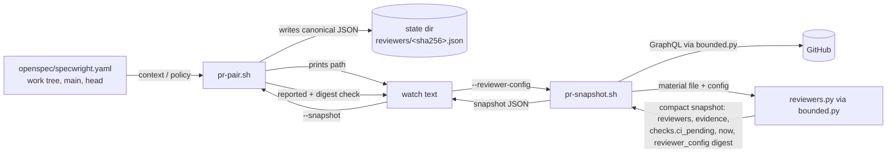
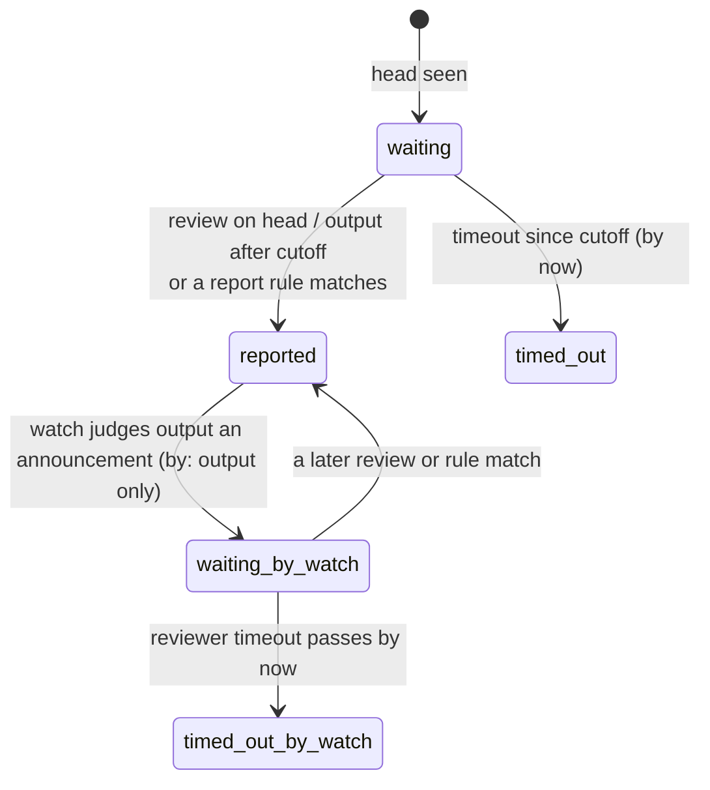
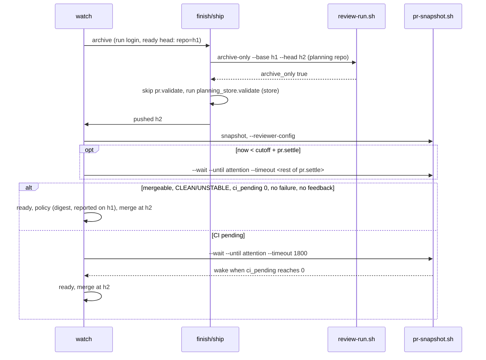

# Design

## Triage

| Trigger | Applies? | Evidence |
|---|---|---|
| T1 Components (new component, or 3+ with directed relationships) | Yes | New rule evaluator `reviewers.py` beside `bounded.py`; `pr-pair.sh` → config file → `pr-snapshot.sh` → evaluator → watch → `pr-pair.sh policy` |
| T2 State (persistent state, caches, 3+ state machine) | Yes | New reviewer-config files in the state dir; reviewer state `waiting`/`reported`/`timed_out` plus watch's announced-review override |
| T3 Concurrency (background work, workers/isolates, async, retries) | Yes | Background `--wait` loops, several watchers per machine (`pr-snapshot.sh:526-580`), timers (`pr.settle`, reviewer timeouts) |
| T4 Boundaries (data format, migration, shared interface, IPC, external) | Yes | Settings schema (`pr.reviewers.<login>.report`, `pr.settle`), `pr-snapshot.sh` CLI (`--reviewer` removed), `policy` JSON (`reviewer_args` → `reviewer_config`, `rules_mismatch`), snapshot JSON (`by`, `evidence`, `now`, `reviewer_config`, `checks.ci_pending`), the watch → finish → ship hand-off (`ready head:`) |
| T5 Volume (grows without a fixed bound) | Yes | Evidence per reviewer, raw material per snapshot, config files in the state dir, regex work over comment bodies |
| T6 Risk (security, money, data loss, unrecoverable user data) | Yes | Detection feeds the agent merge gate (ADR 0009/0020); a user regex runs over untrusted PR text |

TIER: FULL

## Context

- Reviewer detection lives in the snapshot's jq program (`skills/specwright-pr/scripts/pr-snapshot.sh:333-372`), run by gh's built-in jq (gojq, RE2 regexes). Three logins have branches there; every other login uses the timestamp rule. `$review_check` (`:369`) maps one login to its check name for `checks.advisory_pending`.
- Reviewers arrive as `--reviewer LOGIN:ROLE:SECONDS` (`:63-68`), are pasted into a jq `def cfg` (`:490`), and `prepare_cfg` (`:460-492`) adds the head, push time, cutoff and GitHub's clock (`cfg.now`, internal today). The cutoff and first-seen rules (pr-evidence spec) stay as they are.
- The wait finds fields by grepping the compact snapshot JSON: `sig_of`, `attn_of`, `fails_of`, `only_progress` (`"pending":[1-9]`) and the `recheck` batching (`:386-414`, `:521-535`). `sig` and `attn` include `login:state` per reviewer.
- `pr-pair.sh reviewers_of` (`:836-843`) normalizes `pr.reviewers` for `context` and `policy` (`:2668`); `policy`'s drift compares those dicts (`:2746`), and `reported_check` (`:2690-2703`) reads only `state == "reported"` per login from the snapshot. `policy` runs the strict reader `yaml_problem` (`:2644`); `context` uses the lenient `parse_yaml`. `duration` (`:769-777`) falls back silently on a bad value.
- `bounded.py` starts its child with stdin from DEVNULL (`:288-299`), so a pipe cannot carry input to a bounded child.
- `review-run.sh archive-only` (`skills/specwright-review/scripts/review-run.sh:1554-1601`) reads only local git, so it can run before the push.
- Watch's ready rule needs "no new activity for one full wait" (`skills/specwright-pr/SKILL.md:142`); its wait uses `--timeout 1800` (`:134`). Ship validates every repo of the set before a push (`:84`).
- Proposal: `proposal.md`. Issue: #166. Round 1 review: `review.md`.

## Decisions

### D1: Reviewer rules are evaluated in Python, not in jq

- **Choice:** the jq program stops judging reviewers. It emits, for each configured login, the raw material: that login's reviews (with `commit.oid`), PR comments and thread comments with ids, times and full bodies, plus every check with name, state and app slug. `pr-snapshot.sh` writes that JSON to a temp file (`mktemp` with no directory, so the system temp dir, converted with `cygpath -m` where that exists; removed by a trap on exit, including a deadline kill of the evaluator) and runs `bounded.py -- python -I reviewers.py --material <file> --config <file> --head <oid>`. The evaluator prints the finished snapshot with `json.dumps(..., separators=(",", ":"))`, so the wait's greps keep working: `reviewers` (`state`, `by`, `evidence`), `checks.pending`, `checks.advisory_pending`, `checks.ci_pending`, `now`, `reviewer_config`, and `sig`/`attn` with the reviewer states appended. The raw material is dropped from the output.
- **Rejected:** keep the rules in jq, passing patterns into `def cfg`. gojq uses RE2 syntax while `pr-pair.sh` (Python) would validate them, so a pattern could pass validation and fail or match differently at run time, and the snapshot could only find a bad pattern after its GraphQL call.
- **Reversal cost:** medium. The evaluator's input is internal to the snapshot; only its output fields are a contract.

### D2: The reviewer config is a canonical, content-addressed file written by `pr-pair.sh`

- **Choice:** `context` and `policy` write each reviewer set they read as canonical JSON (sorted keys, compact separators, UTF-8) `{"format": 1, "reviewers": [{"login", "role", "timeout", "report"}]}`, logins sorted, to `<state dir>/reviewers/<sha256>.json`, or under the system temp dir when the state dir is unwritable (temp file and rename; an existing file of that name is reused; never exit 1 for the location), and print the path: `context` per repo as `reviewer_config`, `policy` as `reviewer_config.{main,head}.{code[,store]}`. `pr-snapshot.sh --reviewer-config <file>` has the evaluator validate it (format, keys, `re.compile` of each regex, bounds) before the snapshot's first `gh` call, exit 2 on any problem. Equal settings give byte-equal files, so the digest identifies the rules; `policy` compares digests, never paths.
- **Rejected:** the agent writes the JSON from `policy` output; regexes with backslashes, backticks and quotes would pass through a shell, which has already corrupted escapes in this project. **Rejected:** `pr-snapshot.sh` reads `specwright.yaml` itself; it would read the work tree, not main, against ADR 0020.
- **Reversal cost:** low.

### D3: Generic rules use only commit-bound reviews and output; checks need a name

- **Choice:** with no `sha_pattern`, `check` or `marker`, a reviewer is `reported` by its review on the head commit, else its output (comment, review body, thread comment) at or after the cutoff. Check runs never report a reviewer by app: only `report.check`, an exact name, does. With any of the three keys set, only those and a review on the head commit decide; any one that matches reports, and `by` names it. `sha_pattern` and `ignore` are Python regexes (`re.search`, case-sensitive); a `sha_pattern` match counts when its first group is 7 to 40 hex characters and a prefix of the head SHA. `marker` is a literal substring, matched on comments whose last edit (else creation) is at or after the cutoff. `ignore` removes matching comment and review bodies from every rule; it never applies to checks.
- **Rejected:** count a completed check of the app whose slug equals the login (round 1, C2). An app can run CI as well as a review: review actions posting as `github-actions` share the app of every workflow, so CI would report a required reviewer and advisory timeouts would hide CI. **Rejected:** let the generic and the `report` rules both report; a bot with a `marker` rule also posts in-progress text after the push, which the output rule would count.
- **Reversal cost:** low.

### D4: Reports authorize a merge only under the authorizing set's rules

- **Choice:** the snapshot carries `reviewer_config`, the digest (file name) of the config it ran with. `policy` already writes the authorizing sets' configs (main's and the head's); `reported_check` adds a condition: the snapshot's digest equals that set's digest, else `{"ok": false, "rules_mismatch": true}`. Watch then waits again with that set's config, as the "wait again with the authorizing set" rule already says. Store-backed, each side's snapshot is checked against that side's set.
- **Rejected:** start every wait with `policy`'s main config. The start of watch has no ready head to read the policy at, and a mismatch would still be possible after a settings change on main during the wait; the digest check catches both.
- **Reversal cost:** low.

### D5: `context` reads reviewer settings strictly

- **Choice:** `context` runs `yaml_problem` (`pr-pair.sh:2644`) on the whole settings file and prints any problem as `settings_problem` (`line N: why`) without exiting. Watch stops before its first wait when it is set, so a pattern that `policy` would reject stops at the start of watch instead of at every merge; ship, finish and cleanup ignore it, so a settings typo never blocks a push or cleanup. A bad `pr.settle` and `too_many_reviewers` are reported the same way, naming the key; `policy` keeps exiting 2 on all of them. The README and template use single-quoted patterns, and an eval runs every `report:` example in them through both readers.
- **Rejected:** loosen `policy`'s reader for regex escapes. ADR 0020 makes an unparseable policy unknown on purpose.
- **Reversal cost:** low.

### D6: The quiet window is `pr.settle`, and only for a PR that is otherwise ready

- **Choice:** watch keeps `--timeout 1800` for every wait while the PR is short of ready for any reason but the quiet window. When the latest snapshot meets every other ready condition, watch starts the wait with `--timeout <pr.settle>`, and any `timeout` wake is the quiet window. Ready accepts `merge_state` CLEAN, or UNSTABLE when no check fails and `ci_pending` is 0 (a pending advisory check makes GitHub report UNSTABLE). `pr.settle` gets a strict parser (`1m` to `1h`, `s`/`m`/`h`), printed by `context` in seconds; a bad value is a `settings_problem` in `context` (watch starts no wait) and exit 2 `bad_setting` in `policy`.
- **Rejected:** `--timeout <pr.settle>` for every wait (round 1, M1). It turns a 30-minute wait into six agent wake-ups while CI runs. **Rejected:** a quiet clock inside the snapshot; it adds persistent wait state for a judgment the timeout already makes.
- **Reversal cost:** low.

### D7: CI-only pending count drives the filter and the archive check

- **Choice:** the evaluator adds `checks.ci_pending`: pending checks named by no configured reviewer's `report.check`. `only_progress` tests `"ci_pending":[1-9]` instead of `"pending":[1-9]`, so CI finishing wakes a wait even while a reviewer's check runs. The archive-only head is judged only once the snapshot's `now` is at least `pr.settle` after the head's cutoff, so a snapshot taken before CI registered its checks cannot pass; before that watch waits with `--timeout <rest of pr.settle>`. From then on it is ready, with no further quiet window, when it is mergeable, CLEAN or UNSTABLE as above, `ci_pending` is 0, nothing fails and no feedback is new; otherwise watch waits (`--timeout 1800`) and judges each wake, `timeout` included, by the same rule.
- **Rejected:** have watch guess which pending check is a reviewer's from the count (round 1, C3); the snapshot gives it nothing to guess from.
- **Reversal cost:** low.

### D8: The archive judgment moves before the push, with the ready head handed along

- **Choice:** watch's archive step hands `ready head: <repo>=<sha>` (both repos when store-backed) to finish with the run login, and finish hands it to ship. Ship runs `archive-only` in the planning repo before the push. `true` skips `pr.validate` for the planning repo and for a code repo whose head still equals its handed ready head; `planning_store.validate` still runs. An error, `false` or no handed head runs `pr.validate`. The post-push `archive-only` call that sets the carry-over stays.
- **Rejected:** skip `pr.validate` whenever a push touches only Markdown under `
/`; broader than #166 needs, and it would also skip validation for spec edits pushed during feedback.
- **Reversal cost:** low.

### D9: Watch's judgment can only add waiting

- **Choice:** the evaluator's `reported` is deterministic. Watch may treat a reviewer reported `by: output` as waiting when its `evidence` reads as an announcement, until its timeout has passed by the snapshot's `now`, then as timed out (a required one stops the merge and is reported). Watch never treats a `waiting` or `timed_out` reviewer as reported, and `policy`'s reported check stays the script's.
- **Rejected:** let the agent decide `reported` alone; agent merge needs a decision the script can stand behind (ADR 0009/0020).
- **Reversal cost:** low.

### D10: `--reviewer` is removed, and `report` is part of the policy

- **Choice:** `--reviewer` exits 2 naming `--reviewer-config`; `policy` drops `reviewer_args`. `reviewers_of` keeps a normalized `report` (known keys, string values), so `policy` drift covers it like a role change. Install and update copy skills and scripts together, so installed text never calls a script of another version.
- **Rejected:** keep `--reviewer` as a short form; a caller could silently drop a reviewer's `report` rule. **Rejected:** treat `report` as detection detail outside the policy; a PR could loosen a required reviewer's rule and merge on its own reviewer's in-progress notice.
- **Reversal cost:** low.

## Diagrams (FULL)

Components (T1, T4):

Reviewer state per head (T2):

Archive step (T3, T4):

## State & Ownership (FULL)

| State | Owner (sole writer) | Lifetime | Invalidation / rebuild | Authoritative copy |
|---|---|---|---|---|
| Reviewer settings (`pr.reviewers`, `report`, `pr.settle`) | The user, through PRs | Project lifetime | Read fresh by every `context` / `policy` call | `openspec/specwright.yaml` on the default branch (merge), work tree (start of watch) |
| Reviewer-config file | `pr-pair.sh context` / `policy` (temp file and rename, content-addressed; system temp dir when the state dir is unwritable) | Until the state dir is cleared | Never edited: new content gets a new name; a missing file is rewritten by the next call | Derived from the settings above; a cache |
| Raw-material temp file | `pr-snapshot.sh` | One poll | Removed by trap on exit; a leftover from a killed process is a stray file in the system temp dir | None; rebuilt each poll |
| Reviewer state on a head (`reported`/`waiting`/`timed_out`, `by`, `evidence`) | `reviewers.py`, inside each snapshot | One snapshot | Recomputed every poll | GitHub activity plus the cutoff record |
| Cutoff and first-seen record | `pr-snapshot.sh` (unchanged) | Per head | As today | `<state>/heads/...` |
| Ready head hand-off | Watch (agent), passed by text to finish and ship | One archive step | Lost on a session restart: ship then runs `pr.validate` (safe) | Watch's ready report |
| Watch's announced-review override | Watch (agent) | The watch session | Dropped on a new head or when the reviewer reports by another rule | None persisted; a resumed watch judges again from `evidence` |

## Failure & Visibility (FULL)

| Component | Fails / dies mid-operation → | Recovery | Retry safe? | Who finds out |
|---|---|---|---|---|
| `pr-pair.sh` config write | Temp file left, no rename; or state dir unwritable | Next call writes again; an unwritable state dir falls back to the system temp dir | Yes (content-addressed) | Nobody needs to: the printed path still works |
| Config or settings validation | Bad key, bad pattern, bad `pr.settle`, strict-reader problem | None: the user fixes the settings | Yes | Agent and user: exit 2 naming reviewer and key, or `settings_problem` naming the line, before any wait or `gh` call |
| Archive rules mismatch | `policy` reports `rules_mismatch` at the archive decision | Watch archives nothing yet and waits on the ready head with main's config, without asking | Yes | The agent |
| `reviewers.py` | Crash or deadline (pathological regex) | The poll fails like a failed `gh` call: `ok=0`, the last good snapshot is kept, the wait exits 1 if the last poll failed; the trap removes the material file | Yes | The agent, from `bounded: deadline_exceeded: ...reviewers.py` on stderr |
| Digest mismatch | The wait ran with other rules than the authorizing set's | Watch waits again with `policy`'s config | Yes | The agent, from `rules_mismatch`; the user only if it repeats |
| Archive pre-push check | `archive-only` errors (exit 3) | Treated as not archive-only: `pr.validate` runs | Yes | The user, from the report naming the error |
| Watch judgment | Agent misreads an announcement | Bounded by the reviewer's timeout; a required reviewer still gates the merge through `policy` | n/a | The user, from the report naming the reviewer |

## Resource Bounds (FULL)

| Queue / buffer / cache / transfer | Bound | At the bound | Timeout | At 10x / 100x |
|---|---|---|---|---|
| Reviewers per set | 20 | `context` prints `settings_problem` (watch starts no wait); `policy` exits 2 `too_many_reviewers` | n/a | Settings-driven |
| Pattern or marker length | 500 characters each | Exit 2 naming reviewer and key | n/a | n/a |
| Evidence per reviewer | 10 items, 300-character excerpts | Older items dropped, newest first | n/a | Fixed |
| Raw material file | The snapshot's existing pages (100 threads with their comments, last 100 comments and reviews, 100 checks), configured reviewers' items only; bodies already fetched within `bounded.py`'s 32 MiB | `complete: false` as today | Poll deadline | Fixed by the pages |
| Evaluator output | The snapshot minus raw material; under `bounded.py`'s 32 MiB stdout bound | `response_too_large`, poll fails | Poll deadline | Fixed |
| Regex work | Fetched bodies of configured reviewers only | Evaluator killed at the poll's deadline | 120 s per poll (ADR 0012) | Bounded by item count × body size |
| Reviewer-config files | One per distinct reviewer set | Each under 64 KB, checked on write; not pruned | n/a | Hundreds of KB after years |

## Flow & State Gaps (FULL)

- **Settings change during a watch:** the running wait keeps its config until restarted. A merge then needs `policy`'s digest check to pass, so a stale or looser config cannot authorize it; watch restarts the wait with the authorizing config.
- **Two watchers on one PR:** the newest owns the PR (pr-watch spec); config files are content-addressed and read-only once written.
- **Review on the head arrives before the push is in the activity log:** a review bound to the head commit counts whatever the cutoff, as the old sha rule did.
- **Force-push back to an older commit:** a review bound to that commit counts again, matching what GitHub shows.
- **Archive head gets a commit after the one-snapshot ready check:** the merge is conditioned on the ready head SHA, and a new head returns to watching with reviewers (pr-merge spec).
- **Session restart between archive and push:** the ready-head hand-off is lost, so ship runs `pr.validate`: slower, never unsafe.
- **Resume after a crash:** no new persisted state beyond the content-addressed file; a resumed watch reruns `context` and judges `evidence` again.

## Mechanism Ledger (FULL)

| Mechanism | Built? | Why (harm nobody catches / expensive later) | Evidence that would change the call |
|---|---|---|---|
| Content-addressed canonical config files | Yes | Two watchers or a rerun must never see a half-written file, and the digest must identify the rules | n/a |
| Digest check in `policy` | Yes | Without it a looser rule judged in the wait authorizes an agent merge (round 1, C1) | n/a |
| Validation before any `gh` call, strict read in `context` | Yes | A bad pattern would otherwise fail every poll of a background wait, or block every merge as policy unknown | n/a |
| Evaluator under the poll deadline | Yes | A pathological user regex on untrusted PR text could hang a background wait | n/a |
| `checks.ci_pending` | Yes | The archive fast path and the filter cannot tell CI from a reviewer's check without it (round 1, C3) | n/a |
| Pruning old config files | No | Files are tiny and few | A state dir growing past a few MB |
| Check-by-app-slug default | No | Shared apps make CI count as a review (round 1, C2) | A way to tell a review check from CI that needs no settings |
| Bot presets in the code | No | Would reintroduce the bot-specific knowledge this change removes; examples live in docs | n/a |
| A built-in announcement text detector | No | Text varies by bot and language; `ignore` and watch's judgment cover it | Watch misjudging announcements in practice |

## Risks / Trade-offs

- [Bots whose finished review is only a check run report later without `report.check`] → they fall to `output` or time out; the docs show `report.check` for such bots.
- [A bot's review comment is not a GitHub review bound to a commit] → it falls to `output`; `sha_pattern` covers bots that print the SHA.
- [The 5-minute quiet window lets an unconfigured bot's late comment miss a merge] → required reviewers still gate agent merge; unconfigured bots were never a gate; `pr.settle` can be raised to 1h.
- [Projects relying on the removed built-in rules get coarser detection after update] → release notes and README carry copyable `report:` blocks; the dogfood projects are updated as part of the rollout.

## ADRs

- **In force, constraining this change:** 0002 (thin scripts, one JSON document), 0003 (git and GitHub as the state store; the config file is a derived cache in the state dir like review records), 0008 (fenced identity, unchanged), 0009 and 0020 (agent merge, policy from main: `report` joins the compared reviewer settings, and reported reviewers are checked under the authorizing rules), 0012 and 0014 (the evaluator runs under the same bounds).
- **To record during apply:** ADR 0022 "Reviewer detection is generic; bot-specific rules live in settings" (adds to 0020: the normalized reviewer comparison includes `report`; a report counts only under the authorizing set's rules, by digest; scripts name no reviewer; the agent may only add waiting). Update `openspec/architecture.md` (the `specwright-pr` component row, a State ownership row for the reviewer-config file, Resource bounds, In-force ADRs).

## Open Questions

- Which `report:` blocks the README shows for widely used bots, confirmed on live PRs of the dogfood projects during apply; it changes only examples.
