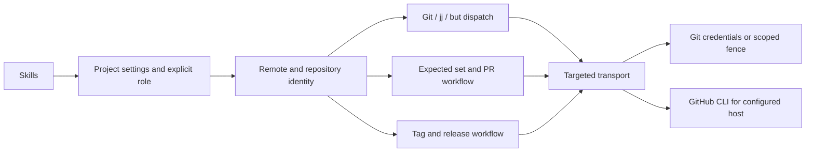
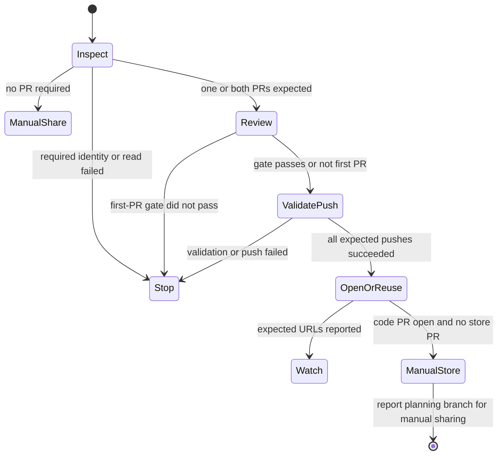
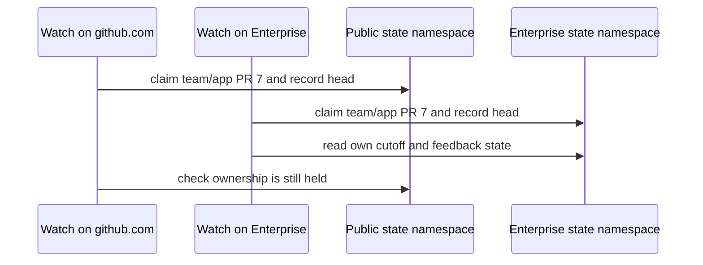
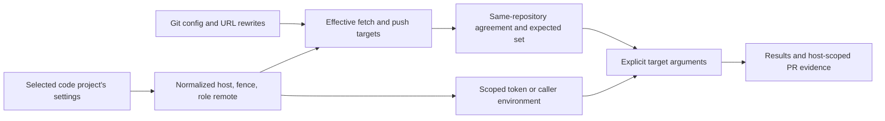

# Design

## Triage

| Trigger | Applies? | Evidence |
|---|---|---|
| T1 Components | yes | PR coordinates, VCS transport and release reads reach the same Git and GitHub installation through separate paths (`cli/lib/src/pr/workflow.dart:80-129`, `cli/lib/src/vcs/git_common.dart:114-138`, `cli/lib/src/release/git.dart:101-133`). |
| T2 State | yes | Watch claims and head cutoffs use owner, name and PR only (`cli/lib/src/pr/watch_state.dart:38-44`); feedback paths use owner, name and change only (`cli/lib/src/pr/feedback_record.dart:68-82`). Partition the existing records by host. |
| T3 Concurrency | yes | Competing watchers take numbered claims and remove lower claims (`cli/lib/src/pr/watch_state.dart:93-111`). The authority changes from slug to host plus slug. |
| T4 Boundaries | yes | Local settings supply workflow context (`cli/lib/src/pr/settings_commands.dart:362-397`); an explicit project selector is currently version-only (`docs/adr/0040-skills-call-the-projects-sw-directly.md:14-18`). This change adds a versioned settings contract and a second GitHub target. |
| T5 Volume | no | No new collection proportional to repository size. Discovery and release reads keep their existing limits; see Resource Bounds. |
| T6 Risk | yes | Login verification currently places the checked token into a subprocess environment (`cli/lib/src/fence/fence.dart:244-282`); changing the host or dropping the fence affects who can make Git and GitHub writes. |

TIER: FULL

## Context

- `sw pr identity` reads rewritten `origin` fetch and push URLs and parses github.com or its SSH alias only (`cli/lib/src/pr/identity.dart:11-24`, `cli/lib/src/pr/identity.dart:28-66`). VCS URL classification is separate (`cli/lib/src/vcs/git_common.dart:84-99`). Release has another parser and a hardcoded release URL (`cli/lib/src/release/git.dart:54-62`, `cli/lib/src/release/publish.dart:286-294`).
- The fence checks stored tokens on github.com and configures a public-host HTTPS-only credential helper plus a disabled SSH command (`cli/lib/src/fence/fence.dart:66-70`, `cli/lib/src/fence/fence.dart:202-229`, `cli/lib/src/fence/fence.dart:249-282`). PR pair reads repeat the stored-token lookup and choose a separate store login by slug (`cli/lib/src/pr/workflow.dart:189-245`, `cli/lib/src/pr/workflow.dart:255-282`).
- The Git backend reads `origin/<main>` after a fetch, pushes explicitly to `origin`, and uses the branch upstream for a bare `pull` (`cli/lib/src/vcs/git_backend.dart:506-540`). Pair cleanup emits that bare pull (`cli/lib/src/pr/workflow.dart:1049-1064`). GitButler validates its target against `origin` or local main (`cli/lib/src/vcs/probe.dart:145-169`). Native workflow main detection checks `origin` (`cli/lib/src/pr/settings_commands.dart:90-98`).
- Ship checks both repo identities before asking for the expected set, and rediscovers both for the pre-ship gate (`skills/specwright-pr/SKILL.md:90-95`). Native expected-set code resolves the code identity before counting code commits and treats a failed `rev-list` as zero (`cli/lib/src/pr/workflow.dart:1244-1258`). Identity treats any failed fetch-URL lookup as an absent `origin` and does not check the push-URL read exit status (`cli/lib/src/pr/identity.dart:34-57`); expected suppresses `no-origin` for the store (`cli/lib/src/pr/workflow.dart:1280-1289`).
- Pair readiness compares snapshot URL slugs without the host (`cli/lib/src/pr/workflow.dart:1454-1467`). Policy counts reports by head and rules digest (`cli/lib/src/pr/policy.dart:272-311`), feedback reads items from a supplied snapshot (`cli/lib/src/pr/feedback_pass.dart:1111-1152`), and reply sends a node-addressed `resolveReviewThread` mutation (`cli/lib/src/pr/reply.dart:375-387`, `cli/lib/src/pr/queries.dart:318-318`). Scope these checks and actions to the expected PR.

## Decisions

### D1: Ambient mode cannot promise an account

- **Choice:** `github.fence: false` selects ambient credentials for all automatic workflow operations. Reject nonempty `github.login`, `planning_store.login`, `github.review_request.login` or `pr.request_as` before network operations and say how to clear the conflict. Do not call the stored-token resolver in that mode. A workflow directly launches Git and `gh`; it still addresses the configured host and exact repo. An explicit `sw as` is a request for the fence, not a way to silently downgrade it.
- **Rejected:** Ignore configured logins in ambient mode, because a named review request could be posted as the wrong account with no error. Do not automatically fall back to ambient credentials after a missing/mismatched token or SSH refusal.
- **Reversal cost:** high; the policy determines which credential can publish or mutate.
- **Important:** yes; changes what settings mean at an authentication boundary.
- **Chosen by:** user.

### D2: An explicitly selected remote controls pull

- **Choice:** `remote` and `planning_store.remote` default independently to `origin`. Track whether each key is explicit. With a set remote, including explicit `origin`, Git pull names that remote and configured main; without one, retain bare `git pull --ff-only` unless the caller requests `--remote-branch`. Other operations always name the effective remote.
- **Rejected:** Always pull `origin/main` when the key is omitted; it would silently change the target of existing Git branches whose upstream differs.
- **Reversal cost:** medium; changes pull targets and cleanup expectations.
- **Important:** yes; people observe a different upstream in a network write.
- **Chosen by:** user.

### D3: Normalize connections once, at the owning seams

- **Choice:** Extend the existing strict settings and repository context modules with typed project host/fence and role-selected remote values. Bind a standalone GitHub command's settings to the same physical code project as its version check. Preserve the repository and cwd arguments, and keep `owner/name` as the PR data contract; qualify it at the `gh` command seam, not in GitHub API paths, feedback records or repository comparisons.
- **Rejected:** Let each backend and skill infer host from the checkout, `GH_HOST` or the first remote. Divergent parsing would make it easy for a write and its read-back to target different locations.
- **Reversal cost:** low; internal routing is concentrated in existing settings, fence, target and runner modules. The user-facing defaults and one-project/one-host settings are the scope contract in S1/S2, not a second way to configure them.
- **Important:** no; internal placement of already chosen behavior.
- **Chosen by:** agent.

### D4: Ship consumes the expected set

- **Choice:** Order ship around one expected-set read in a store-backed change. Use its PR and identity information for the pre-ship decision and perform publish preflight only for set members. Check branch cleanliness for both repos and still run the pre-ship review of the entire change. With no store PR, report which planning branch to share by hand and open the code PR as usual when expected.
- **Rejected:** Treat all identity failures as optional or remove the planning side from review. Only a proven absent remote or positively classified off-host fetch and every push destination exclude the store. Mixed destinations, unreadable or unclassifiable URLs, and identical code/store repository identities fail closed. S3 excludes local store automation from watch, feedback and finish.
- **Reversal cost:** low; the expected-set decision already has a single native owner.
- **Important:** no; implements the owner-approved ordering and outcome in S3.
- **Chosen by:** agent.

**Round 5 owner decision:** “Yes, fix and review.” Apply only the seven round 5 findings, within the ship-only scope in S3. The owner authorized one full independent review, not apply.

**Round 6 owner decision:** “Fix both, recheck only those.” Close design review with an independent targeted recheck of the two remaining findings and their spec, design and task wording. If either finding remains, return to the owner. This is not apply approval.

### Decision summary

| # | Decision | Choice | Rejected | Reversal cost | Important | Chosen by |
|---|---|---|---|---|---|---|
| S1 | Fence by default | Configured host; opt-in ambient transport | Unfenced default or transport workarounds | high | yes | user |
| S2 | Remote scope | One remote per repo with URL agreement | Cross-repo head/base PRs | medium | yes | user |
| S3 | #260 is ship only | Ship the code PR and report manual sharing; PR watch, feedback and finish hand back the local planning branch for manual sharing and archive | Require a store remote or automate unpushed planning work | medium | yes | user (round 4) |
| S4 | Store PR with no code target | Require code identity; fully local needs no PR | Add remote-less code feedback identity | medium | yes | user |
| D1 | Ambient named accounts | Refuse conflicts | Ignore a promised account | high | yes | user |
| D2 | Git pull | Explicit remote wins; omitted keeps legacy upstream | Explicit origin/main even when omitted | medium | yes | user |
| D3 | Connection seam | Typed settings plus explicit target at use | Infer from env or remote enumeration | low | no | agent |
| D4 | Ship preflight | Expected set drives publication | Swallow identity failures or drop local work from review | low | no | agent |

## Assumptions

None. Check GitHub CLI's hostname and token routing at the transport interface, including Enterprise Server and the public-token host class; check the actual Git argv and remotes, not just a settings echo. The required CI proof uses isolated Git repos and fake CLI credentials, not a live Enterprise account.

## Carried constraints

- **C1:** The default fence is fail closed and scoped to one canonical GitHub host. Ambient mode is explicit and cannot promise a named account. Kind: invariant. Destination: ADR 0045.
- **C2:** Code and store remote names are independent, and one selected remote identifies both PR sides. Omitted-setting Git pulls retain upstream selection and apply authentication to the actual upstream; explicitly naming `origin` also opts in. Kind: invariant. Destination: ADR 0045.
- **C3:** `--project` may anchor GitHub settings and version, never target cwd or repo. Native calls retain in-process settings/fence dispatch, existing launch bounds, and bounded read-back on the original target. Kind: invariant. Destination: ADR 0045.
- **C4:** Coordination state and snapshot evidence cannot cross hosts or supply policy or feedback evidence for a different PR. Kind: invariant. Destination: spec: specs/pr-script-runtime/spec.md → Requirement: PR evidence is scoped to its GitHub host.
- **C5:** Only a proven absent or entirely off-host store remote excludes publication. Unreadable, unclassifiable or mixed destinations stop; every store PR requires a usable code identity distinct from the store identity. Kind: invariant. Destination: spec: specs/planning-stores/spec.md → Requirement: The expected PR set follows the change's work and transport.
- **C6:** The planned PR, not a node ID or snapshot alone, authorizes the scope of a reply mutation. Kind: invariant. Destination: spec: specs/pr-script-runtime/spec.md → Requirement: Reply mutations verify the addressed PR item.
- **C7:** Store-backed release notes consume only store main plus code-merge proof; the manual-share branch is not a notes source. Kind: invariant. Destination: spec: specs/releases/spec.md → Requirement: Store-backed notes use the code-merge proof.
- **C8:** Resolve effective push URLs under the execution environment. A fenced command preserves safe indexed rewrites but must refuse transport or PR-target disagreement. Do not run one push across incompatible credential policies. Kind: invariant. Destination: spec: specs/github-identity/spec.md → Requirement: Push authentication follows the actual destinations.
- **C9:** Without `--repo`, a repo-scoped snapshot or reply resolves the selected remote of the target checkout, never ambient `gh` state. Kind: invariant. Destination: spec: specs/pr-script-runtime/spec.md → Requirement: PR snapshots and replies run in the project's sw.
- **C10:** Native readiness returns a manual handoff, never change-ready, for a local-only store. No shadow planning evidence, round accounting or archive automation; stop before archive edits and retain explicit `finish: local`. Kind: invariant. Destination: spec: specs/planning-stores/spec.md → Requirement: A store without a PR is a manual handoff.
- **C11:** A fenced handoff may reuse a bound login or explicitly carry permission for the run's first lookup. Missing handoff data never falls back to the configured or active account. Kind: invariant. Destination: spec: specs/github-identity/spec.md → Requirement: An empty login is resolved once per run.
- **C12:** Fetched main proof binds the exact commit from its own fetch to the verified tag/release destination. A standard tracking ref or another fetch's result is not proof. Kind: invariant. Destination: spec: specs/releases/spec.md → Requirement: The release commit is found on main.

## Diagrams (FULL)

### T1 — module dependencies

### T2 — expected-set and publication state

### T3 — concurrent watches

### T4 — transport data flow

## Implementation Plan (FULL)

1. **Settings and target.** Extend the YAML reader's consumers, not the parser. Validate a DNS hostname (ASCII case-fold and one optional final dot; no scheme, port, path or userinfo), a real boolean and a nonempty non-option Git remote name, not a URL or local path. Missing values retain defaults. A selected name must resolve as a configured remote before a targeted network operation; do not let Git reinterpret a missing remote as an arbitrary path. Keep existing public-default JSON fields; add optional connection/remote fields to PR context for explicit settings so skills need no new YAML parser. Preserve established command-specific stop classes; errors identify the offending key or remote, without secrets.
2. **Identity and transport.** Share configured-host URL recognition across fence, VCS and release. Compare normalized host and owner/name, not string prefixes; accept supported HTTPS, SSH, Git URI and scp-style repository syntax and keep the existing public SSH alias. Distinguish repository parsing from credential eligibility: only HTTPS to the canonical host receives the token. Keep rewriting and URL-userinfo guards, redact URL userinfo before reporting it, and check push agreement for every push URL. Use `gh`'s public token slot for github.com and its public-token host class, Enterprise token slot otherwise. Both stored token lookup and verification name the configured host; no stored credential is read in ambient mode. Retain caller Git credential settings on plain Git paths and do not globally mutate cwd, environment or `gh` configuration. Optional author observations for attribution use the ambient connection only when the operation needs them; they do not choose a credential.
3. **Targeted calls.** Route VCS fetches, explicit pulls, pushes, main/ref probes, jj bookmark remotes and the GitButler target/validation path through role settings. Keep local backend behavior and read-only fetch isolation; a remote-tracking GitButler target must agree with the selected remote. Thread the same remote through PR expected/discovery, branch/ancestry checks and cleanup plans, and through release tag reads, push and read-back. Preserve `owner/name` in PR documents and API paths. At the CLI seam use the configured host for Enterprise API/GraphQL and hostname-qualify Enterprise `gh --repo` arguments. Ambient `gh` targets the configured host even with conflicting inherited `GH_HOST`/`GH_REPO`. Skills use the context report for host/role, and never reconstruct a remote or choose credentials from a PR body or snapshot. Leave install/update store ownership and mixed-host PR pairs out of scope.
4. **Expected-set order.** Count local code changes and inspect both selected remotes before authentication. A publishable store requires a usable code identity. When Git proves a store remote is absent, or the fetch and every push destination are known to be off-host, exclude it. For any destination on the configured host, require all destinations on that host and agreeing on the repository; refuse mixed, invalid or unclassifiable inputs. If both identities are usable, reject identical canonical host and case-insensitive owner/name before discovery or credentials: the two sides use the same branch name. The standalone VCS push policy remains separate. A proven fully local change needs no PR or login. Look up existing code PRs whenever the code identity is usable, including after branch deletion. Ship reads `expected` before publication preflight, version fetch and push; only expected members get validation, push or watch, and pre-ship review still covers the planning diff.
5. **PR state and docs.** Keep github.com's current state paths and feedback-record schema; for non-default hosts partition the state base with the canonical host before deriving existing keys. Use that base for watch claim, head, feedback pass and cleanup readers/writers. Compare discovered PR and supplied snapshot by host/repo/number as well as head. Ship, watch, feedback, finish, branch, roadmap and release skills share this targeting policy. Document Git/`gh` credential prerequisites, explicit remote behavior and the manual-share report in the settings template and README. No real deployments are examples.

### Target and evidence checks

- **Legacy pull and GitButler:** For bare Git pull, get the actual URL through `git ls-remote --get-url` with no repo argument; this expands Git's default remote locally and makes no connection. An error stops before pull; a local or non-GitHub URL runs with the caller's transport. Use the same check when executing a printed cleanup pull, after switching to main; do not classify using the previous branch's upstream. An explicit GitButler remote must match a remote-tracking target; a local-only target cannot prove which remote `but pull` uses, so reject it before `but` runs. Retain the existing GitButler target shapes when the setting is omitted.
- **Push authentication:** The existing Git/jj dispatch looks at the fetch URL (`cli/lib/src/vcs/git_common.dart:114-124`, `cli/lib/src/vcs/jj_backend.dart:636-645`). Use all effective push URLs, including `pushInsteadOf`, for Git, jj and the GitButler Git push. In fenced mode, all targets classified as GitHub require the fence; targets all outside the configured host use plain Git credentials. Refuse failed URL reads or a mixed list rather than launching a push with incompatible policies. In ambient mode don't resolve a stored identity. PR/release repository-agreement checks remain separate.
- **Destination agreement in the launched environment:** Today `runFence` checks with the incoming config, then constructs the launch environment; `fencedEnvironment` replaces indexed entries and resets their count (`cli/lib/src/fence/fence.dart:499-509`, `cli/lib/src/fence/fence.dart:532-535`, `cli/lib/src/fence/fence.dart:573-578`). Retain safe indexed `url.*.insteadOf` and `url.*.pushInsteadOf` entries in their original order, after checking the incoming targets and rules for userinfo; never retain indexed authentication overrides, weaken helper/header scrubbing or write config to disk. Build the final command environment once, resolve the actual fetch and every push URL with Git using that same environment, and run the same credential and URL-policy checks there. Compare the actual effective targets to the preflight targets; any lost/replaced setting that changes them is a redacted refusal, never a silent rewrite. The PR plan passes the expected canonical GitHub repo to dispatch, which rechecks the applicable fetch/push destinations against it before launching; the release descriptor and its pre-write/read-back comparisons likewise use the actual execution environment. The guard uses the effective selected remote (the actual upstream for bare pull), the same cwd and argv semantics, and never infers `gh`'s destination from unrelated remotes. Refuse invalid or unreadable config before the Git write. Cover both retained indexed rewrites and a preflight/launch identity mismatch with two distinguishable remote repositories and an explicit `gh` target.
- **Implicit PR target:** Snapshot and reply currently ask `gh repo view` for an omitted repository (`cli/lib/src/pr/snapshot.dart:275-287`, `cli/lib/src/pr/reply.dart:136-151`). Keep `--repo` optional; when omitted use identity of the role-selected remote from the actual checkout (code when it is the selected project, store when started in the store with `--project <code>`). An explicit repository stays explicit and is qualified at the transport seam. With no snapshot PR number, resolve the current branch against that target rather than asking `gh` to pick a remote; full reads by node ID keep their separate path.
- **Positive local evidence:** Use a successful local remote enumeration to prove the selected name absent. For an existing remote, check the status and nonempty result of the fetch URL read and each applicable push URL read. Use Git's successful `remote get-url --push --all` answer (Git supplies the fetch URL by default), never synthesize agreement from a failed or empty read. Use a successful exact ref listing to distinguish an absent change branch from a read error. When the branch exists, a missing base, malformed count or failed `rev-list` stops expected-set planning. The deleted-branch case must still look for an existing PR when a usable code identity is available.
- **Credential timing:** The existing native command shares an argument decoder for `expected` and `pair-state` with no run-login input (`cli/lib/src/pr/workflow.dart:1328-1344`). Extend the PR invocation to carry either a bound nonempty run login, or an explicit deferred-first-lookup marker from a known user entry point, never both. A user-started entry may defer before local inspection; a commit-to-ship handoff can forward that marker only if the run has made no authenticated GitHub call. A resumed step must get the caller's bound login (or its still-valid deferred marker), never infer new-run permission from absence. As soon as required discovery would use GitHub, an explicit deferred invocation uses the configured login or resolves the active account once, verifies and returns the bound login for further handoffs. A missing fenced handoff stops before any `gh` call even when both account sources exist. Local-only inspection needs no credential; ambient mode never performs a stored-account lookup. Keep direct user invocations and the existing verified in-process fence as entry points; skills explicitly identify handoffs so losing a login cannot look like a direct user invocation. Apply the same condition for `expected`, `pair-state`, and other PR workflow helpers that need the run identity.
- **Manual handoff in the PR workflow:** Native `pair-state` currently chooses `ready` from the expected-member blockers (`cli/lib/src/pr/workflow.dart:1486-1496`); watch consumes that action, checks the store ready head and can run `openspec archive` before finish (`skills/specwright-pr/SKILL.md:153-155`, `skills/specwright-pr/SKILL.md:163-166`). Keep ship's member selection separate: if a confirmed local/off-host store has no PR, `pair-state` returns `action: manual_store_handoff` with the named branch and available code PR status, never `ready` even with green code checks and `pr.merge: agent`. Watch dispatches it before archive prompts, archive, readiness or merge. A missing *expected* PR, including a publishable store's not-yet-created PR, keeps the normal `ship` action; an independently merged code PR can keep normal code-only cleanup, which reports the handoff with no store actions. When no PR is expected the handoff still names the branch. In PR finish, classify at the first decision with planning repo and branch known, before archive prompts or edits and before the existing resume table and archive commit (`skills/specwright-finish/SKILL.md:45-49`, `skills/specwright-finish/SKILL.md:61-62`, `skills/specwright-finish/SKILL.md:88-89`); leave pre-existing edits intact. Feedback and `rounds` branch on the same local classification before store history or ancestry reads (`cli/lib/src/pr/workflow.dart:1513-1562`, `cli/lib/src/pr/workflow.dart:1576-1605`); report the handoff, not a zero count or completed store fix. A failed classification is an error. No archive automation, restart rechecks, new manual gate or change to `finish: local`.
- **Trusted PR evidence:** Bind targets from the configured host and the repo's selected identity plus the expected PR number. Policy takes explicit code/store PR coordinates obtained from current discovery; default-branch policy and head policy both check the same expected target before counting reviewer reports. Feedback checks the current discovered coordinates and the saved pass PRs before consuming snapshots or emitting actions; mismatch requests a fresh read without advancing the pass. `sw pr reply` verifies a GraphQL or REST item's parent PR on that host before any node-addressed mutation, including standalone reactions and resolution. Bind the root comment to the named thread; adapt the existing bounded revision/pending reads where possible instead of adding duplicate lookups.
- **Bound release destination:** The skill currently fetches in a separate command and passes a history ref (`skills/specwright-release/SKILL.md:62-64`); Git fetch-main reads the standard tracking ref after fetch (`cli/lib/src/vcs/git_backend.dart:506-523`), and jj and GitButler backend refreshes read shared `FETCH_HEAD` (`cli/lib/src/vcs/jj_backend.dart:660-671`, `cli/lib/src/vcs/gitbutler_backend.dart:833-846`). Use the release-specific fetch path, including for direct GitHub publish: capture the validated descriptor before and after, and fetch the fully qualified `refs/heads/<main>` to an invocation-unique private Git ref. Use an explicit destination refspec with `--refmap=`, `--no-write-fetch-head`, `--no-tags`, `--no-prune`, `--no-prune-tags` and `--no-recurse-submodules`. Read the commit only from that ref after a successful fetch, never from `FETCH_HEAD`, the checkout, or a conventional tracking ref. Delete only that private ref on exit, using its observed object ID when present. An abandoned ref from a hard kill is inert and never read by a later invocation. Normal backend refresh behavior stays unchanged. Missing, unreadable or non-commit fetch results stop before any publication. Tests use a custom refspec, a stale conventional ref, and a second fetch between the first fetch's completion and proof read.
  Return that exact commit, main branch and opaque binding to the validated remote name, raw/effective fetch URL, all effective push URLs and qualified release repo; disclose no URL userinfo or credentials. The skill passes the proof unchanged. Publish validates a supplied proof before commit selection, even if the newly configured remote is off-host or absent. Direct GitHub publish without a proof uses its own isolated fetch; a supplied history ref alone is not proof. Direct non-GitHub publish retains local main. Check the descriptor again before local tag creation and immediately before/after named-remote operations and cutoff read-back. After an attempted write where it changed or is unreadable, report unknown rather than following the new remote. `gh` uses the saved qualified repo. External Git config cannot be locked; how-to requires stable remotes and rewrite rules.
- **Release notes:** Pass or resolve the code main branch name separately from the code history ref; never send a qualified ref or fetched SHA as a GitHub base. Derive store main using `planning_store.remote` and `planning_store.main_branch` from the code project with the existing `--store-main` override. Notes retain the store-main inclusion rule: an archive made by hand that is only on the planning branch is not evidence. The how-to explains that the archive needs to reach store main before publishing for it to contribute notes; do not read a feature branch as release evidence or change release readiness policy.
- **Deterministic tests:** Inject bounded transport results or use a controlled clock at each deadline decision under test, including migration of timing-dependent coverage on touched fence/VCS and tag publish/read-back paths (`evals/vcs/test_sw_fence.py:446-460`, `evals/release/test_release.py:1826-1836`). A fake announces the lookup, launch, push acknowledgement or read-back event before the test fires its cutoff. Retain the observable result and no-launch assertions. Real time only guards a hung test. Use two distinct real remotes for Git and backend ref effects; test pinned GitButler pull on its supported CI lane and probe refusal deterministically elsewhere.
- **Transport regression coverage:** Migrate the set/unset Enterprise environment cases from `rounds` (`evals/pr-pair/test_pr_pair.py:1508-1578`) to an explicit off-host VCS fetch. With a local committed trailer, assert `rounds` and feedback emit the named handoff, no round decision and no store `git log`, remote ancestry request or credential-helper invocation. Keep the paired round-limit and partial-push recovery cases. Cover native handoff versus `ship`, clean and pre-edited finish entry, both asymmetric URL directions, same canonical repo across different remote names, and missing login handoff despite both account sources.

## State & Ownership (FULL)

| State | Owner (sole writer) | Lifetime | Invalidation / rebuild | Authoritative copy |
|---|---|---|---|---|
| Connection configuration | Project maintainer | Checkout/project setting | Reread at command/preflight; do not rewrite settings | Code project's `openspec/specwright.yaml` through the strict reader |
| Remote URLs and tracking refs | Git/backend | Existing repo lifetime | Re-read effective URLs and refs across invocations; no rewrite | Git config and backend state |
| Verified credential | Fence invocation, or caller in ambient mode | One operation environment | Drop on exit or refusal; never persisted by Specwright | Verified `gh` account for configured host, or caller's own credential provider |
| Expected set | PR workflow | One phase | Recompute from Git branch/remote and GitHub PR evidence | Current local/remote evidence; not an agent guess |
| Watch claim, head cutoff and feedback record | Existing snapshot/feedback writers, within host | Existing lifetime | Same claim, cutoff and resumption rules; no read across host namespaces | Existing per-host state files |
| Published branch, PR and tag | Git backend and addressed GitHub repo | Remote lifetime | Observe before retry; do not move published tags | Selected remote and configured GitHub host |

## Failure & Visibility (FULL)

| Component | Fails / dies mid-operation → | Recovery | Retry safe? | Who finds out |
|---|---|---|---|---|
| Settings and remote reads | Invalid/conflicting settings, unusable required remote or disagreement → stop before write; name key/remote and redact secrets | Correct configuration and rerun | Yes after correction | User |
| Fenced credential or GitHub read | Missing, wrong identity, timeout or oversize → fail closed; never try ambient | Repair requested credential or service and rerun from observed state | Read yes; write only after read-back | User / watch |
| Local planning store | No GitHub transport → ship only the expected code PR; PR watch, feedback and finish stop the store part | Share and archive the planning branch by hand | No skipped store operation to retry | User sees the named planning branch in the report |
| Push and creation | Failed push leaves any earlier push visible; nothing creates or updates a PR before all pushes pass | Resume via branch/PR discovery, never force | Yes for the configured target; check state if result is unknown | User |
| Watch and feedback | Stop/interruption → no ready or merge from incomplete evidence | Fresh snapshot in same host namespace, resume existing records only there | Yes with existing pass and read-back rules | Watch / user |
| Release | Conflicting tag or ambiguous destination → stop; cutoff uses read-back on the original target | Repair config, recover from local/remote tag and release evidence | Yes unless conflicting tag, never force | User |

## Resource Bounds (FULL)

| Queue / buffer / cache / transfer | Bound | At the bound | Timeout | At 10x / 100x |
|---|---|---|---|---|
| Connection values per invocation | One host and up to two role contexts; no new cache or state queue | Missing role uses its default, not the other role's value | Local reads keep existing Git/VCS semantics | Constant shared state and a fixed number of target-validation reads per operation |
| GitHub replies and bounded Git reads | Existing 32 MiB per stream, 50 pages for workflow-driven cursor loops | Named limit stop and no partial decision | Existing 120 s command/poll and 300 s paged budget | No larger capture per invocation or additional pagination |
| PR item ownership | At most one bounded read per addressed item, reusing a revision read when applicable | If ownership or the required revision is not proven, post nothing | Existing per-operation limits | Relative to actions sent; do not scan unrelated PRs |
| URL and credential inputs | Existing Git URL enumeration and strict settings reads; one effective host comparison per URL, no new remote-wide read beyond the fence's existing checks | Credential or disagreement stop before launched write | Existing local Git reads and VCS pushes remain unbounded; fence GH lookups remain bounded | Work scales with Git config already inspected by the fence; no materialized extra list beyond a repo's URL results |
| Host-keyed records | Existing ownership and lifecycle, partitioned by host | Existing on-disk rules; no cross-host retention policy | Existing claim and feedback guards | Linear in independently used PRs, no new scan across hosts |

## Flow & State Gaps (FULL)

- Resolve and validate settings before selecting a remote or opening an authenticated transport. An auth refusal never switches mode. Pass host to the operations that use it, not through process globals in `sw`.
- Code and store may advance between phases. Recompute the expected PR set from current evidence; a merged PR remains discovered even when its local branch is gone. The ready-head and default-branch merge policy are unchanged (ADR 0020).
- A successful first push followed by a failed second push is reported as partial; no PR creation/repair runs until the push stage completes. An existing PR is read and reused on retry. Host and repo identity must match before a pushed change or snapshot is recognized.
- An unconfigured store branch is retained for manual sharing and archiving in PR mode. Do not infer a store PR from code progress or substitute `origin` for an explicitly selected store remote. Existing ready-head and committed user-task requirements are not relaxed.
- Treat a changed connection setting as a new invocation target; don't reuse a PR snapshot or record from another host. Retain pinned GitButler setting checks for writes. The user must run Specwright only with trusted local connection settings; settings from a PR commit are not a credential source for the API request that reads its merge policy.

## Mechanism Ledger (FULL)

| Mechanism | Built? | Why (harm nobody catches / expensive later) | Evidence that would change the call |
|---|---|---|---|
| One normalized settings and target policy | yes | Otherwise fetch and read-back could resolve different hosts without an error | None within this contract |
| Selected-remote agreement check and host-qualified PR state | yes | A fork or a sibling host could receive data or supply stale ready evidence | None within this contract |
| Early expected-set selection | yes | An unrelated absence currently aborts before the code PR can be opened | None within this contract |
| Local-store watch task/archive evidence, round counting or archive recovery | no | Owner limited #260 to ship; the PR workflow hands back the store instead of changing its state or inventing merge evidence | A separately approved scope change |
| Global auth switch, remote rewrite or implicit SSH fallback | no | Changes caller state or undermines the selected credential contract | New explicit owner-approved behavior and security review |
| New journal, record schema or cross-repo PR machinery | no | Discovered evidence and existing records suffice; extra persisted formats and head/base ownership are outside scope | A separately approved need |
| Immutable release target descriptor with read-back guard | yes | Recovery by remote name could otherwise observe a different repository after a cut-off write | None within this contract |

## Risks / Trade-offs

- An unfenced workflow does not isolate identities from another process changing shared credentials. Document single-identity CI or known local credentials; named login settings do not silently work in this mode.
- Multiple SSH aliases, unrelated Git hosting and separate upstream/fork head PRs are not inferred. Require that the selected remote addresses the configured GitHub host and one repository; maintain the documented existing public SSH alias.
- Endpoint support varies across Enterprise versions. Test host/credential routing and ordinary PR/release paths in CI with deterministic fakes; do not claim support for features the server or its token does not permit.
- The legacy Git upstream pull exception retains its pre-change semantics when the setting is absent. Explicitly set `remote` to pin the target, even when it is `origin`.

## ADRs

- **In force, constraining this change:** 0008 (default identity fence and no switch; extends 0004), 0010 (observed release state), 0012/0014 (bounded PR/release I/O), 0017/0018 (VCS boundary), 0020 (default branch merge policy), 0024 (committed user task evidence), 0031/0040 (native dispatch and project selection), 0038 (strict settings), 0044 (FULL review rule and checkpoint).
- **To record during apply:** ADR 0045, Configured GitHub connections keep the fence by default. Amend 0008's fixed public hostname/transport clauses, 0018's `origin` and fenced backend rules, and the version-only selector clause of 0031/0040. Record #260's ship-only boundary; retain committed user-task evidence under 0024 without adding a local store substitute. Update the architecture index and affected contracts.
