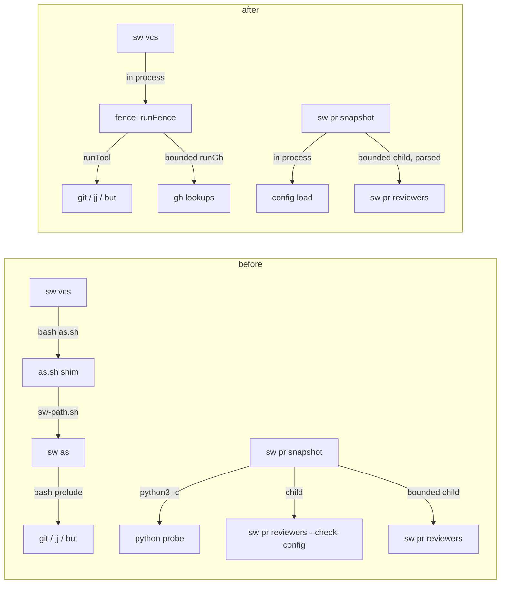
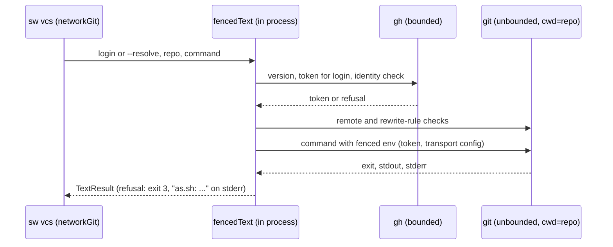

# Design

## Triage

| Trigger | Applies? | Evidence |
|---|---|---|
| T1 Components (new component, or 3+ with directed relationships) | yes | `sw vcs`, the fence, `sw pr snapshot`, the evaluator child and the shims have directed calls between them (`cli/lib/src/vcs/scripts.dart:128-166`, `cli/lib/src/pr/snapshot.dart:234-245`, `:492-500`). |
| T2 State (persistent state, caches, 3+ state machine) | no | No stored state changes. Watch claims and head records (`pr-script-runtime`) keep their format. |
| T3 Concurrency (background work, workers/isolates, async, retries) | yes | The evaluator stays a separately killable child under the poll deadline (`cli/lib/src/pr/snapshot.dart:486-500`), and the fence's gh lookups run bounded while the fenced command does not (`cli/lib/src/fence/fence.dart:436-438`). |
| T4 Boundaries (data format, migration, shared interface, IPC, external) | yes | The `pr-snapshot.sh` and `pr-reply.sh` shims gain an argument, the boundary between snapshot and evaluator changes from regex reads to parsing, and the allowlist becomes a registry that later changes edit. |
| T5 Volume (grows without a fixed bound) | no | No new collection. Existing bounds stay (Resource Bounds). |
| T6 Risk (security, money, data loss, unrecoverable user data) | yes | Identity: the fence's token scope, target-repository checks and refusals move from a child process into `sw vcs`'s own process. |

TIER: FULL

## Context

The proposal gives the why. The current state the approach needs:

- **Fence hop in `sw vcs`.** `fenceLogin` runs `as.sh --resolve` in the repo (`cli/lib/src/vcs/scripts.dart:128-153`), and `runAs` runs `as.sh <who> <command>` there (`:161-166`). Both go through `VcsScripts.run`, which starts `bash <scripts dir>/as.sh` through the framed tool transport and captures its output (`:52-53`, `:20-28`). The callers are `networkGit` (`cli/lib/src/vcs/git_common.dart:104-128`), `networkJj` (`cli/lib/src/vcs/jj_backend.dart:607-626`) and `fencedButPull` (`cli/lib/src/vcs/gitbutler_backend.dart:678-698`).
- **Error mapping.** On Git a failed `pull` whose message reports a non-fast-forward is first stopped as `not_fast_forward` with the stop's default exit status (`git_common.dart:118-119`). Otherwise Git and jj map an exit 3 of the fenced run on a GitHub remote to `fence_failed`, and any other failure to `git_network_error`, both with exit 3 (`git_common.dart:121-124`, `jj_backend.dart:617-624`). GitButler maps to `fence_failed` only when exit is 3 and the message starts with `as.sh:` (`gitbutler_backend.dart:686-689`). A resolve failure is `fence_failed` with the shim's stderr (`scripts.dart:140-147`).
- **The fence itself.** `runFence` checks the gh version, resolves or verifies the login, checks arguments, options and remotes, builds the fenced environment and calls a `launch` callback (`cli/lib/src/fence/fence.dart:536-574`). A refusal is a `FenceStop` whose message starts with `as.sh:` and whose code is 3 unless stated (`fence.dart:11-20`). `sw as` supplies bounded `gh` lookups (`runGh`), unbounded git checks and an inherited-stdio launch (`cli/lib/src/fence/as_command.dart:49-70`). The fenced command is unbounded (`fence.dart:436-438`).
- **Temporary hop C9.** `VcsScripts.fenceProject` adds `--project <code>` to both shim calls only when the workflow sets `branchFetchProject` (`scripts.dart:33-38`, `cli/lib/src/commands/vcs.dart:55-60`, `cli/lib/src/pr/workflow.dart:836-841`).
- **Native workflow fence.** `WorkflowTransport.fenced` already calls `verifyIdentity`, `checkArguments`, `checkOptions`, `checkRemotes` and `fencedEnvironment` in process, under an outer budget (`cli/lib/src/pr/workflow_transport.dart:56-146`).
- **Snapshot probe and config child.** `run` probes `python3`/`python` and stops with `no_python` (`cli/lib/src/pr/snapshot.dart:142-150`, `cli/lib/src/pr/context.dart:183-195`). The probe's only use is the limit line's interpreter name (`snapshot.dart:501-512`). The only `no_python` tests run the shims' own check with an empty `PATH`, before `sw` starts (`evals/pr-pair/test_pr_shims.py:90-99`); no test reaches the `sw`-side stop. The reviewer config is checked by a child `sw pr reviewers --check-config` whose stdout `logins` list is read by regex (`snapshot.dart:232-245`, `cli/lib/src/pr/reviewers.dart:92-101`).
- **C12 readers.** `text.dart` and `snapshot.dart` read the snapshot line and the evaluator's document with regexes (`cli/lib/src/pr/text.dart:4-7`, `:36-109`, `snapshot.dart:311`, `:500`, `:527`, `:571-581`, `:608-610`, `:629-635`).
- **Evaluator child.** `evaluate` runs `sw pr reviewers` through `ctx.bounded` under the poll environment (`snapshot.dart:486-516`), as ADR 0022 requires.
- **Shim discovery.** `pr-snapshot.sh` walks from cwd to the first `.git` entry and runs `sw-path.sh --code <proj>` after its own Python check (`skills/specwright-pr/scripts/pr-snapshot.sh:75-97`). `as.sh` already parses a leading `--project` (`skills/specwright-pr/scripts/as.sh:22-31`).
- **Process runners.** Processes start in `runFramed` (`cli/lib/src/vcs/tool_runner.dart:239-250`), the bounded runner (`cli/lib/src/process/bounded_run.dart:135`), the exec helper (`cli/lib/src/process/exec_helper.dart:148`), the inherited fence launch (`cli/lib/src/fence/exec_inherit.dart:64`) and `taskkill` (`cli/lib/src/process/windows_tree.dart:72`). Self-launches name `Platform.resolvedExecutable` (`bounded_run.dart:83`, `snapshot.dart:236`, `:493`).
- **Printed commands.** `sw vcs plan` and the cleanup plans print `vcs.sh` and `pr-pair.sh` commands as data (`cli/lib/src/vcs/plan.dart:29-44`, `cli/lib/src/pr/workflow.dart:1014-1030`).

## Decisions

### D1: Run the fence in process through `runFence` with a capturing launch

- **Choice:** Add `fencedText` in `cli/lib/src/fence/` beside `runFence`. It runs `runFence` in the target repository with the same `gh` (bounded `runGh`) and `git` (unbounded `runTool`) callbacks `sw as` uses. Its `launch` runs the command through `runTool` in the repo and keeps the output, and its `out`/`err` collect `--resolve`'s login and refusal text. It returns a `TextResult` with the exit status, stdout and stderr, so `networkGit`, `networkJj` and `fencedButPull` keep their mapping code unchanged. `fenceLogin` calls it with `--resolve`. `VcsScripts.run`, `runAs`'s shim path and `fenceProject` are removed, along with `VcsContext.branchFetchProject` and the workflow flag.
- **Rejected:** Reuse `WorkflowTransport.fenced` because it maps refusals to `PairStop` and owns an outer budget that `sw vcs` must not gain. Also rejected: launching `sw as` directly instead of `as.sh`, which keeps a self-launch the exit criterion forbids.
- **Reversal cost:** low
- **Important:** no. Internal to `sw`; outputs stay as they were (D2).
- **Chosen by:** agent

### D2: Keep today's exit-3 mapping

- **Choice:** A fence refusal produces exit 3 with the `as.sh:` message on stderr, as the shim did. Git's preceding `not_fast_forward` check for `pull` stays first and unchanged; past it, a GitHub-remote exit 3 stays `fence_failed` on Git and jj whether the fence refused or the command itself exited 3. GitButler keeps its `as.sh:` prefix test.
- **Rejected:** Split refusals from command exit 3 (`git_network_error`), because it changes an error code that callers may branch on, outside this retrofit.
- **Reversal cost:** low
- **Important:** yes, changes what users see if chosen otherwise.
- **Chosen by:** user, chose "Keep today's mapping".

### D3: Snapshot checks the reviewer config in process

- **Choice:** Expose the config load that `--check-config` uses (`reviewers.dart:96-101`) as a function that returns the logins or a config error message. Snapshot calls it before any gh call, prints the same `reviewers.py:`-prefixed line on a failure and exits 2. The non-UTF-8 config name copy (`snapshot.dart:109-137`) stays only where the evaluator child needs a path argument.
- **Rejected:** Keep the child and only parse its output, because that keeps a self-launch that bounds nothing: a config check runs no report pattern.
- **Reversal cost:** low
- **Important:** no
- **Chosen by:** agent

### D4: Snapshot parses the documents it reads (C12)

- **Choice:** Decode the snapshot line once per poll into a map and read `head_oid`, `recheck`, `fail_names`, `fail_run_ids`, `merge_state`, `ci_pending`, `complete`, `sig` and `attn` from it. Decode the evaluator's stdout the same way. `readFull` (`snapshot.dart:348-352`) decodes its output too and returns 1 when the document's `error` member is `not_found`, keeping its printed output and its exit-3 stop on a failed read; its regex-free check is tested with compact and spaced `not_found` documents. A line that does not parse fails that poll (exit 1 for a single snapshot). The printed snapshot stays the text the jq program and evaluator produced. `text.dart` keeps only the helpers with no JSON reading (`dropTrailingNewlines`, `paste`, `dateHeaderOf`, `firstLine`).
- **Rejected:** Keep the regexes and pin the compact form, because that is the C12 gap this change was assigned.
- **Reversal cost:** low
- **Important:** no
- **Chosen by:** agent

### D5: Fixed limit line, no probe

- **Choice:** Stated in S1. `run` drops the probe, `PrContext.python` is removed, and the evaluator's limit label is the constant `reviewers.py python3`.
- **Rejected:** See S1.
- **Reversal cost:** low
- **Important:** yes, changes what users see.
- **Chosen by:** user (S1)

### D6: `--project` on the snapshot and reply shims

- **Choice:** Copy `as.sh`'s rule into both shims: one optional leading `--project <dir>`, read after the shim's own Python check and before discovery. It replaces the cwd walk's start, and a missing, empty or repeated value is a usage error with the shim's usage status. It is never forwarded to `sw`. `specwright-pr` passes `--project <code toplevel>` on every store-started snapshot, `--full` read and reply. The S-1 and C11 notes in `specwright-pr` and `specwright-finish` are removed, and `architecture.md` drops the gaps.
- **Rejected:** Pass the project through the handoff records to `sw`, because the binary must be chosen before `sw` runs.
- **Reversal cost:** low
- **Important:** yes, changes what users see (S4).
- **Chosen by:** user (S4)

### D7: Allowlist test by source scan

- **Choice:** `cli/test/launch_sites_test.dart` holds a const allowlist keyed by file and runner symbol, with the call count and kind (`external tool`, `process helper`, `reviewer evaluator`, `binary check`). The runner symbols are the functions that start processes (`Process.start`, `Process.run`, `runFramed`, `runTool`, `runToolCapped`, `runText`, `runGh`, `runBoundedCommand`, `runFenced`, `PrContext.tool`/`bounded`, `WorkflowTransport.runner`). The test strips comments, counts calls per file, and fails on any difference. It checks that every function body that calls `Process.start` or `Process.run` is itself a listed runner, so the runner list is closed. Four further checks:
  - **Self-launch arguments.** Every `Platform.resolvedExecutable` must sit in a list literal that is a listed self-launch site, and the allowlist entry fixes the literal argument head that follows it: `'__exec'` for the process helper (`cli/lib/src/process/bounded_run.dart:83`), and `'pr', 'reviewers'` for the reviewer evaluator (`cli/lib/src/pr/snapshot.dart:492-500`). The evaluator entry also fixes its runner as `PrContext.bounded`, so moving it to the unbounded `PrContext.tool` fails. A self-launch whose list is not a literal, or whose head differs, fails even when every count still matches.
  - **Script names anywhere.** Every string literal under `cli/lib/src` that names a shipped script (`as.sh`, `vcs.sh`, `pr-pair.sh`, `pr-snapshot.sh`, `pr-reply.sh`, `review-run.sh`, `release.sh`, `sw-path.sh`, `finish.sh`) or ends in `.py` must sit at a listed non-launch site: a printed command (`cli/lib/src/vcs/plan.dart:29-44`, `cli/lib/src/pr/workflow.dart:1014-1030`, `:1064`, `cli/lib/src/finish/undo_plan.dart:202`), a message or label (`reviewers.py` in `cli/lib/src/pr/reviewers.dart:26` and `snapshot.dart:509`, `finish.sh` in `cli/lib/src/commands/finish.dart:14`), or the `as.sh` `$0` label of the fence prelude (`cli/lib/src/fence/exec_inherit.dart:66`), which names the prelude in its messages and starts no script. A script name built into a variable away from the launch is therefore caught where the literal is written, not where it is used.
  - **Script names in launch arguments.** A listed launch call's argument list holding such a literal, other than the `$0` label above, fails.
  - **Negative fixtures.** The scanner runs over in-memory sources as well as the tree: the evaluator's head changed to `'pr', 'snapshot'` with the same counts, the evaluator moved to `PrContext.tool`, a self-launch with a non-literal argument list, `as.sh` assigned to a variable in an unlisted file and passed to a listed `runTool` call, and an unlisted `Process.start` caller. Each must fail, naming the file and the reason.
- **Rejected:** An `analyzer`-based AST walk, because it adds a heavy dev dependency for a check that a token scan does at this code size.
- **Reversal cost:** low
- **Important:** no. Test-only; the location was S2.
- **Chosen by:** agent

### D8: Black-box evals build on the existing sentinel harness

- **Choice:** Extend `evals/pr-pair/test_workflow_transport.py`'s sentinel pattern (`:24-45`: recording scripts in a handoff scripts directory that log their name and exit 92, a probe that the sentinels record, and an assertion that the log stays absent) to a shared helper that writes recording `as.sh`, `vcs.sh`, `pr-pair.sh` and `sw-path.sh` sentinels and failing `python`/`python3` (exit 97, recording) first on `PATH`. New modules are `evals/vcs/test_sw_fence.py` (Git, jj, GitButler fetch, pull and push with and without `--login`; store without `VERSION`; refusal mapping; argument bytes; token scope; no deadline on the fenced command) and `evals/pr-pair/test_snapshot_native.py` (config check, evaluator, limit line, no Python, `--full` with compact and spaced `not_found`, `--project` shims). Each test is first run on `main` red, then green on the change.
- **Rejected:** Dart-only tests with injected callbacks, because the exit criterion asks for black-box evidence through the built binary on three CI platforms.
- **Reversal cost:** low
- **Important:** no
- **Chosen by:** agent

### D9: No new ADR

- **Choice:** ADR 0031 C1 already sets direct calls as the rule; the `native-cli` spec and the allowlist test enforce it. `openspec/architecture.md` is updated: C9, C11 and S-1 are closed, and C13 now belongs to `native-cli-retire-scripts`.
- **Rejected:** ADR 0034 listing the launch kinds, because it would restate the spec and add a second registry to keep in step.
- **Reversal cost:** low
- **Important:** yes, binds future changes.
- **Chosen by:** user, chose "No new ADR".

### Decision summary

| # | Decision | Choice | Rejected | Reversal cost | Important | Chosen by |
|---|---|---|---|---|---|---|
| S1 | Evaluator limit line | Fixed `reviewers.py python3` | `reviewers.py` alone; `sw pr` | low | yes | user |
| S2 | Allowlist location | Dart test in `cli/test` | Python eval | low | yes | user |
| S3 | Interpreter-absent evals | Now, for retrofitted paths | Leave to retire-scripts | low | yes | user |
| S4 | S-1 gap | `--project` on snapshot and reply shims | Defer | low | yes | user |
| S5 | C13 gap | Move to retire-scripts | New `sw vcs` check now | low | yes | user |
| S6 | C12 gap | Close here by parsing | Keep regexes | low | no | agent |
| S7 | Shell transport | Stays until `native-cli-launcher` | Replace here | low | no | agent |
| D1 | Fence entry for `sw vcs` | `runFence` with capturing launch | `WorkflowTransport.fenced`; launching `sw as` | low | no | agent |
| D2 | Exit-3 mapping | Keep today's | Split refusal from command exit 3 | low | yes | user |
| D3 | Config check | In process | Child plus parse | low | no | agent |
| D4 | C12 readers | Parse each line once, `readFull` included | Keep regexes | low | no | agent |
| D5 | Probe and limit line | Remove probe, constant label | See S1 | low | yes | user |
| D6 | Shim selector | Leading `--project`, skills pass it in stores | Handoff record | low | yes | user |
| D7 | Allowlist mechanism | Source scan with counts, kinds, self-launch argument heads and listed script-name sites | `analyzer` AST | low | no | agent |
| D8 | Black-box evals | Shared sentinel helper, two new modules | Dart-only | low | no | agent |
| D9 | ADR | None; architecture notes updated | ADR 0034 | low | yes | user |

## Assumptions

- **A1:** The snapshot line produced by `gh --jq` is one JSON object per poll that `jsonDecode` accepts. Not checked against live GitHub output; the jq program builds it with `tojson` semantics. Depends on it: D4.

## Carried constraints

- **C1:** `sw` starts its own binary only as the `__exec` helper and as the reviewer evaluator, and never a shipped script or Python, enforced by `cli/test/launch_sites_test.dart`. Kind: invariant. Destination: spec: specs/native-cli/spec.md → Requirement: sw starts itself only for its helper and the reviewer evaluator
- **C2:** A later change that adds a launch registers it in the allowlist with its kind; the test fails otherwise. Kind: invariant. Destination: spec: specs/native-cli/spec.md → Requirement: A launch-site allowlist guards process starts
- **C3:** The fence called from `sw vcs` keeps the fenced command unbounded and only the gh lookups bounded; refusals keep exit 3 and the `as.sh:` prefix that Git, jj and GitButler map to `fence_failed`. Kind: invariant. Destination: doc comment: cli/lib/src/fence/fence.dart fencedText
- **C4:** On Git and jj a fenced command's own exit 3 on a GitHub remote is still reported as `fence_failed` (D2). Kind: deliberate gap. Destination: doc comment: cli/lib/src/vcs/git_common.dart networkGit
- **C5:** The printed jj and GitButler undo guards still match the compact `"branch":"<name>"` until `native-cli-retire-scripts`. Kind: deliberate gap. Destination: spec: specs/native-cli/spec.md → Requirement: sw documents are compact JSON ending in one line feed
- **C6:** The reviewer evaluator stays a separate process killed at the poll deadline, because a Dart regex cannot be interrupted (ADR 0022). Kind: rejected alternative (in-process evaluation). Destination: doc comment: cli/lib/src/pr/snapshot.dart evaluate
- **C7:** External tools still start through the framed bash transport (`runFramed` with `vcsPrelude`), and fenced commands through the inherited bash fence prelude (`exec_inherit.dart`, `fencedPrelude`); both stay until `native-cli-launcher` replaces them (S7). Kind: deliberate gap. Destination: doc comment: cli/lib/src/vcs/tool_runner.dart runFramed

<!-- ===== LIGHT tier ends here. ===== -->

## Diagrams (FULL)

Launch graph before and after (T1, T4):

Fenced network call in `sw vcs` (T3, T6):

## State & Ownership (FULL)

| State | Owner (sole writer) | Lifetime | Invalidation / rebuild | Authoritative copy |
|---|---|---|---|---|
| Fenced environment with the token | `fencedText`, per call | One command | Discarded after the call; never stored in `sw vcs`'s own environment | The verified gh lookup |
| Parsed snapshot map | `Snapshot.poll`, per poll | One poll | Rebuilt from the next poll's line | The printed snapshot line |
| Launch allowlist | `cli/test/launch_sites_test.dart` | Repository | Edited by the change that adds or removes a launch | The test file |

## Failure & Visibility (FULL)

| Component | Fails / dies mid-operation → | Recovery | Retry safe? | Who finds out |
|---|---|---|---|---|
| Fence lookup (gh) | Hangs or fails: refusal, exit 3 | Rerun after fixing gh login | Yes, nothing ran | User: `fence_failed` document with the fence message |
| Fenced command | Fails: mapped as before (D2) | As before | As before | User: the document |
| Config check in process | Bad file: exit 2, `reviewers.py:` line | Fix the config | Yes | User: stderr |
| Evaluator child | Deadline: killed, limit line, poll fails | Next poll | Yes | User and watch: limit line, exit 1 |
| Snapshot line that does not parse | Poll fails | Next poll | Yes | User: exit 1; the watch keeps the last good snapshot |
| Allowlist test | Unlisted launch | Register it or remove it | n/a | Developer: CI failure naming the file |

## Resource Bounds (FULL)

| Queue / buffer / cache / transfer | Bound | At the bound | Timeout | At 10x / 100x |
|---|---|---|---|---|
| Fence gh lookups | 32 MiB per stream (`resolveLimits`) | Refusal, exit 3 | 120 s default | Unchanged per call |
| Fenced git/jj command output | Unbounded, as through the shim | n/a | None (C3) | Fetch and push output is small; the shim kept it in memory the same way |
| `but pull --json` through the fence | Unbounded, as through the shim | n/a | None | Same as before; the plain non-GitHub path is unbounded too (`runTool`, `gitbutler_backend.dart:670-674`) and stays so |
| Evaluator child | 32 MiB per stream | Limit line, poll fails | Poll deadline | Unchanged |
| Parsed snapshot line | Already held as text | n/a | n/a | One extra map per poll |

## Flow & State Gaps (FULL)

- **Concurrent gh account switch:** the fence verifies the token for the named login and passes it only in the per-call environment, so a switch during the call does not redirect it, as before.
- **Store without `VERSION`:** `sw vcs` was resolved from `--code`, and no shim runs inside the store anymore, so nothing resolves there.
- **Fenced command interrupted:** same as before: no Specwright state is written around a fetch, pull or push.
- **Stale sentinel log in evals:** each test uses its own temp directory.

## Mechanism Ledger (FULL)

| Mechanism | Built? | Why (harm nobody catches / expensive later) | Evidence that would change the call |
|---|---|---|---|
| Outer deadline on `sw vcs` fenced commands | No | Spec forbids a new deadline | A hung fetch reported by a user |
| Distinct error code for command exit 3 | No | D2 | A caller misled by `fence_failed` |
| Allowlist closure check (every `Process.*` caller listed as runner) | Yes | Without it a new runner escapes the list | n/a |
| Fallback to `as.sh` when the in-process fence fails | No | A fallback would reintroduce the hop and bypass the test | n/a |

## Risks / Trade-offs

- [The in-process fence diverges from `sw as` over time] → Both call the same `runFence`. Only the launch callback differs.
- [A source-scan allowlist misses a launch hidden behind an alias] → The closure check plus the black-box sentinel evals catch launches the scan misses.
- [Parsing the snapshot line rejects output the regexes tolerated] → A failed parse fails only that poll, and the watch keeps the last good snapshot. The evals feed spaced and compact forms.

## ADRs

- **In force, constraining this change:** 0022 (evaluator under the poll deadline), 0027 (one binary, `__exec` helper), 0028 (shims), 0029 (fence handoff file, still used by `as.sh`), 0031 (direct calls, `--project`, C9, C11, S-1), 0033 (focused libraries; no new dependency here).
- **To record during apply:** none (D9). `openspec/architecture.md` is updated in the same task as the skills' notes.
